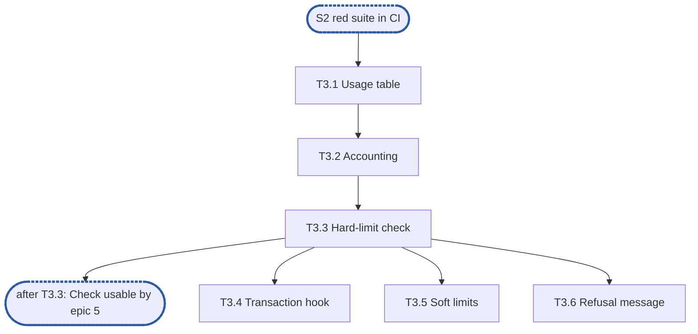

<!--
Example for the epic-breakdown skill. RFC 90, its quota component and every name below are
invented: the document shows the shape, the depth and the fixed lines an epic document has.
Do not copy its content.
-->

# Epic 3: quota v2 usage index and limit checks

**Sources:** [RFC 90](../rfcs/rfc-90-quota.md) §3.1–§3.4 and §6.2;
[RFC 16](../rfcs/rfc-16-metadata-store.md) §4.3, for the transaction hook only.
**Track:** B.
**Epic 3 estimate: 6 subtasks, 11.25 man-days.**
**Depends on:** sync point **S2, red suite in CI**: epic 1's `quotav2.Checker` interface
and error set, and epic 2's injected clock and reference model.
**Blocks:** epic 5, which calls `Check` on every write, and epic 6, which rebuilds the
usage index at start.

---

## 1. Goal

Epic 3 gives the quota component its in-memory usage index and the checks that refuse a
write over a limit. It is pure logic over the metadata store's transaction hook: no I/O of
its own.

**At the end of the epic:**

- usage per (share, principal) equals a recomputed walk after every operation of a random
  sequence;
- a write that would cross a hard limit is refused before any byte is stored;
- a soft-limit crossing is reported once per grace period;
- `Check` costs O(1) and takes no lock shared by every principal.

### 1.1 In scope

Usage accounting for create, extend, truncate, remove and chown; hard and soft limits;
the refusal error; the memory bound per entry.

### 1.2 Out of scope

- Rebuilding the index at start (RFC 90 §3.5): epic 6.
- The API and CLI that set limits (RFC 90 §5): epic 7.
- Group quotas (RFC 90 §3.6): deferred by the RFC.

### 1.3 Names used here

- **E1**, epic 1, interfaces: the public surface, including `quotav2.Checker` and the error
  set.
- **E2**, epic 2, red e2e suite and test foundations: the registered suite with every test
  listed as a known failure, the injected clock and the reference model.
- **S1**, interfaces frozen: E1's exported surface no longer changes.
- **S2**, red suite in CI: E2's suite runs in CI from every pull request.
- **The integration epic**, epic 7: wires quota v2 into the node, including the API and
  CLI that set limits.

## 2. How the general rules apply

The rules are those of [the quota plan's §1.5](rfc-90-quota-plan.md#15-general-rules-for-each-epic),
cited by number and title and not copied.

| Rule | Subtasks | How |
| --- | --- | --- |
| rule 1, independent unit tests ([`CLAUDE.md`, "Writing tests"](../../../CLAUDE.md#writing-tests)) | all | each subtask's tests use the reference model, the injected clock (kind 1), a fault-injection wrapper around the memory store (kind 3, T3.4) and the landed epics they depend on |
| rule 2, fuzz tests where relevant | none | no parser: the index reads only values the store already decoded |
| rule 3, observability follows RFC 25 | T3.1, T3.3, T3.5 | `Deps.Metrics` and `Deps.Logger` taken in T3.1; `quota_refusals_total` and `quota_soft_crossings_total` resolved at construction and recorded with an atomic add. No span: `Check` runs inside the VFS's service span, and its wait on a shard lock is too short to be a span event |
| … | | |

## 3. Requirements and invariants

Every MUST and MUST NOT that RFC 90 and RFC 16 place on this epic, numbered so that
subtasks and tests can cite them.

**Accounting and limits**

| # | Requirement | Kind | Source | Subtasks |
| --- | --- | --- | --- | --- |
| R1 | Usage per (share, principal) equals the sum of the sizes of the files it owns, after every operation | MUST | RFC 90 §3.1 | T3.2 |
| R2 | A write the check admitted never takes usage over the hard limit | MUST NOT | §3.2 | T3.3 |
| R3 | The check and the usage update happen in the same metadata transaction | MUST | §3.2, RFC 16 §4.3 | T3.4 |
| R4 | Usage never goes negative; an underflow is reported as corruption, never clamped | invariant | §3.1 | T3.2 |
| R5 | A chown moves the file's bytes from the old owner to the new one in one step | MUST | §3.3 | T3.4 |
| R6 | A soft-limit crossing is reported once per grace period, not once per write | SHOULD | §3.4 | T3.5 |
| R7 | A refused write returns `ErrQuotaExceeded`, naming the limit and the principal | MUST | §3.2 | T3.3, T3.6 |

**Cost and concurrency**

| # | Requirement | Kind | Source | Subtasks |
| --- | --- | --- | --- | --- |
| R8 | A check costs O(1) | bound | §6.2 | T3.1, T3.3 |
| R9 | Checks never serialise on a lock shared by every principal | MUST NOT | §6.2 | T3.1 |
| R10 | At most 64 bytes per (share, principal) entry at 10⁶ entries | bound | §6.2 | T3.1 |

## 4. Decisions this epic takes

- **D1, lock sharding.** RFC 90 §6.2 forbids a lock shared by every principal but does not
  say what replaces it. The index uses 256 shards keyed by a hash of the principal, which
  meets R9. A `ponytail:` marker at the shard table names the performance ceiling the RFC
  allows: two hot principals in one shard still contend; move to per-entry locks if a
  profile shows it. Prior art: lock striping over a fixed shard count, as Java's
  `ConcurrentHashMap` did before Java 8 (from memory).
- **D2, soft-limit clock.** The grace period runs on the injected clock, so tests drive it.
  A `decision:` marker says a restart resets it, because RFC 90 does not persist it, and
  that it should be withdrawn if RFC 90 starts persisting the grace period, or if restarts
  ever let a principal stay over its soft limit unreported for longer than one period.
  Prior art: Linux disk quotas keep the grace expiry in the quota file, so it survives a
  restart (from memory); RFC 90 chooses not to.

## 5. Target tree

```text
pkg/quotav2/internal/usage/
  table.go        T3.1  sharded usage table
  account.go      T3.2  create, extend, truncate, remove
  check.go        T3.3  hard-limit check
  hook.go         T3.4  transaction hook and chown
  soft.go         T3.5  soft limits and grace
```

## 6. Subtasks

### T3.1 Usage table and lock sharding

**Subtask T3.1 estimate: 1.5 man-days.**

- **Track:** B. **Depends on:** S2.
- **Covers:** R8, R9, R10.
- **Deliverables:** `table.go`: `Table`, `Get`, `Add`, 256 shards (D1); `New(Deps)` taking
  the logger and metrics registry RFC 25 §8 provides. Consumed by T3.2 and T3.3.
- **Acceptance criteria:**
  - `Get` and `Add` cost O(1) and allocate nothing.
  - Readers and writers of principals in different shards run in parallel.
- **Tests:** at `Table`'s API, which T3.2 and T3.3 call: a test that holds one principal's
  shard lock through a test hook and checks that `Add` for a principal in another shard still
  returns (catches a global lock, which would block it); the `-race` run with writers on 64 principals (catches a data race); a
  memory check at 10⁶ entries that fails when one field is added (catches R10). No test
  double: the hook is set per instance from `export_test.go`.

### T3.2 Usage accounting

**Subtask T3.2 estimate: 2.5 man-days.**

- **Track:** B. **Depends on:** T3.1.
- **Covers:** R1, R4.
- **Deliverables:** `account.go`: one function per operation that changes a file's size
  or existence. Consumed by T3.4's hook.
- **Acceptance criteria:**
  - Usage equals a walk of epic 2's reference model after every step.
  - An underflow returns `ErrCorrupt` and leaves usage unchanged.
- **Tests:** at the accounting functions T3.4's hook calls: a property test of random
  create, extend, truncate and remove against the model (catches an operation that miscounts,
  R1); a truncate below zero (catches a clamp, R4). No test double: the reference model is an
  oracle the result is compared with.

### T3.3 Hard-limit check

**Subtask T3.3 estimate: 2 man-days.**

- **Track:** B. **Depends on:** T3.2.
- **Covers:** R2, R7, R8.
- **Deliverables:** `check.go`: `Check(share, principal, delta) error`; the
  `quota_refusals_total` counter. Consumed by T3.4 and T3.5, and by epic 5's write path.
- **Acceptance criteria:**
  - A write exactly at the limit passes; one byte over is refused.
  - The error names the limit and the principal.
- **Tests:** at `Check`, which epic 5's write path calls: the at-limit and over-limit cases
  (catch an off-by-one); comparisons per check at most constant from 10³ to 10⁶ entries
  (catch a scan). No test double.

### T3.4 Transaction hook and chown

**Subtask T3.4 estimate: 3 man-days.**

- **Track:** B. **Depends on:** T3.3.
- **Covers:** R3, R5.
- **Deliverables:** `hook.go`: the RFC 16 §4.3 pre-commit hook; chown as one move. Consumed
  by the integration epic, which installs the hook. A fault-injection wrapper around the
  memory store that aborts a transaction on cue: kind 3, consumed by this subtask's test,
  verified by running the memory store's conformance suite through it with no cue set.
- **Acceptance criteria:**
  - A transaction that aborts after the check leaves usage untouched.
  - No reader sees a chown's bytes counted twice or not at all.
- **Tests:** at the hook, over the memory store: an abort after the check, injected by a
  fault-injection wrapper around the memory store (kind 3 of CLAUDE.md "Writing tests")
  (catches usage updated outside the transaction, R3); a `-race` test that reads both owners'
  usage during chowns and checks the sum never changes (catches a chown applied as two updates, R5).

### T3.5 Soft limits and grace

**Subtask T3.5 estimate: 2 man-days.**

- **Track:** B. **Depends on:** T3.3.
- **Covers:** R6.
- **Deliverables:** `soft.go`: soft limit, grace timer on the injected clock (D2), the
  `quota_soft_crossings_total` counter. Consumed by epic 5, which reports crossings.
- **Acceptance criteria:**
  - A thousand writes over the soft limit inside one grace period report one crossing.
- **Tests:** at the crossing report epic 5 consumes: writes over the soft limit across two
  grace periods, driven by the injected clock (kind 1), report two crossings (catches a
  crossing reported per write, or a grace period that never restarts, R6).

### T3.6 Refusal message and limits table

**Subtask T3.6 estimate: 0.25 man-days.**

- **Track:** B. **Depends on:** T3.3.
- **Covers:** R7.
- **Deliverables:** the wording of `ErrQuotaExceeded`, and the limits table in the
  package doc. Consumed by T3.3's refusal.
- **Acceptance criteria:**
  - The message matches RFC 90 §3.2's example.
- **Tests:** at T3.3's refusal, where the message is read: the existing T3.3 test asserts
  the message (catches a reworded refusal). No test double.

## 7. Order of work



Checkpoint after T3.3: epic 5 can start calling `Check` against the in-memory index.

## 8. Suggested pull requests

| PR | Subtasks | Man-days | After | Why together |
| --- | --- | --- | --- | --- |
| 1 | T3.1, T3.2 | 4 | — | the usage index, correct and fast, with nothing calling it yet |
| 2 | T3.3, T3.4, T3.5, T3.6 | 7.25 | PR 1 | the checks, end to end through the transaction hook |

A suggestion only: one pull request per subtask works as well.

## 9. Open points

- RFC 90 §3.3 does not say whether a chown across shares moves usage between shares. This
  epic assumes it does not (a chown never crosses shares); confirm with the RFC's author.
