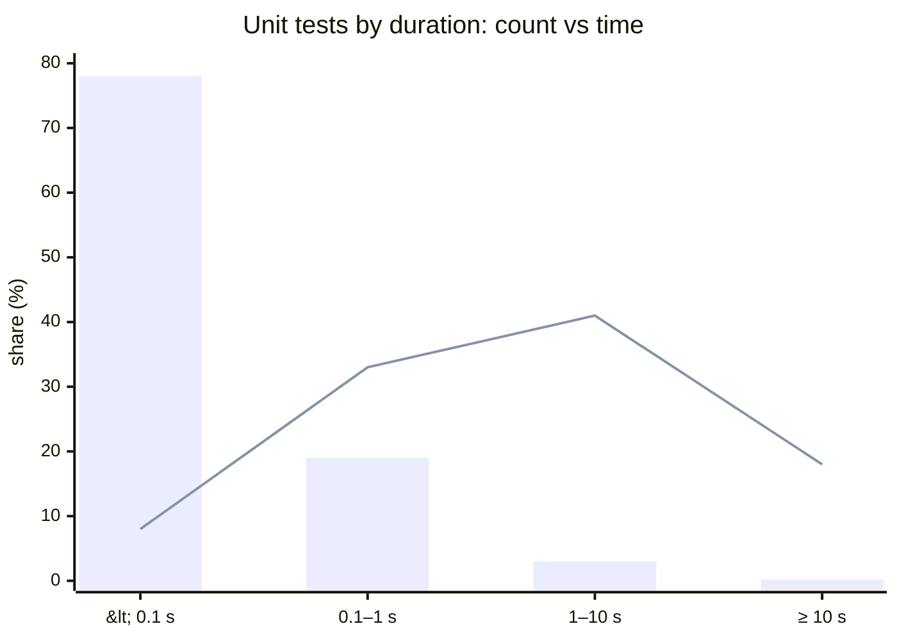
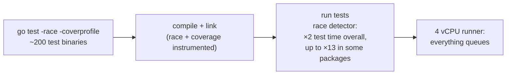
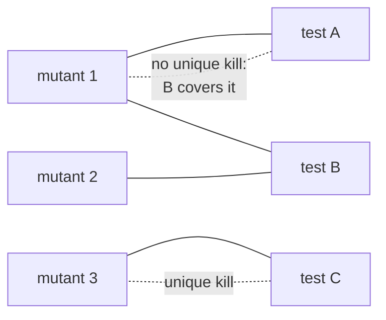

# Plan: a faster and leaner unit test suite

Status: proposal for team discussion · Base: `feat/storage-v2` at `6af2141c6` · 2026-11-24

## TL;DR

We asked two questions: *are we running too many unit tests?* and *are they why CI is slow?*
We measured on an idle machine and ran mutation testing on one package. The answers:

1. **The number of tests is not why CI is slow.** 78% of our unit tests finish in under
   0.1 s, and together they cost 99 s. The suite is **CPU-bound**: on 4 dedicated cores the
   **race detector doubles the test time**, and the build is small. Without `-race`, coverage
   costs nothing we can measure; the atomic mode CI uses is unmeasured. CI is 2–3× slower
   than our 4-core run, and that gap is not explained (§1.2).
2. **Some tests are duplicated, but not in the way a count suggests.** Mutation testing shows
   that many tests overlap. Most of the overlap is *one rule written as several tests*, which
   we can merge. Very few tests are useless.
3. **Mutation testing is a good tool for review, not a gate.** It finds real gaps (39 surviving
   mutants in one package, some of them equivalent) and gives a reviewer a concrete question for every new test.

**What we ask the team to decide** (details in §6):

| # | Decision | Effort |
| --- | --- | --- |
| 1 | Split the unit job into 3–4 parallel jobs (shards) | dt change + workflow |
| 2 | Use a cheap Argon2 cost in tests, with a guard that production keeps the real one | 1 PR |
| 3 | Type-check the export tests from export data, and run single-goroutine oracle tests without `-race` | 1–2 PRs |
| 4 | One trial PR that merges duplicate tests and fills gaps in `pkg/journal/internal/format` | 1 PR |
| 5 | Add one rule to CLAUDE.md "Writing tests" | 1 PR |
| 6 | Set a target time for the unit job | — |

---

## 1. Where the time goes

### 1.1 Many tests, little time

The unit suite (`go test -race -short`, as CI runs it on a PR) on a dedicated, idle 32-core
machine:



*Bars: share of tests. Line: share of test time.*

| Test duration | Tests | Time | Share of time |
| --- | --- | --- | --- |
| under 0.1 s | 5,563 | 99 s | 8% |
| 0.1 – 1 s | 1,341 | 417 s | 33% |
| 1 – 10 s | 226 | 524 s | 41% |
| 10 s or more | 12 | 230 s | 18% |

Deleting half of the fast tests would save about 50 seconds of CPU. That is not a lever.

The 12 slowest tests are mostly the architecture "export freeze" tests
(`TestBootstrapExports` 35 s, `TestSecretsExports` 27 s, `TestSettingsExports` 23 s), one
large-N test (`TestStartPostsTenThousandRemovalsAndRunsNoBatchBeforeItReturns`, 30 s) and
a crash-replay test (`TestCrashAfterEachWriteThenRerun`, 19 s).

> **Measure on an idle machine.** A first run on a busy laptop (load ≈ 160) reported 279
> tests over 10 s and blamed Argon2 for 30% of the suite. That was the load, not the tests.

### 1.2 Why CI takes 20 minutes

The same suite takes **175 s** on 32 idle cores and **15–21 min** in the "Run the suite"
step on CI. The CI runner is `ubuntu-latest`, which has **4 vCPU** for a public repository.



On 4 cores the time splits like this (measured on the VM, pinned to 4 cores with `taskset`):

| Variant | Wall time |
| --- | --- |
| As CI runs it (`-race -coverprofile`), cold build cache ¹ | 760 s |
| Same, warm build cache | 386 s |
| Compile and link only (`-run=^$`), cold | 136 s |
| Without `-race`, cold | 267 s |
| Without `-race` and without coverage, cold | 259 s |

Every variant used `-count=1`, so no run reused cached test results.

¹ This run had a busier machine beside it, so it is slower than the others, and we do not
compare against it. The other four ran together as one batch, with the same load.

CI's suite step takes 884–1,260 s, which is 2.3–3.3× the clean warm run (386 s). We did not
profile the CI runner, so this gap is not explained. A shared cloud vCPU slower than a
dedicated core would explain part of it, but that is a guess. (A comment in
`.github/workflows/tests.yml` says the suite reaches 32 min; the recent runs we read took
15–21 min.)

Compared within the same batch:

- **The race detector doubles test time.** The sum of package times is 1,380 s with `-race`
  and 710 s without. Under heavier load the factor was 3.
- **Coverage costs nothing we can measure without `-race`** (710 s against 703 s). CI runs
  coverage under `-race`, where `go test` uses `-covermode=atomic`. We did not measure that
  pair.
- **The build is small:** 136 s cold, and the job already restores a build cache.

The race cost is concentrated in a few packages (package time, both columns from the clean
batch: the warm `-race` run against the no-race run):

| Package | With `-race` | Without | Factor |
| --- | --- | --- | --- |
| `pkg/journal/internal/index` | 163 s | 12 s | ×13 |
| `pkg/journal/journaltest/model` | 20 s | 2 s | ×9 |
| `pkg/openstate` | 30 s | 5 s | ×6 |
| `internal/identity` | 166 s | 90 s | ×1.8 |
| all packages | 1,380 s | 710 s | ×1.9 |

A package with a high factor and tests that run in one goroutine (an oracle or a model
check, for example) pays for race detection it cannot use.

### 1.3 The heavy packages: Argon2 and the race detector

CPU profiles of the slowest packages (`go test -race -cpuprofile`, idle machine):

| Package | Wall | In Argon2 | In the race detector |
| --- | --- | --- | --- |
| `internal/identity` (slowest package) | 127 s | 41% | 50% |
| `internal/install` | 23 s | 37% | ~48% |
| `pkg/secrets` | 29 s | 29% | ~45% |

Tests hash passwords with the production Argon2 cost: 19 MiB of memory and 2 passes
(`pkg/identity/hashes.go`). Under the race detector, each hash is very expensive.

The race detector's share in `internal/identity` has no Go caller in the profile. It runs on
a runtime system thread. We thought it was the detector's work on Argon2's 19 MiB
allocations, but the 4-core runs refute it: `internal/identity` is only 1.8× slower under
`-race`, below the average. Argon2 matters for another reason: without `-race`,
`internal/identity` is still the slowest package (90 s), so it sets a floor for any shard.

---

## 2. Where the duplication is

### 2.1 How we measured it

**Mutation testing** changes one operator in the production code (a *mutant*), for example
`<` into `<=`, and runs the tests. If a test fails, the test *kills* the mutant. If no test
fails, the mutant *survives*: some behaviour has no test.

We used the 5 operator types that the Go tool `gremlins` enables by default: arithmetic,
boundary (`<` ↔ `<=`), negation (`==` ↔ `!=`), `++` ↔ `--`, and inverted negatives. A small
driver ran the **whole package once per mutant** and recorded **every test that failed**.
This gives a matrix: which test kills which mutant. `gremlins` itself reports only a total.

From the matrix we can see, for each test, whether it kills a mutant that **no other test**
kills. If it does not, the test overlaps with others.



### 2.2 Result for `pkg/journal/internal/format`

| | Value |
| --- | --- |
| Tests (92 `Test` + 7 `Fuzz`) | 99 |
| Mutants | 335 |
| Mutation score (killed / covered and viable) ² | 88% (290 of 329) |
| Surviving mutants (gaps) | 39 |
| Tests that kill no mutant | 10 |
| Tests whose every kill another test also makes | 78 |
| Tests with at least one unique kill | 11 |
| Smallest set found that keeps every kill (greedy) | 19 of 99 |

² 6 mutants are outside the 329: 5 do not compile and 1 is on a line no test covers. The 3
mutants that hung count as kills, credited to the test that hung.

### 2.3 How to read it: three kinds of "extra" test

**1. One rule written as several tests: merge them.** Six tests check the same contract:
"`AppendX` appends after what is already in the buffer, and does not overwrite it".

```go
// Today: six tests like this one, in five files.
func TestAppendSealMarkerAppendsToDst(t *testing.T) {
	prefix := []byte{0xee, 0xbe, 0xef}
	golden := readGolden(t, "seal")
	if got := AppendSealMarker(slices.Clone(prefix), testIdentity, testSealMarker); !bytes.Equal(got, append(slices.Clone(prefix), golden...)) {
		t.Errorf("AppendSealMarker with a prefix =\n% x\nwant the prefix then the golden file\n% x", got, append(prefix, golden...))
	}
}

// Proposed: one table, one case per encoder, each case named in the failure.
func TestAppendersAppendToDst(t *testing.T) {
	for _, c := range []struct {
		name   string
		golden string
		append func([]byte) []byte
	}{
		{"seal marker", "seal", func(b []byte) []byte { return AppendSealMarker(b, testIdentity, testSealMarker) }},
		{"segment header", "segheader_pred", func(b []byte) []byte { return AppendSegmentHeader(b, testSegmentHeader) }},
		// … format file, record, catalog entry, trailer
	} {
		t.Run(c.name, func(t *testing.T) { /* same check as today */ })
	}
}
```

The six tests kill mutants (`TestAppendRecordAppendsToDst` kills 25), but none of those
kills is unique: the golden-file tests catch the same changes. Their own value is the
append contract, and one table checks it as well as six tests do.

**2. Tests the operators cannot judge: keep them.** A test that "kills no mutant" is not
useless. In `format`, 10 tests kill none, and they check things that no `<`/`+`/`==` change
can break:

- the RFC 3720 CRC test vectors (`TestCRC32CMatchesTheRFC3720Vectors`);
- the golden names of the record kinds (`TestRecordGoldenKindNames`);
- that error classes stay distinct (`TestRecordErrorClassesAreDistinct`);
- that segment names sort as their IDs do (`TestSegmentNameSortsAsItsIdDoes`).

These tests pin data and contracts, not arithmetic. A reviewer keeps them.

**The 78 tests with no unique kill are where real duplication may hide.** Each one needs a
person to read it and name the test that covers it, as §4.2 describes. The greedy cover of
19 tests says that at most 19 tests are needed to kill all 290 mutants. It is not a target, because those
19 do not check the contracts above.

**3. Gaps: write the missing test.** A surviving mutant is a behaviour no test checks. For
example, in `formatfile.go:55`:

```go
// A later version may have another size, so its length and checksum
// are never judged by version 1's rules.
if len(b) < 6 {                        // mutant: "<" → "<=" survives
	return f, fmt.Errorf("%w: %d bytes, no version to read", ErrDamaged, len(b))
}
```

No test decodes a format file of exactly 6 bytes, the shortest one that names a version, so
nothing pins that boundary. Some survivors
are *equivalent mutants*, which no test can kill. For example, `catalog.go:127` guards a
footer of more than `72 × MaxUint32` bytes, which no test can build. A reviewer marks those
as equivalent and moves on.

### 2.4 Concurrent packages need a different reading

We also started `pkg/journal/internal/segment` (360 tests, 737 mutants). After 215 mutants,
**25% of them made the tests hang**, not fail. The first version of the driver could not say
which test caught a hang, so we stopped the run and do not report its numbers.

This is expected. `segment` is about ordering and concurrency, and the 5 operators do not
reach those properties. The matrix is reliable for packages like `format` (pure encoding and
decoding), and not yet for concurrent ones.

---

## 3. What published practice says

- **Ratios are a first guess, not a target.** Google suggests about 70/20/10
  unit/integration/end-to-end ([Google Testing Blog, 2015][g1]), and later about 80/15/5
  ([Software Engineering at Google, ch. 11][swe11]).
- **Coverage is a weak measure. Mutation is a stronger one.** With suite size held equal,
  coverage correlates only weakly with finding faults ([Inozemtseva & Holmes, 2014][ih]).
  Google shows surviving mutants on the *changed lines* in code review, with no score
  threshold ([Petrović et al., 2018][gm]).
- **Reduce a suite by killed mutants, not by coverage.** Reduction by coverage loses fault
  detection ([Shi et al., 2014][shi]).
- **Tests that mirror the implementation make code rigid** and catch few bugs
  ([Change-detector tests][cd]).
- **Fast CI runs fewer tests per change, not fewer tests.** Meta's predictive selection
  halves the cost and still catches 99.9% of faulty changes ([Machalica et al., 2019][meta]).

[g1]: https://testing.googleblog.com/2015/04/just-say-no-to-more-end-to-end-tests.html
[swe11]: https://abseil.io/resources/swe-book/html/ch11.html
[ih]: https://www.cs.ubc.ca/~rtholmes/papers/icse_2014_inozemtseva.pdf
[gm]: https://research.google/pubs/state-of-mutation-testing-at-google/
[shi]: https://mir.cs.illinois.edu/awshi2/publications/FSE2014.pdf
[cd]: https://testing.googleblog.com/2015/01/testing-on-toilet-change-detector-tests.html
[meta]: https://arxiv.org/abs/1810.05286

---

## 4. Proposal

### 4.1 Track A: make CI faster

| Step | Change | Gain | Gate |
| --- | --- | --- | --- |
| A1 | **Shard the unit job.** | suite step ÷ ~2 on full runs | none |
| A2 | **Cheap Argon2 cost in tests.** | a few % of CPU; not `internal/identity` (see A2) | none |
| A3 | **Export tests from compiled export data.** | most of ~85 s of race test time | none |
| A4 | **Single-goroutine heavy tests without `-race`.** | up to ~11% of race test time, mostly `index` | read each test first |

**A1 — shard the unit job.** `dt` already has `shards:`, but it splits a list of named tests,
and the unit cell has package patterns instead. The split must happen in `dt run`, after
`--changed` has narrowed the packages: the cell carries only "shard *i* of *n*", and `dt run`
divides the `go list` result. A package list written into `suites.yaml` would go stale.

What the change must also do:

- **An RFC 29 amendment first.** RFC 29's `shards` splits a cell's `tests` (§4.1, the
  registry), so sharding by package changes the harness spec. Amend the RFC before the `dt`
  change.

- **No package falls out.** A test asserts that the union of the shards equals `go list` of
  the unit patterns.
- **Required check.** "Unit Tests (1.26.x)" is a required check. Either the ruleset moves to
  the shard names, or a small fan-in job keeps the old name.
- **No empty shard.** After `--changed`, a shard can get no packages, and a cell with no
  tests listed runs the whole suite (`test/harness/plan/plan.go`). Drop empty shards, and
  cover that case in the union test.
- **Fan-in.** A fan-in job that keeps the old name requires `success` from every shard. A
  skipped or cancelled shard does not count as a pass.
- **Coverage.** Each shard uploads its own profile, and Codecov merges them per commit.
- **Limits.**
  - Sharding helps full runs (merge queue, pushes to the branch) most. A PR already runs
    only the changed packages (`--changed`).
  - Each shard repeats the fixed setup (checkout, cache restore, building `dt`), and the
    extra cells (`journal-index`, `adapter-allocs`, `whole-tree`, the cgo vet) still run
    after the suite. ÷2 on the suite step is a realistic target, not ÷3.
  - The slowest package, `internal/identity`, sets a floor for any shard, and A2 does not
    lower it (see A2).
  - More jobs wait longer in the runner queue, so measure the queue time after A1.

**A2 — cheap Argon2 cost in tests.** Follow the pattern `pkg/keyprovider` already uses:
`GenerateWeakKeyFile` is a cheap variant, and an architecture rule
(`internal/node/arch_test.go`) fails if production code calls it.

- Add a weak variant beside `identity.NewHashes`, used only by test helpers
  (`internal/node/nodetest`), and add it to the same architecture rule.
- A stored hash carries its own parameters (`$argon2id$v=..$m=..,t=..,p=..`), and
  verification reads them back. So a cheap hash also verifies cheaply, and nothing else
  changes.
- The guard test for the production cost already exists (`pkg/identity/hashes_test.go`,
  `phcPrefix`, and `internal/identity/account_test.go`).
- The real risk is a knob. The weak-key rule matches a called function name, and it exempts
  packages whose name ends in `test`. A config field, an option or an environment variable
  would get past it. So the weak variant is reachable **only by a direct call from test
  code**, never through configuration.
- **What A2 does not reach.** `internal/identity`'s own tests hash at production cost
  directly (`pid.NewHashes`, six calls, two of them in the `withPassword` and `withNTHash`
  helpers that run once per seeded user), and every `identity.New` computes the dummy hash
  below at production cost. So A2 lowers `internal/install`, `pkg/secrets` and the node
  tests, but `internal/identity` stays near its floor. Its tests could call a weak variant
  directly; the dummy hash stays.
- **Do not touch** the dummy hash in `internal/identity/server.go`. It makes a sign-in for an
  unknown user take as long as one for a real user, so its cost must always follow the real
  one.

**A3 — export tests from compiled export data.** The three slowest export tests
(`TestBootstrapExports`, `TestSecretsExports`, `TestSettingsExports`) type-check whole
packages from source (`importer.ForCompiler(…, "source", nil)`, for example in
`pkg/bootstrap/arch_test.go`). #5473 moved `TestImportRules` to compiled export data. #5465
records it at 4 min 50 s on CI before, and 6.4 s in a local run with `-race` after. The same switch makes these three cheap
in every run, with or without `-race`, so they need no skip and no new cell.

**A4 — single-goroutine heavy tests without `-race`.** The race cost sits in a few packages
(§1.2). Some of their slow tests are oracle or model checks that run in one goroutine, such
as `TestSegmentBytesMatchWalk` (60,000 steps against an oracle). Such a test skips under
`-race` (the `prof.RaceEnabled` check, with a `decision:` marker).

- **Pair every skip with a run.** `test/suites.yaml` already states the rule for
  `journal-conformance-norace`: "a name reaching only -skip would silently lose its
  enforcement". A check that every test skipping under `-race` runs in some non-race cell
  belongs in the same change.
- `pkg/journal/internal/index` already has a non-race run (`unit/journal-index` runs the
  whole package), so its oracle tests need only the skip.
- Read each test first. A test keeps `-race` if it, **or the code it calls**, starts
  goroutines, or if it is a `t.Parallel()` test sharing state. `pkg/openstate` is
  concurrency-heavy, so expect most of its tests to stay.

**`-race` stays on the PR run for the concurrent code** (journal, engine, node, protocol
adapters). A race found only at night lands after the merge. Coverage stays too: without
`-race` it costs nothing we can measure, and the atomic mode CI uses is unmeasured.

**Not in Track A:** the Go build cache. The unit job already restores it
(`.github/actions/go-cache`). Its key changes only with `go.sum`, so it can go stale (see
the deferral ledger).

### 4.2 Track B: one trial dedup PR in `format`

One PR in `pkg/journal/internal/format`:

1. Merge the six `…AppendsToDst` tests into one table-driven test.
2. Read each of the 78 tests that kill mutants but none uniquely (§2.2), and merge or
   delete it **only** when you
   can name the other test that covers it. The PR lists those pairs.
3. Write tests for the surviving mutants that are not equivalent.
4. Re-run the matrix: the new suite must kill at least what the old one killed.

Rules for merging into a table:

- each case has its own `t.Run` name, and its failure message names the input;
- a case whose setup differs stays a separate test;
- a test with `t.Parallel()` keeps it, and cases share no fixture.

If the PR removes a useful share of lines, we repeat it in the other dense packages. If not,
we stop.

### 4.3 Track C: one rule for new tests

Add this to CLAUDE.md, "Writing tests", as part of the existing rule "A test must be able to
fail":

> **Say what a new test guards.** The test's doc comment names either a behaviour no other
> test at the same layer checks (a surviving mutant it kills is the best evidence), or a
> property mutation cannot reach: a contract such as append-to-prefix, an error identity, an
> ordering, or a concurrency, crash or durability property. One rule over several inputs is
> one table-driven test. A regression test at the consuming layer is exempt (see "Verifying
> a change"), and so are fuzz targets and tests that land red as known failures, since their
> own rules govern them.

The reason lives at the code site, as CLAUDE.md asks for other decisions, so a reviewer
checks it in the diff without running a tool. For a
change to existing code, `gremlins unleash --diff origin/feat/storage-v2 ./<pkg>` lists the
surviving mutants on the changed lines. Run it by hand when you review.

---

## 5. Method and limits

- **Timing.** One idle 32-core VM (Scaleway COMPUTE3-X32C-64G), Go 1.26.10, a non-root user,
  `go test -race -short -json`. The 4-core variants use `taskset -c 0-3`. CI numbers come
  from the last runs on `feat/storage-v2`.
- **Test count.** The run reported 7,142 top-level tests, against 7,728 `func Test` in the
  tree (`rg -c '^func Test' -g '*_test.go'` at `6af2141c6`). The rest are outside the unit package patterns (`k8s/`, `bench/`), behind build tags,
  or skipped under `-short`.
- **Mutation.** 5 operators, no `-race`, `GOMAXPROCS=4`, a timeout of 5× the package's
  baseline time. The driver uses `go test`'s own `-timeout`, so a hang names the test that
  hung. After a panic or a hang, it re-runs the tests that had not run yet, so every test
  runs against every mutant. In `format`, 133 of 335 mutants needed such a rerun, and 3 hung.
  A first version without reruns over-counted unique kills (19 instead of 11).
- **Validity limits.**
  - Without `-race`, a mutant that only creates a data race may survive.
  - The 5 operators do not delete statements or change calls. "Kills no mutant" is
    therefore a question for a reviewer, never a verdict.
  - The "smallest set" is greedy, so it is an upper bound on the minimum, not the minimum.
  - Each result comes from one run.
- **Side finding 1: two tests pass only under `-race`.** On the idle VM, without `-race`,
  `TestComposeAdaptsTheTracerToTheJournal` (`pkg/engine/enginewire`) failed 5 of 5 runs and
  `TestJournalOfServesTheJournalsMarks` (`pkg/engine`) 2 of 5, both with `journal: no
  space: refused by the version limit`. With `-race` they passed 5 of 5. CI runs the unit
  suite only with `-race`, so CI never sees this. Both are now fixed: #5613 for the
  `pkg/engine` test (its first write retried every spare refusal, each refusal spent a
  version, and the `1<<20` version limit ran out before a spare landed), and #5695 for the
  `enginewire` test (#5694).
- **Side finding 2.** On 4 busy cores, `TestDevTracingShutsDownWithinItsBound`
  (`cmd/dfs/commands/tracing_test.go:128`) failed: the shutdown waited 10.5 s, and the test
  fails at twice its 5 s bound, 10 s. It passed in the less loaded batch.
- **Side findings and CLAUDE.md.** A flake is fixed, or quarantined with an issue and an
  expiry. Side finding 2 is #5667. Side finding 1
  is also an argument for non-race cells such as A4's: today no CI run would catch it.
- **Not done.** No mutation matrix for a concurrent package. No profile of the CI runner
  itself.

---

## 6. Decisions and deferrals

### Questions for the team

1. Do we shard the unit job, and into how many jobs? Do we move the required check or keep
   a fan-in job?
2. Do we accept a weak Argon2 cost in test helpers, guarded like `GenerateWeakKeyFile`?
3. Do we move the export tests to compiled export data, and may single-goroutine oracle
   and model tests skip under `-race` when a non-race cell runs them?
4. Do we run the trial dedup PR in `format`?
5. Do we add the Track C rule to CLAUDE.md?
6. What is the target for the unit job? RFC 29 §4.3 sets the PR tier's budget at p90 ≤ 20 min
   wall clock, so 10 minutes on a full run leaves room inside it.


### Deferral ledger

| Deferred | Why | Owner | Trigger |
| --- | --- | --- | --- |
| Dedup in packages beyond `format` | The trial PR must show the gain first | unowned | Track B trial merged with a useful line reduction |
| A CI job that runs `gremlins --diff` on every PR | The manual use must prove useful first; `gremlins` runs only the package's own tests, so it is noisy where a consumer package holds the test | unowned | Reviewers use it by hand on 3+ PRs and ask for it |
| A scheduled kill-matrix suite (`dt`, `tier: manual`) | The driver needs its own tests, and hang attribution in concurrent packages | unowned | Track B extends beyond `format` |
| Test selection from the dependency graph, beyond `--changed` | Sharding may be enough | unowned | The unit job is still over 10 min after A1 and A2 |
| The Go build-cache key (changes only with `go.sum`) | Outside the test suite itself | unowned | A cache-hit measurement shows frequent cold builds |
| Removing the 291 `time.Sleep` calls in tests | Done as tests are touched, per CLAUDE.md | unowned | A flake traced to a sleep |
