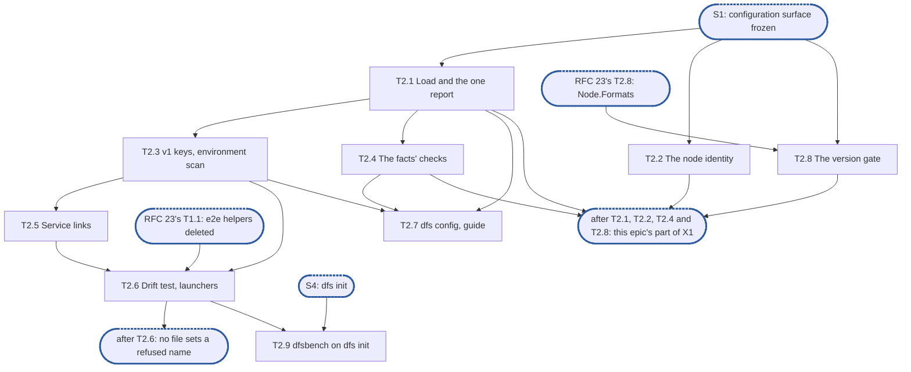

# Epic 2: configuration v2, bootstrap, node identity and versions

**Sources:** [RFC 13](../docs/internals/rfcs/rfc-13-configuration.md) §2.2 ("A host holds only its bootstrap",
but its scratch paths), its roles flag and node identity, §5.5 on one
node, §6's refusal shape for the host's file, §8's format series, and Appendix C; [RFC
28](../docs/internals/rfcs/rfc-28-journal-format.md) §2.1's `node-id` file; [RFC 16](../docs/internals/rfcs/rfc-16-metadata-store.md)
§4.6's store format and §2.3's `Installation.Active` and `Node.Formats`.
**Rests on #4486, merged:** RFC 13's "One file, one name per fact" paragraph, §6's refusal shape,
Appendix B's "How a key and a value are written" and Appendix C, with its "The file's commands",
come from #4486. R1 to R7, R13, R14, R27 and R31 to R36 cite them as "(#4486)",
and D3 reads its matching rule.
**Track:** A.
**Epic 2 estimate: 9 subtasks, 18.5 man-days.**
**Depends on:** S1, the configuration surface frozen by E1: `pkg/bootstrap` with `Bootstrap`'s fields
under Appendix C's keys, each role's wrapping key a `keyprovider.Config`, and the node identity's
three entry points, and `pkg/keyprovider` moved there by E1 (its D3), since `Bootstrap` names the
type. RFC 23's epic 2 (T2.8, the `Node` record with `Formats` and its
`Format` and `VersionRange` types) for T2.8 here; RFC 23's epic 1, which deletes the v1 fixture server
and the e2e helpers, for T2.6; S4, RFC 23's `dfs init`, for T2.9.
**Blocks:** E5, which builds the node's table on a loaded bootstrap; partly E3, whose T3.1 and
T3.6 read the binary's registered ranges T2.8 adds and whose T3.3 imports the shared strict
parser T2.1 creates; RFC 23's epic 3 (`dfs start`
reads `Load`, its T3.10 calls `NodeID`, `WriteMissingNodeIDs` and the version gate), epic 4 (its T4.3 calls `MakeRuntimeDir`) and epic 5 (`dfs init` calls
`InitNodeID`): its X1.

---

## 1. Goal

Epic 2 makes a host's file load the way an operator reads it in RFC 13's Appendix C, refuse what is
not bootstrap in one readable report, give the node its identity, and start only where its
versions overlap the installation's.

**At the end of the epic:**

- `Load` reads the file `--config` or `DITTOFS_CONFIG` names, or the default, under the environment,
  and refuses an unknown key, a v1 key, a `DITTOFS_` name that is no bootstrap key and is not
  allowed, a value of the wrong type, an unclean path, a journal path listed twice or two naming one
  directory, a metadata block's key the backend does not name, a single or repeated role, a missing
  or repeated wrapping key, and an API or a metrics listener off loopback with no certificate, all
  in one report in RFC 13 §6's shape;
- the node identity is read, compared, written at initialisation and restored beside a recorded
  journal, as RFC 13 §2.2's node-identity row says;
- a start refuses an installation whose active versions lie outside its range, the store's format
  by `kvstore.Open` and the others by the gate, and registers that range in its node record;
- no file of the repository sets a refused name, a test keeps it so, and `dfsbench` starts its
  backend through `dfs init` and `dfs start`;
- `dfs config show`, `validate` and `schema`, and the configuration guide, describe the bootstrap
  and nothing else.

### 1.1 In scope

The loader and its refusals; the environment scan and its allowed names; the node identity and the
`node-id` file; the single-node version gate and its three series; the drift test and the launchers;
`dfs config show`, `validate` and `schema` on the bootstrap; the configuration guide; `dfsbench` on
`dfs init`; the shared strict size and duration parser, which `Load` and epic 3's decode use.

### 1.2 Out of scope

- The scratch paths of RFC 13 §2.2 and their start-time check: their first readers, RFC 26, RFC 1
  and RFC 25.
- Initialise-if-empty: E6, with its first caller.
- The call that raises an active version and its refusal while a node lags (RFC 13 §5.5): the
  deferral ledger, until a format has a second version; a test raises one by writing the record,
  and none tests the call.
- The store format's refusal itself: `kvstore.Open` already refuses a store whose format lies
  outside its range, naming both versions, and never rewrites the record. This epic adds no second
  check of it.
- A node's refusal to start while a namespace it would serve writes a block format version it
  cannot read: RFC 13 §5.4 makes that version a namespace setting, and no epic declares its key
  yet. Epic 3 leaves it to RFC 4's plan, and a deferral ledger row carries it. T2.8's gate checks
  the installation's active versions only, and gains this comparison when the key exists (D12).
- `dfs config edit`: it keeps opening `$EDITOR` on the bootstrap file and validates nothing, since
  RFC 13's commands name only `show`, `validate` and `schema` (#4486).
- The control plane's refusal to advance a namespace's block format version (RFC 13 §5.4): E3.
- The other launchers on `dfs init` (Compose, `docker/`, the bench and demo scripts): E6.
- The start steps that call `NodeID`, `WriteMissingNodeIDs` (step 1) and the version gate (step 3), and `dfs
  init` itself: RFC 23's T3.10 and T5.4; the call of `MakeRuntimeDir`: RFC 23's T4.3.
- The Kubernetes operator, a module of its own that still sets v1's names: RFC 23's O4.

### 1.3 Names used here

- **E1**, epic 1, the configuration surface: the user surface in RFC 13 and the frozen
  declarations of `pkg/bootstrap`, `pkg/settings` and `pkg/secrets`.
- **E2**, this epic. Track A.
- **E3**, epic 3, settings: sections, the write check, classes. Track B.
- **E4**, epic 4, secrets. Track C.
- **E5**, epic 5, **the integration epic**: RFC 23's node and API on this library.
- **E6**, epic 6, E2E green: RFC 13 §9's single-node rows through the API, and the launchers on
  `dfs init`.
- **S1**, the configuration surface frozen: E1 has merged.
- **S4**, RFC 23's `dfs init` exists (its epic 5), outside this epic.
- **X1**, RFC 23's name for what its epics 3, 4 and 5 take from the RFC 13 plan: from this epic `Load`, the node identity, the version gate and `MakeRuntimeDir`, and from epic 4 `pkg/secrets`.

## 2. How the general rules apply

The rules are those of
[RFC 13's plan, §1.5](rfc-13-config-plan.md#15-general-rules-for-each-epic), cited by number and
title and not copied.

| Rule | Subtasks | How |
| --- | --- | --- |
| rule 1, independent unit tests ([`CLAUDE.md`, "Writing tests"](../CLAUDE.md#writing-tests)) | all | files under `t.TempDir()`, the environment passed to the loader as a slice (D2), real journal directories made by the journal's own `Init`, Badger under `t.TempDir()` for the store; no double |
| rule 2, fuzz every decoder of untrusted bytes | T2.1, T2.2 | `FuzzLoad` over the file's bytes, the shared parser's fuzz target over a size or a duration string, `FuzzNodeID` over the `node-id` file's, each asserting no panic and, for a parse that succeeds, a re-encode that parses to the same value |
| rule 3, observability follows RFC 25 | T2.8 | `format_active_version`, `format_supported_min` and `format_supported_max`, gauges labelled by format, set at start; no label carries a record or a secret |
| rule 4, profiling | all | every test runs under the leak check |
| rule 5, public interface and internals ([`CLAUDE.md`, "Verifying a change"](../CLAUDE.md#verifying-a-change)) | T2.1, T2.7, T2.8 | refusals are asserted on the text the operator reads, through `dfs config validate`'s output; the version gate through its entry point over a store that refuses, not through the comparison |
| rule 6, known failures shrink | T2.6 | the launchers it edits run suites with a `known.yaml` (`pjdfstest`); none of their entries changes, though until E6 moves them they start no server ([RFC 13's plan, §4.2's D7](rfc-13-config-plan.md#42-decisions)) |
| rule 7, v2 ignores v1 | T2.1, T2.3 | the loader and its path search are kept, and its decoder, with the hooks epic 1 wires in, is replaced by the one strict value codec epic 1 names for E2 (D10); `checkRenamedKeys` and its table are kept and extended; nothing reads a v1 key's value |
| rule 8, real dependencies for properties of those dependencies | T2.2, T2.8 | the `node-id` copies are real files in real journal directories, and their writes' crashes are simulated beneath the code by `journaltest/kit`'s seam; the version gate runs over a real Badger store |
| rule 9, code comment conventions ([`CLAUDE.md`, "Code comments"](../CLAUDE.md#code-comments)) | T2.3, T2.5, T2.8 | a `decision:` note at the allowed names (why each launcher name passes), at the service-link exemption (a value's shape, not its name), and the `ponytail:` marker of the version gate (D5) |
| rule 10, a test must be able to fail | all | each refusal has a test that feeds the refused input and asserts its line; each allowed name a test that it passes; the drift test runs over a planted file |
| rule 11, a symbol is exported only if RFC 13's interfaces use it | all | nothing beyond E1's frozen surface is exported, but things it does not cover, each declared by the subtask that needs it: `Format`'s values and `Installation.Active`, and `kvstore`'s format bounds, which the node record's range reads (T2.8); a format read in the journal package, which the node identity reads (T2.2, D4); a constructor of `keyprovider`'s local provider that takes the passphrase (T2.4, D9), and the call that makes the runtime directory's fallback (T2.4); and the loader's result with each value's source (T2.1, D13) |
| rule 12, each subtask creates only what it declares | all | the `node-id` codec lands with `NodeID`, the series with the gate, the allowed list with the scan |

## 3. Requirements and invariants

Every obligation RFC 13, RFC 28 and RFC 16 place on this epic, and those its own decisions (§4)
set for it.

**Loading the file**

| # | Requirement | Kind | Source | Subtasks |
| --- | --- | --- | --- | --- |
| R1 | The file is `--config`'s, else `DITTOFS_CONFIG`'s, else `$XDG_CONFIG_HOME/dittofs/config.yaml` when that is set, else `~/.config/dittofs/config.yaml`; the environment wins over the file, the file over the defaults | MUST | RFC 13 §2.2 ("One file, one name per fact", #4486); D7 | T2.1 |
| R2 | A key the file sets that Appendix C does not name refuses the start | MUST | RFC 13 §6 ("Unknown fields are refused"); Appendix C (#4486) | T2.1 |
| R3 | A refusal reads `<where>: <key>: <rule>[; <what to do>]`; every refusal of one load is reported together | MUST | RFC 13 §6 ("A refusal says where, what and why", #4486) | T2.1 |
| R4 | A refusal never prints an environment variable's value or a credential's, nor the value of a key it does not declare or no longer reads, and a decoder's own error is reworded into R3's shape, never printed as it comes, since a decoder puts the value it could not read into its text | MUST NOT | RFC 13 §6 (the decoder sentence included), §7 ("Read never returns a secret"); the no-longer-read clause is #4486's | T2.1, T2.3 |
| R5 | A path is absolute and clean; a relative path, a `~` or a trailing slash is refused, never rewritten, since a journal's path is its identity in the store | MUST | RFC 13 Appendix C (#4486); RFC 16 §3 (`JournalDir`, "as written there") | T2.1 |
| R6 | A key in the file that is a setting is refused, naming the management API as the way to set it | MUST | RFC 13 §2.2 ("a record field MUST NOT be overridable from the host"); §6's example (#4486) | T2.1 |
| R30 | A value of the wrong type or out of range is refused, naming the key and the type, and never coerced or replaced: a quoted boolean, a scalar where a list is declared, a number where a string is | MUST, MUST NOT | RFC 13 §6 ("Refused, never replaced") | T2.1 |
| R31 | The `journals` list names each directory once: a path listed twice, or two paths that name one directory, is refused | MUST | RFC 13 Appendix C (journals, #4486) | T2.1 |
| R32 | Only the metadata block `metadata.backend` names is read, and only the block `keys.<role>.kind` names: a key of the other block is refused, the second naming `kind` | MUST | RFC 13 Appendix C (metadata.backend and keys.<role>.kind, #4486) | T2.1 |
| R35 | A value Appendix C bounds beyond its type is refused, each naming its key: an empty `journals` entry, a trailing or doubled comma or an empty value of `DITTOFS_JOURNALS` included; the three `metadata.foundationdb.tls.*` files unless named together or not at all; an `api.socket` path past the socket-address limit; a `logging.rotation.max_size` that is not a whole number of MiB of at least `1MiB`, and a `max_age` that is not whole days; an empty host such as `:8080` in a listen value, while `metrics.listen: off` loads with no certificate | MUST | RFC 13 Appendix C (journals, metadata.foundationdb.tls, api.listen, api.socket, metrics.listen, logging.rotation, #4486) | T2.1 |
| R36 | A rule that relates two keys runs only over keys that passed their own: a bad `metadata.backend` is refused once, and the keys of the block it would name are not refused as well | MUST | RFC 13 §6 ("A refusal says where, what and why", #4486) | T2.1 |

**The environment and the v1 names**

| # | Requirement | Kind | Source | Subtasks |
| --- | --- | --- | --- | --- |
| R7 | A v1 key, in the host's file or as its `DITTOFS_` form, refuses the start, naming its replacement | MUST | RFC 13 §6's examples (#4486); D8 | T2.3 |
| R8 | A `DITTOFS_` name that is neither a bootstrap key nor allowed refuses the start; RFC 13 §9's "§2.2 no host override" row | MUST NOT | RFC 13 §2.2; D7 | T2.3 |
| R9 | The allowed names pass: `DITTOFS_CONFIG`, `DITTOFS_ENCRYPTION_PASSPHRASE`, `DITTOFS_PASSWORD`, the launchers' prefixes and names and the git hooks' ten `DITTOFS_SKIP_*` names, by name not prefix; a bootstrap key wins over an allowed prefix | invariant | D7 | T2.3 |
| R10 | A Kubernetes service link passes only while its value has a link's shape; a v1 or unknown name of a link's form with another value refuses | invariant | D7 | T2.5 |
| R11 | Every file of the repository outside `_test.go` that names a `DITTOFS_` variable names a bootstrap key or an allowed one, and every launcher drops the names the scan refuses | invariant | D7 | T2.6 |

**The facts' own checks**

| # | Requirement | Kind | Source | Subtasks |
| --- | --- | --- | --- | --- |
| R12 | The roles are `protocol` and `storage`, both; one alone refuses the start | MUST | RFC 13 §2.2 (roles row); RFC 15 §2.2 | T2.4 |
| R13 | Both roles' wrapping keys are named, and their key IDs differ; a copied key file or a link to one is the same key and refuses | MUST | RFC 13 §2.2 (wrapping-key row), §7 ("Two wrapping keys": both named), Appendix C ("the two roles name two different keys", #4486); what different means is D9's | T2.4 |
| R14 | An `api.listen` or `metrics.listen` address off loopback (an IP outside `127.0.0.0/8` and `::1`, so a host name and `0.0.0.0` are off loopback, though a name is refused first as not an IP literal) needs `api.tls.cert_file` and `api.tls.key_file` | MUST | RFC 23 §5.3; RFC 13 Appendix C (#4486) | T2.4 |
| R33 | A repeated role in `node.roles` is refused, not deduplicated | MUST | RFC 13 Appendix C (node.roles, #4486) | T2.4 |
| R34 | The state directory is `$STATE_DIRECTORY`, else `$XDG_STATE_HOME/dittofs`, else `$HOME/.local/state/dittofs`, and the runtime directory `$RUNTIME_DIRECTORY`, else `$XDG_RUNTIME_DIR/dittofs`, else a directory under the state directory that only the node's user owns, mode `0700`, all read from `environ` (D2), a colon-separated value read for its first entry, and the defaults of `metadata.badger.path`, `logging.output` and `api.socket` follow them; a state directory that exists and is a symlink, owned by neither the node's user nor root, or writable by others refuses the start, and so does a runtime directory that exists and is a symlink, since it holds `dfs.sock`. The rest of the runtime directory's check, its owner and who can write it, is RFC 23's epic 4 | MUST | RFC 13 Appendix C ("The state and runtime directories", #4486); RFC 13 epic 1's R22 (E2 makes the fallback directory) | T2.4 |

**The node identity**

| # | Requirement | Kind | Source | Subtasks |
| --- | --- | --- | --- | --- |
| R15 | `node-id` is 24 bytes: magic `DNI1`, the 16-byte identity, CRC32C over the first 20; any other length, magic or checksum does not parse | MUST | RFC 28 §2.1 | T2.2 |
| R16 | A copy is written to `node-id.tmp`, synced, renamed, and the directory synced; a `node-id.tmp` is ignored and overwritten by the next write | MUST | RFC 28 §2.1; RFC 13 §2.2 | T2.2 |
| R17 | A start reads every copy and compares them as parsed identities; a copy that does not parse refuses, naming its directory, and is never taken as missing or written over | MUST | RFC 13 §2.2 (node-identity row) | T2.2 |
| R18 | A start refuses, naming the directories, if two copies differ, if no copy exists and the file names no identity, or if a copy differs from the file's identity | MUST | RFC 13 §2.2 (node-identity row) | T2.2 |
| R19 | Nothing rewrites a copy | invariant | RFC 13 §2.2 (node-identity row) | T2.2 |
| R20 | A missing copy is written, logged, only into a directory whose `format` names the journal the store records at `JD‖node‖device` for this node and device; a directory whose journal is not recorded gets none | MUST | RFC 13 §2.2 (node-identity row) | T2.2 |
| R21 | Initialisation generates the identity once and writes it into each directory after its `Init`; a rerun adopts a copy only from a directory whose `format` carries the installation's ID, refuses one that does not parse or two that differ, and takes nothing from another installation's directory | MUST | RFC 13 §2.2 (node-identity row) | T2.2 |

**Versions**

| # | Requirement | Kind | Source | Subtasks |
| --- | --- | --- | --- | --- |
| R22 | Each start registers, in its node record, the range it reads and writes for every shared format, the store format's being `kvstore`'s own bounds | MUST | RFC 13 §5.5; RFC 16 §2.3 (`Node.Formats`) | T2.8 |
| R23 | A start refuses when an active version lies outside its range, naming the format and both versions; an active version of a format this binary registers no range for lies outside it too, and refuses naming the format. The store format's, in `\x00format`, is `kvstore.Open`'s refusal, which exists; any other's, in `Installation.Active`, is the gate's | MUST | RFC 13 §5.5; RFC 16 §4.6 | T2.8 |
| R24 | (a start refusing a namespace's unreadable block format version) | withdrawn | no epic declares the key that holds it; the deferral ledger carries it (D12) | none |
| R25 | A start never raises a version; a newer binary keeps writing the active ones, so the old binary still starts | MUST NOT | RFC 13 §5.5; RFC 16 §4.6 ("A store is never upgraded by being opened") | T2.8 |
| R26 | After a start, `format_active_version{format}` holds each format's active version, and `format_supported_min{format}` and `format_supported_max{format}` the lowest and highest version this binary registers for it | MUST | RFC 13 §8 (`format_supported_min` and `format_supported_max`, #4576: one gauge cannot hold a range, which RFC 25 §11 asked first) | T2.8 |

**Tools and guides**

| # | Requirement | Kind | Source | Subtasks |
| --- | --- | --- | --- | --- |
| R27 | `dfs config show` prints the file it read, the state and runtime directories and the socket path, and the effective bootstrap with each value's source, a credential by its path only, and a value that came from the environment as the variable's name; `validate` refuses what a start refuses and starts nothing; `schema` prints Appendix C as a JSON Schema | MUST | RFC 13 Appendix C ("The file's commands", #4486) | T2.7 |
| R28 | `docs/guide/configuration.md` describes the bootstrap, and `docs/guide/cli.md` is regenerated | invariant | D11 | T2.7 |
| R29 | `dfsbench`'s backend initialises through `dfs init`, with its first password, and starts with `dfs start` | invariant | D7 | T2.9 |

Key words in the owned sections this epic does not carry: §2.2's "initialise if empty **MUST
NOT** be on by default" is E6's; §5.4's refusal to advance a namespace's version is E3's, and its refusal to start while a namespace
writes a version the node cannot read waits with the key that holds it (D12); §5.5's
refusal of the raise while a node lags waits with the raise call; RFC 28 §2.1's two other key words
bind the journal, which leaves `node-id` alone; RFC 16 §4.6's fold-rule key words bind the store.

## 4. Decisions this epic takes

- **D1, one report, not the first error.** `Load` collects every refusal of the file, the
  environment and the facts' checks, then returns them as one error whose lines are RFC 13 §6's
  shape, sorted by where and key. A user fixes a file in one pass. A key that differs from a declared one only in case names that declared key (Appendix C), compared case-folded
  before any edit distance. Another unknown key's "did you mean"
  names the closest declared key, by the smallest edit distance, however far (RFC 13 §6, Appendix C). No marker.
- **D2, the environment is an argument.** `Load(path string, environ []string)` takes the
  environment as `os.Environ()`'s slice, so a test passes its own and nothing reads the process's
  environment but `dfs`'s commands. Viper's `AutomaticEnv` is not used: the scan binds each
  bootstrap key's name itself, so one list says what is read. E1's T1.3 freezes the signature with
  the argument, and its callers pass `os.Environ()`. No marker.
- **D3, keys are matched exactly.** The file's keys are compared as declared, in lower case, as a
  setting's are (RFC 13 Appendix B); viper lowers every key, so the check reads the file's own key
  spelling from the YAML before the decode. #4486's §2.2 states the rule: "A key is matched exactly
  as declared, in the file as in a record, so `Logging.Level` is an unknown key, not
  `logging.level`". No marker.
- **D4, the journal package exports a format read, for the node identity.** Whether a directory's
  `format` carries the installation's ID, or names the journal the store records, is read from the
  file, and the journal package exports no read of it: `format.DecodeFormatFile` and
  `recovery.ReadFormat` are internal, and `journal.Open` (`pkg/block/journal/open.go:240`) wants
  the journal's identity as input, needs a clock and opens the journal. T2.2 adds
  `journal.ReadFormat(ctx, dir)`, returning the journal's ID and its installation's ID, over
  `recovery.ReadFormat`, so the read has the same retry bound as an open's, and the node identity
  never parses the file itself. Rejected: calling `Open` with a zero identity, which returns the
  IDs inside an `IdentityError`, since a caller would need a clock and an error as its result.
  The `node-id` write itself stays in `pkg/bootstrap`, not in the journal package: RFC 28 §2.1
  has the node write the file "after `Init`, never by the journal, which leaves it alone". The
  write follows `format`'s sequence, and T2.2's crash test runs it through the kit's seam, so
  the copy cannot drift unseen. No marker.
- **D5, a test raises a version by writing the record.** No call raises an active version (the
  deferral ledger), so the gate's test writes `Installation.Active` through kvstore and calls
  `Register` again (the store format's raise is RFC 23's T3.10 test). The gate carries a `ponytail:` marker: one comparison per format, on a
  single node. Ceiling: a second node, or a format's second version. Upgrade path: the call that
  raises a version (RFC 13 §5.5), refused while a node lags.
- **D6, `Format`'s values and `Installation.Active` land here.** RFC 23's epic 2 declares `Format`
  (a `uint8` with no value), `VersionRange{Min, Max}` and `Node.Formats` in its T2.8
  (`pkg/metadata/entity/node.go:28-32` on `feat/storage-v2`, #4527), but no value of `Format` and
  no `Installation.Active` (RFC 16 §2.3's `map[Format]uint32`). The gate is their first reader, so
  T2.8 declares the values (store, journal, block, settings schema) and `Active`, with its codec,
  and leaves `Format` and `VersionRange` as they are. No marker.
- **D7, the host's file keeps its path and its loader, and the environment is scanned.** The path
  is `$XDG_CONFIG_HOME/dittofs/config.yaml` when that is set, else `~/.config/dittofs/config.yaml`, with `--config`, or else `DITTOFS_CONFIG`, naming another,
  through the existing viper loader renamed into `pkg/bootstrap`; `DITTOFS_CONFIG` is new code,
  since nothing reads it today. An unknown key (the decode's `Metadata.Unused`, refused after the v1
  keys among them are named, since `ErrorUnused` fails before `Unused` is filled), a v1 key
  (`checkRenamedKeys`), or a `DITTOFS_` name that is neither a bootstrap key nor read outside
  viper refuses the start. The last is a new scan of the environment, since viper reads only the
  names bound from the struct and ignores the rest. The names read outside viper are allowed:
  - `DITTOFS_CONFIG`, the file's path;
  - `DITTOFS_ENCRYPTION_PASSPHRASE`, which `keyprovider`'s local provider reads;
  - `dfsctl`'s `DITTOFS_PASSWORD`, which a shell that runs both may export;
  - the repository's launchers, which a server they start inherits: the prefixes `DITTOFS_TEST_*`,
    `DITTOFS_E2E_*` and `DITTOFS_PREPUSH_*`, and the names `DITTOFS_REPO`,
    `DITTOFS_FDB_CLUSTER_FILE`, `DITTOFS_FDB_DIR`, `DITTOFS_BIN`, `DITTOFS_MOUNT`,
    `DITTOFS_RESULTS_DIR`, `DITTOFS_KNOWN_FAILURES`, `DITTOFS_CLIENT_NS`, `DITTOFS_BRANCH`,
    `DITTOFS_SPN`, `DITTOFS_UID` and `DITTOFS_GID`;
  - the ten `DITTOFS_SKIP_*` names the git hooks read, allowed by name and not as a prefix, so a
    production name such as `DITTOFS_SKIP_TLS_VERIFY` cannot hide under one.

  A bootstrap key wins over an allowed prefix: a future key under `DITTOFS_TEST_*` is read as the
  key. `DITTOFS_LOGGING_LEVEL`, which `dfsbench` sets, is the bootstrap's log level and stays a key, but its value is refused in upper case, so T2.9 sets `warn` for `dfsbench` and T2.6 moves the guides' and `dfs start`'s `DEBUG` examples to `debug`.
  Kubernetes' service links are Appendix C's names read outside the file (#4486), allowed by name
  and value together, since the drift test cannot see them: a pod gets, for every Service in its
  namespace but a headless one,
  `<SVC>_SERVICE_HOST`, `<SVC>_SERVICE_PORT[_<name>]`, `<SVC>_PORT` and
  `<SVC>_PORT_<n>_<PROTO>[_ADDR|_PORT|_PROTO]`. A name of those forms is ignored while its value
  has the shape of any form the name parses as: `tcp://`, `udp://` or `sctp://` and an IP (an IPv6
  one in brackets) and a port for `_PORT` and `_PORT_<n>_<PROTO>`, an IP for `_ADDR` and
  `_SERVICE_HOST`, a port number for `_PORT_<n>_<PROTO>_PORT` and `_SERVICE_PORT*`, `tcp`, `udp` or
  `sctp` for `_PROTO`. A v1 name holding a link's value is the link and is ignored; with another
  value it refuses, naming its replacement, and any other name of those forms whose value is not a
  link's refuses as unknown, so a misspelled `DITTOFS_…_PORT` is never let through by its name.
  The list cannot drift: a test scans the repository by content, not by extension (T2.6), and every
  launcher drops, in this epic, each name the scan refuses, whichever file holds it, so no list of
  files is kept. The first-password name, `DITTOFS_ADMIN_INITIAL_PASSWORD`, is dropped with the others: until E6 moves each launcher
  to `dfs init`, it starts no server, and `dfsbench`, the first measure of v2 against v1, moves in
  this epic once `dfs init` exists (S4). The exemptions of the test are a bare `DITTOFS_` prefix
  literal, `renamed_keys.go`'s table, `test/edge/`'s iptables chain `DITTOFS_EDGE_TEST`, which is
  no variable, `test/harness/bin/dtc`'s forward pattern, and `k8s/dittofs-operator/`, a module of
  its own that still sets v1's names and moves in RFC 23's O4. Markers: a `decision:` note at the
  allowed names and at the service-link exemption.
- **D8, `pkg/bootstrap` is the host's file, and what is not bootstrap is refused, not warned.**
  `pkg/config`'s loader keeps its path search under the new name, so "config"
  names one thing, and its decoder is D10's. An unknown key and a v1 key refuse the start; the v1 table (T2.3) names each
  replacement. No marker.
- **D9, two different keys means two different key IDs.** RFC 13's Appendix C has both roles name
  two different keys (the `keys.<role>.kind` row) and `dfs config validate` check the rule (#4486),
  but says no more about what different means. A copied key file, or a link to one, holds the same
  key, so two roles on it pass a check by file or path and collapse the split without a refusal.
  `Load` loads both keys and compares their current key IDs, as `keyprovider` reports them, so a
  copy and a link to one are the same key and refuse. The local provider reads
  `DITTOFS_ENCRYPTION_PASSPHRASE` with `os.Getenv` (`newLocalProvider`), which would make `Load`
  read the process's environment against D2, so T2.4 adds `keyprovider.NewProviderWithPassphrase(ctx,
  cfg, passphrase)`, which `NewProvider` calls with `os.Getenv`'s value, and `Load` calls it with
  the value in its `environ`. `Config` gains no field, so no passphrase is ever serialised. No
  marker.
- **D10, the decode is strict.** RFC 13 §6 refuses a value of the wrong type and never replaces
  it, but viper's decoder runs with `WeaklyTypedInput` on (viper v1.21.0, `viper.go:988`), which
  turns a scalar into a one-element list, `"1"` or `"t"` into `true` and a number into a string,
  silently. `Load` replaces viper's default hooks with the strict value codec epic 1 names for E2, and runs the decode with weak typing off. The environment is all strings, so the scan parses each bound
  key's variable by the key's declared type (a boolean is `true` or `false`, an integer, a list
  comma-separated: Appendix B's "How a key and a value are written", #4486) and hands the decode a
  typed value. Weak typing off does not by itself refuse a number where a size or a duration is
  declared: mapstructure decodes a number into an integer field, a fraction truncated (v2.5.0,
  `decodeInt`), and a duration is an integer. So a size and a duration are decoded from a string only,
  and a number there is refused naming the key. A decoder's error is reworded into R3's shape, never
  printed as it comes (R4). A `decision:` note at the decoder's options says why weak typing is off.
- **D11, this epic owns the configuration guide.** `docs/guide/configuration.md` is rewritten
  here for the bootstrap, once, and each later epic that adds a section to it adds its own
  without rewriting. `docs/guide/cli.md` is regenerated from the commands' help, which T2.7
  changes. No marker.
- **D12, the version gate checks the installation's active versions, not a namespace's, and lives
  with the node's start.** RFC 13 §5.4 makes a namespace's block format version a setting, and no
  epic declares its key: epic 3 leaves it to RFC 4's plan, and a deferral ledger row carries it
  until that plan runs. Until a key exists nothing could feed the gate a namespace's version, so
  the gate has no such parameter, and RFC 13 §5.4's refusal to join is not carried here, which
  no namespace contradicts since each format has one version so far. The gate takes the store
  `node.New` opened, so `New` stays the one caller of `kvstore.Open`, and writes the node's `Node`
  record, so it sits in `pkg/bootstrap` (`versions.go`), next to the node's start, and not in
  `pkg/settings`, which would then depend on `kvstore`. `pkg/settings/versions.go` keeps only the
  binary's ranges, a table keyed by `entity.Format` that depends on `entity` alone, which epic 3's
  newer-schema refusal reads. No marker.
- **D13, `Load` returns the value of each key's source beside the bootstrap.** `show` prints each
  value with where it came from (R27), and E1 froze `Load(path, environ) (*Bootstrap, error)`,
  which carries no source. T2.1 adds `LoadWithSources(path, environ) (*Loaded, error)`, with
  `type Loaded struct { Bootstrap; Source map[string]Source }`, a `Source` being the file, a
  variable (by its name) or the default, recorded by the same decode that reads the value. `Load`
  returns its `Bootstrap`, so E1's signature and its callers stay, and `show` renders `Loaded`
  without copying the loader's precedence. No marker.

## 5. Target tree

```text
pkg/bootstrap/load.go                  T2.1  Load, LoadWithSources, the report, unknown and setting keys, paths
pkg/bootstrap/load_fuzz_test.go        T2.1  FuzzLoad
internal/<pkg>/<pkg>.go                T2.1  the shared strict size and duration parser, its name a placeholder
internal/<pkg>/<pkg>_fuzz_test.go      T2.1  the parser's fuzz target, with its own table test
pkg/bootstrap/nodeid.go                T2.2  the node-id codec, NodeID, InitNodeID, WriteMissingNodeIDs
pkg/bootstrap/nodeid_fuzz_test.go      T2.2  FuzzNodeID
pkg/block/journal/                     T2.2  ReadFormat, the exported format read (D4)
pkg/bootstrap/renamed_keys.go          T2.3  the v1 table, extended
pkg/bootstrap/environ.go               T2.3  the environment scan and its allowed names
pkg/bootstrap/validate.go              T2.4  roles, wrapping keys, TLS off loopback, the state and runtime directories
pkg/bootstrap/servicelinks.go          T2.5  Kubernetes' service links by name and value shape
pkg/bootstrap/drift_test.go            T2.6  every DITTOFS_ name in the repository
cmd/dfs/commands/config/               T2.7  show, validate, schema on the bootstrap
docs/guide/configuration.md            T2.7  rewritten for the bootstrap
pkg/metadata/entity/                   T2.8  Format's values, Installation.Active
pkg/metadata/kvstore/store.go          T2.8  MinFormat, MaxFormat exported
pkg/bootstrap/versions.go              T2.8  the version gate, its three series
pkg/settings/versions.go               T2.8  the binary's registered ranges, a table (D12)
internal/dfsbench/backend/dittofs.go   T2.9  dfsbench's backend on dfs init and dfs start
```

## 6. Subtasks

### T2.1 `Load` and the one report

**Subtask T2.1 estimate: 3.5 man-days.**

- **Track:** A. **Depends on:** S1.
- **Covers:** R1, R2, R3, R4, R5, R6, R30, R31, R32, R35, R36.
- **Deliverables:** `Load(path, environ)` (D2) on the renamed loader: `--config`, else
  `DITTOFS_CONFIG`, else `$XDG_CONFIG_HOME`'s path, else `~/.config`'s, both read from `environ`; the environment over the file over the defaults; the
  decode with `mapstructure.Metadata`, its `Unused` keys refused as unknown, with D1's "did you
  mean", or as a setting when Appendix B names them, naming the management API; exact key matching
  (D3); the decode strict (D10): `WeaklyTypedInput` off, and the environment's strings parsed by each
  key's declared type before it; every path checked absolute and clean, the `journals` list checked
  for a path listed twice or two naming one directory, and a metadata key checked against the block
  `metadata.backend` names and a role's key against the block `kind` names; the bounds of R35; a rule that relates two keys run over the keys that passed their own (R36); the report of D1; `LoadWithSources` and `Loaded` (D13), which `Load` wraps. `MustLoad`'s fallback to defaults
  with a warning goes: a missing named file refuses, a missing default file loads the defaults
  silently, since a start then refuses for its required keys anyway; the shared strict size and
  duration parser of RFC 13 Appendix B's grammar, an `internal/` package (its name a
  placeholder), created here for `Load` and for epic 3's T3.3, with a file mode that
  refuses a bare integer and a record mode for a JSON number, an integer of bytes kept exact; its
  result is a `uint64`, so the largest size is `2^64 - 1` bytes, and each refusal is an error
  naming its cause (not a number, no unit, unknown unit, fraction, overflow) and carrying only the
  cause, never the input, since a value of the environment reaches it before the decode (R4); epic
  3's T3.3 imports both size modes and the duration grammar. `FuzzLoad`, and the parser's own fuzz
  target.
- **Acceptance criteria:**
  - A file with two unknown keys, one setting key and a relative journal path yields one error with
    four lines, each in §6's shape.
  - An environment value never appears in an error, whatever the name.
  - `LoadWithSources` reports a key set in the file as file-sourced, one set by a variable as that
    variable's name, and one left alone as default.
  - A quoted boolean and a scalar where a list is declared are refused, naming the key and the
    type, and no key takes a default in place of a refused value.
- **Tests:** table tests over files under `t.TempDir()`, one row per refusal, asserting the exact
  line (catches a refusal that drops its rule or its hint); a key in another case refused naming the declared key, `LOGGING.LEVEL` giving `logging.level` (D3, D1; catches a hint taken by edit distance alone, which that key is past); an unknown key more than two edits from every declared one still names the closest (D1; catches a cap on the distance);
  `/data/j1/` refused and `/data/j1` accepted (catches a loader that cleans silently); the
  precedence of `--config` over `DITTOFS_CONFIG` over the default, and of a variable over the
  file; the default path found through `XDG_CONFIG_HOME`, and then through `HOME` alone, each passed
  in `environ` with neither set on the host, under `t.Parallel()` (catches a path search that still reads the process's environment, as `getConfigDir` does today); R30's rows: `journals: "/data/j1"` (a scalar where a list is declared) and
  `logging.rotation.compress: "t"` in the file, each refused naming the key (catches viper's weak
  decode, which takes the first as a one-element list and the second as `true`), `DITTOFS_LOGGING_ROTATION_COMPRESS=1`
  refused and `=true` accepted (catches a strict decode that rejects every environment value,
  which is a string); `journals` holding one path twice, and one holding two entries that name one
  directory, each refuse (catches a dedup by string, which two paths to one directory slip past);
  `metadata.badger.path` beside `metadata.backend: foundationdb` refuses (catches a decode that
  reads both metadata blocks); `keys.protocol.local.file` beside `keys.protocol.kind: kmip` refuses naming `kind`; R35's rows, one each, with `DITTOFS_JOURNALS=/data/j1,`, `DITTOFS_JOURNALS=` and `api.listen: :8080` among them and `metrics.listen: off` loading with no certificate (catches a bound left to the type, and a certificate check that reads `off` as a host); `metadata.backend: sqlite` beside a `metadata.badger.path` refuses once, on `metadata.backend`, and not also for the block's key (R36; catches a relation rule run over a key that failed its own, which cascades); one key from the file, one from a variable and one defaulted each carry their source in
  `Loaded` (catches a source copied from a second precedence walk, which drifts from the decode);
  R4's rows: `logging.rotation.max_backups: s3cr3t` in the file (a string where an integer goes) refuses naming the key, and `s3cr3t` is not in the report (the decoder's own error, which R4 rewords, since the environment's strings are parsed by the scan before the decode, D10); a PEM block pasted into `api.tls.key_file` refuses naming the key and the PEM is not in the report (epic 1 R2's credential canary, through the path check, not the decoder); `pasword: s3cr3t` and `controlplane.jwt.secret: s3cr3t` in the file (RFC 13 §6's own keys, with a value) each refuse, and `s3cr3t` appears nowhere in the report (catches a decoder's error printed as it comes); `logging.rotation.max_age: 7` and `logging.rotation.max_size: 1.5` each refuse naming the key (catches a number decoded into a duration or a size, which turning weak typing off does not stop, D10); `DITTOFS_LOGGING_ROTATION_MAX_SIZE=s3cr3t` and `DITTOFS_LOGGING_ROTATION_MAX_AGE=s3cr3t` each refuse naming the key, and `s3cr3t` is in neither report (catches a parser error that quotes its input, as `internal/bytesize` does with `%q`, which R4's rewording of the decoder's error never sees); `FuzzLoad` seeded with each row.
  - The shared parser has its own table test and fuzz target in `internal/<pkg>`, not through
    `Load`, since the bootstrap's one size key, `logging.rotation.max_size`, takes only a whole
    MiB of at least `1MiB` (R35) and a YAML file never reaches record mode. Each row names its
    cause, taken in this order: text that does not start with a digit is not a number, digits
    alone have no unit, digits then a dot are a fraction, digits then anything but a listed unit
    are an unknown unit, and a product past `2^64 - 1` is an overflow. File mode: `"512B"`
    accepted exact; `abc`, `MiB`, `""` and `-1` refused (not a number); the string `"512"` and a
    bare integer refused (no unit); `1.5GiB` and `4.1GB` refused (fraction); `1kb`, `1Gi`, `10m`,
    `1g`, `100mib`, `1 MiB` and `1e3` refused (unknown unit); `17179869184GiB` and
    `18446744073709551616B` refused (overflow); `18446744073709551615B` accepted exact. Record
    mode: the JSON numbers `9223372036854775808` (2⁶³), `18446744073709551615` (2⁶⁴-1) and
    `9007199254740993` (2⁵³+1) accepted exact, `-1` and `1e3` refused (not a number, since a
    record's size is an integer of bytes written as digits), and `18446744073709551616` refused
    (overflow). The duration grammar: `"0s"`
    and `"1h30m"` accepted, `"-5s"`, `"1.5s"`, `"30S"` and `"5µs"` refused (T3.3 repeats them
    through its decode). The fuzz target checks each size against a `math/big` product, as T3.3's
    `FuzzDecode` does, so an overflow check written as "multiply, then divide back" fails it.
  - The pull request that lands T2.1 names the `internal/` package, which epic 3's T3.3 then
    imports.

### T2.2 The node identity

**Subtask T2.2 estimate: 3.25 man-days.**

- **Track:** A. **Depends on:** S1. Uses kvstore's `Lifecycle.JournalID`, on `feat/storage-v2`, and
  the journal's format read, which this subtask adds (D4).
- **Covers:** R15, R16, R17, R18, R19, R20, R21.
- **Deliverables:** `journal.ReadFormat` (D4); the `node-id` codec; `NodeID`, which reads and compares every copy before the
  store opens and writes nothing; `InitNodeID`, for `dfs init` and a recovery import, adopting a
  copy only from a directory of this installation; `WriteMissingNodeIDs`, writing through
  `node-id.tmp`, sync, rename and directory sync, only beside a journal the store records for this
  node and device, logging each write, through a small interface of the calls it makes (create, write, sync, rename,
  sync the directory), implemented over `os`; `journaltest/kit`'s `Seam` provides a `storage.FS`
  that is internal to the journal package, so the tests wrap it in an adapter of that interface.
  `FuzzNodeID`.
- **Acceptance criteria:**
  - Every refusal names the directories it read.
  - No path through the three writes over an existing `node-id`.
  - A crash at any step of a write leaves no `node-id`, or a whole one, never a torn copy that
    parses.
- **Tests:** on real journal directories under `t.TempDir()`, made by the journal's `Init`: two
  copies that differ refuse, naming both; no copy and no key refuses; a torn copy (20 bytes) and a
  flipped bit each refuse, naming the directory, and are left as they were (catches a torn copy
  taken as missing and rewritten); the golden vector (RFC 28 §2.1's layout, written by hand) parses,
  and the bytes `InitNodeID` writes equal it (catches a writer and a parser that share one layout
  bug, which `FuzzNodeID`'s re-encode cannot see); a 23-byte and a 25-byte copy, another magic and a
  bad checksum each fail to parse (catches a length or magic check dropped); a copy differing from
  the file's `node.id` refuses; a `node-id.tmp` beside a good copy is ignored (catches a leftover
  taken as a copy); a directory lacking its copy, beside a journal the store records for this node and device, gets it from `WriteMissingNodeIDs`, and the write is logged, and a node that lost every copy starts once the host's file names its identity (R20's positive case; catches a write that never happens, which every row that asserts no copy cannot see); a replaced device's empty directory gets no copy from `WriteMissingNodeIDs`,
  its re-initialisation's `Init` then succeeds, and `InitNodeID` then writes its copy (catches a
  copy written early, which makes `Init` refuse a directory holding an entry); every copy deleted
  and a new identity named in the host's file: `WriteMissingNodeIDs` writes no copy, since the
  store records no journal under the new identity (catches a write for a journal not recorded); a
  rerun of `InitNodeID` adopts the copy of a directory of this installation and takes none from
  another's (catches a rerun that adopts a foreign identity); a crash simulated through the seam
  after the temporary file's write, after its sync, after the rename and after the directory sync
  leaves no `node-id` (which `WriteMissingNodeIDs` writes again) or a whole one, and the leftover
  `node-id.tmp` is overwritten by the next write (catches a missing sync or a rename before the
  sync); `FuzzNodeID` seeded with those.

### T2.3 The refused v1 keys and the environment scan

**Subtask T2.3 estimate: 2.25 man-days.**

- **Track:** A. **Depends on:** T2.1.
- **Covers:** R4, R7, R8, R9.
- **Deliverables:** `checkRenamedKeys`' table holds every key Appendix C's "From the files of
  today" (#4486) retires, each refused naming that row's replacement, and is kept in step with it by a
  test (the rows for an upper-case `logging.level` and a bare-integer `max_size` are values of keys v2 keeps, refused by D10's typed decode, and `max_backups` and `max_age` stay keys with new defaults, so none of the four is a table row); the scan of `environ` refusing each v1 name, naming its replacement, `DITTOFS_ADMIN_INITIAL_PASSWORD`
  among them, naming `dfs init`'s `--admin-password-env` or `--admin-password-file`, and every other `DITTOFS_` name that is no bootstrap
  key and is not allowed; the allowed names and prefixes, with a `decision:` note naming why each
  passes; `Blockstore.Journal.Path` retired, with `validate.go`'s print of it, and the exception
  E1's `keys_test` keeps for `blockstore.journal.path` removed.
- **Acceptance criteria:**
  - Each allowed name and prefix passes; `DITTOFS_SKIP_TLS_VERIFY` refuses (a hook's names are
    allowed by name, not prefix).
  - A bootstrap key under an allowed prefix is read as the key.
- **Tests:** one row per allowed name and prefix; `DITTOFS_CONTROLPLANE_SECRET=s3cr3t` refuses,
  naming its replacement, and the output does not contain `s3cr3t` (catches a refusal that prints
  the value, R4); RFC 13 §9's "§2.2 no host override" row: `DITTOFS_ADAPTERS_SMB_PORT` set, the
  start refused and nothing applied; a v1 key in the host's file, `database.type: sqlite`, refuses,
  naming `metadata.backend` and not printing the value (catches a table read only for variables, and a
  v1 key lost among the unknown ones); one row per key the table retires, asserting the replacement it
  names, and `logging.rotation.max_backups: 5` and `.max_age: "720h"` loading (catches a table that takes every row for a refusal, a row left out, and a name refused under a wider family's replacement, such as
  `metrics.auth` under `metrics.listen`); an upper-case `logging.level` and a bare-integer
  `logging.rotation.max_size` refuse; `keys_test`'s exception is gone.

### T2.4 The facts' own checks

**Subtask T2.4 estimate: 2 man-days.**

- **Track:** A. **Depends on:** T2.1.
- **Covers:** R12, R13, R14, R33, R34.
- **Deliverables:** `Bootstrap.Validate`: both roles, a repeated one refused; both wrapping keys
  named, loaded through `keyprovider.NewProviderWithPassphrase`, which takes the passphrase from
  `Load`'s `environ` and not from the process (D9), and their current key IDs compared; certificate and key when
  an `api.listen` or `metrics.listen` address is not loopback; the two directories resolved from
  `environ`, the existing state directory checked and the existing runtime directory refused when a symlink (R34); `MakeRuntimeDir`, which makes the runtime fallback with
  mode `0700` and which the start calls, RFC 23's T4.3 where it binds `dfs.sock`, never `Validate`.
- **Acceptance criteria:** each refusal is a line of T2.1's report, not a separate error.
- **Tests:** `roles: [storage]` and `roles: [protocol, protocol]` each refuse (the second catches a
  comparison that dedups a repeated role); one role's key missing refuses; two roles naming one key
  file, then a copy of it, then a symbolic link to it, each refuses (catches a check by path rather
  than by key ID); `api.listen: 0.0.0.0:8080`, `[::]:8080` and `metrics.listen: 0.0.0.0:9090` with no
  certificate refuse, so does an `api.listen` list whose first entry is loopback and second is not (catches a check that reads the first entry alone), and `127.0.0.1:8080` passes; `api.listen: localhost:8080` is refused, a listen
  host being an IP literal, which catches a check that resolves names, since one that did would see
  loopback here and let the start pass. Key files are real `keyprovider` local files under
  `t.TempDir()`. A test calls `Load` with the passphrase in `environ` on a host where
  `DITTOFS_ENCRYPTION_PASSPHRASE` is unset, and the keys load, with `t.Parallel()`; the same call
  with no passphrase in `environ` refuses whatever the host's variable holds (catches a provider
  that reads the process's environment); a state directory that is a symlink, one writable by
  others and one owned by another user each refuse, `STATE_DIRECTORY`, `XDG_STATE_HOME` and `HOME` given in `environ` choose the directory (catches a
  lookup that reads the process's environment), `STATE_DIRECTORY=/s1:/s2` resolves to `/s1`, asserted on the resolved path since neither directory need exist (catches a lookup that takes the whole value), and so does `RUNTIME_DIRECTORY=/r1:/r2` to `/r1`, a state directory owned by root loads (catches a check that accepts the node's user alone), a symlink planted at the fallback runtime path refuses (R34), and `MakeRuntimeDir` makes the fallback mode
  `0700`.

### T2.5 Kubernetes' service links

**Subtask T2.5 estimate: 1.5 man-days.**

- **Track:** A. **Depends on:** T2.3.
- **Covers:** R10.
- **Deliverables:** the scan ignores a name of a service link's forms while its value has the shape
  of any form the name parses as (D7), with a `decision:` note; a bootstrap key still wins.
- **Acceptance criteria:** a misspelled `DITTOFS_…_PORT` holding no link's value is never let
  through by its name.
- **Tests:** the full set a pod gets for a CR named `dittofs` (its `-api`, `-metrics` and
  `-adapter-nfs` Services, none for `-headless`) and the operator's
  `DITTOFS_OPERATOR_CONTROLLER_MANAGER_METRICS_SERVICE_PORT`, once with IPv4 values and once with
  IPv6 ones (`tcp://[fd00::a]:9090`): all pass (catches a shape check that knows only IPv4, or only
  the `_PORT` form); `DITTOFS_METRICS_PORT=9091` and `DITTOFS_CONTROLPLANE_PORT=8080` refuse,
  naming their replacements (catches a v1 name let through by its form); `DITTOFS_NFS_PORT=2049`
  refuses as unknown (catches a misspelled link name let through by its name); a future bootstrap
  key under an allowed prefix is read as the key.

### T2.6 The drift test and the launchers

**Subtask T2.6 estimate: 2 man-days.**

- **Track:** A. **Depends on:** T2.3, T2.5. Uses RFC 23's T1.1, which deletes `test/e2e/helpers`, so no refused name is left in it.
- **Covers:** R11.
- **Deliverables:** a test scanning the repository by content, every tracked text file outside `_test.go` that
  holds a `DITTOFS_` name, so a built `dfs` in a checkout is not read (Go, shell with or without `.sh`, Compose, `docker/`, Markdown but
  `docs/internals/`, `.planning/` and `CHANGELOG.md`, which name refused names to say they are refused), failing on a name the scan refuses, with D7's
  exemptions; every launcher and guide it finds corrected, an upper-case `DITTOFS_LOGGING_LEVEL` example (the guides', the README's, `CLAUDE.md`'s and `dfs start`'s help text, from which `docs/guide/cli.md` is generated) moved to lower case, which the scan, checking names, does not catch; `DITTOFS_ADMIN_INITIAL_PASSWORD`,
  `DITTOFS_CONTROLPLANE_SECRET`, v1's `DITTOFS_GC_*` and the others it lists dropped.
- **Acceptance criteria:** the test passes on the repository, and the launchers it edits still
  start what they started, or start nothing until E6 moves them to `dfs init` (D7).
- **Tests:** the scan over a planted `testdata` tree holding one refused name in a shell file
  without an extension fails, naming the file and the line (catches a scan by extension); a refused name planted in a Markdown file under `.planning/` passes (catches an exemption missing, which fails on the plans themselves).

### T2.7 `dfs config` and the configuration guide

**Subtask T2.7 estimate: 1.25 man-days.**

- **Track:** A. **Depends on:** T2.1, T2.3, T2.4.
- **Covers:** R27, R28.
- **Deliverables:** `show` as a rendering of `LoadWithSources`' `Loaded` (D13), each value with its
  source and a credential by its path; `validate`
  running `Load` and starting nothing; `schema` generated from `Bootstrap`'s fields. `edit` is left
  as it is (§1.2). `docs/guide/configuration.md` rewritten for the bootstrap, Appendix C's keys and
  the refusal shape, with a section for each later epic to add (D11); `docs/guide/cli.md`
  regenerated.
- **Acceptance criteria:** `validate`'s output on a bad file is exactly the start's refusal; `show`
  prints a file-set key as file-sourced and a defaulted key as default-sourced.
- **Tests:** `validate` on T2.1's four-refusal file prints its four lines and exits non-zero;
  `show` prints the file it read, both directories and the socket path; on a file setting `metadata.foundationdb.tls.cert_file` it prints the path and never the
  file's content; `show` on a file with one key set and the rest defaulted prints `file` for the
  first and `default` for the others, and a key set by a variable prints the variable's name, all
  through the `Load` path the start uses (catches a `show` with its own precedence logic); `DITTOFS_METADATA_BADGER_PATH=/s3cr3t/badger` set, and `show`'s output holds the variable's name and never `s3cr3t` (catches a `show` that prints an environment value); `validate` over a file whose runtime directory does not exist leaves no directory behind (R34: the start makes the fallback, `validate` starts nothing);
  `schema`'s property set equals Appendix C's keys (catches a field added without its schema).

### T2.8 The version gate

**Subtask T2.8 estimate: 2 man-days.**

- **Track:** A. **Depends on:** S1. Uses RFC 23's T2.8 (`Node.Formats`, `Format`, `VersionRange`), on `feat/storage-v2` since #4527.
- **Covers:** R22, R23, R25, R26.
- **Deliverables:** `Format`'s values and `Installation.Active` with its codec (D6); `kvstore`'s
  format bounds exported (`minFormat` and `maxFormat`, `pkg/metadata/kvstore/store.go:32-33`, as
  `MinFormat` and `MaxFormat`), so the store format's range can be registered;
  `pkg/settings/versions.go`, the binary's registered ranges, a table keyed by `entity.Format`,
  which the gate registers and compares and epic 3 reads (D12); the gate, `Register(ctx, store)`
  in `pkg/bootstrap/versions.go`, over the store `node.New` opened, so `New` stays the one caller of
  `kvstore.Open`; RFC 23's step 3 calls it, and it writes the node's ranges to its `Node` record,
  store format included, and compares every `Installation.Active` version
  with them in that registration's one transaction (RFC 23 §2.2, step 3), so a refused start leaves
  its node record as it was, refusing with the format and both versions (a namespace's block format version waits
  with its key, D12); the series, `format_active_version`, `format_supported_min` and
  `format_supported_max`; the `ponytail:` marker (D5). The gate adds no store-format branch of its
  own: a store whose `\x00format` lies outside the range is refused by `kvstore.Open` in `node.New`,
  naming both versions, before the gate runs.
- **Acceptance criteria:** a refusal names the format, the active version and the binary's range;
  a start that passes writes nothing but its node record.
- **Tests:** on Badger under `t.TempDir()`, over a store opened as `node.New` opens it (`kvstore.Open`),
  each through `Register`, not through the comparison: RFC
  13 §9's "§5.5 version gate" single-node part, the active journal format raised past the binary's
  range through kvstore and `Register` refusing, naming it (catches a gate that compares nothing);
  the node record as it was after
  each refusal (catches a registration committed before the comparison, RFC 23 §2.2 step 3); a `Register` under an older active version keeps it and the
  record holds only its ranges after (catches a gate that upgrades, R25); after `Register`, the node record's
  `Formats` holds each format's range and equals `pkg/settings/versions.go`'s table, the store format's equal to `MinFormat` and `MaxFormat`
  (catches a registration dropped or a range off by one, R22, or a table the gate does not read); an `Installation.Active` entry for a `Format` value this binary does not register, written through kvstore and read back, refuses naming the format (catches a gate that loops over its own ranges and skips it, and an `Active` codec that drops a key it does not know, as an older binary meets after a downgrade); the three series read from the
  registry after `Register` (R26). No test calls a raise: none exists (§1.2). A store with its `\x00format` raised past `MaxFormat` is refused by `node.New` before the gate runs: RFC 23's T3.10 tests it through a start.

### T2.9 `dfsbench` on `dfs init`

**Subtask T2.9 estimate: 0.75 man-days.**

- **Track:** A. **Depends on:** S4, T2.6.
- **Covers:** R29.
- **Deliverables:** `dfsbench`'s backend runs `dfs init` with its first password given by file,
  then `dfs start`, in place of the refused variables, and sets `DITTOFS_LOGGING_LEVEL=warn`, since
  `WARN` in upper case is refused (`internal/dfsbench/backend/dittofs.go`).
- **Acceptance criteria:** a managed run on the bench host, `dfsbench run --systems` with the
  backend, completes against the new backend.
- **Tests:** the managed run of the acceptance criterion, on the bench host: only a managed run
  starts the server, so it catches a backend that still sets a refused name, which the server then
  refuses at start, so the run fails (the `bench-smoke` cell benchmarks a temp dir on the runner and
  starts no server; the refused names themselves are T2.6's drift test).

## 7. Order of work



T2.1 and T2.2 come first and in parallel: with T2.4's `MakeRuntimeDir` and T2.8's gate they are this epic's part of RFC 23's X1 (epic 4's `pkg/secrets` is the rest), T2.1 and T2.2 on its critical path. The checkpoint
after T2.6 is that no file of the repository sets a refused name. T2.8 waits on RFC 23's node
record, T2.6 on RFC 23's T1.1 and T2.9 on its `dfs init`.

## 8. Suggested pull requests

| PR | Subtasks | Man-days | After | Why together |
| --- | --- | --- | --- | --- |
| 1 | T2.1, T2.2 | 6.75 | S1 | `Load` and the node identity, the first part of RFC 23's X1 |
| 2 | T2.3, T2.4, T2.5, T2.6 | 7.75 | PR 1 | every refusal of the host's names, and the repository brought in line with them |
| 3 | T2.8 | 2 | S1, RFC 23's T2.8 | the version gate, a part of RFC 23's X1 |
| 4 | T2.7 | 1.25 | PR 2 | the commands and guide on the finished loader |
| 5 | T2.9 | 0.75 | PR 2, S4 | `dfsbench` on `dfs init`, once it exists |

A suggestion only: one pull request per subtask works as well.

The least certain estimates are T2.6, whose launchers and guides are known only when the scan runs; T2.7, which rewrites `docs/guide/configuration.md` (1,840 lines on `feat/storage-v2`); and T2.1, which rewrites `pkg/bootstrap`'s tests (791 lines there) written for today's loader. None is resized here.

## 9. Open points

- **What "two different keys" means is D9's.** RFC 13 has both roles name two different keys but
  leaves "different" unsaid, so this epic reads it as different key IDs, a copy or a link to a key
  file being the same key. RFC 13 gains the sentence, or the rule stays this epic's.
- **No epic declares the namespace setting for the block format version (D12).** RFC 4's plan
  declares the key when it runs, and a deferral ledger row carries it. The gate gains the
  comparison then, and a start over a namespace record refuses a version outside the range.
