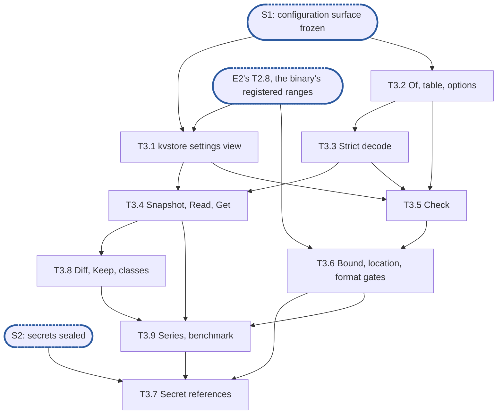

# Epic 3: configuration v2, settings

**Sources:** [RFC 13](../docs/internals/rfcs/rfc-13-configuration.md) §2.1, §2.3, §3, §4.2, §5, §5.1 and §6;
§5.2 as RFC 13's plan's D9 refusal; §5.4's refusal to advance, on one node; §8's two settings
series, the lag series being RFC 23's node's (D5). [RFC 16](../docs/internals/rfcs/rfc-16-metadata-store.md)
§2.3's `Setting` record and §3's settings view.
[RFC 23](../docs/internals/rfcs/rfc-23-control-plane.md) §5.2's `admin`-only settings.
**Track:** B.
**Epic 3 estimate: 9 subtasks, 19.5 man-days.**
**Depends on:** S1, the configuration surface frozen by E1 (#4479, merged): `pkg/settings`' types
with stub bodies, the kvstore view's `DeleteSetting` and `AllSettings` with their transaction
forms, and `Check`'s signature over the `ControlPlaneTx` that RFC 23's T2.4 (#4362) built on
`feat/storage-v2` (#4494), so `Check` waits on nothing beyond S1.
E2's T2.8 (#4518, open), the binary's registered ranges in `pkg/settings/versions.go` (the gate
itself is `pkg/bootstrap`'s), the settings schema among the `Format` values E2's D6 declares
there, which T3.1's newer-schema refusal and T3.6's format gate read; the plan's edge and blockers
row for that dependency came in #4662. S2, a `Secret` sealed by E4, for T3.7 only.
**Blocks:** E5, which builds the node's table from `Of`, reconciles through `Read` and `Diff`, and
calls `Check` from the API's settings routes, which wait on T3.7's secret gates (PR 4); the RFC 18
plan's epic 6, partly, whose NetBIOS cross-check is a tracked read through `Check`.

---

## 1. Goal

Epic 3 makes a component's settings a section the node reads through one call, checks every write
by the component's own rules before it commits, and classifies each change for reconcile.

**At the end of the epic:**

- a component declares its section once, from its typed settings, its defaults and `Validate`,
  with a class on every field, its scope form, its write role, its required keys and its secret
  references; a typo in any of them fails the table's first test;
- `Read` builds a snapshot of every section from one scan, each section decoded strictly on its
  own, so one bad row stops only its section, and `Get` hands a component its value;
- `Check` refuses, inside the write's transaction, an unknown key, a wrong scope, a newer schema, a
  caller below the section's write role, a required key left unset, an invalid value, a bound
  change while content exists, a store location's change, a refusal by the section's own
  `CheckTx`, a reference naming no `Secret` or one to another kind's or owner's secret, and a
  block format version past this node's range;
- `Diff` tells reconcile which keys changed and with which class, and `Keep` holds a refused
  section at its last snapshot;
- the two settings series exist, and a benchmark measures `Read` and `Diff`, the reconcile RFC
  13's plan marks as knowingly simple.

### 1.1 In scope

The kvstore settings view's delete, cross-scope read and schema refusal; `Of`, `Table` and their
options; the strict decode, the size grammar and the duration codec of E1's D10; `Read`, `Get`,
`Diff` and `Keep`; `Check` and every gate RFC 13's plan gives it; the two settings series; the
reconcile benchmark, `Read` and `Diff`; the `decision:` and `ponytail:` markers RFC 13's plan places
in this epic.

### 1.2 Out of scope

- The node's table, reconcile, the API's settings routes and `HoldsContent`'s implementation: E5.
  The route builds `holds` inside `Write` as a closure over the write's `tx`, so E1's frozen
  signature, `func(scope entity.SettingScope) (bool, error)`, stays without a `tx` parameter (the
  plan's sketch still passes `tx`; #4773 merged without that fix, §9), and the closure makes it a
  tracked point
  read through the write's transaction, so the first content write conflicts with a bound change
  (T3.6).
- The test that parses Appendix B against the table (RFC 13's plan's D3), and its check that no
  section's `Validate` prints a `SecretRef` field's value (`Of`'s contract, T3.2): E5.
- The audit record of a settings write (RFC 23 §6, in the audited `Write`): RFC 23's T2.4 (#4362),
  built on `feat/storage-v2` (#4494), not an epic of this plan.
- RFC 13 §6's port rule across the three adapter ports: E5. The general rule across two
  components' settings is a `ponytail:` marker here (RFC 13's plan, §4.3).
- Each component's section and its Appendix B rows: the component's own plan (RFC 13's plan, O4).
- `Resolve`, `Seal` and the secret records: E4. The reconcile benchmark's secrets pass: E5 (D3);
  the `NodeStatus` write is the node's own status loop's, outside any benchmark.
- The proof of a store location's change (RFC 4 §4.11's check, RFC 27's claim), RFC 13 §5's
  two-step restart value and §5.4 across nodes: RFC 13's plan, O1.
- A share's rebind with content refused (RFC 13 §5.1, "§5.1 share binding"): RFC 23's plan, the
  share's own write.
- A node's refusal to start below a namespace's block format version (RFC 13 §5.4): RFC 4's plan,
  which declares the key, as epic 2's D12 and the plan's §6.1 row for the key that holds a
  namespace's block format version record (both in #4518, owner RFC 4's plan, trigger "a plan of
  RFC 4 declares the key"); until then no comparison is needed, since each format has one version.

### 1.3 Names used here

- **E1**, epic 1, the configuration surface: the frozen declarations of `pkg/bootstrap`,
  `pkg/settings` and `pkg/secrets`.
- **E2**, epic 2, bootstrap, node identity and versions. Track A.
- **E3**, this epic. Track B.
- **E4**, epic 4, secrets. Track C.
- **E5**, epic 5, **the integration epic**: RFC 23's node and API on this library.
- **E6**, epic 6, E2E green: RFC 13 §9's single-node rows through the API.
- **S1**, the configuration surface frozen: E1 has merged.
- **S2**, secrets sealed: a `Secret` seals, resolves and versions under each role's key, partway
  through E4.
- **A1**, RFC 13's plan's amendment making `identity.directory`, the whole record, `admin`-only.
- **D9**, **D10** and **D11**, RFC 13's plan's decisions on a store location's change, on a
  reference's kind and owner, and on a section's schema; **D1** to **D6** without a plan named are
  this epic's own (§4).
- **O1** and **O4**, RFC 13's plan's open points: O1 its deferred scope, the cluster rules and the
  proof of a store location's change; O4 the components' sections, each its own plan's. **O3**,
  its open point on the RFC 18 plan's wait, owns the NetBIOS cross-check's route, a tracked read
  through this epic's `Check`.

## 2. How the general rules apply

The rules are those of
[RFC 13's plan, §1.5](rfc-13-config-plan.md#15-general-rules-for-each-epic), cited by number and
title and not copied.

| Rule | Subtasks | How |
| --- | --- | --- |
| rule 1, independent unit tests ([`CLAUDE.md`, "Writing tests"](../CLAUDE.md#writing-tests)) | all | sections declared in the test, over small typed structs; the store is Badger under `t.TempDir()` through kvstore, never a double; `HoldsContent` is a closure over the write's `tx` that point-reads a content record the test seeds in Badger, as `CheckTx`'s test does, never a canned stub |
| rule 2, fuzz every decoder of untrusted bytes | T3.3 | `FuzzDecode` over a row's value, seeded with every row of T3.3's table, asserting no panic and, for a decode that succeeds, a re-encode, by an encoder that emits the grammar (a whole number in the largest unit that divides it exactly, so `1500ms` stays `1500ms`, never `time.Duration.String()`'s `1.5s`), that decodes to the same value; a size's product is also checked against an independent oracle, `math/big` (T3.3) |
| rule 3, observability follows RFC 25 | T3.9 | `config_refused_total{component,reason}` and `config_bound_refusals_total`, `config_generation_lag_seconds{kind}` being RFC 23's node's (D5); no label carries a record, a key's value or a secret, `reason` is a name of E1's closed error list, `component` a declared section prefix and an unknown key one fixed value, as RFC 25 §2.4's closed sets require |
| rule 4, profiling | all | every test runs under the leak check; T3.9's benchmark reports allocations |
| rule 5, public interface and internals ([`CLAUDE.md`, "Verifying a change"](../CLAUDE.md#verifying-a-change)) | T3.4, T3.5, T3.6, T3.7 | refusals are asserted through `Check` and `Read`, on the error a caller sees, never on a helper |
| rule 6, known failures shrink | none | no suite of this epic has a `known.yaml` |
| rule 7, v2 ignores v1 | T3.1 | the view's existing `Settings` and `PutSetting` are kept; nothing reads v1's GORM settings store |
| rule 8, real dependencies for properties of those dependencies | T3.1, T3.9 | the generation raise, the scan and the conflict of a tracked read on Badger under `t.TempDir()` |
| rule 9, code comment conventions ([`CLAUDE.md`, "Code comments"](../CLAUDE.md#code-comments)) | T3.1, T3.3, T3.4, T3.5, T3.6 | D9's and D11's `decision:` notes at `Check`, the skipped row's at `Read` and the size's truncation at the decode; the `ponytail:` markers of the one-scan reconcile, the one `CFGGEN` key and the rule across components |
| rule 10, a test must be able to fail | all | each gate has a test feeding the refused write and one feeding the write that passes beside it |
| rule 11, a symbol is exported only if RFC 13's interfaces use it | all | nothing beyond E1's frozen surface is exported but `Of`'s `FormatVersion` option (D6), added to E1's export pin as it lands; `entity.ErrBadRow` (D2) is outside E1's three packages |
| rule 12, each subtask creates only what it declares | all | the size grammar lands with the decode, the series with T3.9, the gates each with its subtask |

## 3. Requirements and invariants

Every obligation RFC 13, RFC 16 and RFC 23 place on this epic, and those RFC 13's plan sets for it.

**Records and scopes**

| # | Requirement | Kind | Source | Subtasks |
| --- | --- | --- | --- | --- |
| R1 | A setting is a `Setting` record in the metadata store; a component gets its value from `Read` and `Get`, never from a file or a source of its own | invariant | RFC 13 §2.1 | T3.4 |
| R2 | A setting has exactly one scope, in one of three forms: one value across the scope, one per thing inside it, or a wider default a narrower record may replace | MUST | RFC 13 §3 | T3.2 |
| R3 | The effective value is the narrower override if one exists, else the wider value, else the default, per thing where the form is per thing | invariant | RFC 13 §3 | T3.4 |
| R4 | A record with a schema version the reader does not know is refused whole, never read for the fields it recognises | MUST | RFC 13 §2.3; RFC 16 §2.3 (`Setting.Schema`) | T3.1, T3.4, T3.5 |
| R5 | A delete removes one row, so the wider value is effective, and raises the settings generation in its transaction as a put does | MUST | RFC 16 §3 (`DeleteSetting`) | T3.1 |
| R6 | Reconcile reads every scope's rows in one prefix scan | invariant | RFC 13's plan, §4.3; pending #4473 | T3.1 |

**Declaring a section**

| # | Requirement | Kind | Source | Subtasks |
| --- | --- | --- | --- | --- |
| R7 | A setting has a default or is required; a snapshot or a write that leaves a required key unset is refused | MUST | RFC 13 §4.2 | T3.2, T3.4, T3.5 |
| R8 | Every field of a section declares its class: live, restart, next write or bound; one left unclassified panics at `Of` | MUST | RFC 13 §5 | T3.2 |
| R9 | The sections Appendix B gives to `admin` alone (`identity.oidc`, `api.oidc_role_map`, `api.password_sign_in`, `identity.directory`, `audit.retention`, `api.session_lifetime`, `api.token_max_lifetime`) are written by `admin` only, first value included; roles compare by an explicit rank, an empty or unknown one ranking lowest | MUST | RFC 13 Appendix B; RFC 23 §5.2; RFC 13's plan, A1 | T3.2, T3.5 |
| R10 | `Of` panics on a field without a class tag, on a class that is not one of the four (`class:"restar"`), on a field with no explicit `json` name, on two fields that share a name after flattening, and on a `Required`, `SecretRef` or `FormatVersion` name that is no field (E1's D9; the plan's `Of` sketch), and on an unknown write role; `Table` panics on two sections declaring the same prefix and on a section whose prefix consumes a field key another section generates, as an `identity` section's field `oidc` beside an `identity.oidc` section, which the longest-prefix match would make unreachable; a key belongs to the longest section prefix on a dot boundary | invariant | RFC 13's plan, epic 3; E1's D9 for the class tag and the field names | T3.2 |

**Decoding a value**

| # | Requirement | Kind | Source | Subtasks |
| --- | --- | --- | --- | --- |
| R11 | A field the section does not know is refused | MUST | RFC 13 §6 ("Unknown fields are refused") | T3.3 |
| R12 | Keys match exactly as declared; `adapters.smb.Port` is refused | invariant | RFC 13's plan, epic 3; RFC 13 Appendix B's conventions (#4486) | T3.3 |
| R13 | A duration is a string (`"30s"`), a bare number refused; a size is a string or an integer of bytes; `null` into a non-pointer field, a duplicate key and invalid UTF-8 are refused | invariant | RFC 13's plan, epic 3; RFC 13 Appendix B's conventions (#4486) | T3.3 |
| R14 | A size keeps `internal/bytesize`'s grammar, and a product past `uint64` is refused on both of its paths | invariant | RFC 13's plan, epic 3 | T3.3 |

**Validation**

| # | Requirement | Kind | Source | Subtasks |
| --- | --- | --- | --- | --- |
| R15 | A value out of range, of the wrong type or naming something absent is refused, naming the field and the rule, in RFC 13 §6's refusal shape | MUST | RFC 13 §6 ("Refused, never replaced") | T3.3, T3.5 |
| R16 | A value is never clamped, rounded or replaced by a default | MUST NOT | RFC 13 §6 | T3.4, T3.5 |
| R17 | The write check calls the component's own `Validate` and has no rule of its own to drift | invariant | RFC 13 §6 ("Checked twice") | T3.5 |
| R18 | A section that does not decode or validate stops only itself, and where its form is per thing only that thing's value (garbage in share A's row leaves share B's value of the section readable): `Read` returns it refused and decodes the rest; a row no section of the table claims, one a newer binary's section or a removed one left, is skipped, neither refused nor counted; a row whose bytes do not decode refuses the section its key names, and is skipped when its key does not parse or no section claims it (D2) | invariant | RFC 13 §6 ("stops only what it configures") | T3.1, T3.4 |
| R19 | A write related to another setting by a rule is validated against that setting's current value, read tracked in the write's transaction; this epic builds the tracked read only, as `Of`'s `CheckTx` option that `Check` runs (R33), the first rule, RFC 13 §6's port rule, being E5's and the RFC 18 plan's epic 6's NetBIOS cross-check routing through it, while the general rule stays a knowingly simple "not built" (RFC 13's plan, §4.3) | MUST | RFC 13 §6 ("A rule across settings"); RFC 13's plan, §4.3, epic 5 and O3 | T3.2, T3.5 |

**The write check**

| # | Requirement | Kind | Source | Subtasks |
| --- | --- | --- | --- | --- |
| R20 | `Check` refuses an unknown key, a wrong scope, a newer schema and a caller below the section's write role | MUST | RFC 13 §2.3, §3, §6; RFC 23 §5.2 | T3.5 |
| R21 | A delete is checked as the change it is: against the effective value it leaves; a delete that leaves the same effective value, as a node override does when the installation's row holds that value, is no change | invariant | RFC 13's plan, D9 | T3.5, T3.6 |
| R22 | A change to a bound setting is refused while its scope holds content, by a put or a delete; a put of the same value, or a delete that leaves the same effective value, is no change | MUST | RFC 13 §5.1 | T3.6 |
| R23 | A change to a remote store's endpoint, bucket, prefix or credential reference is refused until it can be proven, naming RFC 13 §5.2; its first value passes | MUST | RFC 13 §5.2; RFC 13's plan, D9 | T3.6 |
| R24 | A namespace's block format version is not advanced past the oldest version a node that may read the namespace supports; on one node, this node's range | MUST | RFC 13 §5.4 | T3.6 |
| R25 | A secret reference names a secret of the kind its field declares, owned by the record or key that names it; until T3.7 builds that check, a write that sets a reference field is refused | MUST | RFC 13's plan, D10; RFC 23 §5.2 | T3.5, T3.7 |
| R26 | A section's newer schema is written only once the installation's active version allows it | invariant | RFC 13's plan, D11; RFC 13 §1 | T3.6, D11's `decision:` note only |
| R32 | A write's reads are point reads: one per declared field of the key's section at each scope of its chain (`Check` decodes, validates and checks the required keys of the whole effective section), the current row, each reference's `Secret` and what the section's `CheckTx` reads, never the settings scan, so a write conflicts with a concurrent write made straight to any row it read, a sibling key of its own section included, and not with a write made straight to a row it did not read; every settings write also raises `CFGGEN` in its transaction (RFC 13's plan, §4.3, the one-key `ponytail:`), so two settings writes always conflict through that key, and `Check` adds no conflict beyond it | invariant | RFC 13 §6 ("A rule across settings": tracked, "so that a concurrent write of the other side conflicts") | T3.5 |
| R33 | `Of` takes the section's `CheckTx` option, E1's frozen `func(entity.ControlPlaneTx, Write, T) error`, and `Check` runs it after `Validate`, handing it the write's `tx`, the write and the decoded section, and returns its refusal as it is; what it reads through `tx` is tracked | invariant | RFC 13 §6 ("A write check may read store state beyond settings"); E1's D9; RFC 13's plan, §4.4 (`sec.checkTx`) | T3.2, T3.5 |

**Classes and change**

| # | Requirement | Kind | Source | Subtasks |
| --- | --- | --- | --- | --- |
| R27 | `Diff` lists each changed key with its class; with no previous snapshot, every key is a change | invariant | RFC 13 §5 | T3.8 |
| R28 | `Keep` gives a refused section its previous snapshot's value, so a component never runs a default in place of a refused record | invariant | RFC 13 §6 | T3.8 |

**Observability**

| # | Requirement | Kind | Source | Subtasks |
| --- | --- | --- | --- | --- |
| R29 | `config_refused_total` by component and reason and `config_bound_refusals_total`; no label names a record or a secret: `reason` is a name of E1's closed error list, `component` the declared section prefix, and an unknown key has one fixed value | MUST | RFC 13 §8; RFC 25 §2.4 | T3.9 |
| R30 | The reconcile scan and `Diff` are measured at 10⁴ shares' settings, against a ceiling of 100 ms | bound | RFC 13's plan, §4.3 | T3.9 |

**Secrecy**

| # | Requirement | Kind | Source | Subtasks |
| --- | --- | --- | --- | --- |
| R31 | A secret reference naming no `Secret` is refused like any value "naming something that does not exist", and no refusal of `Check` or `Read` echoes a value that may hold a secret, which RFC 13 §6 forbids printing: a `SecretRef` field's, an undeclared key's, a decoder's own text, which quotes its input; so a plaintext typed into a reference field reaches neither an API answer nor a log: in `Check` the reference gate runs before the section's `Validate`, and `Read`, which has no reference gate, rests on `Of`'s contract that `Validate` prints no `SecretRef` field's value, E5's Appendix B test checking it, and on every stored row having passed `Check`. Any other value a refusal prints, as §6's `got 70000`, is allowed by §6 | MUST | RFC 13 "Start here" ("No secret value appears in any record, API answer, export, log or metric"), §6 ("naming something that does not exist"), §7 ("Read never returns a secret") | T3.2, T3.3, T3.4, T3.5, T3.7 |

Key words in the owned sections this epic does not carry: §5's "a node **MUST** run a live change
within 5 s" is reconcile's, E5 and RFC 23's; §5's settings nodes "**MUST** agree" are a class each
component declares, checked against Appendix B by E5; §5's two-step value is the cluster's (O1);
§5.1's share binding "**MUST NOT** change" is the share's write, RFC 23's; §5.2's capability check
"**MUST** find" the claim waits in O1, D9's refusal standing in for it here; §5.4's node "**MUST**
refuse to join" is RFC 4's plan's (§1.2); §4.2's required keys are each component's section, which
`Required` declares, and its `ErrNotEscrowed` is RFC 5's plan's. R26's enforcement, the raise behind
D11's write of a newer schema, is the plan's unowned "raise-format" deferral row's (its §6.1): T3.6
leaves the `decision:` note only.

## 4. Decisions this epic takes

- **D1, one settings schema version.** Every section's rows carry one schema version, the settings
  schema format's, which E2's D6 declares beside the other formats. This amends RFC 13's plan's D11,
  which raises each section's own `Schema`: one number serves while no format has a second version,
  and needs no option on E1's frozen `Of`. A field added, removed or renamed in any section raises
  it, as D11 says for a section. E3 decodes every version up to the current one into the current
  struct, so a rename or a removal of a field whose rows are in the store cannot be read: both stay
  locked to the plan's "raise-format" deferral row (its §6.1), and until that row lands no release
  renames or removes a field with rows behind it. The reader refuses only a schema version it does
  not know, a newer one (R4), so a row written before an added field still reads, the added field
  falling back to its default: an addition raises no lock. The one version also makes the plan's
  per-section rule one lock across every section: a rename's or a removal's raise is a single event
  for the settings format, which every section's rows share. The price is a wider rollback
  refusal. Before the raise a newer binary keeps writing the older version (D11), so every row it
  rewrites carries a version an older binary knows. One write is not covered: a field the newer
  binary added. Rows are one per key (plan D1), so that write is a new key under a prefix the older
  binary declares, R18's skip covers only a row no section claims, and R11 makes the older binary
  refuse the whole section. Nothing here can stop that write: a field carries a class and no
  version, E1 freezes `Of`'s options, and the call that would refuse a write of a field newer than
  the active version is the plan's unowned "raise-format" row (its §6.1). So until that row lands, a
  rollback after an added field was set refuses that section, and T3.4 tests it. A newer binary's
  section nested under a prefix an older binary declares is the same case, the older one refusing
  the parent (R11), and the same cost. The refused section is repaired by a delete: `lookup` lets a
  delete of a key the section does not declare, under a declared prefix, through (the write role
  still applies), and T3.5 tests it. A put to the section's declared fields commits and leaves it
  refused, since `Check` reads declared fields only (R32) and `Read` reports the refusal. A row of
  undecodable bytes has no repair here, §9. Past the raise,
  every row the newer binary rewrites carries the new version, so an older binary refuses every
  section it rewrote and not only the one that gained the field. That is accepted: D2 and R18 keep
  one bad row to its own section, and a rollback past the raise is the case D11 already leaves
  unsafe. The plan's D11 carries the one version since #4773, merged. Its caveat on an added field
  is still to be written, §9. No marker.
- **D2, the view refuses a newer schema on write, not on read.** `PutSetting` refuses a row whose
  `Schema` is newer than the binary's. `AllSettings` returns such a row as it is, and `Read`
  refuses its section only. A refusal in the scan would stop every section on one row, which RFC
  13 §6's "stops only what it configures" forbids. A row that does not decode follows the same
  rule. Unlike `Settings`, whose `pages` helper ends the scan at the first row that fails to
  decode (`kvstore/tx.go:89-92` and `:100-103`), `AllSettings` is not built on that abort: it
  yields the failure as a pair and goes on. The pair is a row error only when its error is
  `entity.ErrBadRow`, wrapping the cause (the codec's `ErrVersion`, `ErrTruncated` or
  `ErrTrailing` from `decodeSetting`, or a key that does not parse), and it carries the
  `Setting`'s scope and key when the key parses. Any other error is the scan failing, which the
  plan's reconcile sketch never starts on: `Read` returns it and builds no snapshot. For a row
  error `Read` refuses the section the key names with E1's `ErrInvalid`, never echoing the bytes,
  and skips a pair whose key does not parse or that no section claims, as it skips any row it
  cannot place in a section (R18). `ErrBadRow` is declared in `pkg/metadata/entity`, beside
  `SettingScope`, and not in kvstore: `pkg/settings` imports no store package (E1's T1.6
  criterion), and kvstore reads
  `pkg/settings/versions.go` for T3.1's newer-schema refusal, so an import of kvstore by
  `settings.Read` would close a cycle. It is a new name E1 does not pin (T1.7 pins its three
  packages only) and leaves the frozen signatures as they are. `AllSettings` pages as `pages`
  does, one `View` per 256 rows (`kvstore/tx.go:73-93`), and so is not one transaction: a write
  committed between two pages leaves the snapshot rows of two generations. That is tolerated
  because `Read` takes the snapshot's generation, `CFGGEN`, before the first page: a write landing
  mid-scan leaves the
  store ahead of the generation recorded, and the next poll scans again, so a snapshot is never
  recorded as newer than the rows it read; T3.9 measures this shape. No marker.
- **D3, the benchmark measures `Read` and `Diff`; E5 adds the rest.** Reconcile runs `Read` (RFC
  13's plan's reconcile sketch) and then `Diff`, so `Read` is measured, each section's strict
  decode and `Validate` included, not the raw scan alone. RFC 13's plan lists the
  secrets pass and the `NodeStatus` write in this benchmark. The `NodeStatus` write exists on
  `feat/storage-v2` (`internal/node/status.go`, the status loop's `PutNodeStatus`), so only the
  secrets pass is missing, needing E4's `Resolve`, and E5, which builds the reconcile they belong
  to, adds it and judges the 100 ms ceiling on the full figure. The plan carries the move since
  #4662: it lifts this epic's estimate to the same figure, grows RFC 23's
  `BenchmarkReconcile` (#4688) into epic 5's full benchmark with the secrets pass, and leaves
  the status write to the node's own status loop, which reconcile never waits on. No marker.
- **D4, a refusal is a typed error in RFC 13 §6's shape.** Each of `Check`'s and `Read`'s refusals
  matches its frozen error with `errors.Is` and prints as RFC 13 §6 writes it (merged in #4486),
  `setting (<scope>): <key>: <rule>[; <what to do>]`, the scope written as `installation`, `node
  <id>`, `share <id>`, and so on. The API and the component print the same line, which RFC 13 §9's
  "§6 one validator" row asserts. Two parts differ here, on purpose. A refusal prints the value it
  refuses where §6 allows it, `got 70000`, and prints none of what §6 forbids and a setting can
  hold: a
  `SecretRef` field's value, which can be a plaintext, an undeclared key's, and a decoder's own
  text, which quotes its input (R31); the printing of any other value is the section's
  `Validate`'s. §6's "all the refusals
  of one write are reported together" belongs to the file and the environment, epic 2's `Load`,
  and to the API routes that hold one write's keys together: a settings write is one key, and
  `Check` answers its first refusal. And RFC 13 §8's `config_refused_total`, "records refused",
  counts `Read` passes, a section still refused counting again on each read (T3.9). §6's
  closest-declared-key hint is taken for the unknown field (T3.3). An unknown key is printed with
  `%q`, as the caller wrote it but escaped, so a control character in it cannot forge a line of an
  API answer or a log (T3.5). No marker.
- **D5, the lag series is RFC 23's node's.** `config_generation_lag_seconds{kind}` measures time
  since a node's reconciled position fell behind the store's counter, and the position is the
  node's. RFC 23's epic 3 exports it from those positions (its R33, T3.7), and
  `feat/storage-v2` has it (#4553, `internal/node/status.go`, beside `config_generation_behind`).
  So this epic neither registers it nor exports a tracker for it, and E1's freeze keeps one
  exception less. The plan's rule 3 and epic 3 content dropped it in #4696, and E1's doc, rule 11
  row and T1.7 caller list included, in #4773, both merged. No marker.
- **D6, the block format version's key rides an option on `Of`.** RFC 13 Appendix B's "block
  format version to write" row names no key, and no RFC 4 plan declares one yet, but the gate
  needs its key anchored the same way S1 anchors the rest of the surface: `Of` gains one option,
  `FormatVersion(field)`, naming the field whose key holds the block format version, and
  `Check`, keeping the signature S1 freezes, runs the gate on the key that option marks, reading
  the version from the `Write` it is handed and refusing with E1's frozen `ErrFormatVersion`. As
  the plan's epic 3 content says, the gate runs on the key RFC 4's plan declares, this option
  being how. It is this epic's one exception to E1's freeze: T3.6 adds the option to E1's
  `pkg/settings` export pin with the option itself. E1's doc names it in its rule 11 row, its `Of`
  options and T1.7's caller list since #4773, the component's plan's section as its first caller. No
  section uses it until that plan declares the field, so T3.6's unit test declares a section of
  its own with the option and asserts the refusal. No marker.

## 5. Target tree

```text
pkg/metadata/kvstore/settings.go        T3.1  DeleteSetting, AllSettings, the schema refusal
pkg/settings/section.go                 T3.2  Of, its options, the class tags, the rank
pkg/settings/table.go                   T3.2  Table, lookup on a dot boundary
pkg/settings/decode.go                  T3.3  the strict decode, durations, sizes
pkg/settings/decode_fuzz_test.go        T3.3  FuzzDecode
internal/bytesize/bytesize.go           T3.3  the product past uint64 refused
pkg/settings/read.go                    T3.4  Snapshot, Read, Get
pkg/settings/check.go                   T3.5  Check, the effective value after a write
pkg/settings/gates.go                   T3.6  bound, store location, format version
pkg/settings/secretref.go               T3.7  the reference's kind and owner
pkg/settings/diff.go                    T3.8  Diff, Keep
pkg/settings/metrics.go                 T3.9  the two series
pkg/settings/read_bench_test.go         T3.9  the reconcile benchmark, Read and Diff
```

## 6. Subtasks

### T3.1 The kvstore settings view

**Subtask T3.1 estimate: 1.5 man-days.**

- **Track:** B. **Depends on:** S1; E2's T2.8 (the settings schema format's registered range).
- **Covers:** R4, R5, R6, R18.
- **Deliverables:** `DeleteSetting` and its transaction form, deleting the row its `expect` names
  and raising `CFGGEN` in the same transaction; `AllSettings`, one prefix scan of `CFG` across
  every scope, not built on `pages`' abort at the first bad row, a row that does not decode
  yielded as a pair with `ErrBadRow` wrapping the cause, the `Setting`'s scope and key set when
  the key parses, and the scan going on (D2); `PutSetting` refusing a newer `Schema` (D2); the
  `ponytail:` marker of the one `CFGGEN` key at its raise (RFC 13's plan, §4.3); the `setting` row
  of `kvstoretest/expect.go` gaining its `del`, so the stale-`expect` delete check runs on every
  kv backend, not on Badger alone.
- **Acceptance criteria:**
  - A delete with a stale `expect` returns `ErrGenerationMismatch` and deletes nothing.
  - `AllSettings` returns the rows of all five scopes in one scan, a newer-schema row among them,
    and goes past a row it cannot decode.
- **Tests:** on Badger under `t.TempDir()`: a delete raises the settings generation by one; a
  delete of a share's row while the share is being removed is refused as `PutSetting`'s is; a scan
  over rows at every scope returns each once; raw garbage put under a declared key's `CFG` row and
  another under a key that does not parse each come back as an `ErrBadRow` pair, with the scope
  and key on the first and none on the second, and every valid row after them still comes (catches
  a scan that stops at the first bad row, as `Settings` does); a store read failing mid-scan,
  through a fault wrapper, yields an error that is not `ErrBadRow`; a put with `Schema` one past
  the binary's is refused and the row unchanged (catches a check on read only).

### T3.2 `Of`, the table and their options

**Subtask T3.2 estimate: 2.5 man-days.**

- **Track:** B. **Depends on:** S1.
- **Covers:** R2, R7, R8, R9, R10, R19, R31, R33.
- **Deliverables:** `Of`'s body: the section from `T`'s fields and their `class` tags (E1's D9),
  its scope in E1's D9's constructors (`At`, `PerThing`, `Override`), `WriteRole`, whose default
  is `operator` as the plan's `Of` sketch says, `Required`, `CheckTx` as E1 froze it
  (`func(entity.ControlPlaneTx, Write, T) error`, kept on the section for `Check`, R33) and
  `SecretRef(field, kind)`; panics on an unclassified field, a class outside the four, a field
  with no explicit `json` name, two fields sharing a name after flattening (E1's D9, the plan's
  `Of` sketch), an option naming no field and an unknown write role; the explicit role rank;
  `Table`'s body, panicking on two sections declaring the same prefix and on a section whose
  prefix consumes a field key another section generates, as an `identity` section with a field
  `oidc` beside an `identity.oidc` section, which the longest-prefix match would make unreachable,
  and `lookup`'s longest dot-boundary match; the contract, written at `Of`, that a section's
  `Validate` prints no `SecretRef` field's value and may print another field's, as §6's `got 70000`
  does (R31), which E5's Appendix B test checks on every section.
- **Acceptance criteria:**
  - A section declared for `pkg/adapter/settings`' SMB struct builds, and one of its fields left
    untagged panics, naming the field.
  - `identity.oidc.issuer` resolves to `identity.oidc` beside an `identity` section.
- **Tests:** one row per panic, among them a field with no `class` tag, `class:"restar"`, a field
  with no `json` name, two fields sharing a name after flattening, a section declared twice (the
  panic naming both sections), a
  parent field consumed by a child section's prefix, a `FormatVersion`, `Required` or `SecretRef`
  name that is no field and an unknown write role; a section declared with `CheckTx` keeps it,
  and one declared without has none (T3.5 runs it); the rank compares `viewer` below `operator`
  below `admin`, and an empty role below `viewer` (catches a comparison by name); `identity.oidcx`
  does not resolve to `identity.oidc` (catches a prefix match off a dot boundary).

### T3.3 The strict decode

**Subtask T3.3 estimate: 3 man-days.**

- **Track:** B. **Depends on:** T3.2.
- **Covers:** R11, R12, R13, R14, R15, R31.
- **Deliverables:** a section's value decoded over its defaults, refusing an unknown field, its
  refusal naming the closest declared one in #4486's shape, a key in another case than declared
  (Go's JSON decode matches names without case, so the decode checks each key itself), a bare
  number for a duration, `null` into a non-pointer field, a duplicate key and invalid UTF-8, each
  printing the field name from the caller's JSON with `%q`,
  as D4 prints an unknown key; the
  duration codec of E1's D10, a `time.Duration` field read from its string form (`"30s"`), the row
  holding what the operator wrote, so `pkg/adapter/settings`' structs keep their fields and D1's
  version never rises for it (E1's D10 drops its `Schema` raise, since #4773); the duration grammar
  is RFC 13 Appendix B's, `ms`, `s`, `m` or `h` in lower case, never negative, a whole number, `0s`
  zero and a bare number refused, checked before `time.ParseDuration`, which accepts `-5s`, `1.5s`
  and `µs`; sizes through `internal/bytesize`, its unit matched as ASCII (`(?i)` folds the Kelvin
  sign U+212A to `k`, so `1K` is accepted today as one kilobyte), its product past `uint64`
  refused on the integer path, which wraps today, and on the fraction path, whose float conversion
  is undefined past it; `FuzzDecode`; a `decision:` note at the size decode: a fraction of a byte
  truncates toward zero as `internal/bytesize` does today (R14 keeps its grammar), the one place a
  value is rounded against R16, since no unit below a byte exists to express it; withdraw it if a
  refused fraction is wanted, which changes what today's files accept.
- **Acceptance criteria:** each refusal names the field and the rule, never the decoder's own
  text, which quotes its input (D4).
- **Tests:** a table over `internal/bytesize`'s grammar, one row per form: decimal `K`/`KB` to
  `T`/`TB`, binary `Ki`/`KiB` to `Ti`/`TiB`, a bare `B` or no unit, units without case, `1.5GiB`,
  `1.5` as 1 and `0.1KiB` as 102, whitespace around and inside; `16EiB` and `18446744073709551616`
  refused by the grammar alone, an unknown unit and a number `ParseUint` cannot hold, neither
  reaching the multiplication; `18446744073709551615T` and `18446744073709551.615Ti` refused,
  their product past `uint64` on the integer and the fraction path (catches the wrap, which passes
  on today's code); `30` for a duration refused and `"250ms"`, `"30s"`, `"5m"`, `"1h"`, `"1h30m"`
  and `"0s"` accepted, and `"-5s"`, `"0"`, `"1.5s"`, `"30S"`, `"5µs"` and `"5μs"` (U+00B5 and
  U+03BC) refused (RFC 13 Appendix B); a Kelvin-sign unit (`1` then U+212A) refused; the integer
  sizes `9007199254740993` (2⁵³+1) accepted exactly, never through a float, and `1e3` and `-1`
  refused; `{"port":1,"port":2}` refused and a field name with a line break refused with the break
  escaped by `%q`; `adapters.smb.Port` refused; `FuzzDecode` seeded with
  every row, `1500ms` and `90s` among them; a marker value put through a size row and through an
  unknown field never appearing in
  the refusal's error; an independent oracle for sizes: a test computes each row's product, and
  each fuzzed integer-path input's, with `math/big` and fails on a decode that accepts a product
  past `uint64` or refuses one inside it (on the fraction path the oracle holds away from the
  `uint64` edge, where the float conversion's own rounding begins, and the table's rows pin the
  edge itself), so a decode and a re-encode sharing one bug cannot pass.

### T3.4 The snapshot, `Read` and `Get`

**Subtask T3.4 estimate: 2 man-days.**

- **Track:** B. **Depends on:** T3.1, T3.3.
- **Covers:** R1, R3, R4, R7, R16, R18, R31.
- **Deliverables:** `Read(ctx, cp, table, node)`: one `AllSettings` scan, each section decoded on
  its own from its installation value, then the narrower override, per thing where the form is per
  thing, then its required keys, then `Validate`; a newer-schema row refusing its section; the
  sections it could not decode returned as refused, a per-thing section refused for that thing
  alone, with D4's errors, among them the section a row
  of undecodable bytes names, refused with `ErrInvalid` (D2); a scan error that is not `ErrBadRow`
  returned as it is, with no snapshot, since the node never starts on defaults; a row no section
  of the table claims skipped, neither refused nor counted, with a `decision:` note at `Read`:
  such a row belongs to a section another binary declares, a newer one's or one this binary no
  longer has, and refusing it would stop every section of a node in a mixed-version installation;
  the same note covers a pair whose key does not parse, which fails open: a corrupt narrowing
  override falls back to the wider value or the default, with neither a refusal nor a count;
  withdraw both skips if a count of skipped rows is wanted for an alert. `Get`, a lookup of a value
  `Read` decoded, with no decode. The `ponytail:` marker of the one-scan reconcile, carrying the
  plan's
  trigger, the scan's time passing a tenth of the poll's one second (100 ms, measured in T3.9's
  benchmark), and its upgrade path, reading only the records above the reconciled position, with
  an index by position (RFC 13's plan, §4.3).
- **Acceptance criteria:**
  - One bad row refuses its section and no other.
  - `Get` on a refused section returns its error, never the default.
  - A row no section claims changes no snapshot value and no refusal.
- **Tests:** a node override wins over the installation's value, and a delete of the override
  brings it back; a per-journal value read for two journals; a required key unset refuses the
  section (RFC 13 §9's "§6 refused" at the library's layer); an invalid value refuses and no
  default is returned for it; a
  newer-schema row refuses its section (RFC 13 §9's "§2.3 schema"); a row written at an older
  schema version, before a field was added, reads with that field at its default (D1); a row under
  a key no section claims, and one under the prefix of a section the test's table lacks, beside
  valid sections: every section decodes, none is refused and the snapshot holds no value for those
  keys; raw garbage put under a declared section's key refuses that section only, and raw garbage
  under a key that does not parse is skipped, every section still decoding and no error returned
  (R18); garbage in share A's row of a per-share section refuses A's value of it and share B's
  reads (R18); a write committed between two pages, by a fault wrapper around the store that
  fires it after the first page, leaves the snapshot's generation below the store's `CFGGEN`, so
  the next poll scans again (D2); a store read failing mid-scan, through a fault wrapper around the
  store, makes `Read`
  return the error and no snapshot, no section skipped (catches a scan error taken for a bad row);
  a row under a declared section's prefix whose key the section has no field for, as an older
  binary meets a field a newer one added (D1), refuses that section and no other; a plaintext
  marker put through a `SecretRef` field of a stored row never appears in a `Read` refusal for a
  section whose `Validate` obeys `Of`'s contract (`Read` has no reference gate, R31).

### T3.5 `Check`

**Subtask T3.5 estimate: 2.5 man-days.**

- **Track:** B. **Depends on:** T3.1, T3.2, T3.3.
- **Covers:** R4, R7, R9, R15, R16, R17, R19, R20, R21, R25, R31, R32, R33.
- **Deliverables:** `Check(tx, caller, w, holds)`'s first gates, its `tx` the `ControlPlaneTx` S1
  freezes, built on `feat/storage-v2` by #4494 (RFC 23's T2.4, #4362), in RFC 13's plan's order:
  `lookup` for the unknown key and the wrong scope, the newer schema, the write role, then the
  effective value after the write, a put's row or what a delete leaves, decoded, then validated
  through the section's own `Validate`; every related row read through `tx`, so it is tracked, and
  only by point reads, one per declared field of the section at each scope of the key's chain,
  since the effective section is decoded, validated and checked for required keys whole, the
  current row and, from T3.7, each reference's `Secret`, never the settings scan; between the
  decode and `Validate`, the refusal with `ErrSecretRef` of any write that sets a `SecretRef`
  field, so a plaintext typed into one never reaches a `Validate` that formats it (R31) and
  `Check` is closed on references until T3.7 replaces the refusal with the kind and owner check,
  which also runs ahead of `Validate` (the plan's sketch has it before `Validate` since #4773);
  then, after `Validate` as the plan's sketch has it, the section's `CheckTx`, called with `tx`, the
  write and the decoded section, its refusal returned as it is and its reads tracked (R33), so a
  section reads store state beyond settings, as RFC 18's plan's `identity.id_range` refusal does,
  and a write of a key the section does not guard returns at once; `CheckTx` runs after the
  reference gate, so it never meets a plaintext in a reference field; an unknown key is printed
  with `%q` (D4); a delete of a key the section does not declare under a declared prefix passes
  `lookup`, the role gate still applying, so a refused section is repaired (D1); a stored sibling
  row of a newer schema refuses
  the write with `ErrNewerSchema`, as `Read` refuses its section (R4); the `ponytail:` marker of
  the rule across components (RFC 13's plan, §4.3).
- **Acceptance criteria:**
  - `Check` and `Read` return the same error for the same invalid value (RFC 13 §9's "§6 one
    validator"); a row `Check` cannot read, an undeclared key's under a declared prefix (D1), is
    `Read`'s refusal only.
  - `pkg/settings` imports no store package.
  - `Check` makes point reads only: a write straight to a row it read, with no `CFGGEN` raise,
    makes it retry, a sibling key of its own section included, and a write straight to another
    section's row or to another thing's row (another share, another journal) does not.
- **Tests:** on Badger under `t.TempDir()`, through `Write`: RFC 13 §9's "§6 unknown field" row,
  one misspelled field per declared section; a delete that leaves a required key unset refused;
  the role gates, every refusal asserted with `errors.Is(err, ErrForbidden)`: an `operator`'s
  first put to an `admin`-only section refused as its later change is, and an `admin`'s passing,
  a `viewer`'s, an empty role's and an unknown one such as `"Admin"` refused too (catches a rank
  with no floor and a rank that reads names); an `operator`'s put to a default section passing,
  and a `viewer`'s and an empty role's refused; an `operator`'s delete of the installation's row
  of `api.password_sign_in` refused, the rank gate's own case, since what the delete leaves is
  the default, `every role`, and a node override's delete would fail `lookup`'s `ErrWrongScope`
  first; a put whose `Schema` is one past the
  binary's refused with `ErrNewerSchema` and one at the current schema passing beside it, and a
  put to a section whose stored sibling row carries the newer schema refused the same; a put of
  `api.password_sign_in` at node scope refused with `ErrWrongScope` and at the installation scope
  passing for an `admin`; a row of a key the section does not declare, stored under a declared
  prefix, makes `Read` refuse the section, and an `operator`'s delete of that key passes
  `Check` and the next `Read` reads the section, while a `viewer`'s is refused; an
  `operator`'s write to
  `identity.oidc.audience` refused beside an `identity` section an `operator` may write; a
  marker value in a refused write of an undeclared key, or of a value a size decode refuses, never
  appearing in `Check`'s error; a
  concurrent write of a row `Check` read, written straight to the Badger the test opened so that
  no `CFGGEN` raise can be what conflicts, makes the transaction retry (catches an untracked
  read), its two writes lined up through a pause hook `pkg/settings`'s own `export_test.go` adds,
  the same for a sibling key of the same section, at the installation and at the node scope
  (catches a read of the key's row alone), and a direct write of another section's row, or of the
  same key for another share or journal, does not (catches a read of the whole scan); a section's
  `CheckTx` refusal comes back through `Check` unchanged, matched by
  its own error, on a section whose `CheckTx` reads a store record that is not a setting, seeded by
  the test, and refuses a value past it, as RFC 18's `identity.id_range` refusal does; that record
  written concurrently makes the write retry (catches an untracked read); a write that the
  decode, the role or `Validate` refuses and that `CheckTx` would refuse too comes back with the
  earlier gate's own error, and the write that passes is accepted; a key with a line break in it,
  written to a section's table, is refused as unknown and its
  error holds it escaped by `%q`, no raw line break; a put
  that sets a `SecretRef` field refused with `ErrSecretRef`, T3.7 replacing this case with its own
  (catches a `Check` open on references between PR 3 and PR 4); a plaintext marker typed into a
  `SecretRef` field of a section whose `Validate` formats the value it is given, never appearing
  in `Check`'s error (catches a `Validate` run before the reference gate).

### T3.6 `Check`'s bound, store location and format version gates

**Subtask T3.6 estimate: 2.5 man-days.**

- **Track:** B. **Depends on:** T3.5; E2's T2.8 (the block format's registered range).
- **Covers:** R21, R22, R23, R24, R26.
- **Deliverables:** the bound refusal on `holds`, for a put and for a delete, a put of the same
  value and a delete that leaves the same effective value passing, values compared decoded and
  not by bytes, since a row keeps what the operator wrote (R21, R22); D9's refusal of a
  store location's change, its first value passing, with its `decision:` note; the block format
  version past this node's range refused (D6): `Of`'s `FormatVersion` option added with the gate
  and to E1's `pkg/settings` export pin, and `Check` refusing with E1's frozen `ErrFormatVersion`
  on the key it marks; D11's `decision:` note, which says that a rollback before the raise meets
  no row it cannot decode except a field a newer binary added, which the unowned "raise-format"
  row refuses (D1).
- **Acceptance criteria:** a store error from `holds` is returned as itself, never counted as a
  bound refusal. `holds` is E5's: it is a closure over the write's `tx`, so the signature stays as
  E1 froze it, and a tracked point read, so the first content write conflicts with a bound change
  (§1.2); this subtask tests the gate over a `holds` the test builds as that closure, point-reading
  a content record it seeds in Badger, asserting the outcome and the conflict, not the calls.
- **Tests:** a bound key changed with content refused, then with none accepted, for a put and for
  a delete; the same value put again with content accepted, and `"60m"` put over `"1h"` with content
  accepted, equal decoded and not by bytes; that content record written concurrently makes a
  bound change retry (catches an untracked read); on a bound section the test declares
  with a node override (no bound setting in Appendix B has one), a node override deleted while the
  installation's row holds the same value accepted with content though a seeded record would make
  `holds` refuse a
  change, and the same delete refused with content when the installation's row holds another value;
  a bucket's first value accepted, its change refused naming RFC 13 §5.2 even with no content, and
  its row
  deleted, changing what the effective value leaves, refused as its put is (D9's delete path),
  while a delete that leaves the same bucket passes; a block format version one past the range
  refused and the newest one accepted, on a section the test declares with `Of`'s `FormatVersion`
  option (D6), written through `Check`.

### T3.7 Secret references

**Subtask T3.7 estimate: 1.5 man-days.**

- **Track:** B. **Depends on:** T3.6, T3.9, S2.
- **Covers:** R25, R31.
- **Deliverables:** `Check` reading each `SecretRef` field's `Secret` through `tx`, a point read,
  and refusing a reference to another kind or another owner, and one naming no `Secret` at all,
  ahead of the section's `Validate`, replacing T3.5's refusal of any write that sets a `SecretRef`
  field, every refusal raising `config_refused_total` under T3.9's series. The owner it compares
  against is RFC 16 §2.3's `SecretOwner`, scope and setting key both: the setting whose field names
  the reference, the one the sealing routes derive from the record they write (epic 4's §1.2 names
  them), so the two cannot drift. On a delete, the reference compared is the one the effective
  value leaves, owned by the row that holds it. Between PR 3 and this one `Check` refuses every
  write that sets a
  `SecretRef` field (T3.5), so it never fails open on references. The API's settings routes,
  `Check`'s first caller, still wait on this subtask, as the header's Blocks line records, since
  none can write a reference before it, and the RFC 18 plan's tracked read needs secrets resolved,
  so behind it as well.
- **Acceptance criteria:** the refusal names the field, never the secret's value.
- **Tests:** with secrets sealed by E4: a bind credential reference swapped to the OpenID Connect
  client secret refused, and to another record's bind credential refused; a reference naming no
  `Secret` refused, which also catches a plaintext typed into the field; a marker value put
  through the field never appearing in the refusal's `err.Error()`; D9's credential
  reference repointed at a freshly sealed `remote credential` refused, and its first value
  accepted; a new store's first credential reference naming another store's `remote credential`
  refused, D9 letting a first value through, so the owner check is its only guard there.

### T3.8 `Diff`, `Keep` and the classes

**Subtask T3.8 estimate: 1.5 man-days.**

- **Track:** B. **Depends on:** T3.4.
- **Covers:** R27, R28.
- **Deliverables:** `Diff(prev, cur)`, listing each changed key with its section, scope and class,
  every key with no previous snapshot; `(*Snapshot).Keep(section, prev)`, which with no previous
  snapshot, or one without the section, leaves the section with no value, so `Get` on it returns
  an error as E1's `Get` does for a section held at start, never its default (R28).
- **Acceptance criteria:** a key whose value is unchanged is never listed.
- **Tests:** one change per class lands with that class; a per-thing value changed for one journal
  lists that journal only; a first reconcile, `Diff` with no previous snapshot, lists every key;
  `Keep` returns the previous value after a refused read, and with no previous snapshot leaves
  the section unreadable, never at its default.

### T3.9 The series and the reconcile benchmark

**Subtask T3.9 estimate: 2.5 man-days.**

- **Track:** B. **Depends on:** T3.4, T3.5, T3.6, T3.8.
- **Covers:** R29, R30.
- **Deliverables:** the two series, `config_refused_total` raised by `Check` and `Read` by
  component and reason and `config_bound_refusals_total` by T3.6's refusal (the lag series is RFC
  23's node's, D5): `reason` is a name of E1's closed error list, `component` the declared section
  prefix the key's `lookup` found, and an unknown key, which has none, one fixed value, never the
  caller's key or a part of D4's printed line, so a write of an unknown key creates no series (RFC
  25 §2.4); `BenchmarkReconcileScan`: `Read` and `Diff` at 10⁴ shares' settings on Badger under
  `t.TempDir()`, in the `manual` tier with `ReportAllocs` (D3), the fixture seeded before
  `b.ResetTimer()`. Rows are stored per key, so the fixture states its rows: the share's index
  modulo 5 gives 0 to 4 share-scope sections, from typed structs the benchmark declares with five
  fields each, every field set, so a share holds 10 rows on average and 20 at most (RFC 13
  Appendix B has 19 share-scope rows) and the fixture about 10⁵ rows, and each struct's `Validate`
  has a real body, a range check per field. A dense case beside it: every share sets every field of
  all four declared sections, 20 rows, 2×10⁵ rows. Each case is a `b.Run`, timing only `Read` and
  `Diff`, the fixture seeded in per-share batches once per process; the scan pages as D2 says. Both
  include the installation's, node and journal rows; `Diff`
  over one changed key and over no previous snapshot, the first reconcile, where every key is
  listed; a `tier: pr` suite entry with `-benchtime=1x` and `blocking: { pr: false }` that runs
  the benchmark once per change, as `rfc-8-engine-epic10.md` delivers its benchmarks; the `manual`
  tier's figures compared with `benchstat` over `-count=10` runs on one machine, as epic 4's
  `CFGGEN` benchmark is.
- **Acceptance criteria:** no label holds a record's ID, a key's value or a secret.
  `config_refused_total` raised from `Read` counts a refused section per read, so it counts passes
  while a section stays refused and not refusals, and its help text says so; `Check` raises it once
  per refused write. The `manual` run's figures, the sparse and the dense case, land in the
  subtask's pull request. E5 judges R30's 100 ms ceiling on the full figure (D3), so the bound has
  one judge, and a `Read` and `Diff` figure alone past it already fires the one-scan marker's
  trigger (T3.4).
- **Tests:** each series read from the registry after the refusal that raises it; the closed list
  checked: every one of E1's errors raises the series under its own `reason` and its section's
  prefix, an unknown key under the one fixed value whatever its spelling, and a marker value in a
  key or in a value appearing in no label; a section refused and read twice raises
  `config_refused_total` twice; the benchmark fails itself when `Read` returns a refused section
  or `Diff` lists a key set other than the one changed, so its once-per-change run in the `pr`
  tier can fail on code.

## 7. Order of work



T3.1 and T3.2 start at once. Checkpoint after T3.4: a section reads end to end, enough for E5 to
build the node's table. Three subtasks wait outside the epic: T3.1 and T3.6 on E2's T2.8, and
T3.7 on E4's S2.

## 8. Suggested pull requests

| PR | Subtasks | Man-days | After | Why together |
| --- | --- | --- | --- | --- |
| 1 | T3.1, T3.2, T3.3 | 7 | S1, T3.1 behind E2's T2.8 | the view, the declarations and the decode, each reviewable alone |
| 2 | T3.4, T3.8 | 3.5 | PR 1 | the read side, what reconcile calls |
| 3 | T3.5, T3.6, T3.9 | 7.5 | PR 2 | the write check, its gates and the series and benchmark over the finished code |
| 4 | T3.7 | 1.5 | PR 3, S2 | the secret references once E4 seals |

A suggestion only: one pull request per subtask works as well.

## 9. Open points

- **The refusal shape (D4)** is RFC 13 §6's, merged in #4486, with the two differences D4 names.
- **The one-scan read's name and owner.** RFC 16 §3 has no read of every scope's settings; T3.1
  builds it as E1 names it, `AllSettings`, on `ControlPlane`. Pending #4473. Open #4491 moves it:
  a paged `Nodes.AllSettings(ctx, after SettingKey)` behind `entity.SettingsReader`, which
  `Read` takes, built by RFC 23's epic 2 (D7, T2.8), and "no `ControlPlane` method repeats" it.
  Open: if #4491 merges so, the `ErrBadRow` pair and D2's paging shape ride on `Nodes.AllSettings`
  or are asked of RFC 23's epic 2, T3.1 shrinks to the delete and the schema refusal, and the
  estimate moves; if #4491 drops the move, T3.1 stands as written.
- **Amendments #4773 merged without.** The plan's D11 still says a newer binary writes "without
  the field" and its `Check` sketch note says a rollback before the raise "meets no row it cannot
  decode", both against D1 here; the sketch still passes `tx` to `holds`, against E1's frozen
  `func(scope)`; and the "raise-format" ledger row covers the raise call, not refusing a write of a
  field newer than the active version, which D1 and T3.6 lean on. A follow-up docs PR on the
  plan, not opened yet, amends the three and widens that row or adds an `unowned` one beside it.
- **A row of undecodable bytes.** A put over it fails in the store, which reads the row to check
  `expect` (`PutSetting`, `kvstore/settings.go:107-118` on `feat/storage-v2`), and the delete
  `T3.1` builds needs the row's generation for `expect` too. How such a row is repaired is not
  decided here. Open: its owner, for T3.1's `DeleteSetting` or RFC 23's epic 2.
- **A per-thing section's refusal.** R18 refuses a per-thing section for that thing alone, and
  E1's frozen `Read` returns "the sections it refused" by section name, with `Get` taking a node
  and no thing. Open: how the refused list names the thing, for E1's doc and E5's reconcile.
- **The block format version's key (D6).** RFC 13 Appendix B's row names none; its component's
  plan declares the field `Of`'s `FormatVersion` option marks.
- **Who builds `CheckTx`'s body.** The RFC 18 plan's epic 2, on `feat/storage-v2`, says its T2.9
  adds the option to `pkg/settings` and that the plan's `Check` has no `CheckTx` step. E1 already
  freezes the option (epic 1's D9) and R33 has this epic build it, T3.2 the option and T3.5 the
  step, so T2.9 would be its first caller and add nothing. RFC 13's plan already has the step
  (its `Check` sketch runs `checkTx` after `Validate`), so only the RFC 18 plan's T2.9 lines need
  the correction. Open: which epic builds it, if T2.9 keeps it.
- **The secret kinds of the bind credential and the client secret** come from #4491, which adds
  them to RFC 16 §2.3; T3.7's test uses them.
- **The estimate.** 19.5 man-days, the plan's figure since #4662 lifted it to the same 9 subtasks
  and 19.5. The secret references wait for S2, so they are a subtask of their own: T3.7's 1.5 is
  one gate, the reference check over `Secret` records read through `tx`, and six tests over sealed
  secrets. The strict decode is tighter than its first figure, so T3.3 gains half a day. T3.9 also
  gains half a day, after the secrets pass left it for E5 (D3): its work is the benchmark's `Read`
  over every section of every share, which a fixture of several share-scope sections per share and
  the first-reconcile case make larger than the raw scan, and the closed labels of the two series.
