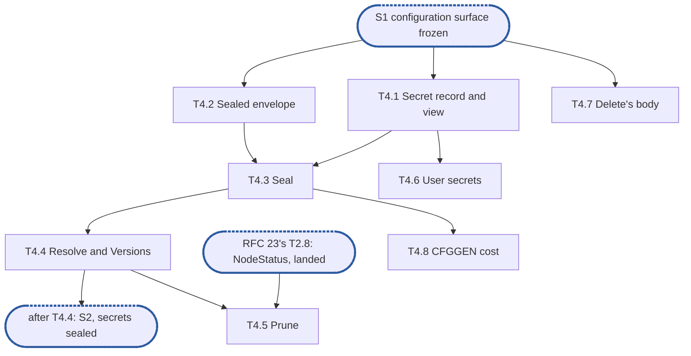

# Epic 4: configuration v2, secrets

**Sources:** [RFC 13](../rfcs/rfc-13-configuration.md) §7 ("Secrets", but its material bullets,
which are RFC 5's, and the wrapping key's reseal pass), §2.2's wrapping-key row, §5's settings
generation as a `Secret` write raises it, and §9's rows "§7 role keys" and "§7 user secrets";
[RFC 16](../rfcs/rfc-16-metadata-store.md) §2.3's `Secret` and `SecretOwner`, §3's `Secret`,
`PutSecret` and `PruneSecret`, `DeleteUser`'s last transaction, and §4.2's `SEC‖id‖version` and
`CFGGEN` rows; [RFC 23](../rfcs/rfc-23-control-plane.md) §2.4's secret versions in a node's status
and §5.2's "a secret is written as its owner is", for the owner a seal records.
**Track:** C.
**Epic 4 estimate: 8 subtasks, 12 man-days.**
**Depends on:** S1, the configuration surface frozen by E1: `pkg/secrets`' `Provider`, `New`, its
five methods, `Meta`, `Version` and errors with stub bodies; `entity.Secret`, `SecretKind` and
`SecretOwner`; the kvstore view's `Secret`, `PutSecret` and `PruneSecret` stubs, with their
transaction forms and a tracked `Secret` read on `ControlPlaneTx`; and `pkg/keyprovider`, moved
there by E1. RFC 23's T2.8, the `NodeStatus` record with its secret versions and the node view's
`NodeStatuses`, which has landed on `feat/storage-v2` (#4527), for T4.5.
**Blocks:** the RFC 18 plan's epic 2, which seals and resolves identity's NT hashes and password
hashes (S2); RFC 23's epic 5, whose signing key (its T5.3), `dfs init` (its T5.4) and
`reset-admin` (its T5.10) seal through `pkg/secrets` (its X1, at S2); E3's T3.7, whose `Check`
tests need sealed secrets (S2); E5, which re-resolves secrets in the node's reconcile and calls
`Prune` for a bind credential and the OpenID Connect client secret.

---

## 1. Goal

Epic 4 makes a secret a sealed record. A value is sealed under the wrapping key of the role its
kind belongs to, as a new version of its reference, bound to its kind, owner, reference and
version, and committed by its caller beside the change that names it. A holder resolves it only as
the kind and owner it expects. An old version is pruned once no node holds it, and a user's
secrets go with the user.

**At the end of the epic:**

- a `Secret` is stored one key per version, raising the settings generation with every write, and
  a new version keeps its kind and owner (T4.1);
- a sealed value opens only under its role's key and only with the role, kind, owner, reference,
  version and handed-over mark it was sealed with (T4.2, T4.3);
- `Resolve` and `Versions` open a secret only as the kind and owner the caller expects, so a
  reference pointed at another holder's secret fails: S2 (T4.4);
- `Prune` drops the versions below the lowest one any node reports holding, never the current one
  (T4.5);
- RFC 13 §9's "§7 user secrets" row passes over the resumable user deletion that exists, a
  restart in the middle included (T4.6);
- the cost of one settings generation for every secret write is measured (T4.8).

### 1.1 In scope

The `Secret` record's codec and the secrets view, on kvstore's control-plane view and on
`ControlPlaneTx`; the sealed envelope; `Seal`, `Resolve`, `Versions` and `Prune`; RFC 13's plan's
D9 refusal at `Seal`; RFC 13 §9's "§7 user secrets" row as a test; `Delete`'s body until
RFC 16 has a secret delete; the benchmark of the settings generation's cost.

### 1.2 Out of scope

- `keyprovider`'s move to `pkg/keyprovider`: E1 (its D3, pending #4479), since `Bootstrap` names
  each role's key as a `keyprovider.Config`.
- Loading both wrapping keys from the bootstrap and refusing two roles on one key: E2 (its T2.4
  and D9). This epic takes the two `keyprovider.KeyProvider`s through E1's `New`.
- Configuration holding a reference rather than a value, and `Check` refusing a reference to
  another kind or owner: E3 (its T3.7), on the tracked `Secret` read this epic fills.
- Re-resolving a moved secret in the node's reconcile, writing the versions a node holds to its
  `NodeStatus.Secrets`, calling `Prune` for a bind credential and the OpenID Connect client secret,
  and the revocation report: E5. So is `config_secrets_behind` (D6).
- The API's secret routes, which derive a seal's owner from the record they write and check its
  write role: E5, in RFC 23's epic 4 slots.
- Who rotates and prunes each other kind: a password hash and the signing key, RFC 23's epic 5; NT
  hashes, keytabs and the machine password, the RFC 18 plan. Turning NTLM off deletes NT hashes
  through kvstore (the RFC 18 plan's epic 2), not through `pkg/secrets`.
- The wrapping key's reseal pass and "§7 rotation"'s wrapping-key half (RFC 13's plan, O1).
- RFC 13 §7's material bullets: master keys, namespace keys and the key table, RFC 5's plan.
- A whole-secret delete in RFC 16 §3, and `Delete` on it (D7).
- A user's secrets in its deletion's last transaction: the `Password` reference is RFC 23's plan's
  T2.11, landed with its restart test, and the `NTHash` reference the RFC 18 plan's T2.8 (D8).

### 1.3 Names used here

- **E1**, epic 1, the configuration surface: the frozen declarations of `pkg/bootstrap`,
  `pkg/settings` and `pkg/secrets`, and the kvstore views' stubs.
- **E2**, epic 2, bootstrap, node identity and versions. Track A.
- **E3**, epic 3, settings: sections, the effective value, the write check, classes. Track B.
- **E4**, this epic. Track C.
- **E5**, epic 5, **the integration epic**: RFC 23's node and API on this library.
- **E6**, epic 6, E2E green: RFC 13 §9's single-node rows through the API.
- **S1**, the configuration surface frozen: E1 has merged.
- **S2**, secrets sealed: a `Secret` seals, resolves and versions under each role's key. Reached
  after T4.4.
- **RFC 23's T2.8**, the node records, `NodeStatus` among them, and the node view. **RFC 23's
  X1**, what its epic 5 waits on from this library.
- **D9** and **D10** with RFC 13's plan named are its decisions on a store credential's change and
  on a reference's kind and owner; **D1** to **D8** without a plan named are this epic's own (§4).

## 2. How the general rules apply

The rules are those of
[RFC 13's plan, §1.5](rfc-13-config-plan.md#15-general-rules-for-each-epic), cited by number and
title and not copied.

| Rule | Subtasks | How |
| --- | --- | --- |
| rule 1, independent unit tests ([`CLAUDE.md`, "Writing tests"](../../../CLAUDE.md#writing-tests)) | all | on RFC 16's in-memory KV suite and on Badger under `t.TempDir()`, `keyprovider`'s local provider over two real key files, one per role, and `kvtest`'s `FaultKV`. No test double of `pkg/secrets` or of the view |
| rule 2, fuzz every decoder of untrusted bytes | T4.1, T4.2 | the `Secret` record's codec (T4.1) and the envelope's parser (T4.2), each round-tripping what it accepts and never panicking on what it refuses |
| rule 3, observability follows RFC 25 | none | `config_secrets_behind` counts versions a node holds, which only E5's reconcile knows (D6). No label would carry a secret: no series here |
| rule 4, profiling | all | every test under `internal/prof`'s leak check; the benchmark of T4.8 reports allocations |
| rule 5, public interface and internals ([`CLAUDE.md`, "Verifying a change"](../../../CLAUDE.md#verifying-a-change)) | T4.3 to T4.6 | a seal is proven by opening it, and failing under the other role's key; a prune by `Secret` returning `ErrNotFound`; a user's deletion by reading the store's raw keys |
| rule 6, known failures shrink | none | no suite with a `known.yaml` is touched |
| rule 7, v2 ignores v1 | none | v1 holds no `Secret`; `keyprovider` is used as E1 moved it |
| rule 8, real dependencies for properties of those dependencies | T4.3, T4.4, T4.6 | sealing on real key files; the commit that fails after a seal, and the user deletion's restart, on Badger under `t.TempDir()` |
| rule 9, code comment conventions ([`CLAUDE.md`, "Code comments"](../../../CLAUDE.md#code-comments)) | T4.3 to T4.5, T4.7 | RFC 13's plan's D9 `decision:` note at `Seal`'s refusal; D5's at `PruneSecret`; `ponytail:` markers for `Resolve`'s missing cache, the missing reseal pass and the one passphrase variable (at `Resolve`, at `Provider` and at `New`), and for `Prune` on one node (at its floor) |
| rule 10, a test must be able to fail | all | each test names the bug it catches in §6 |
| rule 11, a symbol is exported only if RFC 13's interfaces use it | T4.5 | nothing in `pkg/secrets` is added to E1's frozen set. kvstore's `ControlPlane` gains `NodeStatuses` (D4), the one read `Prune` needs |
| rule 12, each subtask creates only what it declares | all | the envelope lands with `Seal`'s first caller in the next subtask, and no helper lands before its test |

## 3. Requirements and invariants

Every obligation RFC 13, RFC 16 and RFC 23 place on this epic, and the ones RFC 13's plan sets for
it, numbered so that subtasks and tests can cite them.

**The record and its view**

| # | Requirement | Kind | Source | Subtasks |
| --- | --- | --- | --- | --- |
| R1 | A `Secret` holds its ID, kind, version, key ID, owner, sealed value, `KeyVersion` and `HandedOver`, encoded with the version; an owner is compared whole | MUST | RFC 16 §2.3 | T4.1 |
| R2 | One key per version, `SEC‖id‖version`; `Secret(id, 0)` reads the current version, still sealed, and a pruned version reads `ErrNotFound` | MUST | RFC 16 §3, §4.2 | T4.1, T4.5 |
| R3 | `PutSecret(s, expect)` writes a new version, `expect` naming the current one and 0 for the first; a stale `expect` is `ErrGenerationMismatch` | MUST | RFC 16 §3 | T4.1 |
| R4 | A new version keeps its kind and owner: `PutSecret` refuses another with `ErrInvalid`, and `Seal` refuses one naming others | MUST | RFC 13 §7 (`Seal`); RFC 16 §2.3, §3 | T4.1, T4.3 |
| R5 | Every `Secret` write raises the settings generation in its own transaction | MUST | RFC 13 §5, §10 item 11; RFC 16 §4.2 (`CFGGEN`) | T4.1 |
| R6 | The view's writes have their `ControlPlaneTx` forms, and `ControlPlaneTx` reads a secret version as a tracked read, so a write that checks a reference conflicts with a concurrent seal | MUST | RFC 16 §3 (`ControlPlaneTx`); RFC 13 plan, D10 | T4.1, T4.5 |

**Sealing**

| # | Requirement | Kind | Source | Subtasks |
| --- | --- | --- | --- | --- |
| R7 | A value is envelope-encrypted under a wrapping key held outside the KV, so a copy of the store alone reveals no secret | MUST | RFC 13 §7 | T4.2, T4.3 |
| R8 | Each kind is sealed under the key of the role RFC 13 §7's table gives it; a seal or a resolve naming the other role is refused | MUST | RFC 13 §7 ("Two wrapping keys, one per role"); RFC 13 plan, D4 | T4.3, T4.4 |
| R9 | The sealed value's additional data binds the role, kind, owner, reference, version and `HandedOver`, each field length-prefixed, so a value moved onto another of any of them, or with its mark flipped, fails to open | MUST | RFC 13 §7 (`Meta`); RFC 16 §2.3 (`HandedOver`); RFC 13 plan, D4 | T4.2, T4.4 |
| R10 | Each version gets a fresh data key, wrapped under the role's key | invariant | RFC 13 plan, D4 | T4.2, T4.3 |
| R11 | Each record names the key ID it is sealed under | MUST | RFC 13 §7 ("A wrapping key rotates the same way"); RFC 16 §2.3 (`KeyID`) | T4.3 |
| R12 | `Seal` returns the next version unwritten; its caller commits it with `PutSecret(s, s.Version-1)` inside its own `Write`, beside the record naming it and its audit record, so a version commits with its change or not at all; wrapping runs before that `Write` | MUST | RFC 13 §7 (`Seal`); RFC 23 §6 | T4.3 |
| R13 | `KeyVersion` is written with its version, outside the additional data, and never changed | invariant | RFC 16 §2.3; RFC 13 plan, D4 | T4.3 |
| R14 | `Seal` reads the kind off the stored record: one of kind `remote credential` refuses a new version, and a reseal under another kind is refused as a kind change; a credential's first version passes | MUST NOT | RFC 13 plan, D9 | T4.3 |

**Resolving**

| # | Requirement | Kind | Source | Subtasks |
| --- | --- | --- | --- | --- |
| R15 | `Resolve` returns the current value opened with the role's key; it fails if this node does not hold that role's key | MUST | RFC 13 §7 (`Resolve`) | T4.4 |
| R16 | `Resolve`, `Versions` and `Prune` refuse a record whose kind or owner is not the caller's, and open with the caller's kind and owner in the additional data, so a reference cannot be pointed at another holder's secret | MUST | RFC 13 §7; RFC 16 §2.3 (`Owner`); RFC 23 §5.2; RFC 13 plan, D10 | T4.4, T4.5 |
| R17 | `Versions` opens every version still held, current first, each with its number and `Meta` | MUST | RFC 13 §7 (`Versions`) | T4.4 |
| R18 | No secret value leaves through any other path: no error, log line or metric carries one, and the provider never lists values | MUST NOT | RFC 13 §7 ("Read never returns a secret"); RFC 23 CP11 | T4.3, T4.4 |
| R19 | A version sealed under a retired key ID still opens | invariant | RFC 13 §7; RFC 13 plan, §4.3 (no reseal pass) | T4.4 |

**Rotation and pruning**

| # | Requirement | Kind | Source | Subtasks |
| --- | --- | --- | --- | --- |
| R20 | The previous version stays resolvable until it is pruned | invariant | RFC 13 §7 ("A secret changes without a record change, in two phases"); RFC 16 §2.3 (`Version`) | T4.4, T4.5 |
| R21 | `Prune` drops the versions below the lowest one any node reports holding in its `NodeStatus.Secrets`, never the current one, and trusts no count from its caller | MUST | RFC 13 §7 (`Prune`, "only once every such node reports"); RFC 23 §2.4 | T4.5 |
| R22 | `PruneSecret(id, below)` deletes every version below `below`, never the current one | MUST | RFC 16 §3 | T4.5 |
| R23 | A prune raises no settings generation, since nothing resolves a pruned version (D5) | invariant | RFC 13 plan, §4.3 | T4.5 |

**Deletion**

| # | Requirement | Kind | Source | Subtasks |
| --- | --- | --- | --- | --- |
| R24 | A user's deletion, in the last transaction, the one that deletes its record, deletes every version of each `Secret` the record names | MUST | RFC 13 §7 ("A user's secrets go with the user"); RFC 16 §3 (`DeleteUser`) | T4.6 |
| R25 | `Delete` destroys every version of a secret, checking the caller's kind and owner, and a later `Resolve` fails. Until RFC 16 §3 has a whole-secret delete, its body returns an error naming RFC 16 §3, never `nil` | MUST | RFC 13 §7 (`Delete`); RFC 13 plan, D9 and §6.1 | T4.7 |

**Cost**

| # | Requirement | Kind | Source | Subtasks |
| --- | --- | --- | --- | --- |
| R26 | The commit rate of eight concurrent `Seal` and `tx.PutSecret` writers is measured with the settings generation's raise and without it | bound | RFC 13 plan, §4.3 ("One `CFGGEN` key") | T4.8 |
| R27 | `Resolve` reads one record and unwraps its data key locally, with no network call | bound | RFC 13 plan, §4.3 ("`Resolve` caches nothing") | T4.4 |

Key words in the owned sections that this epic does not carry: RFC 13 §7's first **MUST NOT**
(configuration holds no secret value) is E3's; its lower-case "must" in the export bullet
describes RFC 26's and RFC 27's exports, and in the key-table bullets RFC 5's keys; §2.2's two
**MUST NOT** are E1's and E2's, and its initialise-if-empty one E6's; §5's five-second **MUST** is
E5's, and its other three are the cluster's.

## 4. Decisions this epic takes

- **D1, the envelope.** One format byte, then the wrapped data key with its length, the 12-byte
  GCM nonce and the sealed value with its tag. The additional data is the role, the kind, the
  owner's record kind, record ID, scope and key, the reference, the version and `HandedOver`, in
  that order, each with a four-byte length. An unknown format byte is refused, so a later format
  is a new byte, not a guess. The data key is fresh per version, so a random nonce never repeats
  under one key. No marker.
- **D2, `Seal` reads the current version outside the caller's `Write`.** RFC 13 §7 has wrapping
  run before the `Write`, so `Seal` reads the current version through the view, not through `tx`;
  a concurrent seal since then fails the caller's `PutSecret` expect, which is not retried. No
  marker.
- **D3, a failed commit leaves nothing, by construction.** `Seal` writes nothing, so "a commit
  that fails after sealing leaves no secret behind" is proven on Badger by faulting the caller's
  `Write` with `FaultKV` on its audit record's set, and reading `Secret(ref, 0)` back as
  `ErrNotFound`. No marker.
- **D4, `Prune` reads node statuses through kvstore's `ControlPlane`.** E1's `New` takes
  `kvstore.ControlPlane`, which reaches no node record, and RFC 23's `NodeStatuses` sits on
  kvstore's node view (#4527). T4.5 adds `ControlPlane.NodeStatuses`, forwarding to it, rather
  than changing `New`'s frozen signature. No marker.
- **D5, a prune raises no settings generation.** RFC 13 §5 and RFC 16's `CFGGEN` row say every
  `Secret` change raises it; RFC 16's `PruneSecret` is silent; RFC 13's plan, §4.3, has a prune
  raise none, since no node resolves a pruned version. This epic follows RFC 13's plan, with a
  `decision:` note at `PruneSecret`, withdrawn if RFC 16 says a prune raises it (§9).
- **D6, `config_secrets_behind` is E5's.** It counts the secrets a node holds at an older version
  than the current one. Only the reconcile that resolves them and writes `NodeStatus.Secrets`
  knows what the node holds, and E1's frozen `New` takes no metrics registry. E5, which owns RFC
  13 §8 as a whole, records it there. No marker.
- **D7, `Delete` keeps its frozen signature and fails loudly.** RFC 16 §3 has no whole-secret
  delete, and `ControlPlaneTx` on `feat/storage-v2` has no secret write at all. `Delete`'s body
  returns an error naming RFC 16 §3; its checks, RFC 13's plan's D9 refusal of a credential a store
  record names, and its write inside the caller's `Write` come with that amendment, when `Delete`
  takes the caller's `ControlPlaneTx`. Nothing calls it before then. A `decision:` note at its body
  says so.
- **D8, a user's secrets ride on the deletion that exists.** On `feat/storage-v2` a user's deletion
  is already resumable: `DeleteUser` marks, and `ContinueDelete`'s last batch deletes every
  `SEC` version of the user's `Secret` reference and raises the settings generation
  (`pkg/metadata/kvstore/principaldelete.go`, RFC 23's plan's T2.11). The RFC 18 plan's T2.8 adds
  the `NTHash` reference to that batch. This epic changes no deletion code: T4.6 runs RFC 13 §9's
  "§7 user secrets" whole over it, its restart clause included, with the password rotated through
  this epic's `PutSecret`. No marker.

## 5. Target tree

```text
pkg/metadata/kvstore/secrets.go          T4.1  Secret, PutSecret and their tx forms; the tracked read
pkg/metadata/kvstore/codecs.go           T4.1  the Secret record's codec
pkg/metadata/kvstore/secrets_fuzz_test.go T4.1  the codec's fuzz target
pkg/secrets/envelope.go                  T4.2  the envelope and its additional data
pkg/secrets/envelope_fuzz_test.go        T4.2  the envelope parser's fuzz target
pkg/secrets/seal.go                      T4.3  Seal, the role check, D9's refusal
pkg/secrets/resolve.go                   T4.4  Resolve and Versions
pkg/metadata/kvstore/secrets.go          T4.5  PruneSecret and its tx form
pkg/metadata/kvstore/users.go            T4.5  ControlPlane.NodeStatuses (D4)
pkg/secrets/prune.go                     T4.5  Prune
pkg/metadata/kvstore/usersecrets_test.go T4.6  RFC 13 §9's "§7 user secrets" row
pkg/secrets/delete.go                    T4.7  Delete's body (D7)
pkg/secrets/bench_test.go                T4.8  the settings generation's cost
```

## 6. Subtasks

### T4.1 The `Secret` record and the secrets view

**Subtask T4.1 estimate: 2.5 man-days.**

- **Track:** C. **Depends on:** S1.
- **Covers:** R1, R2, R3, R4, R5, R6.
- **Deliverables:** the `Secret` record's codec under `KindSEC`, one key per version; the bodies
  of E1's `Secret(ctx, id, version)` and `PutSecret(ctx, s, expect)` on kvstore's `ControlPlane`
  and of their `ControlPlaneTx` forms, the tracked `Secret(id, version)` read among them;
  `PutSecret` raising `CFGGEN` in its transaction and refusing a kind or owner change with
  `ErrInvalid`; the codec's fuzz target.
- **Acceptance criteria:**
  - Version 0 reads the current version; an absent reference reads `ErrNotFound`.
  - A first put with `expect` 0 passes, a second with 0 is `ErrGenerationMismatch`.
  - Every put raises `CFGGEN` by one in its own transaction.
- **Tests:** a put with a stale `expect` refused (catches a blind write); a second version with
  another kind, then another owner, refused (catches a reference moved to another holder); `CFGGEN`
  read before and after a put, and after a put whose transaction is faulted (catches a raise
  outside the transaction); a `ControlPlaneTx` that reads a secret, while a second writer puts a
  new version, retried (catches an untracked read); the codec's fuzz target, seeded with each
  field at its limits.

### T4.2 The sealed envelope

**Subtask T4.2 estimate: 1.5 man-days.**

- **Track:** C. **Depends on:** S1.
- **Covers:** R7, R9, R10.
- **Deliverables:** `envelope.go`: D1's layout, its builder and parser, the additional data with
  each field length-prefixed, AES-256-GCM over a fresh data key; the parser's fuzz target. Used by
  T4.3's `Seal`, its first caller.
- **Acceptance criteria:**
  - A value opens only with the additional data it was sealed with.
  - An unknown format byte or a truncated envelope is refused, never read short.
- **Tests:** a table that changes one additional-data field at a time, the role, the kind, each
  owner field, the reference, the version and `HandedOver`, and asserts the open fails (catches a
  field left out); two fields whose concatenation is equal but whose split differs (`"ab"`,`"c"`
  against `"a"`,`"bc"`), refused (catches a missing length prefix); the fuzz target, seeded with
  each refusal.

### T4.3 `Seal`

**Subtask T4.3 estimate: 2.5 man-days.**

- **Track:** C. **Depends on:** T4.1, T4.2.
- **Covers:** R4, R8, R10, R11, R12, R13, R14, R18.
- **Deliverables:** `Seal`'s body: the kind's role checked against the caller's (`ErrWrongRole`);
  the current version read through the view (D2); a kind or owner change refused
  (`ErrKindChanged`); RFC 13's plan's D9 refusal on the stored kind (`ErrUnproven`), with its
  `decision:` note; the next version sealed under a fresh data key wrapped by the role's
  `keyprovider`, its key ID recorded; `KeyVersion` and `HandedOver` written from `Meta`. Nothing
  is written. The `ponytail:` markers for the missing reseal pass at `Provider` and the one
  passphrase variable at `New`.
- **Acceptance criteria:**
  - An NT hash sealed under `storage`, or a remote credential under `protocol`, is refused.
  - A second version of a `remote credential`, and a reseal of any record under another kind, are
    refused; a credential's first version passes.
  - No error `Seal` returns carries the value.
- **Tests:** each kind sealed under the other role refused (catches a caller-chosen role); D9's
  two refusals and the first version passing (catches a check on the caller's kind rather than the
  stored one); a canary value sealed with every refusal path driven, and no returned error's text
  holding it (catches a value in an error); on Badger, a seal committed by a `Write` whose audit
  record's set is faulted with `FaultKV`, then `Secret(ref, 0)` reading `ErrNotFound` (D3, catches
  a seal that writes); two seals of one reference from the same current version, the second
  commit refused `ErrGenerationMismatch` (catches a lost version); a provider built with the
  `storage` key only, sealing an NT hash, refused (catches a seal under the key it happens to
  hold).

### T4.4 `Resolve` and `Versions`

**Subtask T4.4 estimate: 2 man-days.**

- **Track:** C. **Depends on:** T4.3.
- **Covers:** R8, R9, R15, R16, R17, R18, R19, R20, R27.
- **Deliverables:** `Resolve`'s and `Versions`' bodies: the role checked against the kind, the
  record's kind and owner checked against the caller's (`ErrWrongKind`), the data key unwrapped by
  the role's key and the value opened with the caller's kind and owner in the additional data;
  `Versions` opening every held version, current first, with its `Meta`. The `ponytail:` marker of
  RFC 13's plan's §4.3 at `Resolve`: no cache.
- **Acceptance criteria:**
  - RFC 13 §9's "§7 role keys" passes: a remote credential and an NT hash each open under their
    own key and fail under the other.
  - A record of another kind or owner is refused before any unwrap.
  - After a key rotation in `keyprovider`, a version sealed under the retired key still opens.
- **Tests:** "§7 role keys" on two real key files (catches one key for both roles); under one key,
  so `keyprovider`'s key-ID check cannot answer first, an envelope copied onto another reference,
  version, role, kind or owner, and one with `HandedOver` flipped, each failing the GCM open
  (catches the additional data not checked on open); a reference resolved with another owner
  refused (catches a lookup by reference alone); three versions, `Versions` returning all three
  current first with their `KeyVersion` (catches a list in key order); a version sealed under a
  key then retired, opening (catches the retired keys not consulted); a provider built with the
  `storage` key only, resolving an NT hash, refused (catches a resolve that falls back to the key
  it holds).

S2 is reached here.

### T4.5 `Prune` against the node statuses

**Subtask T4.5 estimate: 2 man-days.**

- **Track:** C. **Depends on:** T4.4; RFC 23's T2.8 (landed, #4527).
- **Covers:** R2, R6, R16, R20, R21, R22, R23.
- **Deliverables:** `PruneSecret`'s body on the view and on `ControlPlaneTx`, deleting every
  version below `below`, never the current one, raising no `CFGGEN`, with D5's `decision:` note;
  `ControlPlane.NodeStatuses` (D4); `Prune`'s body: the current version's kind and owner checked as
  `Resolve` does, the floor read as the lowest version any node's `NodeStatus.Secrets` reports for
  the reference, capped at the current version, then `PruneSecret` below it. A `ponytail:` marker
  at the floor: one node's report counts, and a node that is down holds the prune back (RFC 13's
  plan, §4.3).
- **Acceptance criteria:**
  - A version a node's status still reports is kept; with no node reporting the reference, every
    version but the current one goes.
  - `PruneSecret` never removes the current version, whatever `below` is.
  - A prune with another kind or owner removes nothing.
- **Tests:** statuses written through the node view, one node reporting version 2 of three, and
  `Prune` keeping versions 2 and 3 (catches a caller-trusted count); three nodes reporting
  versions 3, 1 and 2, written in both node ID orders, `Prune` keeping all three (catches a floor
  read from the first, last or highest status); a node whose status lists only other references,
  ignored (catches a missing reference read as version 0); more statuses than one page of
  `NodeStatuses`, the lowest on the last page (catches a floor read from the first page only);
  `PruneSecret(id, 99)` on a three-version secret leaving version 3 (catches a prune of the
  current one); a pruned version read back as `ErrNotFound`, and `CFGGEN` unchanged by the prune
  (catches a prune that raises the generation);
  `Prune` with another owner refused, every version still there (catches a wrong reference cutting
  another holder's retention).

### T4.6 A user's secrets go with the user

**Subtask T4.6 estimate: 0.5 man-days.**

- **Track:** C. **Depends on:** T4.1.
- **Covers:** R24.
- **Deliverables:** RFC 13 §9's "§7 user secrets" row as a kvstore test, on the restart harness
  the resumable deletion's own test uses; no change to the deletion (D8).
- **Acceptance criteria:**
  - A user with a password, rotated once through `PutSecret`, deleted, leaves no version of it in
    the store's raw keys, and a restart mid-deletion still leaves none once it resumes.
- **Tests:** "§7 user secrets" on Badger, the password at two versions (catches a deletion of the
  current version only); the same with the process stopped after the mark and after the first
  batch, then resumed (catches a secret deleted outside the record's transaction, lost to the
  restart).

### T4.7 `Delete`'s body until RFC 16 has a secret delete

**Subtask T4.7 estimate: 0.25 man-days.**

- **Track:** C. **Depends on:** S1.
- **Covers:** R25.
- **Deliverables:** `Delete`'s body returning an error that names RFC 16 §3, with D7's `decision:`
  note.
- **Acceptance criteria:** `Delete` never returns `nil`, and destroys nothing.
- **Tests:** `Delete` on a sealed secret returns the error, and `Resolve` still opens it (catches a
  silent no-op that a caller would read as done).

### T4.8 The settings generation's cost

**Subtask T4.8 estimate: 0.75 man-days.**

- **Track:** C. **Depends on:** T4.3.
- **Covers:** R26.
- **Deliverables:** a `manual`-tier benchmark of eight concurrent `Seal` and `tx.PutSecret`
  writers on Badger under `t.TempDir()`, with `ReportAllocs`, and as its baseline the same `Seal`
  and a raw KV set of the version's key without the `CFGGEN` raise, written in the benchmark
  itself, so the view keeps no switch. Compared by `benchstat` over `-count=10`. The trigger of
  RFC 13's plan's §4.3 is the run with the raise committing under half the baseline's rate.
- **Acceptance criteria:** both runs report commits per second and allocations per commit.
- **Tests:** the benchmark itself, run once in the `manual` tier.

## 7. Order of work



T4.1 and T4.2 start at once. S2, after T4.4, is the checkpoint the RFC 18 plan's epic 2, RFC 23's
epic 5 and E3's T3.7 wait on, so the epic starts with the record, the envelope and sealing. T4.5
to T4.8 follow in any order.

## 8. Suggested pull requests

| PR | Subtasks | Man-days | After | Why together |
| --- | --- | --- | --- | --- |
| 1 | T4.1, T4.2, T4.3, T4.4 | 8.5 | none | the record, the envelope, sealing and resolving: S2 |
| 2 | T4.5, T4.6, T4.7, T4.8 | 3.5 | PR 1 | rotation's prune, the user's deletion, `Delete`'s body and the benchmark |

A suggestion only: one pull request per subtask works as well.

## 9. Open points

- **A prune and the settings generation.** RFC 13 §5 and RFC 16's `CFGGEN` row say every `Secret`
  change raises it; RFC 16's `PruneSecret` does not say; RFC 13's plan has a prune raise none. D5
  follows RFC 13's plan until RFC 16 says which.
- **The secret kinds.** RFC 16 §2.3's `Secret.Kind` has no kind for the directory's bind
  credential or the OpenID Connect client secret, and RFC 13 §7's table gives the node credential
  no role and leaves the client secret out, which RFC 23 §5.5 seals under `storage`. #4491 adds
  `directory credential` and `client secret`, the latter under `storage`, and seals the node
  credential under `protocol`. This epic seals the kinds E1 declares (its D8, pending #4472); T4.3's
  role test reads E1's kind table, so a kind #4491 adds is covered without a change here. Pending
  #4491.
- **A whole-secret delete.** RFC 13 §7's `Delete` and RFC 23 §3's "set, rotate, delete" route have
  no RFC 16 §3 method under them. `Delete` waits (D7).
- **Pruning through kvstore.** RFC 23's epic 5 and the RFC 18 plan's epic 2 prune a password hash,
  an NT hash and the signing key with `tx.PruneSecret` inside their `Write`, not through `Prune`,
  since nothing reports those versions or the signing key's retention is a time. T4.5 fills that
  transaction form with the same body.
- **The installation's signing key has no setter.** `ControlPlaneTx` on `feat/storage-v2` has
  `SetMachinePassword` but nothing that writes `Installation.SigningKey`, which RFC 23's epic 5
  commits beside its first version. That setter is RFC 23's epic 5's.
- **Moved to E1.** `keyprovider`'s move (E1's D3, pending #4479). If #4479 changes, the move comes
  back here.
- **Moved to E5.** `config_secrets_behind` (D6).
- **The estimate.** 12 man-days in 8 subtasks, against 6 and 14 first estimated (13.5 once E1
  takes the move): the envelope, `Delete`'s body and the benchmark are subtasks of their own, and
  the user's deletion is only a test, since the resumable deletion exists and the RFC 18 plan's
  T2.8 adds the `NTHash` reference.
