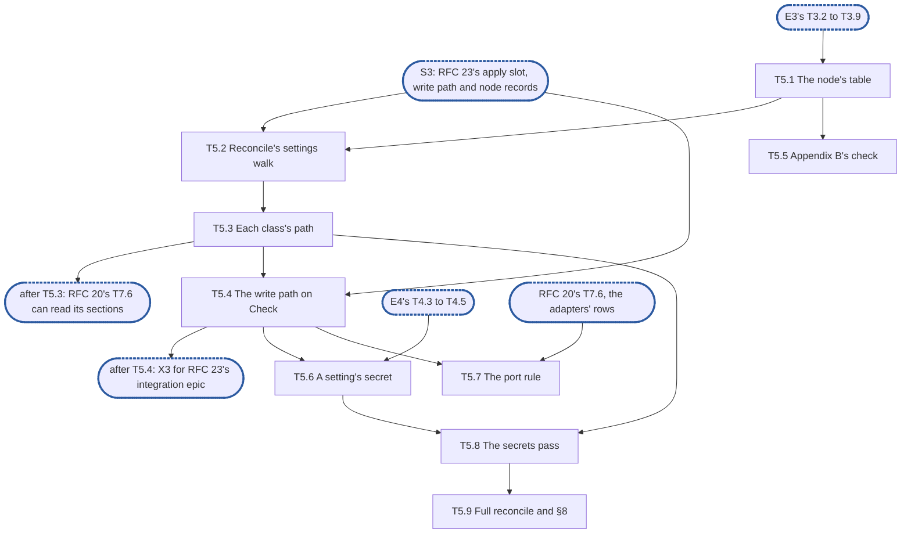

# Epic 5: configuration v2, integration

**Sources:** [RFC 13](../docs/internals/rfcs/rfc-13-configuration.md) §5 (the live bound and each
class's path on a node; §5.3's bound setting recorded with the namespace), §6 ("Refused, never replaced", "Checked twice", "A record that does not
validate stops only what it configures", the port rule of "A rule across settings"), §7 ("A secret
changes without a record change, in two phases", `Seal`, `Versions`, `Prune`), §8 as a whole, §9's
rows "§3 scope forms" and "§7 rotation" (its credential half, on one node) and Appendix B's check
(RFC 13's plan, D3); [RFC 23](../docs/internals/rfcs/rfc-23-control-plane.md) §2.3 (reconcile's
settings walk and its `Secret` row), §2.4 (the reconciled position, the refused and restart-pending
sets, the secret versions held) and §5.2 ("A secret is written as its owner is", the `admin`-only
settings); RFC 23's plan's deferral ledger, its rows for a remote store's credential on its create,
for a store's and a namespace's delete under `Check`, and for RFC 13 §6's port rule;
[RFC 16](../docs/internals/rfcs/rfc-16-metadata-store.md) §2.3 (`Namespace.Bound`, "encoded by RFC
13's settings schema").
**Track:** the team.
**Epic 5 estimate: 9 subtasks, 18 man-days.**
**Depends on:** E2, E3 and E4, whose bodies it wires: E3's `Of` and `Table` (T3.2), `Read` and `Get`
(T3.4), `Check` and its gates (T3.5, T3.6, T3.7), `Diff` and `Keep` (T3.8), its series and reconcile
benchmark (T3.9); E4's `Seal` (T4.3), `Versions` (T4.4) and `Prune` (T4.5); E2's loaded bootstrap,
whose two wrapping keys build the provider. S3, outside RFC 13's plan: RFC 23's reconcile with its
`apply` slot (`internal/node/reconcile.go`, on `feat/storage-v2`), its epic 2's `Nodes.AllSettings`
(T2.8, landed) and `NodeStatus` record (#4527, landed), and its epic 4's settings, store, namespace,
adapter and secret routes, which already call `Check` through `checkSetting` with the caller's role,
and `Deps.Sealer` (its T4.9, #4994, landed). RFC 20's plan's T7.6, the adapters' section types, for
T5.7 only.
**Blocks:** E6, which runs RFC 13 §9's single-node rows on the wired server; RFC 23's integration
epic (its epic 7, through X3), whose rows that write a setting wait for `Check` on the routes; RFC
20's plan's T7.6, which reads each adapter's section from the snapshot this epic's reconcile
publishes; the RFC 18 plan's epic 8, which lists identity's sections in this epic's table and runs
under its Appendix B check.

---

## 1. Goal

Epic 5 puts RFC 23's node and API on the configuration library. The node reads its settings
through one table and one walk, takes each change down its class's path, resolves again the
secrets it keeps, reports what it holds, and prunes what no node holds any more. The API checks
every settings write through the same table before it commits, and seals a setting's secret as
its owner writes it.

**At the end of the epic:**

- `internal/node/settings.go` holds the one table, RFC 23's own sections in it, handed to the API
  and to reconcile (T5.1);
- reconcile reads every setting in one paged walk, discards a walk the settings generation moved
  under, holds or keeps a refused section, publishes one snapshot, and reports the generation it
  read through (T5.2);
- a live change runs within 5 s, a restart-class one lands in the restart-pending set, and a
  next-write one is read by the next write (T5.3);
- the API's `Check`, already called by every settings-backed route, judges through the node's
  table with a tracked content read that fails closed, a store's or a namespace's delete
  removes its scope, and a namespace's record carries its bound settings in `Bound` (T5.4);
- a key the table declares that Appendix B lacks, or holds otherwise, fails a test (T5.5);
- a setting's secret is sealed before its `Write` and committed beside the row that names it
  (T5.6);
- the adapters' two effective ports cannot be made equal on this node by any write; the port
  mapper's joins the rule when its section is declared (D8) (T5.7);
- a rotated bind credential is resolved again, reported, pruned and reported revocable, RFC 13
  §9's "§7 rotation" on one node (T5.8);
- every RFC 13 §8 series is on the node's registry with closed labels, and the full reconcile is
  measured at 10⁴ shares (T5.9).

### 1.1 In scope

The node's table and RFC 23's sections in it; `apply` filled on `Read`, `Diff`, `Keep` and `Get`;
the restart-pending set and the secret versions in `NodeStatus`; the table handed to the API's
`Check`, its content read and the two RFC 23 ledger rows on stores and namespaces; a namespace's
`Bound` written at its create through `pkg/settings`' codec; the write of a
setting's secret; RFC 13 §6's port rule at write, on this node; the secrets pass in reconcile, its
prune and revocation report; `config_secrets_behind`; Appendix B's check; the full reconcile
benchmark.

### 1.2 Out of scope

- Each component's section type and its Appendix B rows: the component's own plan (RFC 13's plan,
  O4). The identity sections are the RFC 18 plan's T8.1; the adapters' sections and
  `connection_limit`'s are RFC 20's plan's T7.6 (D2).
- What reconcile does inside an adapter's slot, `Reconfigure` or the rebuild a changed port takes,
  and RFC 13 §9's "§5 adapter port": RFC 20's plan's T7.6.
- RFC 13 §6's port rule at start, a port equal to the API's or the metrics listener's: the plan's
  deferral ledger row "RFC 13 §6's port rule at start", owner RFC 20's plan's epic 7.
- RFC 13 §6's port rule on every node an installation write reaches, past this node (D8): the
  plan's deferral ledger row "RFC 13 §6's port rule on every node a write reaches", owner RFC 16
  §3 with RFC 15. The rule's `sidecars.portmap.port` (D8): the row "the port mapper's port in RFC
  13 §6's port rule at write", owner the cutover with RFC 20's concrete sidecars. Both rows are
  added to the plan's ledger in this document's pull request (§9).
- Pruning the OpenID Connect client secret and reporting its old version revocable: the plan's
  deferral ledger row "the OpenID Connect client secret's prune and revocation report", owner the
  RFC 18 plan's OpenID Connect epic, which that plan has not added yet, added through a pull
  request against the plan (§9).
- A store credential's rotation and a store location's proof: RFC 13's plan's D9 refuses both
  (E3's T3.6, E4's T4.3); the plan's ledger row for a remote store's endpoint, bucket, prefix or
  credential change.
- The wrapping key's reseal pass and "§7 rotation"'s wrapping-key half: the plan's ledger row "§7
  rotation's wrapping-key half and its reseal pass".
- Pruning once every node of several reports: the plan's ledger row "Pruning an old secret version
  once every node's status reports the new one", owner RFC 15.
- Who rotates and prunes a password hash, the signing key, NT hashes, a keytab and the machine
  password: RFC 23's plan's epic 5 and the RFC 18 plan (RFC 13's plan, §4.3).
- RFC 13 §9's other single-node rows end to end, "§5 propagation" among them: E6.
- The settings series `config_refused_total` and `config_bound_refusals_total` (E3's T3.9), the
  format series (E2), `config_generation_lag_seconds`, `runtime_applied_generation` and the
  `config_generation_behind` condition (RFC 23's epic 3): built by their owners; T5.9 checks only
  that each reaches the node's registry.
- Comparing a namespace's `Bound` with its configuration at every open, and refusing the open on
  a difference (RFC 13 §5.3): the engine's, RFC 8 §2.4. T5.4 writes what that comparison reads,
  and exports from `pkg/settings` the decode it reads through (D12).
- Reconcile reading only the records above its position: the plan's ledger row "Reconcile reading
  only records above its position", unowned.

### 1.3 Names used here

- **E1**, epic 1, the configuration surface: the frozen declarations of `pkg/bootstrap`,
  `pkg/settings` and `pkg/secrets`.
- **E2**, epic 2, bootstrap, node identity and versions. Track A.
- **E3**, epic 3, settings: sections, the effective value, the write check, classes. Track B.
- **E4**, epic 4, secrets: records, sealing, versions, pruning. Track C.
- **E5**, this epic, **the integration epic**.
- **E6**, epic 6, E2E green: RFC 13 §9's single-node rows through the API.
- **S1**, the configuration surface frozen: E1 has merged.
- **S3**, outside RFC 13's plan: RFC 23's node reconciles with an `apply` slot, its `Node` and
  `NodeStatus` records exist, and its write path has a slot for `Check` (its epics 2, 3 and 4).
- **X3**, RFC 23's plan's name for this epic: `apply` on `Diff` and `Get`, the write path on
  `Check`, RFC 23's own section in the node's table.
- **RFC 23's T2.8**, `Nodes.AllSettings` and the node records; **RFC 23's T4.9**, the store,
  namespace, secret, adapter and settings routes; **RFC 20's T7.6**, the adapters' rows on the
  snapshot; **the RFC 18 plan's T8.1**, identity in the node and its sections in the table.
- **D2**, **D3**, **D9**, **D10** and **D11** with RFC 13's plan named are its decisions (the table,
  Appendix B's check, a store location's change, a reference's kind and owner, the one schema);
  **D1** to **D10** and **D12** without a plan named are this epic's own (§4). **O1** and **O4** are the plan's
  open points on its deferred scope and on the components' sections.

## 2. How the general rules apply

The rules are those of
[RFC 13's plan, §1.5](rfc-13-config-plan.md#15-general-rules-for-each-epic), cited by number and
title and not copied.

| Rule | Subtasks | How |
| --- | --- | --- |
| rule 1, independent unit tests ([`CLAUDE.md`, "Writing tests"](../CLAUDE.md#writing-tests)) | all | on `internal/node/nodetest`'s harness over Badger under `t.TempDir()`, `keyprovider`'s local provider over two key files, the API handler with the caller fixed through `api.New`, and `kvtest`'s fault wrapper (kind 3) to pause or fail a read on cue. A section the test needs and the table lacks is declared by the test and handed to the node as an input through `export_test.go`, never a double of `pkg/settings` |
| rule 2, fuzz every decoder of untrusted bytes | T5.4 | one decoder here, `Bound`'s, a new on-disk format the engine's open reads: `FuzzBound` beside it in `pkg/settings` (D12). A setting's value is E3's `FuzzDecode`, the `Secret` codec and envelope E4's. The Appendix B parser reads a file of the repository, not untrusted bytes |
| rule 3, observability follows RFC 25 | T5.8, T5.9 | `config_secrets_behind` recorded by the secrets pass, unlabelled; T5.9 checks every RFC 13 §8 series on the node's registry and that none carries a record or secret label |
| rule 4, profiling | all | every test under the leak check; T5.9's benchmark reports allocations |
| rule 5, public interface and internals ([`CLAUDE.md`, "Verifying a change"](../CLAUDE.md#verifying-a-change)) | T5.2, T5.3, T5.4, T5.6, T5.8 | a live change is proven by the component running the new value (a sign-in's session lifetime, the sweep's retention), a refusal by the API's answer and the store's raw keys, a rotation by `NodeStatus` and the store's versions, never by the snapshot holding a value |
| rule 6, known failures shrink | none | no suite this epic touches keeps a `known.yaml` |
| rule 7, v2 ignores v1 | none | nothing reads v1's settings tables or its watcher; RFC 20's plan replaced the watcher with this reconcile |
| rule 8, real dependencies for properties of those dependencies | T5.2, T5.4, T5.6, T5.8, T5.9 | the paged walk, the tracked reads' conflicts, a seal's commit and a prune's commit on Badger under `t.TempDir()`; sealing on two real key files |
| rule 9, code comment conventions ([`CLAUDE.md`, "Code comments"](../CLAUDE.md#code-comments)) | T5.3, T5.4, T5.5, T5.7, T5.8 | `decision:` markers at the version reported for a secret (D3), at the content read, which fails closed for a namespace and for a scope with no content rule (D6), at the scope removal (D7), at the port rule's key set and its one node (D8), at the Appendix B file the check reads (D10) and at `Bound`'s encoding (D12). T5.4 withdraws five markers in `internal/node/api`: `checkSetting`'s nil-table `decision:` and `holdsContent`'s `decision:` in `res_settings.go`, the two "no store or namespace can be deleted" `ponytail:` markers in `res_stores.go` and `res_namespaces.go`, and `createNamespace`'s `ponytail:` on the record's empty `Bound` in `res_namespaces.go`. `status.go`'s `ponytail:` on the empty restart-pending set, secret versions and claim generation is narrowed, not withdrawn: T5.3 drops the restart-pending set from it, T5.8 the secret versions, and the claim generation stays |
| rule 10, a test must be able to fail | all | each test names the bug it catches in §6 |
| rule 11, a symbol is exported only if RFC 13's interfaces use it | T5.4, T5.6, T5.8 | `pkg/settings` gains four exports, each added to E1's export pin with its first caller: `(Table).Bound` and `(Table).DecodeBound`, the API's create and RFC 8 §2.4's open, which reads `Bound` and cannot import `internal/node/api` (D12); `(*Snapshot).Secrets` and `(Table).SecretKind`, the node's and the API's (D4); all four pending the user's answer. `internal/node` exports nothing new |
| rule 12, each subtask creates only what it declares | all | the table lands with RFC 23's sections, its first rows; the provider is built in `node.New` with its first caller, T5.6's seal; each other section's row lands with its own plan (D2) |

## 3. Requirements and invariants

Every obligation RFC 13 and RFC 23 place on this epic, and those RFC 13's plan and RFC 23's
deferral ledger set for it.

**The table**

| # | Requirement | Kind | Source | Subtasks |
| --- | --- | --- | --- | --- |
| R1 | The node holds one `settings.Table` naming each declared section with its scope, its override and a class per key, and the API's write check and reconcile both read that one table | invariant | RFC 13's plan, D2 | T5.1, T5.2, T5.4 |
| R2 | RFC 23's own settings, `api.session_lifetime`, `api.token_max_lifetime` and `audit.retention`, are declared in the table at installation scope, live, written by `admin` only; an `audit.retention` under 90 days is refused | MUST | RFC 13 Appendix B; RFC 23 §5.2 | T5.1 |
| R3 | A key the table declares that Appendix B lacks, or holds with another scope, class or write role, fails a test; an Appendix B section no component declares, and an Appendix B key under a declared section's prefix that the section lacks, are reported, not failed | invariant | RFC 13's plan, D3 and O4 | T5.5 |
| R4 | Every entry of Appendix B's scope column is one of the five scopes in one of §3's three forms, a shard override counting as a refinement of share, or "—" with a class of fixed, derived or bootstrap | test row | RFC 13 §9 ("§3 scope forms"), §3 | T5.5 |
| R5 | No section's `Validate` prints the value of a field declared as a reference, since a refusal never prints a credential's value | MUST NOT | RFC 13 §6 (a refusal "MUST NOT print the value … of a key that holds a credential"), §7 | T5.5 |

**Reconcile**

| # | Requirement | Kind | Source | Subtasks |
| --- | --- | --- | --- | --- |
| R6 | Reconcile reads every scope's settings in pages of 256 through `AllSettings`, reads `CFGGEN` before the first page and after the last, reports only the first as applied, and discards the walk when it moved, walking again at the next poll | MUST | RFC 23 §2.3 | T5.2 |
| R7 | A full reconcile runs at start and after any failed read of the store, so a change missed during an outage is found at the next read that works | MUST | RFC 23 §2.3 | T5.2 |
| R8 | A section that does not decode or validate, or whose apply fails, stops only itself: it keeps the snapshot it last ran and is reported refused with its generation and error, while every other section applies | MUST | RFC 13 §6 ("A record that does not validate stops only what it configures"); RFC 23 §2.3, §2.4 | T5.2, T5.3 |
| R9 | A section refused before it ever ran holds its component unstarted; no component runs a default in place of a refused record | MUST NOT | RFC 13 §6 ("Refused, never replaced") | T5.2 |
| R10 | Each walk publishes one snapshot, every section decoded and validated once by reconcile, which a reader loads with no decode and no lock shared with the walk | invariant | RFC 13's plan, epic 5 | T5.2, T5.3 |
| R11 | The node reports the settings generation it has reconciled through: every change up to it applied, refused or marked restart-pending | MUST | RFC 23 §2.4 | T5.2, T5.3 |
| R12 | A live change runs within 5 s of its commit | MUST | RFC 13 §5 | T5.3 |
| R13 | Each changed key takes its class's path: a live one reaches its component, a restart-class one other than an adapter's port lands in the restart-pending set, a next-write one is read by the component's next write | MUST | RFC 13 §5; RFC 23 §2.3, §2.4 | T5.3 |
| R14 | A section with live keys and no way to reach its component fails, and is never reported applied | invariant | RFC 23 §2.4 ("applied"); RFC 13's plan, epic 5 | T5.3 |
| R15 | A live setting written through the API reaches the component that reads it, and a restart-class one lands in the restart-pending set | test row | RFC 13's plan, §1.4 | T5.4 |

**The write path**

| # | Requirement | Kind | Source | Subtasks |
| --- | --- | --- | --- | --- |
| R16 | Every settings-backed write of the API, a put and a delete, is checked by `Check` with the caller's role inside the write's transaction before its row is written, so a refused write commits nothing and its refusal names the key | MUST | RFC 13 §6 ("Checked twice"); RFC 23 §5.2; RFC 13's plan, §4.4 (`Check` on the settings route) | T5.4 |
| R17 | Whether a scope holds content is read through the write's transaction, tracked, so a content write conflicts with a bound change | MUST | RFC 13 §5.1; RFC 13's plan, §4.4 | T5.4 |
| R32 | The content read fails closed: a namespace answers that it holds content while its blocks may still be draining, and a scope kind with no content rule is refused as a store error, never read as empty | invariant | D6; RFC 13 §5.1 | T5.4 |
| R18 | A remote store's credential, set when the store has none yet, is its first value and passes; a store can be created and given its credential | MUST | RFC 13's plan, D9; RFC 23's plan, §6.1 (a remote store's credential on its create) | T5.4 |
| R19 | A remote store's or a namespace's delete, once nothing names it, removes its scope's settings as the scope's removal, never refused as a change of a bound or location key | invariant | RFC 23's plan, §6.1 (a store's and a namespace's delete) | T5.4 |
| R34 | A namespace's bound settings are recorded once, with the namespace, when it is created: its record's `Bound` holds, encoded by the settings schema, every namespace-scope key the table classes bound, with the value the create gives it, else its default, and no other key; a namespace section that declares no bound key records an empty set, never an absent `Bound` | invariant | RFC 13 §5.3; RFC 16 §2.3; D12 | T5.4 |
| R20 | The effective `adapters.nfs.port` and `adapters.smb.port`, a node's override else the installation's value, differ unless 0; a write of either at either scope is checked against the other on the node a node-scope write names, or on this node (`Deps.Node`) for an installation write, reading both tracked in the write's transaction. `sidecars.portmap.port` and every other node an installation write reaches are D8's deferrals | MUST | RFC 13 §6 ("A rule across settings"), Appendix B's port rows; D8 | T5.7 |

**Secrets**

| # | Requirement | Kind | Source | Subtasks |
| --- | --- | --- | --- | --- |
| R21 | A secret a setting names is written as its owner is: authorized as that setting's write, its owner the setting's scope and key; no route writes a secret by reference alone | MUST | RFC 23 §5.2; RFC 13's plan, D10 | T5.6 |
| R22 | A setting's secret is sealed before the `Write` and committed with `PutSecret` inside it, beside the row naming it and its audit record, so a version commits with its change or not at all, and a rerun of the write's function seals nothing again | MUST | RFC 13 §7 (`Seal`) | T5.6 |
| R23 | No secret value appears in an API answer, an audit record, a log line or a metric | MUST NOT | RFC 13 §7 ("Read never returns a secret"); RFC 23 §10, CP11 | T5.6, T5.8 |
| R24 | A `Secret`'s new version is resolved again by the component holding the reference within the live bound | MUST | RFC 13 §7 ("A secret changes without a record change, in two phases"); RFC 23 §2.3 | T5.8 |
| R25 | A reference that fails to resolve, of another kind or owner, failing to unwrap, or under a retired key that is gone, holds or keeps its section and is reported refused, as an undecodable row is | invariant | RFC 13 §6; RFC 13's plan, epic 5 | T5.8 |
| R26 | The node writes to its status the version of each secret it keeps resolved | MUST | RFC 23 §2.4; RFC 13 §7 ("Only once every such node reports the new version does the provider delete the old one") | T5.8 |
| R33 | The version reported for a secret is never above the one its holder resolves | invariant | D3 | T5.8 |
| R27 | For a directory's bind credential, once the node reports the new version, `Prune` drops the old one inside an audited `Write`, and only then is the old credential reported revocable at its service | MUST | RFC 13 §7 (`Prune`; "the control plane report that the old credential may be revoked at its service"); RFC 13's plan, §4.3 | T5.8 |
| R28 | Rotating a credential the node uses: it reports the new version within 5 s, the old version stays resolvable until it does, and only then is the old one deleted | test row | RFC 13 §9 ("§7 rotation", its credential half, on one node) | T5.8 |

**Observability and cost**

| # | Requirement | Kind | Source | Subtasks |
| --- | --- | --- | --- | --- |
| R29 | `config_secrets_behind` counts the secrets this node holds at an older version than the current one, and carries no label naming a secret | MUST | RFC 13 §8 | T5.8 |
| R30 | Every RFC 13 §8 series but the provisioning pair is on the node's registry, and no metric is labelled by record or by secret | MUST | RFC 13 §8 | T5.9 |
| R31 | The full reconcile, the settings walk, `Diff` and the secrets pass, is measured at 10⁴ shares' settings and judged against the 100 ms ceiling of the one-walk `ponytail:` | bound | RFC 13's plan, §4.3 ("Reconcile re-reads every setting"), §4.4 (reconcile on `settings.Diff`) | T5.9 |

Key words in the owned sections this epic does not carry: §5's "**(cluster)**" two-step value is
RFC 15's (the plan's O1); §6's "Some bounds are the host's" is the component's own check,
`connection_limit` at RFC 20's plan's T7.6; §6's write check that reads store state is E3's
`CheckTx`, which T5.7 uses; §7's "the new value is proven as §5.2 proves a new credential" applies
to a store credential, which RFC 13's plan's D9 refuses (E4's T4.3), and to a backup location's,
RFC 26's; §7's wrapping-key rotation, user secrets and material bullets are E4's, the reseal pass's
and RFC 5's; RFC 23 §2.3's "The node that wrote a setting … **MUST** still apply it at once" and
"**MUST NOT** answer on a pass already running" are RFC 23's epics 3 and 4 (`Deps.Applied`), which
this epic's reported position (R11) feeds; RFC 23 §2.4's per-record position is written by the
store (E3's T3.1, RFC 23's epic 2).

## 4. Decisions this epic takes

- **D1, RFC 23's settings are two sections, `api` and `audit`, pending the user's answer.**
  `internal/node/api/apisettings.Settings` (RFC 23's T5.1, #4532) holds `api.session_lifetime`,
  `api.token_max_lifetime` and `audit.retention` in one struct with no `json` or `class` tags, and
  `Of` declares one prefix per section, every key `prefix.<json name>`. So T5.1 splits it into
  `apisettings.Settings` under `api` and `apisettings.Audit` under `audit`, each field tagged
  `class:"live"`, both `WriteRole(entity.RoleAdmin)`; `Validate`'s 90-day floor moves with
  `audit.retention`. RFC 23's later `api.oidc_role_map` and `api.password_sign_in` join the `api`
  section. Changing it once rows exist costs a migration of their keys, none before. No marker.
  Prior art: Kubernetes' component configs, one typed group per prefix (from memory).
- **D2, each row of the table lands with its section, in its owner's change, pending the user's
  answer.** RFC 13's plan has this epic's table "with the adapters' section"; RFC 20's plan's T7.6
  has since decided the adapters' section type (a node-side type embedding the protocol's shape,
  with `Enabled` beside it), and T7.6 needs this epic's `Read`, `Get` and `Diff` in `apply`. So the
  table lands here with RFC 23's sections; RFC 20's T7.6 adds the adapters' rows and
  `connection_limit`'s, the RFC 18 plan's T8.1 identity's, each under T5.5's check, and T5.7
  attaches the port rule to the adapters' rows once T7.6 has added them. No placeholder row is
  written for a section whose type is another plan's. No marker. Prior art: none found.
- **D3, the node learns a reference's version through `Versions`, and the component resolves its
  own value, pending the user's answer.** `Resolve` returns a value with no version, and RFC 23
  §2.4 has the node report the version it holds. The secrets pass calls `Versions` for each
  reference the snapshot holds and keeps the current entry's number, which also proves the
  reference opens under the expected kind and owner (R25); it hands the component nothing but the
  section, whose apply runs again when a reference's version moved, and the component resolves its
  value through its own `pkg/secrets` at that apply (the RFC 18 plan's directory client resolves at
  its dial, so a moved version must make it dial again). A concurrent seal can only raise what the
  component then reads, so the reported version is never above the one held (R33), and a prune
  never drops a held version. A `decision:` marker at the report says so, withdrawn if a holder
  ever resolves before the node reads. `Versions` opens every held version, at most a few per
  reference, so no `ponytail:`. Prior art: Vault's KV v2 returns a secret's version with its data
  (from memory).
- **D4, the references a table declares are read through two exports of `pkg/settings`, pending
  the user's answer.** Reconcile must list the references a snapshot holds, and the API must know
  whether a key is a reference and of which kind, and E1's frozen surface exposes neither.
  `(*Snapshot).Secrets() []SecretUse` lists each reference with its section, key, scope, kind and
  `entity.SecretRef`; `(Table).SecretKind(key string) (entity.SecretKind, bool)` answers the
  route. Both are added to E1's export pin with their first caller, as E3's `FormatVersion` was.
  The alternative, a per-section list of reference fields in the node and the API, repeats every
  `SecretRef` option and drifts silently. No marker. Prior art: none found.
- **D5, a section reaches its component by an apply or by being read at use.** RFC 23's
  sections are read where they are used: a sign-in loads the snapshot for the session lifetime, a
  token's creation for its maximum, the sweep's turn for the retention, so each change reaches its
  reader on the next operation, RFC 13 §5's live. The node holds one map from section to its
  apply, or to "read at use"; a section with live keys in neither fails at the first reconcile that
  sees it changed (R14). RFC 23's epic 3's 90-day constant in the sweep goes. No marker. Prior art:
  Kubernetes' kubelet hands its config to components by the pointer each reads at use (from
  memory).
- **D6, whether a scope holds content is answered per scope kind, failing closed.** It replaces
  `holdsContent` in `internal/node/api/res_settings.go`, which answers "holds content" for every
  scope, and its `decision:`. A remote store holds content while a namespace names it
  (`ControlPlaneTx.StoreNamed`, tracked). A namespace keeps answering that it holds content,
  whether or not a share names it: once its last share is removed, `NamespaceNamed` reads false,
  but RFC 9 §7.6 keeps its blocks, keys and claim until GC drains it, and a `Target` or chunking
  key changed then makes that content unreachable, which RFC 13 §5.1 refuses. No `ControlPlaneTx`
  read says whether a share holds content, and no share-scope bound setting is declared yet (case
  sensitivity and the entry-digest key are fixed at the share's creation), so a share scope and
  every other kind answer an error naming the scope, which `Check` returns as a store error, never
  as "no content". The `decision:` marker at the closure names two windows. A namespace's bound
  settings stay refused for its whole life; once the drain is readable in the transaction, a
  namespace holds content while a share names it or its drain is unfinished. A store reads empty
  once its last namespace's record is deleted, while GC still drains that namespace's blocks in
  it, because `deleteNamespace` drops the record at once (its `ponytail:`); this exposes only a
  store's bound keys other than its location, since RFC 13's plan's D9 refuses a location change
  with or without content, and it closes with the same change, the record kept under its drain
  mark so that `StoreNamed` reads true until the drain ends. Withdrawn when the drain is readable
  in the transaction or a share-scope bound setting is declared. Prior art: none found.
- **D7, a store's or a namespace's delete is its scope's removal, not a change.** Once the delete's
  transaction finds the scope deletable, `StoreNamed` reading false for a store and
  `NamespaceNamed` for a namespace, the route deletes every setting row it listed at that scope with
  `DeleteSetting`, without `Check`: a removed scope has no effective value left to change, and the
  route's own role check is the write's authorization. A namespace's settings go with its record,
  as `deleteNamespace` does today, so they share the window its `ponytail:` names: when GC's drain
  lands and the record stays under its drain mark, the settings stay with it and go at the drain's
  end. A `decision:` marker at the route names the rule and its overturn: a store or namespace
  setting whose removal needs a check of its own. Prior art: Kubernetes deletes a namespace's
  objects with the namespace, not object by object under their own admission (from memory).
- **D8, the port rule covers the adapters' ports on one node.** Two narrowings, one `decision:`
  marker at the rule naming both. The port mapper's section is not declared (RFC 20's plan defers
  the concrete sidecars), so `sidecars.portmap.port` has no value to compare: the rule compares the
  adapters' ports, and the port mapper's joins it when its section is declared. And
  `ControlPlaneTx` reads one node's record by its ID (`Node(id)`) and lists none, so the rule reads
  the overrides of the node a node-scope write names, or for an installation write those of the
  node serving the API (`Deps.Node`, the ID `node.New` builds the table with); on one node that is
  every node the write reaches. Each narrowing has its deferral-ledger row (§1.2), added to the plan in
  this document's pull request (§9). Prior art: none found.
- **D9, the prune's audit record is the revocation report.** RFC 13 §7 has "the control plane
  report that the old credential may be revoked at its service" once the old version is deleted.
  The prune commits inside an audited `Write` (E4's T4.5), so its audit record names the reference
  and the versions dropped, and a log line at `Info` names the reference, never a value. No second
  channel. No marker. Prior art: Vault audits a lease's revocation (from memory).
- **D10, Appendix B's check reads the RFC copy in its own checkout.** The test runs on
  `feat/storage-v2`, whose `docs/internals/rfcs/` lags develop and takes RFC text only through the
  batched `-x` cherry-pick of develop's RFC pull requests. The test parses
  `docs/internals/rfcs/rfc-13-configuration.md` as the branch it runs on holds it, so an Appendix B
  change reaches the check through that cherry-pick, and nothing reads develop at test time. A
  plan adding rows to the table (RFC 20's T7.6, the RFC 18 plan's T8.1) whose Appendix B text
  changed on develop lands that cherry-pick before or with its rows; the check failing on the
  stale copy is the signal. Today's drifts (the `remote.*` key names, `adapters.<protocol>.enabled`,
  `tracing.*`'s class) touch no declared section, so they are reported, not failed (R3). A
  `decision:` marker at the file path says so, withdrawn if the RFCs ever live in one copy. Prior
  art: none found.
- **D12, a namespace's `Bound` is a JSON object of every bound setting's effective value,
  encoded and decoded by `pkg/settings`, pending the user's answer.** RFC 16 §2.3 has
  `Namespace.Bound` "encoded by RFC 13's settings schema", and RFC 13 §5.3 has a bound setting
  "recorded once, with the namespace, when it is created", but neither states the encoding, and
  `createNamespace` writes the bound fields as setting rows and leaves `Bound` empty (its
  `ponytail:`).
  - *The form.* `{"schema": <n>, "settings": {"<key>": <value>, …}}`: `schema` the settings
    format's schema version its rows carry (RFC 13 §2.3, RFC 13's plan's D11, the one schema), so a
    reader that does not know it refuses the record as it refuses a row; `settings` every
    namespace-scope key the table classes bound, the value the create gives it, else its default
    (a key the create leaves out would otherwise be absent, and a later release that changes the
    default would open the namespace at the new value, the case RFC 13 §5.3 refuses), and
    `{}` for a namespace section that declares no bound key. Each value is the field E3's value
    decode gives, encoded again, never the bytes the row holds: `262144`, `2.62144e5` and
    `"256KiB"` are one value and encode once. Keys sort as `encoding/json` sorts a map's. So one
    set of values has one encoding, whatever order or spelling the request used.
  - *Where it lives.* The writer is the API's `createNamespace` and the reader RFC 8 §2.4's open,
    in the engine, which cannot import `internal/node/api`, so the codec is `pkg/settings`':
    `(Table).Bound(rows []entity.Setting) ([]byte, error)`, the namespace section decoded over
    its defaults with the create's rows and its bound fields encoded, and
    `(Table).DecodeBound(b []byte) (map[string]json.RawMessage, error)`, which refuses a schema
    version the table does not know, a key the table does not class bound at namespace scope and
    a value E3's decode refuses, and returns each value re-encoded as `Bound` writes it. The pair
    reads the class itself, so no `(Table).Class` is exported. Both join D4's two exports in E1's
    export pin, with their first callers.
  - *The comparison.* The open compares decoded values, key by key, never the record's bytes: it
    decodes the record's `Bound` and compares each key with the same key of `(Table).Bound` over
    the namespace's rows now, so it can name the key that differs. Since both sides are encoded
    from decoded values, a byte comparison would agree, and `Bound` stays a record a later schema
    can widen.
  - *The rows stay*: they are the effective value `Check` and reconcile read, and `Bound` is the
    record RFC 13 §5.3's open compares with them.

  `Bound` is a new on-disk format, so `FuzzBound` runs `DecodeBound` beside it (rule 2). A
  `decision:` marker at the encoder states the encoding, and that RFC 13 states none, withdrawn
  when it does (§9). Prior art: Kubernetes records an object's immutable fields in the object
  and refuses their update (from memory).

## 5. Target tree

```text
internal/node/api/apisettings/settings.go   T5.1  Settings (api) and Audit (audit), tagged (D1)
internal/node/settings.go                   T5.1  the one table; T5.3 the section-to-apply map (D5)
internal/node/node.go                       T5.1  the table kept for reconcile; T5.4 handed to api.Deps.Settings; T5.6 the provider built in New
internal/node/reconcile.go                  T5.2  apply on Read, Keep and the CFGGEN check; T5.3 Diff's class paths
internal/node/status.go                     T5.3  RestartPending; T5.8 Secrets; its ponytail narrowed to the claim generation
internal/node/api/res_settings.go           T5.4  nil table refused 503, the content read per scope replacing holdsContent (D6); T5.6 a setting's secret
internal/node/api/res_stores.go             T5.4  credential on create (R18), scope removal (D7)
internal/node/api/res_namespaces.go         T5.4  scope removal (D7), the record's Bound written at create (D12)
internal/node/appendixb_test.go             T5.5  Appendix B's check on the checkout's RFC copy (D10), "§3 scope forms"
pkg/settings/bound.go                       T5.4  (Table).Bound and (Table).DecodeBound, Bound's codec (D12)
pkg/settings/bound_fuzz_test.go             T5.4  FuzzBound (D12)
pkg/settings/snapshot.go                    T5.8  (*Snapshot).Secrets (D4)
pkg/settings/table.go                       T5.6  (Table).SecretKind (D4)
internal/node/sealer.go                     T5.6  providerSealer wired, its var _ line gone
internal/node/ports.go                      T5.7  the port rule, a CheckTx on the adapters' rows, on one node (D8)
internal/node/secrets.go                    T5.8  the secrets pass, the prune, config_secrets_behind
internal/node/reconcile_bench_test.go       T5.9  BenchmarkReconcile grown with settings and secrets
internal/node/series_test.go                T5.9  RFC 13 §8's series on the registry
```

## 6. Subtasks

### T5.1 The node's table, with RFC 23's sections

**Subtask T5.1 estimate: 0.75 man-days.**

- **Track:** the team. **Depends on:** E3's T3.2.
- **Covers:** R1, R2.
- **Deliverables:** `apisettings` split into `Settings` and `Audit` with `json` and `class` tags
  (D1); `internal/node/settings.go`, the one `settings.Table` with the `api` and `audit` sections,
  both `admin`-only; the table built in `node.New` and kept for reconcile; T5.9 gives it the node's registry. Consumed by T5.2 and
  T5.4, which hands it to the API; RFC 20's T7.6 and the RFC 18 plan's T8.1 add their rows to it.
  It is not handed to `api.Deps.Settings` here: under `holdsContent`'s answer, a handed-in table
  refuses every store and namespace delete until T5.4's scope removal lands.
- **Acceptance criteria:**
  - The table builds its index with no panic, so no two sections share a prefix or a key.
  - An `audit.retention` of 89 days fails `Audit.Validate`, naming the key.
- **Tests:** the table indexed once in a test (catches a duplicate prefix or a key one section
  takes from another, which `Table` panics on); each `api` and `audit` key's class and write role
  read back through `Check` with an `operator` caller, refused `ErrForbidden` (catches a section
  left at the default `operator` role, letting an operator shorten the audit, R2). The 90-day
  floor's test moves with the field.

### T5.2 Reconcile's settings walk

**Subtask T5.2 estimate: 3 man-days.**

- **Track:** the team. **Depends on:** T5.1; E3's T3.4 and T3.8; RFC 23's T2.8 (`Nodes.AllSettings`,
  landed: one read transaction per page).
- **Covers:** R6, R7, R8, R9, R10, R11.
- **Deliverables:** `apply`'s settings half in `reconcile.go`: `CFGGEN` read, `settings.Read` over
  the node view's `AllSettings`, `CFGGEN` read again and the walk discarded when it moved; each
  refused section kept at its last snapshot with `Keep`, or held unstarted when it never ran, and
  returned as a refusal with its generation and error; the snapshot stored in an
  `atomic.Pointer[settings.Snapshot]`; the reconciled settings position advanced only to the first
  `CFGGEN` read. Consumed by T5.3, T5.8, RFC 20's T7.6 and the RFC 18 plan's epic 8.
- **Acceptance criteria:**
  - A walk with a write landing between two pages reports no new position, and the next poll walks
    again and reports it.
  - One undecodable row refuses its section only; every other section applies.
  - A node started with one undecodable row in a section never starts that section's component,
    and reports it refused.
- **Tests:** on `nodetest` over Badger, all through the node's status and its components, never
  the snapshot: 300 settings rows (two pages) with `kvtest`'s fault wrapper pausing the second
  page's read while the test commits a setting, then the status's settings position unchanged and
  the next pass reporting it (catches a walk mixing two states, R6); a row of undecodable bytes in
  one test-declared section beside a live change in another, reconciled together: the first
  reported refused at its generation, the second applied (catches a refusal stopping the walk,
  R8); the same bad row at start, the section's component not started and reported refused
  (catches a start on defaults, R9); a store read failed by the fault wrapper, then healed: the
  next pass is full and applies a change written during the failure (catches a missed change, R7);
  a reader loading the snapshot under `-race` while passes run (catches a published snapshot
  mutated in place, R10).
- **Rules:** rule 9: the `ponytail:` of RFC 13's plan's §4.3 on the one walk stays at `Read` (E3);
  this subtask adds none.

### T5.3 Each class's path

**Subtask T5.3 estimate: 2 man-days.**

- **Track:** the team. **Depends on:** T5.2.
- **Covers:** R8, R10, R11, R12, R13, R14.
- **Deliverables:** `Diff` over the previous and the new snapshot, each change down its class's
  path: a live or bound one to its section's apply or "read at use" (D5), an apply's failure
  refusing that section only; a restart-class one into `NodeStatus.RestartPending` (an adapter's
  port is RFC 20's T7.6's rebuild); a next-write one with nothing to apply; the section-to-apply map
  in `settings.go`, RFC 23's sections "read at use" by `auth` and the sweep, whose 90-day constant
  goes; `status.go`'s `ponytail:` narrowed, the restart-pending set dropped from it. Consumed by
  T5.4's scenario, T5.8 and RFC 20's T7.6.
- **Acceptance criteria:**
  - A live change is run by its component on the first pass after its commit.
  - A section with a changed live key and no entry in the map is refused and never reported
    applied.
- **Tests:** on `nodetest`, the node's clock injected (kind 1): `audit.retention` set to 90 days
  through the store, the clock moved one reconcile interval, and the sweep's next turn, driven on
  the clock, deleting a 91-day-old audit record the 400-day default kept (catches a live change
  read at start only, R12, R13); a
  test-declared restart-class section changed, read back in `NodeStatus.RestartPending` and its
  component's value unchanged (catches a restart-class change applied live); a test-declared
  next-write section changed, the test's writer reading the new value on its next write (catches a
  next-write change never published, R13); a test-declared live section with no map entry changed,
  reported refused (catches a section marked applied that nothing ran, R14).

### T5.4 The write path on `Check`

**Subtask T5.4 estimate: 2.75 man-days.**

- **Track:** the team. **Depends on:** T5.3; E3's T3.5, T3.6 and T3.7; RFC 23's T4.9.
- **Covers:** R15, R16, R17, R18, R19, R32, R34.
- **Deliverables:** RFC 23's T4.9 (#4994) already calls `Check` from `checkSetting`
  (`internal/node/api/res_settings.go`) with the caller's role, for a put and a delete, on the
  settings, store, namespace and adapter routes; what is left:
  - the node's table handed to `api.Deps.Settings` in `node.New`, and a nil table refused `503`,
    which withdraws `checkSetting`'s nil-table `decision:`; `sealer.go`'s `var _` line loses its
    `Settings` half;
  - the content read, a closure over the write's `tx` (D6), replacing `holdsContent` and its
    `decision:` with D6's;
  - the scope removal (D7): `deleteStore` and `deleteNamespace` delete their listed rows without
    `Check`, which withdraws the two "no store or namespace can be deleted" `ponytail:` markers in
    `res_stores.go` and `res_namespaces.go`, with D7's `decision:`; their listing `ponytail:`
    markers and `deleteNamespace`'s drain `ponytail:` stay;
  - a store's create taking its credential, sealed by the pre-write step through `Deps.Sealer`, the
    endpoint, the credential reference and the `Secret` committed in one `Write` (R18, pending the
    user's answer, §9), in place of `createStore`'s refusal of `spec.credential`;
  - `Bound`'s codec in `pkg/settings` (D12): `(Table).Bound(rows []entity.Setting) ([]byte,
    error)` and `(Table).DecodeBound(b []byte) (map[string]json.RawMessage, error)`, with
    `FuzzBound` and their export pin, D12's `decision:` at the encoder; consumed by the create
    below and by RFC 8 §2.4's open;
  - a namespace's `Bound`: `createNamespace` puts `(Table).Bound` over its settings into the record,
    beside the rows, which withdraws its `ponytail:` on the empty `Bound`.

  Consumed by T5.6, T5.7 and RFC 23's integration epic.
- **Acceptance criteria:**
  - An `operator`'s write of an `admin`-only key, and a write of an unknown key, are refused,
    naming the key, and the store's raw keys hold no new row.
  - A bound key changed while a namespace names its store is refused; the same write with none
    passes. A namespace's bound key is refused whether or not a share names it.
  - A store created with its credential reads back as one endpoint row, one reference and one
    `Secret` version; a store and a namespace each delete once nothing names them.
  - A namespace created with bound and next-write settings holds in its record's `Bound` every
    bound key of its section, the ones it sent with the value sent and the others at their
    default, and no next-write key; two creates sending the same bound values in another key
    order or spelling hold byte-equal `Bound`.
- **Tests:** through the API handler on `nodetest`, sections the test declares for a remote store
  and a namespace (none is declared by its plan yet): an `operator` writing `audit.retention`
  refused and nothing committed, an `admin` passing (catches the node's table never handed in,
  every key refused unknown, R16); a bound store key changed with a namespace written through
  `PutNamespace`, refused `409`, and a concurrent namespace write making the change retry (catches
  an untracked content read, R17); a namespace's bound key changed after its last share is
  removed, refused (catches a namespace read as empty while GC drains it, R32); a share-scope
  bound key the test declares refused as a store error, not accepted (catches "no content"
  assumed, R32); a store created with its credential accepted, its reference and one `Secret`
  version read back (catches the create's credential refused as a location change, R18), and a
  second credential set over it refused, as RFC 13's plan's D9 refuses it; a store and a namespace
  deleted with bound and location keys set, both accepted and their rows gone (catches a scope's
  removal judged key by key, R19); a namespace created through the API with two of a
  test-declared namespace section's three bound keys and one next-write key, its record read
  through `tx.Namespace` and `Bound` decoded with `encoding/json` in the test, independent of the
  codec: the schema version the rows carry and exactly the three bound keys, the two sent each
  equal to the value the request sent and to its row's value, the third equal to its declared
  default (catches `Bound` left empty, as today, a next-write key recorded as bound, a key left
  at its default not recorded, or a value decoded wrongly into both the row and `Bound`, R34);
  two creates sending the same bound values in a different key order, and one sending a size as
  `262144` and the other as `"256KiB"`, their `Bound` byte-equal (catches the row's bytes or the
  request's order written in place of the decoded value, D12); a create on a namespace section
  that declares no bound key, its `Bound` `{"schema": <n>, "settings": {}}` (catches an absent or
  `null` set, R34); in `pkg/settings`, `DecodeBound` refusing an unknown schema version, a key not
  classed bound and a value E3's decode refuses, and returning what `Bound` encoded; `FuzzBound`
  asserting no panic and, for a decode that succeeds, that encoding its result and decoding again
  gives the same map; RFC 13's plan's §1.4 scenario: a `audit.retention` `PUT`
  through the API reaching the sweep, and a test-declared restart-class key landing in the
  status's restart-pending set (R15).
- **Rules:** rule 12: the table reaches the API here, with the scope removal that keeps a delete
  possible under it, not in T5.1.

### T5.5 Appendix B's check

**Subtask T5.5 estimate: 2 man-days.**

- **Track:** the team. **Depends on:** T5.1.
- **Covers:** R3, R4, R5.
- **Deliverables:** `appendixb_test.go`, parsing RFC 13 Appendix B from
  `docs/internals/rfcs/rfc-13-configuration.md` as the branch the test runs on holds it, with D10's
  `decision:` marker at the path: each row's backticked keys, its scope cell, the class's first
  word and "written by `admin` only"; compared with the node's table by key, scope, class and write
  role; an Appendix B row no section declares, and an Appendix B key under a declared section's
  prefix that the section lacks, each reported with `t.Log`, never failed (RFC 13's plan, O4); RFC
  13 §9's "§3 scope forms"; each section's `Validate` driven with a marker
  in every reference field and its refusal searched for it. Consumed by RFC 20's T7.6 and the RFC
  18 plan's T8.1, whose rows run under it.
- **Acceptance criteria:**
  - The table's keys all match their rows; the parse finds the RFC 23 rows by key.
  - `api.oidc_role_map` and `api.password_sign_in`, Appendix B keys under the declared `api`
    prefix that T5.1's section lacks (D1), are reported in the test's log and do not fail it.
  - Every scope cell parses as one of §3's forms or "—".
- **Tests:** the check over the real appendix and the node's table, and the same comparison
  table-driven over three edited inputs held in the test, each required to fail: a key of the table
  renamed, an `audit` section declared at the default role, and a scope cell edited to "cluster"
  (each catching a drift between the table and the RFC, R3, R4); the comparison run over the
  real appendix with the `api` section's two later keys returned among its reported keys, required
  to list both and pass (catches a missing key failed, or dropped silently, R3); a test section whose `Validate`
  formats its reference field, required to fail the marker search (catches a refusal printing a
  credential, R5).

### T5.6 A setting's secret, written as its owner

**Subtask T5.6 estimate: 2 man-days.**

- **Track:** the team. **Depends on:** T5.4; E4's T4.3.
- **Covers:** R21, R22, R23.
- **Deliverables:** the provider built in `node.New` from the bootstrap's two wrapping keys,
  wrapped in the existing `providerSealer` (`internal/node/sealer.go`) and handed to
  `api.Deps.Sealer`, `sealer.go`'s `var _` line removed; `(Table).SecretKind` (D4), with its export pin; the settings route's
  secret write (§9's route question, pending the user's answer): for a key the table declares a
  reference, the value sealed by the pre-write step under the declared kind's role, its owner the
  setting's scope and key, then in one audited `Write` `Check` on the reference row and
  `tx.PutSecret(s, s.Version-1)` beside it; a second write of the same key seals the next version
  of the same reference. Consumed by T5.8's rotation test and E6.
- **Acceptance criteria:**
  - A bind credential written through the route reads back as a reference and a version, never a
    value, in the answer and in the audit.
  - An `operator`'s secret write to `identity.directory` is refused and nothing is sealed into
    the store.
- **Tests:** on `nodetest`, through the API with a test-declared `admin`-only section holding a
  `directory credential` reference: the store's raw keys, the answer, the audit record and the
  captured log holding no byte of a canary value (catches a value leaking, R23); the same canary
  search after each refused write carrying it: by an `operator` caller, under an unknown key, and
  with a value the section's `Validate` refuses (catches a refusal printing the value, R23); the `Write`'s
  audit set failed by `kvtest`'s fault wrapper, then `Secret(ref, 0)` reading not found (catches a
  seal committed without its row, R22); an idempotent retry of the call sealing no extra version
  (catches a seal inside the write's function); an `operator` caller refused and no `SEC` key
  written (catches a write authorized by reference alone, R21).

### T5.7 The port rule

**Subtask T5.7 estimate: 1.25 man-days.**

- **Track:** the team. **Depends on:** T5.4; RFC 20's T7.6 (the adapters' rows).
- **Covers:** R20.
- **Deliverables:** `ports.go`: a `CheckTx` attached to the adapters' rows, a closure over the ID
  `node.New` builds the table with, the one `Deps.Node` holds, that reads, tracked, the
  installation value of each adapter's port and the overrides of one node, the one a node-scope
  write names or else this node, and refuses a write leaving the two equal and non-zero, naming
  both keys and the node; D8's `decision:` marker naming both narrowings, the port mapper and the
  one node. Consumed by RFC 23's integration epic.
- **Acceptance criteria:**
  - Installation `adapters.smb.port` set to this node's override of `adapters.nfs.port` is
    refused, naming the node; two ports set to 0 pass.
- **Tests:** on `nodetest`, through `Check`: a node-scope write equal to the other port's
  installation value refused, and an installation write equal to this node's override refused
  (catches the rule checked at the written scope only, R20); both at 0 accepted (catches 0 treated
  as a port); a concurrent write of the other port's override making the write retry (catches an
  untracked read).

### T5.8 The secrets pass

**Subtask T5.8 estimate: 3 man-days.**

- **Track:** the team. **Depends on:** T5.3, T5.6; E4's T4.4 and T4.5.
- **Covers:** R23, R24, R25, R26, R27, R28, R29, R33.
- **Deliverables:** `secrets.go`: after each walk and before any section applies, `Versions` for
  every reference `(*Snapshot).Secrets` lists (D3, D4), a moved version marking its section
  changed so its apply runs again, a failure holding or keeping the section and reporting it
  refused; `NodeStatus.Secrets` from those versions, with D3's `decision:` marker, `status.go`'s
  `ponytail:` narrowed to the claim generation, the secret versions dropped from it; `config_secrets_behind`; for a `directory credential`, once the status
  holding the new version is written, `Prune` inside a `Write` audited as D9 says.
  `(*Snapshot).Secrets` with its export pin. Consumed by E6 and T5.9.
- **Acceptance criteria:**
  - RFC 13 §9's "§7 rotation", credential half, on one node: a bind credential rotated through
    T5.6's route is reported at its new version within 5 s on the injected clock, the old version
    resolves until then, and is pruned and audited after.
  - A reference turned to another kind's secret refuses its section, which keeps its last
    snapshot.
- **Tests:** on `nodetest` over Badger with two real key files: the rotation row, the clock moved
  per reconcile interval, reading the status and `Versions` at each step (catches an old version
  pruned before it is reported, or never, or a status that never reports the new version, R26, R27, R28); the test section's apply resolving its reference and keeping the
  value it resolved at each apply, the new value after the rotation (catches a moved version that
  reaches no component, R24); a seal committed while the pass runs, paused on cue,
  and the reported version never above the one the component then reads (catches a version
  reported above the held one, R33); the stored secret rewritten under another kind through
  kvstore, the section refused and still running its last value (R25); `config_secrets_behind`
  read from the registry at 1 between the seal and the next pass and 0 after (R29); the prune's
  audit record and the log holding the reference and no value (R23).

### T5.9 The full reconcile and RFC 13 §8

**Subtask T5.9 estimate: 1.25 man-days.**

- **Track:** the team. **Depends on:** T5.8; E3's T3.9.
- **Covers:** R30, R31.
- **Deliverables:** `BenchmarkReconcile` (#4688) grown with a case at 10⁴ shares' settings, E3's
  sparse fixture over the node's table and test sections, and 16 references for the secrets pass,
  timed from the commit to the end of the pass; its figure in the pull request against the 100 ms
  ceiling, and the one-walk marker's trigger fired there if it is past it; the call
  `(Table).WithMetrics(registry)` on the node's table, built in `node.New`; `series_test.go`
  reading the node's registry after a start and after a refused write through the settings route.
- **Acceptance criteria:**
  - The benchmark fails itself when the pass reports a refused section or a position below the
    commit's, so its run in the `pr` tier can fail on code.
  - Every RFC 13 §8 series but `config_provisioning_applied` and
    `config_provisioning_refused_total` is registered, and none has a label outside its closed
    set.
  - A refused write through the settings route raises `config_refused_total` on the node's
    registry.
- **Tests:** the benchmark, once per change in the `pr` tier with `-benchtime=1x`, the `manual`
  figures by `benchstat` over `-count=10`; the series test, failing when a series is missing or a
  label set carries a record ID (catches an owner's series never registered on the node, R30).

## 7. Order of work



T5.1 to T5.5 are blockers: the table and the walk for RFC 20's T7.6 and the RFC 18 plan's epic 8,
`Check` on the routes for RFC 23's integration epic, and Appendix B's check, under which the other
plans add their rows. T5.7 waits on RFC 20's T7.6, which waits on T5.3.

## 8. Suggested pull requests

| PR | Subtasks | Man-days | After | Why together |
| --- | --- | --- | --- | --- |
| 1 | T5.1, T5.2, T5.3 | 5.75 | E3's PR 2 | the node reads, holds and applies its settings through the table |
| 2 | T5.4, T5.5 | 4.75 | PR 1, E3's PR 4 | the API checks every write through the table, and the table is checked against the RFC |
| 3 | T5.6, T5.7 | 3.25 | PR 2, E4's PR 1; T5.7 after RFC 20's T7.6 | the write side's last two rules: a setting's secret and the port rule |
| 4 | T5.8, T5.9 | 4.25 | PR 3, E4's PR 2 | secrets end to end and the full figure |

A suggestion only: one pull request per subtask works as well. PR 3's two subtasks share no code
and can be opened apart, T5.6 first if RFC 20's T7.6 has not landed.

## 9. Open points

Pending the user's answer, each written in its recommended form above:

- **The references' surface (D4).** Two exports on `pkg/settings` past E1's freeze, or a per-section
  list in the node and the API. Recommended: the exports.
- **Who resolves a kept reference, and which version is reported (D3).** Recommended: the node
  reads the version through `Versions` before the apply and the component resolves its own value at
  that apply, which asks the RFC 18 plan's directory client to dial again when its section is
  applied after a rotation, not only after a transport error. The alternative, the node resolving
  and handing opened values to components, changes identity's `Deps`.
- **A setting's secret route (T5.6), and a store's credential on its create (T5.4, R18).** RFC 23
  §3.1 lists a write-only secret resource, authorized as its owner's write, and RFC 23's T4.9 builds
  only a store's credential route, refusing a credential on the create. Recommended: the settings
  route takes, for a key the table declares a reference, the value to seal in place of a
  reference, sealed by the pre-write step, and a store's create takes its credential the same way,
  so a store is never created without the credential RFC 13 §4.2 requires. Both change RFC 23 §4's
  route text and RFC 23's T4.9: proposed as an RFC 23 amendment in this document's pull request
  once agreed.
- **`Bound`'s encoding and codec (D12).** RFC 13 states none, and RFC 8 §2.4's open reads what
  T5.4 writes. Recommended: D12's JSON object of every bound key's effective value, through
  `pkg/settings`' `(Table).Bound` and `(Table).DecodeBound`, compared by decoded value, proposed as
  RFC 13 §5.3 text in an RFC amendment once agreed, which withdraws D12's `decision:` marker.
- **RFC 23's sections (D1).** Two sections, `api` and `audit`, or one prefix-less section, which
  `Of` refuses today (#4844 asks for prefix-less keys).

Further points:

- **Five per-journal rows name no key.** Appendix B L1159, L1163, L1166, L1307 and L1308 (the
  maximum footprint, `ExtentLimit`, append streams, the eviction occupancy target and the fill
  low-water mark) say "per journal" and give no key name, and no subtask of this epic declares the
  journal section. Who names the keys and declares that section is open.
- **The table's rows (D2)** depart from the plans' "with the adapters' section": the adapters'
  rows are RFC 20's T7.6's. Four places gave them to this epic, each corrected in this document's
  pull request: RFC 13's plan's epic 5 text ("the one table, with the adapters'
  section") and the last row of its deferral ledger ("the settings table's adapters' section and
  `Check`, wired into reconcile and the settings routes"); RFC 20's plan's epic 7 text ("The one
  settings table, with the adapters' section, and `Check` … are RFC 13's plan's epic 5") and its
  deferral ledger row for the same.
- **Three deferral-ledger rows this breakdown adds** to RFC 13's plan, in this document's pull
  request (§1.2 cites them):
  - the port mapper's port in RFC 13 §6's port rule at write (D8): owner the cutover, with RFC
    20's concrete sidecars; trigger "the port mapper's section is declared";
  - RFC 13 §6's port rule on every node a write reaches (D8, T5.7): `ControlPlaneTx` reads one
    node's record by ID and lists none, and a node registered concurrently must conflict with the
    check; owner RFC 16 §3, with RFC 15; trigger "a second node registers";
  - the OpenID Connect client secret's prune and revocation report, which RFC 13's plan's §4.3
    and epic 5 point at this row: `entity.SecretKind` does not declare the client
    secret ("wait for theirs" in `pkg/metadata/entity/secret.go`, behind RFC 13 §7, which already
    seals OpenID Connect client secrets under the `storage` key) and no section names it; owner
    the RFC 18 plan's OpenID Connect epic, which that plan has not added yet (the RFC 18 and RFC
    23 plans' ledgers hold OpenID Connect sign-in unowned); trigger "`entity.SecretKind` declares
    the client secret". T5.8 prunes the directory's bind credential only; the client secret joins
    the same path then.
- **The node's prune as a writer.** The prune's `Write` is the first audited write `internal/node`
  makes outside its API package; T5.8 states the audit record's actor as the node, as RFC 23 §6
  names one for a node-run step, and checks it against the architecture tests' write rules.
- **The estimate.** 18 man-days in 9 subtasks, against the plan's 12.5 in 4. The plan's figure had
  the port rule ride on the write path and the secret writes on the routes RFC 23 builds; this
  document sizes them, Appendix B's parse (rows that name several keys or none), the two RFC 23
  ledger rows, and a secrets pass that must re-apply a section on a moved version. T5.4 sizes only
  what RFC 23's T4.9 left, and the namespace's `Bound` with its codec in `pkg/settings` (D12, R34),
  1 man-day of its 2.75: the codec lands in T5.4, not a subtask of its own, because its first
  caller is T5.4's create, and an export lands with its first caller (rule 12). Least certain:
  T5.8, whose size depends on how identity's directory
  client takes a moved credential.
