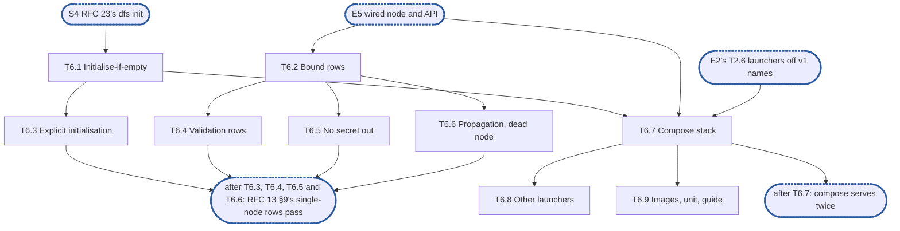

# Epic 6: configuration v2, E2E green

**Sources:** [RFC 13](../docs/internals/rfcs/rfc-13-configuration.md) §9's single-node rows ("§5.1
bound", "§5.1 share binding", "§6 refused", "§6 one validator", "§7 no secret out", "§2.2 explicit
initialisation", "§5.5 dead node" and "§5 propagation", each as far as one node goes), and the
sections those rows test: §2.2 ("An installation is created by an explicit initialisation step,
never by a start", the bootstrap facts, the initialise-if-empty option), §5 (a live change within
5 s), §5.1, §5.5 (the single-node gate), §6 ("Refused, never replaced", "Checked twice"), §7 (no
secret in configuration) and §8 (`config_generation_behind`);
[RFC 23](../docs/internals/rfcs/rfc-23-control-plane.md) §2.5 (the probes), §5.3 (the API over TLS
on every address but loopback) and §5.4 (the first password); RFC 23's plan, its D13 and its
deferral-ledger rows that name this epic; RFC 13's plan, its D7 and its deferral-ledger rows.
**Track:** the team.
**Epic 6 estimate: 9 subtasks, 18.25 man-days.**
**Depends on:** E5, whose wired node and API these rows run against: the one table (T5.1),
reconcile (T5.2, T5.3), the write path (T5.4) and the port rule (T5.7); E2's loaded bootstrap, node
identity (T2.2), launchers off the refused names (T2.6) and version gate (T2.8); E3's `Check` and
E4's sealing, through E5. S4, outside RFC 13's plan: RFC 23's `dfs init` (`internal/install`,
`cmd/dfs/commands/init.go`, landed), its management API (`internal/node/api`, landed) and its
`dfsctl login --cacert`.
**Blocks:** nothing. RFC 13's last epic.

---

## 1. Goal

Epic 6 runs RFC 13 §9's single-node rows against a node that `node.New` builds, through the
management API, and moves every launcher of the repository, and the images' documented path, onto
`dfs init` followed by `dfs start`, with the API served over TLS under a certificate the launcher
generated.

**At the end of the epic:**

- `dfs start --initialise-if-empty` creates an installation on empty storage, and a start without
  it creates none (T6.1);
- "§5.1 bound" and "§5.1 share binding" pass over every bound setting the node's table declares,
  with content behind the scope (T6.2);
- RFC 13 §9's "§2.2 explicit initialisation" passes end to end, over the real `dfs init` and
  `dfs start`, but its last clause (T6.3);
- "§6 refused" and "§6 one validator" pass over every setting the table declares (T6.4);
- "§7 no secret out" passes over a full test run, and fails when a canary leaks (T6.5);
- "§5 propagation" and "§5.5 dead node" pass as far as one node goes (T6.6);
- `docker compose up` run twice over the same volumes serves the second time (T6.7);
- `bench/ditto/night.sh`, `scripts/setup-dittofs-demo.sh` and
  `test/e2e/testdata/nlm/nlm_axis_interop.sh` initialise through `dfs init` (T6.8);
- the three Dockerfiles and the unit file never initialise on their own, the image's
  `HEALTHCHECK` is healthy on its first start after `init`, and `docs/guide/install.md` names
  `init` then `start` (T6.9).

### 1.1 In scope

The initialise-if-empty option; the single-node rows listed above; the launchers named in §6;
the certificate and key the repository's launchers generate; the two documented steps for the
images and the packages.

### 1.2 Out of scope

- "§2.2 explicit initialisation"'s last clause, a new identity recorded by a recovery import: it
  waits for RFC 26 (RFC 13's plan, O1). R12 stops where that clause begins.
- "§5.1 bound" for the chain's encryption (RFC 5's plan, O1) and for a remote store's bucket,
  prefix and credential reference: RFC 13's plan's D9 refuses those with or without content, so
  the row's "no content, accepted" half does not apply to them. E3's T3.6 tests the refusal.
- "§5.1 bound"'s "no content, accepted" half at a namespace and a share scope (R17), and "§5.5 dead
  node"'s single-node sentence as written, an older binary starting on the store (D6): two rows of
  RFC 13's plan's §6.1 ledger, added in this document's pull request.
- Every row RFC 13's plan names as out: the provisioning file's and the backup location's rows,
  the cluster rows, "§2.2 scratch paths", "§5.2 same content", "§5 adapter port", "§7 rotation"
  (E5 runs its credential half), and the namespace key rows.
- Each component's own settings and validator rows: "§5.3 recorded" and "§6 block target range" are
  the engine's and the remote tier's plans'. They join T6.2 and T6.4 by being declared in the
  table.
- The node and API behaviour the rows exercise: E5 and RFC 23's epics 3 to 5 build it.
- The v1 control plane's routes and tables: RFC 23's plan deleted them.
- The Kubernetes operator's own launcher, a module of its own (RFC 13's plan, D7).

### 1.3 Names used here

- **E2**, epic 2, bootstrap, node identity and versions: `Load`, the node identity, the version
  gate, the drift test and the launchers off the refused names.
- **E3**, epic 3, settings: sections, `Check`, classes.
- **E4**, epic 4, secrets: `Secret` records, sealing.
- **E5**, epic 5, **the integration epic**: the node's one table, reconcile and the write path.
- **E6**, this epic.
- **S4**, outside RFC 13's plan: RFC 23's `dfs init` exists (its epic 5).
- **D7**, **D9** and **D13** with a plan named are that plan's decisions: RFC 13's D7 (the bootstrap
  file, and the launchers off the refused names), RFC 13's D9 (a store location's change is
  refused), RFC 23's D13 (`dfs`'s commands, the image's probes and the certificate). **D1** to
  **D6** without a plan named are this epic's own (§4). **O1** and **O8** are RFC 13's plan's open
  points on deferred scope and on the guides' owners.

## 2. How the general rules apply

The rules are those of
[RFC 13's plan, §1.5](rfc-13-config-plan.md#15-general-rules-for-each-epic), cited by number and
title and not copied.

| Rule | Subtasks | How |
| --- | --- | --- |
| rule 1, independent unit tests ([`CLAUDE.md`, "Writing tests"](../CLAUDE.md#writing-tests)) | all | the rows are the epic's tests. Each runs on the layer that consumes the data: `dfs init` and `dfs start` as the commands run (T6.1, T6.3), `nodetest`'s node and the API over its listener with a real sign-in (T6.2, T6.4 to T6.6), and the launchers' shared helper under `sh` beside a built `dfs` (T6.7, T6.8). Doubles are the three kinds the file allows: the injected clock and `kvtest`'s fault wrapper |
| rule 2, fuzz every decoder of untrusted bytes | none | no new decoder: the `node-id` parser's fuzz target is E2's T2.2, and the marker file is never parsed, only tested for existence |
| rule 3, observability follows RFC 25 | T6.5, T6.6 | the epic adds no series. T6.6 reads the `config_generation_behind` health condition and the `format_active_version` series; T6.5 scrapes `/metrics` for canaries |
| rule 4, profiling | T6.1 to T6.6 | every test under `prof.Watch` (`nodetest.Watch()`); the launcher helper's test (T6.7) runs a process, so the leak check does not apply to it |
| rule 5, public interface and internals ([`CLAUDE.md`, "Verifying a change"](../CLAUDE.md#verifying-a-change)) | all | a refusal is proven by the API's answer and the store's raw keys, a live change by the component running the value, a certificate by a client that trusts only it |
| rule 6, known failures shrink | none | no suite this epic touches keeps a `known.yaml`; the new launcher test lands green |
| rule 7, v2 ignores v1 | T6.7, T6.8 | the launchers' v1 configuration layouts, v1 routes and v1 commands are replaced by v2's, never translated |
| rule 8, real dependencies for properties of those dependencies | all | Badger and real journal directories under `t.TempDir()`, a real key file, the built `dfs` binary and a real `openssl` for the launcher helper |
| rule 9, code comment conventions ([`CLAUDE.md`, "Code comments"](../CLAUDE.md#code-comments)) | T6.1, T6.7, T6.8 | a `decision:` marker at the option (D1: why it exists and what withdraws it), at the helper's trust of the generated certificate (D4) and at the compose stack's published loopback ports |
| rule 10, a test must be able to fail | all | each test names the bug it catches in §6 |
| rule 11, a symbol is exported only if RFC 13's interfaces use it | T6.1 | one export, `node.ErrNotInitialised` (the start check's verdict, `errNotInitialised` today), tested by `cmd/dfs/commands` (D1); the rows add none: T6.4's invalid values are a table in `internal/node`'s own test file, and T6.2's caller lives in `nodetest`, a test package already exported for tests |
| rule 12, each subtask creates only what it declares | all | the option lands with the rows that call it (T6.1 with T6.3); the helper lands with its first launcher (T6.7) |

## 3. Requirements and invariants

Every obligation RFC 13 and RFC 23 place on this epic, and those RFC 13's plan and RFC 23's plan
set for it.

**Initialisation (RFC 13 §2.2, §9 "explicit initialisation")**

| # | Requirement | Kind | Source | Subtasks |
| --- | --- | --- | --- | --- |
| R1 | An installation is created by the explicit initialisation step, never by a start: a start opens what exists and creates neither a store nor a journal | MUST | RFC 13 §2.2 | T6.3 |
| R2 | The initialise-if-empty option is given on the command line, never as a key or a `DITTOFS_` name, exists for development and tests only, and is off by default; only with it set does a start on empty storage create an installation | MUST NOT | RFC 13 §2.2, §9 | T6.1, T6.3 |
| R3 | A start against an empty metadata store and empty journal directories refuses, creating nothing but, on a store with no directory, the node's clock ceiling | test row | RFC 13 §9 | T6.3 |
| R4 | After the step, the store's Installation record and every journal's `format` file carry one installation ID | test row | RFC 13 §9 | T6.3 |
| R5 | Every journal directory holds one `node-id`; a start with two that differ refuses, naming both | MUST | RFC 13 §2.2, §9 | T6.3 |
| R6 | With every copy deleted and no identity in the host's file, the start refuses and generates none | MUST | RFC 13 §2.2, §9 | T6.3 |
| R7 | A start with the store volume unmounted reports the metadata store lost and creates nothing; with the journal directory emptied and the identity named in the host's file, it reports the journal missing | MUST | RFC 13 §2.2, §9 | T6.3 |
| R8 | A start with the node's identity changed in its bootstrap refuses, naming the directories, and leaves every copy unchanged | MUST | RFC 13 §2.2, §9 | T6.3 |
| R9 | A truncated copy and a copy with one byte flipped each refuse the start, naming their directory, and neither is written over | MUST | RFC 13 §2.2, §9 | T6.3 |
| R10 | A `node-id` the step writes is the 24 bytes of RFC 28 §2.1's layout, equal to the committed golden vector; a 23- or 25-byte copy, another magic and a bad checksum each fail to parse | test row | RFC 13 §9; RFC 28 §2.1 | T6.3 |
| R11 | A recorded device replaced by an empty directory: a start writes nothing into it, its re-initialisation's `Init` then succeeds, after which the step writes its copy | test row | RFC 13 §9; RFC 28 §3.4 | T6.3 |
| R12 | With every copy deleted and a new identity named in the host's file, a start writes no copy and refuses the journals' shares as not recorded, never as the store lost. The clause's later half, a recovery import recording them, is RFC 26's | MUST | RFC 13 §2.2, §9 | T6.3 |
| R13 | An initialisation interrupted and run again finishes with one identity, and a start then serves; the rerun refuses only a finished installation. RFC 23's epic 5 tests each interruption point inside `internal/install`; this row runs one through the commands | MUST | RFC 13 §2.2; RFC 23 §5.4 | T6.3 |

**Bound settings (RFC 13 §5.1, §9 "bound", "share binding")**

| # | Requirement | Kind | Source | Subtasks |
| --- | --- | --- | --- | --- |
| R14 | The control plane refuses a change to a bound setting while the namespace, store or share it is scoped to holds content | MUST | RFC 13 §5.1 | T6.2 |
| R15 | For every bound setting the node's table declares, but the chain's encryption and a remote store's bucket, prefix and credential reference, the refusal holds for a put and for a delete of an override | test row | RFC 13 §9; RFC 13's plan, epic 6 | T6.2 |
| R16 | After a refusal the content is still readable: the scope's records and the store's raw keys are unchanged, and bytes written through the share before the change read back equal | test row | RFC 13 §9 | T6.2 |
| R17 | The same change with no content behind the scope is accepted. Only a remote store with no namespace naming it reads as holding no content (E5's D6: a namespace holds content for its whole life, and a share scope answers an error), so this half runs at store scope | test row | RFC 13 §9 | T6.2 |
| R18 | A share's binding to its namespace does not change while the share holds content, except by a re-home. RFC 23's share routes build the refusal and `TestSharePatch` (`internal/node/api/shares_test.go` on `feat/storage-v2`) asserts it, so this epic adds no case | MUST NOT | RFC 13 §5.1, §9 | T6.2 |
| R19 | The content in these rows is written through a share | invariant | RFC 13's plan, epic 6 | T6.2 |

**Validation (RFC 13 §6, §9 "refused", "one validator")**

| # | Requirement | Kind | Source | Subtasks |
| --- | --- | --- | --- | --- |
| R20 | For every setting the table declares, one value out of range and one of the wrong type are refused through the API and by the component when the node reconciles the record, naming the field; no component runs a default in its place | MUST | RFC 13 §6 ("Refused, never replaced"), §9 | T6.4 |
| R21 | The API and the component's own check, run when the node reconciles a record written under the API, return the same error for every invalid record in the fixture set | MUST | RFC 13 §6 ("Checked twice"), §9 | T6.4 |

**Secrets (RFC 13 §7, §9 "no secret out")**

| # | Requirement | Kind | Source | Subtasks |
| --- | --- | --- | --- | --- |
| R22 | Configuration holds no secret value: no API answer, export or log of a full test run, and no refusal, carries one | MUST NOT | RFC 13 §6, §7, §9 | T6.5 |
| R23 | The check reads a full run's answers, exports and logs, a `/metrics` scrape, `dfs config show`'s output and the management audit records, the last through the API | test row | RFC 13's plan, epic 6; RFC 23 §2.5 | T6.5 |
| R24 | The check can fail: canary values are seeded as the store credential, the TLS key, a user's password and the API's signing key, and a canary placed in any scanned place fails it | invariant | RFC 13's plan, epic 6 | T6.5 |

**Propagation and the version gate (RFC 13 §5, §5.5, §9 "propagation", "dead node")**

| # | Requirement | Kind | Source | Subtasks |
| --- | --- | --- | --- | --- |
| R25 | A live setting written through the API runs on the node within 5 s of its commit, and a node whose position stays behind longer reports `config_generation_behind`, naming the records | MUST | RFC 13 §5, §8, §9 | T6.6 |
| R26 | On a single node, a binary upgraded without a raise keeps writing the old active versions, and the old binary still starts on the store: no start raises an active version (D6); E2's T2.8 tests the `Register` half | MUST | RFC 13 §5.5, §9 | T6.6 |

**Launchers (RFC 13's plan, D7, epic 6)**

| # | Requirement | Kind | Source | Subtasks |
| --- | --- | --- | --- | --- |
| R27 | `docker-compose.yml`, `docker/bootstrap.sh`, `bench/ditto/night.sh`, `scripts/setup-dittofs-demo.sh` and `test/e2e/testdata/nlm/nlm_axis_interop.sh` initialise the installation, with its first password, through `dfs init` before `dfs start` | invariant | RFC 13's plan, D7 | T6.7, T6.8 |
| R28 | A launcher that can run again over one installation runs `dfs init` only while its marker file is absent and writes the marker once `dfs init` exits 0; a run interrupted before the marker runs `dfs init` again, which resumes | MUST | RFC 13's plan, epic 6 | T6.7, T6.8 |
| R29 | The marker is the launcher's, never read by `dfs`, and lives in a volume other than the store's | invariant | RFC 13's plan, epic 6 | T6.7 |
| R30 | A store volume lost with the marker still in place refuses the start rather than initialising again | invariant | RFC 13 §2.2; RFC 13's plan, epic 6 | T6.7 |
| R31 | A marker volume lost with the store still in place stops the launcher with "installation exists, marker missing", rather than leaving `docker compose up` waiting | MUST | RFC 13's plan, epic 6 | T6.7 |
| R32 | `docker compose up` run twice over the same volumes serves on the second start | test row | RFC 13's plan, epic 6 and its §6.1 | T6.7 |
| R33 | A launcher gives the first password by reference to a file, never by `DITTOFS_ADMIN_INITIAL_PASSWORD` | MUST NOT | RFC 13's plan, D7; RFC 23 §5.4 | T6.7, T6.8 |

**Images and packages (RFC 13 §2.2; RFC 13's plan, epic 6, O8)**

| # | Requirement | Kind | Source | Subtasks |
| --- | --- | --- | --- | --- |
| R34 | `Dockerfile`, `Dockerfile.goreleaser` and `Dockerfile.prebuilt` never initialise on their own: their entrypoint stays `dfs` and their `CMD` stays `dfs start`, so a store volume that is unbound, mistyped or mounted late refuses the start | MUST NOT | RFC 13 §2.2 | T6.9 |
| R35 | For the images, initialisation is `docker run … init --config /config/config.yaml` with the first password by reference to a file the operator mounts, then `docker run … start --config /config/config.yaml` (an argument replaces the image's whole `CMD`, its `--config` with it), both mounting the same five volumes the images declare, since an `init` without them writes anonymous volumes that `--rm` deletes | invariant | RFC 13's plan, epic 6; RFC 23 §5.4 | T6.9 |
| R36 | The password file is read whole, one trailing LF or CRLF dropped; a file over 4 KiB, its trailing newline counted, an empty file, or one missing, refuses the step, naming the path, and never falls back to a generated password. RFC 23's epic 5 builds and tests it; this epic documents it | MUST | RFC 23 §5.4; RFC 23's plan, epic 5 | T6.9 |
| R37 | The unit file (`packaging/dfs.service` on `feat/storage-v2`, `scripts/packaging/dfs.service` on `develop`) keeps `dfs start`, and initialisation is an explicit step before the unit is enabled | invariant | RFC 13's plan, epic 6 | T6.9 |
| R38 | `docs/guide/install.md` names both steps, for the images and for the packages before the unit is enabled; it adds the two steps and does not rewrite the guide | invariant | RFC 13's plan, epic 6, O8 | T6.9 |

**Transport (RFC 13 §2.2; RFC 23 §5.3)**

| # | Requirement | Kind | Source | Subtasks |
| --- | --- | --- | --- | --- |
| R39 | The API, bound on a non-loopback address, is served over TLS under a certificate and key that are host bootstrap facts | MUST | RFC 23 §5.3; RFC 13 §2.2 | T6.7, T6.8, T6.9 |
| R40 | The image ships no certificate or key and takes the pair the operator mounts, as it takes every bootstrap fact | MUST NOT | RFC 13's plan, epic 6; RFC 23's plan, D13 | T6.9 |
| R41 | The repository's launchers generate a self-signed pair at run time, once per installation, into the installation's data volume, never into the working tree or a `Dockerfile` step | invariant | RFC 13's plan, epic 6; RFC 23's plan, D13 | T6.7, T6.8 |
| R42 | The launchers trust that certificate with curl's or `dfsctl`'s `--cacert`, never `-k` or `--tls-skip-verify`, since `docker/bootstrap.sh`'s first call sends the admin password | MUST NOT | RFC 13's plan, epic 6 | T6.7, T6.8 |
| R43 | The certificate names the host; the image's `HEALTHCHECK` probe alone does not verify it, since it reads one word and sends nothing | invariant | RFC 23 §2.5; RFC 23's plan, D13 | T6.7 |
| R44 | The built image's `HEALTHCHECK` on `https://localhost:8080/health/live` reports healthy on its first start after `docker run … init`, with the certificate and key it starts with. Compose's `healthcheck:` on the `dittofs` service replaces the image's, so `docker compose up` cannot show it: a `docker run … start` of the built image, read with `docker inspect --format '{{.State.Health.Status}}'`, checks it until a `dt` suite builds the image | test row | RFC 13's plan, epic 6 and its §6.1 | T6.9 |

## 4. Decisions this epic takes

- **D1, the option is a flag of `dfs start`, keyed on the start check's verdict, and it cannot
  live in `pkg/bootstrap`.** RFC 13 §2.2 makes it a command-line option and never a key, so `Load`
  has nothing to read; RFC 13's plan's
  §4.1 layout nevertheless lists "initialise-if-empty" under `pkg/bootstrap`. `internal/install`
  imports `pkg/bootstrap`, so a `pkg/bootstrap` function could not call `install.Run`. The flag is
  `--initialise-if-empty` on `dfs start` (`cmd/dfs/commands/start.go`), taking `--admin-password-file`
  and `--admin-password-env` as `dfs init` does and refusing them without it. `runStart` already
  runs `node.Preflight` before it opens anything (`cmd/dfs/commands/start.go:86`), and its
  `errNotInitialised` (`internal/node/preflight.go:262`) means "no store, and no journal on any
  device": a store lost, a store or journal that cannot be identified and a v1 layout each get their
  own refusal there. With the flag, that verdict leads to `install.Run`, then the start goes on; any
  other answer, a pass or a refusal, is the start's as without the flag, so the flag never rewrites anything. The
  one export is that verdict's sentinel, `node.ErrNotInitialised`, which `cmd/dfs/commands` tests
  with `errors.Is`. A new `install.Empty` reading the Installation record would need the store's KV
  open (`install.Deps.KV`), and opening Badger creates the store's directory and its MANIFEST
  (`badgerkv.Open`, `pkg/metadata/kv/badgerkv/badgerkv.go:79`), which the start check reads as a
  present store (`probeStore`), so a start with the store lost would pass the check, against T6.1's
  "creates nothing". A generated password is printed once to standard output, as `dfs init` does.
  A `decision:` marker
  at the flag states that it is for development and tests, that it is off by default, and what
  withdraws it: a deployment that needs it in production, which RFC 13 §2.2 forbids. This
  document's pull request moves the layout line in RFC 13's plan, §4.1, to `cmd/dfs/commands`.
- **D2, the rows live with the layer that consumes them.** "§2.2 explicit initialisation" runs the
  real `init` and `start` commands over directories under `t.TempDir()` (`cmd/dfs/commands`), since
  its clauses are about what the commands create and refuse. The other rows run on `nodetest`'s node
  and the API over its listener, signed in through `pkg/node/apiv1/client`, because the rows say
  "through the API". `nodetest.New` today generates and discards the administrator's password and
  hands out no caller; T6.2 gives it a known first password and a signed-in client, which T6.4 to
  T6.6 reuse. Every row is a Go test in the `unit` suite, as RFC 13 §9's closing paragraph asks.
- **D3, a row over "every" setting loops over the table and cannot pass on an empty table.** The
  node's table declares `api` and `audit` today (`internal/node/settings.go`), both installation
  scope and live, so it declares no bound setting, and a loop over the bound ones would pass with
  nothing to check. Each row loops over `Table` as it is, so it grows with the sections RFC 18's,
  RFC 20's, RFC 8's and RFC 4's plans declare; beside the loop, each row runs once on a section the
  test declares and hands to the node (as E5 does, through `export_test.go`) with a bound, a
  next-write and a live key, so the row can fail whatever the table holds. A `decision:` marker in
  the test names the bound keys the loop skips (the chain's encryption and the store location) and
  why.
- **D4, one shared helper for the launchers, and the certificate is trusted by file.**
  `scripts/lib/dfs-install.sh` holds two functions: one generates the pair once (`openssl`, a
  key and a self-signed certificate naming the host and `localhost` in its subject alternative
  names, the key with mode `0600`), skipping when both files exist; the other holds the marker
  test, the `dfs init` call with the password file and the "installation exists, marker missing"
  refusal. The host scripts source it. The compose stack runs the first in a one-shot `certs`
  service on a pinned image that ships `openssl`, since the `dittofs` image (`alpine` with
  `ca-certificates` and `tzdata` only) has none, and the second in a one-shot `init` service on the
  `dittofs` image, whose `busybox` `sh` runs it. Five copies of the logic would drift, and the
  helper is the one thing a test can run. Trust is by `--cacert` on `curl` and `dfsctl`, never by
  skipping verification. Overturned if a host launcher must run where `openssl` is absent, then
  by a `dfs` subcommand that generates the pair.
- **D5, where each launcher file lives.** The store is the metadata volume (`/data/metadata` in
  the images) and the journals'; the marker lives in neither. For the compose stack: the marker in
  a volume of its own, `dittofs-init`; the first password's file, the certificate and the key in
  the state volume, `/data/state`, which the images already declare and v2 leaves to the host's
  files. For a host script: the same split under its work directory, `init/` for the marker and
  `state/` for the rest, beside the store's `metadata/` and `journal/`. The password file has mode
  `0600` and holds what the launcher exported before (its development default, or one it
  generates); the launcher passes it with `--admin-password-file` and reads it again for its own
  sign-in over TLS under `--cacert`. The compose stack keeps `dittofs-compose-dev-password`.
- **D6, the dead node row on one node is "no start raises a version".** RFC 13 §9's single-node
  sentence wants an older binary to start on a store a newer one opened. Each format has one
  version today, so no older range exists to build, and `pkg/bootstrap`'s `register` over another
  range is unexported. The row asserts what makes the sentence hold: after `dfs init` and several
  starts, every active version equals the one `dfs init` wrote, and a restart serves. A node built
  over an older range joins the row when a format gains a second version, with RFC 13's plan's
  ledger row for the raise call.

## 5. Target tree

```text
cmd/dfs/commands/
  start.go                       T6.1  --initialise-if-empty and the password flags it takes
  initempty_test.go              T6.1  the option's rows
  rows_init_test.go              T6.3  "§2.2 explicit initialisation" over init and start
internal/node/
  preflight.go                   T6.1  the start check's verdict, exported as ErrNotInitialised
  nodetest/harness.go            T6.2  a known first password and a signed-in client
  rows_bound_test.go             T6.2  "§5.1 bound", "§5.1 share binding"
  rows_validation_test.go        T6.4  "§6 refused", "§6 one validator"
  rows_secrets_test.go           T6.5  "§7 no secret out"
  rows_propagation_test.go       T6.6  "§5 propagation", "§5.5 dead node"
scripts/lib/dfs-install.sh       T6.7  the pair once; marker, init, refusal
test/launchers/
  install_test.go                T6.7  the helper beside a built dfs; the TLS flag scan
docker-compose.yml               T6.7  certs and init services, marker volume
docker/bootstrap.sh              T6.7  v2 routes, TLS under --cacert
docker/config.yaml               T6.7  v2 bootstrap
bench/ditto/night.sh             T6.8
scripts/setup-dittofs-demo.sh    T6.8
test/e2e/testdata/nlm/nlm_axis_interop.sh  T6.8
test/launchers/images_test.go    T6.9  the Dockerfiles and the unit file
docs/guide/install.md            T6.9  the two steps
```

## 6. Subtasks

### T6.1 Initialise-if-empty on `dfs start`

**Subtask T6.1 estimate: 1.5 man-days.**

- **Track:** the team. **Depends on:** S4.
- **Covers:** R2.
- **Deliverables:** `node.ErrNotInitialised`, the start check's verdict exported (D1);
  `dfs start --initialise-if-empty` with `--admin-password-file` and `--admin-password-env` accepted
  only with it (D1); the `decision:` marker; the regenerated `docs/guide/cli.md`.
- **Acceptance criteria:**
  - Without the flag, a start on empty storage refuses and creates nothing, as today.
  - With it, a start on empty storage creates the installation, the administrator and the node's
    identity beside each journal, and serves; the generated password is on standard output once and
    in no log line.
  - With it, a start on a store that holds an installation, on a store the step left half
    initialised (interrupted after the store's `Init`, before any journal) or on journals that hold
    anything while the store is empty, creates nothing and behaves as without it.
  - The password flags without the option are refused.
  - The flag is not a bootstrap key and no `DITTOFS_` name sets it: the drift test of E2's T2.6 and
    `Load` are unchanged.
- **Tests:** the cases above through the `start` command on `t.TempDir()` directories (catches a
  flag that runs `install.Run` over a present store: it refuses a finished installation with
  `ErrInstalled`, but resumes an interrupted one (`initStore`, `internal/install/install.go`), so it
  would finish an installation on non-empty storage, against R2; the half-initialised case is the
  one a check that looked only at the journals would miss); a bootstrap with `initialise_if_empty: true` and
  `DITTOFS_INITIALISE_IF_EMPTY=1` refused as unknown (catches the option leaking into the file).
- **Rules:** rule 9's `decision:` marker; rule 11's one export.

### T6.2 "§5.1 bound" and "§5.1 share binding"

**Subtask T6.2 estimate: 2.5 man-days.**

- **Track:** the team. **Depends on:** E5's T5.4.
- **Covers:** R14 to R19.
- **Deliverables:** `nodetest` gains a known first password and a signed-in `apiv1/client` caller
  (D2); `internal/node/rows_bound_test.go`.
- **Acceptance criteria:**
  - For every bound setting the table declares but the two groups §1.2 excludes, written through the
    API with content behind its scope: a put and a delete of an override are refused with the
    refusal's key and rule, the raw keys hold no new row, and the scope's records and the
    bytes read back unchanged (R16).
  - The same two writes on a store that no namespace names are accepted (R17); at namespace and
    share scope only the refused half runs.
  - Content is a file in a share bound to the namespace: a few bytes are written and committed
    through the node's engine before the change (`Engine().Write` and `Commit`, as
    `journalseries_node_test.go`'s `jwrite` and `jcommit` do) and read back with `Engine().Read`
    after each refusal (R16, R19).
  - A share's rebind to another namespace is not run here: `patchShare` refuses every rebind but a
    re-home whatever the share holds, and `TestSharePatch` asserts it (R18).
  - The test also runs the sections it declares (D3), one of them at store scope with a bound
    key that is not a store location, so the accepted half has a key to run on.
- **Tests:** per bound key, the two refusals, and the accepted case on a store with no namespace (a
  check that reads "no content" for every scope fails the refused half; one that reads "content"
  for every scope fails the accepted half, which `holdsContent` does today); a delete of an
  override refused where a put is (catches a check wired to puts only); the bytes read back equal
  after a refusal (catches a refused change that still changes what the content reads back as).
- **Rules:** rule 5 (the API's answer and the raw keys); rule 8.

### T6.3 "§2.2 explicit initialisation", end to end

**Subtask T6.3 estimate: 2.5 man-days.**

- **Track:** the team. **Depends on:** T6.1; E2's T2.2.
- **Covers:** R1 to R13.
- **Deliverables:** `cmd/dfs/commands/rows_init_test.go`, one test per clause of the row, each
  running the real `init` and `start` commands over two journal directories and a Badger store
  under `t.TempDir()`, with a key file for the storage role.
- **Acceptance criteria:** every clause of RFC 13 §9's row but the recovery import's second half
  (R12 stops at "refuses the journals' shares as not recorded"):
  - empty storage: `start` refuses, nothing created; `start --initialise-if-empty` creates (R2,
    R3);
  - after `init`, one installation ID in the store and in both `format` files, and one `node-id`
    per directory (R4, R5);
  - two differing copies, no copy and no identity, a store volume unmounted, a journal directory
    emptied with the identity named, an identity changed in the bootstrap, a truncated copy and a
    flipped one: each refuses as R5 to R9 say, naming what they name, with every file byte-equal
    before and after (R5 to R9);
  - the golden vector (R10);
  - a replaced device left empty: `start` writes nothing into it, `init` run again succeeds and
    writes its copy (R11);
  - every copy deleted and a new identity in the file: no copy written, the shares refused as not
    recorded, never as the store lost (R12);
  - `init` stopped partway and run again finishes with one identity, and `start` serves (R13).
- **Tests:** each clause above, asserting the command's error text and the files' bytes (a start
  that wrote a copy beside an unrecorded journal, or generated an identity on its own, fails the
  byte comparison). R13 needs no hook: the second journal directory holds a stray file, so `init`
  initialises the store and the first journal and then refuses the second, whose `Init` refuses a
  directory holding an entry; the file is removed and `init` run again (catches a rerun that
  re-mints the installation ID or a second identity). Each write's own interruption point stays
  with RFC 23's epic 5 (`internal/install`'s `TestCrashAfterEachWriteThenRerun`), whose hook is
  unexported.
- **Rules:** rule 8 (real journals, real files); rule 10.

### T6.4 "§6 refused" and "§6 one validator"

**Subtask T6.4 estimate: 1.25 man-days.**

- **Track:** the team. **Depends on:** T6.2's caller; E5's T5.2.
- **Covers:** R20, R21.
- **Deliverables:** `internal/node/rows_validation_test.go`: a table, in that test file, of an
  out-of-range value and a wrong-typed one for every key of every section the node's table
  declares, which is the row's fixture set, a key whose type admits every value (a bool) holding
  an explicit "none" entry with its reason in place of the out-of-range value; and
  `refused(section, key, value) error`, the row's check, which a test can call on its own.
- **Acceptance criteria:**
  - Each value is refused through the API, naming the field, and the effective value is unchanged
    (the default or the earlier value, never a clamp).
  - The component's own check is reconcile's, so for every record in the fixture set the row
    writes it under the API through `h.Store()`, bypassing `Check`, as E5's T5.2's undecodable-row
    test does, and lets reconcile pass. The node's status then reports the section refused, with
    the key and the rule the API returned for that record, and the component either still runs its
    earlier value or, when it never ran, is not started (R20, R21).
  - A key the node's table declares that the fixture table lacks fails the row, so a section that
    joins the table without its invalid values cannot pass by being skipped; the plan that declares
    a section adds its rows here.
- **Tests:** the loop; `refused` called on one section declared by the test whose validator
  clamps, asserting that it returns an error (catches a check that cannot see a component running
  a default); the reconcile half, whose status must be read from the node, never recomputed
  from the section's `Validate` (catches a row that compares a validator with itself, which no
  record can fail, since the API's `Check` calls that same `Validate`); the missing-key case on a
  test section with one key left out of the table (catches a skipped key).
- **Rules:** rule 10; rule 11 (the table stays in a test file).

### T6.5 "§7 no secret out"

**Subtask T6.5 estimate: 2 man-days.**

- **Track:** the team. **Depends on:** T6.2's caller; E4's `Seal` and E5's T5.6.
- **Covers:** R22, R23, R24.
- **Deliverables:** `internal/node/rows_secrets_test.go`: one node run seeded with four canaries
  (the store credential, the TLS key, a user's password, the API's signing key), exercising every
  secret-bearing write the API has, then scanning, as bytes, every response the caller reads, the
  logger's whole output, a `/metrics` scrape, `dfs config show`'s output over the harness's
  bootstrap, and the audit records read through the API. The TLS key canary is a real PEM key the
  test generates with its certificate and names in the bootstrap's `api.tls`: the node loads the
  pair at start and, bound on loopback only, serves without TLS, so the key is sought in what the
  node prints, never in a handshake.
- **Acceptance criteria:**
  - No scanned byte sequence contains a canary or a base64 or hex form of it.
  - Planting a canary in each scanned place makes the check fail (one case per place).
  - The logger and the scan cover refusals: a refused write of a credential-bearing key prints no
    value.
- **Tests:** the clean run, and one planted run per place (catches a scan that reads only some
  places); a canary for the signing key read from the node's memory through a test export, so the
  scan searches for the key the node actually holds.
- **Rules:** rule 3 (the scrape); rule 8 (the key file is real).

### T6.6 "§5 propagation" and "§5.5 dead node"'s single-node part

**Subtask T6.6 estimate: 1 man-days.**

- **Track:** the team. **Depends on:** T6.2's caller; E5's T5.3; E2's T2.8.
- **Covers:** R25, R26.
- **Deliverables:** `internal/node/rows_propagation_test.go`, freezing reads through the
  package's `faulted` harness helper (`reconcile_test.go`), which wraps the node's KV in
  `kvtest.NewFaultKV` through `nodetest.WithNew`.
- **Acceptance criteria:**
  - A live setting written through the API runs in its component within 5 s of the commit on the
    injected clock, on Badger, which offers no watch.
  - With the node's reads frozen through `kvtest`'s fault wrapper, `config_generation_behind` names
    the node's records after 5 s, and clears when the reads return. On `feat/storage-v2`,
    `TestStatusRaisesBehindOnAFrozenApply` (`internal/node/status_test.go`) already freezes a pass
    after its read and asserts the condition at 5 s and its clearing; this row freezes the reads
    instead, as RFC 13 §9's row words it.
  - After `dfs init` and three restarts, every active version, read from the store and from the
    `format_active_version` series, equals what `dfs init` wrote, and the last restart serves (D6).
- **Tests:** the first at 4 s (still behind) and past 5 s (catches a node that never polls); the
  second at 4 s (no condition) and past 5 s (catches a condition that never fires over frozen
  reads, which the test above does not freeze); the third through
  `Restart`. E2's T2.8 tests `Register` keeping an older active version, over a store written
  through `kvstore`; `Restart` runs the node's whole start over the installation `dfs init` wrote,
  so it catches a raise done by any step of the start other than `Register`, a guard against a
  later change, since no code raises one today (D6).
- **Rules:** rule 3; rule 8 (`kvtest`'s fault wrapper over Badger).

### T6.7 The compose stack on `dfs init`

**Subtask T6.7 estimate: 3.75 man-days.**

- **Track:** the team. **Depends on:** T6.1; E2's T2.6; E5.
- **Covers:** R27 to R33 (for this stack), R39, R41, R42, R43.
- **Deliverables:**
  - `scripts/lib/dfs-install.sh` (D4) and `test/launchers/install_test.go`;
  - `docker-compose.yml`: a one-shot `certs` service on a pinned image with `openssl`, and a
    one-shot `init` service on the `dittofs` image, both running the helper; the marker on its own
    volume, the password file, the certificate and the key in the state volume (D5); the
    `dittofs` service waits for both to complete; its own `healthcheck:` on `/health/ready` stays,
    for `bootstrap`; the published ports stay on the loopback;
  - `docker/config.yaml` in v2's bootstrap layout (`metadata.badger.path`, `journals`, `node.id`
    unset, `api.listen` on `0.0.0.0:8080` and `api.tls`);
  - `docker/bootstrap.sh` on v2's routes (stores, namespaces, shares), signing in over TLS with
    `--cacert` and keeping its "already exists is success" behaviour;
  - the `decision:` markers of rule 9.
- **Acceptance criteria:**
  - `docker compose up` on a clean checkout initialises and serves; run again over the same
    volumes, the second start skips `dfs init` and serves (R32).
  - Deleting the store volume with the marker in place leaves the `dittofs` service refusing to
    start, with `init` not rerun (R30); deleting the marker volume with the store in place makes
    `init` stop with "installation exists, marker missing" (R31).
  - The certificate and key are in the state volume and not in the working tree (`git status`
    clean after `up`).
  - The helper's test passes: marker absent runs `dfs init` and writes the marker only on exit 0;
    an `init` that fails writes none and the rerun resumes; a finished installation with no marker
    stops with the refusal text; a marker with no installation lets `start` refuse; the pair is
    generated once, its key mode `0600`, its subject alternative names holding the host name and
    `localhost`, and a second call leaves both files byte-equal.
  - No file of the five launchers, the helper or `docker-compose.yml` passes `-k`, `--insecure`,
    `--tls-skip-verify` or wget's `--no-check-certificate` on a call that sends a credential.
- **Tests:** the helper's cases beside a built `dfs`, the pair read back with `openssl x509`,
  skipping with the variable named when `openssl` is absent (a helper that writes the marker
  before `init` returns, reruns `init` over a finished installation without the refusal, or makes
  a new pair on each run, fails); a scan of those files for the four flags, the probes' own
  `--no-check-certificate` excepted by line since a probe sends nothing (catches a launcher that
  sends the password unverified, with curl, `dfsctl` or wget, R42); the two compose runs and the volume deletions are checked by hand (R30 to R32), as RFC 13's
  plan's §6.1 says until a suite builds the image.
- **Rules:** rule 7; rule 8.

### T6.8 The other three launchers on `dfs init`

**Subtask T6.8 estimate: 2.5 man-days.**

- **Track:** the team. **Depends on:** T6.7.
- **Covers:** R27, R28, R33, R39, R41, R42 (for these launchers).
- **Deliverables:** `bench/ditto/night.sh`, `scripts/setup-dittofs-demo.sh` and
  `test/e2e/testdata/nlm/nlm_axis_interop.sh`, each sourcing the helper, writing a v2 bootstrap
  (replacing the v1 `controlplane` and `database` layouts they write today), initialising with the
  password file, starting with `dfs start`, waiting on `/health/ready` over `https`, signing in
  with `--cacert`, and provisioning on v2's routes. The demo script's unit runs `dfs start` after
  the script has initialised once, with its marker in the script's `init/` directory (D5).
- **Acceptance criteria:**
  - Each script starts a server that serves, from a clean directory, and a second run over the same
    directory skips `dfs init` and serves.
  - None sets `DITTOFS_ADMIN_INITIAL_PASSWORD` or a name E2's drift test refuses.
  - Each script's provisioning (`night.sh`'s block store and share, the demo's metadata store,
    block store and share, the NLM script's share) and readiness wait use v2: `dfsctl` where it has
    the command, else `curl --cacert` against the routes, with a comment naming which (§9). The NLM
    script's `http://127.0.0.1:$API/health` becomes `/health/ready`; its loopback API stays plain,
    as RFC 23 §5.3 allows.
- **Tests:** E2's drift test stays green; T6.7's flag scan covers these scripts; a run of each
  script by hand, as no suite runs them; the NLM script is run by its e2e test where the host has
  the client it needs, else skipped naming the variable.
- **Rules:** rule 7.

### T6.9 The images, the unit and the install guide

**Subtask T6.9 estimate: 1.25 man-days.**

- **Track:** the team. **Depends on:** T6.7.
- **Covers:** R34 to R38, R39, R40, R44.
- **Deliverables:** `test/launchers/images_test.go`, which reads `Dockerfile`,
  `Dockerfile.goreleaser`, `Dockerfile.prebuilt` and `packaging/dfs.service`, the paths on
  `feat/storage-v2` where the work lands, and asserts what R34, R37 and R40 say;
  `docs/guide/install.md` gains the two steps for the images (R35, R36: `init --config` then
  `start --config`, the five volumes, a mounted password file, a mounted certificate and key) and
  for the packages before the unit is enabled, in its Docker and package sections (R38). The
  guide's sentences that tell a user to set `DITTOFS_ADMIN_INITIAL_PASSWORD` are E2's T2.6's to
  correct, since its drift test scans `docs/guide/`; this subtask adds the steps that replace them.
- **Acceptance criteria:**
  - Each Dockerfile's entrypoint is `["/app/dfs"]`, its `CMD` begins `start`, it declares the five
    volumes, its `HEALTHCHECK` probes `/health/live` over `https`, and no Dockerfile copies a
    certificate or key or runs `dfs init`.
  - The unit's `ExecStart` is `dfs start`.
  - The guide's `docker run … init` and `docker run … start` examples pass `--config`, mount the
    same five volumes and name the password file; the APT, YUM and Arch text puts `dfs init` before
    `systemctl enable --now dfs` (Scoop has no unit).
  - A `docker run … start` of the built image after `docker run … init`, with a mounted pair,
    reads `healthy` from `docker inspect --format '{{.State.Health.Status}}'` (R44).
- **Tests:** the file assertions (a Dockerfile `CMD ["init"]`, a `COPY` of a `.pem`, a fourth
  volume or a unit running `init` fails them). R44 and the guide's text are checked by hand and by
  review, until a `dt` suite builds the image.
- **Rules:** rule 12.

## 7. Order of work



Checkpoint after T6.3, T6.4, T6.5 and T6.6: every single-node row of RFC 13 §9 passes in `unit`. Checkpoint
after T6.7: `docker compose up` serves, twice, and the shared helper is proven for the other
launchers.

## 8. Suggested pull requests

| PR | Subtasks | Man-days | After | Why together |
| --- | --- | --- | --- | --- |
| 1 | T6.1, T6.3 | 4 | S4; E2's T2.2 | the option and the first row that calls it |
| 2 | T6.2, T6.4, T6.5, T6.6 | 6.75 | E5 | the rows that run on the API, sharing the harness's caller |
| 3 | T6.7, T6.8, T6.9 | 7.5 | PR 1 (T6.1); E2's T2.6; E5 | the launchers and the images' steps, sharing the helper and the certificate |

A suggestion only: one pull request per subtask works as well. PR 1 and PR 2 share no code and can
be open at once; PR 3 waits for PR 1's option only.

## 9. Open points

Pending the user's answer, each written in its recommended form above:

- **The estimate.** 18.25 man-days in 9 subtasks, against RFC 13's plan's 10 in 5. The plan
  counted the rows as one subtask each and the launchers as one; this document sizes the option
  (T6.1), the initialisation row's twelve clauses (T6.3), the shared harness caller (T6.2), the
  compose stack's v2 rewrite, which touches the stack's configuration, its provisioning script (on
  v1 routes today), a certificate and the launcher tests (T6.7), and the other three launchers'
  v2 provisioning (T6.8). Least certain: T6.7, whose size depends on how much of
  `docker/bootstrap.sh`'s provisioning RFC 23's routes serve, and T6.8, on `dfsctl`'s commands.
- **"Content written through a share" (R16, R19).** On `feat/storage-v2` the node builds the engine
  and the filesystem over it (`internal/node/node.go`), and a merged node test writes and commits
  file bytes into a share through the node's engine (`internal/node/journalseries_node_test.go`).
  What the branch lacks is the protocol side: no client can write through a share, but a test in
  `internal/node` can. So T6.2 writes real bytes and reads them back. The check still decides
  content from bindings, never from bytes: `holdsContent` answers "holds content" for every scope
  until E5's T5.4, and E5's D6 then reads a namespace as holding content for its whole life and a
  share scope as an error. So the rows' "no content, accepted" half is reachable only for a store
  with no namespace naming it (R17). `CLAUDE.md` rule 4 and `docs/internals/architecture.md` on
  that branch said the data path is cut and `block.ErrNoContentStore` answers every content
  operation; no code returned that error, and the change closing #5280 corrected those lines.
- **The table declares no bound setting today (D3).** Recommended: the loop plus the test's own
  section. The alternative, requiring at least one declared bound key, fails the epic until
  another plan declares one.
- **The launchers' CLI (T6.8).** `night.sh` and the demo script provision with v1 `dfsctl store`
  commands; `dfsctl` on `feat/storage-v2` has no store command yet (RFC 23's epic 6).
  Recommended: `curl --cacert` against the routes until the CLI lands.
- **The first password's size (R36).** PR #5242 has merged into `feat/storage-v2`: RFC 23 §5.4
  there says "A file may hold at most 4 KiB, its trailing newline counted; a longer one is refused
  before the step writes anything", and `internal/install/install.go` enforces it
  (`maxPasswordFile`). R36 and T6.9's guide text name the limit, on the branch where the work
  lands.
- **Where the launcher tests run.** `unit` already runs `./test/...` (`test/suites.yaml`), with
  `-short` on pull requests. What T6.7 settles is whether the launcher test, which needs `openssl`
  and a `go build` of `dfs`, skips under `-short`.

Further points, each changed in this document's pull request:

- **RFC 13's plan, §4.1** lists initialise-if-empty under `pkg/bootstrap`; it moves to
  `cmd/dfs/commands` (D1).
- **RFC 13's plan, epic 6 and its §6.1 row on the image's `HEALTHCHECK`** say `docker compose up`
  checks the image's probe; Compose's own `healthcheck:` replaces it, so they now name a
  `docker run` of the image read with `docker inspect` (R44).
- **RFC 13's plan's §6.1 ledger** gains the two rows of §1.2 above, with owner `unowned`, since the
  drain's readability and a second format version have no plan yet.
- **RFC 13's plan, epic 6** names `scripts/packaging/dfs.service`; the file is
  `packaging/dfs.service` on `feat/storage-v2`, where the work lands, and the text names both.

Not changed here:

- **The launchers still carry v1 names** on `feat/storage-v2` (`DITTOFS_CONTROLPLANE_SECRET`,
  `DITTOFS_ADMIN_INITIAL_PASSWORD`, v1 configuration layouts), because E2's T2.6 has not landed;
  until it does, none of them starts a server (RFC 13's plan, D7). T6.7 and T6.8 start after it.
- **RFC 23's plan's ledger row** "the bootstrap's key names for the API's TLS certificate and key"
  is stale: `api.tls.cert_file` and `api.tls.key_file` exist in `pkg/bootstrap` on
  `feat/storage-v2`. That row is RFC 23's plan's to close.
- **No GitHub issue for this epic exists** (`rfc-13-epic-6` has none).
