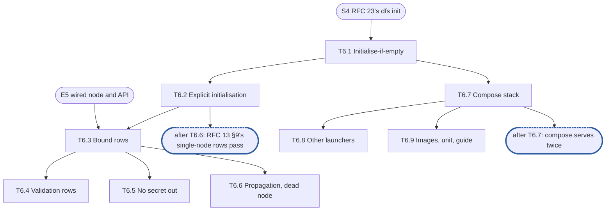

# Epic 6: configuration v2, E2E green

**Sources:** [RFC 13](../docs/internals/rfcs/rfc-13-configuration.md) §9's single-node rows ("§5.1
bound", "§5.1 share binding", "§6 refused", "§6 one validator", "§7 no secret out", "§2.2 explicit
initialisation", "§5.5 dead node" and "§5 propagation", each as far as one node goes), and the
sections those rows test: §2.2 ("An installation is created by an explicit initialisation step,
never by a start", the bootstrap facts, the initialise-if-empty option), §5 (a live change within
5 s), §5.1, §5.5 (the single-node gate), §6 ("Refused, never replaced", "Checked twice"), §7 (no
secret in configuration) and §8 (`config_generation_behind`);
[RFC 23](../docs/internals/rfcs/rfc-23-control-plane.md) §2.5 (the probes), §5.3 (the API over TLS
on every address but loopback) and §5.4 (the first password); RFC 23's plan, its D13 and its
deferral-ledger rows that name this epic; RFC 13's plan, its D7 and its deferral-ledger rows.
**Track:** the team.
**Epic 6 estimate: 9 subtasks, 18 man-days.**
**Depends on:** E5, whose wired node and API these rows run against: the one table (T5.1),
reconcile (T5.2, T5.3), the write path (T5.4) and the port rule (T5.7); E2's loaded bootstrap, node
identity (T2.2), launchers off the refused names (T2.6) and version gate (T2.8); E3's `Check` and
E4's sealing, through E5. S4, outside RFC 13's plan: RFC 23's `dfs init` (`internal/install`,
`cmd/dfs/commands/init.go`, landed), its management API (`internal/node/api`, landed) and its
`dfsctl login --cacert`.
**Blocks:** nothing. RFC 13's last epic.

---

## 1. Goal

Epic 6 runs RFC 13 §9's single-node rows against a node that `node.New` builds, through the
management API, and moves every launcher of the repository, and the images' documented path, onto
`dfs init` followed by `dfs start`, with the API served over TLS under a certificate the launcher
generated.

**At the end of the epic:**

- `dfs start --initialise-if-empty` creates an installation on empty storage, and a start without
  it creates none (T6.1);
- RFC 13 §9's "§2.2 explicit initialisation" passes end to end, over the real `dfs init` and
  `dfs start`, but its last clause (T6.2);
- "§5.1 bound" and "§5.1 share binding" pass over every bound setting the node's table declares,
  with content behind the scope (T6.3);
- "§6 refused" and "§6 one validator" pass over every setting the table declares (T6.4);
- "§7 no secret out" passes over a full test run, and fails when a canary leaks (T6.5);
- "§5 propagation" and "§5.5 dead node" pass as far as one node goes (T6.6);
- `docker compose up` run twice over the same volumes serves the second time, and the image's
  `HEALTHCHECK` is healthy on its first start after `init` (T6.7);
- `bench/ditto/night.sh`, `scripts/setup-dittofs-demo.sh` and
  `test/e2e/testdata/nlm/nlm_axis_interop.sh` initialise through `dfs init` (T6.8);
- the three Dockerfiles and the unit file never initialise on their own, and
  `docs/guide/install.md` names `init` then `start` (T6.9).

### 1.1 In scope

The initialise-if-empty option; the single-node rows listed above; the launchers named in §6;
the certificate and key the repository's launchers generate; the two documented steps for the
images and the packages.

### 1.2 Out of scope

- "§2.2 explicit initialisation"'s last clause, a new identity recorded by a recovery import: it
  waits for RFC 26 (RFC 13's plan, O1). R12 stops where that clause begins.
- "§5.1 bound" for the chain's encryption (RFC 5's plan, O1) and for a remote store's bucket,
  prefix and credential reference: RFC 13's plan's D9 refuses those with or without content, so
  the row's "no content, accepted" half does not apply to them. E3's T3.6 tests the refusal.
- Every row RFC 13's plan names as out: the provisioning file's and the backup location's rows,
  the cluster rows, "§2.2 scratch paths", "§5.2 same content", "§5 adapter port", "§7 rotation"
  (E5 runs its credential half), and the namespace key rows.
- Each component's own settings and validator rows: "§5.3 recorded" and "§6 block target range" are
  the engine's and the remote tier's plans'. They join T6.3 and T6.4 by being declared in the
  table.
- The node and API behaviour the rows exercise: E5 and RFC 23's epics 3 to 5 build it.
- The v1 control plane's routes and tables: RFC 23's plan deleted them.
- The Kubernetes operator's own launcher, a module of its own (RFC 13's plan, D7).

### 1.3 Names used here

- **E2**, epic 2, bootstrap, node identity and versions: `Load`, the node identity, the version
  gate, the drift test and the launchers off the refused names.
- **E3**, epic 3, settings: sections, `Check`, classes.
- **E4**, epic 4, secrets: `Secret` records, sealing.
- **E5**, epic 5, **the integration epic**: the node's one table, reconcile and the write path.
- **E6**, this epic.
- **S1**, the configuration surface frozen: E1 has merged.
- **S4**, outside RFC 13's plan: RFC 23's `dfs init` exists (its epic 5).
- **D7**, **D9** and **D13** with a plan named are that plan's decisions: RFC 13's D7 (the bootstrap
  file, and the launchers off the refused names), RFC 13's D9 (a store location's change is
  refused), RFC 23's D13 (`dfs`'s commands, the image's probes and the certificate). **D1** to
  **D5** without a plan named are this epic's own (§4). **O1** and **O8** are RFC 13's plan's open
  points on deferred scope and on the guides' owners.

## 2. How the general rules apply

The rules are those of
[RFC 13's plan, §1.5](rfc-13-config-plan.md#15-general-rules-for-each-epic), cited by number and
title and not copied.

| Rule | Subtasks | How |
| --- | --- | --- |
| rule 1, independent unit tests ([`CLAUDE.md`, "Writing tests"](../CLAUDE.md#writing-tests)) | all | the rows are the epic's tests. Each runs on the layer that consumes the data: `dfs init` and `dfs start` as the commands run (T6.1, T6.2), `nodetest`'s node and the API over its listener with a real sign-in (T6.3 to T6.6), and the launchers' shared helper under `sh` beside a built `dfs` (T6.7, T6.8). Doubles are the three kinds the file allows: the injected clock and `kvtest`'s fault wrapper |
| rule 2, fuzz every decoder of untrusted bytes | none | no new decoder: the `node-id` parser's fuzz target is E2's T2.2, and the marker file is never parsed, only tested for existence |
| rule 3, observability follows RFC 25 | T6.5, T6.6 | the epic adds no series. T6.6 reads `config_generation_behind` and `format_active_version`; T6.5 scrapes `/metrics` for canaries |
| rule 4, profiling | T6.1 to T6.6 | every test under `prof.Watch` (`nodetest.Watch()`); the launcher helper's test (T6.7) runs a process, so the leak check does not apply to it |
| rule 5, public interface and internals ([`CLAUDE.md`, "Verifying a change"](../CLAUDE.md#verifying-a-change)) | all | a refusal is proven by the API's answer and the store's raw keys, a live change by the component running the value, a certificate by a client that trusts only it |
| rule 6, known failures shrink | none | no suite this epic touches keeps a `known.yaml`; the new launcher test lands green |
| rule 7, v2 ignores v1 | T6.7, T6.8 | the launchers' v1 configuration layouts, v1 routes and v1 commands are replaced by v2's, never translated |
| rule 8, real dependencies for properties of those dependencies | all | Badger and real journal directories under `t.TempDir()`, a real key file, the built `dfs` binary and a real `openssl` for the launcher helper |
| rule 9, code comment conventions ([`CLAUDE.md`, "Code comments"](../CLAUDE.md#code-comments)) | T6.1, T6.7, T6.8 | a `decision:` marker at the option (D1: why it exists and what withdraws it), at the helper's trust of the generated certificate (D4) and at the compose stack's published loopback ports |
| rule 10, a test must be able to fail | all | each test names the bug it catches in §6 |
| rule 11, a symbol is exported only if RFC 13's interfaces use it | T6.1 | one export, `install.Empty`, called by `cmd/dfs/commands` (D1); the rows add none |
| rule 12, each subtask creates only what it declares | all | the option lands with the rows that call it (T6.1 with T6.2); the helper lands with its first launcher (T6.7) |

## 3. Requirements and invariants

Every obligation RFC 13 and RFC 23 place on this epic, and those RFC 13's plan and RFC 23's plan
set for it.

**Initialisation (RFC 13 §2.2, §9 "explicit initialisation")**

| # | Requirement | Kind | Source | Subtasks |
| --- | --- | --- | --- | --- |
| R1 | An installation is created by the explicit initialisation step, never by a start: a start opens what exists and creates neither a store nor a journal | MUST | RFC 13 §2.2 | T6.2 |
| R2 | The initialise-if-empty option is given on the command line, never as a key or a `DITTOFS_` name, exists for development and tests only, and is off by default; only with it set does a start on empty storage create an installation | MUST NOT | RFC 13 §2.2, §9 | T6.1, T6.2 |
| R3 | A start against an empty metadata store and empty journal directories refuses, creating nothing | test row | RFC 13 §9 | T6.2 |
| R4 | After the step, the store's Installation record and every journal's `format` file carry one installation ID | test row | RFC 13 §9 | T6.2 |
| R5 | Every journal directory holds one `node-id`; a start with two that differ refuses, naming both | MUST | RFC 13 §2.2, §9 | T6.2 |
| R6 | With every copy deleted and no identity in the host's file, the start refuses and generates none | MUST | RFC 13 §2.2, §9 | T6.2 |
| R7 | A start with the store volume unmounted reports the metadata store lost and creates nothing; with the journal directory emptied and the identity named in the host's file, it reports the journal missing | MUST | RFC 13 §2.2, §9 | T6.2 |
| R8 | A start with the node's identity changed in its bootstrap refuses, naming the directories, and leaves every copy unchanged | MUST | RFC 13 §2.2, §9 | T6.2 |
| R9 | A truncated copy and a copy with one byte flipped each refuse the start, naming their directory, and neither is written over | MUST | RFC 13 §2.2, §9 | T6.2 |
| R10 | A `node-id` the step writes is the 24 bytes of RFC 28 §2.1's layout, equal to the committed golden vector; a 23- or 25-byte copy, another magic and a bad checksum each fail to parse | test row | RFC 13 §9; RFC 28 §2.1 | T6.2 |
| R11 | A recorded device replaced by an empty directory: a start writes nothing into it, its re-initialisation's `Init` then succeeds, after which the step writes its copy | test row | RFC 13 §9; RFC 28 §3.4 | T6.2 |
| R12 | With every copy deleted and a new identity named in the host's file, a start writes no copy and refuses the journals' shares as not recorded, never as the store lost. The clause's later half, a recovery import recording them, is RFC 26's | MUST | RFC 13 §2.2, §9 | T6.2 |
| R13 | An initialisation interrupted and run again finishes with one identity, and a start then serves; the rerun refuses only a finished installation | MUST | RFC 13 §2.2; RFC 23 §5.4 | T6.2 |

**Bound settings (RFC 13 §5.1, §9 "bound", "share binding")**

| # | Requirement | Kind | Source | Subtasks |
| --- | --- | --- | --- | --- |
| R14 | The control plane refuses a change to a bound setting while the namespace, store or share it is scoped to holds content | MUST | RFC 13 §5.1 | T6.3 |
| R15 | For every bound setting the node's table declares, but the chain's encryption and a remote store's bucket, prefix and credential reference, the refusal holds for a put and for a delete of an override | test row | RFC 13 §9; RFC 13's plan, epic 6 | T6.3 |
| R16 | After a refusal the content is still readable | test row | RFC 13 §9 | T6.3 |
| R17 | The same change with no content behind the scope is accepted | test row | RFC 13 §9 | T6.3 |
| R18 | A share's binding to its namespace does not change while the share holds content, except by a re-home. RFC 23's share routes build the refusal; this epic runs the row | MUST NOT | RFC 13 §5.1, §9 | T6.3 |
| R19 | The content in these rows is written through a share | invariant | RFC 13's plan, epic 6 | T6.3 |

**Validation (RFC 13 §6, §9 "refused", "one validator")**

| # | Requirement | Kind | Source | Subtasks |
| --- | --- | --- | --- | --- |
| R20 | For every setting the table declares, one value out of range and one of the wrong type are refused through the API and directly by the component, naming the field; no component runs a default in its place | MUST | RFC 13 §6 ("Refused, never replaced"), §9 | T6.4 |
| R21 | The API and the component return the same error for every invalid record in the fixture set | MUST | RFC 13 §6 ("Checked twice"), §9 | T6.4 |

**Secrets (RFC 13 §7, §9 "no secret out")**

| # | Requirement | Kind | Source | Subtasks |
| --- | --- | --- | --- | --- |
| R22 | Configuration holds no secret value: no API answer, export or log of a full test run, and no refusal, carries one | MUST NOT | RFC 13 §6, §7, §9 | T6.5 |
| R23 | The check reads a full run's answers, exports and logs, a `/metrics` scrape, `dfs config show`'s output and the management audit records, the last through the API | test row | RFC 13's plan, epic 6; RFC 23 §2.5 | T6.5 |
| R24 | The check can fail: canary values are seeded as the store credential, the TLS key, a user's password and the API's signing key, and a canary placed in any scanned place fails it | invariant | RFC 13's plan, epic 6 | T6.5 |

**Propagation and the version gate (RFC 13 §5, §5.5, §9 "propagation", "dead node")**

| # | Requirement | Kind | Source | Subtasks |
| --- | --- | --- | --- | --- |
| R25 | A live setting written through the API runs on the node within 5 s of its commit, and a node whose position stays behind longer reports `config_generation_behind`, naming the records | MUST | RFC 13 §5, §8, §9 | T6.6 |
| R26 | On a single node, a binary upgraded without a raise keeps writing the old active versions, and the old binary still starts on the store | MUST | RFC 13 §5.5, §9 | T6.6 |
| R27 | A node refuses to start when an active version lies outside the range it registers, naming the format and both versions | MUST | RFC 13 §5.5 | T6.6 |

**Launchers (RFC 13's plan, D7, epic 6)**

| # | Requirement | Kind | Source | Subtasks |
| --- | --- | --- | --- | --- |
| R28 | `docker-compose.yml`, `docker/bootstrap.sh`, `bench/ditto/night.sh`, `scripts/setup-dittofs-demo.sh` and `test/e2e/testdata/nlm/nlm_axis_interop.sh` initialise the installation, with its first password, through `dfs init` before `dfs start` | invariant | RFC 13's plan, D7 | T6.7, T6.8 |
| R29 | A launcher that can run again over one installation runs `dfs init` only while its marker file is absent and writes the marker once `dfs init` exits 0; a run interrupted before the marker runs `dfs init` again, which resumes | MUST | RFC 13's plan, epic 6 | T6.7, T6.8 |
| R30 | The marker is the launcher's, never read by `dfs`, and lives in a volume other than the store's | invariant | RFC 13's plan, epic 6 | T6.7 |
| R31 | A store volume lost with the marker still in place refuses the start rather than initialising again | invariant | RFC 13 §2.2; RFC 13's plan, epic 6 | T6.7 |
| R32 | A marker volume lost with the store still in place stops the launcher with "installation exists, marker missing", rather than leaving `docker compose up` waiting | MUST | RFC 13's plan, epic 6 | T6.7 |
| R33 | `docker compose up` run twice over the same volumes serves on the second start | test row | RFC 13's plan, epic 6 and §6.1 | T6.7 |
| R34 | A launcher gives the first password by reference to a file, never by `DITTOFS_ADMIN_INITIAL_PASSWORD` | MUST NOT | RFC 13's plan, D7; RFC 23 §5.4 | T6.7, T6.8 |

**Images and packages (RFC 13 §2.2; RFC 13's plan, epic 6, O8)**

| # | Requirement | Kind | Source | Subtasks |
| --- | --- | --- | --- | --- |
| R35 | `Dockerfile`, `Dockerfile.goreleaser` and `Dockerfile.prebuilt` never initialise on their own: their entrypoint stays `dfs` and their `CMD` stays `dfs start`, so a store volume that is unbound, mistyped or mounted late refuses the start | MUST NOT | RFC 13 §2.2 | T6.9 |
| R36 | For the images, initialisation is `docker run … init` with the first password by reference to a file the operator mounts, then `docker run … start`, both mounting the same five volumes the images declare, since an `init` without them writes anonymous volumes that `--rm` deletes | invariant | RFC 13's plan, epic 6; RFC 23 §5.4 | T6.9 |
| R37 | The password file is read whole, one trailing LF or CRLF dropped; an empty file, or one missing, refuses the step, naming the path, and never falls back to a generated password. RFC 23's epic 5 builds and tests it; this epic documents it | MUST | RFC 23 §5.4; RFC 23's plan, epic 5 | T6.9 |
| R38 | `scripts/packaging/dfs.service` keeps `dfs start`, and initialisation is an explicit step before the unit is enabled | invariant | RFC 13's plan, epic 6 | T6.9 |
| R39 | `docs/guide/install.md` names both steps, for the images and for the packages before the unit is enabled; it adds the two steps and does not rewrite the guide | invariant | RFC 13's plan, epic 6, O8 | T6.9 |

**Transport (RFC 13 §2.2; RFC 23 §5.3)**

| # | Requirement | Kind | Source | Subtasks |
| --- | --- | --- | --- | --- |
| R40 | The API, bound on a non-loopback address, is served over TLS under a certificate and key that are host bootstrap facts | MUST | RFC 23 §5.3; RFC 13 §2.2 | T6.7, T6.8, T6.9 |
| R41 | The image ships no certificate or key and takes the pair the operator mounts, as it takes every bootstrap fact | MUST NOT | RFC 13's plan, epic 6; RFC 23's plan, D13 | T6.9 |
| R42 | The repository's launchers generate a self-signed pair at run time, once per installation, into the installation's data volume, never into the working tree or a `Dockerfile` step | invariant | RFC 13's plan, epic 6; RFC 23's plan, D13 | T6.7, T6.8 |
| R43 | The launchers trust that certificate with curl's or `dfsctl`'s `--cacert`, never `-k` or `--tls-skip-verify`, since `docker/bootstrap.sh`'s first call sends the admin password | MUST NOT | RFC 13's plan, epic 6 | T6.7, T6.8 |
| R44 | The certificate names the host; the image's `HEALTHCHECK` probe alone does not verify it, since it reads one word and sends nothing | invariant | RFC 23 §2.5; RFC 23's plan, D13 | T6.7 |
| R45 | The built image's `HEALTHCHECK` on `https://localhost:8080/health/live` reports healthy on its first start after `docker run … init`, with the certificate and key it starts with; no `dt` suite builds the image, so `docker compose up` on `docker-compose.yml` checks it | test row | RFC 13's plan, epic 6 and §6.1 | T6.7 |

## 4. Decisions this epic takes

- **D1, the option is a flag of `dfs start`, and it cannot live in `pkg/bootstrap`.** RFC 13 §2.2
  makes it a command-line option and never a key, so `Load` has nothing to read; RFC 13's plan's
  §4.1 layout nevertheless lists "initialise-if-empty" under `pkg/bootstrap`. `internal/install`
  imports `pkg/bootstrap`, so a `pkg/bootstrap` function could not call `install.Run`. The flag is
  `--initialise-if-empty` on `dfs start` (`cmd/dfs/commands/start.go`), taking `--admin-password-file`
  and `--admin-password-env` as `dfs init` does and refusing them without it. With the flag, the
  start asks `install.Empty` (new, the one export) whether the store holds no
  Installation record and every journal directory holds nothing; if yes it runs `install.Run`, then
  starts as usual; if no it starts as without the flag, so the flag never rewrites anything. A
  generated password is printed once to standard output, as `dfs init` does. A `decision:` marker
  at the flag states that it is for development and tests, that it is off by default, and what
  withdraws it: a deployment that needs it in production, which RFC 13 §2.2 forbids. The layout
  line in RFC 13's plan is corrected in this document's pull request (§9).
- **D2, the rows live with the layer that consumes them.** "§2.2 explicit initialisation" runs the
  real `init` and `start` commands over directories under `t.TempDir()` (`cmd/dfs/commands`), since
  its clauses are about what the commands create and refuse. The other rows run on `nodetest`'s node
  and the API over its listener, signed in through `pkg/node/apiv1/client`, because the rows say
  "through the API". `nodetest.New` today generates and discards the administrator's password and
  hands out no caller; T6.3 gives it a known first password and a signed-in client, which T6.4 to
  T6.6 reuse. Every row is a Go test in the `unit` suite, as RFC 13 §9's closing paragraph asks.
- **D3, a row over "every" setting loops over the table and cannot pass on an empty table.** The
  node's table declares `api` and `audit` today (`internal/node/settings.go`), both installation
  scope and live, so it declares no bound setting, and a loop over the bound ones would pass with
  nothing to check. Each row loops over `Table` as it is, so it grows with the sections RFC 18's,
  RFC 20's, RFC 8's and RFC 4's plans declare; beside the loop, each row runs once on a section the
  test declares and hands to the node (as E5 does, through `export_test.go`) with a bound, a
  next-write and a live key, so the row can fail whatever the table holds. A `decision:` marker in
  the test names the bound keys the loop skips (the chain's encryption and the store location) and
  why.
- **D4, one shared helper for the launchers, and the certificate is trusted by file.**
  `scripts/lib/dfs-install.sh` holds the marker test, the `dfs init` call with the password file,
  the "installation exists, marker missing" refusal and the certificate generation (`openssl`,
  a key and a self-signed certificate naming the host and `localhost` in its subject alternative
  names, written with mode `0600` into the data directory). The host scripts source it; the
  compose stack mounts it into its `init` service. Five copies of the logic would drift, and
  the helper is the one thing a test can run. Trust is by `--cacert` on `curl` and `dfsctl`, never
  by skipping verification. Overturned if a launcher must run where `openssl` is absent, then by
  a `dfs` subcommand that generates the pair.
- **D5, the first password of a launcher is a file in the installation's data directory.** A
  launcher that previously exported `DITTOFS_ADMIN_INITIAL_PASSWORD` writes the same value (its
  development default, or one it generates) to a file with mode `0600` beside the marker's
  volume, passes `--admin-password-file`, and reads the file again for its own sign-in. The
  compose stack keeps its development default (`dittofs-compose-dev-password`), which the file
  holds; `docker/bootstrap.sh` signs in with it over TLS under `--cacert`.

## 5. Target tree

```text
cmd/dfs/commands/
  start.go                       T6.1  --initialise-if-empty and the password flags it takes
  initempty_test.go              T6.1  the option's rows
  rows_init_test.go              T6.2  "§2.2 explicit initialisation" over init and start
internal/install/
  empty.go                       T6.1  Empty
internal/node/
  nodetest/harness.go            T6.3  a known first password and a signed-in client
  rows_bound_test.go             T6.3  "§5.1 bound", "§5.1 share binding"
  rows_validation_test.go        T6.4  "§6 refused", "§6 one validator"
  rows_secrets_test.go           T6.5  "§7 no secret out"
  rows_propagation_test.go       T6.6  "§5 propagation", "§5.5 dead node"
scripts/lib/dfs-install.sh       T6.7  marker, init, refusal, certificate
test/launchers/
  install_test.go                T6.7  the helper under sh beside a built dfs
docker-compose.yml               T6.7  init service, certificate, marker volume
docker/bootstrap.sh              T6.7  v2 routes, TLS under --cacert
docker/config.yaml               T6.7  v2 bootstrap
bench/ditto/night.sh             T6.8
scripts/setup-dittofs-demo.sh    T6.8
test/e2e/testdata/nlm/nlm_axis_interop.sh  T6.8
test/launchers/images_test.go    T6.9  the Dockerfiles and the unit file
docs/guide/install.md            T6.9  the two steps
```

## 6. Subtasks

### T6.1 Initialise-if-empty on `dfs start`

**Subtask T6.1 estimate: 1.5 man-days.**

- **Track:** the team. **Depends on:** S4.
- **Covers:** R2.
- **Deliverables:** `install.Empty(ctx, Deps) (bool, error)`; `dfs start --initialise-if-empty`
  with `--admin-password-file` and `--admin-password-env` accepted only with it (D1); the
  `decision:` marker; the regenerated `docs/guide/cli.md`.
- **Acceptance criteria:**
  - Without the flag, a start on empty storage refuses and creates nothing, as today.
  - With it, a start on empty storage creates the installation, the administrator and the node's
    identity beside each journal, and serves; the generated password is on standard output once and
    in no log line.
  - With it, a start on a store that holds an installation, or on journals that hold anything while
    the store is empty, creates nothing and behaves as without it.
  - The password flags without the option are refused.
  - The flag is not a bootstrap key and no `DITTOFS_` name sets it: the drift test of E2's T2.6 and
    `Load` are unchanged.
- **Tests:** the four cases above through the `start` command on `t.TempDir()` directories (a
  start that creates on a store that already holds an installation would rewrite it: catches
  `Empty` answering true on a non-empty store); a bootstrap with `initialise_if_empty: true` and
  `DITTOFS_INITIALISE_IF_EMPTY=1` refused as unknown (catches the option leaking into the file).
- **Rules:** rule 9's `decision:` marker; rule 11's one export.

### T6.2 "§2.2 explicit initialisation", end to end

**Subtask T6.2 estimate: 2.5 man-days.**

- **Track:** the team. **Depends on:** T6.1; E2's T2.2.
- **Covers:** R1, R3 to R13.
- **Deliverables:** `cmd/dfs/commands/rows_init_test.go`, one test per clause of the row, each
  running the real `init` and `start` commands over two journal directories and a Badger store
  under `t.TempDir()`, with a key file for the storage role.
- **Acceptance criteria:** every clause of RFC 13 §9's row but the recovery import's second half
  (R12 stops at "refuses the journals' shares as not recorded"):
  - empty storage: `start` refuses, nothing created; `start --initialise-if-empty` creates (R2,
    R3);
  - after `init`, one installation ID in the store and in both `format` files, and one `node-id`
    per directory (R4, R5);
  - two differing copies, no copy and no identity, a store volume unmounted, a journal directory
    emptied with the identity named, an identity changed in the bootstrap, a truncated copy and a
    flipped one: each refuses as R5 to R9 say, naming what they name, with every file byte-equal
    before and after (R5 to R9);
  - the golden vector (R10);
  - a replaced device left empty: `start` writes nothing into it, `init` run again succeeds and
    writes its copy (R11);
  - every copy deleted and a new identity in the file: no copy written, the shares refused as not
    recorded, never as the store lost (R12);
  - `init` killed after each of its writes and run again finishes with one identity, and `start`
    serves (R13).
- **Tests:** each clause above, asserting the command's error text and the files' bytes (a start
  that wrote a copy beside an unrecorded journal, or generated an identity on its own, fails the
  byte comparison); the kill points reuse RFC 23's epic 5 install hook through the command's
  `Deps`, and R13 asserts only the end state, since epic 5 owns the per-write cases.
- **Rules:** rule 8 (real journals, real files); rule 10.

### T6.3 "§5.1 bound" and "§5.1 share binding"

**Subtask T6.3 estimate: 2.25 man-days.**

- **Track:** the team. **Depends on:** E5's T5.4; T6.2's helpers.
- **Covers:** R14 to R19.
- **Deliverables:** `nodetest` gains a known first password and a signed-in `apiv1/client` caller
  (D2); `internal/node/rows_bound_test.go`.
- **Acceptance criteria:**
  - For every bound setting the table declares but the two groups §1.2 excludes, written through the
    API with content behind its scope: a put and a delete of an override are refused with the
    refusal's key and rule, the raw keys hold no new row, and the content reads back unchanged.
  - The same two writes with no content are accepted.
  - A share with content rebound to another namespace is refused; with none, accepted.
  - Content is written through a share, as far as the node lets a share hold it (§9).
  - The test also runs the bound, next-write and live sections it declares (D3).
- **Tests:** per bound key, the two refusals and the accepted case on a scope with no content (a
  check that reads "no content" for every scope fails the refused half; one that reads "content"
  for every scope fails the accepted half, which `holdsContent` does today); a delete of an
  override refused where a put is (catches a check wired to puts only); the share rebind (catches
  the share routes not checking the binding).
- **Rules:** rule 5 (the API's answer and the raw keys); rule 8.

### T6.4 "§6 refused" and "§6 one validator"

**Subtask T6.4 estimate: 1.25 man-days.**

- **Track:** the team. **Depends on:** T6.3's caller; E5's T5.2.
- **Covers:** R20, R21.
- **Deliverables:** `internal/node/rows_validation_test.go`: for every key of every section the
  table declares, an out-of-range value and a wrong-typed one, derived from the section's own
  declared type and its `Validate` bounds; a fixture set of invalid records per section, held
  beside the section's package as an exported test list the row ranges over.
- **Acceptance criteria:**
  - Each value is refused through the API and by the section's `Validate` and decode, naming the
    field, and the effective value is unchanged (the default or the earlier value, never a clamp).
  - For every record in the fixture set, the API's error and the component's are equal.
  - A section the table gains is covered with no edit to the test.
- **Tests:** the loop, and one section declared by the test with a validator that clamps (the
  test must fail on it: catches a component running a default). Fixture sets and a key a section
  forgot to list are checked against the declared keys, so a key with no invalid value fails the
  row rather than being skipped.
- **Rules:** rule 10.

### T6.5 "§7 no secret out"

**Subtask T6.5 estimate: 2 man-days.**

- **Track:** the team. **Depends on:** T6.3's caller; E4's `Seal` and E5's T5.6.
- **Covers:** R22, R23, R24.
- **Deliverables:** `internal/node/rows_secrets_test.go`: one node run seeded with four canaries
  (the store credential, the TLS key's bytes, a user's password, the API's signing key), exercising
  every secret-bearing write the API has, then scanning, as bytes, every response the caller
  reads, every export route, the logger's whole output, a `/metrics` scrape, `dfs config show`'s
  output over the harness's bootstrap, and the audit records read through the API.
- **Acceptance criteria:**
  - No scanned byte sequence contains a canary or a base64 or hex form of it.
  - Planting a canary in each scanned place makes the check fail (one case per place).
  - The logger and the scan cover refusals: a refused write of a credential-bearing key prints no
    value.
- **Tests:** the clean run, and one planted run per place (catches a scan that reads only some
  places); a canary for the signing key read from the node's memory through a test export, so the
  scan searches for the key the node actually holds.
- **Rules:** rule 3 (the scrape); rule 8 (the key file is real).

### T6.6 "§5 propagation" and "§5.5 dead node", one node

**Subtask T6.6 estimate: 1.5 man-days.**

- **Track:** the team. **Depends on:** T6.3's caller; E5's T5.3; E2's T2.8.
- **Covers:** R25, R26, R27.
- **Deliverables:** `internal/node/rows_propagation_test.go`.
- **Acceptance criteria:**
  - A live setting written through the API runs in its component within 5 s of the commit on the
    injected clock, and the same on a store that offers no watch (Badger has none).
  - With the node's reads frozen through `kvtest`'s fault wrapper, `config_generation_behind` names
    the node's records after 5 s, and clears when the reads return.
  - A node built with a wider range than the store's active versions keeps those versions; a node
    built with the older range then starts on the same store.
  - A store whose active version lies outside the node's range refuses the start, naming the
    format and both versions.
- **Tests:** the first and second cases at 4 s (still behind, no condition) and past 5 s; the third
  and fourth against a store where the test writes an active version above the older range (catches
  a gate that compares nothing, and one that raises at open).
- **Rules:** rule 3; rule 8 (`kvtest`'s fault wrapper over Badger).

### T6.7 The compose stack on `dfs init`

**Subtask T6.7 estimate: 3.5 man-days.**

- **Track:** the team. **Depends on:** T6.1; E2's T2.6; E5.
- **Covers:** R28 to R34 (for this stack), R40, R42 to R45.
- **Deliverables:**
  - `scripts/lib/dfs-install.sh` (D4) and `test/launchers/install_test.go`;
  - `docker-compose.yml`: a one-shot `init` service on the `dittofs` image, running the helper, with
    the marker on a volume of its own and the certificate and key written to the data volume; the
    `dittofs` service waits for it to complete; the password file (D5); the published ports stay on
    the loopback;
  - `docker/config.yaml` in v2's bootstrap layout (`metadata.badger.path`, `journals`, `node.id`
    unset, `api.listen` on `0.0.0.0:8080` and `api.tls`);
  - `docker/bootstrap.sh` on v2's routes (stores, namespaces, shares), signing in over TLS with
    `--cacert` and keeping its "already exists is success" behaviour;
  - the `decision:` markers of rule 9.
- **Acceptance criteria:**
  - `docker compose up` on a clean checkout initialises, serves, and the image's `HEALTHCHECK`
    reports healthy on that first start (R45); run again over the same volumes, the second start
    skips `dfs init` and serves (R33).
  - Deleting the store volume with the marker in place leaves the `dittofs` service refusing to
    start, with `init` not rerun (R31); deleting the marker volume with the store in place makes
    `init` stop with "installation exists, marker missing" (R32).
  - No `-k` or `--tls-skip-verify` in any file the stack holds; the certificate and key are in the
    data volume and not in the working tree (`git status` clean after `up`).
  - The helper's test passes under `sh`: marker absent runs `dfs init` and writes the marker only on
    exit 0; an `init` that fails writes none and the rerun resumes; a finished installation with no
    marker stops with the refusal text; a marker with no installation lets `start` refuse.
- **Tests:** the helper's four cases beside a built `dfs`, skipping with the variable named when
  `openssl` is absent (a helper that writes the marker before `init` returns, or one that reruns
  `init` over a finished installation without the refusal, fails); the two compose runs are checked
  by hand (R33, R45), as RFC 13's plan's ledger says until a suite builds the image.
- **Rules:** rule 7; rule 8.

### T6.8 The other three launchers on `dfs init`

**Subtask T6.8 estimate: 2.25 man-days.**

- **Track:** the team. **Depends on:** T6.7.
- **Covers:** R28, R29, R34, R40, R42, R43 (for these launchers).
- **Deliverables:** `bench/ditto/night.sh`, `scripts/setup-dittofs-demo.sh` and
  `test/e2e/testdata/nlm/nlm_axis_interop.sh`, each sourcing the helper, writing a v2 bootstrap
  (replacing the v1 `controlplane` and `database` layouts they write today), initialising with the
  password file, starting with `dfs start`, and signing in with `--cacert`. The demo script's unit
  runs `dfs start` after the script has initialised once, with its marker in the script's state
  directory.
- **Acceptance criteria:**
  - Each script starts a server that serves, from a clean directory, and a second run over the same
    directory skips `dfs init` and serves.
  - None sets `DITTOFS_ADMIN_INITIAL_PASSWORD` or a name E2's drift test refuses.
  - `night.sh`'s provisioning (a block store and a share) uses the v2 routes through `curl
    --cacert` where `dfsctl` lacks the command, and names in a comment which (§9).
- **Tests:** E2's drift test stays green; a run of each script by hand, which RFC 13's plan's
  ledger leaves to this epic as no suite runs them; the NLM script is run by its e2e test where the
  host has the client it needs, else skipped naming the variable.
- **Rules:** rule 7.

### T6.9 The images, the unit and the install guide

**Subtask T6.9 estimate: 1.25 man-days.**

- **Track:** the team. **Depends on:** T6.7.
- **Covers:** R35 to R39, R40, R41.
- **Deliverables:** `test/launchers/images_test.go`, which reads `Dockerfile`,
  `Dockerfile.goreleaser`, `Dockerfile.prebuilt` and the unit file and asserts what R35, R38 and
  R41 say; `docs/guide/install.md` gains the two steps for the images (R36, R37, with the five
  volumes and a mounted password file and a mounted certificate and key) and for the packages
  before the unit is enabled, in its Docker and package sections, with no other rewrite (R39).
- **Acceptance criteria:**
  - Each Dockerfile's entrypoint is `["/app/dfs"]`, its `CMD` begins `start`, it declares the five
    volumes, its `HEALTHCHECK` probes `/health/live` over `https`, and no Dockerfile copies a
    certificate or key or runs `dfs init`.
  - The unit's `ExecStart` is `dfs start`.
  - The guide's `docker run … init` and `docker run … start` examples mount the same five volumes
    and name the password file; the packages' text puts `dfs init` before `systemctl enable`.
- **Tests:** the file assertions (a Dockerfile `CMD ["init"]`, a `COPY` of a `.pem`, a fourth
  volume or a unit running `init` fails them). The guide's text is checked by review.
- **Rules:** rule 12.

## 7. Order of work



Checkpoint after T6.6: every single-node row of RFC 13 §9 passes in `unit`. Checkpoint after T6.7:
`docker compose up` serves, twice, and the shared helper is proven for the other launchers.

## 8. Suggested pull requests

| PR | Subtasks | Man-days | After | Why together |
| --- | --- | --- | --- | --- |
| 1 | T6.1, T6.2 | 4 | E5 | the option and the first row that calls it |
| 2 | T6.3, T6.4, T6.5, T6.6 | 7 | PR 1 | the rows that run on the API, sharing the harness's caller |
| 3 | T6.7, T6.8, T6.9 | 7 | T6.1; E2's T2.6 | the launchers and the images' steps, sharing the helper and the certificate |

A suggestion only: one pull request per subtask works as well. PR 3 does not wait for PR 2 and
can open in parallel with it.

## 9. Open points

Pending the user's answer, each written in its recommended form above:

- **The estimate.** 18 man-days in 9 subtasks, against RFC 13's plan's 10 in 5. The plan counted
  the rows as one subtask each and the launchers as one; this document sizes the option (T6.1), the
  initialisation row's twelve clauses (T6.2), the shared harness caller (T6.3), the compose stack's
  v2 rewrite, which touches the stack's configuration, its provisioning script (on v1 routes today)
  and a certificate (T6.7), and the other launchers (T6.8). Least certain: T6.7, whose size depends
  on how much of `docker/bootstrap.sh`'s v1 provisioning RFC 23's routes still serve, and T6.2.
- **"Content written through a share" (R19).** On `feat/storage-v2` the data path is cut: a
  read or write of file content answers `block.ErrNoContentStore` (`CLAUDE.md`, architecture
  rule 4), and `holdsContent` answers "holds content" for every scope until E5's T5.4. E5's D6 then
  reads a namespace as holding content for its whole life and a share scope as an error. So the
  rows' "no content, accepted" half is reachable only for a store with no namespace naming it, and
  "content written through a share" means a share bound to the namespace, not bytes. Recommended:
  T6.3 uses that, names it in a `decision:` marker, and gains real bytes when the RFC 20 plan's
  cutover lands. A reading that needs real bytes now would block this epic on that cutover.
- **The table declares no bound setting today (D3).** Recommended: the loop plus the test's own
  section. The alternative, requiring at least one declared bound key, fails the epic until
  another plan declares one.
- **The launchers' CLI (T6.8).** `night.sh` provisions with `dfsctl store block add`, a v1
  command; `dfsctl` on `feat/storage-v2` has no store command yet (RFC 23's epic 6). Recommended:
  `curl --cacert` against the routes until the CLI lands.
- **Where the launcher tests run.** `test/launchers` must be in the `unit` suite's packages and
  needs `openssl` and a `go build` of `dfs`; confirm against `test/suites.yaml` when T6.7 starts.

Further points:

- **RFC 13's plan's §4.1 layout** lists initialise-if-empty under `pkg/bootstrap` (D1); corrected
  in this document's pull request.
- **The unit file's path.** The plan's epic 6 text names `scripts/packaging/dfs.service`; the
  file is `packaging/dfs.service` on `feat/storage-v2` and `scripts/packaging/dfs.service` on
  `develop` (R38 names the `develop` path; the work happens on `feat/storage-v2`).
- **The launchers still carry v1 names** on `feat/storage-v2` (`DITTOFS_CONTROLPLANE_SECRET`,
  `DITTOFS_ADMIN_INITIAL_PASSWORD`, v1 configuration layouts), because E2's T2.6 has not landed;
  until it does, none of them starts a server (RFC 13's plan, D7). T6.7 and T6.8 start after it.
- **No GitHub issue for this epic exists** (`rfc-13-epic-6` has none).
