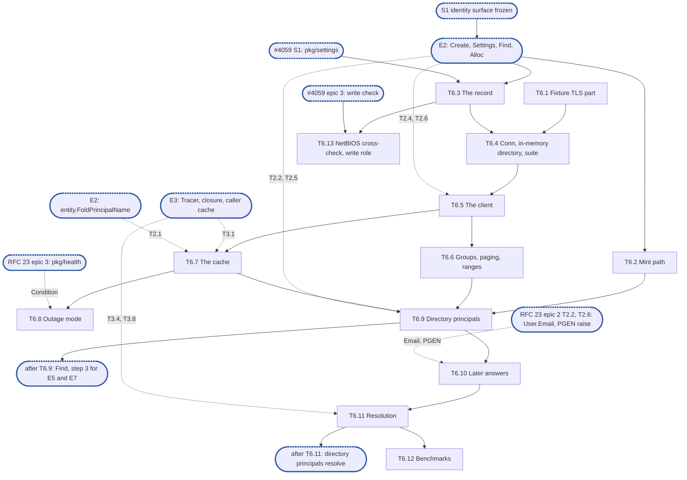

# Epic 6: identity v2 the directory

**Sources:** [RFC 18](../docs/internals/rfcs/rfc-18-identity.md) §2.3 item 3's directory clause, §2.6's
directory client, its record change and lazy dial, §3.4's last bullet (the enabled state read
through the directory cache), §3.5's rule that `identity.netbios_name` and the directory's NetBIOS
domain differ, §4.1's mint path and its held-name rule, §4.2 step 3, §4.3's last bullet (a
directory principal's uid and gid), §4.4's directory SIDs, §4.6's `qualified` spelling of a
directory principal, §5.1 to §5.4, §5.5's SMB rows and its `ponytail:`, §6.3's directory groups,
§7.1's freshness bound, §7.3's directory-cache row, §9.1's ID4 and ID9, §9.2's directory series,
mint counters, `directory_unavailable` refusal and `directory_unreachable` condition, and §10's
rows named in §3 below with its paragraphs "Where the in-memory ones stand in" and "Suites", as
pull request #4058 merged them (83232b441); [RFC 13](../docs/internals/rfcs/rfc-13-configuration.md) §6 (a rule
across settings) and Appendix B's `identity.directory`, `identity.directory_stale_grace` and
`identity.netbios_name` rows; [RFC 16](../docs/internals/rfcs/rfc-16-metadata-store.md) §3 (`Minter`'s `Rename`
and `SetEmail`, `MintBatch`, `Alloc`); [RFC 23](../docs/internals/rfcs/rfc-23-control-plane.md) §3.5, for
`test-directory`; [RFC 25](../docs/internals/rfcs/rfc-25-observability.md) §3.9's `directory_unreachable` row
and §8.2's `Source`.
**Track:** C.
**Epic 6 estimate: 13 subtasks, 27.25 man-days.**
**Depends on:** **E1** (S1): `pkg/identity`'s `Identities`, `FindOpts`, `Spelling`, `Caller`;
`internal/identity`'s `Server`, `Deps`, `State`, `Apply`, `Start`. **E2**: T2.3's `Minter.Create`
(T6.2), T2.4's `Settings`, `State.Settings` and `Apply`'s refusal (T6.3), its `Deps.Secrets`
(T6.5) and its ID range (T6.9), T2.5's `Spell` and `Find` (T6.9), T2.2's `Alloc` (T6.9),
T2.6's `Clock.After` (T6.5, D7) and T2.1's `entity.FoldPrincipalName` (its D2), which T6.7's
keys fold with. **E3, partly**: T3.1's
`Deps.Tracer`, for T6.7's spans, and T3.1's `Resolve`, T3.4's closure and T3.8's caller cache, for
T6.11; the rest does not wait. **#4059's S1** (the RFC 13
plan's): `pkg/settings`' `Of`, for T6.3. **#4059's epic 3, partly**: its write check `Check` with
tracked reads, for T6.13 alone. **RFC 23's plan's epic 3, partly**: `pkg/health`'s `Condition`,
for T6.8's source. **RFC 23's plan's epic 2 (#4326), partly**: its T2.2's `User.Email` and its
T2.6's `PGEN` raise and positions, for T6.10's `Rename` and `SetEmail`.
**Blocks:** **E5**, partly: its T5.9's machine mints call T6.2's mint path, and its T5.8 adds
`require_pac` to T6.3's record and reads its schema and realm; T6.9's step 3 joins E5's Kerberos
branch, called by whichever of T6.9 and E5's T5.5 lands second. **E7**, partly: `resolve-principal`
wraps T6.9's `Find`, `test-directory` wraps T6.5's test call, and pass-through compares the
`LogonDomainID` with T6.5's domain SID, and its T7.6 and T7.7 add the computer account's functions
to `internal/identity/directory` over T6.4's `DialTLS`. **E8**: "directory deadline" and "disabled
directory account" run on this epic's directory; E8 adds T6.8's source to the node's health
evaluator through `Add`, lists T6.3's section in the node's settings table, reads a directory
account's enabled state at a Kerberos sign-in through T6.11's cache read (its T8.5, D6 pending), and
hands T6.9's `KerberosLinkSID` to RFC 23's API as `Deps.Directory`. **RFC 23's plan's epic 4**, its
T4.11's success paths: T6.9's `KerberosLinkSID` and T6.4's in-memory directory with its suite. **RFC
23's plan's epic 7**, its T7.6: T6.4's in-memory directory and T6.9's `Find`, for the grant
by directory name, `resolve-principal` and `test-directory` (RFC 23's epic 6 tests only their
arguments and refusal).

---

## 1. Goal

Epic 6 gives identity its directory: one Active Directory or RFC 2307 directory, reached over
verified TLS only, whose answers are cached with a bounded stale grace, whose principals are minted
once and then follow their entries, and whose outage refuses rather than grants.

**At the end of the epic:**

- `identity.directory` is a section of its own, written by `admin` only, refused at validation
  for plain LDAP, skipped verification or a lower-case `ad` realm, and refused, from either side,
  when its NetBIOS domain is `identity.netbios_name`;
- `internal/identity/directory` is the only package that speaks LDAP: a simple bind over verified
  TLS, no referral followed, exact queries, the domain SID read by each new client, paging,
  `tokenGroups`, range retrieval;
- `identitytest`'s in-memory directory passes the directory's conformance suite in `unit`, and the
  Samba domain controller passes it in `integration/ad-dc`;
- the directory cache serves one query per key, fresh for 5 minutes, stale within the grace, and
  never an error as an answer; while `directory_unreachable` is raised a miss fails at once;
- every record identity writes goes through one mint path, a held name minting a principal without
  one;
- a directory principal is minted once, from the first answer, and later answers rename it, set
  its e-mail address, or disable it, a swap of two names resolving in one transaction;
- resolution of a directory principal reads its enabled state and groups through the cache, and
  its caller is fresh at most 5 minutes.

### 1.1 In scope

The fixture's TLS part; the mint path and its two counters; the `identity.directory` section, its
validation, `State.Directory` and `identity.directory_stale_grace`; the connection seam, the TLS
dialer, the in-memory directory and its conformance suite; the directory client's questions, its
domain SID and test call; groups, paging and range retrieval; the directory cache, its bounds and
series; the outage mode and its condition; directory mints, `Find`'s directory spellings and
§4.2 step 3; renames, e-mail and gone entries, with `Minter.Rename` and `SetEmail`; resolution's
directory step; the benchmarks; the NetBIOS cross-check and the section's write role through
#4059's write check.

### 1.2 Out of scope

- A claimed uid or gid asked of the directory by `uidNumber` or `gidNumber`, its mints under
  §5.5's guards and §7.3's per-address and per-node caps (RFC 18 §4.3, §5.5): the RFC 18 plan's
  deferral ledger row "uid and gid mapping and the mints a claimed uid triggers". The client
  builds no `uid` or `gid` question.
- An owner string's name and the "name held at mint" row's owner-string clause (RFC 18 §4.5): the
  deferral ledger row "NFSv4 owner strings (RFC 18 §4.5) and `FuzzOwnerString`".
- The `krb` row's linked SID and the PAC's binding to it (RFC 18 §3.4, §4.2): E5. The link's
  write, RFC 23 §3.5's user edit, which RFC 18 §4.2 has take a fresh answer only: RFC 23's plan's
  epic 4's T4.11, which asks T6.9's `KerberosLinkSID` through its `Deps.Directory`, filled by E8.
  Steps 1, 2 and 4 of §4.2: E5.
- `require_pac`, the record's one field E5 reads first: E5's T5.8 adds it to T6.3's record.
- Pass-through, its `LogonDomainID` check and its share of the 20-second bound (RFC 18 §3.5,
  §5.1): E7. A join refused against an `rfc2307` record: E7.
- The `resolve-principal` and `test-directory` runner kinds: E7, wrapping T6.9's `Find` and
  T6.5's test call.
- The computer account's LDAP: E7's T7.6 moves v1's join code into this epic's
  `internal/identity/directory` and T7.7 completes it, as concrete functions over `DialTLS`
  outside `Conn` (E7's D3), so `Conn` and the in-memory directory gain nothing; when the join
  wants a double, T6.4's conformance suite is its upgrade path.
- The rows "directory deadline", "disabled directory account", "PAC bound to the record" and "no
  local password for a directory user": E8. This epic builds the bound and the reads they check
  (T6.9, T6.11). "deny-only lookup error": E3's T3.4 and E5's T5.7.
- A directory account's enabled state read at a Kerberos sign-in (RFC 18 §3.4, §3.7): E8's T8.5,
  through T6.11's cache read (E8's D6, pending). R57 is held here at resolution.
- The node composing identity, filling `State.Directory` from the store and adding T6.8's source to
  its health evaluator through `Add`: E8.
- Serving in-grace entries while refreshing them in the background after an outage: RFC 18 §5.3's
  own `ponytail:`, written at the cache (T6.8), not built.
- A second directory, forest trusts, the global catalogue: RFC 18 §5.1's own `ponytail:`.
- Charging the directory cache to RFC 24's pool: the deferral ledger row "Caches charged to RFC
  24's connection-state pool, not fixed counts".

### 1.3 Names used here

- **E1**, the contract and the server's surface: `pkg/identity`, `internal/identity`'s lifecycle.
- **E2**, principals and accounts: `Minter.Create`, the allocation behind `Alloc`, identity's settings section, `Spell`
  and `Find`, and `Clock.After` with its hashing bound's wait (T2.6).
- **E3**, resolution: `Resolve`, the group closure, admission's caller cache, `Deps.Tracer`.
- **E4**, local NTLMv2 sign-in; its throttle and T6.7's cache keys share E2's name fold, `entity.FoldPrincipalName`.
- **E5**, Kerberos and the PAC: §4.2's steps 1, 2 and 4, machine mints, `require_pac`.
- **E6**, this epic.
- **E7**, NETLOGON and the machine account: pass-through, the join, the runner kinds.
- **E8**, the integration epic: identity composed into the node, the rows several epics meet in.
- **S1**, the identity surface frozen, which E1 delivers.
- **S2**, in RFC 18's numbering, NTLM sign-in and resolution in `vfs` (E3 and E4), whose admission
  T6.11's resolution step serves.
- **#4059's S1** is the RFC 13 plan's own point, not RFC 18's: its configuration surface frozen
  (`pkg/settings`, `pkg/secrets`). **#4059's epic 3** is that plan's settings epic, which builds the
  write check.

## 2. How the general rules apply

The rules are those of
[the RFC 18 plan's §1.5](rfc-18-identity-plan.md#15-general-rules-for-each-epic), cited by
number and title and not copied.

| Rule | Subtasks | How |
| --- | --- | --- |
| rule 1, independent unit tests ([`CLAUDE.md`, "Writing tests"](../CLAUDE.md#writing-tests)) | all | identity's tests run over the memory KV store and `identitytest`'s in-memory directory, which passes the directory's conformance suite (kind 2); outages, delays and timeouts come from `identitytest`'s fault wrapper around it (kind 3) and store errors from `kvtest`'s; the clock is injected (kind 1), `pkg/sim`'s test clock; the TLS rows dial real listeners on `127.0.0.1:0` |
| rule 2, fuzz every decoder of untrusted bytes | T6.6 | `go-ldap` decodes BER and SIDs go through `sid.DecodeSID` (E2's `FuzzSID`); the one decoder the client owns, T6.6's range-attribute parser, gets `FuzzRangeAttr`: no panic, a parsed range has `lo ≤ hi` or `hi` = `*`, and it re-formats to text that parses to the same bounds; the client refuses a range whose next `lo` does not advance; the in-memory directory's filter parser reads only what the client builds, and the suite holds it to Samba |
| rule 3, observability follows RFC 25 | T6.2, T6.7, T6.8, T6.9, T6.10, T6.11 | `identity_mints_total` and `identity_mints_unnamed_total` (T6.2), `identity_mints_remapped_total` (T6.9), `identity_directory_lookups_total` and `identity_directory_seconds` and a span per query (T6.7), `directory_unreachable` (T6.8), `identity_renames_unnamed_total` (T6.10), the `directory_unavailable` refusal (T6.11); no label or attribute carries a name, SID, entry ID or address |
| rule 4, profiling | all | every test runs under the leak check; T6.7's single flight and T6.8's outage leave no waiter behind |
| rule 5, public interface and internals ([`CLAUDE.md`, "Verifying a change"](../CLAUDE.md#verifying-a-change)) | T6.7, T6.10, T6.11 | a stale entry is proven by a sign-in admitted or refused at `Resolve`, a rename by `Find` of each name, a gone entry by the next call refused, not by the cache's contents |
| rule 6, known failures shrink | none | no suite this epic touches keeps a `known.yaml`; every test lands green |
| rule 7, v2 ignores v1 | T6.4, T6.5, T6.6 | v1's `pkg/identity/ldap` is lifted from history into `internal/identity/directory` and rewritten on RFC 18: `InsecureSkipVerify` and `AllowPlaintext` dropped, an ambiguous answer refused where v1 took the first, its idmap `rid` mode and `idmap` settings dropped |
| rule 8, real dependencies for properties of those dependencies | T6.1, T6.4, T6.6 | the directory's suite runs against the Samba domain controller in `integration/ad-dc`, reached by its host name with its certificate verified against the fixture's CA; a test that needs real AD's nesting or paging runs there, never on the in-memory one alone |
| rule 9, code comment conventions ([`CLAUDE.md`, "Code comments"](../CLAUDE.md#code-comments)) | T6.4, T6.5, T6.7, T6.8, T6.9 | RFC 18's notes at their sites: §5.1's `ponytail:` (one directory) at the client, §5.2's two `ponytail:` notes (constant TTLs, one cache per node) at the cache, §5.3's `decision:` (stale then closed) and `ponytail:` (recovery burst) at the cache's grace, §5.5's `ponytail:` (no NT hash read) at the client's attribute list, §4.4's `decision:` (no mint for an unauthenticated lookup) at `Find`; this document's D1 to D13 markers at theirs |
| rule 10, a test must be able to fail ([`CLAUDE.md`, "Writing tests"](../CLAUDE.md#writing-tests)) | all | each R row's test is named in its subtask with the bug it catches; R6's write role is held by #4059's write check, run on this section (T6.13) |
| rule 11, a symbol is exported only if RFC 18's interfaces use it | T6.3, T6.4, T6.5, T6.8, T6.9 | the exports are `internal/identity/directory`'s `Record`, `Conn`, `Request`, `Entry`, `Dialer` and `DialTLS`, which `internal/node` and `identitytest` call, its `Client`, `NewClient` and question methods, which `internal/identity` calls, `State.Directory` and `Deps.Directory`, `Server.Conditions` for the node's health evaluator, `Server.KerberosLinkSID` for the API's link write, and `identitytest`'s directory, fault wrapper and suite; the cache and the mint path stay unexported; E7's T7.6 and T7.7 add the computer account's functions to the package, outside `Conn` |
| rule 12, each subtask creates only what it declares | all | each deliverable names its consumer; `Deps.Directory` lands with the client (T6.5), `State.Directory` with `Apply`'s check (T6.3), `Settings.DirectoryStaleGrace` with the cache (T6.7), the fault wrapper with the in-memory directory it wraps (T6.4), first used in T6.6; `Clock.After` is E2's T2.6's (D7) and the record's `RequirePAC` E5's T5.8's |

## 3. Requirements and invariants

Every obligation RFC 18 and the related RFCs place on this epic, numbered so that subtasks and
tests can cite them. Sources are RFC 18 unless named.

**The record and its settings**

| # | Requirement | Kind | Source | Subtasks |
| --- | --- | --- | --- | --- |
| R1 | There is at most one directory, named by `identity.directory`: its schema, `ad` or `rfc2307`, `ad` when the record names none; its address, base, bind credential reference, trust roots, realm and NetBIOS domain; the attributes holding a user's and a group's name, `sAMAccountName` by default and `uid` and `cn` for an `rfc2307` one; `require_pac`, true unless set false; optionally a domain controller address and a DNS server | invariant | §5.1; RFC 13 Appendix B | T6.3; E5's T5.8 for `require_pac` |
| R2 | A record that asks for plain LDAP or for skipping certificate verification is refused at validation | MUST | §5.1; RFC 13 Appendix B; §10 "directory TLS" | T6.3 |
| R3 | An `ad` record whose realm holds a lower-case ASCII letter is refused at validation | invariant | §4.2, §5.1; RFC 13 Appendix B | T6.3 |
| R4 | `identity.netbios_name` never equals the record's NetBIOS domain, compared with ASCII letters folded: a write of either is refused at validation naming the other, checked against the other's current value in the write's transaction, read tracked so that a concurrent write of the other side conflicts; the component checks it again when it applies them | MUST NOT | §3.5, §4.6; RFC 13 §6, Appendix B | T6.3, T6.13 |
| R5 | §10's "NetBIOS name and domain" row | test row | §10 | T6.13 |
| R6 | `identity.directory` is written by `admin` only, the whole record, its first value included | invariant | RFC 13 Appendix B; the RFC 13 plan's A1 and O9 (#4059) | T6.3, T6.13 |
| R7 | `identity.directory_stale_grace` is 15 minutes by default, and applies live | invariant | §5.3; RFC 13 Appendix B | T6.7 |
| R8 | A changed directory record gives a new client and an empty directory cache; lookups in flight finish on the old client | invariant | §2.6 | T6.5, T6.7 |

**The connection**

| # | Requirement | Kind | Source | Subtasks |
| --- | --- | --- | --- | --- |
| R9 | The connection uses TLS, the server's certificate chain verified against the record's trust roots, or the system's, and its host name matched | MUST | §5.1 | T6.4 |
| R10 | A referral to any other host is not followed, so the bind credential goes nowhere else | invariant | §5.1 | T6.5 |
| R11 | The bind credential is a `Secret`, resolved through the secret provider and never logged | invariant | §5.1; RFC 13 §7 | T6.5 |
| R12 | The directory client dials lazily, so a down directory does not fail `Start` | invariant | §2.6 | T6.5 |
| R13 | The directory's domain SID is the `objectSid` of the entry the root DSE's `defaultNamingContext` names, read by each new client before its first answer; an `ad` client that cannot read it answers `ErrUnavailable`; an `rfc2307` one reads none and routes no SID | invariant | §5.1, §4.4 | T6.5 |
| R14 | §10's "directory TLS" row: a directory behind a self-signed certificate, then one whose host name does not match: no bind sent, lookups `ErrUnavailable`, nothing cached; a referral to another host not followed | test row | §10 | T6.4, T6.5, T6.7 |
| R15 | No NT hash is read from the directory | invariant | §5.5 | T6.5 |

**Queries**

| # | Requirement | Kind | Source | Subtasks |
| --- | --- | --- | --- | --- |
| R16 | Each question is answered by a bounded number of queries, each under a 5-second timeout: who holds a name, SID or entry ID; a principal's groups, nested; a group's SID and gid | bound | §5.1 | T6.5, T6.6 |
| R17 | One sign-in's or resolution's identity work, its directory queries and its mints together, stops at 20 seconds and fails `ErrUnavailable` | bound | §5.1 | T6.9, T6.11 |
| R18 | Every value placed in a query is escaped as RFC 4515 requires, binary values as `\xx` escapes | MUST | §5.1 | T6.5 |
| R19 | A "who holds this" query answered by more than one entry fails `ErrUnavailable`, logged and counted `ambiguous`, and is never bound | invariant | §5.1, §9.2 | T6.5 |
| R20 | §10's "exact queries" row | test row | §10 | T6.5 |
| R21 | Each user answer carries the account's enabled state, from `userAccountControl` or `accountExpires`, and its e-mail address when the entry has one | invariant | §5.1; §10 "Where the in-memory ones stand in" | T6.5 |
| R22 | A nested-group closure the directory cannot answer in one query is walked level by level, and one that cannot be finished fails whole | MUST | §5.1, §2.5 | T6.6 |
| R23 | The in-memory directory stands in only because its conformance suite holds it to the real one on exact queries, the escaping of a filter's special characters, an ambiguous name, `LDAP_MATCHING_RULE_BIT_AND` on `groupType`'s security bit, `tokenGroups`, paging, range retrieval, and an account disabled by `userAccountControl` or `accountExpires`; the suite runs against it in `unit` and against a real directory in `integration/ad-dc` | test row | §2.7; §10 "Where the in-memory ones stand in", "Suites"; RFC 29 §4.11 | T6.4, T6.6 |
| R24 | `test-directory` checks that every node reaches the directory the record names, and reports each node's answer; identity gives it the call that reaches the directory and its answer | invariant | RFC 23 §3.5 | T6.5 |

**The cache**

| # | Requirement | Kind | Source | Subtasks |
| --- | --- | --- | --- | --- |
| R25 | The identity server keeps one cache of directory answers, in memory, per node | invariant | §5.2, §7.1 | T6.7 |
| R26 | A positive answer is fresh for 5 minutes, a "no such entry" answer for 30 seconds | bound | §5.2, §5.3 | T6.7 |
| R27 | An error or timeout is never cached as "no such entry", and never replaces a positive entry | MUST NOT | §5.2 | T6.7 |
| R28 | Concurrent lookups of one key share one query | MUST | §5.2 | T6.7 |
| R29 | The key is the question: (scheme, spelling) for "who holds this", a name folded as §4.6 compares names; the principal for "what are its groups" | invariant | §5.2 | T6.7 |
| R30 | §10's "one query per key" row | test row | §10 | T6.7 |
| R31 | Past the fresh window, a failed query serves an entry whose last answer is no older than the TTL plus the grace, counted `stale`; anything else, no entry or an older one, fails `ErrUnavailable`, counted `refused` | MUST | §5.3, §9.2 | T6.7 |
| R32 | A directory account is let in at most the TTL plus the grace after the last answer that showed it enabled, read directly or through a cached caller; a grace of zero never uses an answer older than the TTL | invariant | §5.3, §9.1 ID9 | T6.7, T6.11 |
| R33 | Past its bound, the least recently used entry is evicted; an evicted entry is a miss, never "not found" | invariant | §7.3 | T6.7 |
| R34 | A directory error is never read as "no such principal", and never falls back to the everyone grant, a guest or a cached negative answer | MUST NOT | §5.4, §9.1 ID5 | T6.7, T6.11 |
| R35 | Lookups are counted in `identity_directory_lookups_total{question, result}` and timed in `identity_directory_seconds`; each query is a span, a child of whichever opened it; no label or attribute carries a name, SID or address | invariant | §9.2 | T6.7 |

**The outage**

| # | Requirement | Kind | Source | Subtasks |
| --- | --- | --- | --- | --- |
| R36 | `directory_unreachable` is raised by this node's own failed queries, and by no other node's; while it is raised an entry within the grace is served without a query, a lookup with no such entry fails `ErrUnavailable` at once, and one lookup in 10 seconds asks the directory as a probe; the first answer clears it | invariant | §5.3, §9.2 | T6.8 |
| R37 | `directory_unreachable` is degraded while lookups are served stale within the grace and unhealthy once one is refused past it | invariant | §9.2; RFC 25 §3.9 | T6.8 |
| R38 | §10's "stale grace" row | test row | §10 | T6.7, T6.8 |

**Minting**

| # | Requirement | Kind | Source | Subtasks |
| --- | --- | --- | --- | --- |
| R39 | Every record identity writes goes through one mint path: one sign-in, lookup or resolution mints every principal it needs in one batch; on `ErrExist` the lookups are re-run, a principal now found is bound, the rest minted in a new batch, for as long as each re-run binds a principal the one before did not or newly marks a record `Unnamed`; a re-run that does neither fails `ErrUnavailable`, writes nothing and logs both `PrincipalID`s | invariant | §4.1 | T6.2 |
| R40 | A name never fails a mint: a principal whose name another of its kind holds under §4.6's comparison is minted without a name, counted in `identity_mints_unnamed_total` and logged naming both | invariant | §4.1, §9.2 | T6.2 |
| R41 | Every record minted is counted in `identity_mints_total{kind}` | invariant | §9.2 | T6.2 |
| R42 | A directory record is minted once, from the first answer, and holds its `PrincipalID`, `dir` entry ID, SID, uid and gid from then on; a later answer renames it (R51) | invariant | §5.1 | T6.9 |
| R43 | A directory principal's uid and gid are the entry's `uidNumber` and `gidNumber` when it has them, else allocated, written once and never recomputed; an entry whose `uidNumber` or `gidNumber` is 0, 65534 or one another principal holds gets an allocated one, and the mint is counted in `identity_mints_remapped_total{kind}`, `user` or `group` | invariant | §2.3 item 3, §4.3, §9.2 | T6.9 |
| R44 | A directory principal's SID is its entry's; an entry with none is given a local SID from the RID counter when minted, and keeps it whatever the directory later says | invariant | §4.4, §5.1, §9.1 ID3, ID4 | T6.9, T6.10 |
| R45 | A SID of the directory's domain with no principal is asked of the directory, and minted only when `FindOpts.Mint` is set; otherwise `Find` answers `ErrUnknownPrincipal` and writes nothing | invariant | §4.4 | T6.9 |
| R46 | §4.2 step 3: a Kerberos name in the directory's realm maps to the entry the directory holds under its user part, by the record's name attribute, and then to the principal holding that entry's `dir` spelling, never one found by name alone; a name with a service part never matches it | invariant | §4.2 | T6.9 |
| R47 | The `qualified` scheme spells a directory principal `<directory domain>\<name>` | invariant | §4.6 | T6.9 |
| R48 | §10's "SID-less directory" row | test row | §10 | T6.9, T6.10 |
| R49 | §10's "name held at mint" row, but its owner-string clause (§1.2) | test row | §10 | T6.9, T6.10 |
| R50 | §10's "root" row, its directory clause: an entry with `uidNumber` 0 minted with an allocated uid, counted in `identity_mints_remapped_total{kind="user"}`, as one with a `uidNumber` another principal holds is (§10's "mint conflict" row, epic 8's T8.5) | test row | §10, §9.2 | T6.9 |
| R62 | A directory principal holds no local NT hash and no local password: a local NTLMv2 check refuses it, and giving it a local password is refused; this epic writes the `dir` spelling both refusals read | invariant | §3.5, §5.5 | T6.9 |
| R63 | The SID a `krb` link is written for is asked of the directory fresh only: a name the directory cannot answer freshly fails `ErrUnavailable`, one with no entry `ErrUnknownPrincipal`, and a name in another realm links no SID | MUST | §4.2; RFC 23 §3.5 | T6.9 |

**Later answers**

| # | Requirement | Kind | Source | Subtasks |
| --- | --- | --- | --- | --- |
| R51 | Later answers change a record's name through the store's rename and its e-mail address, each only when it changed, and never its `PrincipalID`, entry ID, SID, uid or gid | invariant | §5.1; RFC 16 §3 | T6.10 |
| R52 | A record whose entry no longer answers its name gives the name up at once: it takes the new name when free, and is otherwise left without one, counted in `identity_renames_unnamed_total` and logged | invariant | §5.1, §9.2 | T6.10 |
| R53 | When a directory principal holds the new name, the directory is asked about that holder's entry, and only a definite answer that it no longer answers the name, a fresh answer naming it otherwise or "no such entry", makes the holder give the name up first; an error, a timeout or a stale answer leaves the holder its name and the renaming record without one | invariant | §5.1 | T6.10 |
| R54 | The renames one answer causes, a swap's both, commit in one transaction with one principals-generation raise; on `ErrExist` the refresh re-reads the holders and plans the list again under §4.1's progress rule, a take still held listed as `""` and counted, and of two takes whose names fold equal the second is listed as `""` and counted | invariant | §5.1 | T6.10 |
| R55 | §10's "name swap" row | test row | §10 | T6.10 |
| R56 | "No such entry" for a principal the directory once minted is read as disabled, never as "no change" | invariant | §5.1, §3.7 | T6.11 |

**Resolution**

| # | Requirement | Kind | Source | Subtasks |
| --- | --- | --- | --- | --- |
| R57 | A directory principal's groups and enabled state are not written to the store; they are read through the directory cache, on every proof, so a change in the directory takes effect at the next lookup | invariant | §3.4, §5.1, §3.7 | T6.11 |
| R58 | A `Secret` or `Ticket` caller of a directory principal holds the directory's groups beside its store closure and its evidence's, computed whole or the resolution fails `ErrUnavailable` | MUST | §6.3, §2.5, §5.4, §9.1 ID8 | T6.11 |
| R59 | A caller of a directory principal, or one that used a directory answer, is served at most 5 minutes after it was built (`Caller.Fresh`) | invariant | §7.1 | T6.11 |
| R60 | A resolution refused for want of a directory answer is counted `directory_unavailable` | invariant | §9.2 | T6.11 |
| R61 | §10's "mint burst" row | test row | §10 | T6.11 |

Which test or enforcer holds each row is in its subtask's **Tests**.

## 4. Decisions this epic takes

- **D1, the seam is a connection the directory package declares.** `internal/identity/directory`
  declares `Conn` with the two calls identity makes, `Bind` and `Search`, over its own
  `Request` and `Entry` types, never `go-ldap`'s, and `Dialer`, `func(ctx, Record) (Conn, error)`.
  `DialTLS` is the production dialer, the one place `go-ldap` dials. Identity takes a `Dialer`
  as `Deps.Directory`, so `identitytest`'s in-memory directory stands in without importing LDAP,
  as RFC 18 §2.7 and E1's import rule require. Needs `Directory` added to RFC 18 §2.6's `Deps`
  sketch (§9). Prior art: v1's `fakeConn` stood in at the same connection (from memory).
- **D2, `State.Directory`, pending the user's answer (§9).** RFC 18 §2.6 puts the record in
  `State.Settings`, but `identity.directory` is its own section, with its own write role, decoded
  apart from `identity.*` by #4059's `Read`, and E2's `Settings` is that section's struct. A
  second field, `Directory *directory.Record`, nil with no directory, keeps each section one
  struct. Needs an RFC 18 §2.6 amendment. Prior art: none found.
- **D3, the bind name is a field, pending the user's answer (§9), and the bind credential a kind of
  its own.** A simple bind needs a name and a password; RFC 13's row names only the
  credential's reference. The record gains `bind_name`, the distinguished name or UPN that binds,
  shown to an operator like the base; the password is a `Secret` of a new kind, `directory
  credential`, sealed under the `protocol` key RFC 13 §7 assigns to identity-provider bind
  credentials. RFC 16 §2.3's `Secret.Kind` list names it (#4491). Needs RFC 13 Appendix B's row. Prior art:
  sssd's `ldap_default_bind_dn` beside `ldap_default_authtok` (from memory).
- **D4, TLS is the address's scheme, and nothing turns it off.** `ldaps://host[:port]` dials TLS;
  `ldap://host[:port]` always upgrades with StartTLS before the bind; any other scheme is refused.
  The record has no field that skips verification or allows plain LDAP, so v1's
  `insecure_skip_verify` and `allow_plaintext` are unknown fields, refused by #4059's strict
  decode. `decision:` marker at `Record.Validate`. Prior art: sssd's `ldap_id_use_start_tls`
  with `ldap_tls_reqcert = demand` (from memory).
- **D5, the renames of one answer are one `Minter` call, settled: the list form replaces the
  single `Rename`.** A single-principal rename in its own transaction would make a swap raise the
  principals generation twice and pass through a state where one name points at nobody, so
  `Rename(ctx, []Renaming)` takes every renaming one answer causes and applies them in one
  transaction. RFC 16 §3 holds its contract. `SetEmail` stays a single-principal call. Prior art:
  none found.
- **D6, the mint path re-runs a plan, not a batch.** The caller hands the path a function that looks
  its principals up and returns the batch of those still missing with the ones bound; on `ErrExist`
  the path calls it again, and stops with `ErrUnavailable` when a run neither binds a principal the
  one before did not nor newly marks a record `Unnamed`: a name another call took between the name
  check and the commit is progress, never a failure (R40). A record this mint call already marked
  `Unnamed` in an earlier run is not newly marked again, so a name an unrelated principal keeps
  holding counts once. A held name is found before the write, by the name index, and the record
  marked `Unnamed` (R40). No count bounds the loop: R39's progress rule and §5.1's 20 seconds do.
  Prior art: optimistic concurrency's re-read and retry, bounded by progress (from memory).
- **D7, the 20-second bound is one deadline on the injected clock.** `Find` with a directory
  question and resolution's directory step each open the bound once, through a context the
  injected clock cancels at 20 seconds, which every query, mint and wait below it inherits; E5's
  and E7's sign-ins open it the same way. Identity's `Clock` subset gains `After(d) <-chan struct{}`,
  which `pkg/sim`'s test clock already has, in T6.5, whose 5-second query timeout is the first
  wait, unless an earlier subtask has added it: E2's T2.6, whose hashing bound waits 5 s on the
  injected clock, is the first wait in the order of work, so by the field rule it adds `After` and
  this epic uses it, as E2's D8 and T2.6 say. Prior art: `context.WithDeadline`, here driven by the injected clock (from memory).
- **D8, fixed bounds, held at their sites by `ponytail:` markers.** The directory cache holds
  65 536 entries, least recently used evicted and counted; in-flight queries are capped at 64 per
  node, the rest waiting within the bound; a SID lookup carries at most 64 SIDs in one OR filter,
  so a PAC of 1 024 SIDs costs 16 queries. Each names RFC 24's pool, or a measured page size, as
  the upgrade. Prior art: sssd's `ldap_page_size` and its range retrieval (from memory).
- **D9, the probe is a lookup, not a goroutine.** While `directory_unreachable` is raised, the
  first lookup 10 seconds after the last probe on the injected clock is sent to the directory
  and every other lookup is answered from the grace or refused; the probe's answer clears the
  condition. No background loop runs, so `Stop` has nothing to wait for. `decision:` marker at the
  outage branch. Prior art: a circuit breaker's half-open state (from memory).
- **D10, `tokenGroups` first, a walk of security groups when the bind cannot read it.** An
  `ad` user's closure is one base-scope read of its constructed `tokenGroups`, which includes the
  primary group `memberOf` omits; more than 1 024 SIDs fail it `ErrUnavailable` before any SID is
  looked up. A bind account without the right to read it gets an empty attribute, and the client
  then walks the closure level by level from the user's DN and the DN of the primary group
  `primaryGroupID` names, asking
  `(&(objectClass=group)(groupType:1.2.840.113556.1.4.803:=2147483648)(|(member=<dn>)…))` with
  paging, at most 64 terms to a filter, 64 levels and 1 024 groups. Only security groups are
  followed, so a distribution group ends its branch and the walk answers what `tokenGroups`
  would. An unreadable `primaryGroupID` fails the closure `ErrUnavailable`. The SID lookups, the
  primary group's lookup and the walk run under the domain's `defaultNamingContext`, not the
  record's base. An `rfc2307` directory is walked level by level over `memberUid` and `member`,
  under the same bounds. Prior art: sssd's `ldap_use_tokengroups` with the same fallback
  (from memory).
- **D11, a definite answer is a fresh one.** The cache answers a caller that asks "fresh only"
  from a query or a fresh entry, never a stale one, and fails `ErrUnavailable` otherwise. The
  rename rule's question about a holder asks it (R53), and so does the `krb` link's write, RFC 23
  §3.5's user edit, which RFC 18 §4.2 requires to take a fresh answer only, through T6.9's
  `KerberosLinkSID`. Prior art: none found.
- **D12, a gone entry disables at resolution, writing nothing.** RFC 16 §3's `Minter` has no
  disable, and RFC 18 §5.1 keeps a directory principal's enabled state out of the store; "no such
  entry" for a minted principal is cached as a negative answer for 30 seconds and read by
  resolution as disabled, refused `ErrAccess`, counted `disabled`. Prior art: sssd marks an entry
  gone from the directory as expired, not deleted (from memory).
- **D13, the NetBIOS cross-check is identity's own `CheckTx`.** Both settings belong to identity,
  so RFC 13 §6 keeps the rule with the component: each identity section's `CheckTx`, in
  `internal/identity`, reads the other's row by key, tracked, in the write's transaction, and
  `Apply` runs the same rule on the `State`. `pkg/settings` holds no rule naming either key and
  imports nothing of identity, as E1's import rule (only `internal/node` and identity's own
  packages import `internal/identity`; `_test.go` files are not checked) requires. RFC 13 §6 sends a rule to the control plane
  only when its two settings belong to different components, as the port rule's do.

## 5. Target tree

```text
test/integration/ad-dc/
  entrypoint.sh, Dockerfile   T6.1  the fixture CA, the DC's SAN certificate, its Docker network
  fixture_test.go             T6.1  TestADFixture
  directory_test.go           T6.4, T6.6  the directory's conformance suite against Samba
internal/identity/
  mint.go                     T6.2  the mint path (D6), identity_mints_total, identity_mints_unnamed_total
  server.go                   T6.3  State.Directory, Apply's NetBIOS check
                              T6.5  Deps.Directory, the client swapped on a record change
  settings.go                 T6.3  the identity.directory section's registration
                              T6.7  Settings.DirectoryStaleGrace
  dircache.go                 T6.7  the directory cache, fresh-only answers (D11)
  outage.go                   T6.8  directory_unreachable, the probe (D9), Conditions
  dirmint.go                  T6.9  directory mints, Find's directory spellings, step 3, the bound
  rename.go                   T6.10 later answers
  resolve_dir.go              T6.11 resolution's directory step
  dir_bench_test.go           T6.12 the benchmarks
internal/identity/directory/
  record.go                   T6.3  Record, its defaults and Validate (D3, D4); E5's T5.8 adds RequirePAC
  conn.go                     T6.4  Conn, Request, Entry, Dialer, DialTLS
  client.go                   T6.5  Client, NewClient: domain SID, who holds, the test call
  filter.go                   T6.5  filters built from escaped values
  groups.go                   T6.6  closures (D10), SIDs in pages, paging, range retrieval
  rangeattr.go                T6.6  the member;range=<lo>-<hi|*> parser
  fuzz_test.go                T6.6  FuzzRangeAttr
  computer.go                 E7's T7.6, T7.7  the computer account's create, reset and read,
                                    outside Conn (E7's D3)
pkg/identity/identitytest/
  directory.go                T6.4  the in-memory directory; T6.6 tokenGroups, chains, paging, ranges
  filter.go                   T6.4  its RFC 4515 parser and evaluator
  directorysuite.go           T6.4, T6.6  DirectoryConformance
  faultdir.go                 T6.4  the fault wrapper on sim.Fault, around a Dialer and its Conns
pkg/metadata/kvstore/
  minter.go                   T6.10 Rename (D5), SetEmail
  kvstoretest/principals.go   T6.10 their conformance rows
internal/identity/
  settings.go                 T6.13 the NetBIOS cross-check in both sections' CheckTx (D13)
```

## 6. Subtasks

### T6.1 The fixture's TLS part

**Subtask T6.1 estimate: 1.5 man-days.**

- **Track:** C. **Depends on:** none; RFC 23's plan's epic 1 (#4334), which the rebase waited for,
  has merged.
- **Covers:** R9, R23.
- **Deliverables:** built, not merged, on the branch `test/ad-dc-network-tls` (9207ec946,
  f86998cd3, 24073d347), on GitHub:
  each test runs its domain controller on a Docker network of its own, reached on the container's
  address with no published port, container, network and image names carrying a per-run ID and a
  prefix `DITTOFS_AD_DC_NAME_PREFIX` replaces; the entrypoint makes a CA once per domain, issues
  the controller a certificate whose SANs name its fixed host name, `dc1.dittofs.ad`, and its
  addresses, and exports the CA as `/keytabs/ca.pem`; `InsecureSkipVerify` and the
  `x509negativeserial` godebug are gone; `docs/guide/identity.md` describes the network and the
  CA. Consumed by T6.4's and T6.6's suite runs in `integration/ad-dc`, and by E5's and E7's
  fixture parts. This subtask is also the one owner of moving the fixture to `feat/storage-v2`,
  which E5's T5.1 and E7's T7.2 cite. The three branches are merged on `feat/storage-v2`:
  `test/ad-dc-network-tls-v2` (#4420), with E5's `test/ad-dc-kerberos-v2` (#4421) and E7's
  `test/ad-dc-join-v2` (#4422) stacked on it (not ancestors of each other). #4420 lifted the
  `V2` skip that dropped the `integration/ad-dc` cell from the plan job's select in
  `.github/workflows/tests.yml`, since its tests no longer drive v1's SMB adapter. What is left is
  the close-out: the `integration/ad-dc` cell green on `feat/storage-v2`'s plan job, and the
  subtask marked done.
- **Acceptance criteria:**
  - No test under `test/integration/ad-dc` sets `InsecureSkipVerify`.
  - Two runs on one Docker host use disjoint names.
  - The three fixture branches build on `feat/storage-v2`, and the cell's skip is lifted or its
    remaining v1 tests named.
- **Tests:** `TestADFixture/ldaps_verified_by_host_name`: an LDAPS handshake to `dc1.dittofs.ad`
  verifies against the exported CA alone with Go's default verification (catches a certificate
  whose SAN misses the host name, or a CA not exported, R9). No test double.
- **Rules:** rule 8, the real Samba domain controller.

### T6.2 The mint path

**Subtask T6.2 estimate: 1.5 man-days.**

- **Track:** C. **Depends on:** E2's T2.3.
- **Covers:** R39, R40, R41.
- **Deliverables:** `internal/identity`'s `mint(ctx, plan func(context.Context) (entity.MintBatch,
  int, error)) error`, the `int` the number of principals the run bound, with D6's re-run loop:
  `ErrExist` re-runs the plan; a run that neither binds a principal the one before did not nor newly
  marks a record `Unnamed` fails `ErrUnavailable` and logs both `PrincipalID`s; before the write, a
  record whose name the name index shows held by another principal of its kind, or which folds to
  the name of an earlier record of its kind in the same batch, is marked `Unnamed` and logged naming
  both; `identity_mints_total{kind}` and `identity_mints_unnamed_total{kind}` counted after the
  commit. Consumed by T6.9, T6.11 and E5's machine mints.
- **Acceptance criteria:**
  - Every write of a new principal in `internal/identity` goes through `mint`:
    `rg -g '!*_test.go' 'Minter\(\)\.Create|\.Create\(ctx, ' internal/identity` shows it alone.
- **Tests:** at `mint`, over the memory KV store wrapped in `kvtest`'s `FaultKV`, a `sim.Fault`
  delaying the first `Create`'s commit on the test clock while a concurrent `mint` commits two of
  its three groups: the first re-runs, binds those two and mints the third, the generation raised
  once per commit (catches a re-run bounded at one, R39); a plan that keeps answering the same batch
  while another writer holds a row it needs: `ErrUnavailable` after the second run, nothing written
  (catches an unbounded loop, R39); a `sim.Fault` delaying the first `Create`'s commit while a
  concurrent `mint` takes a name the batch writes: the re-run binds nothing but commits the record
  `Unnamed`, counted in `identity_mints_unnamed_total` (catches a progress rule that counts only
  bindings, R39, R40); a re-run that binds a new principal beside a name an unrelated principal
  keeps holding: committed (catches a progress rule that sums bindings and unnamings, R39); a re-run
  that only re-marks a record the mint already unnamed: `ErrUnavailable` on the second run, not at
  §5.1's deadline (catches "newly" read per run, R39); a group named `finance` beside a local
  `Finance`: minted, found by SID, not by name, and `identity_mints_unnamed_total{kind="group"}` 1
  (R40); one batch holding directory groups `Finance` and `FINANCE`: both minted, the second
  unnamed, never `ErrUnavailable` (catches a clash inside one batch failing every run, R40);
  `identity_mints_total` read from the registry after a batch of one user and two groups: `user` 1,
  `group` 2 (R41). Doubles: `kvtest`'s `FaultKV` (kind 3), the injected clock (kind 1).
- **Rules:** rule 9 (D6's marker).

### T6.3 The `identity.directory` record

**Subtask T6.3 estimate: 1.25 man-days.**

- **Track:** C. **Depends on:** E2's T2.4. #4059's S1.
- **Covers:** R1, R2, R3, R4, R6.
- **Deliverables:** `directory.Record{Schema, Address, Base, BindName string; BindCredential
  entity.SecretRef; TrustRoots string; Realm, NetBIOSDomain, UserNameAttr, GroupNameAttr string;
  DCAddress, DNSServer string}` with RFC 13 Appendix B's defaults and `Validate`:
  the address scheme of D4, the trust roots parsed as PEM (empty trusts the host's roots), an `ad`
  realm with a lower-case ASCII letter refused, an unknown schema refused, D4's `decision:` marker;
  the section declared through `settings.Of("identity.directory",
  settings.At(entity.ScopeInstallation), …, settings.WriteRole(entity.RoleAdmin),
  settings.SecretRef("BindCredential", entity.SecretDirectoryCredential))` (D3), the reference
  named by its field; the kind `entity.SecretDirectoryCredential`, added here and sealed under the
  `protocol` key in `pkg/secrets`' roles;
  `State.Directory *directory.Record` (D2); `Apply` refusing a `State` whose
  `Settings.NetBIOSName` equals `Directory.NetBIOSDomain` with ASCII letters folded, and keeping
  the last applied; `require_pac`, whose first reader is E5's T5.8, is added there. Consumed by
  T6.4 (`Dialer` takes a `Record`), T6.5, T6.13, E5's T5.8 (the schema and realm), E7
  (`DCAddress`, `DNSServer`, the NetBIOS domain) and E8, which fills `State.Directory` and lists
  the section.
- **Acceptance criteria:**
  - A section with no rows decodes to no directory, `State.Directory` nil.
- **Tests:** at `Record.Validate`, table-driven: §10 "directory TLS"'s validation half, a record
  with `insecure_skip_verify` or `allow_plaintext` refused by the strict decode, `http://`,
  `ldapi://` and an empty address refused, `ldap://` and `ldaps://` accepted (R2); realm
  `corp.example` on an `ad` record refused and on an `rfc2307` one accepted (catches the rule
  applied to every schema, R3); defaults read back: schema `ad`, `sAMAccountName`, and `uid` and
  `cn` for `rfc2307` (R1; `require_pac`'s default is E5's T5.8's test). At `Apply`, over the memory KV store:
  `NetBIOSName` `CORP` with a record whose domain is `corp`: refused, the last `State` kept,
  read through `export_test.go` (catches a case-sensitive compare, R4); `NetBIOSName` `KDC` with
  a domain spelled with the Kelvin sign U+212A for its `K`: accepted (catches a Unicode fold in
  place of the ASCII one, R4). The write role is held by
  T6.13's test through #4059's `Check` (R6). No test double.

### T6.4 The connection, the in-memory directory and its suite

**Subtask T6.4 estimate: 3 man-days.**

- **Track:** C. **Depends on:** T6.1, T6.3.
- **Covers:** R9, R14, R23.
- **Deliverables:**
  - `directory.Conn{ Bind(ctx, name string, password []byte) error; Search(ctx, Request)
    (Result, error); Close() error }`, `Request{Base string; Scope Scope; Filter string; Attrs
    []string; PageSize int; Cookie []byte}`, `Result{Entries []Entry; Cookie []byte; Referrals
    []string}`, `Entry{DN string; Attrs map[string][][]byte}`, `Dialer` (D1), all of the standard library's
    and the package's own types, so `identitytest` imports `internal/identity/directory` and never
    `internal/identity`; `DialTLS`, lifted
    from v1's `dialAndBind` from history: TLS verified against the record's trust roots, or the
    system's when it names none, `ServerName` the address's host, the host resolved through the
    record's `DNSServer` when it names one, StartTLS for `ldap://`, no `InsecureSkipVerify`
    anywhere; its `Bind` refusing an empty password before any byte is sent, so no
    unauthenticated bind leaves (RFC 4513 §5.1.2);
  - `identitytest.Directory`, the in-memory directory (kind 2): entries by DN, a simple bind
    checked against a stored password, no such object (LDAP result 32) for a search based outside
    its naming context, as Samba answers one, and continuation references to the configuration
    and DNS partitions for a subtree search of the naming context itself, a search over base,
    one-level or subtree scope with
    RFC 4515 filters parsed and evaluated by its own parser (equality, presence, substrings, and,
    or, not, `\xx` escapes), so a bad escape matches what a directory would;
  - `identitytest.FaultyDirectory` (kind 3), built on `pkg/sim`'s `Fault` and `Schedule`, around a
    `Dialer` and every `Conn` it returns: it always sends the dial or the query to what it wraps,
    then fails, delays on the test clock, times out, or tears that answer by rewriting a named
    attribute's description in its entries (T6.6's hostile ranges), or every one, on cue, so the
    directory has really answered and a test whose code ignored the answer still fails; it keeps
    a pass-through record of the queries it sent, for a test whose requirement is a query count;
  - `identitytest.DirectoryConformance(t, open func(t *testing.T) (directory.Conn, Seeder))`, its
    first rows: a value holding `*`, `(`, `)`, `\` and NUL matches only the entry that holds it
    literally, by equality; substrings matched by initial, any and final pieces, on values holding
    no NUL, since Samba matches a substring only up to a value's first NUL; two entries answering
    one name both returned; a search based outside the naming context refused, never an empty
    answer (Active Directory answers a referral, Samba noSuchObject); a subtree search of the
    naming context handing back the partitions' continuation references; `userAccountControl`'s
    disable bit
    and a past `accountExpires` read back; a bind with an empty password refused; `objectSid` and `objectGUID` as binary; the root DSE's
    `defaultNamingContext`;
  - the suite run in `unit` over the in-memory directory and in `integration/ad-dc` over `DialTLS`
    to the fixture, its `Seeder` adding entries over LDAP as the domain administrator there, not
    through `samba-tool`; the cell's LDAP tests, which RFC 23's
    plan's epic 1 deletes, written afresh on it.
  Consumed by T6.5 to T6.11, E7's online join (`DialTLS`) and E8; the fault wrapper first by
  T6.6.
- **Acceptance criteria:**
  - `go vet` reports no import of `go-ldap` outside `internal/identity/directory`, E1's import
    rule unchanged.
- **Tests:** at `DialTLS`, against TLS listeners on `127.0.0.1:0` with certificates from a test CA
  made under `t.TempDir()`: a self-signed server, and one whose certificate names another host,
  each refused at the handshake, the listener's `Handshake` returning an error and reading no
  application byte, so no bind was sent (catches verification skipped or the host name unchecked,
  R9, R14); a server signed by the record's trust roots accepted. The suite's rows above, run on
  both implementations, the continuation-reference row among them, so `DialTLS` is shown to hand
  a reference back rather than follow it (R10, R23). No test double but the in-memory directory,
  held by the suite.
- **Rules:** rule 7 (v1's dialer lifted, its plaintext branch dropped),
  rule 8 (the suite against Samba).

### T6.5 The directory client

**Subtask T6.5 estimate: 3 man-days.**

- **Track:** C. **Depends on:** T6.4. E2's T2.4 (`Deps.Secrets`), E2's T2.6 (`Clock.After`).
- **Covers:** R8, R10, R11, R12, R13, R14, R15, R16, R18, R19, R20, R21, R24.
- **Deliverables:**
  - the client, `Client` in `internal/identity/directory`, built by `NewClient` and called by
    `internal/identity` through its question methods: one `Conn` dialled at its first
    question, never at `New` or `Start`, redialled after a transport error; the bind credential
    resolved through `Deps.Secrets` at the dial, an empty one refused before the dial, so no
    unauthenticated bind is sent (RFC 4513 §5.1.2); the domain SID read from the root DSE's
    `defaultNamingContext` entry before the first answer, `ErrUnavailable` while an `ad` client
    cannot read it; a continuation reference (`SearchResultReference`, `Result.Referrals`) handed
    back and ignored, never followed or refused, and a referral (an `LDAPResult` with code 10)
    refused `ErrUnavailable`, never dialled, the two being different LDAP messages; every search
    sent with the domain-scope control (1.2.840.113556.1.4.1339), so a directory that honours it
    sends no references and one that ignores it is served by the rule before;
  - the questions "who holds this name, SID or entry ID" and "what is this group's SID and gid",
    each one query under a 5-second timeout, values escaped as RFC 4515 requires (`go-ldap`'s
    `EscapeFilter` for text, `\xx` for a SID or GUID); two entries answering refused
    `ErrUnavailable` and logged; a user answer's enabled state from `userAccountControl` and
    `accountExpires`, its `mail`, its `objectGUID` as the entry ID, an `rfc2307` entry's `entryUUID`; an attribute list that names
    no NT-hash attribute, with §5.5's `ponytail:` at it;
  - the test call: bind, read the base entry, report the answer, for E7's `test-directory`;
  - the query timeout on E2's `Clock.After` (D7);
  - `Deps.Directory` (D1), optional: `New` accepts a `Deps` without it, so no earlier epic's
    caller changes, and every directory question then answers `ErrUnavailable`, as E1's stubs
    do; `Apply` building a new client on a changed `State.Directory`, the old
    one closed once its lookups in flight finish; §5.1's `ponytail:` (one directory) at the client.
  Consumed by T6.6, T6.7, T6.9, E7 (the test call, the domain SID) and E8.
- **Acceptance criteria:**
  - `New` and `Start` succeed with no `Dialer`, every directory question then `ErrUnavailable`.
  - A changed record's first question reads the domain SID of the new directory.
- **Tests:** at the client, over the in-memory directory: §10's "exact queries" row, names holding
  `*`, `(`, `)` and `\` beside the entries they would match unescaped, each resolving to its own
  entry only, and two entries answering one name `ErrUnavailable`, nothing bound (catches an
  unescaped value or the first of two taken, R18, R19, R20); a question based outside the
  directory's naming context, which the in-memory directory answers noSuchObject, as Samba does:
  `ErrUnavailable`, never "no such entry" (catches a refusal read as an empty answer, R14); the
  same question's answer turned by the fault wrapper into an `LDAPResult` with code 10 naming
  another host: `ErrUnavailable`, nothing dialled (catches a referral read as an empty answer or
  followed, R10, R14); a name's question over the naming context, which the in-memory directory
  answers with the entry and the partitions' continuation references: the entry answered (catches
  a continuation reference refused, which would refuse every subtree lookup, R10); a disabled bit, a past `accountExpires` and a `mail` read back (R21);
  `Start` then `Stop` with the fault wrapper holding every dial until its context ends, under the
  leak check: `Start` returns at once (catches an eager dial, which would hang, R12); an `ad` directory without a readable domain object:
  every question `ErrUnavailable`, and an `rfc2307` one without it answering (R13); `Apply` of a
  second record while a question's answer is delayed by the fault wrapper: it ends on the first
  directory's answer, the next question on the second's (R8); the bind password, a `Secret`
  sealed through #4059's provider, never in a captured log line (R11); an empty resolved
  credential: refused before dial, no connection made (catches a named bind sent with no
  password, which a permissive directory answers as anonymous, R11); the attribute list read
  through `export_test.go` holds no `unicodePwd`, `ntPwdHistory` or `sambaNTPassword` (R15). In
  `integration/ad-dc`, the test call and a user's answer against Samba (R24, R21). R16's timeout
  is checked in T6.7, through the fault wrapper. Doubles: the in-memory directory (kind 2), the
  fault wrapper (kind 3).
- **Rules:** rule 7 (v1's questions lifted, the first of two no longer taken), rule 9 (§5.1's
  and §5.5's markers).

### T6.6 Groups, paging and range retrieval

**Subtask T6.6 estimate: 2.25 man-days.**

- **Track:** C. **Depends on:** T6.5.
- **Covers:** R16, R22, R23.
- **Deliverables:** the question "what are this principal's groups, nested" as D10 says, each page
  of an RFC 2696 paged search followed to its end on the connection that answered its first
  page, restarted once from the first page when that connection is found closed, and a failed
  later page dropping its connection; a `member` value range-retrieved
  (`member;range=0-1499`, then on) by the unexported `members`, reached only from tests until a
  question lists a group's members (a `decision:` marker: no RFC 18 question asks for them), the `member;range=<lo>-<hi|*>` attribute parsed by the client's
  own parser, a range with `lo > hi` or whose next `lo` does not advance past the last `hi` refused
  `ErrUnavailable`, and `FuzzRangeAttr`; a lookup of many SIDs in one OR filter of at most 64 each, with
  D8's `ponytail:`; a closure that cannot be finished, a page or a range that fails, failing whole.
  `identitytest.Directory` gains the constructed `tokenGroups`, `LDAP_MATCHING_RULE_BIT_AND`,
  paged results with a cookie and range retrieval past a member count the test sets; the suite
  gains a row for each. Consumed by T6.9 and T6.11.
- **Acceptance criteria:**
  - A closure is returned whole or not at all.
- **Tests:** in the suite, on both implementations: a user three levels deep in nesting, its
  `tokenGroups` holding every level and the primary group; the walk through security groups
  answering the same groups, a distribution group and a group reached only through it in neither;
  a search over 2 500 entries in pages of 1 000 returning every entry once; a group of 3 000
  members read in ranges (R23). At the client, over the in-memory directory: a bind that
  cannot read `tokenGroups` gets the same closure through the walk and `primaryGroupID`
  (catches the primary group lost, R22); one that cannot read `primaryGroupID`: `ErrUnavailable`
  (R22); a record whose base holds none of the user's groups: the whole closure still answered (R22);
  `tokenGroups` of more than 1 024 SIDs: `ErrUnavailable`, no SID looked up (R16); every page of
  one search on one connection (R16); `identitytest`'s fault wrapper failing the second page:
  the closure `ErrUnavailable`, never the first page's groups (catches a truncated closure, R22);
  an `rfc2307` user two levels deep through `memberUid` and `member` (R22); the wrapper tearing
  the second range's attribute to `member;range=1500-1499`, and on another run repeating
  `member;range=0-1499`: each `ErrUnavailable`, the second without a third query, read from the
  wrapper's pass-through record of queries (catches a parse bug or an endless loop on a hostile range,
  R22). `FuzzRangeAttr`, seeded with `0-1499`, `1500-*` and `0-0`: no panic, a parsed range has
  `lo ≤ hi` or `hi` = `*`, and it re-formats to text that parses to the same bounds; crashers
  under `testdata/fuzz/FuzzRangeAttr`. The 1 024-SID page
  count is checked in T6.7, on its metric (R16). Doubles: the in-memory directory (kind 2), its fault wrapper (kind 3).
- **Rules:** rule 2 (`FuzzRangeAttr`), rule 8 (nesting, paging and ranges held to Samba).

### T6.7 The directory cache

**Subtask T6.7 estimate: 2.5 man-days.**

- **Track:** C. **Depends on:** T6.5. E3's T3.1 (`Deps.Tracer`), E2's T2.1 (`entity.FoldPrincipalName`, its D2).
- **Covers:** R7, R8, R14, R16, R25, R26, R27, R28, R29, R30, R31, R32, R33, R34, R35, R38.
- **Deliverables:** the cache in `internal/identity`: one per `Server`, emptied with each new
  client; keys per R29, names folded with E2's `entity.FoldPrincipalName` (its D2); a positive entry fresh 5 minutes, a negative
  30 seconds, on the injected clock, and never served stale, since RFC 18 §5.4 forbids a cached
  negative answer as a fallback; misses through `x/sync/singleflight`'s `DoChan`; an error
  stored nowhere and leaving a positive entry in place; past the fresh window a failed query
  serving an entry within the TTL plus `Settings.DirectoryStaleGrace`, counted `stale`, else
  `ErrUnavailable` counted `refused`; the fresh-only answer (D11); 65 536 entries with LRU
  eviction, 64 queries in flight (D8); `identity_directory_lookups_total{question,
  result}`, `identity_directory_seconds` and a span per query; §5.2's two `ponytail:` notes and
  §5.3's `decision:`. `Settings.DirectoryStaleGrace`, default 15 minutes, live. Consumed by T6.8
  to T6.11 and by RFC 23's plan's `krb` link write (D11).
- **Acceptance criteria:**
  - A question answered fresh sends no query; one past its window sends exactly one.
  - A negative entry past its 30 seconds, with the directory failing, is `ErrUnavailable`.
- **Tests:** at the cache, over the in-memory directory under the fault wrapper, on the injected
  clock: §10's "one query per key", 100 concurrent lookups of one key, `identity_directory_seconds`'
  sample count rising by 1 (catches a storm multiplied per connection, R28, R30); `alice` and `ALICE` one entry
  (R29); a positive answer served with no query at 4 minutes 59 and queried at 5 minutes 1, a
  negative at 29 and 31 seconds (catches a TTL swapped or a negative kept 5 minutes, R26); two
  `Server`s over one directory each querying once (R25); a failed query after a positive entry:
  the entry still served within the grace, and a first dial failing its handshake through the
  fault wrapper: the next lookup dials again and answers, no negative stored (catches an error
  cached, R14, R27, R34); an ambiguous answer counted `ambiguous` and the next lookup querying
  again (R19); §10's "stale grace" row's first half: alice and bob resolved, the directory failed,
  both served `stale` within the grace, carol refused, alice refused past the grace, and with the
  grace zero refused at the TTL (catches fail-open or no grace, R31, R32, R38); a query delayed 6
  seconds fails at 5 (R16); 1 024 SIDs looked up, `identity_directory_seconds`' sample count rising by 16
  (catches a query per SID, R16); an `Apply` with a new record: the next lookup
  queries (R8); 65 537 keys: the first evicted, counted, and its next lookup a query, never
  `ErrUnknownPrincipal` (R33); a 65th concurrent query waiting until one ends (D8); a section with
  no stale-grace row reads 15 minutes (R7); each of `fresh`, `queried`, `not_found`, `stale` and
  `refused` counted once per lookup after its case, and `identity_directory_seconds`' count
  rising by one per query; the spans, read from OpenTelemetry's in-memory span recorder, one per query, each the
  child of the span that opened the lookup, none holding a name or SID (R35). Doubles: the in-memory directory (kind 2),
  the fault wrapper (kind 3), the injected clock (kind 1).
- **Rules:** rule 9 (§5.2's and §5.3's notes, D8's markers).

### T6.8 The outage mode

**Subtask T6.8 estimate: 2 man-days.**

- **Track:** C. **Depends on:** T6.7. RFC 23's plan's epic 3 (`pkg/health`'s `Condition`).
- **Covers:** R36, R37, R38.
- **Deliverables:** a raised flag set by this node's own failed query and cleared by the first
  answer; while raised, an in-grace entry served with no query, a miss failing `ErrUnavailable`
  at once, and the probe of D9 with its `decision:`; §5.3's `ponytail:` on the recovery's burst;
  `(*Server).Conditions(dst []health.Condition) []health.Condition`, reporting
  `directory_unreachable` degraded while lookups are served stale and unhealthy once one is
  refused past the grace, the condition RFC 25 §3.9's row names; the Go table that would hold the
  row is whoever builds it, since RFC 23's plan's epic 3 builds none. Consumed by E8, which adds
  the server to the node's health evaluator through `Add`.
- **Acceptance criteria:**
  - With the directory answering, `Conditions` reports nothing.
- **Tests:** at the cache, on the injected clock: §10's "stale grace" row's outage half, 100 users
  warmed, the directory failed through the fault wrapper and the clock past the TTL: each signs in
  within the grace while `identity_directory_seconds`' sample count rises by at most one
  per 10 seconds of the injected clock (catches a query per expired entry, R36, R38); dave, never resolved, refused at once
  with the wrapper set to delay every query 5 seconds, the lookup returning before the clock moves
  (catches a cold lookup waiting out a timeout, R36); the directory restored: the next probe
  clears the flag and `Conditions` reports nothing (R36); `Conditions` degraded after a stale
  answer and unhealthy after a refusal (R37). Doubles: the fault wrapper (kind 3); the injected
  clock (kind 1).
- **Rules:** rule 3 (the condition), rule 9 (D9's and §5.3's markers).

### T6.9 Directory principals

**Subtask T6.9 estimate: 2.75 man-days.**

- **Track:** C. **Depends on:** T6.2, T6.6, T6.7. E2's T2.2, T2.4 and T2.5.
- **Covers:** R17, R42, R43, R44, R45, R46, R47, R48, R49, R50, R62, R63.
- **Deliverables:** a directory principal's mint through T6.2, the user and every directory group
  of its closure in one plan: the entry's `uidNumber` and `gidNumber`, or `Alloc` for a missing
  one, 0 or 65534 replaced by `Alloc`, logged and counted in
  `identity_mints_remapped_total{kind}` after the commit; the entry's SID, or `Alloc.RID` for none; the
  `dir` spelling and the name. `Find` gaining the directory: a SID of the directory's domain with
  no principal asked of the directory and minted only with `FindOpts.Mint`, §4.4's `decision:` at
  that branch; `qualified` `<directory domain>\name` both ways, the domain compared with ASCII
  letters folded; §4.2 step 3 as an unexported `s.byKerberosName(ctx, user, realm string, mint
  bool)` reaching the principal through its entry's `dir` spelling, called as step 3 from E5's
  Kerberos branch by whichever of T6.9 and E5's T5.5 lands second. D7's bound opened by `Find`'s
  directory branch. `(*Server).KerberosLinkSID(ctx, name string) (sid.SID, error)`, fresh-only
  (D11): `ErrUnavailable` when no fresh answer can be had, `ErrUnknownPrincipal` when the directory
  holds no such entry, a zero SID for a name in another realm, the realm compared as the KDC
  spells it, case and all (RFC 18 §4.2), and for an entry holding no SID, nothing minted (RFC 23's
  plan's epic 4's R44),
  consumed by E8, which hands it to RFC 23's API as `Deps.Directory`. Consumed by T6.10, T6.11,
  E5 (step 3), E7 (`resolve-principal`, pass-through's SID), E8 and RFC 22's `lsarpc` through
  `Find`.
- **Acceptance criteria:**
  - `Find` without `Mint` of an unminted directory SID writes nothing: `PGEN` unchanged.
- **Tests:** at `Find`, over the memory KV store and the in-memory directory: a directory SID
  without `Mint`: `ErrUnknownPrincipal`, nothing written; with it: the user and its three groups
  minted in one commit (R42, R45); an entry with `uidNumber` 2000 minted with uid 2000, and
  §10's "root" directory clause, `uidNumber` 0 minted with an allocated uid, and an entry with
  `uidNumber` 65534 and one whose group has `gidNumber` 65534, each minted with an allocated ID:
  `identity_mints_remapped_total` read from the registry `user` 2, `group` 1, and 0 after the
  2000 mint (catches a directory supplying root or anonymous, and the remap left uncounted, R43,
  R50); §10's "SID-less directory" row's mint, an `rfc2307` entry
  with no SID minted with `S-1-5-21-a-b-c-RID` (R44, R48); §10's "name held at mint" row's mint,
  a local group `finance` and a directory group `Finance` alice is in: alice's lookup mints it
  unnamed, found by SID, its `qualified` spelling `ErrUnknownPrincipal` (R49); `Find` of
  `CORP\bob` and `corp\BOB` the same principal, `Spell` of it `CORP\bob`, and a domain spelled with the Kelvin sign for a `K` of the
  directory's NetBIOS domain `ErrUnknownPrincipal` (catches a Unicode fold, R47); E2's `NewHashes`
  for a minted directory principal `ErrInvalid` (catches a mint without its `dir` spelling, R62);
  `byKerberosName("alice", "CORP.EXAMPLE")` binding the principal holding alice's entry ID after a
  local user `alice` was created first, and `cifs/alice` matching nothing (catches a principal
  found by name alone, R46); `KerberosLinkSID("alice@CORP.EXAMPLE")` with alice's entry cached and
  the directory failing within the grace: `ErrUnavailable`, never the cached SID (catches a link
  written from a stale answer, R63); with the directory answering: alice's SID; `nobody@CORP.EXAMPLE`
  `ErrUnknownPrincipal`; `alice@OTHER.REALM` and `alice@corp.example` the zero SID (catches a
  folded realm, R63); an `rfc2307` entry with no SID the zero SID, nothing minted (R63); every
  query delayed 4 seconds
  through the fault wrapper, a cold
  `Find` with `Mint` of a user in 300 groups failing `ErrUnavailable` at 20 seconds on the
  injected clock, nothing written (R17). Doubles: the in-memory directory (kind 2), the fault
  wrapper (kind 3), the injected clock (kind 1).
- **Rules:** rule 9 (§4.4's `decision:`, D7's marker).

### T6.10 Later answers: renames, e-mail, the swap

**Subtask T6.10 estimate: 3 man-days.**

- **Track:** C. **Depends on:** T6.9. RFC 23's plan's epic 2's T2.2
  (`User.Email`) and T2.6 (the `PGEN` raise and the records' `Position`).
- **Covers:** R44, R48, R49, R51, R52, R53, R54, R55.
- **Deliverables:** kvstore's `Minter.Rename(ctx, []Renaming)` (D5) and `SetEmail`, each raising
  `PGEN` once in its transaction through RFC 23's T2.6, writing each record's `Position` from
  the raised value and raising each written record's `Generation`, as E2's D4 does for
  `DropNTHashes`, with their rows in kvstore's conformance suite; identity's
  refresh of a minted principal from each new answer by its entry ID: an unchanged name or address
  writes nothing; a new name free taken; a new name held by a local principal leaves the record
  unnamed; a new name held by a directory principal asks the holder's entry fresh-only (D11), one hop and
  never further, and a definite answer renames both in one call, the holder taking its own new
  name when free or when it is the one the renaming record gives up, else left unnamed and
  counted; anything else leaves the renaming record unnamed; the list holds only the records whose
  name changes; on `ErrExist` the refresh re-reads the holders and plans the list again under RFC
  18 §4.1's progress rule, a take still held listed as `""` and counted; of two takes whose names
  fold equal, the second listed as `""` and counted;
  `identity_renames_unnamed_total{kind}`; never a change to `PrincipalID`, entry ID, SID, uid or
  gid. Consumed by T6.11, whose reads trigger the refresh, by RFC 23's plan's user reads, which
  return the e-mail address (RFC 18 §2.2), and by E8.
- **Acceptance criteria:**
  - A refresh whose answer matches the record raises no generation.
- **Tests:** in kvstore's conformance suite, on the memory KV and Badger: a direct swap
  `[{A,"bob"},{B,"alice"}]` and a handoff `[{A,""},{B,"alice"}]` each commit with `PGEN` raised
  by one, and a list whose take names a name held outside it, `Alice` against a held `alice`, is
  `ErrExist` with nothing written (R54); a principal listed twice, and two takes of one folded name
  within a kind, each `ErrInvalid` with nothing written, while a user and a group taking one name
  in one list commit, and an empty list raises no generation (D5); a listed principal marked
  deleted by `DeleteUser`'s first transaction, and one with no record, each `ErrNoEntity`, and a
  Machine principal `ErrInvalid`, each with nothing written and no `NX‖` row (catches a take that
  holds a name for a deleted record or names a machine); a committed list's records each carry the
  raised `PGEN` as their `Position`; a `PutUser` holding the generation read before a
  `Rename`, and one before a `SetEmail`, each refused `ErrGenerationMismatch` (catches an API
  write that silently reverts a directory rename or e-mail, R51). At identity, over the memory KV store and the in-memory
  directory, on the injected clock: §10's "name swap" row, alice and bob swapped and the clock past
  the TTL: `Find` of `alice` answers the principal minted for the entry first called bob, and of
  `bob` the other, with one generation raise (catches a swap that never resolves, R53, R54, R55);
  the rename with the fault wrapper failing, then timing out, the query about bob, then with bob's
  entry served stale: bob keeps his name each time, alice is unnamed and counted (catches a live
  user's name taken on a failed query, R53); a renamed entry whose new name is free: taken, the old
  name free (R52); a changed `mail`: `SetEmail` once, an unchanged one: no write (R51); the
  "SID-less directory" entry later given a SID: the record's SID unchanged (R44, R48); the "name
  held at mint" row's rename, the local `finance` renamed: the next answer names the directory
  group (R49); a `Create` taking `carol` committed between the refresh's read and its `Rename`,
  by a pause hook set from `export_test.go`: the list is planned again and commits, the swap in it
  done and `carol`'s take left unnamed, `identity_renames_unnamed_total` raised by one (catches a
  swap lost to a concurrent mint, R52, R54); an answer renaming two groups to `Finance` and
  `finance`: the list commits, the second take unnamed and counted (catches a list refused
  `ErrInvalid` on every refresh, R54). Doubles: the in-memory directory (kind 2), the fault wrapper
  (kind 3), the injected clock (kind 1).

### T6.11 Resolution of a directory principal

**Subtask T6.11 estimate: 2.5 man-days.**

- **Track:** C. **Depends on:** T6.10. E3's T3.1, T3.4 and T3.8.
- **Covers:** R17, R32, R34, R56, R57, R58, R59, R60, R61.
- **Deliverables:** resolution's directory step, for a principal with a `dir` spelling: its
  enabled state and groups read through the cache, refreshing the record as T6.10 does; a negative
  answer read as disabled (D12); the directory's groups unioned into E3's closure, their missing
  principals and the evidence's unminted SIDs of the directory's domain minted through T6.2 in one
  batch, the SIDs asked in pages (T6.6); `Caller.Fresh` lowered to the earlier of its build plus 5 minutes and the oldest answer used
  plus the TTL and the grace, so a caller built from a stale answer never outlives ID9's bound; a refused answer failing `ErrUnavailable` and counted `directory_unavailable`; D7's
  bound opened once per resolution. Consumed by S2's admission, E5 and E7, whose callers resolve
  through it, and by E8's rows.
- **Acceptance criteria:**
  - A local principal's resolution sends no directory query.
- **Tests:** at `Resolve` and through admission's caller cache, over the memory KV store and the
  in-memory directory, on the injected clock: bob in a directory group, removed from it, the clock
  past the TTL: his next call drops the group with no generation change (catches a cached caller
  outliving the answer, R57, R59); bob's `userAccountControl` disable bit set, then carol's
  `accountExpires` passed, each past the TTL: the next call refused `ErrAccess`, counted
  `disabled` (catches a resolution ignoring the enabled state, R57); bob's entry deleted, the clock past the 5-minute TTL: the next resolution refused
  `ErrAccess`, counted `disabled`; again within 30 seconds, refused with no query (catches "gone"
  read as "no change", R56); the directory failed
  past the grace: refused `ErrUnavailable`, counted `directory_unavailable`, never the everyone
  grant (R34, R60); a cached caller served before the TTL, rebuilt past it, refused past the TTL
  plus the grace (R32); the fault wrapper failing the groups question once: `ErrUnavailable`,
  never a caller without the group (R58); §10's "mint burst" row, 50 concurrent first resolutions
  of distinct users each in the same 300 directory groups: all succeed, each group minted once,
  `PGEN` raised once per minting resolution, then a second wave whose group sets overlap pairwise
  without being equal: all succeed (catches a re-run bounded at one, R61); every query delayed
  4 seconds through the fault wrapper, a cold resolution of a user in 300 groups fails
  `ErrUnavailable` at 20 seconds on the injected clock (catches a resolution that never opens the
  bound, R17). Doubles: the in-memory
  directory (kind 2), the fault wrapper (kind 3), the injected clock (kind 1).
- **Rules:** rule 5 (each row asserted at the call admitted or refused).

### T6.12 The benchmarks

**Subtask T6.12 estimate: 0.75 man-days.**

- **Track:** C. **Depends on:** T6.11.
- **Covers:** R17.
- **Deliverables:** `manual`-tier benchmarks of a cold resolution of a user in 300 groups, alone and
  as 50 concurrent first sign-ins, and of a PAC's 1 024 SIDs, through the fault wrapper delaying
  each query 5, 20 and 50 milliseconds, with `ReportAllocs`, measuring latency; the evidence D8's
  page-size and in-flight `ponytail:` markers wait on. Consumed by D8's markers, as their upgrade's
  evidence.
- **Acceptance criteria:**
  - Each benchmark sets up the directory before `b.ResetTimer()`.
- **Tests:** the benchmarks are the deliverable; at 50 milliseconds the 1 024-SID case stays under
  the 20-second bound or the run reports it (R17). Doubles: the fault wrapper's delay (kind 3).

### T6.13 The NetBIOS cross-check and the write role

**Subtask T6.13 estimate: 1.25 man-days.**

- **Track:** C. **Depends on:** T6.3. #4059's epic 3.
- **Covers:** R4, R5, R6.
- **Deliverables:** in identity's two sections' `CheckTx` functions, which #4059's `Check` runs
  (D13), code naming `identity.netbios_name` and `identity.directory`'s NetBIOS domain: a put of
  either reads the other's current value as a tracked read in the write's transaction and refuses
  a match, ASCII letters folded, naming the other. Consumed by RFC 23's plan's settings route,
  which calls `Check`.
- **Acceptance criteria:**
  - The refusal names the other key.
- **Tests:** through `Check` over the memory KV store's `Write`: §10's "NetBIOS name and domain"
  row, `identity.netbios_name` set to the record's domain in another case, and a record naming
  `identity.netbios_name`, each refused naming the other (R4, R5); a write of
  `identity.netbios_name` `CORP` over the domain `OLD`, the domain row set to `corp` by a raw KV
  `Set` between its `Check` and its commit, which raises no `CFGGEN`: it takes 2 attempts and is
  refused naming `identity.directory.netbios_domain`, no name row stored (catches a read that is
  not tracked, which takes 1 attempt and commits `CORP` beside `corp`, R4); its mirror, a write of
  the domain `corp` over the name `NAS`, the name row set to `CORP` by a raw `Set`: 2 attempts,
  refused naming `identity.netbios_name` (catches the domain side's read untracked, R4); an
  `operator`'s first put of `identity.directory` refused `ErrForbidden`, as is its later change of
  one field, and an `admin`'s passing, the test #4059's epic 3 assigns this epic (catches the
  section declared without `WriteRole`, R6). No test double.

## 7. Order of work



Checkpoints: after T6.2 E5 can mint machines, and after T6.3 E5's T5.8 can add `require_pac`; after T6.6 the directory answers every question
against Samba; after T6.9 E5's step 3 and E7's `resolve-principal` have their calls; after T6.11
a directory principal resolves end to end.

## 8. Suggested pull requests

| PR | Subtasks | Man-days | After | Why together |
| --- | --- | --- | --- | --- |
| 1 | T6.1 | 1.5 | — | the fixture's TLS part, merged (#4420, with #4421 and #4422 stacked on it); its close-out may land beside PR 2 |
| 2 | T6.2, T6.3 | 2.75 | — | the mint path E5 waits for, and the record every later subtask reads |
| 3 | T6.4, T6.5, T6.6 | 8.25 | PR 1, PR 2 | the LDAP side whole: connection, in-memory directory and suite, client, groups, held to Samba |
| 4 | T6.7, T6.8 | 4.5 | PR 3 | the cache and its outage mode, one review of the grace |
| 5 | T6.9, T6.10, T6.11, T6.12 | 9 | PR 4 | directory principals from mint to resolution, with the benchmarks that measure them |
| 6 | T6.13 | 1.25 | PR 2 | the cross-check once #4059's write check lands; may be open beside PR 3 to PR 5 |

A suggestion only: one pull request per subtask works as well.

## 9. Open points

The sources are RFC 18 as #4058 merged it (83232b441), whose text in the sections cited here is
the version this document was written against.

The RFC 18 plan's figure for this epic is 8 subtasks, 22 man-days; this document's is 13 subtasks,
27.25 man-days: the mint path (T6.2) and `Minter.Rename` and `SetEmail` (in T6.10), which E2's document
hands to this epic, add 2.25; the outage mode as its own subtask and the suite's second run in
`integration/ad-dc` add most of the rest; `FuzzRangeAttr` (T6.6), `KerberosLinkSID` (T6.9), the
records' `Generation` raise (T6.10) and `Rename`'s refusals and re-planning (T6.10) add 0.25 each. The fixture's TLS part (T6.1) keeps its 1 man-day
although it is already built, since it has not merged, and gains 0.5 for rebasing the three fixture
branches onto `feat/storage-v2` and the cell's skip there. T6.5 and T6.10 are the least certain: how
much of v1's client survives D4 and D10, and the swap's ordering inside one transaction.

**Pending the user's answer** (the recommended option is written in place):

- **`State.Directory` (D2).** RFC 18 §2.6 puts the directory record in `State.Settings`.
  Recommended: a field of its own, since the record is its own section with its own write role;
  RFC 18 §2.6 amended. Alternative: `Settings` gains a `Directory` field the node fills from the
  other section, which makes E2's struct two sections' shape.
- **The bind name and the credential's kind (D3).** RFC 13 Appendix B's row has no bind name, and
  RFC 16 §2.3's `Secret.Kind` list names the `directory credential` kind since #4491. Recommended:
  a `bind_name` field, amending Appendix B's row. Alternative: the
  `directory credential` secret's sealed value holds the name and the password together, which
  hides from an operator which account binds.

**Settled here:** D5, by the user on #4729: the list form, replacing the single `Rename`, with
RFC 16 §3 amended to match; and the mint path's owner, which E2's §1.2 now names as T6.2. T6.2 owns it: it needs only E2's T2.3 and comes second in this epic, while E5's machine
mint, T5.9, is late in E5, which depends on T6.2 for it.

**Where the RFC 18 plan and the RFCs disagree:**

- **The write-role test.** The RFC 18 plan's list for this epic has a test that an `operator`'s
  put of any key of `identity.directory` is refused; #4059's O9 decided the whole record is
  `admin`'s, with no write role per key, so T6.13 runs the one section-level test #4059's epic 3
  assigns here, and no test per key.
- **The fixture's CA.** The RFC 18 plan says Samba's generated CA is exported; the fixture branch
  makes a CA of its own, which issues the controller a certificate for its fixed host name.
- **The recovery's refresh.** The RFC 18 plan's A17 calls the recovery's burst a
  `ponytail:`; RFC 18 §5.3 states the background refresh only as its upgrade path, so nothing
  refreshes in the background (§1.2).
- **The in-flight cap and the SID page size** are the RFC 18 plan's numbers (D8), not RFC 18's;
  RFC 18 §7.3 charges every table to RFC 24's pool.

**Gaps in the RFCs, as RFC pull request material:**

- RFC 18 §2.6's `Deps` sketch has no field for the directory's dialer (D1), and its `State` no
  place for a record that is its own section (D2).
- RFC 18 §2.3 item 3 counted a mint whose `uidNumber` is 0 or 65534 without naming the counter;
  §9.2 now names `identity_mints_remapped_total{kind}`, which T6.9 counts (R43).
- RFC 18 §5.1's question table lists `uidNumber` and `gidNumber` among "who holds this", and §9.2
  their `uid` and `gid` labels; both serve only §4.3's claimed uid, deferred, so the client builds
  neither (§1.2).
- RFC 18 §10's "Where the in-memory ones stand in" held the in-memory directory to the real one on
  `LDAP_MATCHING_RULE_IN_CHAIN`, which no client question uses since D10 walks security groups
  when `tokenGroups` cannot be read; §10 now names `LDAP_MATCHING_RULE_BIT_AND` instead.
- RFC 18 §7.1 serves a directory principal's caller 5 minutes after it was built, which lets a
  caller built from an answer 19 minutes old live to minute 24, past ID9's TTL plus grace; T6.11
  bounds `Fresh` by both, and §7.1 should say so.
- RFC 18 §5.3 serves "an entry" within the grace, while §5.4 forbids a cached negative answer as
  a fallback; T6.7 never serves a negative entry stale, and §5.3 should say so.
- RFC 18 §5.1's "A record is minted once" says the record holds its name from then on, and its next
  sentence and §10's "name swap" row rename it; R42 follows the rename, and the first sentence
  should drop "name".
- RFC 18 §5.1 names no entry ID for an `rfc2307` directory, which has no `objectGUID`; T6.5 takes
  `entryUUID` (RFC 4530).
- RFC 13 §6 runs a rule across two components' settings in the control plane; the NetBIOS rule
  relates two sections of one component, and T6.13 builds it the port rule's way. RFC 13 §6 could
  say a rule across two sections of one component runs the same way.

**Other:**

- **T6.5's referral rule, decided on #4734.** T6.4 found that Samba, like Active Directory,
  returns continuation references to the configuration and DNS partitions on every subtree search
  of the naming context, and answers a search outside it with noSuchObject rather than a referral,
  so "a referral in any result refused" would have refused every subtree lookup. Decided: a
  continuation reference (`SearchResultReference`) is handed back and ignored, a referral (an
  `LDAPResult` with code 10) is refused `ErrUnavailable`, never dialled, and every search sends the
  domain-scope control (1.2.840.113556.1.4.1339) to cut the references where the server honours
  it; a narrower base is not needed. R10 is unchanged. T6.5's referral row comes from the fault
  wrapper turning a real answer into a code-10 result, and T6.4's suite keeps its two rows from the
  same finding: a base outside the naming context refused, never answered empty, and substrings
  matched on values without a NUL.
- `identitytest` imports `internal/identity/directory` for `Conn`, `Request` and `Entry`. E1's
  import rule forbids importing `internal/identity` outside `internal/node` and its own packages;
  it names the server's package, not the directory's, so the rule needs no change, but T6.4
  checks it.
- The fixture branches were cut from `develop`; as asked in review, T6.1 moved all three onto
  `feat/storage-v2` once #4334 had merged, as #4420 to #4422, merged there.
