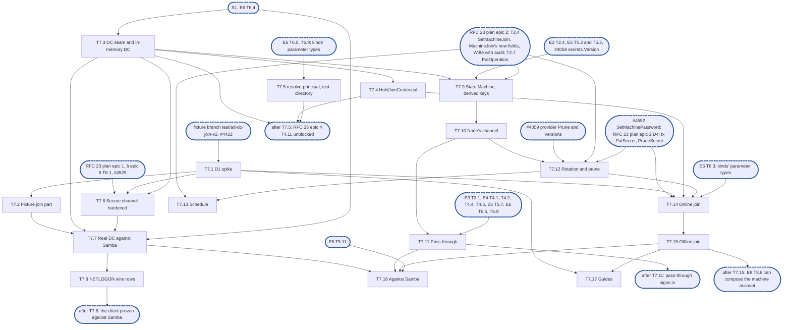

# Epic 7: identity v2 NETLOGON and the machine account

**Sources:** [RFC 18](../docs/internals/rfcs/rfc-18-identity.md) §3.5's pass-through half, its machine account,
online and offline joins, rotation and stored join state; §3.3's derived keytab (the computer
account's names, the salt, the key version number, `sPNMappings`, the fallback across held derived
keys, the `HandedOver` exception, the refused imported key); §3.4's decision on the offline join's
ceilings, as far as the join reports them and the guides say them; §2.6's `State` `Machine` field and
its `Apply` row; §3.7's sign-in half for pass-through; §4.1's `FindOpts`; §5.1's domain SID and
explicit domain controller as pass-through reads them; §9.2's machine-account series and conditions;
§10's rows "pass-through", "NTLM domain" and "NTLM MIC" (their pass-through halves), "logon throttle"
(the domain controller's count), "derived keytab", "online join", "offline join", "machine account
health", "rogue domain controller" and "NETLOGON wire", and "Where the in-memory ones stand in" for
the domain controller, as pull request #4058 merged them (83232b441);
[RFC 23](../docs/internals/rfcs/rfc-23-control-plane.md) §3.5 (the domain join, its crash between the API's two
writes, `resolve-principal`, `test-directory`) and §4.6 (operations);
[RFC 16](../docs/internals/rfcs/rfc-16-metadata-store.md) §2.3 (`Installation`'s `MachinePassword` and `Join`,
`Secret`'s `KeyVersion` and `HandedOver`, `Operation.Params`); [RFC 13](../docs/internals/rfcs/rfc-13-configuration.md)
§7 (the rotation's order, `Meta`, `Prune`, the revocation report) and Appendix B's
`identity.netbios_name`; [RFC 25](../docs/internals/rfcs/rfc-25-observability.md) §3.9's two condition rows; MS-NRPC
2.2.1.4.11, 3.1.4.1 and 3.4.5.2.6, and MS-APDS 3.1.5.2.1.
**Track:** A.
**Epic 7 estimate: 17 subtasks, 36.75 man-days.**
**Depends on:** **S1**, E1's surface frozen: `SignIn`, `Deps`, `State`, `Apply`, `*Server`.
**RFC 23's plan's epic 1** (#4334) and **its epic 6's T6.1** (#4529, merged): `cmd/dfs`'s `netlogon`
commands deleted by epic 1 and `cmd/dfsctl`'s by T6.1, so T7.6 can move the package. **E2**: T2.4's
`State.Settings` (`identity.netbios_name`), `Deps.Secrets` and `SecretProvider`, which T7.12 extends
with `Prune` and `Versions`; T2.3's `Minter` and T2.1's `PrincipalMachine`, which pass-through reaches through E6's mint and never binds. **E3**: T3.1's
`Deps.Tracer` and `Resolve`. **E4**: T4.1's `exportedKey` and `checkMIC`, T4.2's domain table and
NTLMv1 refusal, T4.4's throttle and T4.5's logon event and series, which pass-through joins as the
table's third row. **E5**: T5.2's key ring and T5.3's key selection, which the derived keys join
(T7.9); T5.7's PAC SID filter (T7.11); T5.11's ticket fetch (T7.16). **E6**: T6.3's record, T6.4's
`DialTLS`, T6.5's client, test call and domain SID, T6.9's `Find` with
`FindOpts.Mint`. **RFC 23's plan's epic 3** (#4336, merged): T3.4's runner and its D7's leaf
`internal/node/step`, whose `Step` these steps implement directly, answering
`step.StepResult{Next, Done, Result, End}`, and whose `Progress`,
`func(ctx context.Context, op entity.Operation) apiv1.Progress` (its D7 as #4544 amended it), their
progress functions are, a `*apiv1.Problem` failing an operation and any other error retried.
**#4552** (merged on `feat/storage-v2`): `Installation.MachinePassword`, a `SecretRef`, and
`ControlPlaneTx.SetMachinePassword`, with which D5 seals a version within one `Write`; this epic adds
neither (T7.12, T7.14). **RFC 23's plan's epic 2's D4**: `ControlPlaneTx`'s `PutSecret`, `PruneSecret`
and `Secret`, on no branch yet, added by whichever of its T2.4 and the RFC 13 plan's epic 1 lands
second (D5, D14; T7.12, T7.14).
**RFC 23's plan's epic 2**: its T2.4's `ControlPlaneTx.SetMachineJoin`, the method that writes
`Join`, with RFC 16's `MachineJoin` holding `Names`, `LastRotation.Version` and
`LastRotation.Confirmed` (its R55, as #4485 amended RFC 16 and the epic) (T7.9, T7.12, T7.14), and
its T2.7's `RunningOperation(ctx, kind, target)` on `ControlPlaneTx` as a tracked read, which R63
uses and epic 2 does not have yet (it has the view's only; §9) (T7.12, T7.14, T7.15), and
its T2.4's `Write` with its audit record and T2.7's `PutOperation` on `ControlPlaneTx` (T7.13).
**RFC 23's plan's epic 4** (#4337): T4.11's routes, which write each operation, pick the online
join's ID and call `HoldJoinCredential` before the creating `Write`, and seal the offline join's
password with `secrets.Meta{HandedOver: true}` in a write of their own. **#4059**: `secrets.Seal`,
`secrets.Meta`, `secrets.Version`, the provider's `Prune` and `Versions`. **The fixture branch**
`test/ad-dc-join` (b4858ccfc, 869cdc2c5, 98540128a), moved onto `feat/storage-v2` by E6's T6.1 as
`test/ad-dc-join-v2` (#4422), open there and stacked on #4420: `dittofs$`, `offjoinaes$` and
`offjoinlegacy$` pre-staged, the RPC
range 50000-50019 pinned. What is left of it is merging #4422 after #4420.
**Blocks:** **E8**, whose T8.6 fills `Deps.DomainController`, `State.Machine` and `State.Join`
(D6), and registers this epic's four kinds; whose T8.7 bounds a pass-through and
whose T8.8 reads `Installation.Join`; **RFC 23's plan's epic 4**, whose T4.11 success paths need
T7.3's in-memory domain controller, T7.4's `HoldJoinCredential` and T7.5's kinds.

---

## 1. Goal

An NTLM sign-in of a directory user passes through to a domain controller over the installation's
secure channel. The installation joins the domain, online or offline, keys the computer account's
service names from the machine password, and rotates that password, each as a resumable step of
RFC 23's runner.

**At the end of the epic:**

- a directory user signs in by NTLM pass-through, sealed with AES, after the controller's server
  credential is verified, and is mapped by the reply's user SID;
- an online join creates the computer account with a sealed password, refuses an existing one
  unless taken over, and resumes on the controller it pinned;
- an offline join takes an administrator's account and handed-over password, refuses one without
  AES, rotates twice, and is joined only once the second rotation reads the verified number plus
  two;
- tickets for the computer account's names verify under keys derived from the machine password,
  across a rotation and a restart, and never under the handed-over password;
- the machine password rotates on a schedule, probing before every set, at most one unconfirmed
  version in force, a mismatch reported and counted;
- the join's state is stored on the `Installation` record, and `machine_account_unhealthy` and
  `machine_password_rotation_failed` are raised and cleared as RFC 18 §9.2 says;
- the domain controller's conformance suite holds the in-memory one to Samba, and the NETLOGON wire
  rows run against Samba through a fault wrapper.

### 1.1 In scope

D1's spike; the fixture's join part; the domain-controller seam, its in-memory implementation, fault
wrapper and suite; `internal/auth/netlogon` moved to `internal/identity/netlogon` and hardened; the
NETLOGON reply decoder and its fuzz target; the computer account over LDAP in
`internal/identity/directory`; pass-through as the domain table's third row; the node's secure
channel and its previous-version fallback; the derived keys; the online and offline joins, the
rotation, its prune and its schedule; `resolve-principal` and `test-directory`;
`HoldJoinCredential`; the two conditions and the mismatch counter; an AD user signing in over
Kerberos and pass-through on an installation joined offline to an explicit controller; the guides.

### 1.2 Out of scope

- Composing identity into the node: filling `Deps.DomainController`, `State.Machine` and
  `State.Join`, registering the four kinds in `node.New`, and the conditions in node status: E8's
  T8.6.
- The pass-through's share of RFC 18 §5.1's 20 seconds measured whole, with the directory's work:
  E8's T8.7. This epic bounds its own wait and call (R16).
- "NetBIOS name while joined": E8's T8.8, which reads the `Installation` record's `Join` this epic
  writes. "NetBIOS name and domain" for a settings change: E6.
- The API's routes, their parameter validation, the offline join's sealed write, the hold taken
  before the creating `Write`, the `409` while a join or rotation runs, and the refusal of an
  imported key for a name the account holds at the secret route: RFC 23's plan's epic 4's T4.11
  (§9). That a hold ends when its creating `Write` is refused: E8 (§9).
- The secret-free capture: the online join's administrator credential, RFC 23's plan's epic 7's
  T7.6; the rest, across both joins and a rotation, E8's T8.11.
- The alert rows of the two conditions: RFC 25 §3.9 names them and no Go table holds them yet
  (E8's D8).
- Moving the fixture's branches onto `feat/storage-v2`, `test/ad-dc-join` among them, and the
  `integration/ad-dc` cell's place in its plan job's select: E6's T6.1, their one owner.
- Leaving the domain: the deferral ledger row "Leaving the domain".
- A rotation waiting on every node, and `test-directory`'s answer from every node: the deferral
  ledger row "A machine password's rotation waiting on every node", which §9 asks to widen.
- Pass-through's semaphore and waits as settings: the deferral ledger row "Pass-through's semaphore
  count and its 5 s waits as settings".
- Interop with a Windows Server domain controller: the deferral ledger row "Interop against a
  Windows Server domain controller" (O11).
- A second domain, forest trusts and alternate UPN suffixes: RFC 18 §3.5's and §5.1's own
  `ponytail:` and `decision:` notes, written at the code site (rule 9), not built.
- The local NTLM sign-in, the throttle, the MIC and key exchange functions: E4. The PAC's SID
  filter: E5. `Find`, the domain SID and the test call: E6.

### 1.3 Names used here

- **E1**, the contract and the server's surface: `pkg/identity`, `internal/identity`'s lifecycle,
  the import checks.
- **E2**, principals and accounts: settings, `Deps.Secrets` and `SecretProvider`, the `Minter`,
  `PrincipalMachine`.
- **E3**, resolution: `Resolve`, `Deps.Tracer`.
- **E4**, local NTLMv2 sign-in: the domain table, the MIC and key functions, the throttle, the
  logon event.
- **E5**, Kerberos and the PAC: the key ring, key selection, the SID filter, the test realm,
  the Samba ticket fetch.
- **E6**, the directory: its record, `DialTLS`, client, test call, domain SID and `Find`.
- **E7**, this epic.
- **E8**, the integration epic: identity composed into the node.
- **S1**, the identity surface frozen, which E1 delivers.

## 2. How the general rules apply

The rules are those of
[the RFC 18 plan's §1.5](rfc-18-identity-plan.md#15-general-rules-for-each-epic), cited by number
and title and not copied.

| Rule | Subtasks | How |
| --- | --- | --- |
| rule 1, independent unit tests ([`CLAUDE.md`, "Writing tests"](../CLAUDE.md#writing-tests)) | T7.3 to T7.7, T7.9 to T7.15 | Tier 1 rows run in `internal/identity` over the memory KV store, `identitytest`'s in-memory domain controller (kind 2, held by T7.3's suite) and directory (E6's), E5's test realm for tickets, and the injected clock (kind 1); faults come from T7.3's `FaultyDomainController` and `kvtest`'s wrapper (kind 3); NTLM messages from MS-NLMP's vectors through E4's helpers. T7.1, T7.2, T7.8 and T7.16 run in `integration/ad-dc` only; T7.17 is documentation |
| rule 2, fuzz every decoder of untrusted bytes ([`CLAUDE.md`, "Writing tests"](../CLAUDE.md#writing-tests)) | T7.6 | `FuzzSamInfo4`, the NETLOGON reply decoder |
| rule 3, observability follows RFC 25 | T7.10, T7.11, T7.12 | `identity_machine_key_version_mismatches_total`, `machine_account_unhealthy` and `machine_password_rotation_failed`; a pass-through's outcome through E4's logon event and series, its dropped SIDs through E5's counter; no label carries a name, a SID, an address or the controller's name |
| rule 4, profiling | all with tests | every test under the leak check; the channel's goroutines and connections closed by `Stop` (T7.10); no allocation budget |
| rule 5, public interface and internals ([`CLAUDE.md`, "Verifying a change"](../CLAUDE.md#verifying-a-change)) | all | each row asserted where its value is consumed: a derived key by a ticket verified through `SignIn`, a rotation by the channel set up and the ticket verified after it, a join by a pass-through signed in, a condition by `Conditions`, a prune by the version no longer resolvable |
| rule 6, known failures shrink | none | no suite RFC 18 names keeps a `known.yaml`; nothing lands red |
| rule 7, v2 ignores v1 | T7.6 | `internal/auth/netlogon` moved with `git mv` and rewritten: its Kerberos-signed named pipe, re-send after a mid-call error, missing-`LogonDomainID` acceptance, workstation-trust flag, `SecretStore`, providers, `RotationManager`, `Controller` and the three v1 tests in `integration/ad-dc` dropped; its LDAP join code moved into `internal/identity/directory` in the same change |
| rule 8, real dependencies for properties of those dependencies | T7.7, T7.8, T7.16 | the suite against Samba, the wire rows through the fault wrapper only there, both joins and a rotation against Samba |
| rule 9, code comment conventions ([`CLAUDE.md`, "Code comments"](../CLAUDE.md#code-comments)) | T7.5, T7.6, T7.9, T7.10, T7.11, T7.12, T7.13, T7.14, T7.15 | RFC 18's §3.3 decision (derived names) at the ring, §3.3's `ponytail:` (the hour) at the probe, §3.4's decision (the join's ceilings) at the offline join, §3.5's decision (alternate UPN suffix) at the pass-through row and its `ponytail:` (one domain) at the channel; this document's markers at their sites (§4) |
| rule 10, a test must be able to fail | all | each R row names a test that fails on its assertion when broken, or the test of another epic that holds it; R61 alone is held by review (§9) |
| rule 11, a symbol is exported only if RFC 18's interfaces use it | T7.3, T7.4, T7.5, T7.9, T7.10, T7.12, T7.14 | `internal/identity` adds `Deps.DomainController`, `State.Machine`, `State.Join`, `HoldJoinCredential` and the step methods `internal/node` registers, typed by `internal/node/step` (D4); `pkg/identity` adds `JoinCredential`, which RFC 23's API names (D12); `internal/identity/netlogon` exports the seam `identitytest` implements and `NewDialer`, which E8 calls; `internal/identity/directory` the account functions `netlogon` calls; test accessors in `export_test.go` |
| rule 12, each subtask creates only what it declares | all | `State.Machine` and `State.Join` with T7.9, `Deps.DomainController` with T7.10, their first readers; `JoinCredential` with T7.3's seam, its first user; each kind with its subtask; the wire fault wrapper with T7.8, its first user |

## 3. Requirements and invariants

Every obligation RFC 18 and the related RFCs place on this epic, numbered so that subtasks and tests
can cite them. Sources are RFC 18 unless named.

**Pass-through**

| # | Requirement | Kind | Source | Subtasks |
| --- | --- | --- | --- | --- |
| R1 | A message whose domain, compared with ASCII letters folded, is the directory's NetBIOS domain or its realm, or that is empty with a user name ending `@` and the realm, routes to pass-through when pass-through is configured; an alternate UPN suffix or a trailing dot is `unknown_domain` | MUST | §3.5's table and decision; §4.6 | T7.11 |
| R2 | The response is sent once to a domain controller over the machine account's secure channel (`NetrLogonSamLogonEx`), sealed and signed with AES | MUST | §3.5's table; §10 "NETLOGON wire" | T7.6, T7.8, T7.11 |
| R3 | The reply's user SID and group SIDs with their attributes are used as a PAC's are: the same SIDs dropped and counted, deny-only kept apart, and the evidence maps by the verified user SID | MUST | §3.5's table; §3.4; §9.2 | T7.11 |
| R4 | The reply's `UserSessionKey` is the session base key; a missing, short or all-zero one fails `ErrLogonFailure` | MUST | §3.5's table; MS-NRPC 2.2.1.4.11; MS-APDS 3.1.5.2.1 | T7.11 |
| R5 | A guest logon, a reply whose `UserFlags` holds `LOGON_GUEST` or whose user RID is 501, fails `ErrLogonFailure` and yields no session | MUST | §3.5's table; §3.6; §10 "pass-through" | T7.11 |
| R6 | The reply's `LogonDomainID` is the directory's domain SID, or the sign-in fails `ErrLogonFailure`; with no domain SID read, pass-through fails `ErrUnavailable` | MUST | §3.5's table; §5.1; §10 "NTLM MIC" | T7.11 |
| R7 | Through pass-through the MIC is keyed by the exported session key derived from the reply's `UserSessionKey`; a flagged MIC that is missing, zero or wrong, and signing without key exchange, fail `ErrLogonFailure` | MUST | §3.5 "The MIC"; §10 "NTLM MIC" | T7.11, through E4's T4.1 |
| R8 | An `NtChallengeResponse` of 24 bytes is never forwarded: nothing reaches the domain controller | MUST NOT | §3.5; §10 "pass-through" | held by E4's T4.2, whose refusal runs before the table; T7.11 asserts the controller's count unchanged |
| R9 | Before any logon is sent, the channel's set-up verifies the controller's server credential; one that fails refuses the channel, and no NTLM response is sent | MUST | §3.5; MS-NRPC 3.1.4.1; §10 "rogue domain controller" | T7.6, T7.8 |
| R10 | The client's `NetrServerAuthenticate3` offers no RC4; a reply whose negotiated flags lack AES refuses the channel; every logon carries a Netlogon verifier at the privacy level | MUST | §10 "NETLOGON wire"; RFC 18 plan D5 | T7.6, T7.8 |
| R11 | A logon is retried only after a failure from before the request was written; one torn after it is `ErrUnavailable` and never sent again, so a wrong password counts once | MUST | §10 "NETLOGON wire"; RFC 18 plan D5 | T7.6, T7.8 |
| R12 | A wrong password raises the controller's bad-password count by exactly one; after 10 wrong ones from one address the right one is throttled before it reaches the controller, whose count stays 10 | test row | §10 "pass-through", "logon throttle" | T7.11 |
| R13 | A computer account cannot sign in to files by pass-through: the logon does not set `MSV1_0_ALLOW_WORKSTATION_TRUST_ACCOUNT` | invariant | §2.4; RFC 18 plan D5 | T7.6, T7.7 |
| R14 | A pass-through whose user SID maps to a principal recorded disabled or marked deleted fails `ErrLogonFailure`, and a marked one is never minted anew | MUST | §3.7 | T7.11 |
| R15 | Pass-through is refused until the installation is joined, an offline join's once its second rotation is confirmed | MUST | §3.5 | T7.11, T7.15 |
| R16 | At most 10 pass-throughs run at once per node; a call waits at most 5 s for a slot and then answers `ErrUnavailable`, and the call itself is bounded at 5 s, both inside §5.1's 20 seconds | bound | RFC 18 plan D5; §5.1 | T7.3, T7.10, T7.11; the 20 seconds whole is E8's T8.7 |

**The secure channel and the domain controllers**

| # | Requirement | Kind | Source | Subtasks |
| --- | --- | --- | --- | --- |
| R17 | Domain controllers are found from the domain's DNS service records, with fail-over between them, unless the directory record names a domain controller address, and optionally a DNS server, which is then used alone | MUST | §3.5; §5.1 | T7.7, T7.10 |
| R18 | The channel signs in with the current version once a controller has taken it, else with the previous one, and falls back to the previous one on any controller that refuses the new one until the retention passes: the current version first, then each earlier version in force, newest first; "the previous one" is the newest a controller confirmed | MUST | §3.5; §2.6's table | T7.10 |
| R19 | A version marked `HandedOver` backs no previous-version fallback; the secure channel signs in with it only to set an offline join's first closing rotation | MUST NOT | §3.5; RFC 16 §2.3 | T7.10, T7.15 |
| R20 | `machine_account_unhealthy` is unhealthy while this node's secure channel to every domain controller fails, and cleared by the next channel set up | invariant | §3.5; §9.2; RFC 25 §3.9 | T7.10 |

**The derived keytab**

| # | Requirement | Kind | Source | Subtasks |
| --- | --- | --- | --- | --- |
| R21 | On a joined installation, keys for exactly the service names the computer account holds are derived from the machine password: AES128 and AES256 under the salt of the realm in upper case, `host`, the account's name without its `$` in lower case, `.` and the realm in lower case | MUST | §3.3 | T7.9, T7.16 |
| R22 | Each derived key is tagged with the account's key version number, 32 bits, never truncated to a keytab file's 8 bits | invariant | §3.3 | T7.9 |
| R23 | The account's names are read at each join and rotation from its `servicePrincipalName`, each `host/` name standing also for every service `sPNMappings` maps to `host`, on that host name; a ticket's service name is compared with them with ASCII letters folded | MUST | §3.3 | T7.3, T7.7, T7.9, T7.12, T7.14 |
| R24 | A derived key follows its password's version: applied with it, kept after it stops being current for 10 hours plus the clock skew, a restart included, then removed | MUST | §3.3; §2.6's table | T7.9, T7.10 (the fallback's end) |
| R25 | A version marked `HandedOver` derives no key, on any node and after any restart | MUST NOT | §3.3; §2.6's table; RFC 16 §2.3 | T7.9 |
| R26 | A ticket for one of these names whose key version number no held key carries is tried against each held derived key of its encryption type, the current one first | MUST | §3.3 | T7.9 |
| R27 | An imported key for a name the computer account holds is refused, so no name has two keys | MUST NOT | §3.3; §10 "derived keytab" | T7.9 for the ring; the import's refusal at the secret route is RFC 23's plan's epic 4's T4.11 (#4408) |
| R28 | `State`'s `Machine` holds the machine password's versions in force, opened, current first, each with its `KeyVersion` and `HandedOver`; a new version's keys are added at `Apply`, with no restart; no key is derived and no channel set up while the installation is not joined | invariant | §2.6; §3.3 | T7.9, T7.10 |

**The join**

| # | Requirement | Kind | Source | Subtasks |
| --- | --- | --- | --- | --- |
| R29 | A join of either kind is refused while the directory record's schema is `rfc2307` | MUST | §3.5; §5.1 | T7.14 |
| R30 | An online join takes an organisational unit, a distinguished name under the record's base, by default the domain's `Computers` container, which the domain names (read, not assumed) and which is not checked against the base, and a DNS host name, by default the account's name and the realm in lower case, written as `dNSHostName`; an operator-supplied OU outside the base, or a host name that is not a DNS name, is refused before the join's first step | MUST | §3.5 | T7.3 for the domain's container, its redirected-container row run against Samba in T7.7; T7.14 for the defaults and the first turn's refusal; the refusal before the operation is written is RFC 23's plan's epic 4's T4.11 (#4408) |
| R31 | The join's first step records one domain controller, and every later step and a resumed join use that one | MUST | §3.5 | T7.14, T7.15 |
| R32 | An online join seals a new password as a `Secret` version first, then creates the computer object with that password, its `cifs/` and `host/` names for the short and the fully qualified name, and `msDS-SupportedEncryptionTypes` `0x18` | MUST | §3.5; §3.3 | T7.14, T7.16 |
| R33 | A resumed join creates nothing if its pinned controller already accepts the sealed password | MUST | §3.5 | T7.14 |
| R34 | The probe has three answers: accepts, a channel set up with the version verifying the controller's server credential; rejects; and could not be asked, which retries and never reads as a rejection | MUST | §3.5 | T7.3, T7.14 |
| R35 | A join whose pinned controller could not be asked for an hour fails, naming the controller; a join run again with a takeover pins another | bound | §3.5; §3.3's `ponytail:` | T7.14 |
| R36 | A failed join leaves the installation not joined and `identity.netbios_name` unchanged, keeps each version it sent to a controller, at most two, unconfirmed, and prunes the rest it sealed; the kept ones are pruned once a later join has completed | MUST | §3.5 | T7.14, T7.15; the removal of an unsent current version is pending §9 |
| R37 | The administrator credential is used for one operation, held only in the memory of the node that took it under the operation's ID, and never stored, logged or put in the operation's record; a hold whose operation is never created ends with its request | MUST NOT | §3.5; RFC 23 §3.5, §4.5 | T7.4; the online join's credential in no record or log: RFC 23's plan's epic 7's T7.6; the rest of the capture: E8's T8.11; the refused-write end: E8's T8.6 |
| R38 | A join resumed without the credential continues only if the account already accepts the sealed password; one that must still create the account fails, naming the missing credential | MUST | §3.5 | T7.14 |
| R39 | An online join refuses a computer account that already exists, naming it, unless the request takes it over; a takeover sets the password in the same order | MUST | §3.5 | T7.14, T7.16 |
| R40 | The online join creates the object over LDAP on its pinned controller with TLS verified against the record's trust roots, with no `InsecureSkipVerify` | MUST | §3.5; §5.1 | T7.7, through E6's T6.4 |
| R41 | An offline join refuses a version not marked `HandedOver`, naming it | MUST | §3.5; RFC 23 §3.5 | T7.15 |
| R42 | An offline join refuses an account whose `msDS-SupportedEncryptionTypes` lacks either AES bit or is absent, naming the attribute and the value `0x18`, and reports the service names the account holds, before the channel signs in with the password, then verifies the password against its pinned controller | MUST | §3.5; §3.3 | T7.15 |
| R43 | An offline join records the key version number it read on its pinned controller at the verify, then rotates twice as its own last steps; it is done only once the second rotation's confirm finds the controller accepting that rotation's version and reads exactly the recorded number plus two, and fails naming the number read otherwise | MUST | §3.5 | T7.15, T7.16 |
| R44 | A crash between storing the handed-over password and rotating resumes the rotations | MUST | §3.5 | T7.15 |
| R45 | Either join writes the account's name, without its `$` and in upper case, as `identity.netbios_name` at its last step, once the account accepts the password in force, and refuses a name outside `[A-Z0-9-]` or longer than 15 bytes | MUST | §3.5; RFC 13 Appendix B | T7.14, T7.15 |
| R46 | The join's state is stored on the `Installation` record's `Join`, written by the join's and the rotation's steps: joined, the account's name, the object's owner, its `msDS-AllowedToActOnBehalfOfOtherIdentity` value, and the last rotation's time, outcome, tag and number read | MUST | §3.5; §3.4's decision; RFC 16 §2.3 | T7.12, T7.14, T7.15, T7.16 |
| R47 | An audited `HandedOver` version that no join uses, left by a crash between the API's two writes, derives no key, never signs in the channel, and is superseded by the next join or rotation | invariant | RFC 23 §3.5 | T7.9, T7.10, T7.12 |
| R62 | `identity.netbios_name` never equals the directory record's NetBIOS domain, compared with ASCII letters folded: a join whose account name would make it so is refused | MUST NOT | §3.5; RFC 13 Appendix B | T7.14, T7.15 |

**The rotation**

| # | Requirement | Kind | Source | Subtasks |
| --- | --- | --- | --- | --- |
| R48 | The machine password rotates on a schedule shorter than the domain's maximum machine-password age; a rotation that cannot start by its schedule is reported failed | MUST | §3.5 | T7.12, T7.13 |
| R49 | A rotation seals the new password first, tagged with the pinned controller's key version number plus one; once every node reports it applied, sets it at that controller; then reads that controller's number again to confirm the tag | MUST | §3.5; RFC 13 §7; RFC 23 §3.5 | T7.12 |
| R50 | A tag is written with its version and never changed | MUST NOT | §3.5; §3.3; RFC 16 §2.3; RFC 13 §7 | T7.12 |
| R51 | A rotation does not start until every node reports the previous version applied | MUST NOT | §3.5 | T7.12 (this node, D9) |
| R52 | Before every set the rotation asks the pinned controller whether it already accepts the sealed version, and sets it only if not, so a version is never set twice | MUST | §3.5 | T7.12 |
| R53 | A rotation whose pinned controller could not be asked for an hour, to set or to confirm, fails naming it; its sealed version stays in force beside the previous one, and the next rotation sets that version rather than sealing another, so at most one unconfirmed version is in force on a joined installation | MUST | §3.5 | T7.12 |
| R54 | A resumed seal step that finds the current version already tagged, unconfirmed, with the number it would write takes that version; a `HandedOver` version is never taken | MUST | §3.5 | T7.12 |
| R55 | A confirm first asks whether the controller accepts the sealed version, and fails the rotation naming it if not; an accepted one completes the rotation whether the number read matches the tag or not, a mismatch reported and counted in `identity_machine_key_version_mismatches_total` with the tag unchanged | MUST | §3.5; §9.2 | T7.12 |
| R56 | At a rotation's completion the `Installation` record's last rotation is written and `machine_password_rotation_failed` clears; it is raised while the last rotation is recorded failed, and cleared only by a rotation completed, never by a channel set up with the previous password or by a restart | invariant | §3.5; §9.2; RFC 25 §3.9 | T7.12 |
| R57 | Once the retention passes, the previous version is pruned, which changes none of the above, and the old password is reported revocable at the domain | MUST | §3.5; §3.3; RFC 13 §7 | T7.12 |
| R63 | A rotation that finds a `join-domain` running on this installation fails as a `*apiv1.Problem` at its first turn, writing nothing, and a join's first turn refuses while a rotation runs, both through a tracked read of the running index (`ControlPlaneTx.RunningOperation`, owed by RFC 23's plan's epic 2, §9), so no two passwords are sealed from one number plus one | MUST NOT | §3.5 (R43, R49, R53); RFC 23 §4.6 refuses only a second request of one kind | T7.12, T7.14, T7.15 |

**Operations, the in-memory domain controller, guides**

| # | Requirement | Kind | Source | Subtasks |
| --- | --- | --- | --- | --- |
| R58 | `resolve-principal` asks `Find` with `FindOpts.Mint` and answers the principal's ID; `test-directory` checks that every node reaches the directory and reports each node's answer | MUST | RFC 23 §3.5, §4.1; §4.1 | T7.5 (this node's answer, D9) |
| R59 | Each operation's steps are recorded as RFC 23 §4.6 requires, so a restart resumes at the last recorded step | MUST | RFC 23 §4.6; §3.5 | T7.12, T7.14, T7.15 |
| R60 | The domain controller's suite holds the in-memory one to the real one on pass-through, the bad-password count rising by one per wrong password and reset by a success, a computer account's creation and the refusal of an existing one, `msDS-KeyVersionNumber` rising by one per password set, `msDS-SupportedEncryptionTypes` as written, and the probe's three answers; an unreplicated controller is the in-memory one's alone | test row | §10 "Where the in-memory ones stand in" | T7.3, T7.7 |
| R61 | The operator guides tell the operator to keep an offline-joined account's creator off the network path while the join runs and to transfer the computer object's ownership after a join | MUST | §3.4's decision | T7.17 |

Which test or enforcer holds each row is in its subtask's **Tests**, or in the row when another
epic's test holds it.

## 4. Decisions this epic takes

- **D1, NETLOGON on `ncacn_ip_tcp` with schannel.** As the RFC 18 plan's D5 says: no SMB session, so
  no Kerberos client key, and the offline join's first closing rotation sets its password over a
  channel the handed-over password authenticates. T7.1 ran it against the Samba fixture (#4759): the
  endpoint mapper (135) names NETLOGON's port in the pinned range; an unauthenticated association
  runs the challenge and `NetrServerAuthenticate3`, asking for AES_SHA2 | StrongKey | SecureRPC with
  no RC4, which Samba grants; a second association binds sealed with the Netlogon auth type and
  carries `NetrLogonSamLogonEx` and `NetrServerPasswordSet2`. The logon on the unauthenticated
  association is refused, so the seal is what admits it. `feat/storage-v2`'s `securechannel.go`
  records Samba answering a sealed-schannel `AlterContext` on `ncacn_ip_tcp` with
  `RPC_S_UNKNOWN_AUTHN_SERVICE`, which is why v1 moved to the named pipe; it did not reproduce with
  this Samba and this `go-msrpc`, so v1's named-pipe fallback and its 2 man-days go, and T7.6 keeps
  its "no Kerberos library" criterion. `go-msrpc`'s `NewSecureChannelClient` forces `CapRC4`, so the
  channel is built from `ssp/netlogon`'s parts (session key, credential chain, AES encryption), and
  the client checks the server credential and each return authenticator itself (T7.6, T7.8's rows).
  A `decision:` marker at the dial. Prior art (from memory): Samba's `winbindd` reaches NETLOGON on
  `ncacn_ip_tcp` with schannel.
- **D2, the seam stands above the NETLOGON client.** `netlogon.Dialer` and `netlogon.DC` (T7.3) take
  the logon, the probe, the password set and the computer account's reads and writes, as RFC 18 §10
  and the RFC 18 plan's D11 place the in-memory controller. Below the seam, the server-credential
  check, the retry rule, the AES-only negotiation and the seal are the client's own code, tested
  only against Samba through a fault wrapper around the client's `net.Conn` (T7.8). Above it, delays
  and failures come from `identitytest.FaultyDomainController` (kind 3), built on `pkg/sim`'s
  `Fault`, as E6's `FaultyDirectory` is; it can also refuse a dial before anything is sent, which
  "could not be asked" needs. Prior art: E6's T6.4; v1's `fakeConn` at the LDAP connection.
- **D3, the computer account's LDAP lives in `internal/identity/directory`.** E1's rule lets only
  that package import `go-ldap`, and exempts `internal/auth/netlogon`'s `join.go` until the package
  goes. T7.6 moves the join's LDAP code there in the same change as the `git mv`, as concrete
  functions over `DialTLS` and not methods of E6's `Conn`, so the in-memory directory gains nothing,
  and removes E1's exemption. Reads bind with the directory record's bind credential, an online
  join's writes with the held administrator credential. Prior art: `adcli` creates the computer
  object over LDAP and sets its password there (from memory).
- **D4, the kinds are methods on `*Server` that implement `internal/node/step`'s types directly.** As
  E2's T2.7 is: `JoinStep` is a `step.Step`,
  `func(ctx context.Context, op entity.Operation) (step.StepResult, error)`, run from `op.Step`, the
  cursor its last committed turn answered, and answering `step.StepResult{Next, Done, Result, End}`:
  `Next` the cursor the runner records as `op.Step`, `Done` with `Result` and `End` at the last turn,
  `End` writing in the transaction that ends the operation, so its writes and the operation's end
  commit together or not at all (D5). `JoinProgress` is a `step.Progress`,
  `func(ctx context.Context, op entity.Operation) apiv1.Progress`, reading the cursor from `op.Step`
  (RFC 23's plan's epic 3's D7, as #4544 amended it). The same for the other three kinds; E8 puts
  them in the runner's table in `node.New` as they are (its T8.6), with no adapter, which would lose
  `End`. A terminal failure is a
  `*apiv1.Problem` whose detail names the controller, the number read, the version or the missing
  credential, which the runner fails the operation with; every other error is retried. Identity
  imports `internal/node/step`, and `pkg/node/apiv1` for the problem and the kinds' parameter
  types (§9), never `internal/node`. Prior art: RFC 23's plan's epic 3, D7.
- **D5, identity writes the machine account's records itself.** The seal of each version with
  `Installation.MachinePassword`, the record's `Join`, and an attempt to send a version are written
  by the step through kvstore's control-plane `Write`, each committed before the controller sees the
  password; a version is sealed within one `Write`, `tx.PutSecret` beside
  `ControlPlaneTx.SetMachinePassword`, which #4552 added with the field, a `SecretRef`. `PutSecret`'s
  transaction form is on no branch yet: RFC 23's plan's epic 2's D4 has whichever of that epic's
  T2.4 and the RFC 13 plan's epic 1 lands second add it. A join's `Joined` and
  `identity.netbios_name` are written together in its last turn's `StepResult.End` (D4), so no
  crash leaves one without the other. RFC 18 §2.6 calls the `Minter`'s writes identity's only
  ones, so §2.6 is amended, and RFC 23's plan's epic 2's T2.4 owns `ControlPlaneTx.SetMachineJoin`,
  the method that writes `Join` (its R55, added by #4485). A `decision:` marker at the writer.
  Prior art: none needed.
- **D6, the account's names and its confirmed version are stored with its join.** A restart must
  derive the same keys without asking a controller, RFC 18 §3.3 refuses an imported key for a name
  the account holds, which RFC 23's secret route can check only if the names are stored, and "the
  previous one" is "the newest a controller confirmed", which a tag alone cannot tell once a lagging
  controller gives two versions one tag. Settled in review: RFC 16 §2.3's `MachineJoin` gains
  `Names []string`, the account's service names with `sPNMappings` applied, and
  `LastRotation.Version uint64` and `LastRotation.Confirmed time.Time`, the secret version the last
  join or rotation confirmed and the store time of that confirm, which a failed rotation leaves as
  they were, so the retention's clock (D14) is not moved by a failure; identity's `State` gains
  `Join entity.MachineJoin`, filled by E8 from the same read as `Machine`. A zero `State.Join` is
  "not joined", which is the right answer while the field is unset. Written in place in T7.9,
  T7.12, T7.14 and T7.15.
- **D7, the online join's tag, pending the user's answer (§9).** A created account has no key
  version number before its creation, and a tag is never changed (R50). T7.1 found Samba numbers an
  account added with `unicodePwd` in the add itself 1, and one added without a password, as v1's
  join does, 1 at the add and 2 at the first password set. Recommended: the join writes the password
  in the add, over LDAPS (T7.7's `computer.go`), and the created account's version is sealed with
  `KeyVersion` 1; the alternative keeps v1's add-then-set and seals under 2. Its confirm reports and
  counts a mismatch as a rotation's does; a takeover's is the pinned controller's number plus one.
  Tickets under another number verify through the fallback (R26). The join writes `LastRotation` at
  its confirm, so the schedule has a start. A `decision:` marker at the seal. Prior art: none found.
- **D8, an imported key for a name the account holds contributes nothing to the ring.** `Apply`
  cannot refuse the `State` for it without holding a principal change back (E8's D2), so the ring
  skips that entry, logs it at `Error`, and keeps the derived key; RFC 23's secret route refuses the
  import itself once D6 stores the names (§9). A `decision:` marker at the ring. Prior art: none
  found.
- **D9, "every node" is this node.** The RFC 18 plan's `ponytail:`: the rotation waits until this
  node's `State.Machine` holds the version (R49, R51), and `test-directory` answers for this node
  (R58); the upgrade is the wait on node status and each node's answer, with the cluster rows. A
  `ponytail:` marker at each site.
- **D10, the semaphore is a constant 10 with 5-second waits.** The RFC 18 plan's D5 and `ponytail:`;
  marker at the semaphore.
- **D11, identity starts the scheduled rotation.** RFC 18 §3.5 rotates "on a
  schedule" and reports a rotation that cannot start by it failed, and no RFC says who starts the
  scheduled operation. Settled in review: identity, from a loop started by `Start` on the injected
  clock, creates a `rotate-machine-password` operation when the installation is joined, no join or
  rotation runs (a tracked read of the running index) and `LastRotation.Confirmed` is 7 days old, or, after a failed rotation, one hour has passed since that failure. The 7-day period reads `Confirmed`; the retry after a failure reads `At`, which the failing rotation writes with `Failed`, so a restart within the hour still waits it out. The 7-day period does not read `At`, which a failure moves: read from `At`, a few failures in a row could outlast the domain's maximum machine-password age (RFC 18 §3.5). The loop
  writes the operation, through `ControlPlaneTx.PutOperation` (RFC 23's plan's epic 2's T2.7), and
  its `AuditRecord` in one control-plane `Write`, both with the zero `Principal` as the schedule's:
  the operation's `Account` and the record's `Actor`, `ActorName` and `Credential` empty (RFC 23
  §4.6 and §6 and RFC 16 §2.3 as #4485 amends them; `entity.AuditRecord` on `feat/storage-v2` from
  #4494, whose `testAuditReads` finds such a record by `AuditFilter{Actor: &entity.Principal{}}`).
  It writes nothing else: a rotation that cannot start because
  this node lags fails itself at its wait once one hour has passed since the wait started (R48), and the schedule starts the next an hour after that failure. 7 days is Samba's
  `machine password timeout` default (from memory), inside Windows' 30-day member default. A
  `ponytail:` names the constant. Written in place in T7.13. The operation
  is started by no call, so it carries the zero `Account`, read as the schedule, and its audit
  record names the schedule as its actor, so an unasked rotation is still found in the audit;
  #4485 amended RFC 23 §4.6, and its plan's epic 2's R4 and R8 and epic 4's R50, to admit it.
- **D12, `JoinCredential` is declared in `pkg/identity`.** RFC 23's plan's epic 4 declares
  `Joins.HoldJoinCredential(id entity.OperationID, cred JoinCredential) (release func())` and needs
  the type in a package it may import. `pkg/identity.JoinCredential{User string; Password []byte}`
  lands with T7.3, whose seam is the first code to name it, after S1 (§9), so T7.4 follows T7.3;
  `netlogon` takes the same type for its
  bind and administrator credentials. The hold zeroes the password at release. No marker. Prior art:
  none needed.
- **D13, the scenario against Samba drives identity directly.** A `_test.go` file in
  `test/integration/ad-dc` may import `internal/identity` (E1's R5 checks non-test files only), so
  T7.16 builds the server over the memory KV store and runs the joins' and rotation's steps in a
  loop against Samba, before E8 composes the node: the joins against a real controller are this
  epic's largest risk. No marker. Prior art: none needed.
- **D14, the keys expire at the retention; the secret is pruned at the next rotation's first
  turn.** Waiting out 10 hours plus the skew inside the rotation would keep it running, refusing an
  offline join's write and the schedule for that time (RFC 23 §3.5). So the retention needs no
  running operation: a version below the one `Join.LastRotation.Version` names stops deriving keys
  (T7.9) and backing the channel's fallback (T7.10) once the clock passes
  `LastRotation.Confirmed` plus 10 hours plus the skew, from `State` alone, a restart included. The
  secret itself is pruned by a rotation's first turn, before it pins, through `SecretProvider`'s
  `Prune` inside that turn's control-plane `Write`, with an audit record naming the versions it
  drops, as RFC 23 §3.3's credential-rotation bullet deletes the old version "when it passes" and §6
  audits an action in the transaction that applies it, through `tx.PruneSecret`, whose transaction
  form is on no branch yet (RFC 23's plan's epic 2's D4: whichever of that epic's T2.4 and the RFC
  13 plan's epic 1 lands second adds it), once the retention has passed since the last confirm and
  that confirm completed, and the old
  version is reported revocable then; a joined installation's first rotation prunes what a failed
  join kept.
  `Prune` drops every version below the current one, so it never runs while the current version is
  unconfirmed. A `ponytail:` marker names the ceiling: a previous version's sealed value stays in
  the store, used by no key and no channel, until the next rotation, at most the schedule's 7 days.
  Prior art: Samba keeps the previous machine password until the next change (from memory).

## 5. Target tree

```text
internal/identity/netlogon/               (git mv of internal/auth/netlogon)
  seam.go               T7.3   Dialer, DC, Channel, Account, Computer, LogonRequest, Reply,
                               ErrRejected, ErrNoAccount
  securechannel.go      T7.6   ncacn_ip_tcp + schannel on ssp/netlogon, AES only, server credential (D1)
  logon.go              T7.6   NetrLogonSamLogonEx, the retry rule
  password.go           T7.6   NetrServerPasswordSet2, the trust password (moved)
  reply.go              T7.6   SamInfo4 → Reply; FuzzSamInfo4 in reply_test.go
  discovery.go          T7.7   Lookup: SRV records, through the record's DNS server when set
                               (v1's, from history)
  dc.go                 T7.6   NewDialer, its Dial, and DC.Channel over the secure channel
                        T7.7   DC's account calls over directory's, Lookup
internal/identity/directory/
  computer.go           T7.6   v1's join LDAP moved here (D3)
                        T7.7   create, reset, read a computer account with sPNMappings applied
internal/identity/
  server.go             T7.9   State.Machine, State.Join
                        T7.10  Deps.DomainController
                        T7.12  SecretProvider gains Prune and Versions
  machinekeys.go        T7.9   derived keys into E5's ring, the fallback, D8
  channel.go            T7.10  the node's channel, R17's order, fallback, semaphore, the 5 s call
                               bound, machine_account_unhealthy
  passthrough.go        T7.11  the table's third row, the reply's checks
  rotate.go             T7.12  RotateStep, RotateProgress, the prune (D14), the counter, the condition
  schedule.go           T7.13  the scheduled rotation (D11)
  join.go               T7.4   HoldJoinCredential
                        T7.14  JoinStep, JoinProgress: online
                        T7.15  offline
  ops.go                T7.5   ResolvePrincipalStep, ResolvePrincipalProgress, TestDirectoryStep,
                               TestDirectoryProgress
pkg/identity/
  join.go               T7.3   JoinCredential (D12)
pkg/identity/identitytest/
  dc.go                 T7.3   DomainController (kind 2), FaultyDomainController (kind 3)
  dcsuite.go            T7.3   DomainControllerConformance, DCSeeder
pkg/identity/arch_test.go T7.6 internal/auth/netlogon's LDAP exemption removed
test/integration/ad-dc/
  netlogon_tcp_schannel_test.go  T7.1  NETLOGON on ncacn_ip_tcp with schannel (the spike's check)
  dc_test.go            T7.3   the suite against Samba over a test-built DC
                        T7.7   over the production DC
  netlogon_wire_test.go T7.8   the fault wrapper around net.Conn; the two wire rows
  join_scenario_test.go T7.16  both joins, a rotation, Kerberos and pass-through against Samba
  netlogon_passthrough_test.go, netlogon_reload_test.go, online_join_test.go   T7.6  deleted (v1)
  fixture_test.go       T7.6   waitForMachinePassword over DC.Channel (#4422)
  entrypoint.sh         T7.2   joiner, offjoinowned$, BUILD01$ (test/ad-dc-join-v2)
docs/guide/             T7.17  identity.md, windows-ad-setup.md, smb.md, security.md, configuration.md
```

## 6. Subtasks

### T7.1 D1's spike against the Samba fixture

**Subtask T7.1 estimate: 1 man-days.**

- **Track:** A. **Depends on:** none. The fixture branch `test/ad-dc-join`.
- **Covers:** none; consumed by T7.6 (the transport), T7.2 (the names to register), T7.14 (D7's
  number) and T7.17 (the ports).
- **Deliverables:** built, not merged, as `TestNetlogonTCPSchannel` in
  `test/integration/ad-dc/netlogon_tcp_schannel_test.go`, open on `feat/storage-v2` as #4759; its
  answers are in D1, D7 and §9. What is left is merging #4759. The test looks NETLOGON up through
  the endpoint mapper (the existing check of 869cdc2c5), sets up a schannel-sealed binding on
  `ncacn_ip_tcp` as `dittofs$` with `go-msrpc`'s `ssp/netlogon`, runs `NetrServerAuthenticate3` with
  AES and no RC4, `NetrLogonSamLogonEx` for alice at SamInfo4, and `NetrServerPasswordSet2`, the
  server credential and every return authenticator checked by the caller; the ports 135 and
  50000-50019 dialled from outside the fixture's network. It answered: the transport holds, so no
  fallback (D1); `go-msrpc` checks the server credential only in `NewSecureChannelClient`, which
  forces `CapRC4`, so the caller checks it (D1); Samba issues a `cifs/` ticket for a host holding
  only `host/` names, and for an account with no `servicePrincipalName` at all (T7.2);
  `msDS-KeyVersionNumber` is 1 only for an account added with its password (D7). No production code.
- **Acceptance criteria:**
  - The test passes in `integration/ad-dc`, or fails naming the call Samba refused, and D1 says which.
- **Tests:** the fixture test above, against the real controller (rule 8). Replacing the sealed
  bind with `WithInsecure()` makes the logon fail on its assertion (`STATUS_INVALID_PARAMETER`).

### T7.2 The fixture's join part

**Subtask T7.2 estimate: 0.75 man-days.**

- **Track:** A. **Depends on:** T7.1.
- **Covers:** R13, R42, R46, R60 (the accounts they run against); consumed by T7.7, T7.8 and T7.16.
- **Deliverables:** on `test/ad-dc-join-v2` (#4422), beside the pre-staged `dittofs$`, `offjoinaes$`
  and `offjoinlegacy$` and the pinned RPC range: a `joiner` user granted "create computer objects"
  on the `Computers` container, and `offjoinowned$` created by it with `0x18`, so its owner is
  `joiner`, with `msDS-AllowedToActOnBehalfOfOtherIdentity` set on it; `BUILD01$` with a known
  password; `host/<name>` and `host/<fqdn>` registered on the offline-join accounts, as Windows AD
  resolves `cifs/` through them (from memory), though T7.1 found Samba issues `cifs/` even for an
  account with no `servicePrincipalName`, so the fixture cannot show the registration matters; the
  fixture test asserting each account's owner, encryption types and names. The guide's fixture
  section names the new accounts.
- **Acceptance criteria:**
  - The accounts T7.7 and T7.16 change are put back by `DCSeeder` at each test's start (T7.7), so the
    cell can run twice on one fixture.
- **Tests:** the fixture test reads `offjoinowned$`'s owner as `joiner`'s SID and its delegation
  attribute non-empty, and `offjoinlegacy$` with no encryption types (catches an account staged
  differently from what T7.15's and T7.16's rows assume). No double: the controller is real.

### T7.3 The domain-controller seam, the in-memory controller and its suite

**Subtask T7.3 estimate: 3.75 man-days.**

- **Track:** A. **Depends on:** none. S1; E6's T6.4 (`identitytest`'s package and `pkg/sim`'s use).
- **Covers:** R16 (the hold T7.10 and T7.11 use), R23, R30, R34, R60.
- **Deliverables:**
  - `pkg/identity.JoinCredential{User string; Password []byte}` (D12), which the seam names first;
  - in `internal/identity/netlogon`'s `seam.go` (D2), whose declarations import only the standard
    library, `pkg/auth/sid`, `pkg/identity` and `internal/identity/directory`'s `Record`:
    ```go
    type Dialer interface {
    	// Lookup answers the domain's controllers from its SRV records, through
    	// dnsServer when set; the record's explicit address is the channel's rule (R17).
    	Lookup(ctx context.Context, realm, dnsServer string) ([]string, error)
    	Dial(ctx context.Context, rec directory.Record, addr string) (DC, error)
    }
    type DC interface {
    	// Channel sets up a secure channel as account with password, the server
    	// credential verified: ErrRejected when refused, any other error when the
    	// controller could not be asked (RFC 18 §3.5's probe).
    	Channel(ctx context.Context, account string, password []byte) (Channel, error)
    	// Account reads the computer account bound as bind, its names with
    	// sPNMappings applied: ErrNoAccount when absent.
    	Account(ctx context.Context, bind identity.JoinCredential, name string) (Account, error)
    	Create(ctx context.Context, admin identity.JoinCredential, c Computer, password []byte) error // ErrExist
    	Reset(ctx context.Context, admin identity.JoinCredential, name string, password []byte) error
    	Close() error
    }
    type Channel interface {
    	Logon(ctx context.Context, r LogonRequest) (Reply, error) // ErrRejected with the NTSTATUS
    	SetPassword(ctx context.Context, password []byte) error
    	Close() error
    }
    type Account struct { DN string; KeyVersion, EncTypes uint32; Names []string; Owner sid.SID;
    	Delegation []byte }
    type Reply struct { User sid.SID; UserFlags uint32; Groups []SIDAttr; SessionKey []byte;
    	LogonDomain sid.SID }
    ```
    with `Computer{Name, OU, DNSHostName string}`, an empty `OU` meaning the domain's `Computers`
    container as the domain names it, read by `Create` from the domain object's `wellKnownObjects`
    and never assumed to be `CN=Computers,<base>` (R30), and `LogonRequest` and `SIDAttr` as their
    fields name;
    an absent `msDS-SupportedEncryptionTypes` reads as 0. Consumed by T7.6, T7.7, T7.9 to T7.16, E8's
    T8.6 and RFC 23's plan's epic 4's T4.11 tests;
  - `identitytest.DomainController` (kind 2): one domain of several controllers, which `Lookup`
    answers in the order it was built with, its `Computers` container settable to another OU as
    `redircmp` sets it, accounts with their current and previous passwords,
    names, owner and delegation value, `badPwdCount` per user, `msDS-KeyVersionNumber` 1 for an
    account created with its password and raised by one per set, `sPNMappings` applied to the names
    it answers, NTLMv2 verified by a verifier of its own written from MS-NLMP 3.3.2 (it imports
    nothing of `internal/identity`), replication held per controller on cue;
  - `identitytest.FaultyDomainController` (kind 3) on `pkg/sim`'s `Fault` and `Schedule`: a call is
    sent to what it wraps and then failed, delayed on the test clock, answered "could not be asked",
    or held until the test releases it, or a dial is refused before anything is sent, on cue;
  - `identitytest.DomainControllerConformance(t, open func(*testing.T) (netlogon.DC, DCSeeder))`,
    `DCSeeder`, an interface of `Domain`, `Admin`, `AddUser`, `BadPwdCount`, `StageComputer`,
    `SetComputerPassword`, `MoveComputersContainer` and `Reset`, `Reset` deleting every computer
    account the suite staged or created and putting the `Computers` container back; run in `unit`
    over the in-memory controller, and in `integration/ad-dc` over a `netlogon.DC` the test builds
    from the spike's NETLOGON calls and LDAP, with a seeder adding entries over LDAP as the
    domain administrator, until T7.7's production `DC` replaces it on the same suite. Samba counts
    `badPwdCount` only under a lockout threshold, which the fixture's domain leaves at 0, so that
    run sets one, 100, through `samba-tool` before the suite (§9).
- **Acceptance criteria:**
  - `identitytest` imports `internal/identity/netlogon` and never `internal/identity`.
- **Tests:** the suite's rows over the in-memory controller: a pass-through of the right password
  answering the user's SID and session key; a wrong one raising `badPwdCount` by one and a success
  resetting it; `Create` then `Create` again `ErrExist`, the password unchanged; the created
  account's names, `0x18`, owner and key version number 1 read back by `Account` (catches a create
  that sets the password after the add, which a controller may number 2, D7); a `Create` with no
  `OU` after `DCSeeder.MoveComputersContainer` to `OU=Servers,<base>`: the account created there
  (catches a default hard-coded as `CN=Computers,<base>`, R30, against Samba too in T7.7); `Reset` of an existing
  account accepted by `Channel` with the new password; a set raising the number by one; encryption
  types read as written and 0 when unset; a `host/` name answered with the `cifs/` name
  `sPNMappings` maps to it (R23); the probe's three answers (each row failing on the in-memory one
  when its rule is removed, R60, R34). An unreplicated controller answering the old number and
  accepting the previous password, the in-memory one's alone. No double but the ones delivered here.
- **Rules:** rule 1 (kind 2 held by its suite), rule 8 (the same suite runs against Samba in T7.7).

### T7.4 `HoldJoinCredential`

**Subtask T7.4 estimate: 0.5 man-days.**

- **Track:** A. **Depends on:** T7.3 (`JoinCredential`, D12).
- **Covers:** R37.
- **Deliverables:** over T7.3's `JoinCredential` (D12),
  `(*Server).HoldJoinCredential(id entity.OperationID, cred identity.JoinCredential) (release
  func())`, a map under a mutex, the release deleting the entry and zeroing the password, `Stop`
  dropping every hold; an unexported `heldCredential(id)` T7.14 reads. Consumed by RFC 23's plan's
  epic 4's T4.11 (through E8's `api.Deps.Joins`), T7.14 and E8's hold-ends test.
- **Acceptance criteria:**
  - No method writes the credential anywhere but the map.
- **Tests:** at the server: a hold, then `heldCredential` returns it; after release, absent and the
  caller's slice zeroed (catches a release that leaves the password in memory); `Stop` then
  `heldCredential` absent (catches a hold outliving the server). The hold ending with its refused
  creating `Write` builds both sides, so it is E8's (§9). No double.

### T7.5 The `resolve-principal` and `test-directory` kinds

**Subtask T7.5 estimate: 0.75 man-days.**

- **Track:** A. **Depends on:** none. E6's T6.5 and T6.9; the kinds' parameter types (§9).
- **Covers:** R58.
- **Deliverables:** `ResolvePrincipalStep` and `ResolvePrincipalProgress`, `TestDirectoryStep` and
  `TestDirectoryProgress`, D4's shape, each `Progress` returning the zero `apiv1.Progress`, each step
  done in one turn:
  the first decodes the name or SID from `op.Params`, calls `Find` with `FindOpts.Mint` and answers
  the principal's ID as `result`, `ErrUnknownPrincipal` as a `*apiv1.Problem` naming the spelling
  and `ErrUnavailable` retried; the second runs E6's test call and answers this node's result, with
  D9's `ponytail:`. Consumed by E8's T8.6 and RFC 23's plan's epic 4's T4.11.
- **Acceptance criteria:**
  - A directory SID not yet minted is minted by the step and its ID answered.
- **Tests:** at the steps, over the memory KV store and E6's in-memory directory: a SID minted and
  read back through `Spell` (catches `Mint` not set); an unknown name failing with a problem, not
  retried; the directory down through E6's fault wrapper: a plain error, retried (catches an outage
  failing the operation for good). Doubles: the in-memory directory (kind 2), its fault wrapper
  (kind 3).
- **Rules:** rule 9 (D9's `ponytail:`).

### T7.6 The secure channel, moved and hardened

**Subtask T7.6 estimate: 3 man-days.**

- **Track:** A. **Depends on:** T7.1, T7.3. RFC 23's plan's epic 1 (#4334) and epic 6's T6.1 (#4529).
- **Covers:** R2, R9, R10, R11, R13.
- **Deliverables:** `git mv internal/auth/netlogon internal/identity/netlogon`, with `join.go`'s
  LDAP code moved into `internal/identity/directory/computer.go` and E1's `arch_test` exemption
  removed in the same change (D3), and the three v1 tests in `integration/ad-dc` that import the old
  package deleted; the channel on D1's transport over `go-msrpc`'s `ssp/netlogon`, capabilities AES
  and Secure RPC without `CapRC4`, a reply negotiating no AES refused, the server credential
  verified before anything else is sent by this code, since `go-msrpc`'s helper forces `CapRC4`
  (D1); the binding sealed; `NetrLogonSamLogonEx` at `NetlogonNetworkTransitiveInformation` and
  SamInfo4, without `MSV1_0_ALLOW_WORKSTATION_TRUST_ACCOUNT`, retried once on a new connection only for a failure
  before its request was written; set-up serialised, and logons one at a time per channel, since
  `go-msrpc`'s connection shares one buffer between concurrent calls, with a `ponytail:` naming a
  pool of sealed associations as the upgrade; `NetrServerPasswordSet2` with v1's trust-password
  layout (MS-NRPC 3.4.5.2.6), held by the suite's password set against Samba rather than by a unit
  test; the reply decoder from `go-msrpc`'s SamInfo4 to `Reply`, and `FuzzSamInfo4`; v1's
  Kerberos-signed named pipe, `SecretStore`, providers, `RotationManager`, `Controller`, `Status`
  and `discovery.go` deleted (rule 7), T7.7 taking `discovery.go` back from history; RFC 18
  §3.5's `ponytail:` (one domain) and D1's `decision:`; `dc.go`'s `NewDialer(dial func(ctx
  context.Context, network, addr string) (net.Conn, error)) Dialer`, production passing `(&net.Dialer{}).DialContext`, its `Dial`
  and the `DC`'s `Channel` and `Close`, its `Lookup`, `Account`, `Create` and `Reset` answering
  `errors.ErrUnsupported` until T7.7, in the same pull request (§8), as E1's stubs behind final
  signatures do; `fixture_test.go`'s `waitForMachinePassword`, into which #4422 folded
  `online_join_test.go`'s `waitForSecureChannel`, rewritten to poll `DC.Channel` through
  `NewDialer`, since it builds v1's `NewAuthenticator` and `NewOfflineProvider`, both gone (the
  file is behind `ad_dc`, which lint-go's `go vet -tags=` list builds). Consumed by T7.7 and T7.8.
- **Acceptance criteria:**
  - Outside `_test.go` files, only identity's own packages, `identitytest` and `internal/node`
    import the package (`internal/node/nodetest` does not, as E1's T1.5 checks), and it imports no Kerberos library and no
    `go-ldap`.
- **Tests:** in `unit`: the negotiate flags built with no RC4 bit, and a reply's flags without AES
  refused (R10); the reply mapping as a table, a nil or 15-byte session key kept as it came, empty
  SIDs, a nil `LogonDomainID` (so T7.11 can refuse each); `FuzzSamInfo4`, seeded with replies
  captured from T7.1's run, holding RFC 18 §10's Fuzz property: no panic, allocation at most the
  input's length times a constant, and a decoded reply re-encoded by `go-msrpc`'s NDR encoder
  decoding to the same `Reply` (rule 2). The retry, the seal and the server credential against a
  real controller: T7.7 and T7.8.

### T7.7 The real domain controller, held to the suite against Samba

**Subtask T7.7 estimate: 2.5 man-days.**

- **Track:** A. **Depends on:** T7.2, T7.3, T7.6. E6's T6.4.
- **Covers:** R13, R17, R23, R30, R40, R60.
- **Deliverables:** `internal/identity/directory/computer.go` (D3): create, with `unicodePwd` in
  the LDAP add itself, so the account's first number is the one D7 tags, reset (`unicodePwd`
  over the verified TLS) and read a computer account (the key version number, encryption types,
  `servicePrincipalName` with the configuration partition's `sPNMappings` applied, the security
  descriptor's owner, the delegation attribute), each over E6's `DialTLS` to the pinned controller's
  address; `discovery.go` from v1 as `NewDialer`'s `Lookup`: `_ldap._tcp.dc._msdcs.<realm>`
  through the DNS server it is given, when set; `NewDialer`'s `DC` answering `Account`, `Create`
  and `Reset` through these, replacing T7.6's `errors.ErrUnsupported` and the test-built `DC` of
  T7.3's Samba run; `DCSeeder` over LDAP as T7.3 builds it, its `MoveComputersContainer`
  rewriting the domain object's `wellKnownObjects` `Computers` entry as `redircmp` does, and `Reset` putting it back. Consumed by E8's T8.6 (the production dialer) and T7.16.
- **Acceptance criteria:**
  - `pkg/identity/arch_test.go` passes with the `internal/auth/netlogon` exemption gone (E1's R6),
    and no `errors.ErrUnsupported` is left in `dc.go`.
- **Tests:** in `integration/ad-dc`, `DCSeeder.Reset` at each test's start: T7.3's suite over the
  real controller (R60, R23), its redirected-container row included (R30); `BUILD01$`'s right password passed through refused (catches the
  workstation-trust flag set, R13); `Account` of `offjoinowned$` answering `joiner`'s SID and the
  delegation value; a create over a listener whose certificate names another host refused at the
  handshake (R40, through E6's `DialTLS`). In `unit`: `Lookup` over a DNS server on `127.0.0.1:0`
  answering two SRV records in priority order (R17). No double: the controller is real.

### T7.8 The NETLOGON wire rows

**Subtask T7.8 estimate: 1.25 man-days.**

- **Track:** A. **Depends on:** T7.7.
- **Covers:** R2, R9, R10, R11.
- **Deliverables:** in `test/integration/ad-dc`, a fault wrapper (kind 3) around the client's
  `net.Conn` to the real controller, handed to `netlogon.NewDialer` (T7.6) as its dial, that reads
  DCE/RPC PDU headers, tears the connection or flips a byte
  of a named reply on cue, and records each request's opnum and authentication level as it passes;
  the rows "rogue domain controller" and "NETLOGON wire".
- **Acceptance criteria:**
  - Both rows run in `integration/ad-dc` only.
- **Tests:** "rogue domain controller": one byte of `NetrServerAuthenticate3`'s server credential
  flipped: the channel refused and no `NetrLogonSamLogonEx` passes the wrapper (R9). "NETLOGON
  wire": the connection torn after a wrong password's logon was written: `ErrUnavailable`, no
  second logon, `badPwdCount` up by one; torn before: one logon on a new connection; the client's
  `NetrServerAuthenticate3` offering no RC4 bit, and the reply's AES flag cleared: refused; every
  logon at the privacy level (R2, R10, R11). Doubles: the wrapper (kind 3); the controller real.

### T7.9 The machine password in `State`, and the derived keys

**Subtask T7.9 estimate: 3 man-days.**

- **Track:** A. **Depends on:** T7.3. E2's T2.4; E5's T5.2 and T5.3; #4059's `secrets.Version`;
  RFC 23's plan's epic 2's T2.4 (`MachineJoin`'s `Names`, `LastRotation.Version` and
  `LastRotation.Confirmed`). `Installation.MachinePassword` and `SetMachinePassword` are #4552's,
  not added here.
- **Covers:** R21, R22, R23, R24, R25, R26, R27, R28, R47.
- **Deliverables:** `State.Machine []secrets.Version` and `State.Join entity.MachineJoin` (D6),
  the first code that reads them; `Apply`, while `Join.Joined`, deriving for each version
  in `State.Machine` not marked `HandedOver` AES128 and AES256 keys under R21's salt for each name
  in `Join.Names`, tagged with the version's `KeyVersion`, into E5's ring beside the imported keys,
  and deriving nothing while not joined; a version below the one `Join.LastRotation.Version` names
  carrying a not-after of `LastRotation.Confirmed` plus 10 hours plus the skew, past which key
  selection skips it, read from `State` and the injected clock with no new `State` (D14); E5's key
  selection, for one of those names whose number no held key carries, trying each held derived key
  of the ticket's type, current first; an imported key for one of those names skipped and logged
  (D8); RFC 18 §3.3's decision at the derivation and D8's marker. Consumed by T7.10 to T7.16 and
  E8's T8.6, which fills both fields.
- **Acceptance criteria:**
  - A `State` with `Machine` empty or `Join.Joined` false derives nothing.
- **Tests:** at `SignIn`'s Kerberos branch, over the memory KV store, with tickets made by E5's test
  realm under keys derived by gokrb5 from a known password and the literal salt
  `CORP.EXAMPLEhostnas.corp.example`, never from the code's salt function: a ticket for
  `cifs/nas.corp.example` under number 7 accepted with versions tagged 7 and 6 held, and one under 6
  too (R21, R22); a ticket under 9, unheld, accepted through the fallback (catches a ticket refused
  while its number is unconfirmed, R26); `cifs/NAS.CORP.EXAMPLE` accepted (R23's fold); a number
  above 255 kept whole (catches an 8-bit truncation, R22); the same versions with `Join.Joined`
  false, as a failed join leaves them: every ticket refused (R28); a `HandedOver` version alone, and
  one current beside a confirmed one as a crash between the API's two writes leaves it: a ticket
  under a key derived from it refused, one under the confirmed version accepted (R25, R47); an
  imported keytab holding a key for `cifs/nas.corp.example`: a ticket under it refused and one under
  the derived key accepted (R27); a version dropped from the next `State`: its ticket refused (R24's
  removal); with no second rotation, the clock advanced to 10 hours 4 minutes after
  `LastRotation.Confirmed`: the previous number's ticket accepted, and to 10 hours 5 minutes and a
  second: refused, and still refused by a fresh server over the same store (catches a key kept until
  the next rotation's prune, R24, at the consumer). Doubles: E5's test realm (real tickets), the
  clock (kind 1).
- **Rules:** rule 11 (the two fields), rule 12.

### T7.10 The node's secure channel

**Subtask T7.10 estimate: 2.5 man-days.**

- **Track:** A. **Depends on:** T7.9.
- **Covers:** R16, R17, R18, R19, R20, R24, R28, R47.
- **Deliverables:** `Deps.DomainController netlogon.Dialer`, its first reader, `New` not requiring
  it and its absence answering `ErrUnavailable` as E1's D4 rules; the node's channel, only while
  `State.Join.Joined`: the directory record's controller address alone when it names one, else
  `Deps.DomainController`'s `Lookup` of the realm through the record's DNS server, tried in order
  with fail-over (R17's rule, here and not in each `Dialer`); the version chosen per R18 from
  `State.Machine` and `Join.LastRotation.Version`, never a `HandedOver` one, and the previous one
  not past T7.9's not-after; the channel set up again only when `Machine`, `Join` or the directory
  record changes; the semaphore of 10 with its 5-second wait (D10), and each call bounded at 5 s on
  the injected clock, its slot held until the call underneath returns, so a timed-out call still
  counts towards the 10; `machine_account_unhealthy` in identity's `Conditions` (E6's T6.8's
  source), raised while every controller fails, cleared by a channel set up; `Stop` closing the
  channel. Consumed by T7.11, T7.12 and E8's T8.6.
- **Acceptance criteria:**
  - A new principals generation alone leaves the channel open.
- **Tests:** over the in-memory controller of two controllers, on the injected clock: "machine
  account health"'s channel clauses: both controllers' dials refused through the fault wrapper, the
  condition raised; one restored, cleared (R20); the first refused and the second answering: signed
  in on the second, the condition never raised (R17's fail-over); a controller that has taken
  version 3 and one that has not: the channel signs in to each, with 3 and with 2 (catches no
  fallback, R18); a `HandedOver` version 4 current and 3 confirmed, as R47's crash leaves it: the
  channel signs in with 3, and with 4 nowhere (R19, R47); a record naming one controller's address:
  the other never dialled, and `Lookup` never called (R17); `Join.Joined` false: no dial (R28); past
  T7.9's not-after, a controller that has not taken the new version: no sign-in with the previous
  one (catches a fallback kept until the prune, R18, R24); ten logons held by the fault wrapper's
  hold, an eleventh started at 1 s; the clock advanced to 5 s: the ten answer `ErrUnavailable` (the
  call bound); to 6 s: the eleventh `ErrUnavailable` and no eleventh call reached the controller
  (the slots still held); the hold released, a twelfth signs in (R16). Doubles: the in-memory
  controller (kind 2), its fault wrapper (kind 3), the clock (kind 1).
- **Rules:** rule 9 (D10's `ponytail:`), rule 4 (`Stop` under the leak check).

### T7.11 Pass-through sign-in

**Subtask T7.11 estimate: 2.5 man-days.**

- **Track:** A. **Depends on:** T7.10. E3's T3.1; E4's T4.1, T4.2, T4.4 and T4.5; E5's T5.7; E6's
  T6.5 and T6.9.
- **Covers:** R1, R2, R3, R4, R5, R6, R7, R8, R12, R14, R15, R16.
- **Deliverables:** the pass-through row of E4's domain table: the record's NetBIOS domain or realm,
  or an empty domain with `user@realm`, compared with ASCII letters folded, when the record's schema
  is `ad` and `State.Join.Joined`; RFC 18 §3.5's alternate-suffix `decision:` at the row; the call
  through T7.10's channel inside the sign-in's context; the reply checked: `UserSessionKey` 16 bytes
  and not zero, no `LOGON_GUEST`, the user SID's last sub-authority not 501, `LogonDomainID` equal
  to E6's domain SID (`ErrUnavailable` while unread); E4's `exportedKey` and `checkMIC` with the
  reply's key; the SIDs through E5's filter and counter; the user SID through `Find` with
  `FindOpts.Mint`, a disabled or marked principal `ErrLogonFailure`, never minted anew; the
  controller's refusal `ErrLogonFailure`, a failure to ask it `ErrUnavailable`; the evidence at
  `ProofSecret` bound to the principal, with `Keys.Session` the exported key. Consumed by E8's T8.6,
  T8.7 and T8.11 and T7.16.
- **Acceptance criteria:**
  - Every failure path binds no principal and returns no key.
- **Tests:** at `SignIn`, over the memory KV store, the in-memory directory and controller, E4's
  logon sink and the injected clock: "pass-through", alice signs in and her caller, resolved through
  `Resolve`, is the principal holding her SID (R2, R3); a wrong password raising the count by one
  (R12); a 24-byte response, the count unchanged (R8); replies with `LOGON_GUEST` and with RID 501,
  each refused (R5); "NTLM MIC"'s pass-through half: a corrupted and a zeroed MIC refused, signing
  without key exchange refused, a zero, a 15-byte and a missing `UserSessionKey` each refused,
  another domain's `LogonDomainID` refused, the domain SID unread `ErrUnavailable` (R4, R6, R7);
  "NTLM domain"'s pass-through half: `alice@corp.example.com` with an empty domain and
  `corp.example.com\alice` passed through, `alice@alt.example` and `corp.example.com.\alice`
  `unknown_domain` (R1); "logon throttle"'s controller count: 10 wrong then right, throttled, the
  count 10 (R12); a deny-only group SID kept in `DenyOnly` and a `S-1-5-32-544` dropped and counted
  (R3); alice's record disabled in the store: refused with outcome `disabled`; alice marked deleted:
  refused and no principal minted for her SID (R14); `Join.Joined` false: `unknown_domain` and
  nothing sent (R15); ten sign-ins held by the fault wrapper's hold as in T7.10, an eleventh started
  at 1 s: `ErrUnavailable` at 6 s on the clock, nothing sent for it (R16, at the consumer). Doubles:
  the in-memory directory and controller (kind 2), the fault wrapper (kind 3), the clock (kind 1);
  E4's recording sink, a sink of outputs.
- **Rules:** rule 9 (RFC 18 §3.5's decision and `ponytail:`).

### T7.12 The rotation and its prune

**Subtask T7.12 estimate: 4.5 man-days.**

- **Track:** A. **Depends on:** T7.10. E2's T2.4 (`SecretProvider`); #4059's provider's `Prune` and
  `Versions`; RFC 23's plan's epic 2's T2.4 (`SetMachineJoin`, which writes `Join`, and `Write` with
  its audit record); #4552's `SetMachinePassword`; RFC 23's plan's epic 2's D4 (`tx.PutSecret` and
  `tx.PruneSecret`, by whichever of its T2.4 and the RFC 13 plan's epic 1 lands second); its T2.7's
  tracked `ControlPlaneTx.RunningOperation` (R63, §9).
- **Covers:** R23, R46, R47, R48, R49, R50, R51, R52, R53, R54, R55, R56, R57, R59, R63.
- **Deliverables:** `Prune` and `Versions` added to `SecretProvider` (RFC 18 §2.6, declared by E2's
  T2.4), which `*secrets.Provider` implements, `Prune` taking the caller's `ControlPlaneTx` so D14's
  prune commits inside an audited `Write`; `RotateStep`, a `step.Step`, and `RotateProgress`, a
  `step.Progress` (D4), the cursor `Next`
  recording the pinned controller, the tag, the sealed version, whether a set was attempted, the first unanswered
  time, and when the wait for the previous version started; in RFC 18 §3.5's order: at the first turn, a `join-domain` running on the installation,
  read tracked from the running index, failing the rotation as a problem naming it before anything
  is written, `LastRotation` and the condition untouched (R63), then the prune of D14; pin a
  controller; wait until
  this node's `State.Machine` holds the previous version (D9), failing as a problem once one hour
  has passed since the wait started, with `LastRotation.Failed` and `LastRotation.At` written first (R48, R56); seal through
  `secrets.Seal` with `secrets.Meta{KeyVersion: number+1}` and `Installation.MachinePassword` in one
  write (D5), or take an unconfirmed, non-`HandedOver` version already tagged with that number, or
  the failed rotation's sealed version; wait until this node holds it; probe, record the attempt
  (D5), set only if not accepted; confirm: probe, then read the number, a mismatch logged and
  counted in `identity_machine_key_version_mismatches_total`; at the confirm, `Join.LastRotation`
  (with D6's `Version`) and `Join.Names` written; a pinned controller unanswered for an hour failing
  as a problem naming it, with `LastRotation.Failed` and `LastRotation.At` written first; the parts written so T7.15 calls
  them for the closing rotations; `machine_password_rotation_failed` in `Conditions`, derived from
  `State.Join.LastRotation.Failed`; D9's and D14's `ponytail:`; RFC 18 §3.3's `ponytail:` on the
  hour. Consumed by T7.13, T7.15 and E8's T8.6.
- **Acceptance criteria:**
  - No path writes a version's tag after its seal.
- **Tests:** calling the step in a loop over the memory KV store and #4059's provider, feeding each
  turn's `StepResult.Next` back as `op.Step`, `Apply` given each new `State` as E8's reconcile
  would, on the injected clock,
  the in-memory controller: "derived keytab"'s rotation: rotate, then build a fresh server over the
  same store: tickets under both numbers accepted (R49, through T7.9); stop between seal and set,
  resume: set once, the number up by one, the channel signs in (R52, R54); "machine account
  health"'s rotation clauses: a controller unreachable for an hour after the set: failed naming it,
  the condition raised and still raised after a fresh server, tickets under both versions verified
  (R53, R56); two failures then a completion: the second sets the first's version, one unconfirmed
  version in force (R53); a failure after the controller took the set, then the next rotation: no
  second set, the number up once (R52); a confirm reading 8 against tag 7: completed, counted once,
  the tag still 7, a ticket under 8 accepted (R50, R55); a confirm at a controller that no longer
  accepts the version: failed naming it (R55); `LastRotation`'s time, tag and number read back after
  a fresh server (R46); this node not yet holding the previous version: nothing sealed, still waiting at
  59 minutes after the wait started and failed at one hour (catches a wait ending at a schedule time
  already past, R48), `LastRotation.At` the failure's time, the condition raised and still raised after a fresh server over the
  same store (R51, R48, R56); this node holding the sealed version only after the
  clock passes the wait: the set waits for it (R49); a `HandedOver` version current from R47's
  crash: the rotation seals a new version and never takes or sets it (R47, R54); the condition
  cleared at the completion and not by a channel set up with the previous version (R56); the next
  rotation at 10 hours 4 minutes after a confirm prunes nothing, at 10 hours 5 minutes and a second
  prunes the previous version, no longer listed by `Versions`, the revocation in `result`,
  `LastRotation` byte-equal before and after (R57; the keys' expiry is T7.9's); after a failed
  rotation, the next one prunes nothing (catches `Prune` dropping the confirmed previous version);
  the prune's turn: one `Write` dropping the previous version and holding an audit record that names
  the reference and the versions dropped, and with `kvtest`'s wrapper failing that `Write`'s commit,
  `Versions` still listing both versions and no audit record stored (catches a prune committed
  outside the audited `Write`, RFC 23 §6); `*secrets.Provider` assigned to a `SecretProvider` in the test,
  so a signature drift fails the build;
  a rotation started during an offline join's closing rotations: refused at its first turn naming
  the join, nothing sealed, and the join's second confirm still reading the recorded number plus
  two, joined (catches two passwords sealed from one number, R63, R43).
  Doubles: the in-memory controller (kind 2), its fault wrapper (kind 3), `kvtest`'s wrapper for the
  crash between seal and record (kind 3), the clock (kind 1).
- **Rules:** rule 9 (D5's `decision:`, D9's and D14's `ponytail:`), rule 3 (the counter, the
  condition).

### T7.13 The rotation's schedule

**Subtask T7.13 estimate: 1 man-days.**

- **Track:** A. **Depends on:** T7.12. RFC 23's plan's epic 2's T2.4 (`Write` with its audit record)
  and T2.7 (`PutOperation` on `ControlPlaneTx`).
- **Covers:** R48.
- **Deliverables:** D11's loop: started by `Start`, stopped by `Stop`, on
  the injected clock, creating a `rotate-machine-password` operation once `LastRotation.Confirmed`
  is 7 days old, or one hour after `LastRotation.At` when `LastRotation.Failed`, the installation joined and no join or rotation running: the loop writes the operation
  and its `AuditRecord`, the zero `Principal` as the operation's `Account` and the record's `Actor`,
  in one control-plane `Write`, with the read of the running index tracked, and nothing else;
  D11's `ponytail:`. Consumed by E8's T8.6.
- **Acceptance criteria:**
  - The loop creates no operation while a join or a rotation runs.
- **Tests:** over the memory KV store, on the clock: 6 days 23 hours, no operation; 7 days, one
  operation of the kind with the zero `Account`, and one audit record naming it, found by an audit
  read with `AuditFilter{Actor: &entity.Principal{}}` as #4494's `testAuditReads` reads the
  schedule's (catches an unasked rotation missing from the audit); a rotation already running,
  none (catches a second rotation, R48); not
  joined, none; rotations failing in a row on the clock, each due again one hour after the last,
  with the time since `Confirmed` kept under the domain's maximum machine-password age (catches a
  schedule read from `At`, R48); a fresh server built half an hour after a failure: no rotation at
  its first tick, one exactly one hour after `LastRotation.At` (catches a failure time held only in
  memory, which a restart loses and so retries at the first tick, R48). Doubles: the clock (kind 1).
- **Rules:** rule 9 (D11's `ponytail:`).

### T7.14 The online join

**Subtask T7.14 estimate: 3.5 man-days.**

- **Track:** A. **Depends on:** T7.1, T7.4, T7.12. E6's T6.3; the kinds' parameter types (§9);
  RFC 23's plan's epic 2's T2.4 (`SetMachineJoin`); #4552's `SetMachinePassword`; RFC 23's plan's
  epic 2's D4 (`tx.PutSecret`); its T2.7's tracked `ControlPlaneTx.RunningOperation` (R63, §9).
- **Covers:** R23, R29, R30, R31, R32, R33, R34, R35, R36, R38, R39, R45, R46, R59, R62, R63.
- **Deliverables:** `JoinStep`, a `step.Step`, and `JoinProgress`, a `step.Progress` (D4), online:
  at the first turn, the record's
  schema `rfc2307`, an OU outside the base, a bad host name, an account name outside R45's
  pattern or equal to the record's NetBIOS domain, and a `rotate-machine-password` running (R63,
  the running index read tracked) each failing; the OU and host name defaulted; pin
  a controller; seal with D7's tag, in one write with `MachinePassword` (D5); probe, and if not
  accepted record the attempt and create the object (`cifs/` and `host/` on the short and fully
  qualified names, `dNSHostName`, `0x18`) with the held credential, or `Reset` on a takeover, an
  existing account without one failing naming it, no held credential failing naming it; confirm as
  a rotation does, reading the account's names, owner and delegation attribute; at the last step
  `Join.Joined` and `identity.netbios_name` in its `StepResult.End`; an hour unanswered failing
  naming the
  controller; a failed join writing `Join` not joined and keeping each version it attempted to send;
  the hold released at the join's end. Consumed by E8's T8.6 and T8.11 and T7.15.
- **Acceptance criteria:**
  - A join writes `identity.netbios_name` in no turn but its last, in the same transaction as
    `Join.Joined`.
- **Tests:** the step in a loop over the memory KV store, the in-memory directory and controller, on
  the clock: "online join": stopped between seal and create and resumed in the same server: created
  once with `cifs/` and `host/` names, the default `dNSHostName` and `0x18`, in the `Computers`
  container, and the channel signs in (R30, R32, R33); stopped there, a fresh server, resumed:
  failed naming the missing credential, then a takeover joins (R38); stopped after create, a fresh
  server, resumed: joined with no credential (R33, R38); a join under an existing name: refused
  naming it, the password unchanged; with a takeover: joined, the version sealed before the set
  (R39); the pinned controller's dials refused for an hour: failed naming it, and a join run again
  with a takeover pins the other (R35, R31); an `rfc2307` record refused (R29); a name `NAS_01`
  refused at the first turn, `nas-01` written `NAS-01` (R45); an account named as the record's
  NetBIOS domain in another case refused (R62); the owner and delegation value on `Join` (R46); a
  failed join: `Join.Joined` false after a fresh server, `identity.netbios_name` unchanged, the
  attempted version kept (R36); `kvtest`'s wrapper failing `End`'s commit: neither `Joined` nor
  the name written (catches the two written apart); a join started while a rotation runs: refused
  at its first turn naming it, nothing sealed (R63); a join and a rotation whose first turns
  overlap, each `Write` held by `kvtest`'s wrapper until both have read the running index: the
  second to commit retries and refuses naming the first, one version sealed (catches an untracked
  read, R63). Doubles: the in-memory directory and controller
  (kind 2), the fault wrappers (kind 3), the clock (kind 1).
- **Rules:** rule 9 (D7's `decision:`).

### T7.15 The offline join

**Subtask T7.15 estimate: 2.5 man-days.**

- **Track:** A. **Depends on:** T7.14.
- **Covers:** R15, R19, R31, R36, R41, R42, R43, R44, R45, R46, R59, R62, R63.
- **Deliverables:** `JoinStep`'s offline branch: the version `op.Params` names, current and marked
  `HandedOver`, else failing naming it; R45's, R62's and R63's checks at the first turn; pin; read the
  account over the directory's bind credential, an absent or non-AES value failing naming the
  attribute and `0x18`, the names, `sPNMappings` applied, owner and delegation reported in `result`
  and on `Join`; then verify the password by the probe and record the number in the cursor; then
  T7.12's seal, set and confirm twice, each set recorded as attempted, the first over a channel the
  handed-over version authenticates, the second confirm requiring the recorded number plus two at a
  controller accepting it, else failing naming the number read; joined, `identity.netbios_name`
  written and pass-through allowed only then, in its last turn's `StepResult.End`; a failed join
  keeping both attempted
  versions; RFC 18 §3.4's decision at the step. Consumed by E8's T8.6 and T8.11, T7.16 and T7.17.
- **Acceptance criteria:**
  - No turn before the second confirm writes `Join.Joined` or `identity.netbios_name`.
- **Tests:** the step in a loop over the memory KV store and the in-memory controller, on the clock:
  "offline join": accounts with `0x10` and with no attribute refused naming `0x18`, with no channel
  set up with their password (R42); one with `0x18` joined, its names reported, a ticket under a key
  derived from the handed-over password refused before and after (R41, R42, through T7.9); a version
  sealed without the mark refused naming it (R41); stopped after storing, a fresh server, resumed:
  still `HandedOver`, no key derived, the rotations resumed, joined only at the second confirm (R43,
  R44); before then, a pass-through refused (R15); after it, a controller refusing the new version
  not signed in to with the handed-over one (R19), and the handed-over password setting up no
  channel at the controller; the second closing rotation failed after its set: not joined after a
  fresh server, both versions kept, and an offline join after a reset completes, after which the
  first rotation's prune drops them (R36); a creator's set between the rotations, before the second
  reads its tag and after: failed naming the number, not joined (R43); an offline join started
  while a rotation runs: refused at its first turn naming it, nothing sealed, `Join.Joined` false
  (catches the offline branch skipping R63's check). Doubles: the in-memory
  controller (kind 2), its fault wrapper (kind 3), the clock (kind 1).
- **Rules:** rule 9 (RFC 18 §3.4's decision).

### T7.16 Joins and a rotation against Samba

**Subtask T7.16 estimate: 2.25 man-days.**

- **Track:** A. **Depends on:** T7.7, T7.11, T7.15. E5's T5.11 (a Samba-issued ticket).
- **Covers:** R21, R30, R32, R39, R43, R46, against Samba: an AD user signs in over Kerberos and over
  pass-through on an installation joined offline and pointed at an explicit domain controller.
- **Deliverables:** `join_scenario_test.go` (D13), `DCSeeder.Reset` at its start: the server built
  over the memory KV store with `NewDialer` (T7.6, T7.7) over `net.Dialer`'s `DialContext` and a
  record naming the controller's address explicitly; `offjoinaes$`'s password sealed `HandedOver`
  and the offline join's steps run to joined; alice's ticket for `cifs/offjoinaes.dittofs.ad` from
  gokrb5's client verified through `SignIn` under the derived key; alice signed in by pass-through
  with an AUTHENTICATE computed from her password; a rotation, a fresh server over the same store,
  and a ticket fetched after it verified; an online join of `ONJOIN` with the fixture's
  administrator and the DNS host name `fileserver.dittofs.ad`, and one of `DITTOFS` refused.
- **Acceptance criteria:**
  - The test runs in `integration/ad-dc` on `feat/storage-v2`.
- **Tests:** the scenario above (catches derived keys, a channel or a created object that agree only
  with the in-memory controller, R21, R32); the number read at the second confirm equal to the
  verified plus two at Samba (R43); `onjoin$`'s `servicePrincipalName`, `dNSHostName` and `0x18`
  read back with `samba-tool` (R32); `dittofs$`'s password unchanged after the refused join (R39);
  `LastRotation` after the rotation naming Samba's number (R46); the online join's tag equal to
  Samba's `msDS-KeyVersionNumber` for `onjoin$` (catches a join whose every confirm counts a
  mismatch by design, D7); alice's ticket from Samba for `cifs/fileserver.dittofs.ad` verified under
  the key derived with R21's salt from the account's name, `DITTOFS.ADhostonjoin.dittofs.ad`
  (catches a salt taken from `dNSHostName`, R21). No double: the controller is real.

### T7.17 The guides

**Subtask T7.17 estimate: 1.5 man-days.**

- **Track:** A. **Depends on:** T7.1, T7.15.
- **Covers:** R61.
- **Deliverables:** `identity.md` and `windows-ad-setup.md` rewritten for both joins, AES only
  (`0x18`), the derived keytab and which names still need an imported key; the ports a firewalled
  site opens to each controller: 135, the controller's dynamic RPC range (Samba's
  `rpc server dynamic port range`), 88 and 636; the creator kept off the network path while an
  offline join runs and the object's ownership transferred after a join; `smb.md`'s machine account
  and no map to guest; `security.md`; identity's section in `configuration.md`, which #4059's epic 2
  rewrites (its O8).
- **Acceptance criteria:**
  - `test/harness/bin/dt docs --check` passes.
- **Tests:** none: R61 is a statement to an operator, held by review of the guides (§9).

## 7. Order of work



Checkpoints: after T7.5, RFC 23's plan's epic 4 has every call it makes into identity; after T7.8,
the client holds against Samba; after T7.11, a directory user signs in by pass-through; after T7.15,
both joins run and E8's T8.6 can start.

## 8. Suggested pull requests

| PR | Subtasks | Man-days | After | Why together |
| --- | --- | --- | --- | --- |
| 1 | T7.1, T7.2 | 1.75 | #4422 | the spike, open on `feat/storage-v2` as #4759, and the fixture, on `test/ad-dc-join-v2` |
| 2 | T7.3, T7.4, T7.5 | 5 | S1, E6's T6.4, T6.5 and T6.9, the kinds' parameter types | the seam and the calls other epics wait for; may be open beside PR 1 |
| 3 | T7.6, T7.7, T7.8 | 6.75 | PR 1, PR 2, #4334, #4529 | the client moved, hardened and held to Samba |
| 4 | T7.9, T7.10, T7.11 | 8 | PR 2; RFC 23's plan's epic 2's T2.4; E2's T2.4, E3's T3.1, E4, E5's T5.2, T5.3 and T5.7, E6's T6.5 and T6.9 | derived keys and pass-through; may be open beside PR 3 |
| 5 | T7.12, T7.13 | 5.5 | PR 4, #4059's `Prune` and `Versions`, RFC 23's plan's epic 2's T2.4 and T2.7 | the rotation, its prune and its schedule |
| 6 | T7.14, T7.15 | 6 | PR 5, E6's T6.3 | both joins |
| 7 | T7.16, T7.17 | 3.75 | PR 3, PR 6, E5's T5.11 | the joins against Samba and the guides |

A suggestion only: one pull request per subtask works as well, but for T7.6, whose move and LDAP
extraction go in one change, and T7.6 with T7.7, since T7.6's `NewDialer` answers
`errors.ErrUnsupported` for the account calls until T7.7.

## 9. Open points

The sources are RFC 18 as #4058 merged it (83232b441), RFC 23 and RFC 16 on `develop` at 2b6ff8ac7,
RFC 23's plan's epic 3 (#4336, merged) and epic 4 (#4337 at 55330a2a1, with #4408's follow-ups),
RFC 23's and RFC 16's amendments and RFC 23's plan's epics 2 and 4 as #4485 left them on
`develop` (17c3871f5), `entity.AuditRecord` as #4494 merged it on `feat/storage-v2` (5eaa58452),
`Installation.MachinePassword` and `SetMachinePassword` as #4552 merged them there (7ec44d27f),
`internal/node/step` as #4542 builds it, RFC 23's plan's epic 3's D7 as #4544 amended it,
and the open epic documents of RFC 18's epics 1 to 6 and 8 (#4315, #4316, #4318, #4339, #4340, #4341,
#4385).

D6 and D11 were settled in review as (a): `MachineJoin` gains `Names`, `LastRotation.Version` and
`LastRotation.Confirmed`, and identity's own loop starts the scheduled rotation, with the zero
`Account` and an audit record naming the schedule.

**Pending the user's answer:**

- **The online join's tag (D7), for Marco to decide.** T7.1 found `msDS-KeyVersionNumber` 1 only
  when the online join writes the password in the add; v1's add-then-set gives 1 at the add and 2
  at the first password set. Options: (a) the password in the add, over LDAPS, keeping D7's 1;
  (b) v1's add-then-set, the first version sealed under 2. Recommended: (a), which T7.7's
  `computer.go` and T7.3's in-memory controller already assume. Written in place in D7, T7.7 and
  T7.14.
- **§3.5's previous password and the lockout threshold, for Marco on #4625.** T7.3 found that Samba
  refuses a workstation's previous password at `NetrServerAuthenticate3`, after an administrator's
  reset and after a set over the channel alike, and its in-memory controller follows Samba with a
  `decision:` at `Channel`; and that Samba counts `badPwdCount` only under a lockout threshold,
  which the fixture's domain leaves unset. Open; nothing in §3.5's reasoning, D7 or D14 changes
  here until it is answered. `Prune`'s shape stays open as the gap below states.

**What T7.1 found** (#4759, run against the fixture's Samba 4.17 with `go-msrpc` v1.6.4):

- The transport is `ncacn_ip_tcp` with schannel (D1); the named-pipe fallback is dropped, and with
  it the 2 man-days of contingency it would have added to T7.6. Its ports changed nothing in T7.17.
- D7's "1 at the first password set" is wrong for an account added without a password: Samba gives
  1 at the add and 2 at the first set, and 1 for an account added with its password. D7 is pending
  above.
- Samba issues `cifs/<host>` even for an account with no `servicePrincipalName`, matching the host
  label to the `sAMAccountName`, so whether `host/` alone suffices is untested here. T7.2 registers
  `host/<name>` and `host/<fqdn>` regardless.

**Where the RFC 18 plan and this document differ:**

- The figure here is 36.75 man-days over 17 subtasks, against the RFC 18 plan's 32 over 13. It holds
  work the RFC 18 plan's list does not name: the rotation's schedule (T7.13, 0.75),
  `HoldJoinCredential` (T7.4, 0.5), the online join and a rotation against Samba (in T7.16,
  0.5), the keys' and the fallback's expiry at the retention (in T7.9 and T7.10, 0.5), the call
  bound and R17's order above the seam (in T7.10, 0.25), the fixture's wait rewritten (in T7.6,
  0.25) and the account's LDAP moved into the directory package (in T7.6 and T7.7), less a fixture
  remainder smaller than planned, since three of its commits exist, and the credential arithmetic
  `go-msrpc` already has, plus review's additions: the domain's `Computers` container read (in
  T7.3, 0.25), a rotation and a join refusing each other (in T7.12, 0.25), `Prune` and `Versions`
  on `SecretProvider`, which E5 no longer adds (in T7.12, 0.25), the schedule's audit record (in
  T7.13, 0.25) and the salt checked against Samba with a chosen host name (in T7.16,
  0.25). T7.6 and T7.7 are the least certain. The named-pipe fallback's 2 man-days, never in the
  figure, are dropped: T7.1 found the transport holds (D1).
- The RFC 18 plan has D5's spike run "before the epic is broken down". It ran after, as T7.1
  (#4759), and its answers are in D1, D7 and below; T7.6 and T7.17 keep the transport's figures.
- The RFC 18 plan's fixture part asks for no pre-created `dittofs$`. The branch keeps `dittofs$`
  without resetting its password, so the online join's existing-account refusal runs on it, and the
  online join's success runs under another name, since the fixture registers
  `cifs/dittofs.dittofs.ad` on `Administrator` for E5's keytab.
- The RFC 18 plan lists no creator principal; T7.2 adds `joiner` and `offjoinowned$` for the
  owner's report against Samba, and `BUILD01$` for the workstation-trust refusal.
- The RFC 18 plan has the retention's prune follow each rotation; D14 runs the secret's prune at
  the next rotation's first turn, so no operation stays running for 10 hours, while the keys and
  the channel's fallback stop at the retention itself (T7.9, T7.10).
- The RFC 18 plan's §4.4 sketch has `s.netlogon.SamLogonEx` return a `SignInResult`; the package
  returns the reply and `SignIn` applies E4's functions (E4's open point), as T7.11 does.
- The RFC 18 plan's D8 signature `HoldJoinCredential(id, cred)` returns `release func()`, as E1 and
  RFC 23's plan's epic 4 have it.

**Gaps in the RFCs and the other documents, as pull request material:**

- RFC 18 §2.6 calls the `Minter`'s writes identity's only ones, while §3.5 has the join's and the
  rotation's steps seal versions and write the `Installation` record and `identity.netbios_name`
  (D5), and D14's prune drops versions. The `ControlPlaneTx` method that writes `Join` is RFC
  23's plan's epic 2's `SetMachineJoin` (its T2.4 and R55, added by #4485).
- RFC 18 §2.6's `Deps` names neither the directory's dialer (E6's `Deps.Directory`) nor the domain
  controller's (`Deps.DomainController`), and its `State` has no `Join` (D6).
- RFC 18 §3.5 does not say what tag an online join's version carries for an account it creates,
  whose number does not exist when it seals (D7).
- RFC 18 §3.5 schedules the rotation and does not say who starts it (D11). #4485 amended RFC 23 §4.6
  and §6, RFC 16 §2.3 and RFC 23's plan's epics 2 and 4 for an operation the schedule starts; RFC
  18 §3.5 should name identity's loop as the starter.
- RFC 18 §3.5 and RFC 23 §4.6 do not say that a rotation and a join exclude each other; RFC 23
  refuses only a second request of one kind, and the offline join's secret write while either runs.
  R63 refuses each at the other's first turn; RFC 18 §3.5 should state it.
- RFC 18 §3.3 refuses an imported key for a name the account holds; RFC 23's secret route can check
  it only once the names are stored (D6), and until then R27's import half is unmet: T7.9's ring
  skips the key (D8).
- The RFC 13 plan's `Prune` commits `PruneSecret` on its own, outside any `Write`, while RFC 23
  §3.3's credential-rotation bullet deletes a rotated credential's old version when the retention
  passes and §6 audits every action in the transaction that applies it. T7.12's
  `SecretProvider.Prune` takes the caller's `ControlPlaneTx` (D14); #4059's provider needs that
  form, and RFC 13 §7 should say a prune commits in the caller's audited `Write`.
- RFC 13 §7's `Prune` drops every version below the lowest held and never the current one, while RFC
  18 §3.5 has a failed join prune "the rest it sealed", the newest version whenever it sealed one it
  never sent, and a later join prune "once it is joined". T7.14 keeps every version it attempted to
  send and removes none it cannot, and D14 prunes at the next rotation; a per-version removal
  belongs to #4059's provider, and RFC 18 §3.5 should say the kept versions go at the first prune
  after a join completes. Until #4059 adds one, a failed join's one unsent version stays in force,
  unconfirmed, deriving nothing while not joined.
- RFC 23 §3.5's crash between the API's two writes is stated in RFC 23 only, "as the RFC 18 plan
  amends it"; RFC 18 §3.5 should say that an audited `HandedOver` version no join uses is superseded
  by the next join or rotation (R47).
- RFC 16's `Operation.Params` is "encoded by that kind"; the kinds' parameter types are written by
  RFC 23's routes and read here, so they belong in `pkg/node/apiv1`, which RFC 23's plan's epic 4's
  T4.11 declares for `resolve-principal` and both joins (#4408).
- R58's every-node answer from `test-directory` (RFC 23 §3.5) is this node's (D9); the deferral
  ledger row "A machine password's rotation waiting on every node" should name it too.
- R61 is held by review of the guides alone; no test can check what an operator is told.

**Changes the other documents need:** E1's, E5's, E6's and E8's documents (#4315, #4340, #4341,
#4385) carry this epic's edges: `JoinCredential` admitted after S1 with T7.3 and T7.6's removal of
the `go-ldap` exemption; T5.7's filter consumed by T7.11 and T5.3's selection calling T7.9's fallback;
the computer-account functions in `internal/identity/directory` outside `Conn`; T8.6's fields, the
four kinds in the runner's table as they are, `NewDialer` given `net.Dialer`'s `DialContext`, and
the refused creating `Write`'s hold. RFC 23's plan's epic 4's T4.11 (#4408) carries R30's refusal
before the creating write, R27's at the secret route under D6, and the kinds' parameter types in
`pkg/node/apiv1`. RFC 23's plan's epic 2 carries, since #4485, `SetMachineJoin` with `MachineJoin`'s
`Names`, `LastRotation.Version` and `LastRotation.Confirmed` (its T2.4, R55) and the schedule's zero
`Account` and audit actor (its R4, R8). Still owed elsewhere:

- **RFC 23's plan's epic 2:** T2.7: `RunningOperation(ctx, kind, target)` on `ControlPlaneTx` as
  a tracked read, which R63 uses. Epic 2 has `RunningOperation` on the view only, and T2.7 adds only
  `PutOperation` to `ControlPlaneTx`, whose refusal is keyed on one kind and target, so a join and a
  rotation reading the index outside the transaction would both go ahead.

- **E1 (#4315):** R5 and T1.5 name `pkg/identity/identitytest` among identity's own packages,
  importing `internal/identity/directory` and `internal/identity/netlogon` and never the server;
  a seeded violation shows it importing `internal/identity`. E6's note that the rule "names the
  server's package, not the directory's" then holds.

**Field and import notes.** This epic adds `State.Machine` and `State.Join` (D6) with T7.9 and
`Deps.DomainController` with T7.10, their first readers; `New` refuses none, a zero `State.Join`
means not joined, and while `Deps.DomainController` is unset pass-through, the joins and the
rotation answer `ErrUnavailable`. Only `internal/node` imports `internal/identity` outside tests;
`identitytest` imports `internal/identity/netlogon` and `internal/identity/directory`, never the
server. The node's tests reach the dialer through E8's D4, an `export_test.go` constructor with
`Config` kept at its five fields, as E8's working revision has it.
