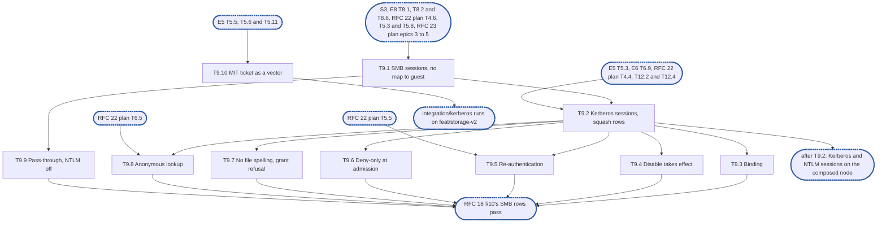

# Epic 9: identity v2, E2E green

**Sources:** [RFC 18](../docs/internals/rfcs/rfc-18-identity.md) §10's Tier 2 rows, their SMB halves: "no map
to guest", "squash drops SIDs", "squash order follows the proof" (its Kerberos half), "disable takes
effect" (its SMB half), "binding", "re-authentication", "deny-only SIDs", "no file spelling" (its
SMB half), "`none` is stored", "NTLM off" (its session halves) and "anonymous lookup"; §10's "PAC"
row, its keytab-realm clause, against a real MIT KDC; §9.1's ID3, ID5, ID7, ID10, ID12, ID13 and
ID14 as those rows check them; and the sections the rows test: §2.4 (no file spelling), §3.3 (an
unknown principal refused), §3.4 (a PAC with no logon-information buffer), §3.5 (NTLM off), §3.6
(no map to guest), §3.7 (a disable on a held session), §3.8 (re-authentication and expiry), §4.2
(Kerberos names), §4.4 (no mint for an unauthenticated lookup), §6.2 (squashing and its order),
§6.3 and §6.4 (grants, `none`), §7.1 and §7.2 (the caller cache and a change applied within a
second); [RFC 22](../docs/internals/rfcs/rfc-22-smb.md) §16.5 (`STATUS_LOGON_FAILURE`) and §18's "§4.1
re-authentication" and "§4.1 expired session"; [RFC 17](../docs/internals/rfcs/rfc-17-vfs.md) §4.9's
admission, whose steps 1, 2 and 4 still gate a call that only releases state. RFC 18 as `develop`
holds it at f272a7c8d.
**Track:** the team.
**Epic 9 estimate: 10 subtasks, 12.25 man-days.**
**Depends on:** **S3**, an SMB adapter serving through the node: RFC 20's plan's epic 7 (the node
starts the adapters, and `nodetest` serves them on loopback) and RFC 22's plan's sessions, trees,
opens and data path (its epics 5 to 7), with its scripted client (T5.8), `gsstest`'s initiators
(T4.6) and SPNEGO (T4.4), re-authentication (T5.5) and lsarpc (T6.5); and RFC 22's plan's security
descriptors over `QUERY_INFO` and `SET_INFO` (T12.2, T12.4), which every row reading an owner or
setting a DACL needs and which RFC 22's first-mount path leaves for later. **E8**: identity in
`node.New` and its `State` from reconcile (T8.1, T8.2), the in-memory directory and domain
controller handed through `export_test.go`'s `NewWithDialers` (its D4), the offline join and
pass-through on the node (T8.6). **E5**: `identitytest.Realm` (its D10), whose tickets and PACs
every Kerberos row here uses, the PAC tests T5.5 and T5.6, and T5.11's replay of a captured
AP-REQ. **E3**: D9's refusal of a deny-only
caller, which shapes T9.6. **RFC 23's plan**: its epic 3's `nodetest` and the writer's at-once apply
(its D16), its epic 4's user, share, grant, settings, keytab and `resolve-principal` routes (T4.10,
T4.11), its epic 5's `set-password`.
**Blocks:** nothing. RFC 18's last epic.

---

## 1. Goal

Every RFC 18 §10 row that needs a protocol passes over SMB on the node `node.New` builds, from a
client's session setup to the answer the client reads, with the real identity server, the real
metadata store and RFC 19's real file decisions behind the adapter, wherever something crosses the
adapter that no lower test sees. And the PAC a real MIT KDC puts in its tickets is held by
identity's own tests.

**At the end of the epic:**

- a sign-in the store fails leaves no session (T9.1);
- a Kerberos session's PAC groups reach the file decision and a squash removes them, a proven
  principal's own grant, `none` included, decides a squashed share (T9.2), and a deny-only mark
  reaches admission (T9.6);
- a session acts as the principal it was bound to across a delete and a re-creation under the same
  name, over Kerberos (T9.3) and over pass-through (T9.9);
- a disable, a re-authentication and turning NTLM off each act on sessions already held (T9.4,
  T9.5, T9.9);
- a machine principal reaches no share, no grant names an API-only account on any store backend
  (T9.7), and an anonymous lookup mints nothing (T9.8);
- an MIT KDC's AP-REQ, its PAC holding no logon-information buffer, is a captured vector that signs
  in through `SignIn` on a clock pinned to its capture, and its PAC a `FuzzPAC` seed (T9.10).

### 1.1 In scope

The rows listed under **Sources**, each over SMB on the composed node in `unit`, as far as D2
says; the SMB sign-in helpers those rows share; the refusal of a grant naming an API-only account,
which no epic builds, as a store contract in `kvstoretest` (D6); the MIT KDC image restored under
`test/integration/kerberos` with the test that captures its ticket.

### 1.2 Out of scope

- Every clause these rows hold below the adapter or inside it alone (D2), each named in its R row:
  E3's resolution tests (squash, groups, grants, deny-only principals, the caller cache, NTLM off at
  resolution), E4's sign-in refusals, E5's PAC and binding tests, RFC 22's plan's adapter rows on
  `memory.New`.
- "NTLM off"'s other halves: the password set held across the change (RFC 23's plan's epic 5,
  T5.7), the turn-back-on refusal (RFC 23's plan's epic 4, T4.11, and epic 7, T7.5), the deletion on
  the node's runner and no NT hash after it (E8's T8.10), a fresh NTLM sign-in refused (E4's
  refusal at `SignIn`).
- A grant naming a machine principal refused: RFC 23's plan's epic 4, T4.10 (its R46), which
  `kvstore`'s `SetGrant` already holds on `feat/storage-v2`.
- Re-authentication's teardown on a failed proof and an expired session's release calls: RFC 22
  §18's "§4.1 re-authentication" and "§4.1 expired session", run by RFC 22's plan's T5.5 on
  `memory.New` and by its T16.3 through smbtorture (D2).
- A deny-only SID matched by deny entries only in a file's ACL: E3's D9 refuses a caller holding a
  deny-only principal at admission until RFC 19 §2.3's deny match lands, owned by #4564; the file
  clauses of "deny-only SIDs" go with it (D7).
- A deleted owner shown as `S-1-0-0` over SMB, the SMB clause of "owner strings": RFC 22's plan's
  T12.3. The row's NFS clauses: the RFC 18 plan's deferral ledger row "NFSv4 owner strings
  (RFC 18 §4.5) and `FuzzOwnerString`".
- Kernel and Windows clients: RFC 20 §7.5's "§4.4 Kerberos and AD" row over a kernel SMB mount is
  RFC 22's plan's T16.4; a Windows client's ticket and a Windows Server domain controller, the RFC
  18 plan's deferral ledger row "Interop against a Windows Server domain controller". No RFC 18
  row needs a kernel client (D1). So is the MIC Samba's clients send, which E4 flags as a risk:
  `gsstest`'s NTLM initiator cannot disagree with `gss`, and RFC 22's plan's smbtorture cells
  (T16.3) are where a Samba client's MIC is verified.
- The `e2e/kerberos` cell, which runs kernel-client Kerberos tests and has none on
  `feat/storage-v2`: T16.4's to fill or remove (D1).
- `lsarpc`'s `LookupSids` (opnum 15): the RFC 18 plan's deferral ledger row "`lsarpc`'s
  `OpenPolicy`, `LookupSids` and `OpenPolicy3`"; "anonymous lookup" runs on `LookupSids2` (D5).
- The NFS halves of "squash order follows the proof", "disable takes effect" and "no file
  spelling", and "expiry" over NFS: the RFC 18 plan's deferral ledger row "RFC 18 §10's NFS rows
  and NFS halves".
- "admin needs proof", "deny-only lookup error", "NTLM without a domain controller" and the
  directory's Tier 1 rows: E3, E4, E5, E6 and E8 hold them.

### 1.3 Names used here

- **E1**, the contract and the server's surface.
- **E2**, principals and accounts: `NewHashes`, the NT-hash deletion step.
- **E3**, resolution: `Resolve`, squash, groups, grants, the caller cache, D9's deny-only refusal.
- **E4**, local NTLMv2 sign-in and re-authentication at identity's layer.
- **E5**, Kerberos and the PAC: the keytab, the binding, `identitytest.Realm`, the PAC tests.
- **E6**, the directory and its in-memory double.
- **E7**, NETLOGON and the machine account: pass-through, the joins, the in-memory domain
  controller.
- **E8**, the integration epic: identity composed in `node.New`, the node's test seams.
- **E9**, this epic, E2E green.
- **S3**, an SMB adapter serving through the node, outside RFC 18's plan: RFC 20's plan's epic 7
  and RFC 22's plan's sessions and data path. This epic starts once it is reached.
- **RFC 22's plan's T4.4, T4.6, T5.3, T5.5, T5.8, T6.5, T12.2, T12.3, T12.4, T16.3 and T16.4** are
  its SPNEGO, `gsstest`'s initiators, `SESSION_SETUP`, re-authentication with the expired session,
  the scripted client, lsarpc, descriptors and their translation, principals by SID, security
  `QUERY_INFO` and `SET_INFO`, the smbtorture burn-down, and its kernel-client end-to-end rows.
- **RFC 23's plan's epics 3, 4, 5 and 7** are the node with `nodetest`, the management API, accounts
  and that plan's integration epic.

## 2. How the general rules apply

The rules are those of
[the RFC 18 plan's §1.5](rfc-18-identity-plan.md#15-general-rules-for-each-epic), cited by
number and title and not copied.

| Rule | Subtasks | How |
| --- | --- | --- |
| rule 1, independent unit tests ([`CLAUDE.md`, "Writing tests"](../CLAUDE.md#writing-tests)) | T9.1 to T9.9 | each row is a `node_test` test through `nodetest` over Badger in memory, the SMB adapter on `127.0.0.1:0` and RFC 22's scripted client. Doubles: the in-memory directory and domain controller (kind 2, held by E6's and E7's suites) handed by `NewWithDialers`; `kvtest`'s `FaultKV` (kind 3); the injected clock (kind 1). Tickets and PACs come from `identitytest.Realm`, real tickets under the test realm's keys, and NTLM responses from `gsstest`'s initiator, never stubbed |
| rule 2, fuzz every decoder of untrusted bytes | T9.10 | no decoder is added; the MIT PAC joins `FuzzPAC`'s seeds |
| rule 3, observability follows RFC 25 | T9.4, T9.9 | no series is added; two tests read admission's `vfs_caller_cache_lookups_total{result="hit"}` from the node's metrics listener as their control that a call was served from the cache |
| rule 4, profiling | all | node tests run under `nodetest.Watch()`; the capture test under the leak check; no allocation budget |
| rule 5, public interface and internals ([`CLAUDE.md`, "Verifying a change"](../CLAUDE.md#verifying-a-change)) | all | every clause is asserted where a client sees it: the SMB status of a session setup, a `TREE_CONNECT` or a `READ`, the bytes a read returns, the owner SID read back with the file's descriptor (D2) |
| rule 6, known failures shrink | none | `unit` and `integration` keep no `known.yaml` for these cells, so each test lands green with the subtask that makes it pass |
| rule 7, v2 ignores v1 | T9.10 | the MIT KDC's `Dockerfile` and `entrypoint.sh` are lifted from `develop`'s `test/integration/kerberos`; v1's `kerberos_integration_test.go`, which drives v1's Kerberos code, is not |
| rule 8, real dependencies for properties of those dependencies | T9.10 | an MIT KDC's PAC, which neither the test realm nor Samba's KDC issues, captured from a real KDC and held to identity's verifier (D3) |
| rule 9, code comment conventions ([`CLAUDE.md`, "Code comments"](../CLAUDE.md#code-comments)) | T9.7, T9.10 | RFC 18 §2.4's grant rule gets its `decision:` beside `SetGrant`'s machine refusal (D6); the capture test's `decision:` says why the KDC runs only to capture (D3) |
| rule 10, a test must be able to fail | all | each test names the bug it catches, and runs only what crosses the adapter (D2); a clause another epic's or RFC 22's plan's test already holds is named in its R row, not run again |
| rule 11, a symbol is exported only if RFC 18's interfaces use it | none | tests only; `SetGrant`'s signature is unchanged |
| rule 12, each subtask creates only what it declares | all | each helper lands with its first row: NTLM sessions with T9.1, Kerberos sessions in both realms with T9.2, the offline join with T9.9 |

## 3. Requirements and invariants

Every obligation RFC 18 and RFC 22 place on this epic, numbered so that subtasks and tests can
cite them. Sources are RFC 18 unless named.

**Failed and anonymous sessions**

| # | Requirement | Kind | Source | Subtasks |
| --- | --- | --- | --- | --- |
| R1 | A session setup whose credential fails, for a wrong password, an unknown user or a known user while the store errors, is answered `STATUS_LOGON_FAILURE` and leaves no session; it never becomes an anonymous or guest session | MUST NOT | §3.6; §9.1 ID5; §10 "no map to guest"; RFC 22 §16.5 | T9.1 for the store error, the one answer the real `SignIn` gives that `memory.New`'s does not; a wrong password and an unknown name are E4's at `SignIn` and RFC 22's plan's T5.3 at the adapter |
| R2 | An anonymous session reaches `IPC$`, and its `TREE_CONNECT` to a data share, `profiles`, is refused | test row | §3.6; §10 "no map to guest" | held by RFC 22's plan's T5.3 and T6.1: which shares a null session reaches is RFC 22 §4.1's, and identity adds nothing to it (§3.6) |
| R3 | A lookup by an unauthenticated caller never mints: over an anonymous session on `IPC$`, a `LookupSids` of an unminted directory SID writes no record | MUST NOT | §4.4's decision; §10 "anonymous lookup" | T9.8 |

**Squashing, groups and grants**

| # | Requirement | Kind | Source | Subtasks |
| --- | --- | --- | --- | --- |
| R4 | A squashed caller carries no group, SID or name of the principal it replaced: with `Squash = all`, a Kerberos caller whose PAC carries `Finance` is refused a file whose ACL grants `Finance` only; with `Squash = none`, granted | MUST | §6.2; §9.1 ID7; §10 "squash drops SIDs" | T9.2 |
| R5 | A proven identity's grant is read for the principal sign-in authenticated, before the squash: with `Squash = all`, `read-write` to alice, `none` to bob and `read` to everyone, alice over Kerberos writes and the file is owned by `Anonymous`, and bob is refused at the share | invariant | §6.2 "The squash order follows the proof"; §10 "squash order follows the proof", its Kerberos half | T9.2 |
| R6 | A deny-only SID matches deny entries only and never grants: with a PAC marking `Finance` deny-only, a file whose ACL allows `Finance` read is refused, one that allows alice and denies `Finance` read is refused, and a share whose only grant names `Finance` refuses alice | invariant | §3.4; §6.3; §9.1 ID13; §10 "deny-only SIDs" | T9.6 for the mark reaching admission over SMB; the share-grant clause held by E5's T5.7 and E3's T3.5; the file clauses wait for #4564 (D7) |
| R7 | A principal with no file spelling acts on files as the share's `Anonymous`, never `authenticated`: a machine principal is refused on a share whose only grant is authenticated users `read` | invariant | §2.4; §6.2; §9.1 ID3; §10 "no file spelling", its SMB half | T9.7 |
| R8 | No share grant may name a principal with no file spelling: the management API refuses a grant naming a machine principal or an API-only account | MUST NOT | §2.4; §10 "no file spelling" | T9.7 for an API-only account, a case of `kvstoretest`'s conformance suite (D6); held for a machine principal by RFC 23's plan's epic 4's T4.10 (its R46) at the route, and by T9.7's `kvstoretest` case at the store |
| R9 | A grant of `none` is stored, distinct from no grant: with `Finance` granted `read-write` and alice `none`, alice is refused; with alice's grant removed, she is granted through `Finance` | MUST | §6.4; §9.1 ID14; §10 "`none` is stored" | T9.2's eve, whose `none` refuses her at `TREE_CONNECT` over an everyone grant; the removal's fall-through to a group is E3's T3.5, since an adapter grants nothing (§9.1 ID11) |

**Changes on held sessions**

| # | Requirement | Kind | Source | Subtasks |
| --- | --- | --- | --- | --- |
| R10 | A disable reaches a session already held: on a Kerberos session whose calls the caller cache serves, the next call after the disable is still served until the `State` that carries it is applied, and refused from then on: its open handle stays in the session's table, and every call through it, `CLOSE` included, is refused; on a local NTLM session, never cached, the first call after the disable is refused with no `State` applied | MUST | §3.7; §7.1; §7.2; §9.1 ID10; §10 "disable takes effect", its SMB half; RFC 17 §4.9's admission, whose steps 1, 2 and 4 still gate a release call | T9.4 |
| R11 | A session acts as the principal its last successful sign-in bound it to, and its name is never mapped again: alice deleted and a user named alice created, every call on alice's old Kerberos session is refused and a fresh sign-in acts as the new principal; the same for an NTLM pass-through session whose name the directory gives to a new SID | invariant | §3.7; §9.1 ID12; §10 "binding" | T9.3 for the Kerberos half, which catches an adapter or `*vfs.Filesystem` mapping again by name whatever the mechanism; T9.9 for the pass-through half, on `joinedNode` |
| R12 | Turning `identity.ntlm` off refuses every call on an established NTLM session, local or pass-through, cached or not, from the `Apply` that delivers it, and every fresh NTLM sign-in | MUST | §3.5; §10 "NTLM off", its session halves | T9.9 for held sessions; a fresh sign-in refused by E4; the deletion and the stored NT hashes by E8's T8.10 |

**Re-authentication**

| # | Requirement | Kind | Source | Subtasks |
| --- | --- | --- | --- | --- |
| R13 | Any failed re-authentication ends the session it targeted, its trees and opens with it | MUST | §3.8; §10 "re-authentication"; RFC 22 §18 "§4.1 re-authentication" | held by E4 (the context ended at `SignIn`) and RFC 22's plan's T5.5 and T16.3 (the session torn down) (D2) |
| R14 | A successful re-authentication replaces the session's identity in one step and keeps its trees and opens, each with the access granted at its open: as alice with a new ticket, the new `Expires` in force; as bob, the session acts as bob while alice's open keeps its access | invariant | §3.8; §9.1 ID12; §10 "re-authentication" | T9.5 |
| R15 | A session past `Expires` still admits `CLOSE`, an unlock and its re-authentication, and refuses a read with the expired-credential answer, `STATUS_NETWORK_SESSION_EXPIRED` | MUST | §3.8; §10 "re-authentication"; RFC 22 §18 "§4.1 expired session" | T9.5 for a read refused at the real ticket's end; the release calls held by RFC 22's plan's T5.5 and T16.3 (D2) |

**A real KDC**

| # | Requirement | Kind | Source | Subtasks |
| --- | --- | --- | --- | --- |
| R16 | In a keytab realm other than the directory's, a ticket without a PAC, or with a PAC whose server signature verifies but which holds no logon-information buffer, is accepted and its groups read from the store | MUST | §3.4; §4.2; §10 "PAC", its keytab-realm clause | T9.10 for the PAC with no logon-information buffer, with a real MIT KDC's AP-REQ; E5's T5.5 (no PAC) and T5.6 (no logon-information buffer) hold it with the test realm |

Which test holds each row is in its subtask's **Tests**, or in the row when another epic's test
holds it.

## 4. Decisions this epic takes

- **D1, the Tier 2 rows run in `unit`, over the composed node's SMB on loopback, never with a
  kernel client, pending the user's answer (§9).** RFC 18 §10's "Suites" puts Tier 2 in `unit`,
  "the in-process layer, as RFC 20 §7.4 is", not the kernel-client rows. Every clause of the rows
  above is a decision the server makes and the SMB answer shows, which RFC 22's scripted client
  reads exactly; a kernel client adds its caching and its retries, which none of these rules is
  about, and needs root. What a kernel client does show about sign-in, its own Kerberos and
  pass-through handshake, is RFC 20 §7.5's "§4.4 Kerberos and AD" row, which RFC 22's plan's T16.4
  runs. So this epic adds no test to `e2e` (`CLAUDE.md`, "By kind": a rule a lower tier can check
  belongs there), where the RFC 18 plan had named `e2e/kerberos`. That cell
  (`test/suites.yaml`'s `e2e` option `kerberos`, `go test -tags=e2e -run Kerberos ./test/e2e/`)
  matches no test on `feat/storage-v2`, where `test/e2e` holds only its framework, so every change
  under its path triggers, `test/integration/kerberos/**` among them, runs it green on nothing. It
  stays, for RFC 22's plan's T16.4, whose kernel-client Kerberos rows are what it runs; that owner
  fills it or removes it with `KDCHelper`. This epic does not remove it:
  `test/harness/plan/plan_test.go` pins the cell and the paths that plan it, and T16.4 would add it
  back. Prior art (from memory): Samba's
  selftest checks its authentication rules with its own client libraries against a provisioned
  server, and leaves kernel mounts to cifs-utils.
- **D2, a row runs here only for what crosses the adapter.** Each row's lower clauses are already
  held: a squash's empty `Caller` by E3, a PAC's groups by E5, a re-authentication's teardown by RFC
  22's plan on `memory.New`, grant order by E3, which shares a null session reaches by RFC 22. What
  none of them holds is the path between: the `Identity` the adapter builds from `SignIn`'s answer,
  carried through `*vfs.Filesystem` into admission and RFC 19's decision, and back as an SMB status.
  A field dropped on that path, such as `Expires`, `DenyOnly` or a PAC's groups, leaves every lower
  test green. So a row runs here when such a field crosses, asserted at the client (a status, the
  bytes read, the owner read back), and is named in its R row when nothing crosses (R2, R9, R13,
  R15's release calls). Re-authentication's teardown and the release calls past `Expires` are the
  adapter's alone, run by RFC 22's plan's T5.5 on `memory.New` and its T16.3 through smbtorture's
  `smb2.session.reauth1` to `reauth6` and `expire2s`, which RFC 22 §18 names; what the real
  Kerberos `SignIn` adds, `Expires` from the ticket and a new principal, is T9.5's. No marker: test
  placement. Prior art: `CLAUDE.md`, "Verifying a change".
- **D3, the real KDC runs only to capture its ticket, pending the user's answer (§9).** RFC 18
  never names a real KDC beyond Samba's, and no RFC 18 row needs a kernel client (D1). What only an
  MIT KDC shows is its PAC: since krb5 1.20 (Debian bookworm's `krb5-kdc`) MIT puts a PAC in every
  ticket unless the service is marked `no_auth_data_required`, with no logon-information buffer,
  which RFC 18 §3.4 treats as no PAC and on which gokrb5's `ProcessPACInfoBuffers` errors (E5's
  D6). Neither `identitytest.Realm` nor Samba's KDC issues one. The adapter path a ticket takes is
  the same for every KDC and is T9.2's, so T9.10 does as `integration/ad-dc`'s
  `pac_capture_test.go` does for Samba: it restores `test/integration/kerberos` with `develop`'s MIT
  image, captures one ticket with the service's keytab, checks it against identity's verifier, and
  commits it as a vector E5's tests and `FuzzPAC` read in `unit`. Only one: a ticket with no PAC is
  the same whichever KDC issues it, and E5's T5.5 holds it with the test realm. A ticket alone
  cannot sign in through `SignIn`, which decrypts the authenticator under the session key and
  refuses a ticket past its end (`kerberos.go`), so the vector is alice's AP-REQ with the capture's
  authentication time, replayed on the injected clock set to that time, as E5's T5.11 does for
  Samba's alice; on the wall clock it would go red once the ticket ends. `FuzzPAC` takes PAC bytes
  (`pacSeeds` reads `testdata/pac/`), so the ticket's PAC is also written there as its own file.
  The capture runs in the `integration/kerberos` cell, unskipped on `feat/storage-v2`, with
  `kerberos` in lint-go's `go vet -tags=` list. `e2e/kerberos`'s `KDCHelper` builds from the same
  directory, so its build context exists again, a side effect with no consumer here (D1). A
  `decision:` marker at the test says why the KDC only captures. Prior art: `pac_capture_test.go`
  on `feat/storage-v2` and E5's T5.11 (#5314); from memory, gokrb5 keeps captured MIT
  tickets as test vectors.
- **D4, folded into D2.**
- **D5, "anonymous lookup" runs on `LookupSids2`.** RFC 22's plan's T6.5 builds `OpenPolicy2`,
  `LookupSids2` and `LookupSids3`; opnum 15, `LookupSids`, is a deferral ledger row. The rule, a
  lookup that never mints for an unauthenticated caller, is `Find`'s (`FindOpts.Mint`, §4.4), the
  same whichever opnum carries it. A control in the same test, the lookup over an authenticated
  session minting the SID, keeps the row from passing on a lookup that never reaches the directory.
  No marker. Prior art: none needed.
- **D6, the grant refusal for an API-only account sits beside the machine one, in `SetGrant`,
  pending the user's answer (§9).** RFC 18 §2.4: a principal with no uid is not a file principal,
  "and no share grant may name it: the management API refuses one". On `feat/storage-v2`,
  `kvstore`'s `SetGrant` refuses any principal kind but a user or a group, so a machine is refused,
  and an API-only account, a user record with no uid, is stored; RFC 23's plan's T4.10 tests
  machines only (its R46). T9.7 adds the refusal of a user with no uid to the same check,
  `ErrInvalidArgument` and nothing written, with a `decision:` marker naming RFC 18 §2.4's rule. It
  sits at the store so that every writer is refused, the API, a runner and a test fixture alike, as
  machines already are; the route maps the error to `400` as T4.10 tests for machines. A refusal
  `SetGrant` makes is a store contract, so its case joins the `OWNER@` and default-grant refusals
  in `kvstoretest/auth.go`, run on every backend, with a machine principal's case beside it, which
  the suite does not hold yet. The check breaks the fixtures that grant
  a user with no uid, listed in T9.7, which give those users a uid. Alternative: RFC 23's plan's
  T4.10 takes it. Prior art: none found.
- **D7, "deny-only SIDs" is held at admission until #4564.** E3's D9 refuses any caller holding a
  deny-only principal at admission, because RFC 19 §2.3's deny match is not built; #4564 owns it.
  Until then both file clauses of the row pass for D9's reason, whatever an ACL says, so running
  them would test D9 rather than ID13. T9.6 runs the one clause that crosses the adapter: the mark
  carried from the PAC to admission, refused with it and granted without it. The file clauses join
  the test that lands with #4564's deny match, which removes D9. No marker: E3's D9 marker names
  the withdrawal. Prior art: E3's D9.
- **D8, a disable that must not apply at once is written through the store, not the API.** RFC
  23's plan's epic 3's D16 makes the writing node apply its own change at once, so a disable
  through the API never shows the "before the `State` is applied, still served" clause of
  "disable takes effect". T9.4 disables bob through kvstore's view, as E8's T8.2 does, and steps
  the injected clock a second to apply it. No marker: a test's means. Prior art: E8's T8.2.

## 5. Target tree

```text
internal/node/
  identity_smb_test.go          T9.1   the SMB helpers: a node serving SMB on loopback with
                                       the in-memory directory and domain controller, the
                                       principals table, NTLM sessions; "no map to guest"
                                T9.2   Kerberos sessions in both realms; the squash rows
                                T9.3   "binding"
  identity_smb_live_test.go     T9.4   "disable takes effect"
                                T9.5   "re-authentication"
                                T9.9   the offline join; "NTLM off"'s session halves
  identity_smb_files_test.go    T9.6   "deny-only SIDs" at admission
                                T9.7   "no file spelling"
                                T9.8   "anonymous lookup"
pkg/metadata/kvstore/shares.go  T9.7   SetGrant refuses a user with no uid (D6)
pkg/metadata/kvstore/kvstoretest/
  auth.go                       T9.7   the no-uid and machine grant refusals, on every backend
  namespace.go, bench.go        T9.7   their admin given a uid
internal/vfs/                   T9.7   authz_test.go's bob given a uid; tests that rewrite the
                                       fixture admin's IDs keep its uid
test/integration/kerberos/
  Dockerfile, entrypoint.sh     T9.10  lifted from develop's history (rule 7)
  pac_capture_test.go           T9.10  the MIT ticket captured and verified
internal/identity/
  testdata/pac/mit-*            T9.10  alice's AP-REQ, its time, the PAC and the keytab
  fuzz_test.go                  T9.10  mit-service.pac in pacSeeds
  pac_test.go                   T9.10  the AP-REQ signed in on the pinned clock
test/suites.yaml                T9.10  kerberos in lint-go's go vet -tags list
.github/workflows/tests.yml     T9.10  integration/kerberos out of the V2 skip
```

## 6. Subtasks

### T9.1 SMB sessions on the composed node, and "no map to guest"

**Subtask T9.1 estimate: 2 man-days.**

- **Track:** the team. **Depends on:** S3. E8's T8.1, T8.2 and T8.6; RFC 22's plan's T4.6, T5.3
  and T5.8; RFC 23's plan's epic 3 (`nodetest`) and epics 4 and 5 (users, shares, grants,
  `set-password`).
- **Covers:** R1.
- **Deliverables:** in `internal/node`'s `identity_smb_test.go`, unexported test helpers:
  `smbNode(t, opts)`, a node built by `nodetest.WithNew(NewWithDialers(dir, dc))` (E8's D4) with
  the SMB adapter on `127.0.0.1:0` and shares `data` and `profiles`; one principals table for every
  row: local users alice and bob with passwords set through the API, and a local group
  `Finance` holding alice; in the in-memory directory, dana and eve and the group `Sales` holding
  dana, under the directory's domain SID, minted through the API's `resolve-principal` where a grant
  names them; `ntlmSession(t, addr, user, domain, password)` over RFC 22's scripted client with
  `gsstest`'s NTLM initiator. Consumed by every later subtask but T9.10.
- **Acceptance criteria:**
  - A failed setup's session ID answers the next request with `STATUS_USER_SESSION_DELETED`.
- **Tests:** in `node_test`, through `nodetest`, watched, on the injected clock: alice with her
  right password while a `FaultKV` error fails the read of her NT-hash `Secret`: answered
  `STATUS_LOGON_FAILURE`, and a `TREE_CONNECT` to `IPC$` under the answer's session ID
  `STATUS_USER_SESSION_DELETED` (catches a store error answered with a guest or anonymous session
  on the way from `SignIn` to the session table, R1); the control, the same sign-in with no fault,
  connects. Doubles: the in-memory directory and domain controller (kind 2), `kvtest`'s `FaultKV`
  (kind 3), the injected clock (kind 1).

### T9.2 Kerberos sessions with a PAC, and the squash rows

**Subtask T9.2 estimate: 1.75 man-days.**

- **Track:** the team. **Depends on:** T9.1. E5's T5.3 (`identitytest.Realm`); E6's T6.9
  (directory principals); RFC 22's plan's T4.4, T4.6, T12.2 and T12.4; RFC 23's plan's epic 4 (the
  keytab route, share settings).
- **Covers:** R4, R5, R9 (its refusal).
- **Deliverables:** `kerberosSession(t, addr, ticket)`: an AP-REQ built by `identitytest.Realm` for
  `cifs/<host>`, wrapped in SPNEGO and sent through the scripted client; two realms in the one
  `identity.keytab` written through the API: `CORP.EXAMPLE`, the directory's, whose PACs carry the
  SIDs a test names, and `LOCAL.EXAMPLE`, which is not, whose PAC-less tickets reach local users by
  §4.2's step 2 (§9). Consumed by T9.3 to T9.8.
- **Acceptance criteria:**
  - A ticket whose PAC names `Sales` signs in, and its session reads a file only `Sales` may read
    on a `Squash = none` share.
- **Tests:** in `node_test`, the in-memory directory, the injected clock; DACLs set and owners read
  over SMB with security `SET_INFO` and `QUERY_INFO`; a fresh session after each change of
  `Squash`:
  - "squash drops SIDs": the share grants everyone `read`; a file whose DACL grants `Sales` read
    only, and a second whose DACL grants everyone read; dana's ticket with `Sales` in its PAC.
    `Squash = none`: the first file's `READ` returns its bytes. `Squash = all` through the API: the
    second file reads (the control that the squashed caller reaches the share and the file), and
    the first's `CREATE` is refused `STATUS_ACCESS_DENIED` (catches a squash that kept the PAC's
    SIDs on the way to the file decision, R4);
  - "squash order follows the proof", its Kerberos half: `Squash = all`, grants `read-write` to
    dana, `none` to eve and `read` to everyone; dana writes a new file and its owner SID read back
    is the `Anonymous` principal's; eve's `TREE_CONNECT` refused although everyone may read
    (catches a proven principal's grant ignored on a squashed share, its own principal kept as the
    owner, or `none` read as no grant, R5, R9).
  - Doubles: as T9.1's; tickets are real, under the test realm's keys.

### T9.3 "binding" over SMB

**Subtask T9.3 estimate: 0.75 man-days.**

- **Track:** the team. **Depends on:** T9.2.
- **Covers:** R11.
- **Deliverables:** a test in `identity_smb_test.go`.
- **Acceptance criteria:**
  - The old session is refused with no sign-in in between.
- **Tests:** in `node_test`, the injected clock: alice, a local user, signs in with a PAC-less
  ticket of `LOCAL.EXAMPLE` and opens a file; alice deleted through the API and a user named alice
  created: a `READ` on the old session refused, and a fresh sign-in creates a file whose owner SID
  is the new alice's, not the old one's (catches a live context mapped again by name between the
  adapter and resolution, R11).

### T9.4 "disable takes effect" over SMB

**Subtask T9.4 estimate: 1.25 man-days.**

- **Track:** the team. **Depends on:** T9.2. E3's T3.10; E8's T8.2.
- **Covers:** R10.
- **Deliverables:** a test in `identity_smb_live_test.go`.
- **Acceptance criteria:**
  - The Kerberos session's refusal comes with the `State` applied one second later, the NTLM
    one's with none; the disabled session's open stays in the table while every call through it is
    refused.
- **Tests:** in `node_test`, the injected clock: bob holds a Kerberos session with a PAC-less
  ticket of `LOCAL.EXAMPLE`, and an NTLM session; each opens a file, the Kerberos one with no share
  access, and reads twice, and `vfs_caller_cache_lookups_total{result="hit"}` read just before and
  just after the Kerberos session's second read grows by one (the control; the NTLM session's
  reads fall outside that window). bob disabled through kvstore's view (D8): the NTLM session's
  next `READ` refused at once; the Kerberos one's served; the clock advanced one second and the
  reconcile pass awaited on `export_test.go`'s `Moved()`, as `adapters_test.go` does, with a 10 s
  backstop: its next `READ` refused, and `CLOSE` on its open refused too, while eve's `CREATE` of
  the same file is still answered `STATUS_SHARING_VIOLATION` by that open (catches a cached caller
  outliving the disable, a release call let through for a disabled user, or the disabled user's
  handle closed under it, R10).

### T9.5 "re-authentication" over SMB

**Subtask T9.5 estimate: 0.75 man-days.**

- **Track:** the team. **Depends on:** T9.2. E4's re-authentication in place; RFC 22's plan's T5.5.
- **Covers:** R14, R15 (its refused read).
- **Deliverables:** a test in `identity_smb_live_test.go`.
- **Acceptance criteria:**
  - Every clause is read on the session the re-authentication targeted.
- **Tests:** in `node_test`, the injected clock, `LOCAL.EXAMPLE` tickets with chosen end times; the
  adapter reads `Expires` against the clock on each request (RFC 18 §3.8), with no `State` to
  apply, so a clock step needs no wait:
  - alice's Kerberos session with an open; re-authenticated with a ticket ending an hour after the
    first: the clock past the first's end, a `READ` on the open still served (catches the new
    `Expires` dropped between `SignIn` and the session, R14);
  - re-authenticated as bob: a `CREATE` of a file only alice may read refused, and alice's open
    still reads (catches the identity left unchanged, or an open re-decided for the new principal,
    R14);
  - the clock past bob's ticket's end: `READ` answered `STATUS_NETWORK_SESSION_EXPIRED` (catches
    the real ticket's end never reaching the session, R15).

### T9.6 "deny-only SIDs" at admission over SMB

**Subtask T9.6 estimate: 0.5 man-days.**

- **Track:** the team. **Depends on:** T9.2. E3's T3.4 and D9; E5's decoding of deny-only SIDs.
- **Covers:** R6 (the mark reaching admission).
- **Deliverables:** a test in `identity_smb_files_test.go`.
- **Acceptance criteria:**
  - The two sessions differ only in the mark.
- **Tests:** in `node_test`, two tickets for dana from `identitytest.Realm`, one marking `Sales`
  deny-only (`SE_GROUP_USE_FOR_DENY_ONLY`), one not, on a share granting everyone `read`: without
  the mark the `TREE_CONNECT` succeeds and a `READ` returns the file's bytes; with it the
  `TREE_CONNECT`, the first call admission sees, is answered `STATUS_ACCESS_DENIED` (catches
  `DenyOnly` dropped between the PAC and admission, which turns a deny-only SID into a plain
  member, R6). The file clauses: D7.

### T9.7 "no file spelling" over SMB, and the grant refusal

**Subtask T9.7 estimate: 1.25 man-days.**

- **Track:** the team. **Depends on:** T9.2. E5's machine principals (minted at first Kerberos
  sign-in); RFC 23's plan's epic 4's T4.10.
- **Covers:** R7, R8.
- **Deliverables:** in `kvstore`'s `SetGrant`, a user with no uid refused `ErrInvalidArgument`,
  nothing written, beside the machine refusal, with the `decision:` marker (D6); its case and a
  machine principal's in `kvstoretest/auth.go`, beside the `OWNER@` and default refusals; the
  fixtures that grant a user with no uid given one: `kvstoretest/namespace.go`'s `setupFS` admin,
  which `kvstoretest.NewFS` hands to `internal/vfs`'s tests, `kvstoretest/bench.go`'s admin and
  `internal/vfs/authz`'s `TestViaReachesTheChokepoint` bob, with the `internal/vfs` tests that
  write the fixture admin's IDs again kept to the uid it is given; the rest found by running the
  tree; a test in `identity_smb_files_test.go`.
- **Acceptance criteria:**
  - A grant naming the bootstrap administrator, an API-only account, is refused, and a user with
    a uid is still granted.
- **Tests:**
  - in `node_test`: a share whose only grant is authenticated users `read`; dana's `TREE_CONNECT`
    succeeds (the control); `BUILD01$`'s `CORP.EXAMPLE` ticket with a PAC signs in, minting a
    machine principal, and its `TREE_CONNECT` is refused `STATUS_ACCESS_DENIED` (catches a machine
    treated as an authenticated file caller, R7);
  - in `kvstoretest`, on every backend: `SetGrant` for a user with no uid, and for a machine
    principal, refused `ErrInvalidArgument` and no grant readable after it; for a user with a uid,
    stored (catches an API-only account given file access through a grant, by any writer, R8). The
    route's `400` for the error is T4.10's.

### T9.8 "anonymous lookup"

**Subtask T9.8 estimate: 0.75 man-days.**

- **Track:** the team. **Depends on:** T9.2. RFC 22's plan's T6.5 (lsarpc); E6's T6.9 (`Find` with
  `Mint`).
- **Covers:** R3.
- **Deliverables:** a test in `identity_smb_files_test.go`.
- **Acceptance criteria:**
  - The anonymous lookup leaves the store's principal records byte-equal.
- **Tests:** in `node_test`, the in-memory directory holding frank, never minted: over an anonymous
  session on `IPC$`, `OpenPolicy2` and `LookupSids2` of frank's SID: answered unmapped, and no user
  record written, read raw through kvstore's view (catches an unauthenticated caller minting a
  principal, R3); the control: the same lookup over dana's session mints frank (catches a lookup
  that never reached the directory, which would let the first clause pass on nothing, D5).

### T9.9 Pass-through on the composed node, and "NTLM off"

**Subtask T9.9 estimate: 1.75 man-days.**

- **Track:** the team. **Depends on:** T9.1. E3's T3.10; E7's pass-through; E8's T8.6.
- **Covers:** R11 (its pass-through half), R12.
- **Deliverables:** `joinedNode(t)`: `smbNode` offline-joined through the API to the in-memory
  domain controller, as E8's T8.6 does; a pass-through session through `ntlmSession` with the
  domain's NetBIOS name; two tests in `identity_smb_live_test.go`.
- **Acceptance criteria:**
  - Both NTLM sessions are refused with no principal changed; the old pass-through session is
    refused with no sign-in in between.
- **Tests:** in `node_test`, on `joinedNode`:
  - "NTLM off", the injected clock not advanced: alice on a local NTLM session reads; dana on a
    pass-through session reads twice, and `vfs_caller_cache_lookups_total{result="hit"}` read just
    before and just after dana's second read grows by one (the control that the cached path is
    tested); `identity.ntlm` turned off through the API, which applies at once on this node: each
    session's next `READ` refused (catches an NTLM context outliving the setting through a cached
    caller or through the adapter's session, R12);
  - "binding", its pass-through half: dana on a pass-through session opens a file; dana deleted
    through the API, and the in-memory domain controller and directory re-link the name dana to a
    new user SID: a `READ` on the old session refused, and a fresh pass-through sign-in as dana
    creates a file whose owner SID read back is the new SID's principal, not the old one's (catches
    a pass-through context mapped again by name, R11).

### T9.10 An MIT KDC's ticket as a vector

**Subtask T9.10 estimate: 1.5 man-days.**

- **Track:** the team. **Depends on:** E5's T5.5, T5.6 and T5.11, `FuzzPAC`; no node.
- **Covers:** R16.
- **Deliverables:** `test/integration/kerberos/Dockerfile` and `entrypoint.sh` lifted from
  `develop`'s history (rule 7), building Debian bookworm's `krb5-kdc`; `pac_capture_test.go` (tag
  `kerberos`), on the model of `integration/ad-dc`'s: the KDC container on its own network; alice
  and `cifs/<host>` added with `kadmin.local` in the container, since the image's entrypoint
  creates neither, and the service's keytab exported with AES keys only; alice's service ticket
  fetched by gokrb5's client and her AP-REQ built from it; with `DITTOFS_KERBEROS_PAC_OUT` set,
  written there as `mit-alice.apreq`, `mit-alice.json` holding the authenticator's time,
  `mit-service.pac` holding the ticket's PAC, and `mit-service.keytab`; the `decision:` marker of
  D3; the four committed under `internal/identity/testdata/pac/`, with the README's capture
  steps; `mit-service.pac` added to `FuzzPAC`'s `pacSeeds`; a `unit` test in `internal/identity`
  that signs the AP-REQ in; `kerberos` in lint-go's `go vet -tags=` list in `test/suites.yaml`;
  `integration/kerberos` removed from `tests.yml`'s V2 skip and its comment.
- **Acceptance criteria:**
  - The capture runs in the `integration/kerberos` cell on `feat/storage-v2`.
  - The `unit` test runs on the injected clock set to the capture's time, never the wall clock.
- **Tests:**
  - in the cell, against the real KDC, no double: the ticket, decrypted with the exported keytab,
    holds a PAC whose server signature verifies and which has no logon-information buffer
    (catches a KDC change that would make the vector take another path, R16);
  - in `unit`, beside E5's T5.11: alice's AP-REQ signed in through `SignIn` with
    `mit-service.keytab`, the clock at the capture's time, for a local alice in a store group: her
    caller holds the group (catches an MIT PAC refused, or its missing logon information taken as
    an empty group list, R16). Doubles: the injected clock (kind 1).
- **Rules:** rule 2's seed; rule 8; rule 9's marker.

## 7. Order of work



Checkpoints: after T9.2, every helper a row needs but the join exists; after T9.3 to T9.9, every
RFC 18 §10 row with an SMB half passes as far as D2 and D7 say; T9.10 needs no node and can land
before S3.

## 8. Suggested pull requests

| PR | Subtasks | Man-days | After | Why together |
| --- | --- | --- | --- | --- |
| 1 | T9.1, T9.2 | 3.75 | S3, E8, RFC 22's plan's T4.6, T5.8, T12.2 and T12.4 | the SMB sessions every row signs in with, proven by their first rows |
| 2 | T9.3, T9.4, T9.5, T9.6, T9.7, T9.8 | 5.25 | PR 1, RFC 22's plan's T5.5 and T6.5 | the rows on Kerberos sessions, and the grant refusal they need |
| 3 | T9.9 | 1.75 | PR 1 | pass-through on the composed node, its binding and NTLM off on its sessions |
| 4 | T9.10 | 1.5 | E5's T5.6 and T5.11 | the MIT vector, which needs no node |

A suggestion only: one pull request per subtask works as well. PRs 2 and 3 can be open at once;
PR 4 can land before S3.

## 9. Open points

The sources are RFC 18 at f272a7c8d on `develop`, RFC 22's plan as `develop` holds it, the epic
documents of RFC 18's epics 1 to 8, and `feat/storage-v2` at 64e12fc28 for what exists:
`test/e2e` holds only its framework there, `test/integration/kerberos` was deleted by RFC 20's
T1.1 (#3916), and `integration/ad-dc` signs Samba's tickets and pass-through in through identity
alone (`signin_test.go`, #5306) and captures Samba's PACs (`pac_capture_test.go`), with no adapter.

**This epic is written ahead of S3.** The RFC 18 plan marked it "planned after S3", and S3 has not
been reached: no adapter serves SMB through the node on `feat/storage-v2`. It was broken down at
the owner's request; T9.1 starts only once S3 holds, and its helpers' shapes follow RFC 22's
scripted client as that plan's T5.8 builds it. T9.10 does not wait.

**Pending the user's answer** (the recommended option is written in place):

- **Kernel clients (D1).** Options: (a) no RFC 18 test in `e2e`: every Tier 2 row runs in `unit`,
  and the kernel's Kerberos and pass-through handshake is RFC 22's plan's T16.4; (b) as the RFC 18
  plan said, the Kerberos rows also in `e2e/kerberos` with `mount.cifs -o sec=krb5`, which adds
  root, a kernel and `cifs.upcall` to rows whose every clause the in-process test holds.
  Recommended: (a).
- **The real KDC (D3).** Options: (a) the MIT KDC runs in the restored `integration/kerberos` cell
  only to capture one ticket, whose AP-REQ E5's `unit` tests replay on a pinned clock; (b) the
  same cell signs a live MIT ticket in over SMB on the composed node, 1 man-day more, whose adapter
  path T9.2 already holds; (c) none, the test realm and Samba's KDC taken as enough.
  Recommended: (a): the MIT PAC with no logon-information buffer is a path no other test takes,
  and a vector holds it in every `unit` run.
- **The grant refusal for an API-only account (D6).** Options: (a) T9.7 adds it to `SetGrant`
  beside the machine refusal; (b) RFC 23's plan's T4.10 takes it, with its R46 widened to RFC 18
  §2.4's two kinds. Recommended: (a), the smaller change, in the one place both kinds meet.

**Assumptions about other plans, to confirm with their owners:**

- **Two realms in one keytab.** T9.2 writes the directory's realm and a second keytab realm into
  `identity.keytab`, and needs `identitytest.Realm` (E5's D10) to issue tickets for both, or two
  realms whose keytabs the test joins; E5's T5.3 owner should confirm.
- **An AP-REQ built elsewhere.** RFC 22's plan's T4.6 gives `gsstest` a Kerberos initiator minting
  tickets from a test keytab; T9.2 sends `identitytest.Realm`'s AP-REQ, with its PAC, wrapped by
  T4.4's SPNEGO through the scripted client, which "sends what a test gives it" (T5.8). Should
  neither take a given AP-REQ, T9.2 adds that to `gsstest`, which T4.6's owner should agree to.
- **`nodetest` serving SMB on loopback**, its listener's address readable by a test, with the
  in-memory directory and domain controller handed by E8's `NewWithDialers`: RFC 20's plan's epic
  7 and RFC 22's plan's in-process rows assume the first; E8's D4 the second.
- **`e2e/kerberos` is T16.4's.** The cell runs no test on `feat/storage-v2`; RFC 22's plan's T16.4
  owner fills it with the kernel-client Kerberos rows or removes it with `KDCHelper` and the
  harness's pins (D1).
- **Descriptors before the rows.** RFC 22's plan leaves its epics 11 and 12 outside its first-mount
  path; T9.2's DACLs and owners need its T12.2 and T12.4, so PR 1 waits for them.

**Gaps in the RFCs, as pull request material:**

- RFC 23 §3.5 refuses a grant naming a machine principal and says nothing of an API-only account,
  which RFC 18 §2.4 also excludes (D6); RFC 23 §3.5 should name both.
- RFC 18 §10's "Suites" names no suite for a real KDC other than Samba's; under D3 it gains
  `integration/kerberos`.
