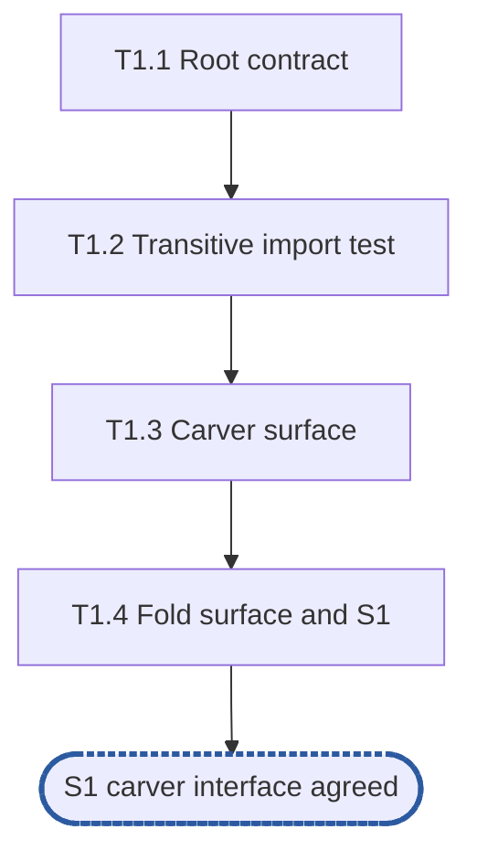

# Epic 1: carver v2 interfaces

**Sources:** [RFC 2](../docs/internals/rfcs/rfc-2-carver.md) §1.1 (the dependencies and the import
test), §1.2 (the split into the chunker, the carver and their packages, and the shapes of `Cut`
and `Chunk`), §1.3 (no interface, testable alone) and §5.1 (the fold's inputs and outputs, as
the pipeline supplies them). As signatures only, whose bodies are later epics': §2.1, §2.2 and
§2.4 (`Cut`), §3.2 and §3.7 (the settings value and its refusals), §4.1 to §4.3 (the chunk ID
and the block name), §5.2 (the block target's refusal), §5.4 (the short last block) and §5.5
(a plan holds no bytes), §5.7 (A4), §7 (`Cut`'s errors), §8 (C1, C11) and §10.2 (the stalled
reader). [RFC 0](../docs/internals/rfcs/rfc-0-data-lifecycle.md) §1.2, as #5774
amends it: contract and implementation, and the transitive import check. Cited, not owned:
[RFC 8](../docs/internals/rfcs/rfc-8-engine.md) §2.1, §2.6, §6.2, §6.3 and §6.6, the engine that calls this
surface; [RFC 6](../docs/internals/rfcs/rfc-6-block-metadata.md) §4.1 and §5.2, the commit a plan
becomes and its key budget. Every citation is `develop`'s text. The code lands on
`feat/storage-v2`, where `pkg/metadata/entity` exists, and the paths below are paths there.
**Track:** the team.
**Epic 1 estimate: 4 subtasks, 4 man-days.**
**Depends on:** no other epic of RFC 2. It builds on `pkg/metadata/entity` on `feat/storage-v2`
(`ChunkHash`, `BlockName`, `NamespaceID`, `FileID`), on `lukechampine.com/blake3` v1.4.1, already
in `go.mod` there, and on the RFC 0 §1.2 amendment, merged in #5774.
**Blocks:** E2, whose `internal/carvetest` adds its own import-test row and, holding plain bytes,
`int` and `[32]byte`, names none of the carver's types; E3, which fills `NewSettings` and `CheckTarget`, adds the settings value's derived fields and
declares `pkg/carver/section`; E4, which fills `Cut`, `ChunkID` and `BlockName`; E5, which fills
the fold. Outside RFC 2, the RFC 8 offload plan's epic 11 writes the engine's declared interface
over this surface at S1, its epic 15 is the first caller of every symbol here, and its epic 21
wires the subpackages; the RFC 4 plan's codec receives `ChunkID` and `BlockName` as functions;
the RFC 5 plan's chain ID is the 32-byte input `BlockName` takes.

---

## 1. Goal

Epic 1 freezes the surface of the carver and the block assembler, so the engine's offload
pipeline and RFC 4's codec can be written against it before any boundary is cut. It settles at
S1 everything the pipeline hands the fold, the key budget included, so S1 is final. Nothing here
cuts, hashes or packs: every body is a stub behind a final signature, and the one piece of real
code is the import test, which holds every later epic to RFC 2 §1.1 and RFC 0 §1.2 from its
first commit.

**At the end of the epic:**

- `pkg/carver`, the root, is the contract: the settings value's type, `Chunk`, the fold's input,
  configuration, plan and disposition types, and `ErrInvalidSettings`. It declares no function, no
  interface and no state (T1.1);
- an import test walks every package of `pkg/carver`, test packages included, and fails on any
  import its row does not allow, following the module's own packages transitively (T1.2);
- `pkg/carver/carve` declares the settings constructor, the check of a `Target` alone, `Cut`,
  `ChunkID` and `BlockName` (T1.3);
- `pkg/carver/assembler` declares the fold, its constructor and `Add` and `Finish` (T1.4);
- the surface is agreed with the RFC 8 offload plan's and the RFC 4 plan's authors: S1 (T1.4).

### 1.1 In scope

The exported surface of the root, `carve` and `assembler`, with stub bodies; the settings
value's sealed type; the fold's inputs as the pipeline supplies them (RFC 2 §5.1, P2 as
amended); the error set; the import test and the structural checks of the surface; the S1
review.

### 1.2 Out of scope

- The settings derivation and refusals, the gear tables and the boundary search, and
  `pkg/carver/section` with its import-test row: E3.
- `Cut`'s body, the chunk ID, the block name and its golden vector: E4.
- The fold's body, the block-target check with RFC 2 §5.2's `decision:` marker: E5.
- The reference chunker, the golden vectors and the suites: E2.
- The engine's declared interface over this surface, `Deps.Carver`, the per-namespace settings
  at the Carve state and the node's content wiring: the RFC 8 offload plan's epics 11, 15 and
  21, the RFC 2 plan's deferral-ledger row "Composing the carver into the engine".
- The dedup lookup, the adopted disposition and their two §5.7 rows: the deferral-ledger row
  "The dedup lookup and the adopted disposition".

### 1.3 Names used here

- **E1**, this epic.
- **E2**, epic 2, test foundations: the reference chunker, golden vectors, seeded inputs, the
  corpus fetch, `carver-allocs` and the nightly `fuzz` suite.
- **E3**, epic 3, the chunker: settings derivation and refusal, `Target`'s settings section, the
  gear tables, the boundary search. Track A.
- **E4**, epic 4, the carver and identity: `Cut`, artificial ends, errors, chunk IDs, block
  names. Track B.
- **E5**, epic 5, the block assembler: the fold, P1 to P6, the key budget, the short last block,
  the block-target range. Track C.
- **S1**, the carver interface agreed: the end of this epic, the RFC 8 offload plan's S1a. The
  team reviews every exported signature with the RFC 8 offload plan's and RFC 4 plan's authors.
- **The RFC 8 offload plan**, [`rfc-8-offload-engine-plan.md`](rfc-8-offload-engine-plan.md):
  its epic 11 is that plan's interfaces epic, epic 15 the offload pipeline, epic 21 its
  integration epic, which wires the node.
- **D1** to **D8** are this epic's decisions (§4). A decision of the RFC 2 plan is always written
  with the plan named ("the RFC 2 plan's D3").

## 2. How the general rules apply

The rules are those of
[the RFC 2 plan's §1.5](rfc-2-carver-plan.md#15-general-rules-for-each-epic), cited by number and
title and not copied.

| Rule | Subtasks | How |
| --- | --- | --- |
| rule 1, independent unit tests ([`CLAUDE.md`, "Writing tests"](../CLAUDE.md#writing-tests)) | T1.1 to T1.4 | each test reads the real tree: `go/build` for imports, `go/parser` for declarations, `reflect` for the plan's fields. No test double, and no internal interface for one to stand in for |
| rule 2, fuzz tests where relevant | none | no parser and no body: the constructor's fuzz target is E3's, `Cut`'s E4's, the fold's E5's |
| rule 3, observability follows RFC 25, with RFC 2's exception | T1.1 | no logger, registry or tracer anywhere. The settings value reports `Target`, `Min` and `Max`, which the engine reads for the `carver_chunk_size_bytes` buckets RFC 2 §2.3 asks for; deriving the series is the RFC 8 offload plan's epic 15 |
| rule 4, profiling | none | no goroutine, no descriptor and no hot path yet; the allocation counts land with E3 and E4 in E2's `carver-allocs` |
| rule 5, public interface and internals ([`CLAUDE.md`, "Verifying a change"](../CLAUDE.md#verifying-a-change)) | T1.1 to T1.4 | the structural tests read the packages as an importer sees them. Every value this surface carries is tested at its consumer once a body exists: a plan at the RFC 8 pipeline, a name and a chunk ID at RFC 4's codec |
| rule 6, known failures shrink | none | no suite here keeps a `known.yaml`, and no test lands red |
| rule 7, v2 ignores v1, and imports only what RFC 0 §1.2 allows | T1.2 | the import test enforces it transitively, per package, test packages included; v1's `pkg/block/carver` and `pkg/block/chunker` are on no row, and v1's `foreign_imports_test.go` is not the model. The root also imports `pkg/carver/internal/params` (D1), the carver's own value package |
| rule 8, real dependencies for properties of those dependencies | none | nothing here tests a property of BLAKE3, a disk or a host |
| rule 9, code comment conventions ([`CLAUDE.md`, "Code comments"](../CLAUDE.md#code-comments)) | T1.1, T1.4 | D1's `decision:` at the `Settings` alias; D5's `decision:` at `Add`. RFC 2 §6's `ponytail:` is E3's and §5.2's `decision:` E5's |
| rule 10, a test must be able to fail | T1.1 to T1.4 | every check runs over planted violations on every run, beside the real tree, so a rule that stopped refusing fails on its own table |
| rule 11, a symbol is exported only if the RFC's interface uses it | T1.1, T1.3, T1.4 | each deliverable names its first caller; the exported set is frozen at S1 |
| rule 12, each subtask creates only what it declares | all | `internal/params` lands with the alias that needs it and holds only what `Target`, `Min` and `Max` read; the gear table and the chunk-ID key join it with E3 and E4. Each package's import-test row lands with the subtask that creates the package. The stubs are the one exception, behind final signatures |

## 3. Requirements and invariants

Every obligation RFC 2 and RFC 0 place on this epic's declarations, numbered so subtasks and
tests can cite them. Where the behaviour behind a declaration is another epic's, the row says
which.

**The split and the imports**

| # | Requirement | Kind | Source | Subtasks |
| --- | --- | --- | --- | --- |
| R1 | The carver's production code depends only on the standard library, a BLAKE3 implementation, the metadata store's entity package and its own packages, and an import test enforces it transitively | MUST | RFC 2 §1.1; RFC 0 §1.2 ("Conformance is checked by a per-component import-graph test that follows imports transitively") | T1.2 |
| R2 | The root package is the contract: the value types and errors other components name. `Cut`, the chunk-ID and naming functions and the assembler live in subpackages, which only the node's content wiring imports; the engine imports only the root | invariant | RFC 2 §1.1; RFC 0 §1.2 | T1.1, T1.3, T1.4 |
| R3 | The contract holds no behaviour beyond pure functions and methods over its own value types and value-minting constructors, and imports only the standard library, libraries outside the set and other contracts; a unit that mixes in an implementation counts as one | MUST | RFC 0 §1.2 | T1.1, T1.2 |
| R4 | No package of the carver reaches another component's implementation, directly or through what it imports: not `pkg/carver/section` from the root, not `internal/node/content`, not `pkg/settings`, `pkg/metrics` or `pkg/health` | MUST NOT | RFC 0 §1.2; RFC 2 plan, §1.5 rule 7 | T1.2 |
| R5 | Test packages are walked too. RFC 0 lets a component's tests import implementations, but the carver's checks need no store, fake backend, temp directory, network, clock or goroutine, so its tests import only what its production code may, plus the carver's own test components | invariant | RFC 0 §1.2; RFC 2 §1.3; RFC 2 plan, §1.5 rule 7 | T1.2 |
| R6 | The entity package's types are used, never copied: a chunk's hash is `entity.ChunkHash`, a block's name `entity.BlockName`, the scope `entity.NamespaceID` | MUST NOT | RFC 0 §1.2 ("MUST NOT copy a provider's value types"); RFC 2 §1.1, §1.2; RFC 2 plan, D9 | T1.1, T1.3 |
| R7 | Neither layer declares an interface, and neither does the assembler: each is a concrete type or function, and the engine declares its own interface over them | invariant | RFC 2 §1.3; RFC 8 §2.1; RFC 2 plan, D2 | T1.1, T1.3, T1.4 |
| R8 | The carver keeps nothing between calls: no package-level state in the root, `carve` or `assembler` but error values | MUST NOT | RFC 2 §1.1, §1.2 ("Keeps between calls: nothing at all"); RFC 2 plan, §1.3 | T1.1, T1.3, T1.4 |

**`Cut` and its chunks**

| # | Requirement | Kind | Source | Subtasks |
| --- | --- | --- | --- | --- |
| R9 | A chunk is its file offset, its length and its hash | invariant | RFC 2 §1.2 | T1.1 |
| R10 | `Cut` takes a reader, the file offset of its first byte, the settings, a buffer the caller supplies, whether the stretch's end is real, and `emit`, called once per chunk with the chunk and its bytes; it returns how many bytes it consumed, and an error. E4 fills it | MUST | RFC 2 §1.2, §2.1, §2.4 ("the caller **MUST** tell `Cut` which") | T1.3 |
| R11 | `Cut` says plainly that the bytes handed to `emit` are good only for the length of that call, and that a caller keeping them copies them | MUST | RFC 2 §2.2 | T1.3 |
| R12 | A buffer shorter than `Max` is refused with an error, which this epic names. E4 refuses it | MUST | RFC 2 §1.2 | T1.3 |
| R13 | An error from the reader or from `emit` stops `Cut` and is returned, unwrapped (D6). E4 does it | MUST | RFC 2 §7 | T1.3 |
| R27 | A reader that keeps returning zero bytes and no error fails `Cut` after a bounded number of reads, with an error this epic names. E4 does it | MUST | RFC 2 §10.2; RFC 2 plan, D5 | T1.3 |

**The settings value**

| # | Requirement | Kind | Source | Subtasks |
| --- | --- | --- | --- | --- |
| R14 | A namespace configures one size, `Target`; `Min` and `Max` are derived, not configured. The value reports all three, since the caller sizes `Cut`'s buffer from `Max` | invariant | RFC 2 §3.2, §1.2 ("its size is the caller's to choose") | T1.1, T1.3 |
| R15 | The constructor takes the encryption flag and the chunking and chunk-ID keys as 32-byte arrays, so no other length can be passed | invariant | RFC 2 §3.7; RFC 2 plan, D4 | T1.3 |
| R16 | Invalid settings are refused with an error, never replaced by a default; only the constructor builds a settings value, so no inconsistent table and key can be passed to `Cut`. E3 refuses | MUST NOT | RFC 2 §3.7; RFC 0 §1.2 ("an invalid setting MUST be refused") | T1.1, T1.3 |
| R17 | A `Target` can be checked alone, with no key material, by the constructor and by a settings validator | invariant | RFC 2 §3.7 (the three `Target` refusals); RFC 2 plan, §1.3 | T1.3 |

**Identity**

| # | Requirement | Kind | Source | Subtasks |
| --- | --- | --- | --- | --- |
| R18 | A chunk's ID is a function of its bytes and its namespace's chunk-ID key, and of nothing else: no offset, file identity, length, settings profile or version is an input. E4 computes it | MUST NOT | RFC 2 §4.1, §8 C1 | T1.3 |
| R19 | A block's name is a function of the scope (the namespace ID's 16 raw bytes), a 16-byte nonce the caller draws, the 32-byte chain ID and the chunk IDs in block order; the function draws no nonce. E4 computes it | invariant | RFC 2 §4.2, §4.3; RFC 2 plan, D9 | T1.3 |
| R28 | A block plan, and the intent recorded for it, are keyed under one namespace and one chunk-ID key. The pass that folds the plan captured both at the offer, and the intent step refuses a plan whose namespace or key differs from the target store's; this epic's part is that one fold serves one pass (R24), so a plan inherits its pass's namespace and key (D8) | MUST | RFC 2 §4.3, §8 C11; RFC 8 §6.3 (Capture, Intent), §6.6 | T1.4 |

**The fold**

| # | Requirement | Kind | Source | Subtasks |
| --- | --- | --- | --- | --- |
| R20 | The fold takes, per chunk, its file, offset, length and hash, whether it is all zeros, the worst-case keys it adds to its block's commit (a zero ref's included, counting the existing refs it replaces) and the age of its oldest byte; and per pass the block target, the count cap `N`, the key budget `K`, a commit's per-block keys and its per-file keys | invariant | RFC 2 §5.1, P2, P4; RFC 8 §6.3 (Assemble); RFC 6 §5.2 | T1.1, T1.4 |
| R21 | In the first release the fold takes no dedup lookup, and adding a chunk cannot fail | invariant | RFC 2 §5.1 | T1.4 |
| R22 | The fold returns, per chunk, its disposition, zero ref or carried, and a sequence of block plans. A plan lists each carried chunk in block order with its hash and where its bytes sit in the offer, and the refs its commit writes, a chunk repeated within the block (P6) and the zero refs that join the block included | invariant | RFC 2 §5.1, P2, P3, P6; RFC 6 §4.1 | T1.1, T1.4 |
| R23 | A plan holds hashes and positions, never chunk bytes | MUST NOT | RFC 2 §5.5, §5.7 A4 | T1.1 |
| R24 | One fold serves one pass: it does no I/O, keeps nothing between passes and does not survive its pass, and the time it closes the pass at comes from the caller | MUST NOT | RFC 2 §5.1, §5.4, §1.3 ("no clock") | T1.4 |
| R25 | Closing the pass returns the short last plan with whether it is held back, so the caller keeps its extents dirty and reports none of them; the dispositions `Add` returned for its chunks count only once a plan is committed | invariant | RFC 2 §5.1, §5.4, P2 | T1.4 |
| R26 | A block target outside 1 MiB to 64 MiB is refused with an error, never clamped. The range is two root constants, so the startup check of the block-target setting, which the RFC 2 plan's deferral ledger gives the RFC 4 plan's epic 7, reads the same bounds without importing the fold; the fold's constructor refuses too, as a defence, in E5 | MUST | RFC 2 §5.2; RFC 2 plan, §6.1 deferral ledger | T1.1, T1.4 |

How each row is enforced once this epic lands, where no test of this epic can break it: R6 and
R15 by the compiler, since every signature names `entity`'s types and `[32]byte`; R10's
parameters, R19's inputs, R20 and R21 by the compiler at each caller, through the frozen
signatures; R16's "only the constructor builds" by Go's rule on `internal` packages (D1);
R12, R13, R18 and R27 by E4's tests, R16 and R17's refusals by E3's, R25 and R26 by E5's, R28's
refusal by RFC 8 §6.3's Intent state (the RFC 8 offload plan's epic 15), each named in that owner's document.
R11 and R23 have this epic's own tests (T1.3, T1.1).

The candidates of the owned sections that bind other epics are theirs: §1.2's "neither does the
other's job" (E3 and E4), §2.1's padding, §2.4's artificial end and §7's dropped part-chunk (E4),
§3.2's mask and mean (E3), §4.2's minting once and golden vector (E4, and RFC 8 §6.6 at the
Intent state), §5.1's lookup error (the deferral-ledger row of the dedup lookup).

## 4. Decisions this epic takes

- **D1, the settings value is a sealed type, named in the root and built only by `carve`.** RFC
  2 §1.1 puts the type in the contract, and its constructor lives in `carve` with the derivation; the engine
  holds one value per namespace and passes it to `Cut`. Go lets no package build or read another
  package's unexported fields, and exported fields would let anyone build a keyed table for a
  namespace that does not encrypt, which RFC 2 §3.2 and C10 forbid. So the struct lives in
  `pkg/carver/internal/params`, with unexported fields, and the root declares
  `type Settings = params.Settings`. Code outside `pkg/carver` can hold, copy and pass a value,
  and call its three exported methods (`Target`, `Min`, `Max`), but cannot import `params`, so
  it can neither build one nor read its derived fields; `carve` and the internal chunker reach
  them through `params`' package functions, which the internal rule keeps inside the tree.
  `params` holds data only and imports the standard library alone, so the root stays a contract
  (R3); the derivation lives in `carve` (E3). The zero value is refused: `Cut` answers
  `ErrInvalidSettings` (E4), and `ChunkID` panics on it, since only a caller that skipped the
  constructor holds one and it has no error to return. The value is passed by value: the gear
  table sits behind a pointer the value shares, read-only after construction. A `decision:` at
  the alias says the seal is Go's internal rule, not a check, and names its ceiling: code inside
  `pkg/carver` can still build a bad value, and `params` must stay a value package: if E4 keeps a
  pre-keyed hash state in the value to keep `Cut` allocation-free (§9 point 1), `params` gains the
  BLAKE3 import, which the entity package already brings to every importer, and nothing more.
  `ChunkID` takes the whole value rather than a key of its own: every caller, RFC 4's codec
  included, gets the function from the node's wiring, which closes over the namespace's value.
  Prior art: none found.
- **D2, positions are the entity package's file identity.** A chunk's place in the offer is its
  `entity.FileID` and its `Chunk`, so the fold compares files for §5.3's contiguity (A5) and charges
  per-file keys once per file, and the engine builds the commit (`kvstore.BlockCommit` on
  `feat/storage-v2`, whose per-file entries each name an `entity.FileID`) with no lookup table. A plan reuses the fold's
  input type, `ChunkInfo`, for both its lists, rather than a second position type. Prior art:
  `kvstore.BlockCommit` keeps carried chunks (`Chunks`) apart from per-file refs (`Files`)
  (checked), which is the split `BlockPlan`'s `Carried` and `Refs` follow.
- **D3, a plan with no carried chunk is the zero-ref commit.** RFC 8 §6.3 commits zero refs with
  no block to ride in one commit with no intent and no put. The fold returns them as a
  `BlockPlan` whose `Carried` is empty, so the pipeline has one output to read. Every other plan
  holds at least one carried chunk (RFC 2 P2). Which zero refs ride with which block, and when a
  zero-ref plan closes at `K`, is E5's. Prior art: none found.
- **D4, the fold's per-pass inputs are one root value, `AssemblerConfig`, and include the
  maximum age.** The engine computes every one of them (`K` from the store, the per-block and
  per-file keys from RFC 8 §6.3, the age from RFC 8 §6.2), and imports only the root, so the
  type it fills is the root's. RFC 2 §5.1 does not list the maximum age, but §5.4's "put once its
  oldest chunk's bytes reach the offload maximum age" cannot be decided without it, and `Finish`
  takes only the time. Prior art: none found.
- **D5, `Add` returns no error, and `ZeroRef` and `Carried` are the only dispositions.** RFC 2
  §5.1 as amended: no lookup, so nothing can fail and nothing is adopted. A `decision:` at `Add`
  says so and that its signature gains the lookup and the error with the dedup oracle, the
  deferral-ledger row that brings them back. The `Adopted` value lands then too, rather than a
  value no code can return now. Prior art: none found.
- **D6, the error set is one sentinel and the standard library's.** `carver.ErrInvalidSettings`
  for every refusal of RFC 2 §3.7 and §5.2, wrapped with the field and the rule; `io.ErrShortBuffer`
  for a buffer under `Max` (RFC 2 §1.2); `io.ErrNoProgress` for a reader that stalls (the RFC 2
  plan's D5); a reader's or `emit`'s error returned as it came (RFC 2 §7), so the engine labels
  `carver_errors_total`'s `source` from which side it handed over. A stub returns
  `errors.ErrUnsupported`, or the zero value where its signature has no error; nothing calls one
  before its epic lands. Prior art: `bufio` and `io` use these sentinels for the same conditions
  (from memory); the stub convention is RFC 23's epic 1 (checked).
- **D7, the import test is transitive over the module's packages and stops at the module's
  edge.** For each package it checks the direct imports against the package's row, then follows
  every import inside the module, the entity package's included, and fails when any package
  reached is not allowed to the one it started from. A module outside cannot import this one, so
  its imports are not followed; its own path must be on the row (BLAKE3 and
  `github.com/google/uuid`, which the entity package brings). A directory under `pkg/carver`
  with no row fails, so each later epic adds its package's row with the package. A row that
  allows the root also allows `pkg/carver/internal/params`, which the root brings with it (D1). Prior art:
  `pkg/journal/imports_test.go` and `pkg/engine/imports_test.go` on `feat/storage-v2` (checked):
  the same `go/build` walk with an allowlist per package, both direct only, which RFC 0 §1.2 now
  makes too weak.
- **D8, a plan names no namespace and no key; its pass does.** RFC 2 §4.3 has a plan and its
  intent name the namespace and chunk-ID key ID its chunk IDs were computed under. The engine's
  Capture state records both with the offer (RFC 8 §6.3), one fold serves one pass (R24), and
  the Intent state compares them with the target store's before any put, so carrying them in
  every `BlockPlan` would copy the pass's two values into each plan for a check that reads them
  from the pass. The settings value holds no key ID either: the key's ID is RFC 5's, and the
  carver takes only its bytes. Adding the fields later would change a frozen type, so the S1
  review confirms this with the RFC 8 offload plan's authors. Prior art: none found.

## 5. Target tree

```text
pkg/carver/
  doc.go                  T1.1  the contract: what the root holds and who imports what
  carver.go               T1.1  Settings (alias), Chunk, ChunkInfo, AssemblerConfig, BlockPlan,
                                Disposition, ErrInvalidSettings
  arch_test.go            T1.1  declarations: no function, interface or state; no bytes in a plan
                                T1.3, T1.4 add their packages' rows
  imports_test.go         T1.2  the transitive import rule, one row per package
  internal/params/
    params.go             T1.1  the settings struct, unexported fields, Target, Min, Max
  carve/
    carve.go              T1.3  NewSettings, CheckTarget, Cut, ChunkID, BlockName, stubs
  assembler/
    assembler.go          T1.4  Fold, New, Add, Finish, stubs
```

## 6. Subtasks

### T1.1 The root contract and its settings value

**Subtask T1.1 estimate: 1 man-days.**

- **Track:** the team. **Depends on:** none.
- **Covers:** R2, R3, R6 to R9, R14, R16, R20, R22, R23, R26.
- **Deliverables:**
  - `pkg/carver/internal/params`: `type Settings struct{ target, min, max int }` and its methods
    `Target() int`, `Min() int`, `Max() int`, each 0 on the zero value. E3 adds the gear table, the
    masks and the package function that builds a value; E4 the chunk-ID key. Consumed by the
    root's alias.
  - `pkg/carver`, consumed by T1.3, T1.4 and the RFC 8 offload plan's epic 15, and, for the two
    block-target constants, by the RFC 4 plan's epic 7's startup check of the setting:
    ```go
    // Settings is one namespace's chunking settings. Only carve.NewSettings builds one; the
    // zero value is refused. Target, Min and Max report its sizes.
    type Settings = params.Settings

    // Chunk is one chunk Cut emits.
    type Chunk struct {
        Offset int64            // file offset of its first byte
        Length int32            // at most Max
        Hash   entity.ChunkHash // its chunk ID (RFC 2 §4.1)
    }

    // ChunkInfo is one chunk as the fold takes it, in file order, file after file.
    type ChunkInfo struct {
        File   entity.FileID
        Chunk
        Zero   bool      // all zeros: a zero ref, never carried; set by the caller, which holds the bytes
        Keys   int       // worst-case keys it adds to its block's commit, the refs it replaces counted
        Oldest time.Time // when its oldest byte was written
    }

    // AssemblerConfig is one pass's limits.
    type AssemblerConfig struct {
        BlockTarget int64         // carried bytes per block, MinBlockTarget to MaxBlockTarget
        MaxChunks   int           // the block format's count cap N
        KeyBudget   int           // K, the most keys one commit may write
        BlockKeys   int           // keys every block's commit writes once
        FileKeys    int           // keys a commit writes once per file in it
        MaxAge      time.Duration // the offload maximum age; a short last block older than it is put
    }

    // BlockPlan is one block, or with no carried chunk the zero-ref commit (D3).
    type BlockPlan struct {
        Carried []ChunkInfo // each carried chunk once, in block order: the put reads these bytes
        Refs    []ChunkInfo // every ref its commit writes, in input order, repeats and zero refs included
    }

    // Disposition is what the fold did with one chunk.
    type Disposition uint8

    const (
        Carried Disposition = iota + 1 // in a block plan
        ZeroRef                        // all zeros: a ref with a zero hash, no block carries it
    )

    // The block target's range (RFC 2 §5.2): a target outside it is refused, never clamped.
    const (
        MinBlockTarget = 1 << 20  // 1 MiB
        MaxBlockTarget = 64 << 20 // 64 MiB
    )

    // ErrInvalidSettings refuses a setting RFC 2 §3.7 or §5.2 rules out; it is never replaced
    // by a default.
    var ErrInvalidSettings = errors.New("carver: invalid settings")
    ```
    The alias carries D1's `decision:`.
  - `pkg/carver/arch_test.go`, the structural checks, one row per package, which T1.3 and T1.4
    extend.
- **Acceptance criteria:**
  - The root declares no function, no interface and no package-level variable but
    `ErrInvalidSettings`; constants are allowed.
  - Outside `pkg/carver`, a `carver.Settings` can be held and passed, and cannot be built with
    fields or read beyond its three methods.
  - No type reachable from `BlockPlan` holds a byte slice.
- **Tests:** at the root as an importer reads it, which is where the engine meets it:
  `TestRootIsAContract` parses the root's files with `go/parser` and fails on any function,
  interface type or non-error variable, run beside planted declarations of each kind (catches
  behaviour or state slipping into the contract, R3, R7, R8); `TestPlanHoldsNoBytes` walks
  `BlockPlan`'s fields with `reflect` and fails on any `[]byte` (catches a plan that copies the
  bytes `emit` lent, R23): it allows only integers, booleans, arrays of bytes, `time.Time`,
  `time.Duration`, the entity package's types, and structs of `pkg/carver` and slices of them, walked recursively, so a `[]byte`, a
  `string`, an `any`, a pointer or an interface field fails, each run beside a planted struct
  holding one. No test double.
- **Rules:** as §2 says.

### T1.2 The transitive import test

**Subtask T1.2 estimate: 1.25 man-days.**

- **Track:** the team. **Depends on:** T1.1.
- **Covers:** R1, R3, R4, R5.
- **Deliverables:** `pkg/carver/imports_test.go`: `TestImportRule` walks every directory under
  `pkg/carver` with `go/build`, `testdata` skipped, and checks each package's imports, its test
  files' and its external test package's, files for another platform included, as D7 says. Two
  pure functions do the work, so planted violations test them with no tree: `forbidden(pkg,
  kind, imp string) string`, which answers a row's verdict, and `reach(graph map[string][]string,
  from string) []string`, which returns what a package reaches inside the module. The rows at
  the end of this subtask:

  | Package | May import, besides the standard library |
  | --- | --- |
  | `pkg/carver` | `pkg/carver/internal/params`, `pkg/metadata/entity` |
  | `pkg/carver/internal/params` | nothing |
  | any test file of the above | the same, and the package under test |

  And everywhere, through the entity package: `lukechampine.com/blake3`,
  `github.com/google/uuid`. T1.3 and T1.4 add their rows; E2, E3 add theirs with
  `internal/carvetest`, `internal/chunker` and `section`. Consumed by every later epic of this
  plan, whose packages it holds.
- **Acceptance criteria:**
  - The walk checks at least the two packages of T1.1, and fails on a directory with no row.
  - A package reaching, through the entity package or any other in the module, a package not
    on its row fails, and the failure names the chain of imports.
  - A test file importing `pkg/metadata/kvstore`, a store, fails, as RFC 2 §1.3 requires.
- **Tests:** at the rule's two functions, which `TestImportRule` applies to the real tree:
  a table of planted imports — the root importing `pkg/journal`, `carve` importing
  `pkg/carver/section`, a test importing `pkg/metadata/kvstore`, v1's `pkg/block/carver` — each
  must be refused with its reason (catches an allowlist that grew a wildcard, R1, R4, R5); a
  synthetic graph in which the entity package imports `pkg/metadata/kvstore` must make the root
  fail through it (catches a direct-only walk, the one the journal's and the engine's tests do,
  R1, R3). The graph is data, not a double.
- **Rules:** rule 7, this subtask. Others as §2 says.

### T1.3 The carver's surface

**Subtask T1.3 estimate: 0.75 man-days.**

- **Track:** the team. **Depends on:** T1.2.
- **Covers:** R2, R6 to R8, R10 to R19, R27.
- **Deliverables:** `pkg/carver/carve`, stub bodies (D6), and its rows in `imports_test.go`
  (the root, `internal/params`, `pkg/metadata/entity`, `lukechampine.com/blake3`) and
  `arch_test.go`. Consumed by the node's content wiring (the RFC 8 offload plan's epic 21), which
  is `NewSettings`' only caller, answering the engine's `Settings(ns)` with its value, and hands the
  other functions to the engine and the codec; and by E3 and E4, which fill them:
  ```go
  // NewSettings builds a namespace's settings from its Target, whether it encrypts and its two
  // keys. A namespace that does not encrypt passes a zero chunking key. It refuses, with
  // ErrInvalidSettings, a Target CheckTarget refuses, a zero chunk-ID key, a chunking key without
  // encryption, and encryption with a zero chunking key (RFC 2 §3.7). E3.
  func NewSettings(target int, encrypting bool, chunkingKey, chunkIDKey [32]byte) (carver.Settings, error)

  // CheckTarget refuses a Target that is not a power of two, below 64 KiB or above 4 MiB. It
  // needs no key, so a settings validator can call it. E3.
  func CheckTarget(target int) error

  // Cut cuts one unbroken stretch read from r, whose first byte sits at file offset base, into
  // chunks, calling emit once per chunk in order. The bytes handed to emit are borrowed: they
  // are good only until emit returns, and a caller that keeps them copies them. buf is the
  // caller's, at least s.Max() bytes, or Cut fails with io.ErrShortBuffer. realEnd says whether
  // the stretch ends for good; on an artificial end the tail after the last content-chosen
  // boundary is not emitted, and consumed says how far Cut cut. An error from r or emit stops
  // Cut and is returned as it came. E4.
  func Cut(r io.Reader, base int64, s carver.Settings, buf []byte, realEnd bool,
      emit func(carver.Chunk, []byte) error) (consumed int64, err error)

  // ChunkID is the chunk ID of p: BLAKE3's keyed hash under s's chunk-ID key, over p and
  // nothing else. It panics on a zero Settings (D1). E4.
  func ChunkID(s carver.Settings, p []byte) entity.ChunkHash

  // BlockName is the name of a block holding ids, in block order, under scope, for the put
  // attempt that drew nonce, with the chain ID chain (RFC 2 §4.2). E4.
  func BlockName(scope entity.NamespaceID, nonce [16]byte, chain [32]byte, ids []entity.ChunkHash) entity.BlockName
  ```
- **Acceptance criteria:**
  - `carve` declares no interface and no package-level variable.
  - `Cut`'s doc comment says that `emit`'s bytes are borrowed and must be copied to be kept.
  - The walk of T1.2 holds `carve` to its row.
- **Tests:** at `carve` as the wiring imports it: `arch_test.go`'s row for `carve` (catches
  state or an interface, R7, R8) and a check that `Cut`'s doc comment, read with `go/doc`,
  contains "borrowed" and "copies" (catches the contract RFC 2 §2.2 makes the carver state
  dropped from the one place a caller reads it, R11). No test calls a stub: its answer is not a
  behaviour.
- **Rules:** as §2 says.

### T1.4 The fold's surface, and S1

**Subtask T1.4 estimate: 1 man-days.**

- **Track:** the team. **Depends on:** T1.3.
- **Covers:** R2, R7, R8, R20 to R22, R24 to R26, R28.
- **Deliverables:**
  - `pkg/carver/assembler`, stub bodies (D6), and its rows in `imports_test.go` (the root,
    `pkg/carver/internal/params` with it, and `pkg/metadata/entity`) and `arch_test.go`. Consumed by the node's content wiring and the RFC
    8 offload plan's epic 15, which folds through the engine's own interface, and by E5:
    ```go
    // Fold packs one pass's chunks into block plans (RFC 2 §5). One Fold serves one pass and
    // does no I/O.
    type Fold struct{ /* unexported */ }

    // New starts a pass's fold. It refuses a BlockTarget outside 1 MiB to 64 MiB with
    // ErrInvalidSettings, never clamping it. E5.
    func New(c carver.AssemblerConfig) (*Fold, error)

    // Add folds in the next chunk, in file order, and returns the plans it closed and its
    // disposition. It takes no lookup and cannot fail (D5). E5.
    func (f *Fold) Add(c carver.ChunkInfo) ([]carver.BlockPlan, carver.Disposition)

    // Finish closes the pass at now and returns its last plan, nil if none is open. held is true
    // when that plan is short and held back: the caller puts none of it, reports none of its
    // extents and leaves them dirty for the next pass. E5.
    func (f *Fold) Finish(now time.Time) (last *carver.BlockPlan, held bool)
    ```
    `Add` carries D5's `decision:`.
  - The S1 review: every exported symbol of T1.1, T1.3 and this subtask walked with the RFC 8
    offload plan's and the RFC 4 plan's authors against its first caller, and their findings
    folded before the pull request merges.
- **Acceptance criteria:**
  - `assembler` declares no interface and no package-level variable.
  - The import rule holds `assembler` to its row.
  - Each exported symbol has a first caller named in a Deliverables line here or in the RFC 8
    offload plan, and the review's changes are folded: S1.
- **Tests:** `arch_test.go`'s row for `assembler` (catches an `Assembler` interface declared
  beside the type, which RFC 2 §5.1's indicative block invites, R7, and state, R8). R20 to R22's
  shapes are held by the compiler at the engine's interface; their behaviour by E5's §5.7 checks.
- **Rules:** rule 11, this subtask's review. Others as §2 says.

## 7. Order of work



Checkpoint after T1.2: every later package lands under the import rule. The order is one path:
each subtask adds the rows of the packages it creates to the tests the one before it built.

## 8. Suggested pull requests

| PR | Subtasks | Man-days | After | Why together |
| --- | --- | --- | --- | --- |
| 1 | T1.1, T1.2, T1.3, T1.4 | 4 | — | the surface S1 reviews in one piece, with the import rule that holds it |

A suggestion only: one pull request per subtask works as well, with S1 on the last.

## 9. Open points

1. **`lukechampine.com/blake3` allocates and starts goroutines on a chunk-sized write.** Measured
   on v1.4.1 with `testing.AllocsPerRun`: a keyed hash of 8 KiB makes 15 allocations, of 300 KB
   54, and `Hasher.Write` spawns goroutines through `sync.WaitGroup` once its input spans several
   BLAKE3 chunks (`blake3.go`, `guts/node.go`); deriving a keyed 2,048-byte table makes 7 or 8, depending on the hasher's output size. RFC 2
   §10.4 wants `Cut` to allocate nothing and §1.3 a check with no goroutine, and the RFC 2 plan's
   §1.1 and rule 4 assume the library allows both. The settings value (D1) can hold what is
   derived once, which takes the table's 8 out of `Cut`, but not the hash's. E4 decides between
   hashing through the library's exported `guts` primitives one BLAKE3 chunk at a time, another
   BLAKE3 implementation, and an RFC 2 amendment; E2's BLAKE3 modes check is where the choice is
   first exercised.
2. **RFC 8 §2.1's carver row names only `Cut` and the fold.** The engine also reads `Max` and
   mints names with `BlockName` at its Intent state; RFC 4's codec gets `ChunkID` and `BlockName`
   from the content wiring (RFC 4 §4.3). The engine never calls `NewSettings` and never holds key material: the node's content
   wiring calls `NewSettings` for each namespace and answers the engine's `Settings(ns)` with the
   value (the RFC 8 offload plan's epic 11, D5). The RFC 8
   offload plan's epic 11 writes the engine's declared interface over this surface at S1, and
   amends §2.1's row if it holds these calls.
3. **The engine's import walk reaches `pkg/carver/internal/params` through the root** (D1). It is
   the carver's own value package, part of the contract; the RFC 8 offload plan's epic 15, which
   adds the root to that walk, allows it with the root.
