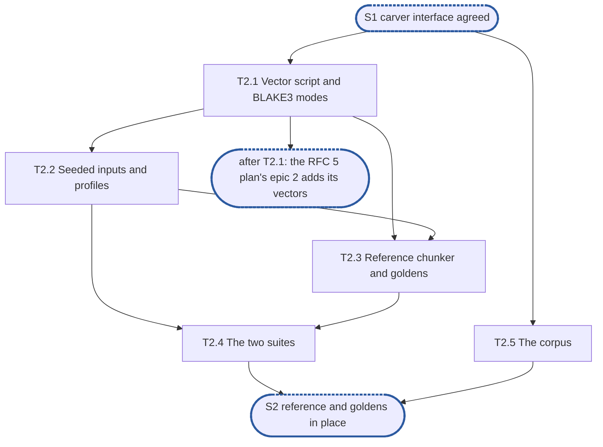

# Epic 2: carver v2 test foundations

**Sources:** [RFC 2](../docs/internals/rfcs/rfc-2-carver.md) §1.3 (a check needs no fixture),
§10.1 (the golden, differential, property and architecture kinds, as the inputs they need), §10.2
(the content kinds and profiles every check reaches) and §10.6 (the suites). As the vectors and the
second implementation their checks compare against, whose checks are later epics': §3.2 (the
derivation, exactly), §3.7 (the supported `Target`s), §4.1 (the chunk ID), §4.2 (the golden name),
§9's derivation-golden and golden-name rows and its "MUST NOT stand in" paragraph, §9.1 (seeded
input and the corpus), §10.4 (the per-change counts' inputs). [RFC 5](../docs/internals/rfcs/rfc-5-transforms.md)
§2.8, the chain ID's byte table, which the golden name's chain ID is computed from.
[RFC 0](../docs/internals/rfcs/rfc-0-data-lifecycle.md) §1.2, as #5774 amends it: what a test
package may import. [RFC 29](../docs/internals/rfcs/rfc-29-test-harness.md) §4.9: adding a suite and
naming it in the RFC. Every citation is `develop`'s text. The code lands on
`feat/storage-v2`, where E1 creates `pkg/carver` and `test/suites.yaml` has the option form
`carver-allocs` follows, and the paths below are paths there.
**Track:** the team.
**Epic 2 estimate: 5 subtasks, 8.5 man-days.**
**Depends on:** **S1**, the end of E1: `pkg/carver/imports_test.go` (E1's T1.2), to which this epic
adds the rows of the packages it creates. Nothing else of E1: the test components name none of the
carver's types (D9). `lukechampine.com/blake3` v1.4.1, in `go.mod` on `feat/storage-v2`.
**Blocks:** E3, which checks its gear tables against `Vectors`, its boundary search against the
reference chunker and the golden boundaries, and lands its allocation counts and fuzz targets in the
two suites; E4, which checks the chunk ID and the block name against `Vectors`, `Cut` against the
golden boundaries and hashes, and cuts the seeded inputs; E5, which lands its fuzz targets and its
memory check in the two suites; E7, which runs K1 to K5 over the seeded inputs and the corpus.
Outside RFC 2, the RFC 5 plan's epic 2 (its D11) adds RFC 5's vectors to this epic's
script with its chain-ID encoder, and checks its Go code with the library this epic holds to
BLAKE3's published vectors; the RFC 5 plan's epic 4 reads the corpus through the layout of D8 for
its benchmarks.

---

## 1. Goal

Epic 2 gives every later epic of RFC 2 something to be wrong against: bytes computed by an
implementation the code under test does not share, a second boundary function written from RFC 2
§3.2's text, seeded inputs of every content kind §10.2 names, and the two suites the checks run in.
Nothing here cuts, hashes or packs for production; every test of this epic is green when it lands,
because no suite of RFC 2 keeps a known-failure file.

**At the end of the epic:**

- one script, run by hand, writes the golden gear tables, a chunk ID and a block name with its
  chain ID, computed with the BLAKE3 team's Python binding, and a Go test on every pull request
  recomputes each of them and holds `lukechampine.com/blake3`'s three modes to BLAKE3's published
  vectors (T2.1);
- `carvetest` streams seeded input of each of §10.2's content kinds, the same bytes on any machine,
  with no allocation per read (T2.2);
- a reference chunker, literal from §3.2, agrees with hand-built cases that pin each clause of the
  derivation, and has written the committed golden boundaries of every supported `Target` (T2.3);
- `unit`'s `carver-allocs` option runs the allocation counts on every pull request, and the shared
  nightly `fuzz` suite runs its first target; RFC 2's suites paragraph names both (T2.4);
- a fetch caches the pinned corpus under one directory, and a check that needs it skips when that
  directory is not given (T2.5).

### 1.1 In scope

The vector script and its Go check; the BLAKE3 modes check; the seeded inputs and the supported
profiles; the reference chunker and the golden boundaries; `unit`'s `carver-allocs` option and the
nightly `fuzz` suite with its first target; RFC 2's suites paragraph and `docs/internals/testing.md`;
the corpus fetch, cache and its layout; the import-test rows of the packages this epic creates.

### 1.2 Out of scope

- The checks the vectors and the reference stand behind: §9's chunker rows, B1 to B5, the warm-up
  equivalence, the differential and property tests of the chunker, §10.4's average and edit
  stability, the regression checks of RFC 2 Appendix A.1 and A.2: E3. §9's carver and name rows,
  the golden name's failing build, §10.2's readers and stretch shapes, §10.3's fault sweep: E4.
- The allocation counts themselves, beyond the seeded reader's: E3 and E4 for the boundary search
  and `Cut`, E5 for the fold's memory; each lands in `carver-allocs` by name (D7).
- The `carver` group, its `carver-bench` suite, the second architecture, the full-size fault sweep
  and K1 to K5's runs, the corpus option that runs K4 and K5: E7.
- RFC 5's chain-ID, envelope, fingerprint and key vectors, and the Go check of them in
  `transformtest`: the RFC 5 plan's epic 2. This epic gives its script the chain-ID encoder they use.
- Choosing what makes `Cut` allocation-free given `lukechampine.com/blake3`'s allocations on long
  writes: E4 (§9 point 2).

### 1.3 Names used here

- **E1**, epic 1, interfaces: the root contract, `carve` and `assembler` stubbed, and the transitive
  import test `pkg/carver/imports_test.go`, one row per package.
- **E2**, this epic.
- **E3**, epic 3, the chunker: settings derivation and refusal, `Target`'s settings section, the gear
  tables, the boundary search. Track A.
- **E4**, epic 4, the carver and identity: `Cut`, artificial ends, errors, chunk IDs, block names.
  Track B.
- **E5**, epic 5, the block assembler. Track C.
- **E7**, epic 7, E2E green: the benchmarks on the reference box, the second architecture and the
  full-size runs, in the `carver` group's `carver-bench` suite.
- **S1**, the carver interface agreed: the end of E1.
- **S2**, reference and goldens in place: the end of this epic, where E3, E4 and E5 start.
- **The RFC 5 plan**, [`rfc-5-transforms-plan.md`](rfc-5-transforms-plan.md): its epic 2 adds
  RFC 5's vectors to this epic's script, and its epic 4 benchmarks over this epic's corpus.
- **D1** to **D9** are this epic's decisions (§4). A decision of the RFC 2 plan is written with the
  plan named ("the RFC 2 plan's D6").

## 2. How the general rules apply

The rules are those of
[the RFC 2 plan's §1.5](rfc-2-carver-plan.md#15-general-rules-for-each-epic), cited by number and
title and not copied.

| Rule | Subtasks | How |
| --- | --- | --- |
| rule 1, independent unit tests ([`CLAUDE.md`, "Writing tests"](../CLAUDE.md#writing-tests)) | all | each test component is checked against something it does not share: the vectors against a Go recomputation and BLAKE3's published vectors, the reference against hand-built tables, the inputs against pinned bytes, the fetch against a real HTTP server on `127.0.0.1:0` under `t.TempDir()`. No test double |
| rule 2, fuzz tests where relevant ([`CLAUDE.md`, "Writing tests", "By kind"](../CLAUDE.md#writing-tests)) | T2.4 | `FuzzReferenceBounds`, the `fuzz` suite's first target: seeded input of a fuzzed kind, length, `Target` and gear table into the reference, asserting C4's bounds, that the chunks tile the input and that re-cutting from a chunk end gives the same later ends. Nothing here parses input off a disk or a wire: `LoadVectors` reads a committed file every test reads, which a malformed edit fails at once |
| rule 3, observability follows RFC 25, with RFC 2's exception | none | test components only: no logger, registry or tracer |
| rule 4, profiling | T2.2, T2.4 | the seeded reader allocates nothing per `Read` (`TestAllocsSeededInput`), so the counts E3, E4 and E7 take over it count only the carver; it is `carver-allocs`'s first test. No component starts a goroutine or holds a descriptor; the corpus fetch, which does, runs in no per-change check |
| rule 5, public interface and internals ([`CLAUDE.md`, "Verifying a change"](../CLAUDE.md#verifying-a-change)) | T2.1, T2.3 | the vectors and the golden boundaries are checked where E3 and E4 read them, through `LoadVectors` and `LoadBoundaries`, not only where the script writes them |
| rule 6, known failures shrink | none | `unit` and `fuzz` keep no `known.yaml`; every test lands green |
| rule 7, v2 ignores v1, and imports only what RFC 0 §1.2 allows | T2.1, T2.3, T2.5 | `carvetest` imports the standard library alone, and its tests BLAKE3 and `internal/prof` besides; every carver package's tests may import `carvetest` and `internal/prof`, a row T2.1 widens; `carvetest/corpus` and its fetch import the standard library alone; no production package of the carver imports either. Each row lands in E1's `imports_test.go` with its package. v1's `pkg/block/chunker` and its tests are not read for the reference (§1.5 rule 7) |
| rule 8, real dependencies for properties of those dependencies | T2.1, T2.5 | BLAKE3's properties are checked against BLAKE3's own published vectors and its team's Python binding, not against a fake; K4 and K5 run on real files of the kinds §9.1 names, fetched and pinned. The second architecture is E7's |
| rule 9, code comment conventions ([`CLAUDE.md`, "Code comments"](../CLAUDE.md#code-comments)) | T2.3, T2.5 | D3's `decision:` at the reference chunker; D8's `ponytail:` at the fetch |
| rule 10, a test must be able to fail | all | each test names the planted break that turns it red: a vector byte changed, a reference clause moved by one, the seed stream changed, a hash mismatch served by the test server |
| rule 11, a symbol is exported only if the RFC's interface uses it | none | `carvetest` is internal and outside S1's frozen surface; each export names the epic that calls it |
| rule 12, each subtask creates only what it declares | all | each package lands with the subtask whose test uses it. The corpus is the one piece whose consumers are other epics (E7, and the RFC 5 plan's epic 4), as the RFC 2 plan's D7 places it here so both reuse one fetch; T2.5's own test is its fetch against a local server |

## 3. Requirements and invariants

Every obligation RFC 2 and the sources above place on this epic's components, numbered so subtasks
and tests can cite them. Where the check that reads a component is another epic's, the row says so.

**The vectors**

| # | Requirement | Kind | Source | Subtasks |
| --- | --- | --- | --- | --- |
| R1 | The unkeyed gear table, a keyed table under a fixed chunking key and one chunk ID are committed bytes computed from §3.2's text by an implementation the code under test does not share | test row | RFC 2 §9 (derivation golden), §3.2; RFC 2 plan, D6 | T2.1 |
| R2 | The golden name: a fixed non-empty scope, nonce, chain ID and chunk-hash list, and the name they give, with the scope's canonical encoding, one length byte `0x10` then the namespace ID's 16 raw bytes | MUST | RFC 2 §4.2, §9 (golden name) | T2.1 |
| R3 | The golden name's chain ID is computed from RFC 5 §2.8's byte table by the independent implementation, never committed as opaque bytes, and its length byte is `0x20` | test row | RFC 2 §9 (golden name), §4.2; RFC 5 §2.8 | T2.1 |
| R4 | One chain-ID encoder serves the golden name and RFC 5's chain-ID vectors, so the two cannot disagree | invariant | RFC 2 plan, D6; RFC 5 §2.8 | T2.1 |
| R5 | The BLAKE3 library's three modes, the plain hash, the keyed hash and key derivation, each with extended output, give BLAKE3's published values, over inputs shorter and longer than one BLAKE3 chunk | test row | RFC 2 §3.2, §4.1, §4.2, §10.1 (Architecture: "BLAKE3 takes different code paths"); RFC 2 plan, §1.4 | T2.1 |
| R6 | A changed vector fails the build: every committed vector and golden boundary is checked by `unit` on every change | MUST | RFC 2 §4.2, §10.1 (Golden vectors), §10.4 | T2.1, T2.3 |
| R7 | A vector decodes to the same values on any architecture: gear-table words are read little-endian from the committed bytes, never through the host's byte order | invariant | RFC 2 §3.2 ("256 little-endian 64-bit words"), §3.1 B2 | T2.1 |

**The second implementation**

| # | Requirement | Kind | Source | Subtasks |
| --- | --- | --- | --- | --- |
| R8 | The reference follows §3.2's derivation literally: fingerprint `fp ← (fp << 1) + G[b]` mod 2⁶⁴; a byte is a boundary when the top *m* bits of `fp` are zero; *m* is *t* + 1 while the chunk's length before the byte under test is under `Target`, and *t* − 3 from `Target` on; a passing byte is the last of its chunk; the first byte tested is at index `Min` − 1; a chunk reaching `Max` ends there; `Min` is `Target` / 4 and `Max` 4 × `Target` | MUST | RFC 2 §3.2 | T2.3 |
| R9 | The reference is a second implementation of the boundary function: it shares no code with the chunker, so two implementations over the same random input can be required to emit identical chunks | MUST | RFC 2 §10.1 (Differential), §1.3; RFC 2 plan, §1.4 | T2.3 |
| R10 | The reference's chunks hold C4's bounds and tile the input: none longer than `Max`, none shorter than `Min` but the last | invariant | RFC 2 §3.1 B3, §8 C4 | T2.3, T2.4 |
| R11 | Golden boundaries: a fixed seed per supported profile, its boundaries and chunk hashes committed, under the unkeyed and a keyed table | test row | RFC 2 §10.1 (Golden vectors); D5 | T2.3 |

**The inputs**

| # | Requirement | Kind | Source | Subtasks |
| --- | --- | --- | --- | --- |
| R12 | Every supported profile is offered: each power-of-two `Target` from 64 KiB to 4 MiB, so no check runs at one fixed profile only | MUST NOT | RFC 2 §9 ("One fixed profile MUST NOT be the only settings under test"), §3.7, §10.2 (Settings) | T2.2 |
| R13 | The inputs reach §10.2's content kinds: random data; zeros; a repeating pattern of period 64; repeated ASCII text of period 44; a period above 64 (4 KiB); random data with a repetitive region in the middle | MUST | RFC 2 §10.2 (Content), §3.8 | T2.2 |
| R14 | Seeded random input is offered for the size checks apart from the repetitive kinds, so compressible or repetitive data is never the only input a size check can reach | MUST NOT | RFC 2 §9 ("Compressible or repetitive data MUST NOT be the only input"), §9.1 | T2.2 |
| R15 | The same seed gives the same bytes in any process, on any machine and any toolchain | invariant | RFC 2 §3.5, §10.1 (Golden vectors: "a fixed seed") | T2.2 |
| R16 | The inputs stream: 256 MiB or 64 MiB is read with no allocation per read and no buffer of the input's size, so a count taken over them counts only the carver | bound | RFC 2 §10.4 (average over 256 MiB; allocations), §9.1 K1, K2 | T2.2 |

**No fixture, and the corpus**

| # | Requirement | Kind | Source | Subtasks |
| --- | --- | --- | --- | --- |
| R17 | A check written with these components needs no store, fake backend, temp directory, network, clock or goroutine: the components a per-change check imports hold none | MUST | RFC 2 §1.3, §9 | T2.1, T2.2, T2.3 |
| R18 | The corpus is real files of several kinds, source trees, VM images and media, fetched once and pinned, so a change of profile compares against the last run on the same bytes | test row | RFC 2 §9.1 K4, K5; RFC 2 plan, D7 | T2.5 |
| R19 | No per-change check fetches the corpus: a check that needs it skips when it is not provided, and the skip names how to provide it | MUST NOT | RFC 2 §10.4 ("which no check may do"), §1.3; [`CLAUDE.md`, "Writing tests"](../CLAUDE.md#writing-tests) (a missing backend is a skip naming its environment variable) | T2.5 |
| R20 | The test components are imported only by tests: no production package of the carver imports them, and they import nothing a production row forbids but what a test needs | MUST NOT | RFC 0 §1.2 (a component's tests may import implementations); RFC 2 §1.1; RFC 2 plan, §1.5 rule 7 | T2.1, T2.5 |

**The suites**

| # | Requirement | Kind | Source | Subtasks |
| --- | --- | --- | --- | --- |
| R21 | The allocation counts run on every pull request in `unit`'s option named for the carver, `carver-allocs`, and skip under the race detector, so that option is the only place they count | invariant | RFC 2 §10.6, §10.4; RFC 2 plan, §1.4 | T2.2, T2.4 |
| R22 | Fuzzing past the seed corpus runs in a shared nightly fuzz suite, `fuzz`; the seeds run in `unit` | invariant | RFC 2 §10.6, §10.1 (Properties); RFC 2 plan, §1.4 | T2.4 |
| R23 | RFC 2's suites paragraph names each suite and option registered, and says which planned checks no suite runs yet | invariant | RFC 29 §4.9 (R11); RFC 2 §10.6 | T2.4 |

How each row is enforced once this epic lands, where no test of this epic can break it: R2's
"failing build" for the name and R1's for the tables and chunk ID by E4's and E3's checks against
`Vectors`, and here by T2.1's recomputation (R6); R9's identical chunks by E3's differential
property; R14's "size check" by E3's §9 rows, which this epic only supplies; R20 by E1's
`imports_test.go`, with the rows T2.1 and T2.5 add; R17 by the same rows, which admit no store,
no backend and no clock package, and by review for goroutines and temporary directories; R4 by
the RFC 5 plan's epic 2, whose vectors call `encode_chain` and whose Go check recomputes them; R23
by `lint-repo`'s `dt docs --check` for a name the registry lacks, and by
review for a suite the paragraph leaves out.

The candidates of the owned sections that bind other epics are theirs: §1.3's "build the settings,
hand `Cut` a byte slice and a closure" as a way of writing checks (E3, E4, E5); §10.1's
differential, property and fault kinds (E3, E4); §10.2's readers, stretch shapes, buffer edges and
settings edges (E3, E4, E5); §10.3 (E4, E7 at full size); §10.4's average, allocations and edit
stability (E3, E4); §10.6's benchmarks, full-size sweep, second architecture and K4/K5 runs (E7);
§4.2's "a changed vector MUST fail the build" as a test of the name function (E4).

## 4. Decisions this epic takes

- **D1, one script, BLAKE3's own binding, a Go check on every pull request.** The script is
  `pkg/carver/internal/carvetest/gen_vectors.py`, Python 3 with the `blake3` package, the BLAKE3
  team's binding of their Rust implementation, pinned in the script's header with the command
  that runs it; the RFC 5 plan's epic 2 adds the
  libraries its own vectors need (its D11 names `cryptography`). It writes `testdata/vectors.json` beside it;
  CI does not run it, since a per-change check may not fetch a toolchain. The script holds one
  `encode_chain` function, RFC 5 §2.8's byte table, which the golden name's chain ID uses and
  RFC 5's chain-ID vectors call (R4); the RFC 5 plan's epic 2 adds its vectors to the same script,
  written to its own `transformtest` file, since `pkg/transform` cannot import an `internal`
  package of the carver. `vectors_test.go` recomputes every value from the file's inputs with
  `lukechampine.com/blake3` and a Go copy of the chain encoding for the one chain the name vector
  uses, so a hand edit of the file, or a script that drifts from §3.2 and §4.2, fails `unit`. The
  Go recomputation is the second implementation, not the first: what the file pins is the
  Python binding's answer, and the Go side agrees with it or fails. Prior art: BLAKE3's own
  `test_vectors.json`, written by its reference implementation; Wycheproof's vectors with a check
  in each consumer (from memory).
- **D2, the library's modes are checked against BLAKE3's published vectors, copied in.** BLAKE3's
  `test_vectors/test_vectors.json` is committed as `testdata/blake3/test_vectors.json`, with the
  upstream commit and its licence (CC0 1.0 or Apache 2.0) named in the test's comment. It covers
  every input length from 0 to 102,400 bytes that the BLAKE3 tree splits differently, for the
  plain hash, the keyed hash under its 32-byte key and key derivation under its context, each with
  131 bytes of extended output. `TestBLAKE3Modes` checks `lukechampine.com/blake3` against every row: the plain
  hash through `New(131, nil)` and `XOF`, with `Sum256` against its first 32 bytes; the keyed hash
  through `New(131, key)` and `XOF`; key derivation through `DeriveKey` into a 131-byte slice, which
  fills it from the extended output. It checks values,
  not cost: what the library allocates is E4's choice (§9 point 2). Prior art: `lukechampine.com/blake3`
  v1.4.1 tests itself against a 22-case subset of that file, up to 100,000 bytes, with the context
  written into `blake3_test.go` (checked); the full copy here adds the lengths it skips and runs
  them on this repository's own architectures (RFC 2 §10.1, Architecture). BLAKE3's reference
  implementations run the full file (from memory).
- **D3, the reference is the derivation read aloud, slowly.** `carvetest.Boundaries` takes the gear
  table as an argument and is called with `Vectors`' tables, so it shares neither E3's code nor
  E3's derivation of the table nor BLAKE3. It runs one byte at a time and builds the fingerprint
  from each chunk's first byte, the reading of §3.2 with nothing optimised, so it is also the side
  of §9's warm-up equivalence row that warms from the chunk start, which E3 compares its 64-byte
  warm-up against. A `decision:` at the function says that warming from the chunk start is
  deliberate, that §3.4's "MUST NOT warm it from the start of the chunk" binds the shipped chunker
  and not this oracle, and that it is withdrawn if the reference ever ships. It is written by an
  engineer other than E3's (the RFC 2 plan's §1.4). Prior art: none found.
- **D4, seeded input is `math/rand/v2`'s ChaCha8.** The standard library's ChaCha8 is a specified
  stream (C2SP's `chacha8rand`), not an implementation detail, and its `Read` fills a slice with no
  allocation. A seed is a `uint64`, spread into the 32-byte ChaCha8 seed little-endian. The pinned
  prefix of D5's golden seed is a test (T2.2), so a toolchain that changed the stream would fail
  there before it moved every golden boundary. Patterned kinds draw their period's bytes from the
  same seed. Prior art: Go's own `math/rand/v2` tests check ChaCha8 against C2SP's published `chacha8rand`
  vector (from memory).
- **D5, golden boundaries come from the reference, written with `-update`.** `testdata/
  boundaries.json` holds, for each supported `Target` and for the unkeyed table and the keyed table
  of `Vectors`, the seed, the length, every chunk end and every chunk's keyed hash under `Vectors`'
  chunk-ID key. The input is 16 × `Target` of seeded random bytes, about 16 chunks per profile and
  256 MiB in all, which the reference reads in well under a minute under `-race`.
  `go test ./pkg/carver/internal/carvetest -run '^TestGoldenBoundaries$' -update` rewrites it; the
  test compares otherwise. The hashes are computed with `lukechampine.com/blake3`, the library
  E4's `Cut` will call, so they
  are not an independent oracle for BLAKE3: they pin which bytes each chunk covers and under which
  key, and D2 and D1 hold the library itself to BLAKE3. Prior art: Go's `-update`
  flag for golden files, as `cmd/gofmt`'s tests use it (from memory).
- **D6, the `fuzz` suite is a list of commands, one `go test -fuzz` each.** `go test -fuzz` takes
  one target in one package, so each target is one line of the suite's `cmd` list,
  `go test -run=^$ -fuzz=^<Name>$ -fuzztime=10m <package>`, and `dt` runs every command of a list
  even after one fails. The list ends with one command that copies every new file under a
  `testdata/fuzz/` directory (`git ls-files -o`) into `{out}`, since `go test -fuzz` writes a
  crasher there and prints only its path, which dies with the runner; its owner commits it as a
  seed (`CLAUDE.md`, "By kind"). `tier: nightly`, `format: exit`, which runs the list as one test,
  so `timeout.test` and `timeout.cell` both cover every target's ten minutes and build, and the
  RFC 4, 5 and 8 plans raise both as they add lines. Prior
  art: OSS-Fuzz runs each target for a fixed time budget and keeps crashers as regression inputs
  (from memory); `lint-go`'s command list on `feat/storage-v2` (checked).
- **D7, `carver-allocs` runs tests by a name prefix.** Its command is
  `go test -timeout=5m -run=^TestAllocs ./pkg/carver/...`, unquoted, since `dt` splits a
  command on spaces with no shell,, with no race detector, so E3, E4 and E5
  add a count by naming its test `TestAllocs…`, with no registry change. Every such test skips under
  the race detector through `internal/prof.RaceEnabled`, the constant the adapters' and the
  journal's allocation tests read on `feat/storage-v2`, so `unit`'s raced run skips it; only the
  carver's test files import it, which RFC 0 §1.2 allows a component's tests.
  Prior art: `adapter-allocs` and `journal-conformance-norace` on
  `feat/storage-v2`, which list their packages or names (checked); a prefix keeps the list from
  falling behind the tests.
- **D8, the corpus: one directory, three kinds, one fetch.** The cache is the directory named by
  `DITTOFS_CORPUS_DIR`; each file sits at `$DITTOFS_CORPUS_DIR/<kind>/<name>`, with the kinds
  `source`, `vm` and `media`. That layout is the contract other plans read: the RFC 5 plan's epic 4
  reads the files directly, since `carvetest` is internal to the carver. `corpus.Dir(tb)`
  skips when the variable is unset, naming it; a file missing from a set directory fails the
  test that opens it. The fetch command, `go run ./pkg/carver/internal/carvetest/corpus/fetch`,
  fills the directory. Each entry pins two SHA-256s, of what is downloaded and of the file stored;
  a `.gz` is stored decompressed, written to a temporary name and renamed once both match, and a
  file already present is hashed again and refetched when it differs, so a run reads the bytes the
  last one read. `DITTOFS_CORPUS_DIR` joins `testOnlyEnvNames` in `pkg/bootstrap/drift_test.go`,
  whose check fails on a `DITTOFS_` name it does not list. The entries: `source/linux-6.6.tar`,
  the Linux 6.6 source tarball
  from kernel.org, about 1.4 GB once decompressed, which K4's 1 GiB file needs; `vm/debian-12-
  genericcloud-amd64.raw`, a dated Debian 12 generic cloud raw image from cloud.debian.org, a
  mixed VM image of zero runs, filesystem metadata, binaries and text; `media/big-buck-bunny-1080p.mp4`,
  the Blender Foundation's open film (from memory; T2.5 pins each by its hash). Random bytes are not
  a corpus kind: they are T2.2's seeded input. K5's "chunks at `Max`" target applies to a corpus
  with no repetitive regions, which the source tree and the film are and the VM image, with its
  zero runs, is not; each entry says which it is. A `ponytail:` at the fetch says it does not resume a
  partial download, and upgrades if a fetch on the reference box fails part-way more than once.
  Prior art: `golang.org/x/benchmarks` fetches its inputs on first use (from memory); the RFC 2
  plan's D7.
- **D9, the test components name none of the carver's types.** `carvetest` hands out bytes, `int`
  ends and `[32]byte` hashes, so it imports neither the root nor `entity`, and its row in E1's
  import test is the standard library alone (its tests add BLAKE3). E3 and E4 convert at their own
  checks, which is a line each. A later change that makes `carvetest` import the root brings
  `pkg/carver/internal/params` with it (E1's D1), and its row then admits both. Prior art: none
  found.

## 5. Target tree

```text
pkg/carver/
  imports_test.go                 T2.1, T2.5  rows for carvetest, corpus and corpus/fetch
  internal/carvetest/
    doc.go                        T2.1  what each component is, who calls it
    gen_vectors.py                T2.1  the one vector script, encode_chain
    vectors.go                    T2.1  Vectors, NameVector, LoadVectors (embedded file)
    vectors_test.go               T2.1  the Go recomputation; TestBLAKE3Modes
    testdata/vectors.json         T2.1  the script's output
    testdata/blake3/test_vectors.json  T2.1  BLAKE3's published vectors
    input.go                      T2.2  Kind, Input, Bytes, Targets
    input_test.go                 T2.2  kinds, pinned prefix, TestAllocsSeededInput
    reference.go                  T2.3  Boundaries, Bounds, LoadBoundaries
    reference_test.go             T2.3  hand-built tables; TestGoldenBoundaries
    testdata/boundaries.json      T2.3  the golden boundaries
    fuzz_test.go                  T2.4  FuzzReferenceBounds
    testdata/fuzz/FuzzReferenceBounds/  T2.4  seeds
    corpus/corpus.go              T2.5  Dir, Fetch, the pinned entries
    corpus/corpus_test.go         T2.5  Fetch against a local server
    corpus/fetch/main.go          T2.5  the fetch command
    corpus/fetch/main_test.go     T2.5  run against a local server
pkg/bootstrap/drift_test.go       T2.5  DITTOFS_CORPUS_DIR in testOnlyEnvNames
test/suites.yaml                  T2.4  unit's carver-allocs option; the fuzz suite (D6)
.github/workflows/tests.yml       T2.4  the carver-allocs step in unit; fuzz in plan's select
docs/internals/rfcs/rfc-2-carver.md  T2.4  §10.6's suites paragraph
docs/internals/testing.md         T2.4  regenerated by dt docs
```

## 6. Subtasks

### T2.1 The vector script and the BLAKE3 modes check

**Subtask T2.1 estimate: 2.25 man-days.**

- **Track:** the team. **Depends on:** none. It adds a row to E1's import test, so it lands after S1.
- **Covers:** R1 to R7, R17, R20.
- **Deliverables:**
  - `gen_vectors.py` (D1): the unkeyed gear table (`dittofs gear table v1`, key derivation, 2,048
    bytes of extended output over the empty input); the keyed table under a fixed 32-byte chunking
    key (keyed mode, 2,048 bytes over `dittofs chunking key v1`); one chunk ID under a fixed
    chunk-ID key over 4,096 bytes of the pattern `i mod 251`, longer than one BLAKE3 chunk; the
    golden name over a fixed scope, nonce, three chunk IDs and the chain ID of one transform
    (ID `0x0001`, format version 1, a one-byte length key, no material) encoded by `encode_chain`.
    It writes each value with its inputs, and each gear table's first and last words decoded
    little-endian by Python as decimal strings. Consumed by the RFC 5 plan's epic 2, which adds
    its vectors and calls `encode_chain`.
  - `testdata/vectors.json` and `testdata/blake3/test_vectors.json` (D2).
  - `vectors.go`, consumed by T2.3 (the tables), E3 (tables), E4 (chunk ID, name):
    ```go
    // Vectors is the script's output: values computed from RFC 2 §3.2 and §4.2 by BLAKE3's
    // reference binding, with their inputs.
    type Vectors struct {
        GearUnkeyed [256]uint64 // decoded little-endian from the file's bytes
        ChunkingKey [32]byte
        GearKeyed   [256]uint64
        ChunkIDKey  [32]byte
        ChunkInput  []byte      // the bytes the chunk-ID vector hashes
        ChunkID     [32]byte
        Name        NameVector
    }

    // NameVector is RFC 2 §4.2's golden name with its inputs.
    type NameVector struct {
        Scope   [16]byte   // the namespace ID's raw bytes
        Nonce   [16]byte
        ChainID [32]byte   // computed from the chain's inputs by RFC 5 §2.8's table
        IDs     [][32]byte // in block order
        Name    [32]byte
    }

    // LoadVectors decodes the embedded file and fails tb on a malformed or short value.
    func LoadVectors(tb testing.TB) Vectors
    ```
  - `doc.go`, and `carvetest`'s rows in E1's `imports_test.go`: the standard library; its test
    files add `lukechampine.com/blake3` and `internal/prof` (D7). It widens E1's row for the test
    files of every carver package to admit `internal/carvetest` and `internal/prof`, which E1's
    "the same, and the package under test" does not; no production package's row admits either.
- **Acceptance criteria:**
  - Every value in `vectors.json` equals its recomputation in Go, the chain ID from its inputs
    through RFC 5 §2.8's table and the name from the scope's `0x10` length byte, the nonce, the
    `0x20` length byte, the chain ID and the IDs.
  - `lukechampine.com/blake3` gives every row of BLAKE3's published vectors in all three modes.
  - `LoadVectors`' words equal the Python-decoded first and last words.
- **Tests:** at `LoadVectors`, which E3 and E4 call: `TestVectorsRecompute` recomputes each value
  and fails naming the field (catches a hand-edited file or a script that drifted from §3.2 or
  §4.2, R1, R2, R6), the name rebuilt with the scope's `0x10` and the chain's `0x20` length bytes and the
  chain ID from its inputs (R2, R3); the name's sensitivity to order, scope, nonce and chain is
  §9's golden-name row, E4's, at the production function; `TestBLAKE3Modes` over every row
  (catches a library mode that differs from BLAKE3 on some input length, R5); the first and last
  words against Python's (catches a big-endian or host-order decode, R7). Each is seen to fail on one byte
  changed in the file before the pull request opens (rule 10). No test double.
- **Rules:** rule 7, its import row. Others as §2 says.

### T2.2 Seeded inputs and the supported profiles

**Subtask T2.2 estimate: 0.75 man-days.**

- **Track:** the team. **Depends on:** T2.1.
- **Covers:** R12 to R17, R21.
- **Deliverables:** `input.go`. Consumed by T2.3, T2.4, E3 (the
  average, edit stability, repetitive rows), E4 (`Cut`'s content cases), E7 (K1 to K3):
  ```go
  // Targets is every supported Target: the powers of two from 64 KiB to 4 MiB (RFC 2 §3.7).
  var Targets = [...]int{64 << 10, 128 << 10, 256 << 10, 512 << 10, 1 << 20, 2 << 20, 4 << 20}

  // Kind is a content kind of RFC 2 §10.2.
  type Kind int

  const (
      Random       Kind = iota // incompressible: boundaries come from the fingerprint
      Zeros                    // only Max ends a chunk
      Period64                 // a 64-byte pattern drawn from the seed
      Text44                   // a 44-byte ASCII sentence, repeated
      Period4K                 // a 4,096-byte pattern drawn from the seed
      RandomRepeat             // random, with its middle third Period64
  )

  // Input returns n bytes of kind k from seed. Read allocates nothing, and the reader holds no
  // buffer of n bytes.
  func Input(k Kind, seed uint64, n int64) io.Reader

  // Bytes reads n bytes of Input into one slice.
  func Bytes(k Kind, seed uint64, n int) []byte
  ```
- **Acceptance criteria:**
  - Each patterned kind has its period, `RandomRepeat`'s middle third repeats, and `Targets` is
    every power of two from 64 KiB to 4 MiB.
  - The first 32 bytes of `Random` at seed 1 equal a committed constant.
  - Reading 256 MiB of `Random` through a 1 MiB buffer allocates nothing per `Read`.
- **Tests:** at `Input`, as E3's and E4's checks read it: kinds compared against their definition
  (catches `Text44` drifting to another period, or `RandomRepeat` with no repeat, R13, R14); the
  pinned prefix (catches a seed spread differently or a changed stream, R15); `Targets` against
  the powers of two from 64 KiB to 4 MiB (catches a profile dropped from every check, R12);
  `TestAllocsSeededInput`, skipped under `prof.RaceEnabled`, `testing.AllocsPerRun` over `Read`
  (catches a reader that allocates per call, which would land in every count E3 and E4 take, R16,
  R21).
  No test double.
- **Rules:** rule 4, `TestAllocsSeededInput`. Others as §2 says.

### T2.3 The reference chunker and the golden boundaries

**Subtask T2.3 estimate: 2.25 man-days.**

- **Track:** the team, an engineer other than E3's owner. **Depends on:** T2.1, T2.2.
- **Covers:** R6, R8 to R11, R17.
- **Deliverables:** `reference.go`, with D3's `decision:`. Consumed by T2.4's fuzz target, E3's
  differential property and warm-up equivalence, and E4's golden `Cut`:
  ```go
  // Boundaries cuts p, a stretch with a real end, under gear table g and target, and returns
  // each chunk's end offset in order. It follows RFC 2 §3.2 one byte at a time, warming from
  // each chunk's first byte (D3).
  func Boundaries(g *[256]uint64, target int, p []byte) []int

  // Golden is one committed profile: its input and the chunks the reference cut.
  type Golden struct {
      Target int
      Keyed  bool
      Seed   uint64
      Length int
      Ends   []int
      Hashes [][32]byte // keyed BLAKE3 under Vectors' chunk-ID key
  }

  // LoadBoundaries decodes the embedded golden boundaries.
  func LoadBoundaries(tb testing.TB) []Golden
  ```
  `testdata/boundaries.json` (D5).
- **Acceptance criteria:**
  - Hand-built tables pin each clause: with every `G[b]` zero, every chunk is exactly `Min` and the
    last is the rest; with every `G[b]` 2⁶³, every chunk is exactly `Max`; with `G[1] = 2⁶³` and
    a run of byte 1 holding one other byte `x`, each end below asserted exactly, the carry that
    later bytes of 1 bring included: before `Target`, `G[x] = 2^(62−t)` at index `Target` − 1 ends
    the chunk there and `G[x] = 2^(63−t)` does not, which pins *m* at *t* + 1 and the switch on the
    length before the byte under test; from `Target` on,
    `G[x] = 2^(66−t)` at index `Target` ends the chunk there and `G[x] = 2^(67−t)` does not, which
    pins *m* at *t* − 3.
  - The reference reproduces `boundaries.json` for every supported `Target`, keyed and unkeyed,
    and its hashes.
- **Tests:** at `Boundaries` and `LoadBoundaries`, which E3 and E4 call: the three hand-built cases
  (catch a first byte tested at `Min` instead of `Min` − 1, an *m* off by one either side of
  `Target`, *m* switching on the length including the byte under test, and a missing `Max` end,
  R8);
  `TestGoldenBoundaries` (catches a reference changed after the goldens were written, and is where
  E3 and E4 meet one fixed answer, R6, R11); every chunk of every golden within C4's bounds and the
  ends tiling the length (catches a golden file written by a broken reference, R10). Each is seen to
  fail with *m*'s switch moved by one byte before the pull request opens (rule 10). No test
  double: the tables are inputs.
- **Rules:** rule 9, D3's `decision:`. Others as §2 says.

### T2.4 The two suites and the first fuzz target

**Subtask T2.4 estimate: 1.75 man-days.**

- **Track:** the team. **Depends on:** T2.2, T2.3.
- **Covers:** R10, R21, R22, R23.
- **Deliverables:**
  - `unit`'s `carver-allocs` option in `test/suites.yaml`, `tier: pr`, D7's command. Consumed by
    E3, E4 and E5's `TestAllocs…` tests.
  - The CI wiring both need, in `.github/workflows/tests.yml`. A registry entry alone runs nowhere:
    the `unit` job runs each of its options as a step of its own, and the plan job keeps only the
    suites its `select` names. So a step `Run unit/carver-allocs` joins the `unit` job beside
    `unit/adapter-allocs`, with the same `if: ${{ !cancelled() && steps.build.outcome == 'success' }}`
    and the same `dt run … --tier "$TIER" --ci --retry "$RETRY"`, and `.suite == "fuzz"` joins the
    plan job's `select`, so the nightly schedule plans a `fuzz` cell and the run job runs it.
  - The `fuzz` suite (D6), whose first command fuzzes `FuzzReferenceBounds` in
    `./pkg/carver/internal/carvetest`. Consumed by E3 to E5 and by the RFC 4, 5 and 8 plans, which
    add lines.
  - `fuzz_test.go`: `FuzzReferenceBounds(f *testing.F)` takes an input seed, a kind, a length up
    to 4 × `Max`, an index into `Targets` and a table seed, builds the bytes with `Bytes` and a gear
    table from the table seed, and asserts the chunks tile the input, none exceeds `Max`, none but
    the last is under `Min`, and cutting again from any chunk's end gives the same later ends. A
    fuzzed byte slice rarely grows past `Min`, so the target fuzzes the generator's parameters
    instead and reaches content-defined cuts at every profile. Its seeds in
    `testdata/fuzz/FuzzReferenceBounds/` are a few lines each.
  - RFC 2 §10.6's suites paragraph names `unit/carver-allocs` and `fuzz`, keeps the benchmarks,
    the full-size sweep and the second architecture as planned for E7's suite, and
    `docs/internals/testing.md` is regenerated with `dt docs`. This is the RFC edit the RFC 2
    plan's §1.4 asks for. It lands with the code on `feat/storage-v2`, where the names exist: on
    `develop`, `dt docs --check` would refuse a name its registry lacks.
- **Acceptance criteria:**
  - `dt run unit/carver-allocs` runs `TestAllocsSeededInput` and passes.
  - `dt run fuzz` runs `FuzzReferenceBounds` for ten minutes and fails when the target finds a
    crasher, which lands in its `{out}`.
  - On the pull request that lands this subtask, the Tests workflow's `unit` job shows the step
    `Run unit/carver-allocs` passing, and `dt plan --tier nightly --json` piped through the plan
    job's `select` lists a `fuzz` cell; the first nightly run after the merge shows the `fuzz` cell
    in the run job.
  - `dt docs --check` passes.
- **Tests:** the fuzz target itself, its seeds run by `unit` (catches a reference that breaks C4
  on some input, R10), seen to fail on a planted `Max` + 1 chunk before the pull request opens;
  for the wiring, the workflow's own run, in which a missing step or cell shows as absent; `dt docs --check` for a name the registry lacks, and review for a registered suite the paragraph
  leaves out, which the check does not see (R23). The fuzz cell's red on a crasher is `go
  test`'s own exit status, and
  the option's command is checked by its run in `dt`, not by a test of its own.
- **Rules:** rule 2, the target; rule 4, the option; rule 6 does not apply, as §2 says.

### T2.5 The corpus

**Subtask T2.5 estimate: 1.5 man-days.**

- **Track:** the team. **Depends on:** none. It adds rows to E1's import test, so it lands after S1.
- **Covers:** R18, R19, R20.
- **Deliverables:** `pkg/carver/internal/carvetest/corpus` and its `fetch` command (D8), with D8's
  `ponytail:`; `DITTOFS_CORPUS_DIR` in `pkg/bootstrap/drift_test.go`'s `testOnlyEnvNames`; and
  their rows in E1's import test: the standard library alone, admitted by no
  production package and, until E7 adds its benchmark files, by no test of the carver. Consumed by
  E7's K4 and K5, and, through the layout, by the RFC 5 plan's epic 4's benchmarks:
  ```go
  // Dir returns DITTOFS_CORPUS_DIR, whose files sit at <dir>/<kind>/<name>, the kinds source,
  // vm and media. It skips tb when the variable is unset, naming it.
  func Dir(tb testing.TB) string

  // Entry is one pinned corpus file.
  type Entry struct {
      Kind, Name, URL  string
      Download, Stored [32]byte // SHA-256 of what is downloaded and of the file stored
      Repetitive       bool     // has repetitive regions, so K5's at-Max target skips it
  }

  // Entries is the pinned corpus.
  var Entries = []Entry{ /* source, vm, media (D8) */ }

  // Fetch stores each entry at <dir>/<kind>/<name>, downloading it unless a file there already
  // has its stored hash, and refuses one whose hashes do not match.
  func Fetch(ctx context.Context, client *http.Client, dir string, entries []Entry) error
  ```
- **Acceptance criteria:**
  - `Fetch` against a server holding an entry with the right hashes stores it, decompressed where
    it is a `.gz`, at `<dir>/<kind>/<name>`; a second `Fetch` downloads nothing, and one over a
    stored file changed by a byte downloads it again.
  - An entry whose bytes do not match its hash is refused and leaves no file under its name.
  - `Dir` skips with the variable's name when it is unset.
- **Tests:** at `Fetch` and `Dir`, as E7 calls them: `Fetch` against `httptest` on
  `127.0.0.1:0` under `t.TempDir()`, over a table of entries pointed at it (catches a stored file
  whose hash was never checked, a partial file left under its final name, a second download, and
  a changed stored file kept, R18, R19); the `fetch` command's `run(dir)` against the same server,
  and refusing an empty directory argument, which is also the test `lint-repo` asks of a new
  package; `Dir` with the variable unset (catches a check that passes with no
  corpus, R19). The server serves real bytes: no test double.
- **Rules:** rule 8, the real files; rule 9, the `ponytail:`. Others as §2 says.

## 7. Order of work



Every subtask blocks another epic, so the order follows the one path T2.1 to T2.4, with T2.1 first
as the riskiest (two languages agreeing) and the one the RFC 5 plan waits on; T2.5 is a branch of
its own, open beside the path. Checkpoint after T2.1: the vector script exists for the RFC 5 plan's
epic 2. S2 needs all five.

## 8. Suggested pull requests

| PR | Subtasks | Man-days | After | Why together |
| --- | --- | --- | --- | --- |
| 1 | T2.1 | 2.25 | — | the script and its check, which the RFC 5 plan's epic 2 builds on |
| 2 | T2.2, T2.3, T2.4 | 4.75 | PR 1 | the inputs, the reference and the suites that run them, ending at S2's checks |
| 3 | T2.5 | 1.5 | — | the corpus, which nothing else here reads; open beside PR 1 and PR 2 |

A suggestion only: one pull request per subtask works as well.

## 9. Open points

1. **Estimate against the RFC 2 plan's figure.** The plan says 5 subtasks and 8.5 man-days; this
   document says 5 and 8.5, T2.4's CI wiring included. The BLAKE3 modes check over the
   published vectors (D2) and the Go recomputation of the vectors (D1) cost about a day more than the plan's script alone; goldens
   the reference writes itself (D5), the race constant `internal/prof` already has (D7) and a
   corpus that is one directory and a fetch (D8) take back most of it.
2. **`lukechampine.com/blake3` allocates and starts goroutines on writes longer than one BLAKE3
   chunk** (E1's §9 point 1: 15 allocations for an 8 KiB keyed hash). T2.1's modes check runs those
   lengths but checks values, not allocations, so it does not surface the problem, and this epic
   does not decide it. E4 chooses between the library's `guts` primitives, another implementation
   and an RFC 2 amendment; whichever it picks is held to D2's published vectors by pointing
   `TestBLAKE3Modes` at it, and the golden hashes of D5 stay valid, since they are values.
3. **The corpus entries are named from memory.** T2.5 pins each by the hash of the file it
   downloads; if one is gone from its host, T2.5 picks another of the same kind and says so in its
   pull request. The `vm` image is about 2 GiB to download.
4. **Where the code lands.** This document merges to `develop`; the code goes to `feat/storage-v2`,
   whose `test/suites.yaml` has the option form `carver-allocs` follows, where `develop`'s has none.
5. **Epic 1's document says `carvetest` names the root's types** (its **Blocks:** line). This
   epic's D9 says it names none, so `carvetest`'s import row stays the standard library. Epic 1's
   pull request (#5874) is still open; its line is worth changing there, and this document does not
   edit it.
