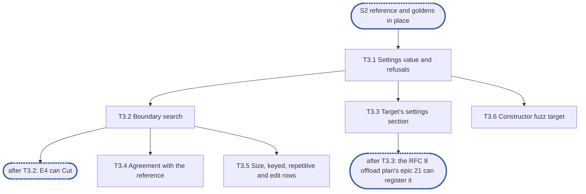

# Epic 3: carver v2 the chunker

**Sources:** [RFC 2](../docs/internals/rfcs/rfc-2-carver.md) §3.1 to §3.5, §3.7 and §3.8 (the
boundary function, its one setting, its derivation and its refusals), §6 (the keyed table and
the cutter's refusal of it), §1.2 (the chunker's half: `NextBoundary`, what it never does, no
"not yet" answer) and §3.6 (`Target` is bound). The checks this epic lands: §8's C2, C3, C10's
cutter half and C4's bounds on what the chunker returns; §9's chunker rows and its "MUST NOT
stand in" paragraph; §9.1's K1, as a benchmark function; §10.1's golden, differential and
property kinds for the chunker; §10.2's settings, buffer-edge and content cases the chunker
reaches; §10.4's allocation count, average and edit stability for the chunker; Appendix A's
first, second and sixth rows, as regression checks. [RFC 13](../docs/internals/rfcs/rfc-13-configuration.md)
Appendix B's `Target` row. [RFC 0](../docs/internals/rfcs/rfc-0-data-lifecycle.md) §1.2, as
#5774 amends it: an invalid setting is refused, and what `pkg/carver/section` may import.
Every citation is `develop`'s text. The code lands on `feat/storage-v2`, where E1 creates
`pkg/carver` and E2 `internal/carvetest`, and the paths below are paths there.
**Track:** A.
**Epic 3 estimate: 6 subtasks, 10.75 man-days.**
**Depends on:** **S2**, the end of E2: `carvetest`'s `Vectors` (the golden gear tables),
`Boundaries` and `LoadBoundaries` (the reference chunker and the golden boundaries), `Input`,
`Bytes` and `Targets` (seeded input of every content kind, every supported `Target`), `unit`'s
`carver-allocs` option and the nightly `fuzz` suite. Through S2, **S1**, the end of E1:
`carve.NewSettings` and `carve.CheckTarget` behind their final signatures, `carver.Settings`
aliasing `internal/params.Settings`, `carver.ErrInvalidSettings`, and the import and structure
tests (`imports_test.go`, `arch_test.go`) to which this epic adds its packages' rows.
**Blocks:** E4, whose `Cut` asks `chunker.NextBoundary` for every boundary and cuts under
settings `NewSettings` builds (T3.1, T3.2); E7, which runs `BenchmarkNextBoundary` as K1 and the
golden and allocation checks on the second architecture. Outside RFC 2, the RFC 8 offload
plan's epic 21 registers `pkg/carver/section` in the node's table, at namespace scope, and reads
each namespace's `Target` from it into `NewSettings` (T3.3); E6 freezes the section's default.

---

## 1. Goal

Epic 3 makes the boundary function real: the settings value a namespace cuts under, built from
its `Target`, its encryption flag and its two keys, with every refusal RFC 2 §3.7 names, and the
boundary search over a byte slice, exactly as RFC 2 §3.2 derives it. Everything here is a pure
function of bytes and settings, so every check is a byte slice and an expected answer.

**At the end of the epic:**

- `carve.CheckTarget` and `carve.NewSettings` refuse every invalid setting with
  `ErrInvalidSettings` and return nothing usable, and build the unkeyed or keyed gear table and
  the test's two bit counts from what they accept, the tables checked against E2's committed
  vectors (T3.1);
- `chunker.NextBoundary` reproduces every golden boundary of E2, at every profile and under both
  tables, allocates nothing, and has its K1 benchmark function (T3.2);
- `pkg/carver/section` states `Target`'s row as plain values, bound, and validates it through
  `CheckTarget`; the wiring gives it its namespace scope (T3.3);
- the chunker agrees with the reference chunker over fuzzed input, tables, profiles and buffer
  sizes, warmed from the chunk's start there and over 64 bytes here (T3.4);
- §9's size, keyed, repetitive and edit-stability rows pass at every profile (T3.5);
- the constructor's refusals are a fuzzed property in the `fuzz` suite (T3.6).

### 1.1 In scope

`CheckTarget` and `NewSettings`' bodies; the sizes, bit counts and gear tables in the settings
value; the internal chunker and its boundary search; `pkg/carver/section`; the chunker's rows of
RFC 2 §9 and §10; two fuzz targets; one allocation count; the K1 benchmark function; the import
and structure rows of `internal/chunker` and `section`.

### 1.2 Out of scope

- `Cut`, the chunk ID, the chunk-ID key in the settings value, the block name, the stretch-shape,
  reader and fault cases of RFC 2 §10.2 and §10.3, and the property tests across two buffer
  sizes through `Cut`: E4. E4 also adds `internal/chunker` to `carve`'s import row, and so to
  `section`'s.
- K1's run on the reference box, its ratio to BLAKE3, the second architecture and the full-size
  runs: E7.
- Freezing the default `Target` through the real offload path: E6.
- Registering the section in the node's table at namespace scope, its key in RFC 13's key form,
  and RFC 13 Appendix B's check passing with it: the RFC 2 plan's deferral-ledger row
  "`Target`'s settings section, `pkg/carver/section`, added to the node's table" (the RFC 8
  offload plan's epic 21).
- Recording which settings produced a namespace's content and reporting a change as a migration
  (RFC 2 §3.6): the ledger row "Recording which settings produced a namespace's content".
- Re-cutting or refusing an imported chunk longer than `Max` (RFC 2 §3.6, C9): the ledger row
  "Re-cutting or refusing an imported chunk longer than `Max`" (RFC 27).
- Drawing the namespace keys, never rotating the chunking key with the data keys, and its
  fingerprint (RFC 2 §6, C10's namespace half): the ledger row "The namespace keys" (RFC 5).
- RFC 2 §6's keyed PRF upgrade: the ledger row "RFC 2 §6's keyed PRF upgrade of the keyed gear
  table".

### 1.3 Names used here

- **E1**, epic 1, interfaces: the root contract, `carve` and `assembler` stubbed, `internal/params`,
  and the import and structure tests `imports_test.go` and `arch_test.go`, one row per package.
- **E2**, epic 2, test foundations: `internal/carvetest` (vectors, reference chunker, golden
  boundaries, seeded inputs), `unit`'s `carver-allocs` option and the nightly `fuzz` suite.
- **E3**, this epic. Track A.
- **E4**, epic 4, the carver and identity: `Cut`, artificial ends, errors, chunk IDs, block
  names. Track B.
- **E6**, epic 6, integration: RFC 2 Appendix C's sweep through the real offload path, which
  freezes the default `Target`.
- **E7**, epic 7, E2E green: K1 to K5 on the reference box, the second architecture and the
  full-size runs.
- **S1**, the carver interface agreed: the end of E1.
- **S2**, reference and goldens in place: the end of E2, where this epic starts.
- **The RFC 8 offload plan**, [`rfc-8-offload-engine-plan.md`](rfc-8-offload-engine-plan.md):
  its epic 21 wires the node, registers this epic's section and builds each namespace's settings
  with `NewSettings`.
- **D1** to **D8** are this epic's decisions (§4). A decision of the RFC 2 plan is written with
  the plan named ("the RFC 2 plan's D4"), and one of E1 or E2 with the epic named ("E1's D1").

## 2. How the general rules apply

The rules are those of
[the RFC 2 plan's §1.5](rfc-2-carver-plan.md#15-general-rules-for-each-epic), cited by number and
title and not copied.

| Rule | Subtasks | How |
| --- | --- | --- |
| rule 1, independent unit tests ([`CLAUDE.md`, "Writing tests"](../CLAUDE.md#writing-tests)) | all | every check is a byte slice, a settings value and an answer: E2's vectors, its reference chunker, its seeded inputs, hand-built gear tables. No test double, and nothing to stand in for |
| rule 2, fuzz tests where relevant ([`CLAUDE.md`, "Writing tests", "By kind"](../CLAUDE.md#writing-tests)) | T3.4, T3.6 | `FuzzNextBoundary`: fuzzed input, table, profile and buffer size into the chunker, asserting agreement with the reference, C4's bounds and the tiling; `FuzzNewSettings`: fuzzed settings into the constructor, asserting §3.7's refusals. Each is one command of the `fuzz` suite (D7) |
| rule 3, observability follows RFC 25, with RFC 2's exception | none | no logger, registry or tracer; the chunker reports nothing, and the `carver_` series are the RFC 8 offload plan's epic 15's |
| rule 4, profiling | T3.1, T3.2 | `TestAllocsNextBoundary` in `carver-allocs`, skipped under `internal/prof.RaceEnabled`. No descriptor, and no goroutine: `lukechampine.com/blake3` starts goroutines on an output read of two 1,024-byte blocks or more, not on its input, so the tables are read 1,024 bytes at a time (D5), and T3.1 counts `/sched/goroutines-created:goroutines` around `NewSettings` |
| rule 5, public interface and internals ([`CLAUDE.md`, "Verifying a change"](../CLAUDE.md#verifying-a-change)) | T3.1 to T3.5 | the chunker is tested as `Cut` will call it, a buffer of at least `Max` bytes or a final one, and its §9 rows through settings `NewSettings` built, the value E4 and the engine receive (D6). The section is tested by its own `Validate`; the table it joins is the RFC 8 offload plan's epic 21's, tested there |
| rule 6, known failures shrink | none | `unit` and `fuzz` keep no `known.yaml`; every test lands green, each seen to fail on its planted break before the pull request opens |
| rule 7, v2 ignores v1, and imports only what RFC 0 §1.2 allows | T3.2, T3.3 | `internal/chunker`'s production files import `internal/params` alone, no standard-library package either, which its `arch_test.go` row checks (R13); `section` imports the root and `carve`, and reaches what they do, `internal/params` among them; neither `pkg/settings`, `pkg/metrics` nor `pkg/health` is on any row. v1's `pkg/block/chunker` is not read |
| rule 8, real dependencies for properties of those dependencies | T3.1 | the gear tables are BLAKE3's output and are checked against E2's vectors, which BLAKE3's own binding computed; the second architecture is E7's |
| rule 9, code comment conventions ([`CLAUDE.md`, "Code comments"](../CLAUDE.md#code-comments)) | T3.1, T3.2, T3.3 | RFC 2 §6's `ponytail:` at the keyed table's construction; `decision:` markers for D1 and D2 at `params.New`, D5 at the table derivation, D4 at `NextBoundary`'s precondition and D8 at the section's `Prefix` |
| rule 10, a test must be able to fail | all | each test names its planted break: a table word changed, *m* moved by one, a boundary at `Min` − 1 missed, the warm-up window shortened, a refusal dropped, fixed-size cuts |
| rule 11, a symbol is exported only if the RFC's interface uses it | T3.2, T3.3 | none joins S1's frozen surface. `NextBoundary` is exported from an internal package for E4's `Cut`; `section`'s `Prefix`, `Settings` with its `Validate` method, and `Default` are exported after S1 for one consumer, the RFC 8 offload plan's epic 21, as the RFC 2 plan's rule 7 places the section in this epic |
| rule 12, each subtask creates only what it declares | all | `internal/chunker` lands with its tests (T3.2) for E4's `Cut`; `section` with the wiring that registers it named; `params` grows only the fields the chunker reads |

## 3. Requirements and invariants

Every obligation RFC 2, RFC 13 and RFC 0 place on the chunker and its settings, numbered so
subtasks and tests can cite them. Where part of an obligation is another epic's, the row says
which.

**The setting and its refusals**

| # | Requirement | Kind | Source | Subtasks |
| --- | --- | --- | --- | --- |
| R1 | A namespace configures one size, `Target`, a power of two; `Min` is `Target` / 4 and `Max` 4 × `Target`, derived and never configured, so `Min < Target ≤ Max` holds for every accepted `Target` and no value with `Min ≥ Target` can be built | invariant | RFC 2 §3.2, §3.3 | T3.1 |
| R2 | A `Target` that is not a power of two, below 64 KiB or above 4 MiB is refused with an error and never replaced by a default; 64 KiB and 4 MiB are accepted, and the power of two past each is refused | MUST, MUST NOT | RFC 2 §3.7, §10.2 (Settings); RFC 0 §1.2 | T3.1 |
| R3 | An all-zero chunk-ID key is refused; a chunking key for a namespace that does not encrypt is refused; an encrypting namespace with no chunking key, or an all-zero one, is refused | MUST | RFC 2 §3.7, §3.2 (keyed table: "a cutter **MUST** refuse a keyed table for one"), §8 C10; RFC 2 plan, D4 | T3.1 |
| R4 | A refused setting gives nothing usable: the error, and the zero settings value, which `Cut` refuses | MUST | RFC 2 §9 (bad settings refused: "nothing usable comes back"); E1's D1 | T3.1 |
| R5 | A `Target` is checked alone, with no key material, by `CheckTarget`, which `NewSettings` and the section's validator both call, so the two cannot disagree | invariant | RFC 2 §3.7; E1's T1.3 (`CheckTarget`) | T3.1, T3.3 |
| R6 | A fuzz check of the constructor asserts every refusal of R2 and R3 | MUST | RFC 2 §3.7 ("A fuzz check of the constructor asserts these refusals"); RFC 2 plan, §1.5 rule 2 | T3.6 |

**The derivation**

| # | Requirement | Kind | Source | Subtasks |
| --- | --- | --- | --- | --- |
| R7 | What decides a boundary is computed from `Target`, in one place: for a `Target` of 2^*t*, the test reads the top *t* + 1 bits before `Target` and the top *t* − 3 from it on, and no mask or bit count is written down anywhere else | MUST | RFC 2 §3.2 ("Whatever decides a boundary MUST be derived from `Target`"), Appendix A.1 | T3.1 |
| R8 | The unkeyed gear table is 256 little-endian 64-bit words, the first 2,048 bytes of BLAKE3's extendable output in key-derivation mode, context `dittofs gear table v1`, over the empty input | MUST | RFC 2 §3.2 (unkeyed table) | T3.1 |
| R9 | The keyed table is the first 2,048 bytes of BLAKE3's extendable output in keyed mode under the namespace's chunking key, over `dittofs chunking key v1`, built by the constructor from the key, so no table and key can be passed apart; a namespace that does not encrypt cuts under the unkeyed table | MUST | RFC 2 §3.2 (keyed table), §6 (Construction), §8 C10 (the cutter's half); RFC 2 plan, D4 | T3.1 |
| R10 | The unkeyed table and the keyed table under a fixed key equal committed bytes an independent implementation computed from §3.2's text | test row | RFC 2 §9 (derivation golden); E2's T2.1 (`Vectors`) | T3.1 |
| R11 | The test's bit counts track `Target` at every profile, and no one pair serves two `Target`s | test row | RFC 2 §9 (mask comes from target), Appendix A.1 | T3.1 |
| R12 | No comment or document of the chunker claims boundaries are hidden: without encryption they are public, and a keyed table hides which file a run of lengths belongs to only from a bucket reader who can cause no write into the namespace and knows none of its stored content | MUST NOT | RFC 2 §6 ("**MUST NOT** claim otherwise"; "**MUST NOT** be described … as hiding which files a namespace holds") | T3.1 |

**The boundary search**

| # | Requirement | Kind | Source | Subtasks |
| --- | --- | --- | --- | --- |
| R13 | The chunker answers where the next chunk ends and nothing else: it never hashes, holds a file offset, reads from anything or allocates, and keeps nothing between calls | MUST NOT | RFC 2 §1.2 ("the chunker **MUST NOT** hash, hold a file offset, read from anything, or allocate") | T3.2 |
| R14 | `NextBoundary` is given the settings, a buffer of at least `Max` bytes or a `final` one, and returns one end: with `Max` bytes a boundary or `Max`, with `final` the rest when no boundary comes first; there is no "not yet" answer, and it is never called with fewer than `Max` bytes and `final` unset | invariant | RFC 2 §1.2, §10.2 (The buffer edge), Appendix A (the "not yet" row) | T3.2 |
| R15 | The derivation exactly: `fp ← (fp << 1) + G[b]` mod 2⁶⁴; a byte is a boundary when the top *m* bits of `fp` are zero; *m* switches from *t* + 1 to *t* − 3 when the chunk's length before the byte under test reaches `Target`; a passing byte is the last of its chunk; the first byte tested is at index `Min` − 1; a chunk reaching `Max` ends there | MUST | RFC 2 §3.2 (the derivation, exactly), §3.3 | T3.2, T3.4 |
| R16 | The search warms its fingerprint over exactly the 64 bytes a decision looks back, never from the start of the chunk, and says so | MUST, MUST NOT | RFC 2 §3.4, §3.1 B5 | T3.2, T3.4 |
| R17 | A boundary depends on the bytes and the settings alone: no file identity, offset, position in the buffer, running count, clock or random seed; the same bytes, `Target` and key give the same boundaries in any process, on any machine | MUST NOT | RFC 2 §3.5, §3.1 B1, B2, §8 C2 | T3.2, T3.4, T3.5 |
| R18 | No chunk the chunker ends is longer than `Max`, and none shorter than `Min` but the last of a `final` buffer | invariant | RFC 2 §3.1 B3, §8 C4 (the chunker's bounds) | T3.2, T3.4 |
| R19 | The boundary search reproduces E2's golden boundaries at every supported `Target`, under the unkeyed and the keyed table | test row | RFC 2 §10.1 (Golden vectors), §3.6; E2's T2.3 (`LoadBoundaries`) | T3.2 |
| R20 | `NextBoundary` makes no allocation, counted in `unit`'s `carver-allocs` option | bound | RFC 2 §10.4 (allocations), §1.2; RFC 2 plan, §1.4 (`carver-allocs`) | T3.2 |
| R21 | K1's benchmark: `NextBoundary` over 64 MiB of seeded random bytes, per profile, reporting its rate and allocations. E7 runs it and holds it to its §10.5 ratio | bound | RFC 2 §9.1 K1, §10.5 K1 | T3.2 |

**Agreement with the reference**

| # | Requirement | Kind | Source | Subtasks |
| --- | --- | --- | --- | --- |
| R22 | Two implementations of the boundary function over the same random input and settings emit identical chunks: the chunker and E2's reference, over fuzzed input, gear tables and profiles | MUST | RFC 2 §10.1 (Differential, Properties), §1.3; RFC 2 plan, §1.5 rules 2 and 10 | T3.4 |
| R23 | Boundaries are identical whether the fingerprint is warmed from the chunk start or over the last 64 bytes, across several profiles | test row | RFC 2 §9 (warm-up equivalence), §3.4 | T3.4 |
| R24 | Fuzzing past the seed corpus runs in the shared nightly `fuzz` suite; its seeds run in `unit` | invariant | RFC 2 §10.6, §10.1 (Properties); RFC 2 plan, §1.4 (`fuzz`) | T3.4, T3.6 |

**Size and shape**

| # | Requirement | Kind | Source | Subtasks |
| --- | --- | --- | --- | --- |
| R25 | The average chunk size, the `Min` skip included, is within 10 % of `Target` over 256 MiB of seeded random input at every profile; a mismatch is a defect of the function, never settled by writing the real number into the specification | bound | RFC 2 §3.2 ("**MUST** hit `Target` as the average"; "The mean includes the skip"), §8 C3, §9 (target is real), §10.4 (average) | T3.5 |
| R26 | The same input cut under two chunking keys and under none gives three different sets of boundaries, the average within tolerance of `Target` under each, and the same key the same boundaries | test row | RFC 2 §9 (keyed boundaries), §6, §3.5 | T3.5 |
| R27 | `Max` is load-bearing: 64 MiB of zeros under the unkeyed table cuts into chunks of exactly `Max` at every supported `Target`, and a 64-byte repeating pattern, keyed and unkeyed, ends with no chunk over `Max` | test row | RFC 2 §9 (repetitive input still terminates), §3.8 | T3.5 |
| R28 | The content cases: 44-byte repeated text cuts no chunk over `Max`; a period above 64 cuts at boundaries that repeat with the period, or at `Max`, never below `Min`; random data with a repetitive middle cuts within C4's bounds crossing in and out of it | MUST | RFC 2 §10.2 (Content: "**MUST** reach these"), §3.8 | T3.5 |
| R29 | Repetitive data is never the only input of a size check, and is covered by checks of its own; one fixed profile is never the only settings under test | MUST NOT | RFC 2 §9 ("Two things **MUST NOT** stand in") | T3.2, T3.5 |
| R30 | One byte inserted early in a large input leaves every chunk that starts more than 2 × `Max` past the edit unchanged, at every profile | test row | RFC 2 §9 (B4 shift resistance), §3.1 B4, §10.4 (edit stability) | T3.5 |

**`Target`'s settings section**

| # | Requirement | Kind | Source | Subtasks |
| --- | --- | --- | --- | --- |
| R31 | `Target` is a namespace setting, bound once content exists, proposed default 256 KiB; the section declares it bound with that default, and the wiring registers it at namespace scope, never per share | invariant | RFC 13 Appendix B (`Target`); RFC 2 §3.2, §3.6 | T3.3 |
| R32 | The section's validator refuses a `Target` as R2 does, with no key material | MUST | RFC 2 §3.7; RFC 0 §1.2 ("an invalid setting MUST be refused"); RFC 2 plan, §1.5 rule 7 | T3.3 |
| R33 | The section imports the root and `carve`, nothing else, never `pkg/settings`, `pkg/metrics` or `pkg/health`, and no carver package imports the section | MUST NOT | RFC 0 §1.2 (as #5774 amends it); RFC 2 plan, §1.5 rule 7 | T3.3 |

How each row is enforced once this epic lands, where no test of this epic can break it: R3's and
§3.7's 32-byte keys by the compiler, through E1's signature; R12 in review, since no test can
read a claim made anywhere in prose, with RFC 2 §6's own words carried by the `ponytail:` at the
keyed table; R13's "never reads" and "holds no offset" by `NextBoundary`'s signature and the
chunker's `arch_test.go` row, which admits no import but `internal/params`, standard library
included, its "never hashes" by the same row and by its import row, which admits no BLAKE3, and
"keeps nothing" by E1's structure check of package-level state, which T3.2 extends to the chunker;
R16's "exactly 64" by the compiler, since the warm-up takes a `*[64]byte` (D3), its output by R23
and its cost by E7's K1; R7's "nowhere else" in review, with R11 checking the counts; R17's "no
clock, no file identity" by `NextBoundary`'s signature; R21's ratio by E7; R31's namespace scope,
its registration and RFC 13 Appendix B's check by the RFC 8 offload plan's epic 21; R33's "no
carver package imports the section" by E1's import test, whose rows for the root, `carve` and
`assembler` do not admit it.

The candidates of the owned sections that bind other epics are theirs: §1.2's carver half and
§3.5's moving stretch start (E4 and the RFC 8 offload plan's epic 15); §3.2's ceiling under random
overwrite and §3.6's re-cut of imported chunks (the RFC 8 offload plan's widening, RFC 27); §3.6's
record of the settings (the RFC 8 offload plan's epic 16); §6's key draw, rotation and
fingerprint (RFC 5); §10.2's stretch-shape and reader cases and §10.3 (E4); §11's default (E6).

## 4. Decisions this epic takes

- **D1, `params.New` derives the sizes and bit counts from `Target`; `carve` derives the gear
  table.** The value E1 sealed gains the table, behind a pointer the value shares, and the two bit
  counts; `params.New(target int, gear *[256]uint64) Settings` computes `Min`, `Max`, *t* + 1 and
  *t* − 3 by integer arithmetic, and `params.Gear` and `params.Bits` read them back. BLAKE3 stays
  in `carve`, whose row admits it, and `params` keeps to the standard library (E1's D1), and in
  fact imports nothing, so the chunker's tests build a value over any table, hand-built or
  fuzzed, with no hash. `NewSettings` checks the `Target` and the keys first, so `params.New`
  never sees a refused one; a `decision:` at `params.New` says it trusts its caller and that code
  inside `pkg/carver` can still build a value over a table no key produced, which is the seal's
  ceiling E1's D1 names. This narrows E1's D1, which put the whole derivation in `carve`: the
  arithmetic moves, the hashing does not. Prior art: none found.
- **D2, the value holds the two bit counts, not masks, and RFC 2 §3.2's start-up assertion is not
  adopted as a runtime check.** E1's T1.1 expected this epic to add "the masks", and the RFC 2
  plan's outline a mask "with its start-up check". The chunker tests `fp >> (64 − m) == 0`, RFC 2
  §3.2's own form, with *m* read from the value, so the one place *m* exists is `params.New`,
  computed from `Target`; no mask is stored that could disagree with it. §3.2's SHOULD, assert at
  start-up that mask and `Target` agree, guards against a mask written down apart from `Target`,
  Appendix A.1's defect; with none written down, a start-up assertion would compare `params.New`
  with itself and could never refuse anything. §9's mask row (R11) checks the counts at every
  profile instead, per change. A `decision:` at `params.New` records it, withdrawn if a later
  change stores masks beside `Target`. Prior art: FastCDC's paper and its reference code keep a
  small-region and a large-region mask, `MaskS` and `MaskL`, hard-coded per normalisation level
  (from memory), which is the drift §3.2 asks to guard.
- **D3, the warm-up takes exactly 64 bytes by type.** `warm(g *[256]uint64, w *[64]byte) uint64`
  builds the fingerprint over the 64 bytes ending at the first tested byte, index `Min` − 1, and
  the chunker tests that fingerprint before shifting in the next byte: the decision at each
  position then covers exactly RFC 2 §3.4's 64-byte window. A warm-up over the whole chunk would
  need that signature changed, which a reviewer sees, where it changes no output and no count
  (RFC 2 §10.4). The unexported constant `window = 64` is the "how many" B5 asks the function to
  say. Prior art: none found.
- **D4, `NextBoundary` panics on a buffer under `Max` with `final` unset.** RFC 2 §1.2 gives no
  "not yet" answer, and any position returned for such a buffer would be wrong, a short chunk or a
  boundary beyond the buffer. Its one caller, `Cut`, never passes one, which E4's buffer-edge and
  one-byte-reader cases of RFC 2 §10.2 exercise, so reaching it is a bug in the carver, not in its
  input. Its ceiling: a panic on the offload path stops the node, every share with it, where an
  error would fail one pass. A `decision:` at the check says so, and that it becomes an error
  return if the chunker ever gains a second caller, or if the carver's buffer-edge cases ever
  reach it, worded without naming an epic. Prior art: Go's
  slice expressions and `bytes.Buffer.Truncate` panic on an out-of-range argument rather than
  return a value (from memory).
- **D5, both tables are derived at each `NewSettings`, and nothing is cached.** The unkeyed table
  is the same for every namespace, but deriving it is 2,048 bytes of BLAKE3 output once per
  namespace at each apply, and a package-level table would be the state E1's R8 keeps out of
  `carve`. `lukechampine.com/blake3` v1.4.1's `OutputReader.Read` starts goroutines when one read
  asks for two or more of its 1,024-byte buffers (read the code, `blake3.go`), and `DeriveKey`
  reads its whole output in one call. So the keyed table is `New(2048, key)`, then `XOF` read in
  two 1,024-byte reads, which compress inline; and the unkeyed table drives
  `lukechampine.com/blake3/guts` in key-derivation mode, the context and the empty key material
  each one block, its root output compressed 1,024 bytes at a time with `guts.CompressBlocks`. Both
  start no goroutine, as the RFC 2 plan's rule 4 requires, and R10's vectors check both. Their
  allocations land in the constructor, which RFC 2 §10.4 does not count. E4's D1 gives
  `internal/blake3` no extendable output, so the tables stay on `lukechampine.com/blake3`; a
  `decision:` at the derivation says the reads are split to keep goroutines out, and is withdrawn
  if the library stops starting them. Prior art: restic's chunker builds its polynomial tables when
  a chunker is made, per polynomial (from memory).
- **D6, §9's rows run through real settings, in the chunker's external test package, with one
  shared cut loop.** The average, keyed, repetitive and edit-stability rows build their settings
  with `NewSettings`, the value E4 and the engine receive, in `package chunker_test`, which may
  import `carve` although `carve` will import the chunker. The hand-built tables, the allocation
  count, the benchmark and the fuzz target use `params.New` in `package chunker`. Every test cuts
  through one helper, `Ends(s params.Settings, r io.Reader, buf int) []int`, which streams `r`
  through a window of `buf` bytes, calling `NextBoundary` from each boundary with `final` set once
  the reader is done; it lives in `export_test.go` so both test packages share it, and it never
  holds a 256 MiB input whole. The goldens hold the helper too, since it must reproduce E2's
  ends. The linear rows keep RFC 2's sizes on every pull request, `-short` included (the RFC 2
  plan's D8). Prior art: Go's external test packages and `export_test.go`, as `net/http`'s tests
  use them (from memory).
- **D7, the two fuzz targets.** `FuzzNextBoundary` fuzzes generator parameters, as E2's
  `FuzzReferenceBounds` does: a seed, a content kind, a length up to 4 × `Max`, an index into
  `Targets`, a table seed and a window of `Max`, `Max` + 1 or 2 × `Max` bytes, since a fuzzed byte
  slice rarely grows past `Min`; its `f.Add` seeds cover every content kind, the unkeyed and keyed
  tables of `Vectors` and at least three profiles, so `unit` runs R23 on every change.
  `FuzzNewSettings` fuzzes the constructor's own arguments, each key as a byte slice copied into a
  `[32]byte`, so an empty slice is a zero key and random input reaches every refusal; its `f.Add`
  seeds are T3.1's table of `Target`s and key cases, an all-zero chunk-ID key, an all-zero chunking
  key with encryption and a chunking key without it among them, each with a comment naming its
  case. Its oracle restates R2 and R3 in the test, apart from `CheckTarget`. `testdata/fuzz/` holds
  only crashers the nightly runs find (`CLAUDE.md`, "By kind"). Each target is one command of the
  `fuzz` suite (E2's D6), and both raise its `timeout.test` and `timeout.cell` by ten minutes and a
  build each. Prior art: E2's D6 and D7 (the suite and its lines).
- **D8, the section is a plain struct the settings package reads, under a provisional key.**
  `pkg/settings`' `Of` declares a section from a type with `json` and `class` tags and a `Validate`
  method, and its defaults as a value (`settings.Of(prefix, scope, def, opts…)`), so the section
  states exactly that with no import: `section.Prefix`, `section.Settings{Target int}` tagged
  `json:"target" class:"bound"`, and `section.Default()`. The scope, namespace, is the wiring's
  argument (`settings.At(entity.ScopeNamespace)`), since the section imports neither
  `pkg/settings` nor `entity` directly. RFC 13 Appendix B writes the row as `Target`, not in its
  key form, and naming the key is pending the user's answer in the RFC 2 plan's §6 point 2; the
  section uses `carver.target` meanwhile, and a `decision:` at `Prefix` says the key is
  provisional, that it changes in one line to whatever RFC 13 names, and that no namespace can
  have bound it before the section is registered in the node's settings table (the RFC 8 offload
  plan's epic 21). Like every marker here, it is worded by behaviour, naming no plan or epic. Prior art:
  `apisettings.Defaults()`, a plain value `newTable` hands to `settings.Of` in
  `internal/node/settings.go` on `feat/storage-v2` (checked); `internal/identity`'s `Section`,
  which calls `settings.Of` itself and imports `pkg/settings` (checked), is the shape D8 avoids.

## 5. Target tree

```text
pkg/carver/
  imports_test.go          T3.2, T3.3  rows for internal/chunker and section
  arch_test.go             T3.2        chunker: imports params only; no package-level state
  internal/params/
    params.go              T3.1        gear, bit counts; New, Gear, Bits; D1's and D2's decision:
  carve/
    settings.go            T3.1        CheckTarget, NewSettings, the table derivation;
                                       §6's ponytail: at the keyed table
    settings_test.go       T3.1        refusals, edges, tables against Vectors, bit counts
    fuzz_test.go           T3.6        FuzzNewSettings
  internal/chunker/
    chunker.go             T3.2        window, NextBoundary, warm; D4's decision:
    export_test.go         T3.2        Ends, the shared cut loop
    chunker_test.go        T3.2        hand-built tables, goldens, buffer edges, TestAllocsNextBoundary
    bench_test.go          T3.2        BenchmarkNextBoundary (K1)
    fuzz_test.go           T3.4        FuzzNextBoundary
    rows_test.go           T3.5        package chunker_test: §9's size, keyed, repetitive and B4 rows
  section/
    section.go             T3.3        Prefix, Settings, Default, Validate; D8's decision:
    section_test.go        T3.3        Validate, the default, the tags
test/suites.yaml           T3.4, T3.6  two lines of the fuzz suite, its timeouts raised
```

## 6. Subtasks

### T3.1 The settings value: sizes, tables and refusals

**Subtask T3.1 estimate: 2.5 man-days.**

- **Track:** A. **Depends on:** none. It fills E1's stubs, so it lands after S2.
- **Covers:** R1 to R5, R7 to R12.
- **Deliverables:**
  - `internal/params` gains, with D1's and D2's `decision:` at `New`:
    ```go
    // Settings gains gear *[256]uint64 and before, after int beside target, min, max.

    // New builds the value for an accepted target over gear: Min is target/4, Max 4×target,
    // and for a target of 2^t the test reads the top t+1 bits before Target, t−3 from it on.
    // It trusts its caller.
    func New(target int, gear *[256]uint64) Settings

    // Gear is the table s cuts under; nil on the zero value.
    func Gear(s Settings) *[256]uint64

    // Bits is how many top bits of the fingerprint the test reads before Target and from it on.
    func Bits(s Settings) (before, after int)
    ```
    Consumed by `NewSettings`, T3.2's chunker and its tests.
  - `carve`'s bodies, consumed by T3.3's validator, E4's `Cut` tests, and the RFC 8 offload plan's
    epic 21, which calls `NewSettings` once per namespace:
    - `carve`'s production row in `imports_test.go` gains `lukechampine.com/blake3/guts` (D5).
    - `CheckTarget(target int) error`: refuses, wrapping `ErrInvalidSettings` with the value and
      the rule, a `Target` that is not a power of two, under 64 KiB or over 4 MiB.
    - `NewSettings(target int, encrypting bool, chunkingKey, chunkIDKey [32]byte)
      (carver.Settings, error)`: `CheckTarget`, then a zero chunk-ID key, a chunking key without
      encryption, and encryption with a zero chunking key, each refused with the zero value; then
      the unkeyed or the keyed table (D5) and `params.New`. The chunk-ID key is checked here and
      stored by E4, whose `ChunkID` is its first reader.
    - RFC 2 §6's `ponytail:` at the keyed table's derivation, its ceiling and upgrade as the RFC
      words them; the doc comment of `NewSettings` says the unkeyed boundaries are public and what
      the keyed table hides, from whom only (R12).
- **Acceptance criteria:**
  - Every supported `Target` is accepted, with `Min`, `Max` and the bit counts R1 and R7 give;
    `48 << 10`, `96 << 10`, `32 << 10`, `8 << 20`, `0` and `-1` are refused, each with
    `ErrInvalidSettings` and the zero value.
  - The three key refusals of R3 hold at every supported `Target`, and a zero chunking key with
    encryption off is accepted.
  - A non-encrypting value's table is `Vectors.GearUnkeyed`; an encrypting value under
    `Vectors.ChunkingKey` has `Vectors.GearKeyed`.
  - `NewSettings` starts no goroutine, keyed or unkeyed.
- **Tests:** at `carve`, as the wiring calls it: a table of `Target`s at, under and over each
  limit, non-powers of two among them (catches a floor at 32 KiB, a ceiling at 8 MiB, a rounding
  instead of a refusal, R2, R4); the key cases (catches a keyed table built for a namespace that
  does not encrypt, or an unkeyed one for one that does, R3, R9); the tables against
  `carvetest.LoadVectors` through `params.Gear`, in `package carve` (catches a wrong context
  string, a big-endian decode, a table built from the wrong mode, R8 to R10); the bit counts at
  every `Target`, *t* + 1 and *t* − 3 through `params.Bits`, and seven distinct pairs across the
  seven profiles (catches Appendix A.1's fixed pair, and *m* off by one either side, R7, R11);
  the change in `runtime/metrics`' `/sched/goroutines-created:goroutines` over 100 calls of each
  kind, in a test that never calls `t.Parallel`, since the count is process-wide (catches a table
  read in one 2,048-byte call, which starts one). Each is seen to fail on its planted break before
  the pull request opens. No test double.
- **Rules:** rule 8, the tables against BLAKE3's own binding's output; rule 9, the `ponytail:` and
  D1's, D2's and D5's `decision:`. Others as §2 says.

### T3.2 The boundary search

**Subtask T3.2 estimate: 2.5 man-days.**

- **Track:** A. **Depends on:** T3.1.
- **Covers:** R13 to R21, R29.
- **Deliverables:**
  - `pkg/carver/internal/chunker`, with D4's `decision:`. Consumed by E4's `Cut`, T3.4, T3.5 and
    E7's K1:
    ```go
    // window is how many bytes a boundary decision looks back (RFC 2 §3.4): after 64 shifts an
    // older byte has left the 64-bit fingerprint.
    const window = 64

    // NextBoundary returns where the first chunk of buf ends under s: just after the first byte
    // from index Min−1 whose fingerprint has its top Bits zero, else Max, else, when final is set and buf is
    // shorter than Max, len(buf). buf holds at least s.Max() bytes unless final is set; it panics
    // otherwise. It never hashes, reads, allocates or keeps anything.
    func NextBoundary(s params.Settings, buf []byte, final bool) int

    // warm is the fingerprint over the 64 bytes ending at the first tested byte.
    func warm(g *[256]uint64, w *[window]byte) uint64
    ```
  - `Ends` in `export_test.go` (D6), consumed by every chunker test.
  - Its rows in E1's tests: in `imports_test.go`, production `internal/params` and nothing else;
    test files `internal/params`, `carve` and what `carve` reaches, `internal/carvetest` and
    `internal/prof`. In `arch_test.go`, that its production files import `internal/params` and no
    other package, the standard library included, and declare no package-level variable.
  - `TestAllocsNextBoundary`, which joins `carver-allocs` by its name (E2's D7).
  - `BenchmarkNextBoundary`: one sub-benchmark per entry of `carvetest.Targets`, each over
    `carvetest.Bytes(carvetest.Random, seed, 64 << 20)` built before `b.ResetTimer`, cutting the
    whole input per iteration with `b.SetBytes` and `b.ReportAllocs`. Consumed by E7, which runs
    it as K1.
- **Acceptance criteria:**
  - Every golden of `carvetest.LoadBoundaries`, unkeyed and keyed, is reproduced end for end
    through `Ends` with a window of `Max` bytes.
  - With every `G[b]` zero every chunk but the last of a `final` buffer is exactly `Min`; with
    every `G[b]` 2⁶³ every chunk but that last one is exactly `Max`; with `G[1]` = 2⁶³, `G[x]` zero and a run of byte 1, an `x` at index `Min` − 1 ends
    the chunk there, and one at `Min` − 2 does not.
  - A buffer of exactly `Max` bytes with no boundary returns `Max`; a `final` buffer of 1,
    `Min` − 1, `Min`, `Max` and `Max` + 1 bytes returns its length, or `Max`, when no boundary
    comes first; a non-empty buffer never returns 0; a buffer under `Max` with `final` unset
    panics.
  - With `G[1]` = 1, every other entry zero, and byte 1 at index `Min` − 64 of an otherwise zero
    buffer, the fingerprint at `Min` − 1 is 2⁶³, so the chunk does not end there and ends at
    `Min` + 1.
  - `NextBoundary` makes 0 allocations.
- **Tests:** at `NextBoundary`, as `Cut` will call it, written in `chunker_test.go`: the goldens at
  every profile under both tables (catches any clause of R15 moved, and E4 meeting another answer
  than the reference's, R15, R17, R19, R29's "one fixed profile"); the zero and 2⁶³ tables and the
  planted `x` at `Min` − 1 and `Min` − 2 (catches the first test at `Min`, which the goldens see only
  when a boundary falls exactly there, and a missing `Max` end, R15, R18); the `G[1]` = 1 case
  (catches a warm-up over 63 bytes, whose fingerprint at `Min` − 1 is 0 and ends the chunk at
  `Min`, R16; random input changes that decision only at odds of about 2⁻ᵐ per chunk, so the
  goldens and T3.4's seeds do not); the buffer edges and the
  panic (catches the "not yet" answer of Appendix A's sixth row, R14); `TestAllocsNextBoundary`,
  `testing.AllocsPerRun` over `Max` bytes, skipped under `prof.RaceEnabled` (catches an
  allocation, R13, R20); the import and structure rows over planted imports of `io` and
  `lukechampine.com/blake3` (catches a chunker that reads or hashes, R13). The *m* switch around
  `Target` is pinned by the goldens and by T3.4's differential, against E2's reference, whose own
  hand-built cases pin it. The benchmark is run, not asserted: E7 holds K1 to its ratio. No test
  double: the tables are inputs.
- **Rules:** rule 4, the count; rule 7, the rows; rule 9, D4's `decision:`. Others as §2 says.

### T3.3 `Target`'s settings section

**Subtask T3.3 estimate: 0.75 man-days.**

- **Track:** A. **Depends on:** T3.1.
- **Covers:** R5, R31 to R33.
- **Deliverables:** `pkg/carver/section`, with D8's `decision:` at `Prefix`, and its row in E1's
  `imports_test.go`: production the root and `carve`, and what they reach (`internal/params`,
  `pkg/metadata/entity`, `lukechampine.com/blake3` and its `guts`, `github.com/google/uuid`; E4 adds
  `internal/chunker` when `carve` imports it); test files the same, with `internal/carvetest`.
  Consumed by the RFC 8 offload plan's epic 21, which passes `section.Prefix`,
  `settings.At(entity.ScopeNamespace)` and `section.Default()` to `settings.Of` in `newTable`, and
  each namespace's `Target` to `NewSettings`; and by E6, which sets the default to the value its
  sweep freezes:
  ```go
  // Prefix is the section's prefix in the settings table: the key carver.target.
  const Prefix = "carver"

  // Settings is a namespace's Target, bound once the namespace holds content (RFC 2 §3.6).
  type Settings struct {
      Target int `json:"target" class:"bound"`
  }

  // Default is the section's value where no row sets the key: RFC 13 Appendix B's proposed
  // 256 KiB, until RFC 2 Appendix C's sweep freezes it.
  func Default() Settings

  // Validate refuses a Target as carve.CheckTarget does; it holds no key material.
  func (s Settings) Validate() error
  ```
- **Acceptance criteria:**
  - `Validate` refuses exactly what `CheckTarget` refuses, and `Default()` passes it.
  - `Target`'s `class` tag reads `bound` and its `json` tag `target`.
  - The section imports nothing but the root and `carve`.
- **Tests:** at `Validate`, which `pkg/settings` calls on every write and read: every entry of
  `carvetest.Targets` accepted and T3.1's refused values refused, each with `ErrInvalidSettings`
  (catches a validator that drifted from `CheckTarget`, R5, R32); the default against RFC 13's
  256 KiB and against `Validate` (catches a default no namespace could bind, R31); the two tags
  read with `reflect` (catches a `live` class, which would let a namespace re-cut its content
  quietly, R31); the import row over a planted import of `pkg/settings` (catches the section
  turned into an implementation, R33). The section in the node's table, at namespace scope, and
  RFC 13 Appendix B's check over it, are the RFC 8 offload plan's epic 21's. No test double.
- **Rules:** rule 7, the row; rule 9, D8's `decision:`; rule 11, its symbols' one consumer.
  Others as §2 says.

### T3.4 Agreement with the reference chunker

**Subtask T3.4 estimate: 1.5 man-days.**

- **Track:** A. **Depends on:** T3.2.
- **Covers:** R15 to R18, R22 to R24.
- **Deliverables:** `FuzzNextBoundary(f *testing.F)` in `package chunker` (D7) with its `f.Add`
  seeds; one line of the `fuzz` suite in `test/suites.yaml`,
  `go test -run=^$ -fuzz=^FuzzNextBoundary$ -fuzztime=10m ./pkg/carver/internal/chunker`, with
  its timeouts raised (D7). Consumed by the `fuzz` suite nightly and by `unit` through the seeds.
- **Acceptance criteria:**
  - For any fuzzed seed, kind, length, profile, table and window, the ends `Ends` returns equal
    `carvetest.Boundaries` over the same table, `Target` and bytes, every chunk is within C4's
    bounds and the ends tile the input.
  - The seeds cover every content kind, the unkeyed and keyed tables of `Vectors` and at least
    three profiles, so the chunker, warmed over 64 bytes, and the reference, warmed from each
    chunk's start, are compared on every change.
- **Tests:** the fuzz target, its seeds run by `unit` (catches a clause the goldens' two tables do
  not exercise, a carry the hand-built cases miss, a chunker that looks past `Max` and so cuts
  differently in a wider window, R15, R17, R18, R22); the seeds as R23's warm-up equivalence,
  whose planted break is T3.2's `G[1]` = 1 case: a window shortened by its oldest byte drops only
  `G[b] << 63`, bit 63 of the first tested fingerprint and only for an odd `G[b]`, so random
  input rarely shows it (R16, R23). The fuzz cell's red
  on a crasher is `go test`'s own exit status (R24).
- **Rules:** rule 2, the target; rule 10, the property is what makes agreement worth more than the
  goldens. Others as §2 says.

### T3.5 §9's size, keyed, repetitive and edit-stability rows

**Subtask T3.5 estimate: 2.75 man-days.**

- **Track:** A. **Depends on:** T3.2.
- **Covers:** R17, R25 to R30.
- **Deliverables:** `rows_test.go` in `package chunker_test` (D6), over settings `NewSettings`
  builds, `carvetest.Input` and `Ends`. No production code.
- **Acceptance criteria:**
  - Over 256 MiB of `Random` at every profile, the mean chunk length is within 10 % of `Target`
    under the unkeyed table and under each of two chunking keys, `Vectors.ChunkingKey` and a
    second fixed key.
  - Under those two keys and none, the same 64 MiB of `Random`, generated once and held as one
    slice for every profile, gives three pairwise different sets of ends, and a second cut under
    each the same ends.
  - 64 MiB of `Zeros` under the unkeyed table cuts only chunks of exactly `Max` at every profile;
    64 MiB of `Period64`, unkeyed and under `Vectors.ChunkingKey`, ends with every chunk at most
    `Max`.
  - `Text44` cuts no chunk over `Max`; every `Period4K` chunk but the stream's last is within
    `Min` and `Max`, and two such chunks starting at the same offset modulo 4,096 have the same
    length; `RandomRepeat` cuts every
    chunk within C4's bounds.
  - Over 8 × `Max` bytes of `Random` with one byte inserted 1 KiB in, every chunk of the edited
    input that starts more than 2 × `Max` past the edit has the same length and the same bytes as
    a chunk of the original, one byte further back, at every profile.
- **Tests:** the rows above, each at every entry of `carvetest.Targets` (catches a test sized to
  `Target` without the skip, which lands the average up to `Min` high, and Appendix A.1's fixed
  bit counts, R25; a keyed table that ignores its key, or keys every namespace, R26; a `Max`
  removed or raised, R27; a period above 64 cut below `Min`, R28; a cut that is not
  content-defined, R17, R30). The random rows and the repetitive rows are separate tests, so the
  size check never runs on repetitive input alone (R29). Each is seen to fail on its planted break
  before the pull request opens: the skip left out of the bit counts, the keyed table built from
  the unkeyed one, `Max` doubled, and, for edit stability, boundaries replaced by fixed-size cuts
  of `Target` bytes from the input's start. Edit stability runs on seeded input per change; K4 on
  the corpus is E7's, by hand. No test double.
- **Rules:** rule 5, through the settings E4 receives (D6). Others as §2 says.

### T3.6 The constructor's fuzz target

**Subtask T3.6 estimate: 0.75 man-days.**

- **Track:** A. **Depends on:** T3.1.
- **Covers:** R6, R24.
- **Deliverables:** `FuzzNewSettings(f *testing.F)` in `carve` (D7), seeded with `f.Add` from
  T3.1's table of `Target`s and key cases; one line of the `fuzz` suite,
  `go test -run=^$ -fuzz=^FuzzNewSettings$ -fuzztime=10m ./pkg/carver/carve`, with its timeouts
  raised. Consumed by the `fuzz` suite nightly and by `unit` through the seeds.
- **Acceptance criteria:** for any fuzzed `Target`, flag and keys, `NewSettings` errs exactly when
  the test's own restatement of R2 and R3 refuses, the error wraps `ErrInvalidSettings` and the
  value is zero; otherwise `Target`, `Min` and `Max` are R1's.
- **Tests:** the target, its seeds run by `unit` (catches a refusal dropped, R6), seen to fail with
  the chunking-key check removed before the pull request opens. No test double.
- **Rules:** rule 2, the target. Others as §2 says.

## 7. Order of work



T3.1 and T3.2 are the blockers, so they come first: track B's `Cut` needs a real settings value and
the boundary search. T3.3 is the third blocker, which the RFC 8 offload plan's epic 21 waits on.
The rest block nothing: T3.4 first, as the riskiest (random tables find what two golden tables
cannot), then the rows of T3.5, then T3.6. Checkpoints after T3.2 (E4 can cut) and after T3.3 (the
section is ready to register).

## 8. Suggested pull requests

| PR | Subtasks | Man-days | After | Why together |
| --- | --- | --- | --- | --- |
| 1 | T3.1, T3.2 | 5 | — | the settings value and the boundary search track B's `Cut` waits on |
| 2 | T3.3, T3.6 | 1.5 | PR 1 | the section and the constructor's fuzz target, both over `CheckTarget` and `NewSettings`; open beside PR 3 |
| 3 | T3.4, T3.5 | 4.25 | PR 1 | the chunker's agreement with the reference and its §9 rows, all over `NextBoundary` |

A suggestion only: one pull request per subtask works as well.

## 9. Open points

1. **Estimate against the RFC 2 plan's figure.** The plan says 7 subtasks and 12.5 man-days; this
   document says 6 and 10.75. The K1 benchmark is a function beside the allocation count, edit
   stability is one more row of T3.5, the section needs no `pkg/settings` code (D8), the tables
   need no cache (D5), and the warm-up equivalence is the differential's seeds (D7).
2. **The average at a 4 MiB `Target`.** 256 MiB holds about 64 chunks there; with a chunk-length
   spread near 0.3 × `Target`, the sample mean's spread is about 4 % of `Target`, so R25's 10 %
   bound sits about 1.6 spreads from the expected 0.96 × `Target`, and each of T3.5's three tables
   is one more draw. Each test uses one fixed seed, so it passes or fails the same way every run.
   If one fails on a correct derivation, the seed is not changed until it passes: RFC 2 §10.4 is
   amended to size the row by chunk count. Running E2's reference over the fixed seeds settles it
   before this epic starts. This is computed, not measured, and is the least certain figure here
   (T3.5).
3. **`Target`'s key is provisional.** D8 uses `carver.target` until RFC 13 names the key, which is
   pending the user's answer in the RFC 2 plan's §6 point 2; the RFC 8 offload plan's epic 21 waits
   on that name before registering the section, and T3.3 does not.
4. **What E4 brings to the chunker's reach: settled.** E4's D2 stores the chunk-ID key in the
   settings value as bytes, so `internal/params` imports nothing new and the chunker's row is not
   widened; E4's D1 gives `internal/blake3` no extendable output, so the gear tables stay on
   `lukechampine.com/blake3` (D5). Nothing here waits on E4's choice.
5. **The raced cost of the 256 MiB rows.** `unit` runs with `-race` on every pull request, and
   T3.5 generates about 6 GiB of ChaCha8 output across its rows, tables and profiles: 5.25 GiB for
   R25 (256 MiB, seven profiles, three tables), about 0.5 GiB for edit stability (8 × `Max` at
   each profile, original and edited, 254 MiB each), 64 MiB for R26, whose one input is held and
   cut 42 times (about 2.6 GiB more if it were re-streamed per cut), and the content cases'
   few MiB. It is measured when T3.5 lands. The rows keep RFC 2's sizes under `-short`, so if
   the cost is too high the answer is an RFC 2 §10.4 amendment, not a smaller input chosen in the
   test.
