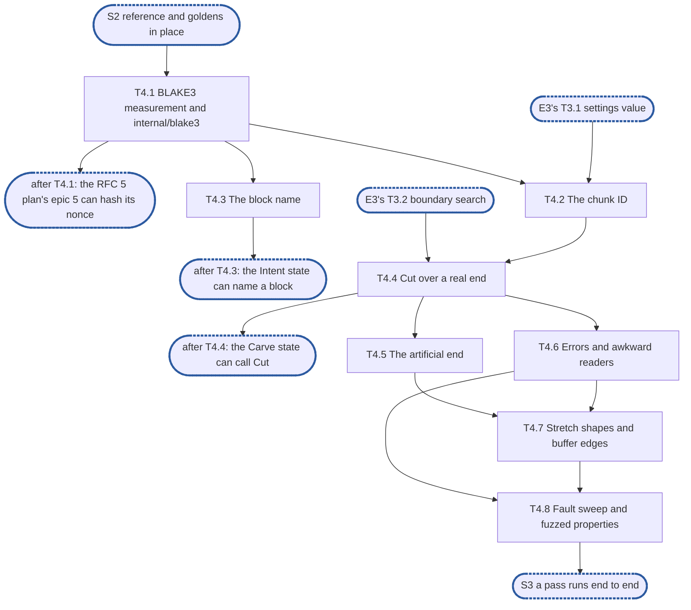

# Epic 4: carver v2 the carver and identity

**Sources:** [RFC 2](../docs/internals/rfcs/rfc-2-carver.md) §2.1, §2.2 and §2.4 (one stretch per
call, borrowed bytes, the artificial end), §4.1 to §4.3 (the chunk ID, the block name, the scope),
§7 (errors), and §1.2 (the carver's half: `Cut`, its buffer, what it never does) and §1.1 (a BLAKE3
implementation among the dependencies). The checks this epic lands: §8's C1, C7 and C4's last chunk
at a stretch end; §9's carver and name rows; §9.1's K2 and K3, as benchmark functions; §10.1's
golden, property and fault kinds for `Cut`; §10.2's stretch-shape, buffer-edge, reader and content
cases; §10.3's fault sweep and its two-buffer-size determinism; §10.4's allocation count for `Cut`
and the golden name; §10.5's memory per call. [RFC 5](../docs/internals/rfcs/rfc-5-transforms.md)
§8.2 T17, the carver's half. [RFC 16](../docs/internals/rfcs/rfc-16-metadata-store.md) §4.2.1, the
namespace ID's raw bytes. [RFC 0](../docs/internals/rfcs/rfc-0-data-lifecycle.md) §1.2, as #5774
amends it: who may import a component's implementation, and the transitive import check. Every citation is `develop`'s
text. The code lands on `feat/storage-v2`, where E1 creates `pkg/carver`, E2
`internal/carvetest` and E3 `internal/chunker`, and the paths below are paths there.
**Track:** B.
**Epic 4 estimate: 8 subtasks, 12.75 man-days.**
**Depends on:** **S2**, the end of E2: `carvetest`'s `Vectors` (the chunk-ID and name vectors),
`Boundaries` and `LoadBoundaries` (the reference chunker and the golden ends and hashes), `Input`,
`Bytes` and `Targets`, `TestBLAKE3Modes` over BLAKE3's published vectors, `unit`'s
`carver-allocs` option and the nightly `fuzz` suite. Through S2, **S1**, the end of E1: `Cut`,
`ChunkID` and `BlockName` behind their final signatures, `carver.Chunk`, `carver.Settings` aliasing
`internal/params.Settings`, the error set of E1's D6, and the import and structure tests
(`imports_test.go`, `arch_test.go`). From **E3**: `chunker.NextBoundary(s params.Settings, buf
[]byte, final bool) int`, which panics on a buffer under `Max` with `final` unset (E3's D4, T3.2),
and `NewSettings`, which checks the chunk-ID key this epic stores (E3's T3.1). T4.1 and T4.3 need
nothing of E3.
**Blocks:** the RFC 8 offload plan's epic 15, which calls `Cut` at its Carve state and `BlockName`
at its Intent state, and its epic 21, whose content wiring hands `ChunkID` and `BlockName` to RFC 4's
codec and whose import walk then reaches `internal/blake3` through `carve`; the RFC 5 plan's epic 5,
whose chunk nonce hashes through `internal/blake3` (T4.1) and whose import allowlist admits it in
that epic's change; E6, which measures the default `Target` through the composed pipeline once S3
is reached, and S3 needs this epic; E7, which runs `BenchmarkCut` as K2 and K3 against `internal/blake3` alone, and
the fault sweep at full size nightly.

---

## 1. Goal

Epic 4 makes `Cut` real: one stretch read through the caller's buffer, every boundary asked of the
chunker, every chunk hashed under its namespace's chunk-ID key and handed to `emit` on borrowed
bytes, with nothing allocated, nothing kept and nothing emitted past the last content-chosen
boundary when the end is artificial. It also gives a block its name, and gives the carver and RFC 5
one BLAKE3 hasher that allocates nothing and starts no goroutine at any chunk size.

**At the end of the epic:**

- `internal/blake3` hashes in BLAKE3's keyed and key-derivation modes with no allocation and no
  goroutine up to 16 MiB, backed by whichever of two implementations the measurement chose, and
  gives BLAKE3's published values (T4.1);
- `carve.ChunkID` hashes a chunk under the key its settings value holds, and matches E2's vector
  (T4.2);
- `carve.BlockName` derives RFC 2 §4.2's name and matches E2's golden vector, each input shown to
  move it (T4.3);
- `Cut` reproduces E2's golden ends and hashes at every profile with no allocation, and its K2 and
  K3 benchmark functions exist (T4.4);
- an artificial end holds back its tail, and offers re-offered from `consumed` cut as one long
  stretch would (T4.5);
- a reader or `emit` failure stops `Cut` with no short chunk, and every awkward reader of RFC 2
  §10.2 is cut correctly or refused (T4.6);
- every stretch shape and buffer edge of RFC 2 §10.2 passes through `Cut` (T4.7);
- the fault sweep and a fuzzed property of C1, C4 and C7 across two buffer sizes and every content
  kind run, the sweep reduced unless its full-size flag is set (T4.8).

### 1.1 In scope

`internal/blake3`, with the measurement that chooses its backing and its own import test; the
chunk-ID key in the settings value; the bodies of `ChunkID`, `BlockName` and `Cut`; the carver and
name rows of RFC 2 §9; §10.2's cases through `Cut`; §10.3's fault sweep; one fuzz target; the
allocation counts of the hasher and of `Cut`; the K2 and K3 benchmark functions; the import rows of
`carve` and `section` once `carve` imports the chunker and `internal/blake3`, and `carvetest`'s
test row once its modes check reaches `internal/blake3`.

### 1.2 Out of scope

- The boundary search, the gear tables and the settings refusals: E3. This epic's buffer-edge and
  reader cases are the evidence for E3's D4 that `Cut` never reaches its panic.
- K2 and K3 on the reference box against their §10.5 ratios, the second architecture, the fault
  sweep's full-size nightly cell: E7.
- Minting a name once per put attempt with a nonce from a cryptographic source, the put intent,
  and refusing a plan under another namespace's key (C8, C11): the RFC 2 plan's deferral-ledger row
  "C8 and C11" (the RFC 8 offload plan's epic 15).
- When a stretch ends, real or artificial, the age exception and widening back (RFC 2 §2.4's two
  exceptions): the ledger row "RFC 2 §2.4's real end at the key budget".
- Deriving the `carver_` series from what `Cut` hands back (RFC 2 §2.3): the ledger row "Deriving
  and exporting the `carver_` series".
- The consumer checks of RFC 2 §10.1's last paragraph, that bytes are copied before `emit` returns
  and that a block holds whole chunks: the ledger row "RFC 2 §5.3's 'a block never mixes two flows
  or two namespaces'".
- Drawing the chunk-ID key for every namespace and never rotating it (RFC 2 §4.1): the ledger row
  "The namespace keys" (RFC 5).
- The name and chunk ID checked on a read by RFC 4's codec (RFC 4 §3.4): tested there, at the
  consumer (the RFC 2 plan's §1.5 rule 5).
- Moving `pkg/transform`'s chunk nonce onto `internal/blake3` and adding it to `pkg/transform`'s
  allowlist: the RFC 5 plan's epic 5, which this epic blocks.

### 1.3 Names used here

- **E1**, epic 1, interfaces: the root contract, `carve` and `assembler` stubbed, `internal/params`,
  and the import and structure tests `imports_test.go` and `arch_test.go`, one row per package.
- **E2**, epic 2, test foundations: `internal/carvetest` (vectors, the BLAKE3 modes check, the
  reference chunker, golden boundaries, seeded inputs), `unit`'s `carver-allocs` option and the
  nightly `fuzz` suite.
- **E3**, epic 3, the chunker: `CheckTarget`, `NewSettings`, the gear tables, `internal/chunker`'s
  `NextBoundary`, `pkg/carver/section`. Track A.
- **E4**, this epic. Track B.
- **E6**, epic 6, integration: RFC 2 Appendix C's sweep through the real offload path, after S3,
  which freezes the default `Target`.
- **E7**, epic 7, E2E green: K1 to K5 on the reference box, the second architecture and the
  full-size runs, in the `carver` group's `carver-bench` suite.
- **S1**, the carver interface agreed: the end of E1.
- **S2**, reference and goldens in place: the end of E2, where this epic starts.
- **S3**, the RFC 8 offload plan's S3, a pass runs end to end: it needs this epic landed.
- **The RFC 8 offload plan**, [`rfc-8-offload-engine-plan.md`](rfc-8-offload-engine-plan.md): its
  epic 15 is the offload pipeline, the first caller of `Cut` and `BlockName`; its epic 21 wires the
  node, including `internal/node/content`.
- **The RFC 5 plan**, [`rfc-5-transforms-plan.md`](rfc-5-transforms-plan.md): its epic 5 is the
  encrypt transform, whose chunk nonce is a keyed BLAKE3 hash over the whole chunk.
- **D1** to **D7** are this epic's decisions (§4). A decision of the RFC 2 plan is written with the
  plan named ("the RFC 2 plan's D5"), and one of E1, E2 or E3 with the epic named ("E3's D4").

## 2. How the general rules apply

The rules are those of
[the RFC 2 plan's §1.5](rfc-2-carver-plan.md#15-general-rules-for-each-epic), cited by number and
title and not copied.

| Rule | Subtasks | How |
| --- | --- | --- |
| rule 1, independent unit tests ([`CLAUDE.md`, "Writing tests"](../CLAUDE.md#writing-tests)) | all | every check builds settings with `NewSettings`, hands `Cut` a reader over a byte slice and a closure, and checks what the closure saw (RFC 2 §1.3). The readers are `bytes.Reader`, `testing/iotest`'s, `io.MultiReader`, and two fault wrappers of a few lines around a real reader (kind 3): `failAt` fails at a chosen byte, `stall` returns zero bytes and no error a chosen number of times before passing reads through. No test double answers in a dependency's place |
| rule 2, fuzz tests where relevant ([`CLAUDE.md`, "Writing tests", "By kind"](../CLAUDE.md#writing-tests)) | T4.8 | `FuzzCut`: fuzzed generator parameters into `Cut`, asserting C1, C4, C7, the tiling, agreement with the reference and two buffer sizes (D7), one command of the `fuzz` suite. `internal/blake3` parses nothing, so it has a table over lengths and write splits instead of a fuzz target (T4.1) |
| rule 3, observability follows RFC 25, with RFC 2's exception | none | `Cut` takes no logger, registry or tracer and counts nothing; what it hands back is all the RFC 8 offload plan's epic 15 needs to derive the `carver_` series, `consumed` included for `carver_held_bytes_total` |
| rule 4, profiling | T4.1, T4.4 | `TestAllocsHasher` and `TestAllocsCut` in `carver-allocs`, skipped under `internal/prof.RaceEnabled`; no goroutine started, counted once, at the hasher, through `runtime/metrics`' `/sched/goroutines-created:goroutines` around the call by a test that never calls `t.Parallel` (D1), since the hasher is the only code on the path that could start one. `Cut` opens no descriptor |
| rule 5, public interface and internals ([`CLAUDE.md`, "Verifying a change"](../CLAUDE.md#verifying-a-change)) | T4.1, T4.4 | `internal/blake3` is checked where its consumer meets it: its allocation count again through `Cut`, at the smallest and largest `Target`. The chunk ID and the name carried into RFC 4's header, and a plan's chunks into the RFC 8 pipeline, are tested at those consumers. No concurrency test: RFC 2 §10.1 |
| rule 6, known failures shrink | none | `unit` and `fuzz` keep no `known.yaml`; every test lands green, each seen to fail on its planted break before the pull request opens |
| rule 7, v2 ignores v1, and imports only what RFC 0 §1.2 allows | T4.1, T4.4 | `internal/blake3` is a library outside the component set, imports the standard library and its chosen backing alone, and has its own import and structure tests (D1); `carve`'s row gains `internal/chunker`, `internal/blake3` and the backing's import path, and `section`'s row the same, since it reaches what `carve` does; `params` imports nothing new (D2), so the chunker's row is unchanged. v1's `pkg/block/carver` is not read |
| rule 8, real dependencies for properties of those dependencies | T4.1 | the hasher is held to BLAKE3's published vectors through E2's `TestBLAKE3Modes`, not to a fake, and against `lukechampine.com/blake3` itself past their longest input; its cost is measured on amd64 and arm64 by T4.1, and its vectors run on arm64 nightly through E2's tests in E7's cell. The reference box is E7's |
| rule 9, code comment conventions ([`CLAUDE.md`, "Code comments"](../CLAUDE.md#code-comments)) | T4.1, T4.2, T4.4, T4.5, T4.8 | `decision:` markers for D1 at `internal/blake3`'s package doc, D2 at `params.WithChunkIDKey`, D3 and D4 at `Cut`'s fill loop, D5 at the artificial-end stop, D6 at the `-carver.sweep-full` flag |
| rule 10, a test must be able to fail | all | each test names its planted break: a key byte changed, two hashes swapped, a refill that drops a byte, an artificial end that cuts its tail, a short chunk emitted on error, a reader's empty reads unbounded |
| rule 11, a symbol is exported only if the RFC's interface uses it | T4.1, T4.2 | none joins S1's frozen surface. `internal/blake3` exports `Hasher` and its `InitKeyed`, `InitDeriveKey`, `Write` and `Sum256` for its two consumers, `carve` and the RFC 5 plan's epic 5. No RFC interface names them, so this is an exception to the rule's letter: they are a library's surface inside the module, exported only because Go's package boundary needs it. `params` gains two package functions inside the carver's tree |
| rule 12, each subtask creates only what it declares | all | `internal/blake3` lands with `ChunkID`, its first consumer, named in T4.1; the measurement's losing candidate is not committed; `params` grows only the key `ChunkID` reads |

## 3. Requirements and invariants

Every obligation RFC 2, RFC 5, RFC 16 and RFC 0 place on the carver's half and on identity, numbered
so subtasks and tests can cite them. Where part of an obligation is another epic's, the row says
which.

**The hash**

| # | Requirement | Kind | Source | Subtasks |
| --- | --- | --- | --- | --- |
| R1 | The carver's dependencies are the standard library, a BLAKE3 implementation and the entity package, and an import test enforces that, transitively: the BLAKE3 implementation `carve` hashes with is D1's package, held to its own row | MUST | RFC 2 §1.1; RFC 0 §1.2 ("a per-component import-graph test that follows imports transitively") | T4.1, T4.4 |
| R2 | Hashing a chunk allocates nothing and starts no goroutine, at every length up to the largest `Max`, 16 MiB, so `Cut` can allocate nothing | bound | RFC 2 §10.4 (allocations), §3.7 (16 MiB `Max`); RFC 2 plan, §1.5 rule 4 ("No package starts a goroutine"); E1's §9 point 1 | T4.1 |
| R3 | The keyed and key-derivation modes give BLAKE3's published values over inputs shorter and longer than one BLAKE3 chunk, on amd64 per change and arm64 nightly; past the published lengths, up to 16 MiB, they give what the library's own API gives, however the input is split into writes | test row | RFC 2 §10.1 (Architecture), §4.1, §4.2; E2's D2 | T4.1 |

**Identity**

| # | Requirement | Kind | Source | Subtasks |
| --- | --- | --- | --- | --- |
| R4 | A chunk ID is BLAKE3's keyed hash of the chunk's bytes under its namespace's 32-byte chunk-ID key, 32 bytes of output, and of nothing else: no offset, file identity, length, settings profile or version is fed into it | MUST NOT | RFC 2 §4.1, §3.2 (Chunk ID), §8 C1 | T4.2, T4.4 |
| R5 | The hash is computed over exactly the bytes handed to `emit`, the chunk as cut, never over a buffer that merely contains it | MUST | RFC 2 §4.1 | T4.4 |
| R6 | One chunk ID equals the committed bytes an independent implementation computed | test row | RFC 2 §9 (derivation golden: "and one chunk ID"); E2's T2.1 (`Vectors`) | T4.2 |
| R7 | The same input cut under two chunk-ID keys gives the same boundaries and every ID different, none equal to the unkeyed BLAKE3 hash of its bytes; so the same file under two namespaces' keys gives disjoint chunk IDs | test row | RFC 2 §9 (chunk IDs are keyed); RFC 5 §8.2 T17 (the carver's half) | T4.2, T4.4 |
| R8 | A block's name is BLAKE3's key derivation under the context `dittofs content-defined block name v2` over `0x10` ‖ the namespace ID's 16 raw bytes ‖ the 16-byte nonce ‖ `0x20` ‖ the 32-byte chain ID ‖ the chunk IDs in block order, with no count, 32 bytes of output; the scope is never the namespace ID's text form, and the function draws no nonce | MUST | RFC 2 §4.2, §4.3; RFC 16 §4.2.1; RFC 2 plan, D9 | T4.3 |
| R9 | Order counts: two blocks holding the same chunks in a different order get different names; the domain is separated from a chunk ID, so a block of one chunk never answers to that chunk's ID; the input is the hashes, never the bytes | MUST | RFC 2 §4.2 ("Five things follow") | T4.3 |
| R10 | A golden name, a fixed non-empty scope, nonce, chain ID and chunk-hash list and the name they give, is committed, and a changed vector fails the build; changing the order of two hashes, the scope, the nonce or the chain ID each gives a different name, and so does a scope encoded with another length byte | MUST, test row | RFC 2 §4.2, §9 (golden name), §10.4 (golden vectors, names) | T4.3 |

**One call to `Cut`**

| # | Requirement | Kind | Source | Subtasks |
| --- | --- | --- | --- | --- |
| R11 | `Cut` reads until the reader is empty and cuts one unbroken stretch; each chunk's offset is a file offset, `base` plus its place in the stretch, and offsets never overflow | MUST NOT | RFC 2 §1.2, §2.1, §10.2 (Stretch shape: "**MUST NOT** overflow") | T4.4, T4.7 |
| R12 | A buffer shorter than `Max` is refused, and so is the zero settings value | MUST | RFC 2 §1.2 ("`Cut` **MUST** refuse a shorter one"); E1's D1, D6 | T4.4 |
| R13 | `Cut` never works out a boundary itself, looks at a fingerprint or depends on how the chunker reached its answer: every chunk end is one `NextBoundary` returned | MUST NOT | RFC 2 §1.2 ("the carver **MUST NOT** work out a boundary itself") | T4.4 |
| R14 | `NextBoundary` is called only with at least `Max` bytes or with `final` set, so E3's panic is never reached | invariant | RFC 2 §1.2, §10.2 (The buffer edge: "`NextBoundary` is never called with fewer than `Max` bytes and `final` unset"); E3's D4 | T4.4, T4.7, T4.8 |
| R15 | On a real end, the last chunk is whatever length is left and may be shorter than `Min`; content is never padded to reach a chunk size; every other chunk is between `Min` and `Max` | MUST NOT | RFC 2 §2.1, §2.4 (Real), §8 C4 | T4.4, T4.7, T4.8 |
| R16 | The bytes handed to `emit` point into the caller's buffer and are good only for that call; `Cut` never allocates a fresh slice per chunk | MUST NOT | RFC 2 §2.2 | T4.4 |
| R17 | Holding the slice passed to `emit` shows it change | test row | RFC 2 §9 (borrowed bytes) | T4.4 |
| R18 | `Cut` makes no heap allocation and holds no buffer of its own but the caller's; its stack holds one `Hasher` (D1) | bound | RFC 2 §10.4 (allocations), §10.5 (allocations; memory per call), §1.2 (Allocates: never) | T4.4 |
| R19 | Every check of `Cut` is settings, a byte slice and a closure: no store, fake backend, temporary directory, network, clock or goroutine | MUST | RFC 2 §1.3, §9 | all |
| R20 | `Cut` reproduces the committed golden ends and hashes at every supported `Target`, under the unkeyed and the keyed table | test row | RFC 2 §10.1 (Golden vectors), §10.4; E2's T2.3 (`LoadBoundaries`) | T4.4 |
| R21 | Identical content cut at two `base` offsets gives one set of hashes | MUST, test row | RFC 2 §9 (hash covers the chunk), §10.2 (Content: "**MUST** produce one set of hashes") | T4.4 |
| R22 | K2's benchmark is `Cut` over 64 MiB of seeded random bytes, hashing included, beside BLAKE3 alone over the same bytes; K3's is `Cut` over all-zero and short-period input; each reports its rate and allocations. E7 runs them and holds them to §10.5 | bound | RFC 2 §9.1 K2, K3, §10.5 K2, K3 | T4.4 |

**The artificial end**

| # | Requirement | Kind | Source | Subtasks |
| --- | --- | --- | --- | --- |
| R23 | On an artificial end, `Cut` emits no byte after the last boundary the chunker found without `final`, never calls `NextBoundary` with `final` set, and returns in `consumed` how many bytes it cut; the tail it holds back is shorter than `Max` | MUST NOT | RFC 2 §2.4, §8 C7 | T4.5, T4.8 |
| R24 | Random input cut as one stretch with a real end, and again as a series of offers ending at arbitrary limits, each re-offered from the previous `consumed`, emits identical chunks, and no call emits a byte past its last content-chosen boundary | test row | RFC 2 §9 (artificial end), §2.4 | T4.5 |
| R25 | An artificial end on a stretch shorter than `Max` with no boundary in it emits nothing and consumes zero; one landing exactly on a boundary found with `Max` bytes in view, which is a cut at `Max` (D5), holds nothing back | MUST | RFC 2 §10.2 (Stretch shape: "**MUST** reach these"), §2.4 | T4.5 |

**Errors**

| # | Requirement | Kind | Source | Subtasks |
| --- | --- | --- | --- | --- |
| R26 | An error from `emit` or from the reader stops the call and is returned as it came; chunks already handed to `emit` are delivered and never taken back | MUST | RFC 2 §7; E1's D6 | T4.6, T4.8 |
| R27 | A part-built chunk held when the error arrives is dropped, never handed over short | MUST | RFC 2 §7 | T4.8 |
| R28 | `Cut` reports nothing as stored and keeps nothing that would let a retry cut differently: a retry over the same bytes delivers exactly the clean run | MUST NOT | RFC 2 §7, §10.3 | T4.6, T4.8 |
| R29 | Failing `emit` mid-stretch, and the reader mid-chunk, delivers no chunk that is a truncated prefix of one the clean path produces | test row | RFC 2 §9 (no short chunk on error) | T4.8 |
| R30 | A reader returning one byte per call is cut as a whole read would be; one returning its last bytes with end-of-stream has them cut, not dropped; one returning zero bytes and no error repeatedly is not taken for the end, and fails `Cut` after a bounded number of such reads | MUST, MUST NOT | RFC 2 §10.2 (Readers that are legal but awkward); RFC 2 plan, D5; E1's R27 | T4.6 |

**The edge cases**

| # | Requirement | Kind | Source | Subtasks |
| --- | --- | --- | --- | --- |
| R31 | Stretch shapes: an empty stretch emits nothing and succeeds; stretches of 1, `Min` − 1, `Min`, `Max` and `Max` + 1 bytes; one an exact multiple of `Max` of repetitive content ends on a chunk of exactly `Max`; `base` at zero, at an odd offset and near the largest file offset | MUST | RFC 2 §10.2 (Stretch shape) | T4.7 |
| R32 | The buffer edge: a boundary exactly where the buffer is refilled, one byte before and one byte after; a chunk exactly as long as the buffer; a buffer of exactly `Max` bytes with no boundary; a `final` buffer shorter than `Min` | MUST | RFC 2 §10.2 (The buffer edge) | T4.7 |
| R33 | Content through `Cut`: random data, zeros, a repeating pattern of period 64, one above 64, and random data with a repetitive middle, each cut within C4's bounds and tiling the stretch | MUST | RFC 2 §10.2 (Content), §3.8 | T4.8 |

**Faults, determinism and properties**

| # | Requirement | Kind | Source | Subtasks |
| --- | --- | --- | --- | --- |
| R34 | The reader fails at every byte offset of a stretch spanning several chunks and at least two buffer refills, and `emit` at every chunk; after each, the chunks delivered are exactly a prefix of the clean run's, byte for byte, none a shortened one, and a retry delivers the clean run | MUST | RFC 2 §10.3 | T4.8 |
| R35 | The same input through two buffer sizes gives identical output | test row | RFC 2 §10.3 ("the property tests run the same input with two buffer sizes and require identical output") | T4.8 |
| R36 | C1, C4 and C7 are fuzzed properties over random input and random valid settings, asserting on what `emit` saw; fuzzing past the seeds runs in the shared nightly fuzz suite and the seeds in `unit`. C2 and C3 are E3's | invariant | RFC 2 §10.1 (Properties), §10.6; RFC 2 plan, §1.4 (the `fuzz` suite), epic 4's expected content ("property fuzzing of C1, C4, C7") | T4.8 |
| R38 | Two implementations over the same random input emit identical chunks: `Cut` and the reference chunker over E2's tables agree on every end | MUST | RFC 2 §10.1 (Differential), §1.3; RFC 2 plan, §1.4 | T4.4, T4.8 |
| R37 | Only the fault sweep runs reduced in a per-change run: every chunk end and buffer refill, one byte either side, and a seeded sample of other offsets, at the smallest `Target`; the full sweep runs in no per-change run, only nightly | bound | RFC 2 plan, D8; RFC 2 §10.6 | T4.8 |

How each row is enforced once this epic lands, where no test of this epic can break it: R1's
transitive walk by E1's `imports_test.go`, which T4.4 extends, and `pkg/transform`'s admission of
`internal/blake3` by the RFC 5 plan's epic 5; R12's key lengths and R8's input
types by the compiler, through E1's signatures; R13 by the package boundary, since `carve` can
read no fingerprint from `NextBoundary`'s `int`, and by R20's goldens and R38's agreement, which a
boundary the carver worked out itself would break; R16's "never a fresh slice" by R18's
count; R19 by E1's import rows, which admit no store or backend package to any carver test, and by
review for a clock, temporary directories and goroutines; R22's ratios by E7.

The candidates of the owned sections that bind other epics are theirs: §2.2's "the carver **MUST**
say so plainly" (E1's T1.3, `Cut`'s doc comment, tested there); §2.1's "the reader **MUST**
supply one unbroken stretch" and §2.4's "the caller **MUST** tell `Cut`" (the RFC 8 offload plan's
epic 15, whose caller holds the holes and the offer); §2.2's "a caller that wants to keep them
**MUST** copy them" (the same epic, checked at the consumer); §2.4's two exceptions (the ledger row
"RFC 2 §2.4's real end at the key budget"); §4.2's minting once, the cryptographic nonce, the
retries reusing a name and the intent, and §4.3's scope unchanged within an attempt and the plan
keyed under one namespace (the ledger row "C8 and C11"); §4.1's key drawn for every namespace and
never rotated (RFC 5); §10.5's "at most 2 × `Max`" for the caller's buffer, which is the caller's
size to choose (RFC 2 §1.2, the RFC 8 offload plan's epic 15).

## 4. Decisions this epic takes

- **D1, chunks and names hash through one shared package, `internal/blake3`, whose backing a
  measurement chooses.** `lukechampine.com/blake3` v1.4.1's `Hasher.Write` starts goroutines once
  its input spans several BLAKE3 chunks and allocates in proportion to it (E1's §9 point 1, 15
  allocations for an 8 KiB keyed hash; `CompressEigentree` in `guts/node.go` runs a `go` statement
  per subtree, checked), so `Cut` cannot call it per chunk and keep R2. The user decided the
  answer: measure the library's exported `guts` primitives (`CompressChunk`, `CompressBuffer`,
  `ChainingValue`, `ParentNode`, `CompressNode`, `WordsToBytes`, checked in v1.4.1) driven by a
  tree hasher of this package's own, against another pure-Go implementation,
  `github.com/zeebo/blake3` v0.2.4 (no `go` statement in its production files, checked; `NewKeyed`
  returns `(*Hasher, error)` and `NewDeriveKey` a `*Hasher`, which passes only if escape analysis keeps it off the heap, and it imports `github.com/klauspost/cpuid/v2`, checked),
  and keep the one with zero allocations and no goroutine at every carver size. T4.1 records the
  figures in its pull request and in the `decision:` at the package doc; the loser is not
  committed. Between two that both pass, the one that adds no module wins, which is the tree
  hasher, since `lukechampine.com/blake3` is already a dependency; speed is E7's K2 to watch. The tree hasher keeps its chaining-value stack in a fixed array, 54 entries, enough
  for any input BLAKE3 can hash, so nothing grows.

  The package lives at the module root's `internal/`, not under `pkg/carver/internal/`: Go's
  internal rule would keep it from `pkg/transform`, and `pkg/transform` may not import `carve`,
  another component's implementation (RFC 0 §1.2). It holds no component's behaviour and no state,
  so it is one of RFC 0 §1.2's "libraries outside this set", as `internal/prof` is to the
  components whose tests read it. Its own `imports_test.go` admits the standard library and the
  chosen backing alone, test files `internal/prof` and `lukechampine.com/blake3` besides, in the
  shape of `internal/prof`'s `TestImportsStandardLibraryOnly`, and its `arch_test.go` refuses a
  package-level variable or an interface, so it stays a library with no state. Every row that
  reaches it names the backing's import path too (`lukechampine.com/blake3/guts` or
  `github.com/zeebo/blake3`), since E1's walk stops at the module's edge and checks each outside
  path against the row (E1's D7). This reading of RFC 0 §1.2 is this epic's: the RFC names no
  shared hash library, and treats one that holds no component's behaviour as outside the
  component set it governs. The surface is the least both
  consumers need: keyed and key-derivation modes, streaming writes (the name's and RFC 5's nonce's
  inputs are several slices), and a 32-byte sum. A `Hasher` holds its chaining-value stack and a 16 KiB group buffer, about 18 KiB on its
  caller's stack, so it is started in place (`InitKeyed`, `InitDeriveKey`) rather than returned by value, which would copy
  them per chunk. No extendable output: E3's gear tables keep
  `lukechampine.com/blake3`, whose inputs are under one BLAKE3 chunk and whose allocations land in
  the constructor (E3's D5). The marker's ceiling: withdraw the package, and call the library
  directly, if a later `lukechampine.com/blake3` neither allocates nor starts a goroutine on a long
  write. Prior art: `internal/prof`, a shared internal package with its own import test (checked);
  Go's `crypto/internal` packages shared by the `crypto/...` tree (from memory). Applied by T4.1.

- **D2, the chunk-ID key sits in the settings value as bytes, and `params` stays a value
  package.** `params.WithChunkIDKey(s Settings, key [32]byte) Settings` returns `s` with the key,
  and `params.ChunkIDKey(s Settings) [32]byte` reads it; `NewSettings`, which E3 has checking the
  key, calls the first after `params.New`. With `internal/blake3` taking the key as bytes, no
  pre-keyed hash state is worth keeping: turning 32 bytes into eight words per chunk costs nothing
  beside hashing the chunk. So `params` imports nothing new, the chunker's import row is not widened
  (E3's §9 point 4), and E1's D1 ceiling, a BLAKE3 import in `params`, is not reached. A separate
  setter rather than a third argument to `params.New` leaves E3's chunker tests, which build values
  over hand-built tables with no key, untouched. A `decision:` at `WithChunkIDKey` says it trusts its
  caller, as `params.New` does, and that only `NewSettings` calls it. Prior art: none found. Applied
  by T4.2.

- **D3, `Cut`'s fill loop is its own, and moves the unread rest to the buffer's front.** While the
  reader is not done and fewer than `Max` bytes past the current chunk's start sit in the buffer,
  `Cut` copies those bytes to the front of `buf` and reads into the rest until the buffer is full or
  the reader is done. A whole chunk is then always in view, and only a stretch's end can leave fewer
  than `Max` bytes. `final` is set only once the reader is done and the end is real. It does not use
  `io.ReadFull` or `io.ReadAtLeast`, which keep calling a reader that returns zero bytes and no error
  (checked, `io/io.go`), and counts such reads instead: the RFC 2 plan's D5, 100 in a row, `io.ErrNoProgress`,
  the bound `bufio.Reader`'s fill uses (`maxConsecutiveEmptyReads`, checked). A buffer of exactly `Max` bytes moves up to
  `Max` bytes per chunk; a larger one moves less often, which is the caller's to size (RFC 2 §10.5,
  at most 2 × `Max`). A `decision:` at the loop says so. Prior art: `bufio.Reader.fill` (checked). Applied by T4.4.

- **D4, `consumed` is what `emit` accepted, and a reader's error stops `Cut` at once.**
  On every return, success or error, `consumed` is the end of the last chunk `emit` returned nil
  for, counted from `base`; a chunk whose `emit` failed is not in it. A reader that returns bytes
  with an error other than `io.EOF` stops the call before those bytes are cut: the extents stay
  dirty and the retry re-reads them (RFC 2 §7), so cutting them first would only deliver chunks the
  pass discards, and the clean-run prefix R34 asks for holds either way. A reader's `io.EOF` with
  bytes is end-of-stream, and those bytes are cut (R30). A negative `base`, or a stretch whose next
  byte would sit past `math.MaxInt64`, fails with an error wrapping `io/fs.ErrInvalid`, the standard
  library's sentinel for an invalid argument, so offsets never overflow (R11); `Cut`'s doc comment
  gains that sentence. Prior art: `io.Copy`, whose count is what the writer accepted (from memory);
  `os.File`'s methods returning `ErrInvalid` on misuse (from memory). Applied by T4.4 and T4.6.

- **D5, an artificial end holds its tail even when that tail ends on a content boundary.** The
  chunker is asked only with at least `Max` bytes in view or with `final` (E3's D4), and an
  artificial end never sets `final` (RFC 2 §2.4). So once fewer than `Max` bytes remain past the
  last boundary, `Cut` stops: a content boundary inside those bytes is not looked for. "One landing
  exactly on a boundary, which holds nothing back" (RFC 2 §10.2) is then reached at a boundary found
  with `Max` bytes in view that is also the stretch's end, which is a chunk cut at `Max`, as an
  exact multiple of `Max` of zeros gives under the unkeyed table (RFC 2 §3.8 promises it for that
  table only). The cost is at most `Max` − 1 bytes re-read per offer,
  which `carver_held_bytes_total` shows, never a different cut. A `decision:` at the stop says so,
  and that it is withdrawn if the chunker gains an answer for "no boundary in this short buffer".
  Prior art: restic's chunker reads ahead to its maximum chunk size before it cuts, unless the
  input has ended (from memory). Applied by T4.5.

- **D6, the fault sweep is sized as the RFC 2 plan's D8 says.** The stretch is 640 KiB of seeded
  random bytes at the smallest `Target`, 64 KiB (`Min` 16 KiB, `Max` 256 KiB), through a buffer of
  `Max` bytes: about ten chunks, and since a buffer of exactly `Max` refills after nearly every
  chunk (D3), about ten refills. By default the reader
  fails one byte before, at and after every chunk end and every refill, and at 256 offsets drawn
  from a fixed seed; only when the test flag `-carver.sweep-full` is set, at every one of the
  655,360 offsets, each followed by a retry, which E7's T7.4 runs nightly. The flag, not
  `testing.Short()`, decides it: `unit` passes `-short` only on pull requests, so a sweep keyed on
  `-short` would run at full size under `-race` in `unit` after every merge and time it out. The
  flag is declared in `carve`'s test files with `flag.Bool`, with a `decision:` saying so. `emit`
  fails at every chunk in both. Prior art: the RFC 2 plan's D8; E7's D6; test-only flags such as
  `-update` for golden files (from memory). Applied by T4.8.

- **D7, `FuzzCut` fuzzes the generator's parameters.** A seed, a content kind of E2's, a length up
  to 4 × `Max`, an index into `carvetest.Targets`, whether the table is keyed, a `base`, a buffer of
  `Max`, `Max` + 1 or 2 × `Max` bytes, and an artificial end's limit. It cuts the stretch twice, at
  two buffer sizes, and with a real end and an artificial one, and asserts: the chunks tile from
  `base`; each is within C4's bounds but the last before a real end; with a real end the ends equal
  `carvetest.Boundaries` over the same table, `Target` and bytes; each hash equals `ChunkID` over the
  same bytes cut at another `base` (C1); the artificial cut's chunks are a prefix of the real cut's,
  its `consumed` their sum and the bytes left under `Max` (C7); both buffer sizes emit the same
  chunks (R35). A fuzzed byte slice rarely grows past `Min`, so the parameters are fuzzed, as E2's
  `FuzzReferenceBounds` and E3's `FuzzNextBoundary` do. Prior art: E2's D6 and E3's D7. Applied by
  T4.8.

## 5. Target tree

```text
internal/blake3/
  blake3.go                T4.1  Hasher, InitKeyed, InitDeriveKey, Write, Sum256; D1's decision:
  blake3_test.go           T4.1  lengths and splits against the library, TestAllocsHasher,
                                 the goroutine count
  imports_test.go          T4.1  the package's own import row (D1)
  arch_test.go             T4.1  no package-level variable, no interface
pkg/carver/
  imports_test.go          T4.1, T4.4  carvetest's test row admits internal/blake3 and its
                                       backing; carve's and section's rows admit internal/chunker,
                                       internal/blake3 and its backing
  internal/params/
    params.go              T4.2  idKey; WithChunkIDKey, ChunkIDKey; D2's decision:
  internal/carvetest/
    vectors_test.go        T4.1  TestBLAKE3Modes also holds internal/blake3
  carve/
    settings.go            T4.2  NewSettings stores the chunk-ID key
    identity.go            T4.2, T4.3  ChunkID, BlockName
    identity_test.go       T4.2, T4.3  vectors, keyed IDs, name perturbations
    cut.go                 T4.4, T4.5, T4.6  Cut, its fill loop; D3's, D4's and D5's decision:
    cut_test.go            T4.4  goldens, two bases, two keys, borrowed bytes, offsets,
                                 TestAllocsCut
    bench_test.go          T4.4  BenchmarkCut (K2, K3)
    end_test.go            T4.5  the artificial end
    errors_test.go         T4.6, T4.8  failAt, stall, the awkward readers; TestFaultSweep and its
                                       -carver.sweep-full flag (D6)
    edges_test.go          T4.7  stretch shapes and buffer edges
    fuzz_test.go           T4.8  FuzzCut (D7)
test/suites.yaml           T4.1, T4.8  carver-allocs reaches ./internal/blake3; FuzzCut's line of
                                       the fuzz suite, its timeouts raised
```

## 6. Subtasks

### T4.1 The BLAKE3 measurement and `internal/blake3`

**Subtask T4.1 estimate: 2.75 man-days.**

- **Track:** B. **Depends on:** none. It adds a row to E2's modes check, so it lands after S2.
- **Covers:** R1 to R3.
- **Deliverables:**
  - The measurement (D1): both candidates, the tree hasher over `lukechampine.com/blake3/guts` and
    `github.com/zeebo/blake3` v0.2.4, in keyed mode at 0, 1, 1,023, 1,024, 1,025 and 16,384 bytes,
    64 KiB, 256 KiB, 1 MiB, 4 MiB and 16 MiB, on amd64 and arm64: `testing.AllocsPerRun`, and the
    change in `/sched/goroutines-created:goroutines` over 100 calls after a `runtime.GC()`. The
    table goes into the pull request and its verdict into the `decision:`.
  - `internal/blake3`, backed by the winner. Consumed by T4.2's `ChunkID`, T4.3's `BlockName`, and
    the RFC 5 plan's epic 5's chunk nonce:
    ```go
    // Package blake3 is BLAKE3's keyed and key-derivation modes with 32 bytes of output, for
    // the paths that hash whole chunks: it allocates nothing and starts no goroutine, at any
    // input length.
    package blake3

    // Hasher hashes in one mode. It holds no pointer to the heap, so a caller declares it on
    // its stack and starts it in place, with no copy of its buffers; its zero value is not a
    // mode, and only InitKeyed and InitDeriveKey start one.
    type Hasher struct{ /* unexported */ }

    // InitKeyed starts h in BLAKE3's keyed mode under key, dropping what h held.
    func (h *Hasher) InitKeyed(key *[32]byte)

    // InitDeriveKey starts h in BLAKE3's key-derivation mode under context, dropping what h
    // held; what is written next is the key material.
    func (h *Hasher) InitDeriveKey(context string)

    // Write absorbs p. Whole groups of BLAKE3 chunks are compressed straight from p when
    // nothing is buffered, so hashing one slice copies at most its last group.
    func (h *Hasher) Write(p []byte)

    // Sum256 returns the first 32 bytes of output over what was written.
    func (h *Hasher) Sum256() [32]byte
    ```
  - `internal/blake3`'s `imports_test.go` and `arch_test.go` (D1). In E1's `imports_test.go`,
    `carvetest`'s test row admits `internal/blake3` and the backing's import path.
  - `unit`'s `carver-allocs` command in `test/suites.yaml` gains `./internal/blake3`, since its
    `./pkg/carver/...` pattern (E2's D7) does not reach the package and `TestAllocsHasher` would
    otherwise count nowhere.
  - In E2's `vectors_test.go`, `TestBLAKE3Modes` also checks `internal/blake3` in keyed mode against
    the first 32 bytes of each published keyed output, and in key-derivation mode against each
    published derived key's first 32 bytes.
- **Acceptance criteria:**
  - Every published keyed and key-derivation vector, at every input length the file holds, gives
    its value through `internal/blake3`.
  - At every length of the measurement, in both modes, `internal/blake3` gives what
    `lukechampine.com/blake3`'s `New(32, key)` and `DeriveKey` give, written whole and split at 1,
    1,023, 1,024, 1,025, 16,383, 16,384 and 16,385 bytes.
  - At every length of the measurement up to 16 MiB, `InitKeyed`, `Write` and `Sum256` together
    make 0 allocations and start 0 goroutines.
  - Production files import the standard library and the chosen backing, nothing else, and declare
    no package-level variable and no interface.
- **Tests:** at `internal/blake3`, which `ChunkID` and the RFC 5 nonce call: `TestBLAKE3Modes`
  over every published row (catches a tree hasher that merges subtrees in the wrong order or sets
  the root flag on the wrong node, which only some lengths show, R3), seen to fail with the root
  flag set on the last chunk rather than the top node; the table of lengths and splits against the
  library (catches an answer that depends on how the input was split into writes, which the name
  and the RFC 5 nonce rely on, and a defect past the published 102,400 bytes, R3), seen to fail
  with a group buffered twice across a split; `TestAllocsHasher`, skipped under `prof.RaceEnabled`,
  at each length (catches a chaining-value stack or a group buffer moved to the heap, R2), seen to
  fail with the stack made a slice; the goroutine count at 16 MiB, in a test that never calls
  `t.Parallel` (catches a backing that parallelises long inputs, as the library's top-level
  `Write` does, R2), seen to fail pointed at that `Write`; the import and structure rows over a
  planted import of `pkg/carver` and a planted package-level variable (catches the package turning
  into part of a component, or holding state, R1). No test double: the library compared against is
  the real one, and the vectors are BLAKE3's.
- **Rules:** rule 4, the counts; rule 7, the rows; rule 8, the published vectors; rule 9, D1's
  `decision:`. Others as §2 says.

### T4.2 The chunk ID

**Subtask T4.2 estimate: 0.75 man-days.**

- **Track:** B. **Depends on:** T4.1, E3's T3.1.
- **Covers:** R4, R6, R7.
- **Deliverables:**
  - `internal/params`, with D2's `decision:`:
    ```go
    // Settings gains idKey [32]byte.

    // WithChunkIDKey returns s holding key as its chunk-ID key. It trusts its caller.
    func WithChunkIDKey(s Settings, key [32]byte) Settings

    // ChunkIDKey is the chunk-ID key s holds; zero on the zero value.
    func ChunkIDKey(s Settings) [32]byte
    ```
  - `NewSettings` stores the chunk-ID key it has checked (E3's T3.1).
  - `ChunkID`'s body: `internal/blake3`'s keyed hash under `params.ChunkIDKey(s)` over `p`,
    panicking on the zero settings value (E1's D1). Consumed by T4.4's `Cut` and, through the
    node's content wiring, by RFC 4's codec.
- **Acceptance criteria:**
  - `ChunkID` under settings built with `Vectors.ChunkIDKey` over `Vectors.ChunkInput` gives
    `Vectors.ChunkID`.
  - Under two keys, the IDs of one input differ, and neither equals `lukechampine.com/blake3`'s
    unkeyed `Sum256` of it.
  - A zero settings value panics.
- **Tests:** at `ChunkID`, as `Cut` and the codec call it: the vector (catches the wrong mode, the
  key read from the wrong field, or a length or offset fed into the hash, R4, R6), seen to fail
  with the chunk's length written before its bytes; the two keys and the unkeyed hash (catches a
  plaintext ID, R7), seen to fail with the key ignored; the zero value. Its allocations are counted
  by `TestAllocsHasher` and through `Cut` by `TestAllocsCut`. No test double.
- **Rules:** rule 9, D2's `decision:`. Others as §2 says.

### T4.3 The block name

**Subtask T4.3 estimate: 1 man-days.**

- **Track:** B. **Depends on:** T4.1.
- **Covers:** R8 to R10.
- **Deliverables:** `BlockName`'s body: `internal/blake3`'s key derivation under the context
  `dittofs content-defined block name v2`, writing `0x10`, the scope's 16 bytes, the nonce, `0x20`,
  the chain ID and each chunk ID in order. Consumed by the RFC 8 offload plan's epic 15 at its
  Intent state, and, through the node's content wiring, by RFC 4's codec for its whole-block read
  check.
- **Acceptance criteria:**
  - `BlockName` over `Vectors.Name`'s scope, nonce, chain ID and IDs gives `Vectors.Name.Name`.
  - Swapping two IDs, changing one byte of the scope, the nonce or the chain ID each gives a name
    other than the golden one; the same input hashed by the test through `internal/blake3` with
    `0x11` for the scope's length byte gives another.
  - The name of a block holding one chunk differs from that chunk's ID and from its keyed hash.
- **Tests:** at `BlockName`, as the Intent state calls it: the golden name (catches a changed
  construction, which orphans every stored block, R8, R10), seen to fail with the context string
  changed; each perturbation (catches a name that ignores order, an input left out, or a scope with
  no length byte, R9, R10), each seen to fail on its own break: the IDs sorted before hashing, the
  nonce not written, the chain ID not written, the scope's length byte left out; the one-chunk
  block (catches a block that answers to its chunk's hash, R9), seen to fail with the context
  dropped and the keyed mode used. The vector's chain ID is E2's, computed from RFC 5 §2.8's table.
  No test double.
- **Rules:** as §2 says.

### T4.4 `Cut` over a real end

**Subtask T4.4 estimate: 2.75 man-days.**

- **Track:** B. **Depends on:** T4.2, E3's T3.2.
- **Covers:** R1, R5, R11 to R22, R38.
- **Deliverables:**
  - `Cut`'s body, with D3's and D4's `decision:` at the fill loop: the settings, buffer and `base`
    checks, the fill loop, `NextBoundary` from each chunk's start with `final` once the reader is
    done, the hash over `buf[start:end]`, `emit` handed `buf[start:end:end]`, so an `emit` that
    appends cannot write over the next chunk's bytes, and `consumed`. `Cut`'s doc comment gains
    D4's sentence on `base`. Consumed by the RFC 8 offload plan's epic 15 at its Carve state, and by
    T4.5 to T4.8.
  - `carve`'s rows in E1's `imports_test.go` admit `internal/chunker`, `internal/blake3` and the
    backing's import path, and `section`'s row the same, since it reaches what `carve` reaches.
  - `TestAllocsCut`, which joins `carver-allocs` by its name.
  - `BenchmarkCut`: per entry `t` of `carvetest.Targets`, a sub-benchmark named `strconv.Itoa(t)`,
    holding four named `Random` (K2), `BLAKE3` (the same bytes through `internal/blake3`'s keyed
    hash in `Target`-sized pieces, K2's baseline), `Zeros` and `Period64` (K3), so the full names
    are `BenchmarkCut/<Target>/<Random|BLAKE3|Zeros|Period64>`, as `BenchmarkCut/262144/BLAKE3`.
    The names are a contract E7's checker reads (E7's T7.1). Each runs over 64 MiB built before
    `b.ResetTimer`, with `b.SetBytes` and `b.ReportAllocs`. Consumed by E7, which runs it as K2
    and K3.
- **Acceptance criteria:**
  - Every golden of `carvetest.LoadBoundaries`, unkeyed and keyed, is reproduced by `Cut`, ends and
    hashes, through buffers of `Max` and 2 × `Max` bytes.
  - A buffer of `Max` − 1 bytes fails with `io.ErrShortBuffer`, the zero value with
    `ErrInvalidSettings`, and a `base` of −1 with `fs.ErrInvalid`, each before a byte is read; at a
    `base` of `math.MaxInt64` − 10, a stretch of 100 bytes fails with `fs.ErrInvalid` before any
    chunk past the largest offset is emitted.
  - The same 8 × `Max` bytes at `base` 0, 1 and 12,345 give one list of hashes, offsets apart by
    the bases; under two chunk-ID keys they give the same ends and no ID in common.
  - The slice handed to `emit` for the first chunk, kept, reads different bytes once a later chunk
    has been emitted.
  - `Cut` over 4 × `Max` bytes makes 0 allocations at 64 KiB and 4 MiB `Target`.
- **Tests:** at `Cut`, as the Carve state calls it: the goldens (catches a refill that drops or
  repeats a byte, a hash over the buffer rather than the chunk, and `Cut` meeting another answer
  than the reference's, R5, R11, R13, R15, R20, R38), seen to fail with the refill moved by one
  byte; the bases (catches an offset fed into the hash, R4, R21), seen to fail with `base` written
  into the hash; the two keys (catches a plaintext ID through the real path, R7); the borrowed
  slice (catches a copy per chunk, R16, R17), seen to fail with `emit` handed a copy; the refusals
  and the offset cases (R11, R12), seen to fail with the overflow check removed;
  `TestAllocsCut`, skipped under `prof.RaceEnabled` (catches an allocation, R18), seen to fail with
  a per-chunk `make`; the import rows over a planted import of `pkg/settings` in `carve` (R1). The
  benchmarks are run, not asserted: E7 holds them to §10.5. No test double.
- **Rules:** rule 4, the count; rule 7, the rows; rule 9, D3's and D4's `decision:`. Others as §2
  says.

### T4.5 The artificial end

**Subtask T4.5 estimate: 1.25 man-days.**

- **Track:** B. **Depends on:** T4.4.
- **Covers:** R23 to R25.
- **Deliverables:** `Cut`'s stop on an artificial end, with D5's `decision:`: no `final`, and a
  return once fewer than `Max` bytes past the last boundary remain and the reader is done.
  `end_test.go`.
- **Acceptance criteria:**
  - Over 32 × `Max` bytes of `Random` at every profile, under both tables, offers ending at limits
    drawn from a fixed seed, each re-offered from the previous `consumed` and the last with a real
    end, emit exactly the chunks one real-end stretch emits.
  - No offer emits a byte past its last content-chosen boundary, and each leaves fewer than `Max`
    bytes after `consumed`.
  - An artificial end on `Max` − 1 bytes of `Random` emits nothing and consumes 0; one on 3 × `Max`
    bytes of `Zeros` under the unkeyed table emits three chunks of `Max` and consumes the whole
    stretch.
- **Tests:** at `Cut`, as the Carve state offers: the series of offers against one stretch (catches
  a tail cut at the limit, which re-cuts every later chunk from a start no earlier cut shares, R23,
  R24), seen to fail with the tail emitted; the limit at every byte of one chunk at the smallest
  `Target` (catches an off-by-one between `consumed` and the last emitted end, R23), seen to fail
  with `consumed` counting the held tail; the two shapes (catches a `final` set on an artificial
  end, and a tail held back after a `Max` cut, R25), seen to fail with `final` set. No test double.
- **Rules:** rule 9, D5's `decision:`. Others as §2 says.

### T4.6 Errors and awkward readers

**Subtask T4.6 estimate: 1.25 man-days.**

- **Track:** B. **Depends on:** T4.4.
- **Covers:** R26, R28, R30.
- **Deliverables:** `Cut`'s error paths (D4) and the zero-read bound (D3); in `errors_test.go`, two
  fault wrappers around a real reader: `failAt{r io.Reader; n int64; err error}`, which returns
  `err` once it has served `n` bytes, and `stall{r io.Reader; n int}`, which returns zero bytes and
  no error on its first `n` calls and then reads through `r`. Consumed by T4.8's sweep.
- **Acceptance criteria:**
  - `emit` failing at its third chunk: `Cut` returns that error, unwrapped, two chunks were
    delivered and `consumed` is their sum, not counting the refused one.
  - A reader returning bytes with a planted error stops `Cut` before those bytes are cut, and the
    error comes back unwrapped.
  - `iotest.OneByteReader` and `iotest.DataErrReader` over the same bytes give the clean run.
  - `io.MultiReader` over `Random` bytes and `iotest.ErrReader` returns the planted error.
  - `stall` with `n` = 100 fails `Cut` with `io.ErrNoProgress`; with `n` = 99 it gives the clean
    run.
- **Tests:** at `Cut`, as the Carve state retries: the refused chunk (catches a refused chunk
  counted in `consumed`, R26, R28), seen to fail with `consumed` advanced before `emit`; bytes with
  an error (catches bytes cut after a failure, D4), seen to fail with those bytes cut first; the
  two `iotest` readers (catches the last bytes with end-of-stream dropped, R30), seen to fail with
  bytes that come with `io.EOF` ignored; the error reader (catches an error wrapped or swallowed,
  R26); `stall` (catches a reader that stalls taken for the end or spun on forever, R30), seen to
  fail with the empty-read bound removed. Each error's chunks delivered and the retry are T4.8's
  sweep, which runs them at every offset. Test doubles: the two readers are fault wrappers around a
  real reader (kind 3).
- **Rules:** rule 1, the wrappers' kind. Others as §2 says.

### T4.7 The stretch shapes and buffer edges

**Subtask T4.7 estimate: 1 man-days.**

- **Track:** B. **Depends on:** T4.5, T4.6.
- **Covers:** R11, R14, R15, R31, R32.
- **Deliverables:** `edges_test.go`, table-driven, each case at the smallest and largest `Target`.
  No production code.
- **Acceptance criteria:**
  - Stretch shapes: 0 bytes emit nothing and succeed with either end; 1, `Min` − 1, `Min`, `Max`
    and `Max` + 1 bytes of `Random`, under both tables, emit what the reference cuts, the last
    possibly under `Min`; 3 × `Max` of `Zeros` under the unkeyed table ends on a chunk of exactly
    `Max`, and under the keyed table matches the reference; `base` 0, 1 and `math.MaxInt64` − 4 ×
    `Max` give offsets that tile from `base`.
  - Buffer edges, at a buffer of `Max` and of `Max` + 1 bytes: a stretch whose boundary falls at
    the refill point, one byte before and one byte after; a chunk exactly the buffer's length;
    `Max` bytes of `Zeros` with a real end; a real-end tail shorter than `Min`. Each gives the
    reference's cut, and no case panics.
- **Tests:** the table above (catches a refill that tiles one byte into two chunks, a chunk the
  length of the buffer cut short, an offset that wraps, a padded last chunk, and a `NextBoundary`
  call under `Max` with `final` unset, which E3's panic turns into a test failure, R11, R14, R15,
  R31, R32), seen to fail with the refill moved by one byte and, for the shapes, with the last
  chunk padded to `Min`. The boundary-at-the-refill stretches are found by cutting seeded input
  with the reference and choosing the seed whose end sits at the offset wanted, so no byte is
  planted; they are also `FuzzCut`'s seeds (T4.8). No test double.
- **Rules:** rule 5, `Cut` as the Carve state calls it. Others as §2 says.

### T4.8 The fault sweep and the fuzzed properties

**Subtask T4.8 estimate: 2 man-days.**

- **Track:** B. **Depends on:** T4.6, T4.7.
- **Covers:** R14, R15, R23, R26, R27, R28, R29, R33 to R38.
- **Deliverables:**
  - `TestFaultSweep` in `errors_test.go`, sized by D6, over T4.6's `failAt`, and the test flag
    `-carver.sweep-full` that runs it at full size, with D6's `decision:`. Consumed by E7's T7.4,
    whose nightly cell sets the flag.
  - `FuzzCut` (D7) with `f.Add` seeds covering every content kind of E2's, both tables, three
    profiles, both ends, the three buffer sizes and T4.7's boundary-at-the-refill stretches; its
    line of the `fuzz` suite, `go test -run=^$ -fuzz=^FuzzCut$ -fuzztime=10m ./pkg/carver/carve`,
    with the suite's timeouts raised by ten minutes and a build.
- **Acceptance criteria:**
  - After a reader failure at each offset D6 names, and an `emit` failure at every chunk, the chunks
    delivered are a prefix of the clean run's, byte for byte, none a truncated prefix of a clean
    chunk, and a retry gives the clean run.
  - Without the flag, with or without `-short`, the sweep takes under a minute on a developer
    machine with the race detector; with it, every offset of D6 runs.
  - For any fuzzed input, the properties of D7 hold; the seeds of every content kind tile within
    C4's bounds and agree with the reference.
- **Tests:** the sweep (catches a chunk delivered short at one offset only, which an example test
  misses, and state left from a failed call, R26 to R29, R34, R37), seen to fail with the
  part-built chunk emitted on a reader error; `FuzzCut`, its seeds run by `unit` (catches a cut
  that depends on the buffer size, an artificial end that emits its tail on some limit, a chunk
  outside C4's bounds, a hash that depends on the offset, a content kind cut wrongly, R14, R15,
  R23, R33, R35, R36, R38), seen to fail with a refill that drops the byte at the buffer's end on
  one size only. The fuzz cell's red on a crasher is `go test`'s own exit status. Test doubles:
  `failAt`, a fault wrapper (kind 3).
- **Rules:** rule 2, the target; rule 9, D6's `decision:`. Others as §2 says.

## 7. Order of work



T4.1 is the riskiest and the one another plan waits on, so it comes first, and it needs nothing of
E3: track B builds it, the chunk ID and the name while E3's boundary search lands (T4.2 also reads
E3's T3.1, which comes first in E3). T4.4 is the last blocker, the `Cut` every later subtask and the
RFC 8 offload plan's epic 15 call. Then the path: the artificial end, the errors, the edge cases
that read both, and the sweep and the fuzz target over all of them. Checkpoints after T4.1 (the RFC 5
plan's epic 5 can hash its nonce), after T4.3 (a block can be named) and after T4.4 (the Carve state
can call `Cut`).

## 8. Suggested pull requests

| PR | Subtasks | Man-days | After | Why together |
| --- | --- | --- | --- | --- |
| 1 | T4.1 | 2.75 | — | the measurement and the shared hasher, which the RFC 5 plan's epic 5 waits on |
| 2 | T4.2, T4.3 | 1.75 | PR 1 | the chunk ID and the block name, the identities RFC 4's codec receives |
| 3 | T4.4, T4.5 | 4 | PR 2 | `Cut` with both ends, what the RFC 8 offload plan's Carve state calls |
| 4 | T4.6, T4.7, T4.8 | 4.25 | PR 3 | the errors, the edge cases and the sweep and fuzz target that read them |

A suggestion only: one pull request per subtask works as well.

## 9. Open points

1. **Estimate against the RFC 2 plan's figure.** The plan says 7 subtasks and 13.5 man-days; this
   document says 8 and 12.75. The BLAKE3 measurement and the shared hasher (T4.1, 2.75 man-days) are
   new since the RFC 2 plan was written; the K2 and K3 benchmark functions sit beside `Cut`'s
   allocation count, the content cases are `FuzzCut`'s seeds, and the error cases the sweep
   already reaches are not written twice, which takes back more than T4.1 adds.
2. **T4.1's size depends on the measurement.** 2.75 man-days is the cost if the tree hasher over
   `guts` wins, since that is code of this package's own. If `github.com/zeebo/blake3` passes both
   counts and the tree hasher does not, the package is a thin wrapper and T4.1 is about 1.5
   man-days, at the cost of a new module, `github.com/zeebo/blake3`. This is the least certain
   figure here.
3. **The goroutine count reads `/sched/goroutines-created:goroutines`**, which go1.26.10's
   `runtime/metrics` has (checked in its `description.go`), the toolchain `feat/storage-v2` pins.
   It counts across the process, so the tests that read it never call `t.Parallel`.
4. **The fault sweep's nightly cost is computed, not measured.** At 655,360 offsets, each run cuts
   on average half of 640 KiB and the retry the whole of it, about 600 GiB of hashing; at the rates
   `internal/blake3` will show that is several minutes to tens of minutes per run. T4.8 measures it
   and E7 sizes its cell's timeout from it; if it is too slow, the answer is an RFC 2 §10.3
   amendment, not a smaller stretch chosen in the test.
5. **Refinements of sibling documents**, which this document does not edit:
   - D4 adds `fs.ErrInvalid` to the errors `Cut` returns, beside E1's D6 set, and a sentence to
     `Cut`'s doc comment, which S1 froze. It is a standard-library sentinel, so no symbol changes;
     the S1 surface's reviewers should confirm it when T4.4 lands.
   - E2's D5 says the golden hashes come from "the library E4's `Cut` will call". `Cut` calls
     `internal/blake3` instead; the values stay valid, since T4.1 holds the package to the same
     published vectors and to the library.
   - E1's D7 row for `carve` names `lukechampine.com/blake3`; T4.4 adds the backing's import path
     beside it, which may be `lukechampine.com/blake3/guts`.
6. **Needs on other plans.** The RFC 5 plan's epic 5 adds `internal/blake3` and its backing's
   import path to `pkg/transform`'s allowlist and hashes its nonce through it; the RFC 8 offload
   plan's epic 21 allows both in the content wiring's import walk, which reaches them through
   `carve`; E7's K2 baseline is `BenchmarkCut`'s `BLAKE3` sub-benchmark, the implementation `Cut`
   calls.
