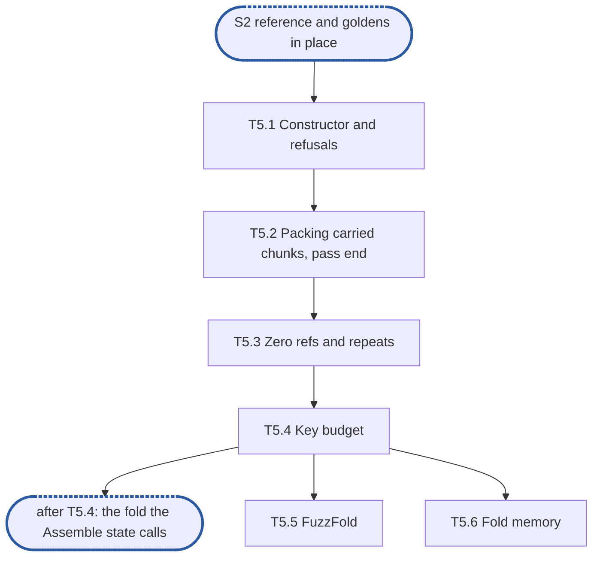

# Epic 5: carver v2 the block assembler

**Sources:** [RFC 2](../docs/internals/rfcs/rfc-2-carver.md) §5.1 to §5.7 (the fold's inputs and
dispositions, P1 to P6, the block target, packing across files, the short last block, a plan with
no bytes, A1 to A7 and the check table), §1.3 (a check needs no fixture), §10.2's block-target edge
cases and §10.6 (where §5.7's checks run). [RFC 6](../docs/internals/rfcs/rfc-6-block-metadata.md)
§4.1 (one commit per block, the zero-ref commit) and §5.2 (the key budget `K`), as the commit a plan
becomes. [RFC 8](../docs/internals/rfcs/rfc-8-engine.md) §6.2 (the offload maximum age) and §6.3,
the Assemble and Commit states, which drive the fold and commit its plans.
[RFC 0](../docs/internals/rfcs/rfc-0-data-lifecycle.md) §1.2: an invalid setting is refused, never
replaced. Every citation is `develop`'s text. The code lands on `develop`, where E1 creates
`pkg/carver/assembler`, and the paths below are paths there.
**Track:** C.
**Epic 5 estimate: 6 subtasks, 9 man-days.**
**Depends on:** **S2**, the end of E2: `unit`'s `carver-allocs` option (tests named `TestAllocs…`,
skipped under `internal/prof.RaceEnabled`), the nightly `fuzz` suite as a list of commands, and the
import-test row that lets every carver package's tests import `internal/prof`. Through S2, **S1**,
the end of E1: `assembler.Fold`, `New`, `Add` and `Finish` behind their final signatures;
`carver.ChunkInfo`, `AssemblerConfig`, `BlockPlan` with `Carried` and `Refs`, `Disposition` with
`Carried` and `ZeroRef`, `MinBlockTarget`, `MaxBlockTarget` and `ErrInvalidSettings`; E1's
`arch_test.go` and `imports_test.go` rows for `assembler`. Nothing of E3 or E4: the fold's tests
build chunk streams by hand.
**Blocks:** S3, through the RFC 8 offload plan's epic 15, whose Assemble state folds each pass's
chunks and whose Commit state commits each plan, a plan with no carried chunk as the zero-ref
commit; E7, which runs `FuzzFold` in the nightly `fuzz` suite.

---

## 1. Goal

Epic 5 makes the fold real: a pure function, chunk by chunk, from one pass's chunk stream to the
block plans RFC 8's pipeline names, puts and commits. A block carries whole chunks up to its
target in carried bytes, at most `N` of them, and never a commit's worth of keys past `K`; zero
refs ride in the nearest block's commit and are carried by none; a chunk repeated in one block is
carried once; the last block of a pass is held back while it is short and young.

**At the end of the epic:**

- `New` refuses a block target outside 1 MiB to 64 MiB, and a count cap, key count or age it
  cannot honour, with `ErrInvalidSettings` (T5.1);
- `Add` packs carried chunks across files by the target and the count cap, and `Finish` holds back
  a short last plan until its oldest byte reaches the maximum age (T5.2);
- an all-zero chunk is a zero ref in the nearest plan's `Refs`, never in `Carried`, a pass of zeros
  alone whose keys fit `K` gives one plan with no carried chunk, and a chunk repeated within one
  block is carried once and referenced each time (T5.3);
- no plan's keys pass `K`, the per-block and per-file keys counted, and a block closed at `K` is
  never held back (T5.4);
- `FuzzFold` asserts A1 to A3, A5 to A7 and the key budget over random chunk streams, nightly past
  its seeds (T5.5);
- the fold's memory does not grow with the chunks' sizes, measured in `carver-allocs` (T5.6).

### 1.1 In scope

The bodies of `New`, `Add` and `Finish`; every row of RFC 2 §5.7's check table but the two that
need the lookup; §10.2's block-target edge cases; one fuzz target and its line in the `fuzz`
suite; the memory check.

### 1.2 Out of scope

- The dedup lookup, the adopted disposition and §5.7's two rows "with the lookup": the RFC 2
  plan's deferral-ledger row "The dedup lookup and the adopted disposition".
- §5.3's "a block never mixes two flows or two namespaces", and the consumer checks that a block
  holds whole chunks and that bytes are copied before `emit` returns: the ledger row "RFC 2 §5.3's
  'a block never mixes two flows or two namespaces'" (the RFC 8 offload plan's epic 15), which
  decides what one fold folds.
- Setting each chunk's all-zero flag from its bytes, and its age: the ledger rows "Setting each
  chunk's all-zero flag" and "A time per extent for each chunk's age"; the fold takes both as
  given.
- Counting each chunk's worst-case keys and a commit's per-block and per-file keys, and ending a
  stretch before one chunk's keys pass `K`: the ledger row "RFC 2
  §2.4's real end at the key budget" (the RFC 8 offload plan's epic 15); the accessor for `K`, that
  epic too (the RFC 2 plan's D3).
- The block-target key in RFC 13's table and its startup check: the ledger row "The block-target
  key in RFC 13's table" (the RFC 4 plan's epic 7). `New`'s refusal is the fold's own defence.
- Randomised assembly (RFC 2 §5.6): the ledger row "Randomised assembly".
- `FuzzFold` on the second architecture: E7 runs its seeds there, and fuzzing past them stays on
  amd64 (E7's D5).

### 1.3 Names used here

- **E1**, epic 1, interfaces: the root contract, `carve` and `assembler` stubbed, `internal/params`,
  and the import and structure tests `imports_test.go` and `arch_test.go`, one row per package.
- **E2**, epic 2, test foundations: `internal/carvetest`, `unit`'s `carver-allocs` option and the
  nightly `fuzz` suite.
- **E3**, epic 3, the chunker, and **E4**, epic 4, the carver and identity: tracks A and B, of
  which this epic needs nothing.
- **E5**, this epic. Track C.
- **E7**, epic 7, E2E green: the nightly and manual runs, the full-size fuzzing among them.
- **S1**, the carver interface agreed: the end of E1.
- **S2**, reference and goldens in place: the end of E2, where this epic starts.
- **S3**, the RFC 8 offload plan's S3, a pass runs end to end: it needs this epic landed.
- **The RFC 8 offload plan**, [`rfc-8-offload-engine-plan.md`](rfc-8-offload-engine-plan.md): its
  epic 15 is the offload pipeline, whose Assemble state is the fold's one caller.
- **The RFC 4 plan**, [`rfc-4-remote-tier-plan.md`](rfc-4-remote-tier-plan.md): its epic 7 holds the
  block-target setting's startup check.
- **D1** to **D6** are this epic's decisions (§4). A decision of the RFC 2 plan is written with the
  plan named ("the RFC 2 plan's D3"), and one of E1 with the epic named ("E1's D3").

## 2. How the general rules apply

The rules are those of
[the RFC 2 plan's §1.5](rfc-2-carver-plan.md#15-general-rules-for-each-epic), cited by number and
title and not copied.

| Rule | Subtasks | How |
| --- | --- | --- |
| rule 1, independent unit tests ([`CLAUDE.md`, "Writing tests"](../CLAUDE.md#writing-tests)) | all | every check folds a `[]carver.ChunkInfo` built in the test and reads the plans and dispositions that come back (RFC 2 §5.7: a pure function of a chunk stream and settings). Time is an input: each chunk's `Oldest` and `Finish`'s `now` are plain `time.Time` values. No test double, and no lookup to stand in for |
| rule 2, fuzz tests where relevant ([`CLAUDE.md`, "Writing tests", "By kind"](../CLAUDE.md#writing-tests)) | T5.5 | `FuzzFold`: fuzzed generator parameters into a chunk stream and a configuration, asserting A1 to A3, A5 to A7, the key budget and the tiling, one command of the `fuzz` suite. A4 needs no fuzzing: no type the fold takes or returns can hold bytes (E1's `TestPlanHoldsNoBytes`). The fold parses nothing off a disk or a wire |
| rule 3, observability follows RFC 25, with RFC 2's exception | none | the fold takes no logger, registry or tracer and counts nothing; the plans and dispositions it returns are what the RFC 8 offload plan's epic 15 derives its series from |
| rule 4, profiling | T5.6 | `TestAllocsFoldMemory` in `carver-allocs`, skipped under `internal/prof.RaceEnabled`, reads `prof.LiveHeap` around a fold of 1 GiB of chunks. No goroutine and no descriptor: there is nothing to leak-check |
| rule 5, public interface and internals ([`CLAUDE.md`, "Verifying a change"](../CLAUDE.md#verifying-a-change)) | all | every test calls `New`, `Add` and `Finish` as the Assemble state does. A plan carried into `kvstore.BlockCommit`, and a held plan's extents left dirty, are tested at that consumer, the RFC 8 offload plan's epic 15. No concurrency test: one fold serves one pass, and RFC 2 §10.1 says nothing is shared |
| rule 6, known failures shrink | none | `unit` and `fuzz` keep no `known.yaml`; every test lands green, each seen to fail on its planted break before the pull request opens |
| rule 7, v2 ignores v1, and imports only what RFC 0 §1.2 allows | all | `assembler` imports the root, `internal/params` with it, `pkg/metadata/entity` and the standard library, as E1's row allows; nothing widens it. Its tests add `internal/prof` (T5.6), which E2's row admits. v1's `pkg/block/carver` assembly is not read |
| rule 8, real dependencies for properties of those dependencies | none | nothing here tests a property of BLAKE3, a disk or a host |
| rule 9, code comment conventions ([`CLAUDE.md`, "Code comments"](../CLAUDE.md#code-comments)) | T5.1, T5.3, T5.4 | RFC 2 §5.2's `decision:` and D5's at `New`'s checks (T5.1); D1's at the lazy close (T5.3); D2's at the per-block charge, D3's at the per-file charge and D4's at the close before a chunk over `K` (T5.4) |
| rule 10, a test must be able to fail | all | each test names its planted break: a target counted in all bytes, a block closed at a file's end, a zero chunk carried, a repeat carried twice, the per-file keys charged per chunk, a short last plan put while young, a zero ref's age ignored, the per-block keys charged to a plan with no carried chunk |
| rule 11, a symbol is exported only if the RFC's interface uses it | none | nothing joins S1's frozen surface; every helper is unexported |
| rule 12, each subtask creates only what it declares | all | no new package; each test file lands with the subtask whose check it holds. T5.2's stream builders and `checkPlans` are test code its own tests use first |

## 3. Requirements and invariants

Every obligation RFC 2 §5 and the sources above place on the fold, numbered so subtasks and tests
can cite them. Where the obligation's other half is the caller's, the row says so.

**What the fold returns**

| # | Requirement | Kind | Source | Subtasks |
| --- | --- | --- | --- | --- |
| R1 | Each chunk gets one disposition: an all-zero chunk is a zero ref, which no block carries; every other chunk is carried, in the pending plan. No chunk is adopted, since the first release has no lookup | invariant | RFC 2 §5.1 (its table; "until then no chunk is adopted, and the fold carries every chunk that is not all zeros"), P3 | T5.2, T5.3 |
| R2 | A plan lists each carried chunk once, in block order, with its hash and where its bytes sit, and every ref its commit writes, in input order, repeats and zero refs included, so one commit records the refs of every file in the block | invariant | RFC 2 §5.1, §5.3 ("One commit per block"), P6; RFC 6 §4.1 | T5.2, T5.3 |
| R3 | One fold serves one pass: it does no I/O, keeps nothing between passes and is used no more once its pass is closed | MUST NOT | RFC 2 §5.1 ("MUST NOT survive its pass"), §5.4 ("Holding back keeps the assembler per pass") | T5.2 |
| R4 | The fold never copies the bytes `emit` lent: a plan records hashes and positions, and its memory does not grow with the chunks' sizes | MUST NOT | RFC 2 §5.5, A4 | T5.6 |

**Packing**

| # | Requirement | Kind | Source | Subtasks |
| --- | --- | --- | --- | --- |
| R5 | A block holds whole chunks only: every chunk of the input reaches exactly one plan, unchanged, and none is split to make a block an exact size | invariant | RFC 2 P1, A1 | T5.2 |
| R6 | A block ends when its carried bytes reach the block target, overshooting it by at most one chunk, or when it reaches the count cap, whichever comes first | invariant | RFC 2 P2, A1 | T5.2 |
| R7 | A block holds at most `N` carried chunks, `N` the count cap the pass is given, never more than the block format's 1,024 | invariant | RFC 2 P4, A1 | T5.1, T5.2 |
| R8 | The target counts carried bytes: a zero ref, and a repeat carried once already, add nothing to it | invariant | RFC 2 P5, P6 | T5.3 |
| R9 | A block falls short of its target only when the count cap or the key budget closed it, or it is the last of its pass; a file's end never closes a block | invariant | RFC 2 P2, A7, §5.3; RFC 8 §6.3 (Assemble: "the pass closes no block before it reaches the target or the count cap except its last") | T5.2, T5.4 |
| R10 | Blocks are cut from the chunks of every file in the pass, one file after another, by P1 to P5 alone, so one block may hold the tail of one file, several files whole and the head of another | invariant | RFC 2 §5.3 | T5.2 |
| R11 | A file's chunks within a block are contiguous and in offset order: the fold keeps the order it is given, which the caller supplies in file order, file after file | invariant | RFC 2 §5.1, §5.3, A5 | T5.2 |
| R12 | A block holds only the chunks whose bytes it carries: no all-zero chunk is in a plan's carried chunks | invariant | RFC 2 P3, A2 | T5.3 |
| R13 | Zero refs within no block's span, before a stretch's first carried chunk, after its last, or in a stretch that is all zeros, join the commit of the nearest block of the pass; which block is nearest is D1's. Zero refs that would take that commit past `K` close it and commit in zero-ref commits, plans with no carried chunk, each within `K`, in the middle of a pass as at its end (D2) | invariant | RFC 2 P2; RFC 6 §4.1 | T5.3, T5.4 |
| R14 | A pass whose carved extents hold only all-zero chunks has no block: its zero refs commit in zero-ref commits, each within `K` like any commit and as many as `K` needs, which the fold returns as a plan with no carried chunk | MUST | RFC 6 §4.1 ("Zero refs with no block commit alone"); RFC 8 §6.3 (Commit); E1's D3 | | T5.3, T5.4 |
| R15 | A chunk repeated within one pending block is carried once and referenced each time; one repeated across blocks is carried in each; nothing else is reused without a lookup | invariant | RFC 2 P6, A6; `kvstore.BlockCommit`, which refuses a chunk carried twice | T5.3 |

**The key budget**

| # | Requirement | Kind | Source | Subtasks |
| --- | --- | --- | --- | --- |
| R16 | A block ends early, at a chunk boundary, when the next chunk would take its commit past the key budget `K`, the keys of the zero refs its commit writes counted | MUST | RFC 2 P2, §5.1; RFC 8 §6.3 (Assemble); RFC 6 §5.2 | T5.4 |
| R17 | The fold charges the per-block keys once to each plan that carries a chunk, and none to a zero-ref commit, and the per-file keys once for each file with a chunk or a zero ref in it | invariant | RFC 2 §5.1; RFC 8 §6.3 (Assemble) | T5.4 |
| R18 | No plan's keys exceed `K`; a chunk whose keys, with the per-block and per-file keys, are exactly `K` sits alone in its block, and the block after a close at `K` starts with the chunk that did not fit | bound | RFC 2 P2, §5.7 (P2 key budget) | T5.4 |
| R19 | A block closed at `K` counts as a short block, which A3 does not limit, and is never held back | invariant | RFC 2 P2, A3, §5.4 | T5.4 |
| R20 | The fold never splits a commit: a chunk's refs ride in one plan. No chunk passes `K` alone, because the caller ends its stretch first (the RFC 8 offload plan's epic 15); a chunk that would gets a plan of its own, the one plan over `K` (D4) | invariant | RFC 2 P2 ("the caller **MUST** end a stretch"; "the assembler never splits a commit") | T5.4 |

**The short last block**

| # | Requirement | Kind | Source | Subtasks |
| --- | --- | --- | --- | --- |
| R21 | The pass's last block, when short of the target, may be held back: `Finish` returns it as held, so the caller puts none of it and its extents stay dirty for the next pass | invariant | RFC 2 §5.4 ("**MAY** hold it back"), §5.1 | T5.2 |
| R22 | A short last block is put, however short, once its oldest chunk's bytes reach the offload maximum age | MUST | RFC 2 §5.4; RFC 8 §6.2 | T5.2 |
| R23 | At most one short last block is put per pass, and none waits past the age ceiling; blocks the count cap or `K` closed are not last blocks and are never held | invariant | RFC 2 §5.4, A3 | T5.2, T5.4 |

**Settings**

| # | Requirement | Kind | Source | Subtasks |
| --- | --- | --- | --- | --- |
| R24 | A block target outside 1 MiB to 64 MiB is refused, never clamped, and nothing is assembled | MUST | RFC 2 §5.2, §10.2 (Settings) | T5.1 |
| R25 | Any other pass configuration the fold cannot honour is refused with an error, never replaced by a default (D5) | MUST | RFC 0 §1.2 ("an invalid setting **MUST** be refused, never replaced by a default") | T5.1 |

**The checks**

| # | Requirement | Kind | Source | Subtasks |
| --- | --- | --- | --- | --- |
| R26 | P1, P2, P4: random chunk streams, and 5,000 chunks of 1 KiB between holes; every block ends on a chunk, overshoots by at most one chunk and holds at most `N` | test row | RFC 2 §5.7 | T5.2, T5.5 |
| R27 | P3 zero chunks: a stream with all-zero chunks; none is in a plan's carried chunks, each is a zero ref | test row | RFC 2 §5.7 | T5.3 |
| R28 | P5 zero refs: carried chunks between runs of zero chunks, no cap or `K` closure; every block but the last reaches the target in carried bytes | test row | RFC 2 §5.7 | T5.3 |
| R29 | P6 repeats: one chunk three times in one block's span and once past its end; the first block carries it once with three refs, the second carries it again | test row | RFC 2 §5.7 | T5.3 |
| R30 | §5.3 packing: 10³ files of 64 KiB; ⌈total / target⌉ plans, each file's chunks contiguous in one plan or split only at a block end | test row | RFC 2 §5.7 | T5.2 |
| R31 | §5.4 short last block: a pass finished short with its oldest chunk young, then old; held, then put | test row | RFC 2 §5.7 | T5.2 |
| R32 | §5.5 no bytes: 1 GiB of chunks; the fold's memory is independent of chunk size, and the slices `emit` handed over are not retained | test row | RFC 2 §5.7 | T5.6 |
| R33 | P2 no short block mid-pass: many files whose chunks end between blocks at every possible point, no cap or `K` closure; every block but the last reaches the target | test row | RFC 2 §5.7 | T5.2 |
| R34 | P2 key budget: the close at `K` and the next block's first chunk; zero refs over existing refs closing a block before `K`; one chunk at exactly `K`, alone; zero refs before the first carried chunk, after the last and in an all-zero stretch, each in the nearest block's commit within `K` | test row | RFC 2 §5.7 | T5.4 |
| R35 | Block target range: 512 KiB and 128 MiB refused at startup with nothing assembled; exactly 1 MiB and 64 MiB accepted; and one byte past each bound refused | test row | RFC 2 §5.7, §10.2 (Settings) | T5.1 |
| R36 | Each check is a pure function of a chunk stream and settings, needing no fixture; they run in `unit`, and fuzzing past the seeds in the nightly `fuzz` suite | invariant | RFC 2 §5.7, §1.3, §10.6; RFC 2 plan, §1.5 rule 2 | all |

How each row is enforced once this epic lands: R4's "a plan records hashes and positions" and R32's
"the slices `emit` handed over are not retained" by E1's `TestPlanHoldsNoBytes`, which walks
`BlockPlan` and every `ChunkInfo` in it and fails on any byte slice, so the fold is handed none to
keep; this epic measures the rest (T5.6). R20's caller half by the RFC 8 offload plan's
epic 15, whose Carve state ends the stretch, and RFC 6 §5.2's floor, checked at start by the same
epic. R21's "its extents stay dirty" by that epic's Commit state, which E1's `Finish` doc comment
holds to it; what the pass returns for a file whose extents a held plan kept is RFC 8 §6.3's, the
RFC 2 plan's ledger row "A held plan's outcome". Every other row has a test here.

The candidates of the owned sections that bind other components are theirs: §5.1's lookup error
and §5.7's two rows "with the lookup" (the deferral-ledger row of the dedup lookup); §5.3's single
share and namespace, and §10.1's consumer checks (the RFC 8 offload plan's epic 15); §5.5's put
reading the bytes from the offer (RFC 8 §6.3, the Put state); §5.2's block target as a remote-store
setting, its default and its benchmark (RFC 13's table, the RFC 4 plan); §5.6's randomised
assembly (the ledger row). §5.6's sequential assembly needs no row: the fold keeps the input's
order (R11).

## 4. Decisions this epic takes

- **D1, a full block stays open for the zero refs that follow it.** RFC 2 P2 has zero refs outside
  every block's span join "the nearest block of the pass" without saying which, for zero refs
  between two blocks. A block that reaches its target or the count cap is not returned at once: it
  stays the open plan, and the zero refs after it join its `Refs`, until a non-zero chunk arrives,
  a zero ref would take it past `K`, or `Finish` closes the pass. Zero refs before the first carried
  chunk start the first plan; zero refs between two blocks ride with the earlier one; zero refs
  after the last ride with the last. So the open plan always is the nearest block, no plan is
  reopened, and `Add` returns at most one plan, the one the chunk closed. A non-zero chunk closes a
  full plan even when it repeats one of its chunks, which keeps P6's "once more past the block's
  end" a second carry. A `decision:` at the close says so, and that the choice changes only which
  commit a zero ref rides in, never a block's bytes, so it can change with no migration. Prior
  art: none found.
- **D2, a plan with no carried chunk is the zero-ref commit, is never held back, and is not charged
  the per-block keys.** It is RFC 6 §4.1's zero-ref commit, for a pass of zeros alone (R14) and for
  zero refs that fit no block's commit (R13). `Finish` returns it with `held` false: holding back
  exists to spare a short put (RFC 2 §5.4), and this plan has no put; RFC 8 §6.3's all-zero check
  wants its extents reported in the same pass. A plan is charged the per-block keys when it gains
  its first carried chunk, not when it opens: a zero-ref commit writes none of them (no intent
  delete, block record or GC index key), and charging them at open splits a pass of zeros that fits
  one commit (at `K` = 20, per-block keys 5 and per-file keys 1, 18 zero refs of one key each close
  at 14). The chunk that would take a plan of zero refs past `K` with the per-block keys closes it
  as a zero-ref commit and starts the next. A zero ref that would take a zero-ref plan past `K` closes it the same way:
  a zero run longer than `K`'s worth folds to several zero-ref commits, each charged its files' keys. A zero-ref plan in the middle of a pass is routine, not
  a caller fault: at `K` = 100, per-block and per-file keys 1, a chunk of 90 keys, 20 zero refs and
  a chunk of 90 keys fold to [the first chunk and 8 zero refs], [12 zero refs] and [the second
  chunk], and no stretch end avoids it: two block commits hold at most 200 keys, and the chunks and
  zero refs need 204. A `decision:` at the charge says both. Prior art: none found.
- **D3, the open plan keeps a set of its hashes, and charges a file when the file changes.** P6
  needs to know whether a carried chunk is already in the open plan: a map keyed by
  `entity.ChunkHash`, cleared with `clear` when the plan closes, holding at most `N` hashes. The
  per-file keys are charged when a ref's file differs from the previous ref's in the plan, and at a
  plan's first ref. That is exact for the order RFC 2 §5.1 requires, file after file, and on any
  other order it charges a file that returns twice, never too little, so it needs no set of files.
  A `decision:` at the charge names that. Prior art: `kvstore.BlockCommit`'s commit refuses a block
  that carries one chunk twice (`pkg/metadata/kvstore/offload.go` on `feat/storage-v2`, checked).
- **D4, a chunk that alone passes `K` gets a plan of its own, with no code of its own.** RFC 2 P2
  makes the caller end a stretch before any chunk's keys, with the per-block and per-file keys,
  could pass `K`, and RFC 6 §5.2's floor makes that always possible, so such a chunk means a caller
  that broke P2. `Add` cannot return an error (E1's D5), and P2 has every block hold at least one
  chunk, so the general rule applies: the chunk closes the open plan, if it holds a ref, and starts
  the next, which the next chunk closes in turn. The plans around it stay within `K`, and the one
  over it holds a single chunk. Its ceiling: the Commit state cannot apply it, and RFC 8 §6.3's
  over-`K` path re-offers it, so the same chunk is carved, planned and refused on every pass until
  the caller is fixed; the RFC 8 offload plan's epic 15 checks a plan's keys before its Intent, so no
  put is made for it (§9 point 3). A `decision:` at the close names that ceiling, and that it is
  withdrawn when `Add` gains its error with the dedup lookup. A panic would end the node on a
  value that depends on the store's refs at run time; reuse after `Finish` (R3) panics instead,
  because no input can cause it and any test of the caller finds it. Prior art: none found.
- **D5, `New` refuses what the fold cannot honour.** Beyond RFC 2 §5.2's range, it refuses, with
  `ErrInvalidSettings` wrapped with the field: a count cap under 1 or above 1,024, the block
  format's `N` (RFC 2 P4); a key budget under 1; per-block or per-file keys under 0; a negative
  maximum age. The 1,024 is an unexported constant with a `decision:` saying it is P4's constant of
  the block format version, changed with a format version that raises it, beside RFC 4's codec. It
  does not refuse a key budget too small for the per-block and per-file keys and one chunk: that
  is RFC 6 §5.2's floor, checked at start by the RFC 8 offload plan's epic 15, and `K` is derived,
  never configured. Prior art: none found.
- **D6, the last plan's age is its oldest ref's, zero refs included, and "reach" includes equal.**
  RFC 2 §5.4 puts a short last block once "its oldest chunk's bytes reach the offload maximum
  age". The zero refs riding in it are dirty extents held with it, so their ages count too.
  `Finish` holds the plan while `now` minus the oldest `Oldest` is under `MaxAge`, and puts it at
  `MaxAge` exactly. A zero `Oldest` is older than any `now`, so it is put. Prior art: none found.

## 5. Target tree

```text
pkg/carver/assembler/
  assembler.go          T5.1  New's checks, with RFC 2 §5.2's decision: and D5's
                        T5.2  Add and Finish over carried chunks: target, count cap, the hold
                        T5.3  zero refs, the lazy close (D1), the zero-ref plan (D2), repeats (D3)
                        T5.4  the key budget, the per-block and per-file charges (D2, D3), D4
  assembler_test.go     T5.1  TestNewRefusesBlockTarget, TestNewRefusesConfig
                        T5.2  the P1/P2/P4, packing, no-short-block and short-last-block checks
                        T5.3  the P3, P5 and P6 checks
                        T5.4  the P2 key-budget check
  stream_test.go        T5.2  the chunk-stream builders and checkPlans; T5.3, T5.4 extend checkPlans
  fuzz_test.go          T5.5  FuzzFold, its seeds added with f.Add
  memory_test.go        T5.6  TestAllocsFoldMemory
test/suites.yaml        T5.5  FuzzFold's line in the fuzz suite, its timeouts raised
```

## 6. Subtasks

### T5.1 The constructor and its refusals

**Subtask T5.1 estimate: 0.5 man-days.**

- **Track:** C. **Depends on:** S2.
- **Covers:** R7, R24, R25, R35.
- **Deliverables:** `New`'s body in `assembler.go`: the block-target check against
  `carver.MinBlockTarget` and `carver.MaxBlockTarget`, carrying RFC 2 §5.2's `decision:` (the upper
  bound derived from P4 and the default `Target`, the default and the floor proposals, the floor
  lowered if RFC 4 Appendix B's benchmark finds a service flat below 1 MiB); D5's checks and their
  `decision:`, each wrapping `ErrInvalidSettings` with the field and the rule. A refused `New`
  returns a nil `*Fold`. Consumed by T5.2, whose fold starts from it, and by the RFC 8 offload
  plan's epic 15, which builds one fold per pass.
- **Acceptance criteria:**
  - A block target of 512 KiB, 128 MiB, 1 MiB − 1 and 64 MiB + 1 byte is refused with
    `ErrInvalidSettings` and a nil fold; 1 MiB and 64 MiB are accepted.
  - Each of D5's configurations is refused with `ErrInvalidSettings`, naming its field; a count cap
    of 1,024 is accepted and 1,025 refused.
- **Tests:** at `New`, which the Assemble state calls: `TestNewRefusesBlockTarget`, a table of the
  six targets above with `errors.Is` and the nil fold (catches a clamp, which returns a fold, and an
  off-by-one at either bound, R24, R35); `TestNewRefusesConfig`, one case per D5 configuration and a
  valid one beside them (catches a check dropped or a default substituted, and a cap above the
  format's `N`, R7, R25). No test double.
- **Rules:** rule 9, the two `decision:` markers here. Others as §2 says.

### T5.2 Packing carried chunks, and the pass's end

**Subtask T5.2 estimate: 2.5 man-days.**

- **Track:** C. **Depends on:** T5.1.
- **Covers:** R1, R2, R3, R5 to R7, R9 to R11, R21 to R23, R26, R30, R31, R33.
- **Deliverables:**
  - `Add` and `Finish` in `assembler.go`, for chunks that are not all zeros: the open plan, its
    carried bytes and count; a chunk that arrives at a full plan closes it and starts the next
    (D1); `Add` returns the closed plan, at most one, and `carver.Carried`. `Finish` returns the
    open plan, nil if none, held when it is short (carried bytes under the target and fewer than
    `N` chunks) and its oldest `Oldest` is younger than `MaxAge` at `now` (D6). After `Finish`,
    `Add` and `Finish` panic, so a fold cannot outlive its pass (R3, D4's last sentence). Consumed
    by T5.3 and T5.4, and by the RFC 8 offload plan's epic 15, whose Assemble state calls both and
    whose Commit state keeps a held plan's extents dirty.
  - `stream_test.go`: builders of `[]carver.ChunkInfo` from a list of files, each a list of chunk
    lengths with gaps between them, every chunk's hash distinct unless a test asks for a repeat;
    `fold(t, cfg, stream, now)`, which runs `New`, `Add` over the stream and `Finish`, and returns
    every plan in order with each chunk's disposition and `Finish`'s `held`; and `checkPlans(t, cfg,
    stream, plans, now, held)`, a pure check of what every fold must give: the plans' `Refs` tile
    the input in order, A1, A3 and A5, A3's age half included (a held last plan is short and its
    oldest ref, zero refs counted, is younger than `MaxAge` at `now`; a short last plan that is not
    held has reached it). T5.3 and T5.4 add A2, A6, A7 and the key budget to it. Test code, not a
    double: it drives and reads the real fold. Consumed by every test of T5.2 to T5.6, and by T5.5's
    fuzz target.
- **Acceptance criteria:**
  - Concatenating every plan's `Refs`, in the order the plans came back, gives the input exactly.
  - Every plan but the last has carried bytes at least the target with its last carried chunk, and
    under it without, or exactly `N` carried chunks.
  - A pass of many small files gives no short plan before its last.
  - `Finish` holds a short last plan whose oldest chunk is one nanosecond under `MaxAge`, and puts
    it at `MaxAge` exactly; it never holds a full one.
- **Tests:** at `Add` and `Finish`, as the Assemble state calls them:
  - the P1, P2, P4 check, 5,000 chunks of 1 KiB with a gap between every two, at a 1 MiB target and
    `N` = 1,024, and again at `N` = 100; and 5,000 chunks of 3 KiB at a 1 MiB target and
    `N` = 1,024, which close at 342 chunks, 2 KiB over the target: every plan ends on a chunk,
    overshoots by less than its last chunk and holds at most `N` (the 3 KiB run catches a block
    closed before the chunk that would overshoot, which ends at 1,023 KiB; the 1 KiB runs cannot,
    since 1,024 of them are the target exactly; the `N` = 100 run catches a missing cap, R5 to R7,
    R26). Random streams are T5.5's, whose seeds run in `unit`;
  - one table for §5.3 packing and no short block mid-pass: 10³ files of four 16 KiB chunks at a
    4 MiB target, giving 16 plans with each file's chunks in one plan or split only at a plan's end;
    and files whose last chunk ends at every chunk position of a block in turn, no cap reached,
    every plan but the last reaching the target (catches one block per file and a block closed at a
    file's end, R9 to R11, R30, R33);
  - the short-last-block check: a pass short of its target finished at `now` with its oldest chunk
    young, then the same pass at `MaxAge` and past it: held, then put; and a pass ending on a full
    plan, never held (catches a hold with no age ceiling, and a full block held, R21 to R23, R31);
  - `Add` after `Finish` panics (catches a fold reused for a second pass, R3).
  No test double.
- **Rules:** as §2 says.

### T5.3 Zero refs, the zero-ref plan and repeats

**Subtask T5.3 estimate: 2 man-days.**

- **Track:** C. **Depends on:** T5.2.
- **Covers:** R1, R2, R8, R12 to R15, R27 to R29.
- **Deliverables:** in `assembler.go`:
  - the zero chunk: `carver.ZeroRef`, appended to the open plan's `Refs` and never to `Carried`,
    adding nothing to carried bytes or count; a zero chunk with no open plan opens one; a full plan
    stays open for the zero refs after it (D1's `decision:`); `Finish` returns a plan with no
    carried chunk, never held (D2), and reads a short last plan's age from every ref's `Oldest`,
    zero refs included (D6);
  - the open plan's hash set (D3): a carried chunk whose hash is in it is appended to `Refs` only,
    adding no carried bytes and no slot of `N`, with disposition `carver.Carried`; the set is cleared
    when the plan closes;
  - A2 and A6 added to `checkPlans`: no `Carried` holds a zero chunk or names one hash twice, and
    every carried ref's hash is in its own plan's `Carried`.
  Consumed by T5.4, whose key budget counts zero refs and repeats, and by the RFC 8 offload plan's
  epic 15, whose Commit state commits a plan with no carried chunk as the zero-ref commit and whose
  `kvstore.BlockCommit` refuses a chunk carried twice.
- **Acceptance criteria:**
  - No plan's `Carried` holds a chunk with `Zero` set, and every such chunk's disposition is
    `ZeroRef`.
  - Zero refs before the first carried chunk ride in the first plan, between two blocks in the
    earlier one, after the last in the last.
  - A pass of zero chunks only gives one plan, with every chunk in `Refs`, none in `Carried`, and
    `held` false.
  - No plan's `Carried` names one hash twice; a chunk repeated in a later block is carried in it
    again.
- **Tests:** at `Add` and `Finish`:
  - the P3 check, a stream with zero chunks scattered among carried ones (catches a zero chunk
    carried, R12, R27);
  - the P5 zero-refs check, carried chunks between runs of 64 zero chunks of 1 MiB each, no cap
    reached: every plan but the last reaches the target in carried bytes (catches zero refs counted
    toward the target, R8, R28);
  - the placement check: zero runs before the first carried chunk, between two full blocks and
    after the last, asserting the plan each lands in (catches a zero run that closes or opens a
    block of its own, R13);
  - an all-zero pass, finished young: one plan, no carried chunk, not held (catches a zero-ref
    commit held back, which would leave the pass's zeros dirty until the age ceiling, R14);
  - a short last plan whose carried chunks are young and whose first ref is a zero ref at `MaxAge`:
    put (catches an age read from `Carried` alone, D6, R22);
  - the P6 check, one hash three times within the first block's span and once after its end: the
    first plan carries it once with three refs, the second carries it once more (catches a repeat
    carried twice, which the store refuses, and a set kept across blocks, which leaves the second
    block without the bytes its ref names, R15, R29); a block of repeats of one chunk reaches the
    target only through other carried bytes (catches a repeat counted toward the target, R8).
  No test double.
- **Rules:** rule 9, D1's `decision:`. Others as §2 says.

### T5.4 The key budget

**Subtask T5.4 estimate: 1.75 man-days.**

- **Track:** C. **Depends on:** T5.3.
- **Covers:** R9, R13, R14, R16 to R20, R23, R34.
- **Deliverables:** in `assembler.go`, the open plan's keys: the per-block keys when it gains its
  first carried chunk (D2's `decision:`), the per-file keys at its first ref and whenever a ref's
  file differs from the previous ref's (D3's `decision:`), each ref's `Keys`, zero refs and repeats
  included. Before adding a chunk, `Add` closes the open plan, if it holds a ref, when the chunk
  would take it past `K`, the per-block keys counted if it would be the plan's first carried chunk,
  and starts the next with that chunk; such a plan is short, and `Add` returns it. A chunk over `K`
  alone therefore gets a plan of its own, with D4's `decision:` at the close. A7 and the key budget
  added to `checkPlans`: every plan but the last is full or closed by `K`, its keys with the next
  ref's passing `K`, and no plan's keys, recomputed from its `Refs` and the configuration, the
  per-block keys only when it carries a chunk, pass `K` unless it holds a single chunk that does.
  Consumed by T5.5, whose fuzz target asserts the budget, and by the RFC 8 offload plan's epic 15,
  whose Commit state writes each plan in one transaction.
- **Acceptance criteria:**
  - Every plan's keys are at most `K`; a plan closed at `K` would pass it with the next chunk.
  - A chunk at exactly `K` with the per-block and per-file keys is alone in its plan, whose keys are
    `K`.
  - A plan closed at `K` with carried bytes under the target is returned by `Add`, not by `Finish`.
- **Tests:** at `Add` and `Finish`, the P2 key-budget check in its four parts:
  - carried chunks whose keys reach `K` before the target: the plan closes at the last chunk within
    `K`, and the next starts with the chunk that did not fit (catches a close after the chunk that
    passed `K`, R16, R18);
  - a few carried chunks between runs of 10⁴ zero chunks each replacing an existing ref: the zero
    refs' keys close the plan before `K` (catches zero refs left out of the count, R13, R16); and
    D2's example, a chunk of 90 keys, 20 zero refs and a chunk of 90 keys at `K` = 100: three plans,
    the middle one with no carried chunk (catches zero refs that fit no block merged into the next
    block's commit past `K`, R13); - 18 zero refs of one key each at `K` = 20, per-block keys 5 and
    per-file keys 1: one plan of 19 keys (catches the per-block keys charged to a plan with no
    carried chunk, which splits it at 14, R14, R17); and 45 zero refs of one key each in one file at
    `K` = 20, per-file keys 1: three zero-ref plans of 20, 20 and 8 keys, each charged the file's key
    (catches a zero run past `K` left in one plan, or a later plan missing its per-file key, R14, R17);
  - one chunk at exactly `K`: alone, keys `K` (catches an off-by-one that closes at `K` − 1 or lets
    `K` + 1 through, R18);
  - zero refs before the first carried chunk, after the last and in an all-zero stretch beside a
    carried one, with `K` small: each in the nearest plan's commit, within `K` (catches a zero-ref
    commit over `K`, R13).
  Beside them: files of three chunks each, one file crossing a plan boundary, with per-file keys
  set, closing at `K` exactly where one charge per file in each plan says (catches per-file keys
  charged per chunk, or not charged again in the plan a file continues into, R17); a plan closed at
  `K` short of the target comes back from `Add` (catches a `K` close left open until `Finish`, where
  it could be held, R19, R23); a chunk alone over `K` between two others sits alone in its plan,
  and the plans before and after it are within `K` (catches a lone chunk merged into a neighbour,
  which takes that commit past `K` too, R20). No test double.
- **Rules:** rule 9, D2's, D3's and D4's `decision:`. Others as §2 says.

### T5.5 Fuzzing the fold

**Subtask T5.5 estimate: 1.5 man-days.**

- **Track:** C. **Depends on:** T5.4.
- **Covers:** R26, R36, and the fuzzed half of R5 to R7, R9, R11 to R13, R15, R16, R18, R23.
- **Deliverables:**
  - `fuzz_test.go`: `FuzzFold(f *testing.F)` takes a seed, a chunk count up to 10⁴, a files count, a
    zero fraction, a repeat fraction, a range of chunk lengths and keys, and a configuration within
    `New`'s range, and builds the stream with `math/rand/v2`'s ChaCha8 from the seed, as E2's seeded
    inputs do, since a fuzzed byte slice rarely forms a valid stream. The generator keeps every
    chunk within `K` alone, so D4's lone plan is T5.4's to test. It folds the stream and runs
    `checkPlans`: the tiling, A1 to A3 and A5 to A7, and the key budget. Its seeds, added with
    `f.Add`: an all-zero pass, a pass closed by the cap, one closed by `K` at every block whose zero
    refs carry keys, and a single chunk at exactly `K`.
  - In `test/suites.yaml`, the `fuzz` suite's line `go test -run=^$ -fuzz=^FuzzFold$
    -fuzztime=10m ./pkg/carver/assembler`, and its `timeout.test` and `timeout.cell` raised by ten
    minutes and the build (E2's D6). Consumed by E7's nightly run.
- **Acceptance criteria:**
  - `dt run unit` runs `FuzzFold`'s seeds and passes.
  - `dt run fuzz` runs `FuzzFold` for ten minutes beside the other targets.
- **Tests:** the fuzz target itself, its seeds run by `unit`: with D1's close removed, so a full
  block takes the next carried chunk, A1 fails; with the hash set kept across plans, a repeat in a
  later block is carried by none, and A6's check that every carried ref's hash is in its plan's
  `Carried` fails; with zero refs left out of the key count, the budget fails on the `K` seed. No
  test double.
- **Rules:** rule 2, this subtask. Others as §2 says.

### T5.6 The fold's memory

**Subtask T5.6 estimate: 0.75 man-days.**

- **Track:** C. **Depends on:** T5.4.
- **Covers:** R4, R32. - **Deliverables:** `memory_test.go`: `TestAllocsFoldMemory`, skipped under
`internal/prof.RaceEnabled`, folds 1 GiB of carried chunks twice, once of 64 KiB chunks at a 1 MiB
target and once of 4 MiB chunks at a 64 MiB target, 16 chunks a block either way, dropping each plan
`Add` returns, and reads `prof.LiveHeap` before the fold and after its last `Add`, the fold kept
alive past the read. The difference is taken signed, `int64(after) - int64(before)`: `LiveHeap` is a
`uint64`, and the heap can end lower than it began. Consumed by `carver-allocs`, which runs it by
its `TestAllocs` prefix.
- **Acceptance criteria:**
  - The heap the fold holds after 1 GiB is the same, within 1 MiB, for both chunk sizes, though the
    first run folds 64 times as many chunks. Two folds that hold constant memory differ by tens of
    KiB in `LiveHeap`, often more than 4 KiB, while a fold that keeps every closed plan holds
    about 3.5 MiB more at 64 KiB chunks than at 4 MiB.
- **Tests:** the test itself: a fold that kept every closed plan, or a slice sized by chunk length,
  grows with the gigabyte or with the chunk size and fails (R4, R32). It counts only what the fold
  holds; that no byte slice reaches a plan is E1's `TestPlanHoldsNoBytes`. No test double.
- **Rules:** rule 4, this subtask. Others as §2 says.

## 7. Order of work



Checkpoint after T5.4: every rule of RFC 2 §5 the first release needs holds, and the RFC 8 offload
plan's epic 15 can fold through it. T5.5 and T5.6 are independent of each other.

## 8. Suggested pull requests

| PR | Subtasks | Man-days | After | Why together |
| --- | --- | --- | --- | --- |
| 1 | T5.1, T5.2, T5.3 | 5 | — | the fold packing by bytes, count, zeros and repeats, with its §5.7 checks |
| 2 | T5.4, T5.5, T5.6 | 4 | PR 1 | the key budget, and the fuzz target and memory check over the finished fold |

A suggestion only: one pull request per subtask works as well.

## 9. Open points

1. **Estimate against the RFC 2 plan's figure.** The RFC 2 plan says 7 subtasks and 10.5
   man-days; this document says 6 and 9. The fold needs nothing of tracks A and B; its checks share
   one stream builder and one `checkPlans` (T5.2), which the fuzz target reuses; the lone over-`K`
   chunk and the per-block charge fall out of the general close (D2, D4) rather than code of their
   own; and repeats share a subtask with zero refs. T5.2 is the least certain figure: it sets the
   open plan's shape every later subtask extends.
2. **Refinements of sibling documents**, which this document does not edit:
   - E1's `New` doc comment names only the block-target refusal; D5 adds the count cap, key and age
     checks. E1's `Finish` doc comment says a held plan's extents stay dirty; D2 adds that a plan
     with no carried chunk is never held. None changes a signature; the S1 surface's reviewers
     confirm them when T5.1 and T5.3 land.
   - E1's D3 leaves to this epic which zero refs ride with which block and when a zero-ref plan
     closes at `K`: D1, D2 and T5.4 answer it.
   - P4's 1,024 lives as an unexported constant here and in RFC 4's codec (D5). A root constant
     both read would be additive to S1's surface and cost no migration; it is the S1 reviewers' call
     if a second format version is ever planned.
3. **Needs on other plans.** The RFC 8 offload plan's epic 15 commits a plan with an empty `Carried`
   as the zero-ref commit, with no intent and no put, also in the middle of a pass, where zero refs
   fit no block's commit (D2); keeps the per-block and per-file keys it hands the fold an upper
   bound of what its commit writes, since the fold checks `K` against them alone; and, since
   `BlockPlan` carries no key total, recomputes a plan's keys from its `Refs` before Intent, the
   per-block keys only when the plan carries a chunk, and refuses, with a count, a plan over `K`,
   which only a lone chunk its Carve state failed to end the stretch before can be (D4), so no
   object is put for a commit that cannot apply. What a pass returns for a file whose extents a held
   plan kept is decided: `Done`, its extents left Dirty, where RFC 8 §6.3 returns `Retry`, which
   backs the file off and counts toward O6's five failed passes, though holding back is not a
   failure. The RFC 2 plan's ledger row "A held plan's outcome" holds it for RFC 8.
