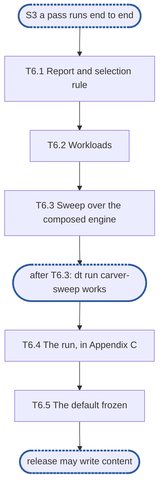

# Epic 6: carver v2 integration, the default `Target` on the real path

**Sources:** [RFC 2](../docs/internals/rfcs/rfc-2-carver.md) §11 (the default `Target`, its one
open question), Appendix C (the whole-file baseline and the measurement plan through the real
offload path), §9.1 (its last paragraph: a benchmark that runs the carver in the full stack), §3.2
(the default's row, and the ceiling under random overwrite the report compares against), §3.6 (a
change of settings is a migration, so the default freezes before content exists) and §10.6 (the
suites paragraph, and recording results). [RFC 13](../docs/internals/rfcs/rfc-13-configuration.md)
Appendix B: the `Target` row and the paragraph that opens the appendix. [The RFC
index](../docs/internals/rfcs/rfc-index.md), "Test tiers": "Recording results" and "A proposed
target is replaced once, by measurement". [RFC 29](../docs/internals/rfcs/rfc-29-test-harness.md)
§4.9: adding a suite and naming it in the RFC. Cited, not owned: [RFC 8](../docs/internals/rfcs/rfc-8-engine.md)
§6.2, §6.5 and §6.7, the offers, the dedup oracle that the first release leaves out, and widening,
which the sweep runs as the engine does them. Every citation is `develop`'s text. The code lands on
`feat/storage-v2`, and the paths below are paths there.
**Track:** the team.
**Epic 6 estimate: 5 subtasks, 9.5 man-days.**
**Depends on:** **S3**, a pass runs end to end: a file written through the journal is offered,
carved, packed, put through a flow to RFC 4's in-memory store, committed and reported offloaded,
over E4's `Cut` and E5's fold (the RFC 8 offload plan's epic 16, over its S5 and S6). **E2**'s
corpus: its layout `$DITTOFS_CORPUS_DIR/<kind>/<name>`, which the sweep reads directly, since
`carvetest` is internal to the carver, and its fetch, to whose pinned entries this epic adds one. **E3**'s `pkg/carver/section`, whose `Default()` this epic sets to the frozen
value.
**Blocks:** the release: no release writes content before this epic lands (RFC 2 §3.6, held as a
v1.1 release gate in the programme, #5488). E7 closes once the default is frozen, and nothing else
in it waits. Outside RFC 2, the RFC 8 offload plan's epic 21 registers the section with the default
this epic freezes; a default other than 256 KiB moves RFC 2 §5.2's derived upper block target, which
E1's `carver.MaxBlockTarget` holds and the RFC 4 plan's epic 7 validates against (§9 point 3).

---

## 1. Goal

Epic 6 answers RFC 2's one open question. It runs Appendix C's measurement plan through the engine
as the first release composes it, for each candidate `Target`, records what it measured in RFC 2
Appendix C, and freezes the default it selects in RFC 2, in RFC 13 Appendix B and in the settings
section. Nothing here is timed: every figure is a count of bytes, chunks or blocks, so the sweep
runs on any host and two runs at one commit give the same report.

**At the end of the epic:**

- the report's figures are pure functions of a chunk-size list and the store's object list, each
  checked against hand-computed values, and the rule that selects the default is one of them
  (T6.1);
- the five workloads are seeded operation lists over the corpus, the same on every run, writing no
  buffer twice (T6.2);
- `dt run carver-sweep` writes each workload through the journal of a composed engine at each
  candidate `Target`, offloads it as the engine's own offers, age and widening decide, and writes
  the report; it fails when a workload does not offload, or the chunk records pass RFC 2 §3.2's
  ceiling (T6.3);
- RFC 2 Appendix C holds the real-path table of that run, with its commit and corpus (T6.4);
- RFC 2 §11 lists the default as settled, RFC 13 Appendix B's `Target` row reads it as settled, and
  `section.Default()` returns it (T6.5).

### 1.1 In scope

The report's arithmetic and the selection rule; the workloads and the one corpus entry they add;
the sweep over the composed engine and its manual suite; the run and its record in Appendix C; the
freeze in RFC 2, RFC 13 and the section, and, if the selected value is not 256 KiB, every RFC
figure derived from the default.

### 1.2 Out of scope

- The pipeline the sweep runs through: Capture to Mark, widening, the age trigger and the pass
  bound are the RFC 8 offload plan's epics 15 and 16. A finding the sweep makes about them, such as
  a ceiling passed, is a defect filed against that plan, not fixed here.
- Registering `pkg/carver/section` in the node's table, and `Target`'s key in RFC 13's key form:
  the RFC 2 plan's deferral-ledger row "`Target`'s settings section, `pkg/carver/section`, added to
  the node's table" (the RFC 8 offload plan's epic 21). This epic changes the section's default
  value, not its key.
- K4 and K5 over the corpus, the speed rows and the `carver-bench` suite: E7.
- Recording which settings produced a namespace's content (RFC 2 §3.6): the ledger row "Recording
  which settings produced a namespace's content".
- Re-measuring with deduplication: the ledger row "The dedup lookup and the adopted disposition"
  (unowned, post-v1). Until it returns, the default this epic freezes is the first release's.

### 1.3 Names used here

- **E1**, epic 1, interfaces: the root contract, including `carver.MinBlockTarget` and
  `carver.MaxBlockTarget`.
- **E2**, epic 2, test foundations: `internal/carvetest` and its corpus (`corpus.Dir`, the fetch,
  the pinned entries).
- **E3**, epic 3, the chunker: `pkg/carver/section`, with `Prefix`, `Settings` and `Default()`.
- **E4**, epic 4, the carver and identity: `Cut`.
- **E5**, epic 5, the block assembler: the fold and the block-target range.
- **E6**, this epic.
- **E7**, epic 7, E2E green: K1 to K5, the `carver` group and its `carver-bench` suite.
- **S3**, a pass runs end to end: the RFC 8 offload plan's S3, the end of its epic 16, where this
  epic starts.
- **S5**, offload components built, and **S6**, the journal's offload half built: the RFC 8
  offload plan's points S3 waits on.
- **The RFC 8 offload plan**, [`rfc-8-offload-engine-plan.md`](rfc-8-offload-engine-plan.md): its
  epics 15 and 16 build the pipeline the sweep runs, and its epic 21 registers the section.
- **D1** to **D8** are this epic's decisions (§4). A decision of another document names it ("E3's
  D8", "the RFC 2 plan's D7").

## 2. How the general rules apply

The rules are those of
[the RFC 2 plan's §1.5](rfc-2-carver-plan.md#15-general-rules-for-each-epic), cited by number and
title and not copied.

| Rule | Subtasks | How |
| --- | --- | --- |
| rule 1, independent unit tests ([`CLAUDE.md`, "Writing tests"](../CLAUDE.md#writing-tests)) | T6.1, T6.2 | the arithmetic and the workloads are pure functions with unit tests in `unit`, over hand-built lists and seeded input; the sweep's own run is the integration of the real components. No test double |
| rule 2, fuzz tests where relevant | none | nothing here decodes bytes off a disk or a wire; the report reads values the stores already decoded |
| rule 3, observability follows RFC 25, with RFC 2's exception | none | the sweep is a test and adds no series; it reads none of the engine's either, since they count chunks cut, not live data (D5) |
| rule 4, profiling | none | no hot path: the sweep is run by hand and timed by nothing |
| rule 5, public interface and internals ([`CLAUDE.md`, "Verifying a change"](../CLAUDE.md#verifying-a-change)) | T6.3 | every figure is read where the bytes land, from the remote store's objects and the metadata store's refs, never from the carver's or the engine's own counts (D5) |
| rule 6, known failures shrink | none | `carver-sweep` keeps no `known.yaml`; T6.1 and T6.2's tests land green in `unit` |
| rule 7, v2 ignores v1, and imports only what RFC 0 §1.2 allows | T6.3 | the sweep is a test file of `internal/vfs/integration`, which may import implementations; no production file is added. Nothing of v1's carver or its Appendix A measurements' code is read or reused |
| rule 8, real dependencies for properties of those dependencies | T6.3, T6.4 | this rule's third check: the default measured through the real offload path, over the real journal, carver, assembler, syncer and metadata store and RFC 4's in-memory store, which S3 composes; on the corpus of real files, never seeded input alone |
| rule 9, code comment conventions ([`CLAUDE.md`, "Code comments"](../CLAUDE.md#code-comments)) | T6.2, T6.3, T6.5 | D4's `ponytail:` at the workload schedule; D2's `decision:` at the sweep's composition; E3's D8 `decision:` at `section.Prefix` kept as it is |
| rule 10, a test must be able to fail | T6.1, T6.2, T6.3 | each test names the planted break that turns it red: a bucket edge moved by one, Σs² summed as Σs, a seed ignored, a buffer reused, a pass that leaves a dirty extent |
| rule 11, a symbol is exported only if the RFC's interface uses it | none | nothing exported: the sweep's functions live in a test package; `section.Default()` is E3's |
| rule 12, each subtask creates only what it declares | all | T6.1's arithmetic and T6.2's workloads are consumed by T6.3, its report by T6.4, its selection by T6.5 |

## 3. Requirements and invariants

Every obligation RFC 2, RFC 13 and the index place on this epic, numbered so subtasks and tests can
cite them.

**When the default freezes**

| # | Requirement | Kind | Source | Subtasks |
| --- | --- | --- | --- | --- |
| R1 | The default `Target` is frozen only once Appendix C's measurement plan has run through the real offload path | MUST | RFC 2 §11, Appendix C ("Before the default is frozen"); RFC 13 Appendix B (`Target`) | T6.4, T6.5 |
| R2 | It is frozen before the first release writes content under it, before the first namespace binds it: a later change is a migration | invariant | RFC 2 §11, §3.6; RFC 13 Appendix B (`Target`) | T6.5 |
| R3 | A default other than 256 KiB is adopted only if it beats 256 KiB on the real path by more than the whole-file baseline's margins | MUST | RFC 2 §11, Appendix C ("Decides") | T6.1, T6.5 |
| R4 | `Target` is a set-point: no "measured value plus headroom" applies, and the default is the value the sweep selects, with no headroom and no miss | invariant | RFC 2 §11; RFC index, "A proposed target is replaced once, by measurement"; RFC 13 Appendix B (opening paragraph) | T6.1, T6.5 |
| R5 | The quality measures decide the default, speed never: the selection reads no timing | invariant | RFC 2 §9.1 ("speed alone never does") | T6.1 |

**What the sweep runs**

| # | Requirement | Kind | Source | Subtasks |
| --- | --- | --- | --- | --- |
| R6 | Each candidate `Target` is measured through the engine, not over whole files | MUST | RFC 2 Appendix C ("each `Target` is measured through the engine") | T6.3 |
| R7 | The input is the baseline's three workloads (the next release of a tree, 256 random 4 KiB pages overwritten in place in a VM image, 64 random 100-byte insertions), a streaming append, and 4 KiB random overwrites of a VM image, on the K5 corpus: source trees, VM images, media | MUST | RFC 2 Appendix C ("Input"), §9.1 (K5) | T6.2 |
| R8 | The path is the workload written through the journal and offloaded by the engine: offers bounded by the pass limit and age, artificial ends held back, widening as RFC 8 §6.7 permits | MUST | RFC 2 Appendix C ("Path"), §2.4; RFC 8 §6.2, §6.7 | T6.3 |
| R9 | The chunker runs with §3.2's mask, as shipped, so its mean includes the `Min` skip | invariant | RFC 2 Appendix C (its last sentence) | T6.3 |
| R10 | The data written does not deduplicate: no buffer is written twice, so no repetition the workload did not intend reaches the stores | MUST | RFC 2 §9.1 (full-stack paragraph) | T6.2 |

**What the sweep reports**

| # | Requirement | Kind | Source | Subtasks |
| --- | --- | --- | --- | --- |
| R11 | Bytes stored against bytes written | MUST | RFC 2 Appendix C ("Report"), §9.1 (full-stack paragraph) | T6.1, T6.3 |
| R12 | Chunk records per GiB of live data, against §3.2's ceiling | MUST | RFC 2 Appendix C ("Report"), §3.2 | T6.1, T6.3 |
| R13 | Under widening, a file holds at most 1 GiB / `Min` chunks per GiB plus one per hole; the sweep fails a workload whose live data passes it | invariant | RFC 2 §3.2 ("The ceiling under random overwrite") | T6.1, T6.3 |
| R14 | The chunk-size histogram, against `Min`, `Target` and `Max` | MUST | RFC 2 Appendix C ("Report"), §9.1 (K5) | T6.1, T6.3 |
| R15 | The cold-read fetch size: the chunk a random byte falls in, on average, Σs²/Σs | MUST | RFC 2 Appendix C ("Report", and "Cold read fetches") | T6.1, T6.3 |
| R16 | Blocks per pass and short blocks | MUST | RFC 2 Appendix C ("Report"), §5.4 | T6.1, T6.3 |
| R17 | The result is recorded with its commit, the box, the operating system and filesystem, and the toolchain, beside the figures | MUST | RFC index, "Recording results"; RFC 2 §10.6 | T6.4 |
| R18 | The suite that runs the sweep is named in RFC 2's suites paragraph | MUST | RFC 29 §4.9 ("A component"); RFC 2 §10.6 | T6.3 |

**The freeze**

| # | Requirement | Kind | Source | Subtasks |
| --- | --- | --- | --- | --- |
| R19 | The frozen value is written in RFC 2 (§3.2's `Target` row and §11, moved from open to settled) and in RFC 13 Appendix B's `Target` row, which drops "proposed" and names the measurement that settled it | MUST | RFC 2 §11; RFC 13 Appendix B (opening paragraph, `Target`) | T6.5 |
| R20 | RFC text cites the setting rather than restating its number as a requirement: where a figure derived from the default is stated, it follows the frozen value | invariant | RFC 13 Appendix B (opening paragraph); RFC index ("A number inside a MUST") | T6.5 |
| R21 | The settings section's default is the frozen value | MUST | RFC 13 Appendix B (`Target`); E3's T3.3 (`section.Default()`) | T6.5 |

**How each requirement is enforced.** R1 and R2 by the order of T6.4 and T6.5 and by the release
gate in #5488, which no test can hold. R3 to R5 by T6.1's selection function, which takes no
timing and is tested against hand-built reports. R6, R8 and R9 by T6.3's composition, which builds
the engine and carver as S3 does, with no option that swaps the mask or bypasses the pipeline. R10
by T6.2's test that no two writes carry identical bytes. R11 to R16 by T6.1's arithmetic tests and
T6.3's reading of the stores. R17 and R19 to R21 are edits to text and one constant: T6.5's
acceptance criteria, and E3's T3.3 test, which reads the default.

**Candidates mapped elsewhere.** §3.2's "MUST hit `Target` as the average chunk size, within a
stated tolerance": E3 (§10.4's count) and E7 (K5). K4 and K5's runs: E7. §3.6's record of a
namespace's settings: the RFC 8 offload plan's epic 16. Appendix C's whole-file baseline and the
"What others ship" table: background, kept as they are. §11's settled items 1 to 5: settled, not
this epic's.

## 4. Decisions this epic takes

- **D1, the sweep is a tagged test over the composed engine, in a manual suite of its own.**
  `internal/vfs/integration` already composes the filesystem service over the engine through
  `internal/node/content` for RFC 8's benchmarks (`benchcompose_test.go` on `feat/storage-v2`), and
  a test file there may import every implementation. The sweep is
  `target_sweep_test.go`, tagged `engine_conformance && target_sweep`, run by a new suite
  `carver-sweep`, `tier: manual`. It reads the corpus at E2's layout directly, as E2's D8 offers
  other plans, since `internal/vfs/integration` cannot import `pkg/carver/internal/carvetest`; it
  skips naming `DITTOFS_CORPUS_DIR` when the variable is unset, and the cell's command refuses to
  start without it, as `engine-bench`'s does for its directory, so a skipped run never passes. The
  report goes to the directory a test flag names (`-sweep.out`, given `{out}` by the cell), so no
  new `DITTOFS_` variable is added. It is a
  new suite and not an option of E7's `carver-bench`, since RFC 29 §4.9 makes an option a variant of
  one command, and the two run different packages. It joins the `carver` group, which E7 creates;
  whichever of the two lands second adds its suite to it. Prior art: `engine-bench` and
  `reconcile-bench` on `feat/storage-v2` (checked), manual cells over a composition.
- **D2, one composition per candidate, isolated from the stages that do not depend on `Target`.**
  Each run is a fresh composition: a non-encrypting namespace, so the unkeyed gear table; the empty
  transform chain; RFC 4's in-memory store; the metadata store on Badger under `t.TempDir()`; the
  journal on a directory under `t.TempDir()`; the engine's settings at their RFC 13 Appendix B
  defaults (`offload.max_age`, the pass bound, the block target of 4 MiB). RFC 2 §3.2 says blocks
  pack to their own target, so the number and size of remote objects do not depend on `Target`; a
  chain compresses or seals whole blocks and would scale every candidate alike, so the empty chain
  measures what the carver changes. A keyed table moves boundaries but not their distribution,
  which E3's §9 rows check under both tables. A `decision:` at the composition says so, and that a
  chain whose cost depends on chunk sizes withdraws it. Nothing is timed, so the run needs no
  reference box. Prior art: Appendix C's own baseline, measured without transforms (RFC 2
  Appendix C).
- **D3, the candidates are the baseline's four rows: 64 KiB, 256 KiB, 1 MiB and 4 MiB.** Every
  real-path figure then has its whole-file twin, which R3's rule compares against. Each is a power
  of two RFC 2 §3.7 accepts. Prior art: the baseline table itself.
- **D4, each workload runs on the kind it models, as seeded operations, and offload runs between
  phases.** Every run first writes its corpus file whole and offloads it (phase 0, the original);
  the workload's phase then writes its operations and offloads again, and the report counts only
  what phase 1 adds. The workloads:

  | Workload | Corpus file | Phase 1 |
  | --- | --- | --- |
  | next release | `source/linux-6.6.tar` | `source/linux-6.6.1.tar` written over it from offset 0, truncated to its length |
  | 256 pages | `vm/debian-12-genericcloud-amd64.raw` | 256 distinct 4 KiB-aligned pages, chosen by the seed, each overwritten with fresh seeded bytes |
  | 64 inserts | `source/linux-6.6.tar` | 64 offsets chosen by the seed; at each, 100 fresh bytes inserted, written as an editor saves: the file rewritten from the insertion point to its end |
  | streaming append | `media/big-buck-bunny-1080p.mp4` | none for phase 0; the whole file appended in 64 KiB writes to an empty file, the injected clock advanced by a quarter of `offload.max_age` every 16 MiB, so the age trigger fires mid-stream |
  | sustained overwrites | `vm/debian-12-genericcloud-amd64.raw` | 16 rounds of 256 pages as above, each round offloaded before the next, the chunk records read after each round |

  `source/linux-6.6.1.tar` is one entry this epic adds to E2's pinned list, the next patch release of
  the same tree, as the baseline's "next release" column measured. Offload "until clean" waits on
  the condition itself, no dirty extent of the namespace left in the journal, with the injected
  clock advanced past `offload.max_age` so the age trigger offers every file, and one generous
  timeout as a backstop. A `ponytail:` at the schedule names its ceiling: each phase's edits land
  as one burst before offload, so passes coalesce neighbouring edits that a slower writer would
  offer apart; the upgrade is a trace-driven schedule, once a trace of a real workload exists.
  Prior art: Appendix C's baseline workloads, which this table runs through the engine; fio's
  seeded random offsets (from memory).
- **D5, every figure is read where the bytes land.** Bytes stored: the sizes of the objects RFC
  4's in-memory store holds that phase 0 did not, read from the store's listing. Chunk records and
  sizes: the live refs of the workload's file in the metadata store, zero refs counted as holes and
  never as chunks. Blocks per pass: objects put in phase 1 over the passes that put them, a pass
  counted from the engine's per-pass report. Short blocks: blocks whose carried bytes are under the
  block target, from the block records RFC 6 §4.1 commits. Cold-read fetch size: Σs²/Σs over the
  live chunk sizes, Appendix C's own definition, computed rather than read through a cold read,
  which needs the RFC 8 offload plan's epic 17 and adds nothing a size list does not say.
  Re-stored bytes, the baseline's own measure: the bytes of phase 1's live chunks whose chunk IDs
  no ref of phase 0 held, read from the same refs. The first release has no deduplication (RFC 8
  §6.5), so the real path stores again every byte rewritten, at every `Target`; re-stored bytes are
  what the whole-file baseline's columns report, now cut as the engine cuts. The engine's
  `carver_` series are not read: they count every chunk cut, including those phase 1 replaced, so
  they are not a count of live data. Prior art: the RFC index's "Test at the consumer of a
  value".
- **D6, the histogram's buckets are powers of two from 4 KiB to `Max`, with `Min`, `Target` and
  `Max` marked, and chunks of exactly `Max` counted apart.** Every candidate's `Min`, `Target` and
  `Max` are powers of two, so each falls on a bucket edge at every candidate. Prior art: RFC 25
  §2.6's `size` bucket set, also powers of two (RFC 25).
- **D7, the selection rule, written as a function before the run — pending the user's answer.**
  R3's "the whole-file baseline's margins" has more than one reading, and with no deduplication in
  the first release bytes stored alone cannot show what the baseline's columns showed (D5). The
  recommended reading, which T6.1 writes: 256 KiB was chosen accepting the baseline's trade-off,
  and a candidate replaces it only if the real path moves that trade-off in the candidate's
  favour. For each of the baseline's three workloads, the baseline ratio is the candidate's
  re-stored bytes over 256 KiB's in Appendix C's table, and the real ratio is the same with D5's
  re-stored bytes. A candidate is adopted if its real ratio is below its baseline ratio on all
  three and its chunk records stay under R13's ceiling; of two that qualify, the one below on more
  workloads by the larger total, then the smaller `Target`. Bytes stored, the two new workloads and
  the other figures are reported and decide nothing. The reading leaves no room for noise: the
  corpus is pinned and the workloads seeded, so a run is repeatable to the byte.
  The rule is written and reviewed before the run, so the run cannot choose its own test. Prior
  art: a pre-registered analysis, the usual guard against choosing a criterion after seeing the
  data (from memory); none found for chunk sizes.
- **D8, the record is a table in RFC 2 Appendix C, and the raw report stays in the run's output.**
  The real-path table sits under the measurement plan, one row per candidate and workload with
  R11 to R16's figures, preceded by the run's fields (R17) and the corpus entries' hashes. The
  per-bucket histogram and the per-round sustained figures are in `{out}/report.md`, attached to
  the pull request, not committed. The RFC index lets an appendix be a measurement. Prior art: RFC
  2 Appendix A.1 and A.2, measurements kept in the RFC (checked).

## 5. Target tree

```text
internal/vfs/integration/
  sweep_report_test.go       T6.1  chunk and block figures, the ceiling, Σs²/Σs, buckets, select
  sweep_workload_test.go     T6.2  the five workloads as seeded operation lists, D4's ponytail:
  target_sweep_test.go       T6.3  TestTargetSweep: composition per candidate (D2's decision:),
                                   phases, store reads, the report
pkg/carver/internal/carvetest/corpus/
  corpus.go                  T6.2  one more pinned entry, source/linux-6.6.1.tar
test/suites.yaml             T6.3  carver-sweep, tier manual; target_sweep in lint-go's vet tags;
                                   the carver group
docs/internals/rfcs/rfc-2-carver.md
                             T6.3  §10.6's suites paragraph names carver-sweep
                             T6.4  Appendix C, the real-path table
                             T6.5  §3.2's Target row, §11; derived figures if the value moves
docs/internals/rfcs/rfc-13-configuration.md
                             T6.5  Appendix B, the Target row
docs/internals/testing.md    T6.3  regenerated with dt docs
pkg/carver/section/
  section.go                 T6.5  Default() returns the frozen value
  section_test.go            T6.5  the default's expected value
```

`sweep_report_test.go` and `sweep_workload_test.go` carry no build tag, so `unit` runs their tests;
`target_sweep_test.go` uses them under its tags.

## 6. Subtasks

### T6.1 The report's figures and the selection rule

**Subtask T6.1 estimate: 1.5 man-days.**

- **Track:** the team. **Depends on:** S3.
- **Covers:** R3, R4, R5, R11 to R16.
- **Deliverables:** `sweep_report_test.go`, pure functions over plain values, consumed by T6.3:
  ```go
  // chunkFigures summarises a file's live chunk sizes under one Target.
  type chunkFigures struct {
      Records    int     // non-zero refs
      PerGiB     float64 // records per GiB of live data
      Ceiling    float64 // 1 GiB / Min, plus one per hole (RFC 2 §3.2)
      ColdFetch  float64 // Σs²/Σs, bytes
      Buckets    []int   // D6's buckets
      AtMax      int
  }
  func summarise(sizes []int64, holes int, target int64) chunkFigures

  // blockFigures summarises the blocks phase 1 put.
  type blockFigures struct{ Blocks, Passes, Short int; PerPass float64 }
  func summariseBlocks(carried []int64, passes int, blockTarget int64) blockFigures

  // row is one candidate's figures on one workload.
  type row struct {
      Target, Written, Stored, Restored int64 // Restored: D5's re-stored bytes
      Chunks chunkFigures
      Blocks blockFigures
  }
  // selectDefault applies D7 to the rows and the baseline ratios; it takes no time.
  func selectDefault(rows []row, baseline map[string]map[int64]float64) int64
  ```
  The baseline is Appendix C's whole-file table, transcribed once as a literal beside the function.
- **Acceptance criteria:**
  - `summarise` gives Appendix C's definition of the cold-read fetch, and the §3.2 ceiling at each
    candidate's `Min`.
  - `selectDefault` returns 256 KiB on a report whose ratios equal the baseline's, and a candidate
    only when D7's condition holds for it.
- **Tests:** at the functions T6.3 calls: a hand-built size list whose Σs²/Σs is worked out in the
  test (catches Σs² summed as Σs, R15); sizes on each bucket edge, at `Min`, `Target` and `Max`
  (catches an edge moved by one, R14); a list one record over the ceiling (catches a ceiling built
  from `Target` rather than `Min`, R13); block lists with one short block and none (R16);
  `selectDefault` on a report whose ratios equal the baseline's, on one where 64 KiB's three real
  ratios fall below its baseline ratios, on one where only two do, and on one where all three do
  but its chunk records pass the ceiling (catches a rule that adopts on one workload, or on bytes
  alone, R3, R4). R5 is held by the signature: no input
  carries a duration. No test double.
- **Rules:** rule 10, the planted breaks above. Others as §2 says.

### T6.2 The workloads

**Subtask T6.2 estimate: 1.5 man-days.**

- **Track:** the team. **Depends on:** T6.1.
- **Covers:** R7, R10.
- **Deliverables:** `sweep_workload_test.go`: one function per workload of D4, from a seed and the
  corpus file's length to an operation list (offset, length, the bytes' source: the corpus at an
  offset or the seeded stream at an offset), and the bytes produced lazily from it, so no workload
  holds a file in memory; D4's `ponytail:` at the schedule. One pinned entry,
  `source/linux-6.6.1.tar`, added to E2's corpus list, with both of its SHA-256s. Consumed by T6.3.
- **Acceptance criteria:**
  - The same seed gives the same operations and bytes; another seed gives other offsets.
  - The 256 pages are distinct and 4 KiB-aligned inside the image; the inserts fall inside the
    file; the append's clock steps fall every 16 MiB.
  - No two writes of a run carry the same bytes (R10).
- **Tests:** at the operation lists T6.3 replays: two runs of one seed compared byte for byte, and
  one of another seed (catches an ignored seed); the page set's size and alignment (catches pages
  drawn with replacement, which writes fewer than 256); every pair of written buffers hashed and
  compared (catches a reused buffer, R10); the operations' offsets against a file length (catches an
  insert past the end). The corpus entry is checked by E2's fetch test, which hashes each entry. No
  test double.
- **Rules:** rule 9, D4's `ponytail:`; rule 10, the planted breaks above. Others as §2 says.

### T6.3 The sweep over the composed engine

**Subtask T6.3 estimate: 4 man-days.**

- **Track:** the team. **Depends on:** T6.2.
- **Covers:** R6, R8, R9, R11 to R16, R18.
- **Deliverables:** `target_sweep_test.go`, `TestTargetSweep`, tagged `engine_conformance &&
  target_sweep`: for each candidate of D3 and each workload of D4, a fresh composition as D2
  states it with D2's `decision:`, phase 0 and phase 1 written through the filesystem service and
  offloaded until clean, the stores read as D5 states, and `{out}/report.md` written: one table per
  workload, the histogram per candidate, the sustained workload per round, and the `Target`
  `selectDefault` returns. `carver-sweep` in `test/suites.yaml`, `tier: manual`, its `cmd` passing
  `-run ^TestTargetSweep$`, an explicit `-timeout` with the cell's above it and
  `-args -sweep.out={out}`, refusing to start without `DITTOFS_CORPUS_DIR`, with a comment naming
  the host memory the in-memory store needs and the temporary space the journal and Badger take
  (about the largest file, once per candidate); `target_sweep` added to lint-go's `go vet -tags=` list; the suite in the `carver`
  group (D1); RFC 2 §10.6's suites paragraph names `carver-sweep`, and `docs/internals/testing.md`
  regenerated with `dt docs`. Consumed by T6.4, which runs it.
- **Acceptance criteria:**
  - Each run builds the carver through the content wiring as S3 does, with no option that changes
    the mask, the chain or the pipeline beyond D2's settings (R6, R8, R9).
  - The run fails a workload whose phase does not end clean, or whose chunk records pass R13's
    ceiling.
  - `dt docs --check` passes with the suite named.
- **Tests:** the sweep is itself the check of R13 at the consumer, over the real path. Its own
  failure paths are seen before the pull request, as the RFC 2 plan's rule 6 asks of a test no
  suite holds red: with the age trigger disabled in a local edit, phase 1 never ends clean and the
  run fails on that assertion, not on the timeout (catches a "clean" read from the wrong journal);
  with widening disabled in a local edit, the sustained workload passes R13's ceiling and fails on
  it. A run on the smallest corpus file, at one candidate, is part of the pull request's evidence.
  No test double: every component is the one S3 composes.
- **Rules:** rule 5, D5; rule 8, the real path; rule 9, D2's `decision:`. Others as §2 says.

### T6.4 The run, recorded in Appendix C

**Subtask T6.4 estimate: 1.5 man-days.**

- **Track:** the team. **Depends on:** T6.3.
- **Covers:** R1, R17.
- **Deliverables:** one `dt run carver-sweep` over the full corpus at a commit on `feat/storage-v2`
  where S3 holds; RFC 2 Appendix C's real-path table under its measurement plan (D8), with the
  commit, the host, its operating system and filesystem, the Go toolchain and the corpus entries'
  hashes; `{out}/report.md` attached to the pull request. Consumed by T6.5.
- **Acceptance criteria:**
  - Every candidate and workload of D3 and D4 has its row, each with R11 to R16's figures.
  - A second run at the same commit gives the same table, run once on the smallest file to show it.
- **Tests:** none in Go: the deliverable is a measurement. Its check is the repeat run, which
  catches a sweep that depends on anything but its seed and corpus.
- **Rules:** rule 8, the corpus; none other applies to a text change.

### T6.5 The default frozen

**Subtask T6.5 estimate: 1 man-days.**

- **Track:** the team. **Depends on:** T6.4.
- **Covers:** R1 to R4, R19 to R21.
- **Deliverables:** the value `selectDefault` returned on T6.4's run, written in RFC 2 §3.2's
  `Target` row and in §11, whose question moves under "Settled", citing the Appendix C table; RFC
  13 Appendix B's `Target` row, "proposed" dropped and "settled by" naming that table;
  `section.Default()` and its test in `pkg/carver/section` returning it. If the value is not
  256 KiB, every RFC figure derived from the default is restated from it (§9 point 3), and the pull
  request lists each one.
- **Acceptance criteria:**
  - RFC 2, RFC 13 and the section name one value, the one T6.4's report selected.
  - `rg -n '256 KiB' docs/internals/rfcs/` lists no figure that states the default and disagrees
    with it; each remaining hit is a candidate or a measurement.
  - The pull request lands before any release writes content (R2), as #5488's gate holds it.
- **Tests:** E3's T3.3 test, which asserts the default and that it passes `Validate`, with its
  expected value changed here (catches a section default left at the proposal, R21). The text has
  no Go check: `dt docs --check` and review read it.
- **Rules:** rule 9, E3's D8 `decision:` at `Prefix` kept; none other applies.

## 7. Order of work



Checkpoint after T6.3: the sweep runs by hand on any host with the corpus. T6.1 and T6.2 need
nothing of S3 and may start before it; the order keeps one path.

## 8. Suggested pull requests

| PR | Subtasks | Man-days | After | Why together |
| --- | --- | --- | --- | --- |
| 1 | T6.1, T6.2, T6.3 | 7 | S3 | the sweep, end to end: its arithmetic, its workloads and its suite |
| 2 | T6.4, T6.5 | 2.5 | PR 1 | the run and the freeze it decides, so the recorded table and the frozen value land together |

A suggestion only: one pull request per subtask works as well.

## 9. Open points

1. **D7's reading of "the whole-file baseline's margins" is pending the user's answer.** The
   recommended rule is written in place; the alternatives are a single cost per candidate (bytes
   stored plus a metadata cost per chunk record, lowest wins) or an absolute bound (adopt a
   candidate that re-stores at least 10 % less on all three baseline workloads with records under
   the ceiling). The block target stays at 4 MiB for every candidate (D2), so at a 4 MiB `Target` a
   block often holds one chunk; whether it should co-vary is part of the same answer. Each needs RFC 2 §11 to say which, so the answer amends §11's sentence in T6.1's pull
   request. Until then the pull request of this document stays a draft.
2. **The estimate against the RFC 2 plan's figure.** The plan says "planned after S3" and gives no
   figure, so there is none to compare with; this document gives 5 subtasks and 9.5 man-days, broken
   down before S3 at the programme's request. T6.3 builds on the composition the RFC 8 offload
   plan's epics 15, 16 and 21 shape, none of it written yet, so its 4 man-days may move.
3. **A default other than 256 KiB moves figures in other RFCs and one constant.** RFC 2 §5.2 derives
   the 64 MiB upper block target from P4's 1,024 chunks and the default's 64 KiB `Min`; at a 64 KiB
   default that product is 16 MiB, so `carver.MaxBlockTarget` (E1), E5's range check and the RFC 4
   plan's epic 7, which validates the block target against it, would follow, or §5.2's `decision:`
   would be amended to derive the bound from the smallest supported `Target` instead. RFC 3 §2.2
   sizes the syncer's per-worker buffers by `Max`, and RFC 0, 5, 8, 9 and 16, the FAQ and the RFC 2
   learning deck restate 256 KiB or figures derived from it. Restating them is about three more
   man-days, not in the total, and the §5.2 choice is the user's when it arises. At 256 KiB none of
   this applies.
4. **`Target`'s key is not this epic's.** E3's D8 uses the provisional `carver.target`, pending the
   user's answer in the RFC 2 plan's §6 point 2; this epic changes the section's default, never its
   key.
5. **The sweep's host.** The in-memory store holds each run's objects: about the largest corpus
   file, 1.4 GB, per composition, with one composition alive at a time. A finding about the
   pipeline itself, such as a ceiling passed, is filed against the RFC 8 offload plan and blocks
   T6.4 until fixed; how many such findings the first full run surfaces cannot be known, which makes
   T6.4 the least certain estimate here.
