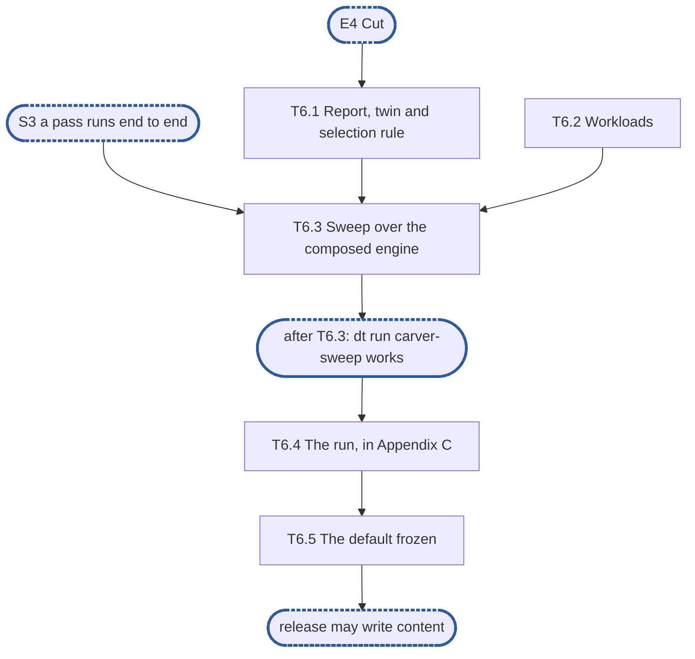

# Epic 6: carver v2 integration, the default `Target` on the real path

**Sources:** [RFC 2](../docs/internals/rfcs/rfc-2-carver.md) §11 (the default `Target`, its one
open question), Appendix C (the whole-file baseline and the measurement plan through the real
offload path), §9.1 (its last paragraph: a benchmark that runs the carver in the full stack), §3.2
(the default's row, and the ceiling under random overwrite the report compares against), §3.6 (a
change of settings is a migration, so the default freezes before content exists) and §10.6 (the
suites paragraph, and recording results). [RFC 13](../docs/internals/rfcs/rfc-13-configuration.md)
Appendix B: the `Target` row and the paragraph that opens the appendix. [The RFC
index](../docs/internals/rfcs/rfc-index.md), "Test tiers": "Recording results" and "A proposed
target is replaced once, by measurement". [RFC 29](../docs/internals/rfcs/rfc-29-test-harness.md)
§4.9: adding a suite and naming it in the RFC. Cited, not owned: [RFC 8](../docs/internals/rfcs/rfc-8-engine.md)
§6.2, §6.5 and §6.7, the offers, the dedup oracle that the first release leaves out, and widening,
which the sweep runs as the engine does them. Every citation is `develop`'s text. The code lands on
`feat/storage-v2`, and the paths below are paths there.
**Track:** the team.
**Epic 6 estimate: 5 subtasks, 11.5 man-days.**
**Depends on:** **S3**, a pass runs end to end: a file written through the journal is offered,
carved, packed, put through a flow to RFC 4's in-memory store, committed and reported offloaded,
over E4's `Cut` and E5's fold (the RFC 8 offload plan's epic 16, over its S5 and S6). **E4**'s
`Cut`, which T6.1 calls directly for the whole-file twin. **E2**'s
corpus: its layout `$DITTOFS_CORPUS_DIR/<kind>/<name>`, which the sweep reads directly, since
`carvetest` is internal to the carver, and its fetch, to whose pinned entries this epic adds one. **E3**'s `pkg/carver/section`, whose `Default()` this epic sets to the frozen
value.
**Blocks:** the release: no release writes content before this epic lands (RFC 2 §3.6, held as a
v1.1 release gate in the programme, #5488). E7 closes once the default is frozen, and nothing else
in it waits. Outside RFC 2, the RFC 8 offload plan's epic 21 registers the section with the default
this epic freezes; a default other than 256 KiB moves RFC 2 §5.2's derived upper block target, which
E1's `carver.MaxBlockTarget` holds and the RFC 4 plan's epic 7 validates against (§9 point 2).

---

## 1. Goal

Epic 6 answers RFC 2's one open question. It runs Appendix C's measurement plan through the engine
as the first release composes it, for each candidate `Target`, records what it measured in RFC 2
Appendix C, and freezes the default it selects in RFC 2, in RFC 13 Appendix B and in the settings
section. Nothing here is timed: every figure is a count of bytes, chunks or blocks, so the sweep
runs on any host and two runs at one commit give the same report.

**At the end of the epic:**

- the report's figures are pure functions of a chunk-size list and the store's object list, each
  checked against hand-computed values, and the rule that selects the default is one of them
  (T6.1);
- the five workloads are seeded operation lists over the corpus, the same on every run, writing no
  buffer twice (T6.2);
- `dt run carver-sweep` writes each workload through the journal of a composed engine at each
  candidate `Target`, offloads it as the engine's own offers, age and widening decide, and writes
  the report; it fails when a workload does not offload, the chunk records pass RFC 2 §3.2's
  ceiling, or a control workload's re-stored bytes differ from its whole-file twin's (T6.3);
- RFC 2 Appendix C holds the real-path table of that run, with its commit and corpus (T6.4);
- RFC 2 §11 lists the default as settled, RFC 13 Appendix B's `Target` row reads it as settled, and
  `section.Default()` returns it (T6.5).

### 1.1 In scope

The report's arithmetic and the selection rule; the workloads and the one corpus entry they add;
the sweep over the composed engine and its manual suite; the run and its record in Appendix C; the
freeze in RFC 2, RFC 13 and the section, and, if the selected value is not 256 KiB, every RFC
figure derived from the default.

### 1.2 Out of scope

- The pipeline the sweep runs through: Capture to Mark, widening, the age trigger and the pass
  bound are the RFC 8 offload plan's epics 15 and 16. A finding the sweep makes about them, such as
  a ceiling passed, is a defect filed against that plan, not fixed here.
- Registering `pkg/carver/section` in the node's table, and `Target`'s key in RFC 13's key form:
  the RFC 2 plan's deferral-ledger row "`Target`'s settings section, `pkg/carver/section`, added to
  the node's table" (the RFC 8 offload plan's epic 21). This epic changes the section's default
  value, not its key.
- K4 and K5 over the corpus, the speed rows and the `carver-bench` suite: E7.
- Recording which settings produced a namespace's content (RFC 2 §3.6): the ledger row "Recording
  which settings produced a namespace's content".
- Re-measuring with deduplication: the ledger row "The dedup lookup and the adopted disposition"
  (unowned, post-v1). Until it returns, the default this epic freezes is the first release's.

### 1.3 Names used here

- **E1**, epic 1, interfaces: the root contract, including `carver.MinBlockTarget` and
  `carver.MaxBlockTarget`.
- **E2**, epic 2, test foundations: `internal/carvetest` and its corpus (`corpus.Dir`, the fetch,
  the pinned entries).
- **E3**, epic 3, the chunker: `pkg/carver/section`, with `Prefix`, `Settings` and `Default()`.
- **E4**, epic 4, the carver and identity: `Cut`.
- **E5**, epic 5, the block assembler: the fold and the block-target range.
- **E6**, this epic.
- **E7**, epic 7, E2E green: K1 to K5, the `carver` group and its `carver-bench` suite.
- **S3**, a pass runs end to end: the RFC 8 offload plan's S3, the end of its epic 16, where this
  epic starts.
- **S5**, offload components built, and **S6**, the journal's offload half built: the RFC 8
  offload plan's points S3 waits on.
- **The RFC 8 offload plan**, [`rfc-8-offload-engine-plan.md`](rfc-8-offload-engine-plan.md): its
  epics 15 and 16 build the pipeline the sweep runs, and its epic 21 registers the section.
- **D1** to **D8** are this epic's decisions (§4). A decision of another document names it ("E3's
  D8", "the RFC 2 plan's D7").

## 2. How the general rules apply

The rules are those of
[the RFC 2 plan's §1.5](rfc-2-carver-plan.md#15-general-rules-for-each-epic), cited by number and
title and not copied.

| Rule | Subtasks | How |
| --- | --- | --- |
| rule 1, independent unit tests ([`CLAUDE.md`, "Writing tests"](../CLAUDE.md#writing-tests)) | T6.1, T6.2 | the arithmetic and the workloads are pure functions with unit tests in `unit`, over hand-built lists and seeded input; the sweep's own run is the integration of the real components. No test double |
| rule 2, fuzz tests where relevant | none | nothing here decodes bytes off a disk or a wire; the report reads values the stores already decoded |
| rule 3, observability follows RFC 25, with RFC 2's exception | none | the sweep is a test and adds no series; it reads none of the engine's either, since they count chunks cut, not live data (D5) |
| rule 4, profiling | none | no hot path: the sweep is run by hand and timed by nothing |
| rule 5, public interface and internals ([`CLAUDE.md`, "Verifying a change"](../CLAUDE.md#verifying-a-change)) | T6.3 | every figure is read where the bytes land, from the remote store's objects and the metadata store's refs, never from the carver's or the engine's own counts (D5) |
| rule 6, known failures shrink | none | `carver-sweep` keeps no `known.yaml`; T6.1 and T6.2's tests land green in `unit` |
| rule 7, v2 ignores v1, and imports only what RFC 0 §1.2 allows | T6.3 | the sweep is a test file of `internal/vfs/integration`, which may import implementations; no production file is added. Nothing of v1's carver or its Appendix A measurements' code is read or reused |
| rule 8, real dependencies for properties of those dependencies | T6.3, T6.4 | this rule's third check: the default measured through the real offload path, over the real journal, carver, assembler, syncer and metadata store and RFC 4's in-memory store, which S3 composes; on the corpus of real files, never seeded input alone |
| rule 9, code comment conventions ([`CLAUDE.md`, "Code comments"](../CLAUDE.md#code-comments)) | T6.2, T6.3, T6.5 | D4's `ponytail:` at the workload schedule; D2's `decision:` at the sweep's composition; E3's D8 `decision:` at `section.Prefix` kept as it is |
| rule 10, a test must be able to fail | T6.1, T6.2, T6.3 | each test names the planted break that turns it red: a bucket edge moved by one, Σs² summed as Σs, a seed ignored, a buffer reused, a pass that leaves a dirty extent |
| rule 11, a symbol is exported only if the RFC's interface uses it | none | nothing exported: the sweep's functions live in a test package; `section.Default()` is E3's |
| rule 12, each subtask creates only what it declares | all | T6.1's arithmetic and T6.2's workloads are consumed by T6.3, its report by T6.4, its selection by T6.5 |

## 3. Requirements and invariants

Every obligation RFC 2, RFC 13 and the index place on this epic, numbered so subtasks and tests can
cite them.

**When the default freezes**

| # | Requirement | Kind | Source | Subtasks |
| --- | --- | --- | --- | --- |
| R1 | The default `Target` is frozen only once Appendix C's measurement plan has run through the real offload path | MUST | RFC 2 §11, Appendix C ("Before the default is frozen"); RFC 13 Appendix B (`Target`) | T6.4, T6.5 |
| R2 | It is frozen before the first release writes content under it, before the first namespace binds it: a later change is a migration | invariant | RFC 2 §11, §3.6; RFC 13 Appendix B (`Target`) | T6.5 |
| R3 | A different default is adopted if it beats 256 KiB on the real path by more than the whole-file baseline's margins; otherwise 256 KiB stays | MUST | RFC 2 §11, Appendix C ("Decides") | T6.1, T6.5 |
| R4 | `Target` is a set-point: no "measured value plus headroom" applies, and the default is the value the sweep selects, with no headroom and no miss | invariant | RFC 2 §11; RFC index, "A proposed target is replaced once, by measurement"; RFC 13 Appendix B (opening paragraph) | T6.1, T6.5 |
| R5 | The quality measures decide a profile; speed alone never does. The sweep measures no time, so its selection reads none (D7) | invariant | RFC 2 §9.1 ("speed alone never does") | T6.1 |

**What the sweep runs**

| # | Requirement | Kind | Source | Subtasks |
| --- | --- | --- | --- | --- |
| R6 | Each candidate `Target` is measured through the engine, not over whole files | MUST | RFC 2 Appendix C ("each `Target` is measured through the engine") | T6.3 |
| R7 | The input is the baseline's three workloads (the next release of a tree, 256 random 4 KiB pages overwritten in place in a VM image, 64 random 100-byte insertions), a streaming append, and 4 KiB random overwrites of a VM image, on the K5 corpus: source trees, VM images, media | MUST | RFC 2 Appendix C ("Input"), §9.1 (K5) | T6.2 |
| R8 | The path is the workload written through the journal and offloaded by the engine: offers bounded by the pass limit and age, artificial ends held back, widening as RFC 8 §6.7 permits | MUST | RFC 2 Appendix C ("Path"), §2.4; RFC 8 §6.2, §6.7 | T6.3 |
| R9 | The chunker runs with §3.2's mask, as shipped, so its mean includes the `Min` skip | invariant | RFC 2 Appendix C (its last sentence) | T6.3 |
| R10 | The data written does not deduplicate beyond what the workload is: no load-generator buffer is reused, so the only repetition is the workload's own (a rewritten tail, the next release's unchanged files) | MUST | RFC 2 §9.1 (full-stack paragraph) | T6.2 |

**What the sweep reports**

| # | Requirement | Kind | Source | Subtasks |
| --- | --- | --- | --- | --- |
| R11 | Bytes stored against bytes written | MUST | RFC 2 Appendix C ("Report"), §9.1 (full-stack paragraph) | T6.1, T6.3 |
| R12 | Chunk records per GiB of live data, against §3.2's ceiling | MUST | RFC 2 Appendix C ("Report"), §3.2 | T6.1, T6.3 |
| R13 | Under widening, a file holds at most 1 GiB / `Min` chunks per GiB plus one per hole; the sweep fails a workload whose live chunk records pass it, counted as an integer bound (D5) | invariant | RFC 2 §3.2 ("The ceiling under random overwrite") | T6.1, T6.3 |
| R14 | The chunk-size histogram, against `Min`, `Target` and `Max` | MUST | RFC 2 Appendix C ("Report"), §9.1 (K5) | T6.1, T6.3 |
| R15 | The cold-read fetch size: the chunk a random byte falls in, on average, Σs²/Σs | MUST | RFC 2 Appendix C ("Report", and "Cold read fetches") | T6.1, T6.3 |
| R16 | Blocks per pass and short blocks | MUST | RFC 2 Appendix C ("Report"), §5.4 | T6.1, T6.3 |
| R17 | The result is recorded with its commit and the box it ran on, beside the figures; the fields that only bear on timing are recorded as not applying (D8) | MUST | RFC index, "Recording results"; RFC 2 §10.6 | T6.4 |
| R18 | The suite that runs the sweep is named in RFC 2's suites paragraph | MUST | RFC 29 §4.9 ("A component"); RFC 2 §10.6 | T6.3 |

**The freeze**

| # | Requirement | Kind | Source | Subtasks |
| --- | --- | --- | --- | --- |
| R19 | The frozen value is written in RFC 2 (§3.2's `Target` row and §11, moved from open to settled) and in RFC 13 Appendix B's `Target` row, which drops "proposed" and names the measurement that settled it | MUST | RFC 2 §11; RFC 13 Appendix B (opening paragraph, `Target`) | T6.5 |
| R20 | RFC text cites the setting rather than restating its number as a requirement: where a figure derived from the default is stated, it follows the frozen value | invariant | RFC 13 Appendix B (opening paragraph); RFC index ("A number inside a MUST") | T6.5 |
| R21 | The settings section's default is the frozen value | MUST | RFC 13 Appendix B (`Target`); E3's T3.3 (`section.Default()`) | T6.5 |

**How each requirement is enforced.** R1 and R2 by the order of T6.4 and T6.5 and by the release
gate in #5488, which no test can hold. R3 to R5 by T6.1's selection function, which takes no
timing and is tested against hand-built reports. R6, R8 and R9 by T6.3's composition, which builds
the engine and carver as S3 does, with no option that swaps the mask or bypasses the pipeline. R10
by T6.2's test that no seeded buffer is emitted twice. R11 to R16 by T6.1's arithmetic tests and
T6.3's reading of the stores. R17 and R19 to R21 are edits to text and one constant: T6.5's
acceptance criteria, and E3's T3.3 test, which reads the default.

**Candidates mapped elsewhere.** §3.2's "MUST hit `Target` as the average chunk size, within a
stated tolerance": E3 (§10.4's count) and E7 (K5). K4 and K5's runs: E7. §3.6's record of a
namespace's settings: the RFC 8 offload plan's epic 16. Appendix C's whole-file baseline and the
"What others ship" table: background, kept as they are. §11's settled items 1 to 5: settled, not
this epic's.

## 4. Decisions this epic takes

- **D1, the sweep is a tagged test over the composed engine, in a manual suite of its own.**
  `internal/vfs/integration` already composes the filesystem service over the engine through
  `internal/node/content` with the test clock (`compose`, in `compose_test.go` on
  `feat/storage-v2`, tagged `engine_conformance`, over `enginetest`'s fixture), and a test file there
  may import every implementation. The sweep builds on `compose` with the fixture's carver and
  syncer options, which the RFC 8 offload plan's epic 12 declares and its epics 15 and 16 make real
  at S3, not on `benchcompose_test.go`, whose tag the sweep's file cannot see and whose clock is the
  wall clock. The sweep is
  `target_sweep_test.go`, tagged `engine_conformance && target_sweep`, run by a new suite
  `carver-sweep`, `tier: manual`. It reads the corpus at E2's layout directly, as E2's D8 offers
  other plans, since `internal/vfs/integration` cannot import `pkg/carver/internal/carvetest`; it
  skips naming `DITTOFS_CORPUS_DIR` when the variable is unset, and the cell's command refuses to
  start without it, as `engine-bench`'s does for its directory, so a skipped run never passes. The
  report is written to `report.md` in `t.ArtifactDir()`, and the cell passes `-artifacts
  -outputdir={out}` and copies it to `{out}/report.md` (`format: exit`), as `engine-bench` does for
  `b7-bursts.txt`: in package list mode a passing test's output is printed only with `-v`, so a
  printed report would never reach the file. The cell passes `-count=1`, since `dt` adds it only
  to `go-json` cells and a repeat run would otherwise replay the first from the test cache. It is a new suite and not an option of E7's
  `carver-bench`, since RFC 29 §4.9 makes an option a variant of one command, and the two run
  different packages; it joins no group, since none needs it. Its own tag keeps it out of
  `engine-conformance`, which would otherwise report it skipped on every pull request. Prior art: `engine-bench` and
  `reconcile-bench` on `feat/storage-v2` (checked), manual cells over a composition.
- **D2, one composition per candidate, isolated from the stages that do not depend on `Target`.**
  Each run is a fresh composition: a non-encrypting namespace, so the unkeyed gear table; the empty
  transform chain; RFC 4's in-memory store; the fixture's metadata store, badger in memory, and its
  journal under `t.TempDir()`; the engine's settings at their RFC 13 Appendix B
  defaults (`offload.max_age`, the pass bound, the block target of 4 MiB, fixed for every candidate
  and never varied with `Target`, the user's decision of 2026-11-26, D7); a share journal limit *L*
  of `8 << 30`, `benchcompose`'s; and the candidate `Target` as the namespace's setting, which reaches the engine with
  the share at `Bind` (the RFC 8 offload plan's epic 12, D7, whose `TestRFC8C_Settings/the_pool_half`
  epic 16 turns green by S3). `compose`'s `shareLimit` of 8 MiB is set inside its closure, so no
  option overrides it, and at 8 MiB a phase's writes are refused `ErrDelay` (the journal's share
  limit), pressure offers files mid-burst and phase 0 is released from the journal, so widening,
  which reaches only held offloaded neighbours (RFC 8 §6.7), never happens: `compose` takes the
  limit as a parameter, its existing callers passing `shareLimit`. *L* has to hold every held phase
  (D4) below the share's soft threshold *S* = *L*/2, not only below *L*: with dispatch held, a write
  that reaches the pacing path ([RFC 8 §10.2.1](../docs/internals/rfcs/rfc-8-engine.md#10.2.1%20Writes%20are%20paced%20before%20the%20limit%2C%20not%20stopped%20at%20it),
  above *S*) or the refusal path (at *L*) waits for an offload that cannot start, and on the
  stopped test clock the writer hangs. RFC 8's measure *M* is dirty plus unreclaimed bytes, and
  everything it counts during a run was written by that run's held phases, so the condition is
  that their bytes summed stay at or under *S*: 2.8 GB for the next release (the 1.4 GB tar and its
  rewrite), the largest; 2 GiB plus the pages for the VM image's workloads; all under *S* = 4 GiB.
  The fixture's journal has no maximum, so the share is the nearer limit. The sweep checks the sum
  as an integer for each workload before its first write and fails naming the workload, so a
  corpus file that outgrows *S* fails there and never hangs. The candidate is set by a
  fixture option, `enginetest.WithTarget`, which configures it in the fixture's settings table and
  records it in the namespace's `Bound` when `enginetest.New` creates the namespace, before the
  first `Start`: epic 16's D7 reads the recorded `Target` at `Bind`, and a `Target` changed after
  the namespace exists is the migration its T16.9 refuses. The content wiring builds the carver's settings from it with `carve.NewSettings`, as for any
  namespace, so the sweep never builds `carver.Settings` itself and needs no section registered
  (epic 21). RFC 2 §3.2 says blocks
  pack to their own target, so the number and size of remote objects do not depend on `Target`; a
  chain compresses or seals whole blocks and would scale every candidate alike, so the empty chain
  measures what the carver changes. A keyed table moves boundaries but not their distribution,
  which E3's §9 rows check under both tables. A `decision:` at the composition says so, and that a
  chain whose cost depends on chunk sizes withdraws it. Each (workload, candidate) runs in its own
  `t.Run`, one after another and never parallel, under a parent test that is not watched: the
  fixture calls `prof.Watch` on the test it is given, and twenty compositions on one test would
  overlap its watches, which fails them all, and keep every engine and store alive to the end. Nothing is timed, so the run needs no
  reference box. Prior art: Appendix C's own baseline, measured without transforms (RFC 2
  Appendix C).
- **D3, the candidates are the baseline's four rows: 64 KiB, 256 KiB, 1 MiB and 4 MiB.** Every
  real-path figure then has its whole-file twin, which R3's rule compares against. The twin is
  recomputed by the sweep on the same corpus files and operations, by `Cut` over the whole file
  before and after phase 1 (for the sustained overwrites, before and after each round, summed), as
  Appendix C's baseline did, not transcribed from Appendix C's table:
  that table was measured on another corpus, a compiler toolchain whose next release was mostly new
  at every `Target`, so a ratio against it would credit the corpus change to the path. Each is a power
  of two RFC 2 §3.7 accepts. Prior art: the baseline table itself.
- **D4, each workload runs on the kind it models, as seeded operations, and offload runs between
  phases.** Every run but the streaming append first writes its corpus file whole and offloads it
  (phase 0, the original); the workload's phase then writes its operations and offloads again, and
  the report counts only what phase 1 adds. The workloads:

  | Workload | Corpus file | Phase 1 |
  | --- | --- | --- |
  | next release | `source/linux-6.6-git.tar` | `source/linux-6.6.1-git.tar` written over it from offset 0, truncated to its length |
  | 256 pages | `vm/debian-12-genericcloud-amd64.raw` | 256 distinct 4 KiB-aligned pages, chosen by the seed, each overwritten with fresh seeded bytes |
  | 64 inserts | `source/linux-6.6-git.tar` | 64 offsets chosen by the seed; at each, 100 fresh bytes inserted, and the edited file written once, as an editor saves it: from the first insertion point to its end, as the baseline measured one edited version |
  | streaming append | `media/big-buck-bunny-1080p.mp4` | phase 1 alone: the whole file appended in 64 KiB writes to an empty file, the injected clock advanced by a quarter of `offload.max_age` every 16 MiB, so the age trigger fires mid-stream |
  | sustained overwrites | `vm/debian-12-genericcloud-amd64.raw` | 16 rounds of 256 pages as above, each round offloaded before the next; the report gives the last round and the round with the most chunk records |

  `source/linux-6.6-git.tar` and `source/linux-6.6.1-git.tar` are two entries this epic adds to E2's
  pinned list: the Linux 6.6 and 6.6.1 trees, the next patch release as the baseline's "next
  release" column measured, each built by the fetch with `git archive --prefix=linux/
  --mtime=<one fixed time>` from the tag's tree and pinned by its SHA-256, marked not repetitive as
  E2's entries are. kernel.org's two tarballs differ in every tar header, by the prefix, the mtime
  and so the checksum, and a header falls about every 16 KiB, so nearly every chunk at every
  candidate would change and the unchanged files would give almost no repetition; built with one
  prefix and one mtime, an unchanged file's header and bytes are the same in both. The two add about
  2.8 GB to every fetch, E7's included.

  Every phase but the streaming append is written with offload held, by a fixture control that
  holds the engine's offload dispatch as `HoldNextCommit` holds a commit, and released once its
  last write returns, so the phase lands as one burst before offload. Without it the byte trigger
  offers a rewritten run mid-burst, the run ends real at the offloaded phase-0 bytes past the write
  front (RFC 8 §6.7), and that forced cut falls where the scheduler happened to offer. The control
  meets four conditions:

  1. **It holds dispatch, not posting.** Every post still reaches the scheduler and merges into
     the file's one offload key (RFC 8 §6.1, "a post for a pending key merges into its entry"), so
     the release dispatches each file once, and the hold covers all three of §6.2's triggers alike,
     since each only posts: `Dirty` by bytes, `Pressure(on)` above the soft threshold, and the age
     tick. A workload writes one file, so its one key always fits its shard's reservation (at least
     one entry, §6.1.1) and no post is dropped.
  2. **The share limit keeps a held phase below the soft threshold** (D2's *S* = *L*/2, checked
     per workload before its first write), or a paced or refused writer waits for a dispatch the
     hold refuses.
  3. **A final flush follows the drain** (below).
  4. **A held dispatch counts as neither a pass nor idle.** No pass runs while it holds, so
     `Stats.OffloadPasses` (the RFC 8 offload plan's epic 16, T16.3) does not move, and D5's
     blocks-per-pass denominator counts only passes that ran. The held entries are kept as a paused
     tenant's are and are not due (that plan's epic 13, D7 and R23), so the scheduler withholds no
     `Idle` for them and a hold of any length neither fails the watchdog's liveness nor raises
     `work_queue_stalled` (epic 13, R21); the clock does not move while a phase writes, so epic
     20's `offload_age_exceeded` does not stand either. The sweep never reads a hold as the drain's
     quiescence, since its key stays queued.

  The drain then runs as the engine runs it, never by aging the files first: a clock moved past
  `offload.max_age` before the drain makes every pass's artificial end old enough to be passed as
  real (RFC 8 §6.7), so no tail is held back, cuts fall at the pass limits, and the figures stop
  repeating. The sweep waits on the condition: no offload key queued and no pass in flight, read
  from the engine's `Stats` (whose fields the RFC 8 offload plan's epic 11 declares), polled with a
  short pause. A pass that returns `Done` leaves its key absent, and the file is posted again only
  by the age tick (epic 14, R18), so a file longer than one pass needs ticks: while quiescent the
  sweep takes `Clock.Armed` for the tick period, a quarter of `offload.max_age`, advances the clock
  by one period, waits for the tick to re-arm, which it does only after it has posted what is due,
  and polls again, at most three times, so the clock stays under `offload.max_age` since the
  phase's last write and every pass's end at its limit is held back. A pass offers at most
  `upload_workers` block targets (RFC 8 §6.2), 128 × 4 MiB = 512 MiB at D2's defaults, so the
  release and the three ticks consume at least 2 GiB less four held tails, each under `Max`, and
  what a phase of at most 2.5 GiB less four `Max` leaves fits one pass. Then the **final flush**: once quiescent, each file's tail at its end of
  file is still an artificial end, held back until its oldest byte reaches `offload.max_age`,
  since the engine cannot know the file will not grow (the streaming append's case), so the sweep
  advances the clock once past `offload.max_age` since the phase's last write. The age tick posts
  every file, its pass offers what is left up to the end of file, and the end is passed as real,
  so the forced cut lands at the end of file for every candidate, as the whole-file twin's last cut
  does. The drain ends quiescent after the flush, and asserts the namespace's dirty bytes in the
  journal are zero, failing on that assertion with the file and its dirty bytes named; one generous
  timeout stays as the backstop. The largest held phase, the VM image's 2 GiB phase 0, fits these
  five passes (2048 MiB against 2560 − 64 MiB at the 4 MiB candidate's `Max` of 16 MiB); a phase
  that would not fails D2's per-workload check, which also asserts that bound. A `ponytail:` at the schedule names its ceiling: each phase's edits land
  as one burst before offload, so passes coalesce neighbouring edits that a slower writer would
  offer apart; the upgrade is a trace-driven schedule, once a trace of a real workload exists.
  Prior art: Appendix C's baseline workloads, which this table runs through the engine; fio's
  seeded random offsets (from memory).
- **D5, every figure is read where the bytes land.** Bytes stored: the sizes of the objects RFC
  4's in-memory store holds that phase 0 did not, read from the store's listing. Chunk records and
  sizes: the live refs of the workload's file in the metadata store, zero refs counted as holes and
  never as chunks. The ceiling is checked as an integer, records ≤ ⌈live bytes / `Min`⌉ +
  holes + 1, the one for the file's last chunk, which may fall under `Min`; per GiB it is only reported.
  Blocks per pass: objects put in phase 1 over the passes that put them, the passes counted as the
  change in the engine's `Stats.OffloadPasses` across phase 1, the count the RFC 8 offload plan's
  epic 16 exports (its pass registry is internal and holds only passes in flight). Short blocks: blocks whose carried bytes are under the
  block target, from the block records RFC 6 §4.1 commits. Cold-read fetch size: Σs²/Σs over the
  live chunk sizes, Appendix C's own definition, computed rather than read through a cold read,
  which needs the RFC 8 offload plan's epic 17 and adds nothing a size list does not say.
  Re-stored bytes, the baseline's own measure: the bytes of phase 1's live chunks whose chunk IDs
  no ref of phase 0 held, read from the same refs. The first release has no deduplication (RFC 8
  §6.5), so the real path stores again every byte rewritten, at every `Target`; re-stored bytes are
  what the whole-file baseline's columns report, now cut as the engine cuts. The engine's
  `carver_` series are not read: they count every chunk cut, including those phase 1 replaced, so
  they are not a count of live data. Prior art: the RFC index's "Test at the consumer of a
  value".
- **D6, the histogram's buckets are powers of two from 4 KiB to `Max`, one more below 4 KiB for
  chunks at stretch ends, with `Min`, `Target` and `Max` marked, and chunks of exactly `Max` counted
  apart.** Every candidate's `Min`, `Target` and
  `Max` are powers of two, so each falls on a bucket edge at every candidate. Prior art: RFC 25
  §2.6's `size` bucket set, also powers of two (RFC 25).
- **D7, the selection rule, written as a function and into RFC 2 §11 before the run (the user's
  decision, 2026-11-26).** R3's "the whole-file baseline's margins" has more than one reading, and
  with no deduplication in the first release bytes stored alone cannot show what the baseline's
  columns showed (D5). The reading the user chose, which T6.1 writes as `selectDefault` and states
  in RFC 2 §11, as amended here and pending the user's confirmation: 256 KiB was chosen accepting
  the baseline's trade-off, and a candidate replaces it only if it beats 256 KiB on the real path
  and the real path moves that trade-off in its favour.

  On the next release and the 64 inserts the path cuts exactly as whole-file `Cut` does, so they
  are controls and decide nothing. Each rewrites one run to the file's end from a boundary both
  cuts share: offset 0 for the next release, and for the inserts the start of the ref the first
  insertion falls in, where re-tiling widens the run. Artificial ends are held back, so each next
  offer "cuts exactly as one long stretch would have" (RFC 2 §2.4), and the run's last cut is
  forced at the file's end by D4's final flush, where the twin's last cut falls. Their real re-stored bytes equal the twin's at every candidate, so their real ratio
  equals the baseline ratio by construction, and only a forced cut can move it. The run fails
  when a candidate's real re-stored bytes on either differ from its twin's, which names a forced
  cut.

  The decision rests on the two workloads where the path cuts otherwise: the 256 pages and the
  sustained overwrites, whose runs widen to the refs a page partially replaces and end real at the
  offloaded neighbour. For each, the baseline ratio is the candidate's re-stored bytes over 256
  KiB's on the whole-file twin (D3), and the real ratio is the same with D5's re-stored bytes,
  summed over the sixteen rounds for the sustained workload. A candidate is adopted if, on both,
  its real ratio is below 1, so it re-stores fewer bytes than 256 KiB on the real path, and below
  its baseline ratio, and its chunk records stay under R13's ceiling. Of two that qualify, the one
  with the larger total relative margin, Σ (baseline ratio − real ratio) / baseline ratio, wins,
  then the smaller `Target`. The margin is relative because an absolute one scales with the
  baseline ratio: on Appendix C's 256 pages, 1 MiB's ratio is 165/70 ≈ 2.36 and 64 KiB's is 24/70
  ≈ 0.34, so 2 % better at 1 MiB (0.047) would beat 10 % better at 64 KiB (0.034). Without the
  bound of 1, a 1 MiB or 4 MiB candidate whose real ratio merely fell below its baseline ratio
  would qualify while re-storing more than 256 KiB. Bytes stored, the streaming append and the
  other figures are reported and decide nothing. The chunk and byte figures leave
  no room for noise: the corpus is pinned, the workloads seeded, boundaries a function of the
  bytes and no cut forced by age or by a mid-burst offer (D4), so they repeat to the byte. Blocks per pass may not, since how offers group into passes can
  depend on the scheduler; they decide nothing. The block target stays at 4 MiB for every candidate
  (D2), also the user's decision: it does not co-vary with `Target`, so at a 4 MiB `Target` a block
  often holds one chunk, which the short-block and blocks-per-pass figures report and which decides
  nothing. Rejected: one cost per candidate (bytes stored plus a metadata cost per chunk record,
  lowest wins), which needs a price per record no RFC states; and an absolute bound (at least 10 %
  fewer re-stored bytes on all three workloads), whose 10 % nothing derives. Example: 64 KiB
  re-stores about 0.34 times 256 KiB's bytes on the 256 pages' whole-file twin, so it is adopted
  only if its real-path ratio there is below 0.34, likewise against its own twin on the sustained
  overwrites, and its records stay under the ceiling; 1 MiB, whose twin ratio there is about 2.36,
  must also come under 1 on both.
  The rule is written and reviewed before the run, so the run cannot choose its own test. Prior
  art: a pre-registered analysis, the usual guard against choosing a criterion after seeing the
  data (from memory); none found for chunk sizes.
- **D8, the record is a table in RFC 2 Appendix C, and the raw report stays in the run's output.**
  The real-path table sits under the measurement plan, one row per candidate and workload with
  R11 to R16's figures and the ones D7 decides on: re-stored bytes, the twin's re-stored bytes, and
  the real and baseline ratios, so the frozen default can be checked from the table alone. It is
  preceded by the run's fields (R17): the commit, the host's CPU and memory,
  its operating system, the toolchain and the corpus entries' hashes. A `decision:` beside the
  table says the device's raw figures, mount options, concurrency and BLAKE3's SIMD extensions do
  not apply, because nothing in the run is timed and every figure is a count; it is withdrawn if a
  timed figure ever joins the table. The
  per-bucket histogram and the per-round sustained figures are in `{out}/report.md`, attached to
  the pull request, not committed. The RFC index lets an appendix be a measurement. Prior art: RFC
  2 Appendix A.1 and A.2, measurements kept in the RFC (checked).

## 5. Target tree

```text
internal/vfs/integration/
  sweep_report_test.go       T6.1  chunk and block figures, the ceiling, Σs²/Σs, buckets, the
                                   whole-file twin, select
  sweep_workload_test.go     T6.2  the five workloads as seeded operation lists, D4's ponytail:
  target_sweep_test.go       T6.3  TestTargetSweep: composition per candidate (D2's decision:),
                                   phases, store reads, the report
  compose_test.go            T6.3  compose takes the share limit as a parameter
pkg/engine/enginetest/
  fixture.go                 T6.3  WithTarget; the control that holds offload dispatch
pkg/carver/internal/carvetest/corpus/
  corpus.go                  T6.2  two pinned entries built with git archive,
                                   source/linux-6.6-git.tar and source/linux-6.6.1-git.tar
test/suites.yaml             T6.3  carver-sweep, tier manual; target_sweep in lint-go's vet tags
docs/internals/rfcs/rfc-2-carver.md
                             T6.3  §10.6's suites paragraph names carver-sweep
                             T6.4  Appendix C, the real-path table
                             T6.1  §11 states D7's rule and the fixed 4 MiB block target
                             T6.5  §3.2's Target row, §11; derived figures if the value moves
docs/internals/rfcs/rfc-13-configuration.md
                             T6.5  Appendix B, the Target row
docs/internals/testing.md    T6.3  regenerated with dt docs
pkg/carver/section/
  section.go                 T6.5  Default() returns the frozen value
  section_test.go            T6.5  the default's expected value
```

`sweep_report_test.go` and `sweep_workload_test.go` carry no build tag, so `unit` runs their tests;
`target_sweep_test.go` uses them under its tags.

## 6. Subtasks

### T6.1 The report's figures, the whole-file twin and the selection rule

**Subtask T6.1 estimate: 2 man-days.**

- **Track:** the team. **Depends on:** E4's `Cut`. Nothing of S3: it starts as soon as E4 lands.
- **Covers:** R3, R4, R5, R11 to R16.
- **Deliverables:** `sweep_report_test.go`, pure functions over plain values, consumed by T6.3:
  ```go
  // chunkFigures summarises a file's live chunk sizes under one Target.
  type chunkFigures struct {
      Records    int     // non-zero refs
      PerGiB     float64 // records per GiB of live data, reported
      Ceiling    int     // ⌈live / Min⌉ + holes + 1, the bound the sweep checks (D5)
      ColdFetch  float64 // Σs²/Σs, bytes
      Buckets    []int   // D6's buckets
      AtMax      int
  }
  func summarise(sizes []int64, holes int, target int64) chunkFigures

  // blockFigures summarises the blocks phase 1 put.
  type blockFigures struct{ Blocks, Passes, Short int; PerPass float64 }
  func summariseBlocks(carried []int64, passes int, blockTarget int64) blockFigures

  // restoredWholeFile is the whole-file twin (D3): the bytes of after's chunks whose
  // chunk IDs before's chunks do not hold, both cut whole by carve.Cut under one Target.
  func restoredWholeFile(before, after io.Reader, target int) (int64, error)

  // row is one candidate's figures on one workload.
  type row struct {
      Workload                          string
      Target, Written, Stored, Restored int64 // Restored: D5's re-stored bytes
      Twin                              int64 // restoredWholeFile on the same files
      Chunks chunkFigures
      Blocks blockFigures
  }
  // selectDefault applies D7 to a report's rows, deciding on the 256 pages and the
  // sustained overwrites alone; it takes no time.
  func selectDefault(rows []row) int64
  ```
  RFC 2 §11 amended to state D7's rule and the block target fixed at 4 MiB for every candidate,
  so the rule is in the RFC before T6.3's run produces a figure; the edit goes to `develop` in a
  pull request of its own (§8).
- **Acceptance criteria:**
  - `summarise` gives Appendix C's definition of the cold-read fetch, and the §3.2 ceiling at each
    candidate's `Min`.
  - `restoredWholeFile` is zero for a file against itself, and counts an appended chunk's bytes.
  - `selectDefault` returns 256 KiB on a report whose ratios equal the baseline's, and a candidate
    only when D7's condition holds for it on the 256 pages and the sustained overwrites; the next
    release and the 64 inserts never decide.
  - RFC 2 §11 states the rule `selectDefault` applies and the fixed 4 MiB block target, merged on
    `develop` before T6.4's run (held by review).
- **Tests:** at the functions T6.3 calls: a hand-built size list whose Σs²/Σs is worked out in the
  test (catches Σs² summed as Σs, R15); sizes on each bucket edge, at `Min`, `Target` and `Max`
  (catches an edge moved by one, R14); a list one record over the ceiling (catches a ceiling built
  from `Target` rather than `Min`, R13), and one with many holes exactly at the bound (catches a
  bound normalised per GiB, which shrinks each hole's allowance); `restoredWholeFile` over seeded
  bytes (`math/rand/v2`'s ChaCha8, since `carvetest` is internal to the carver) against itself and
  with 1 MiB of other seeded bytes appended (catches a twin that
  counts every chunk); block lists with one short block and none (R16);
  `selectDefault` on a report whose ratios equal the twin's, on one where 64 KiB's real ratios on
  the 256 pages and the sustained overwrites fall below its twin's, on one where only one does, on
  one where both do but its chunk records pass the ceiling, on one where 1 MiB's real ratios fall
  below its twin's but stay above 1, on one where a control's real ratio falls below its twin's
  and no deciding one does, and on one where 64 KiB and 1 MiB both qualify, 1 MiB by the larger
  absolute margin and 64 KiB by the larger relative one (catches a rule that adopts on one
  workload, on bytes alone, without beating 256 KiB, on a control, or by an absolute margin, R3,
  R4). R5 is held by the signature: no input
  carries a duration. No test double.
- **Rules:** rule 10, the planted breaks above. Others as §2 says.

### T6.2 The workloads

**Subtask T6.2 estimate: 2 man-days.**

- **Track:** the team. **Depends on:** none.
- **Covers:** R7, R10.
- **Deliverables:** `sweep_workload_test.go`: one function per workload of D4, from a seed and the
  corpus file's length to an operation list (offset, length, the bytes' source: the corpus at an
  offset or the seeded stream at an offset), and the bytes produced lazily from it, so no workload
  holds a file in memory; D4's `ponytail:` at the schedule. Two pinned entries,
  `source/linux-6.6-git.tar` and `source/linux-6.6.1-git.tar`, added to E2's corpus list, each built
  by the fetch with `git archive` from its tag's tree under one prefix and one mtime (D4) and pinned
  by the SHA-256 of the tar. Consumed by T6.3.
- **Acceptance criteria:**
  - The same seed gives the same operations and bytes; another seed gives other offsets.
  - The 256 pages are distinct and 4 KiB-aligned inside the image; the inserts fall inside the
    file; the append's clock steps fall every 16 MiB.
  - No seeded buffer is emitted twice in a run; corpus bytes may recur where the workload models
    it, a rewritten tail or a next release's unchanged files (R10).
- **Tests:** at the operation lists T6.3 replays: two runs of one seed compared byte for byte, and
  one of another seed (catches an ignored seed); the page set's size and alignment (catches pages
  drawn with replacement, which writes fewer than 256); every seeded buffer of a run hashed and
  compared with every other (catches a reused load-generator buffer, R10); the operations' offsets against a file length (catches an
  insert past the end). The corpus entry is checked by E2's fetch test, which hashes each entry. No
  test double.
- **Rules:** rule 9, D4's `ponytail:`; rule 10, the planted breaks above. Others as §2 says.

### T6.3 The sweep over the composed engine

**Subtask T6.3 estimate: 5 man-days.**

- **Track:** the team. **Depends on:** S3, T6.1, T6.2.
- **Covers:** R6, R8, R9, R11 to R16, R18.
- **Deliverables:** `target_sweep_test.go`, `TestTargetSweep`, tagged `engine_conformance &&
  target_sweep`: for each candidate of D3 and each workload of D4, a fresh composition as D2
  states it with D2's `decision:`, each in its own `t.Run` (D2), phase 0 and phase 1 written
  through the filesystem service with offload held and then drained as D4 states, the stores read
  as D5 states, the whole-file twin cut on the same files, and the
  report printed: one table per workload, the histogram per candidate, the sustained workload's two
  rounds (D4), and the `Target` `selectDefault` returns. `carver-sweep` in `test/suites.yaml`,
  `tier: manual`, `format: exit`, its `cmd` passing `-count=1`, `-run ^TestTargetSweep$`, an
  explicit `-timeout` with the cell's above it and `-artifacts -outputdir={out}`, copying the
  report from `{out}/_artifacts` to `{out}/report.md` (D1), refusing to start without
  `DITTOFS_CORPUS_DIR`, with a comment naming the host memory the in-memory store and the in-memory
  metadata store need and the temporary space the journal takes (§9 point 4); `compose`'s share
  limit as a parameter, `enginetest.WithTarget` and the fixture control that holds offload dispatch
  under D4's four conditions: posts merge while dispatch is held, the per-workload check of the
  held phases against *S* and of the five-pass bound, the final flush, and no pass or idle counted
  for a hold (D2, D4); `target_sweep` added to lint-go's `go vet -tags=` list (D1); RFC 2 §10.6's suites paragraph names `carver-sweep`, and `docs/internals/testing.md`
  regenerated with `dt docs`. Consumed by T6.4, which runs it.
- **Acceptance criteria:**
  - Each run builds the carver through the content wiring as S3 does, with no option that changes
    the mask, the chain or the pipeline beyond D2's settings (R6, R8, R9).
  - Each composition cuts at its candidate: the run fails when two candidates leave the same live
    chunk sizes on one workload (D2).
  - The run fails a workload whose dirty bytes are not zero once the final flush is quiescent, or
    whose chunk records pass R13's ceiling (D4, D5).
  - While a phase is held, its file's offload key is queued once whatever the phase wrote, and
    `Stats.OffloadPasses` does not move; after the release it moves by the passes that ran (D4,
    conditions 1 and 4).
  - The run fails before a workload's first write, naming it, when its held phases' bytes pass *S*
    or a held phase passes the five-pass bound (D2, D4, condition 2).
  - The run fails when a candidate's real re-stored bytes on the next release or the 64 inserts
    differ from its twin's (D7).
  - `dt docs --check` passes with the suite named.
- **Tests:** the sweep is itself the check of R13 at the consumer, over the real path. Its own
  failure paths are seen before the pull request, as the RFC 2 plan's rule 6 asks of a test no
  suite holds red: with the age trigger disabled in a local edit, the 256 pages' phase 1 stays
  dirty after the final flush and the run fails on that assertion, not on the timeout (catches a
  "clean" read from the wrong journal); with the final flush removed in a local edit, the next
  release's tail stays dirty and the run fails on the same assertion, naming the file (catches a
  drain that ends before the end-of-file tail is cut); with *L* lowered to `2 << 30` in a local
  edit, the run fails on the per-workload check before the next release's first write, not on a
  hung writer (catches a limit the held phase passes); with the hold placed on posting in a local
  edit, the held phase's key is not queued and the run fails on that assertion (catches a hold
  that drops a trigger); with the clock advanced past `offload.max_age` before the
  drain in a local edit, the next release's cuts fall at the pass limits and the run fails on the
  control's assertion (catches a forced cut, D7); with widening disabled in a local edit, the sustained workload at the 1 MiB
  and 4 MiB candidates passes R13's ceiling and fails on it (at 64 KiB and 256 KiB sixteen rounds of
  pages stay under it, so those candidates do not show the break); with the share bound without
  the candidate in a local edit, every candidate cuts at the default and the run fails on the
  same-sizes assertion (catches a `Target` that never reaches the carver). A run on the smallest corpus file, at one candidate, is part of the pull request's evidence.
  No test double: every component is the one S3 composes.
- **Rules:** rule 5, D5; rule 8, the real path; rule 9, D2's `decision:`. Others as §2 says.

### T6.4 The run, recorded in Appendix C

**Subtask T6.4 estimate: 1.5 man-days.**

- **Track:** the team. **Depends on:** T6.3.
- **Covers:** R1, R17.
- **Deliverables:** one `dt run carver-sweep` over the full corpus at a commit on `feat/storage-v2`
  where S3 holds; RFC 2 Appendix C's real-path table under its measurement plan, with D8's run
  fields and `decision:`; `{out}/report.md` attached to the pull request. Consumed by T6.5.
- **Acceptance criteria:**
  - Every candidate and workload of D3 and D4 has its row, each with R11 to R16's figures and D8's
    re-stored, twin and ratio figures.
  - A second run at the same commit gives the same chunk and byte figures, run once on the
    smallest file to show it; blocks per pass may differ (D7).
- **Tests:** none in Go: the deliverable is a measurement. Its check is the repeat run, which
  catches a sweep that depends on anything but its seed and corpus.
- **Rules:** rule 8, the corpus; none other applies to a text change.

### T6.5 The default frozen

**Subtask T6.5 estimate: 1 man-days.**

- **Track:** the team. **Depends on:** T6.4.
- **Covers:** R1 to R4, R19 to R21.
- **Deliverables:** the value `selectDefault` returned on T6.4's run, written in RFC 2 §3.2's
  `Target` row and in §11, whose question moves under "Settled", citing the Appendix C table; RFC
  13 Appendix B's `Target` row, "proposed" dropped and "settled by" naming that table;
  `section.Default()`, its doc comment ("proposed" dropped) and its test in `pkg/carver/section`
  returning it. If the value is not 256 KiB, every RFC figure derived from the default is restated
  from it, from the list in §9 point 2, and the pull request lists each one.
- **Acceptance criteria:**
  - RFC 2, RFC 13 and the section name one value, the one T6.4's report selected.
  - If the value moved, each figure of §9 point 2's list is found by its own search and reads the
    new value; `rg -n '256 KiB' docs/internals/rfcs/` then lists only candidates, measurements and
    other quantities (RFC 3's small-body cap is one).
  - The pull request lands before any release writes content (R2), as #5488's gate holds it.
- **Tests:** E3's T3.3 test, which asserts the default and that it passes `Validate`, with its
  expected value changed here (catches a section default left at the proposal, R21). The text has
  no Go check: `dt docs --check` and review read it.
- **Rules:** rule 9, E3's D8 `decision:` at `Prefix` kept; none other applies.

## 7. Order of work



Checkpoint after T6.3: the sweep runs by hand on any host with the corpus. T6.1 needs only E4's
`Cut` and T6.2 nothing, so both may start before S3; T6.3 waits on it.

## 8. Suggested pull requests

| PR | Subtasks | Man-days | After | Why together |
| --- | --- | --- | --- | --- |
| 1 | T6.1, T6.2, T6.3 | 9 | S3 | the sweep, end to end: its arithmetic, its workloads and its suite |
| 2 | T6.4, T6.5 | 2.5 | PR 1 | the run and the freeze it decides, so the recorded table and the frozen value land together |

A suggestion only: one pull request per subtask works as well. The code lands on `feat/storage-v2`;
the RFC text each pull request edits (§10.6's suites line, Appendix C, §3.2, §11, RFC 13 Appendix
B) goes to `develop` in a pull request of its own and is cherry-picked onto `feat/storage-v2`, as
the programme's other RFC edits are.

## 9. Open points

1. **The estimate against the RFC 2 plan's figure.** The plan says "planned after S3" and gives no
   figure, so there is none to compare with; this document gives 5 subtasks and 11.5 man-days, broken
   down before S3 at the programme's request. T6.3 builds on the composition the RFC 8 offload
   plan's epics 15, 16 and 21 shape, none of it written yet, so its 4 man-days may move.
2. **A default other than 256 KiB moves figures in other RFCs and one constant.** RFC 2 §5.2 derives
   the 64 MiB upper block target from P4's 1,024 chunks and the default's 64 KiB `Min`; at a 64 KiB
   default that product is 16 MiB, at 1 MiB 256 MiB and at 4 MiB 1 GiB, so `carver.MaxBlockTarget` (E1), E5's range check and the RFC 4
   plan's epic 7, which validates the block target against it, would follow, or §5.2's `decision:`
   would be amended to derive the bound from the smallest supported `Target` instead. RFC 3 §2.2
   sizes the syncer's per-worker buffers by `Max`. The figures to restate, each searched for on its
   own: RFC 2 §3.2's 4,096 records per GiB, 8.6×10⁹ at 2 PB, the 16,384 ceiling and the 0.3 MiB cold
   read; §5.2's 1 MiB `Max` and 2²⁰ refs; the 64 MiB bound; and the "about 256 KiB" chunk of RFC 0,
   5, 8, 9 and 16, the FAQ and the RFC 2 learning deck. Restating them is about three more
   man-days, a contingency not in the total, and the §5.2 choice is the user's when it arises. At 256 KiB none of
   this applies.
3. **`Target`'s key is not this epic's.** E3's D8 names it `carver.target`, the user's decision of
   2026-11-26, which closes the RFC 2 plan's §6 point 2; this epic changes the section's default,
   never its key.
4. **The sweep's host.** The in-memory store holds each run's objects, and nothing frees any while
   it runs: the first release has no deduplication and the run no collection, so phase 1 stores
   again every byte it rewrites. The next release alone stores about 2.8 GB, phase 0's 1.4 GB tar
   and its rewrite, with one composition alive at a time (D2); the metadata store is badger in
   memory too, beside it. The journal under `t.TempDir()` holds both phases, about 2.8 GB of
   temporary space, or more for the VM image if it is larger (its zero runs become zero refs and
   store nothing, but the journal takes the whole file). T6.3's comment gives the figures once E2
   pins the image. A finding about the
   pipeline itself, such as a ceiling passed, is filed against the RFC 8 offload plan and blocks
   T6.4 until fixed; how many such findings the first full run surfaces cannot be known, which makes
   T6.4 the least certain estimate here.
5. **The candidate's route into the carver is another plan's.** D2 binds the share with the
   candidate `Target` as the namespace's setting, the route the RFC 8 offload plan's epic 12 fixes
   (its D7) and its epic 16 makes real by S3, where epic 16's D7 reads the `Target` the namespace
   recorded at creation. Nothing in that plan creates a fixture namespace with a chosen `Target`,
   so this epic adds `enginetest.WithTarget` (T6.3), and the fixture control that holds offload
   dispatch (D4), which that plan does not list either. If epic 16 carries `Target` another way,
   D2 follows it; T6.3's same-sizes assertion fails a run where the candidate never reaches the
   carver.
