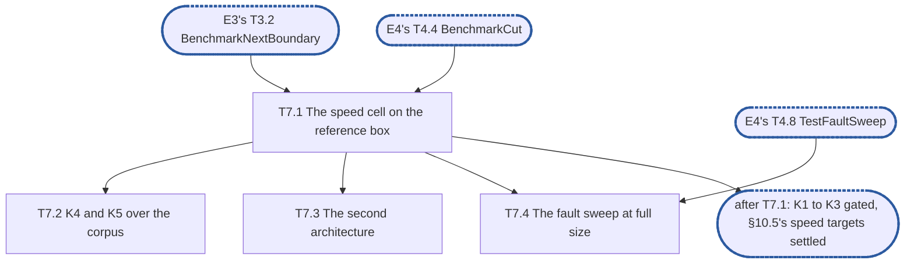

# Epic 7: carver v2 E2E green

**Sources:** [RFC 2](../docs/internals/rfcs/rfc-2-carver.md) §9.1 (K1 to K5, two
architectures, speed apart from quality), §10.5 (the performance targets) and §10.6 (the recorded
fields and the suites), which this epic owns. As the runs they ask for, whose checks are earlier
epics': §10.1 (the Architecture and Benchmark kinds), §10.3 (the fault sweep at full size, the
golden vectors on a second architecture), §10.4 (K1 run nightly), §3.4 and Appendix A.2 (the
warm-up regression only K1 sees). The [RFC index](../docs/internals/rfcs/rfc-index.md), "Test
tiers": no timed check per change, recording results, the reference box, a proposed target
replaced once by measurement, a regression tracked and explained, a check that did not run is a
failure. [RFC 29](../docs/internals/rfcs/rfc-29-test-harness.md) §4.1 (the registry's fields),
§4.3 (tiers), §4.9 (a component's suite, group and suites paragraph) and §4.10 (benchmarks and
long runs). Every citation is `develop`'s text. The code lands on `develop`, where E1
creates `pkg/carver`, E2 `pkg/carver/internal/carvetest`, E3 `pkg/carver/internal/chunker` and
E4 `internal/blake3` at the module root, and the paths below are paths there.
**Track:** the team.
**Epic 7 estimate: 4 subtasks, 7.75 man-days.**
**Depends on:** **E2**: `carvetest`'s `Targets`, `Vectors` and `TestBLAKE3Modes`, the corpus's
`Dir` and `Entries` at `$DITTOFS_CORPUS_DIR/<kind>/<name>`, and `unit`'s `carver-allocs` option.
**E3**: `BenchmarkNextBoundary`, one sub-benchmark per entry of `carvetest.Targets` over 64 MiB
of seeded random bytes (its T3.2), and `carve.NewSettings` (its T3.1). **E4**: `BenchmarkCut` with
its `Random`, `BLAKE3`, `Zeros` and `Period64` sub-benchmarks per `Target` (its T4.4), `Cut`,
`internal/blake3`, and `TestFaultSweep` (its T4.8, D6). **E5**: the fold's tests, which the
second-architecture run includes. **E6**: no subtask waits on it; the epic closes once E6 freezes
the default.
**Blocks:** no epic. E6's report, and any later change of profile or of BLAKE3 backing, is read
against the series this epic starts on the reference box.

---

## 1. Goal

Epic 7 runs what no per-change suite may run: the speed measures on real hardware, the quality
measures over real files, and the long and second-architecture runs of checks earlier epics
wrote. It writes almost no carver code: the cells, one script that runs and records the
benchmarks, and one small program that holds each speed figure to its §10.5 ratio against BLAKE3
measured beside it in the same run.

**At the end of the epic:**

- `carver-bench`, the `carver` group's suite, runs K1 to K3 nightly on the reference box, records
  every figure with the toolchain, the SIMD extensions and the box, and fails when a profile's
  ratio to BLAKE3 alone falls below its target; the first run there has settled §10.5's speed
  targets in RFC 2 (T7.1);
- `carver-bench/corpus` runs K4 and K5 by hand over the pinned corpus at every profile, fails on
  a missed target, and its first run on the reference box is recorded beside §10.5's quality
  targets (T7.2);
- `carver-bench/arm64` runs the carver's checks nightly on arm64, golden vectors and allocation
  counts gated, and records K1 to K3 there without holding them to a ratio (T7.3);
- `carver-fault-sweep`, the `carver` group's second suite, runs §10.3's fault sweep at full size
  nightly, and no other run does (T7.4, D8);
- RFC 2's suites paragraph names each of these, and `docs/internals/testing.md` is regenerated.

### 1.1 In scope

`test/carver/bench.sh`; the ratio checker `pkg/carver/internal/carvetest/ratios`; a `BLAKE3`
sub-benchmark beside K1's; `BenchmarkCorpus`, K4 and K5 as benchmarks with their own metrics; the
`carver` group, the `carver-bench` suite with its `arm64` and `corpus` options, the
`carver-fault-sweep` suite; their lines in `tests.yml`'s `plan` job select; setting
`TestFaultSweep`'s full-size flag, which E4 declares; the settling run and the RFC 2 §10.5 edit it makes; RFC 2's §10.6 suites paragraph
and `docs/internals/testing.md`; the import-test rows of what this epic adds.

### 1.2 Out of scope

- The benchmark functions K1 to K3 run, and the per-change counts that stand in for timing
  (allocations, the average chunk size over 256 MiB, edit stability on seeded input): E3 and E4.
  K5's "average chunk size, random input, within 10 % of `Target`" is E3's per-change count
  (§10.4); the corpus run reports the corpus's average as a figure.
- §10.5's memory per call: E4. §9.1's full-stack rule and Appendix C's sweep: E6.
- `unit/carver-allocs`, the nightly `fuzz` suite and every fuzz target: E2 to E5.
- The index's three measurements the reference box must hold before a decision that depends on
  numbers: the programme's, not RFC 2's. `BenchmarkCut`'s `BLAKE3` sub-benchmark is the hash's raw
  cost on that box, and nothing more is claimed for it.
- Posting a red reference-box cell: the dedicated host reports in its own run's status, as
  `journal-bench-data` does (RFC 29 §4.5). No change to the harness.

### 1.3 Names used here

- **E1**, epic 1, interfaces: the root contract and the import test `pkg/carver/imports_test.go`,
  one row per package.
- **E2**, epic 2, test foundations: `carvetest` (vectors, the BLAKE3 modes check, seeded inputs,
  `Targets`), its `corpus` package and fetch, `unit`'s `carver-allocs` option and the nightly
  `fuzz` suite.
- **E3**, epic 3, the chunker: `NewSettings`, `NextBoundary` and `BenchmarkNextBoundary`, K1's
  function. Track A.
- **E4**, epic 4, the carver and identity: `internal/blake3`, `Cut`, `BenchmarkCut`, K2's and K3's
  function, and `TestFaultSweep`. Track B.
- **E5**, epic 5, the block assembler. Track C.
- **E6**, epic 6, integration: RFC 2 Appendix C's sweep through the real offload path, which
  freezes the default `Target`.
- **E7**, this epic.
- **The reference box**: the harness's dedicated host, which a cell reaches with
  `needs: [linux, host:dedicated]` and which runs develop's latest commit each night.
- **D1** to **D8** are this epic's decisions (§4). A decision of another epic is written with the
  epic named ("E4's D6").

## 2. How the general rules apply

The rules are those of
[the RFC 2 plan's §1.5](rfc-2-carver-plan.md#15-general-rules-for-each-epic), cited by number and
title and not copied.

| Rule | Subtasks | How |
| --- | --- | --- |
| rule 1, independent unit tests ([`CLAUDE.md`, "Writing tests"](../CLAUDE.md#writing-tests)) | T7.1, T7.2 | the ratio checker is a function of benchmark text, tested over text written in the test, its input and not a double; `BenchmarkCorpus` cuts the real files through the real `Cut`. No test double anywhere |
| rule 2, fuzz tests where relevant ([`CLAUDE.md`, "Writing tests", "By kind"](../CLAUDE.md#writing-tests)) | none | the checker reads what `go test` wrote in the same cell, not bytes off a wire or another program's disk, so it has a table test. Fuzzing past the seeds stays on amd64 in E2's `fuzz` suite; arm64 runs the seeds (D5) |
| rule 3, observability follows RFC 25, with RFC 2's exception | none | nothing here is a carver package |
| rule 4, profiling | T7.1, T7.3 | the checker fails a K1 to K3 line with an allocation or with no allocation figure, so the nightly run counts allocations at 64 MiB too; T7.3 runs the allocation counts on arm64 |
| rule 5, public interface and internals ([`CLAUDE.md`, "Verifying a change"](../CLAUDE.md#verifying-a-change)) | T7.1 | the gate reads the very file `dt` records, so the gate and the series cannot disagree |
| rule 6, known failures shrink | none | `carver-bench` and `carver-fault-sweep` keep no `known.yaml`: a missed ratio or target is a finding, as `journal-bench` decides |
| rule 7, v2 ignores v1, and imports only what RFC 0 §1.2 allows | T7.1, T7.2 | `ratios` imports the standard library and `carvetest`, a row in E1's import test; `carve`'s test row admits `carvetest/corpus`; `BenchmarkNextBoundary` moves to `package chunker_test` (D2), whose row admits `carve` and so `internal/blake3` (E3's D6), while the row of `package chunker`'s test files, which admits no BLAKE3 (E3's §3), is unchanged. v1's measurements are not read |
| rule 8, real dependencies for properties of those dependencies | all | the speed ratios on the reference box and a real arm64 machine, the golden vectors on that machine's BLAKE3 path, K4 and K5 on real files |
| rule 9, code comment conventions ([`CLAUDE.md`, "Code comments"](../CLAUDE.md#code-comments)) | T7.1, T7.3 | `decision:` markers for D1 at the checker's targets, D3 at the script's record, D5 in the `arm64` option's comment; `ponytail:` at `medians` (D1). D6's `decision:` at the flag is E4's |
| rule 10, a test must be able to fail | all | each cell is seen red on a planted break before its pull request opens: a full-chunk warm-up for K1, a vector byte for arm64, a part-built chunk emitted for the sweep, fixed-size cuts for K4 |
| rule 11, a symbol is exported only if the RFC's interface uses it | none | nothing is exported: `ratios` is a command and the benchmarks are test functions |
| rule 12, each subtask creates only what it declares | all | each file lands with the cell that runs it; `bench.sh` gains its `corpus` group with T7.2 |

## 3. Requirements and invariants

Every obligation the sources above place on this epic's runs. Where the check a run executes is
another epic's, the row says so.

**The speed measures**

| # | Requirement | Kind | Source | Subtasks |
| --- | --- | --- | --- | --- |
| R1 | K1: `NextBoundary` over 64 MiB of seeded random bytes, at every profile, reporting MB/s (`go test`'s 10^6 bytes a second) and its allocations, run nightly on the reference box | test row | RFC 2 §9.1 K1, §10.1 (Benchmark), §9 ("One fixed profile **MUST NOT** be the only settings under test"); E3's T3.2 | T7.1 |
| R2 | K2: `Cut` over the same input, hashing included, beside BLAKE3 alone over the same bytes, each reporting MB/s, so the difference is the carver's own cost | test row | RFC 2 §9.1 K2; E4's T4.4 | T7.1 |
| R3 | K3: `Cut` over all-zero and short-period input, where chunks run to `Max`, reporting MB/s | test row | RFC 2 §9.1 K3, §3.8 | T7.1 |
| R4 | Each speed target is stated against BLAKE3 alone over the same bytes on the same box: K1 at least 10 × BLAKE3's rate, K2 at least 90 % of it, K3 at least 50 % of K2, at every profile; a nightly run below one fails | bound | RFC 2 §10.5; RFC index, Recording results ("A target is stated against something measured on the same box") | T7.1 |
| R5 | K1 to K3 make no allocation | bound | RFC 2 §9.1 K1 ("zero allocations"), §10.5 (allocations: none) | T7.1 |
| R6 | K1, run nightly, is what sees a warm-up that crept back over the whole chunk, which changes no output and so no count: the boundary search falls from over 20 × BLAKE3's rate to about 2 × | invariant | RFC 2 §10.4 (last paragraph), §3.4, Appendix A.2 | T7.1 |
| R7 | K1 to K3 run on at least two CPU architectures, because the ratios differ between them | invariant | RFC 2 §9.1, Appendix A.2 | T7.1, T7.3 |
| R8 | Speed and quality are measured separately, and speed alone never decides a profile: no speed figure stands in for K4 or K5 | invariant | RFC 2 §9.1 | T7.1, T7.2 |
| R9 | No timed check runs per change: K1 to K3 run nightly, K4 and K5 by hand | invariant | RFC index, Test tiers ("No timed check runs per change"); RFC 2 §10.1 (Benchmark), §10.4 | T7.1, T7.2 |

**Recording**

| # | Requirement | Kind | Source | Subtasks |
| --- | --- | --- | --- | --- |
| R10 | Every result is recorded in absolute numbers, with the commit, the box (CPU, memory, device and the device's raw figures), the operating system and filesystem with its mount options, each row's concurrency, and the CPU's SIMD extensions BLAKE3 used and the toolchain version. The device, its figures, the filesystem and its mount options are left out by D3, since nothing measured touches a device | invariant | RFC index, Recording results; RFC 2 §10.6 | T7.1, T7.2, T7.3 |
| R11 | One named reference box carries the series; results from another box are compared only with themselves, never gated against the reference box's | invariant | RFC index, Recording results | T7.1, T7.3 |
| R12 | A row more than 10 % worse on a measured path than the last result on the reference box needs a recorded decision before the next result becomes its baseline, so each night's absolute figures are kept where that comparison can be made | invariant | RFC index ("A regression is tracked, and explained") | T7.1 |
| R13 | Each proposed benchmark target of §10.5 is replaced once, by the first run on the reference box, with the measured value and headroom stated beside the result (K4 and K5 repeat to the byte on the pinned corpus, so their headroom is stated as none, D7); a target that run misses is a design finding against RFC 2, never relaxed to pass | invariant | RFC index ("A proposed target is replaced once, by measurement"); RFC 2 §10.5 ("Proposed target") | T7.1, T7.2 |

**The quality measures**

| # | Requirement | Kind | Source | Subtasks |
| --- | --- | --- | --- | --- |
| R14 | K4: a corpus file, then the same file with one byte inserted near the start; the fraction of chunk hashes the two share, and every chunk that starts more than 2 × `Max` bytes past the edit shared, on a 1 GiB corpus file | test row | RFC 2 §9.1 K4, §10.5 K4, §9 (B4 shift resistance) | T7.2 |
| R15 | K5: the chunk-size histogram against `Min`, `Target` and `Max` over real files of several kinds, source trees, VM images and media; at most 1 % of chunks at `Max` on a corpus with no repetitive regions | test row | RFC 2 §9.1 K5, §10.5 K5 | T7.2 |
| R16 | K4 and K5 are not timed, and run on a fixed corpus so a change of profile is compared against the last run on the same bytes | invariant | RFC 2 §9.1 | T7.2 |
| R17 | Seeded random input never stands in for K4 or K5: it holds no edits to survive and no structure to find | invariant | RFC 2 §9.1 ("the wrong one for K4 and K5") | T7.2 |
| R18 | No check fetches the corpus; a run of K4 and K5 without it fails, never passing having measured nothing | invariant | RFC 2 §10.4, §1.3; RFC index ("A check that did not run is a failure") | T7.2 |

**The second architecture and the full size**

| # | Requirement | Kind | Source | Subtasks |
| --- | --- | --- | --- | --- |
| R19 | The golden vectors, chunks and names, run on a second CPU architecture nightly, since BLAKE3 takes different code paths on each | invariant | RFC 2 §10.1 (Architecture), §10.3, §10.4, §3.1 B2 | T7.3 |
| R20 | The allocation counts pass on the second architecture nightly | invariant | RFC 2 §10.4 (allocations); RFC 2 plan, epic 7 (Done when) | T7.3 |
| R21 | The reader fails at every byte offset of the fault sweep's stretch, and `emit` at every chunk of it, at full size, nightly, with the same prefix-and-retry assertions as the reduced sweep; E4's `TestFaultSweep` runs both at both sizes | MUST | RFC 2 §10.3, §10.6; RFC 2 plan, D8; E4's T4.8 (`TestFaultSweep`) | T7.4 |
| R22 | The full sweep runs in no per-change run; every run that does not ask for it by name runs the reduced sweep | invariant | RFC 2 plan, D8; E4's D6 | T7.4 |

**The suites**

| # | Requirement | Kind | Source | Subtasks |
| --- | --- | --- | --- | --- |
| R23 | K1 to K3 on the reference box, the fault sweep at full size and the golden vectors on a second architecture run nightly, and K4 and K5 by hand, in a suite named for the carver, `carver-bench`, which a `carver` group holds; the full sweep in that group's second suite, `carver-fault-sweep` (D8) | invariant | RFC 2 §10.6 (Suites); RFC 29 §4.9; RFC 2 plan, §1.4, epic 7 | T7.1, T7.2, T7.3, T7.4 |
| R24 | RFC 2's suites paragraph names each suite, option and group registered, and says which planned checks no suite runs yet | invariant | RFC 29 §4.9; RFC 2 §10.6 | T7.1, T7.2, T7.3, T7.4 |

How each row is enforced once this epic lands, where no test of this epic can break it: R9 by the
registry, whose `carver-bench` cells are `nightly` and `manual`; R11 by
`needs: [linux, host:dedicated]` on the gated cell and the arm64 option's `-record` (D5); R12 by
`metrics: go-bench`, which keeps each night's absolute medians in `dt history`, while the decision
is the owner's, by hand (D1); R22 by E4's flag, which only `carver-fault-sweep` passes; R23 and
R24 by `lint-repo`'s `dt docs --check` for a name the registry lacks, and by review for a
registered cell the paragraph leaves out.

The candidates of the owned sections that bind other epics are theirs: §9.1's full-stack **MUST**
(E6); §10.5's memory per call (E4); K5's average on random input (E3); §10.3's two buffer sizes
and the reduced sweep (E4); §10.6's `unit` checks, the allocation option and the fuzz suite (E2 to
E5). §10.1's "no crash test, no soak and no concurrency test" describes the design.

## 4. Decisions this epic takes

- **D1, the ratio gate reads the recorded run, and pairs inside one benchmark function.** Ten
  `go test -p 1 -count=1 -bench` passes, one after another, append to `{out}/speed.txt`, which
  `dt`'s go-bench reader records, and `ratios` reads the same file: at each `Target`, the median
  MB/s of K1 against its `BLAKE3` sibling in `BenchmarkNextBoundary`, of K2's `Random` against its
  `BLAKE3` sibling in `BenchmarkCut`, and of K3's `Zeros` and `Period64` against that `Random`.
  Every ratio is between sub-benchmarks of one function at one `Target`, which one pass runs back
  to back, so each pair of samples runs seconds apart in one process and a drifting host moves
  both sides. Ten passes rather than `-count=10`, which runs all ten samples of one sub-benchmark
  before the next (`testing`'s `processBench`), so a pair's samples would be ten blocks of
  10 to 20 s apart; `-p 1` keeps the two packages' binaries from running at once. Medians, keyed
  "NAME UNIT" as `readGoBench` keys them, which pools a name's lines across the file
  (`test/harness/run/gobench.go` on `feat/storage-v2`, checked), so one slow sample neither fails
  the gate nor moves the series; `medians` repeats that reader's 50 lines, since the harness's
  package is not the carver's to import, and a `ponytail:` there says so. `allocs/op` is read at
  its maximum over the samples, not its median, so an allocation in four samples of ten still
  fails. A missing sub-benchmark, or a K line with no `allocs/op`, fails as loudly as a missed
  ratio. Performance is tracked, not gated (RFC 29
  §4.10), but §10.5 asks for targets that a real regression trips, and this gate fails only a
  nightly cell, never a pull request, as `unit --nonrace` does (RFC 29 §4.10). A ratio does not see
  a regression that slows BLAKE3 and `Cut` together, a backing losing its assembly path or a
  toolchain regression: the `decision:` at the targets says the absolute rows in `dt history` are
  where the index's 10 % comparison is read, by hand. Not an in-process test calling
  `testing.Benchmark`, as RFC 29's `TestBLAKE3FasterThanSHA256` does (`pkg/block/hash_bench_test.go`
  on develop, checked): it would take one sample where the record keeps ten, so the gate and the
  series would measure different runs. Prior art: that test, for the shape of a ratio against a
  hash in one process. Applied by T7.1.

- **D2, the sub-benchmark names are a contract E3 and E4 write.** The checker reads
  `BenchmarkNextBoundary/<Target>/Search`, `BenchmarkNextBoundary/<Target>/BLAKE3` and
  `BenchmarkCut/<Target>/<Random|BLAKE3|Zeros|Period64>`, with `<Target>` the decimal byte count,
  `strconv.Itoa(t)` for each `t` of `carvetest.Targets` (`BenchmarkCut/262144/BLAKE3`). E4's T4.4
  spells its names exactly so; E3's T3.2 has one level, in `package chunker` (E3's D6), which
  T7.1 moves to `package chunker_test` and splits into `Search`, E3's body unchanged, and
  `BLAKE3`, the same bytes through `internal/blake3`'s keyed hash in `Target`-sized pieces, as
  E4's baseline. The move is what lets the sibling hash: the external test package may import
  `carve` and what it reaches, while `package chunker`'s import row admits no BLAKE3 (E3's §3);
  the body needs only `params.New` and `NextBoundary`, both exported. `bench.sh` passes `-cpu=1`, so `go test` adds no `-N`
  suffix in the cell or in a hand run. A benchmark spelled otherwise fails the checker by name. Prior art: `go test`'s
  sub-benchmark naming (from memory). Applied by T7.1.

- **D3, the record: what `go test` prints, plus `meta.txt`.** `go test -bench` heads its output with
  `goos`, `goarch` and `cpu`, and `dt`'s summary holds the commit. `bench.sh` writes
  `{out}/meta.txt` once per run, as `test/journal/bench-data.sh` does (checked): `go version`; the
  kernel (`uname -srm`); the memory (`MemTotal` on Linux, `sysctl -n hw.memsize` on macOS);
  `GOMAXPROCS`, the `-cpu` value `bench.sh` passed, which is the one in effect for the rows, since neither `Cut` nor the boundary search starts a
  goroutine; the CPU, from `/proc/cpuinfo`'s `model name` on Linux and
  `sysctl -n machdep.cpu.brand_string` on macOS; the SIMD paths the backing E4's T4.1 picks
  dispatches on, read from that backing's source once it is picked, which T7.1 writes down: were it
  `lukechampine.com/blake3`, AVX-512F and AVX2 on amd64, from `/proc/cpuinfo` (`avx512f`, `avx2`),
  and none on arm64, which it runs as generic Go (read the code, `guts/cpu.go`); and the backing's
  module and version, from `go list -m`, since which path it takes depends on both. The device, the filesystem and its mount options are not
  recorded: the inputs are built in memory before the timer starts and nothing measured touches a
  device. A `decision:` at the record says so, and that it is withdrawn if a carver benchmark ever
  reads a file. Applied by T7.1 and T7.3.

- **D4, K4 and K5 are benchmarks that report their own metrics.** `BenchmarkCorpus` runs at
  `-benchtime=1x -count=1`, one sub-benchmark `BenchmarkCorpus/<kind>/<name>/<Target>` per
  corpus entry and `Target`, under the unkeyed table, and reports each figure with
  `b.ReportMetric`, so the same go-bench reader records it. The figures are a function of the
  pinned bytes and the settings, so one count is the whole sample, and the run fails with
  `b.Errorf` on a missed K4 or K5 target. Each entry is read up to its first 1 GiB, the size K4's
  target names, through `Cut` with a buffer of 2 × `Max`; the edit is one byte, `0x5A`, inserted at
  offset 4,096 into that prefix, so the edited stream is 1 GiB + 1 bytes and both end on the same
  content. The metrics: `shared-frac`, the fraction of the edited file's chunks whose hash the
  original has; `far-unshared`, how many chunks starting more than 2 × `Max` past the edit the
  original lacks, which K4's target holds at 0; `mean-B`; `at-max-frac`, which K5's target holds
  at 0.01 on an entry not marked `Repetitive`; and the histogram as `lt-half-frac`,
  `lt-target-frac`, `lt-double-frac` and `lt-max-frac`, the chunks in `[Min, T/2)`, `[T/2, T)`,
  `[T, 2T)` and `[2T, Max)`. The keyed table is left out: no K4 or K5 row asks for it, §9's keyed
  boundaries row is E3's per-change check. A run cuts at most about 2.7 GiB, twice, at seven
  `Target`s, about 38 GiB through `Cut`: a few minutes (computed, not measured), and the cell's
  timeouts are sized from that. Prior
  art: Go's `testing.B.ReportMetric` (checked, the standard library). Applied by T7.2.

- **D5, arm64 gates the checks and records the speeds.** The `arm64` option runs the carver's tests
  once without the race detector and without `-short`, so the golden vectors, BLAKE3's published
  vectors through `internal/blake3`, the allocation counts and every fuzz target's seeds pass on
  arm64 or turn the cell red; then `bench.sh speed`, then `ratios -record`, which keeps every
  presence and allocation check, skips the ratios, and fails unless the run's header says
  `goarch: arm64`, so it never passes an amd64 run unchecked. K2's 90 % target sits about 6 % under the
  96 % measured on arm64 (Appendix A.2), a margin a noisy neighbour on a shared hosted runner
  crosses with no code change, and R11 forbids gating another box against the reference box's
  targets. The cell is the harness's macOS host, arm64 (`needs: [macos]`), the one non-x86 runner
  it has. Fuzzing past the seeds stays on amd64: what differs on arm64 is BLAKE3's code path, which
  the vectors hold, and the fold hashes nothing, so this hands E5's "`FuzzFold` at full size on the
  second architecture" back as its seeds on arm64. A `decision:` in the option's comment says the
  speeds are recorded, not checked, until an arm64 machine is set aside as a reference box. Prior
  art: `journal-bench-data`'s "collected, never checked" (checked). Applied by T7.3.

- **D6, the full sweep runs only when asked for by a flag.** `unit` passes `-short` only on pull
  requests (`args: { pr: "-short" }` in `test/suites.yaml` on `feat/storage-v2`, checked), so after
  a merge and nightly it runs every test without it, under `-race`. A sweep that grows whenever
  `-short` is absent would run its 655,360 offsets there, raced, against `unit`'s 25-minute limit,
  and in a developer's plain `go test ./...`. So E4's `TestFaultSweep` runs the reduced sweep unless
  the test flag `-carver.sweep-full` is set, which E4's T4.8 declares in `carve`'s test files with
  `flag.Bool` and its `decision:` (E4's D6). This epic adds no flag: `carver-fault-sweep` sets it, nightly,
  without the race detector, which a sweep over `Cut`'s output needs none of. A flag rather than an
  environment variable: an option's `env` replaces the suite's whole, and a `DITTOFS_` name would
  join the start's drift check. Prior art: `unit --nonrace` in RFC 29 §4.1 (checked). Applied by
  T7.4.

- **D7, settling §10.5.** The settling runs on the reference box, at least two on separate nights,
  set each speed target, a floor, to max(proposed, 90 % of the measured median ratio), the
  measured ratio being the lowest of the runs' medians, rounded down to two significant figures:
  the headroom sits below the measurement, at the index's 10 % regression line, and a target the
  RFC chose is never loosened by a box that beat it. The spread, the lowest and highest of the
  runs' medians, is stated beside each target, so the margin a night's noise takes is on the
  record. Together they are the index's first run on the reference box: the target is still
  replaced once. A measured ratio below the proposed floor is R13's design finding: the runs are recorded,
  the settling stops, and RFC 2's author decides. So is a floor that would leave under 10 % of
  room below the measurement, which max() gives whenever 90 % of the measurement falls below the
  proposed value (K2 measured at 0.91 against 0.90 leaves about 1 %): §10.5 asks that each target leave
  room below what was measured, so the author decides rather than a gate going silently tight. K4 and K5
  are deterministic on a pinned corpus, so the first run replaces each as R13 asks with its
  proposed value, "proposed" dropped, its figures beside it and the headroom stated as none: a
  figure that repeats to the byte needs no margin, and a missed one is R13's design finding. §10.5 states each result with the commit, the box, the toolchain and the
  SIMD extensions, and `ratios`' constants change in the same pull request. Prior art: the index's
  rule, which this applies. Applied by T7.1 and T7.2.

- **D8, the full sweep is a suite of its own in the `carver` group, which amends §10.6's one
  suite.** An option of `carver-bench` inherits the suite's `tests: [speed]` and
  `metrics: go-bench`: the registry's `merge` copies only an option's set fields, so none can clear
  them (`test/harness/registry/registry.go` on `feat/storage-v2`, checked), and `dt` would read
  `{out}/speed.txt`, which the sweep never writes, and report the cell not run every night
  (`test/harness/run/run.go`, checked). `unit` is not the answer either, since R23 places the run
  with the carver. So `carver-fault-sweep` joins `carver-bench` in the `carver` group, and T7.4
  words RFC 2 §10.6's suites paragraph as naming the carver's suites, this one beside
  `carver-bench`, the amendment this decision records. E6 adds a third, the manual `carver-sweep`
  (#5991), whose name this one stays apart from. Prior art: `journal-bench` and
  `journal-bench-data`, two suites of one component (checked). Applied by T7.4.

## 5. Target tree

```text
test/carver/
  bench.sh                        T7.1, T7.2  speed and corpus groups, meta.txt; D3's decision:
pkg/carver/
  imports_test.go                 T7.1, T7.2  ratios' row (std, carvetest); carve's test row
                                              admits carvetest/corpus
  internal/carvetest/ratios/
    main.go                       T7.1  the checker; D1's decision: and ponytail:
    main_test.go                  T7.1  the rule over written benchmark text
  internal/chunker/
    bench_test.go                 T7.1  BenchmarkNextBoundary split into Search and BLAKE3
  carve/
    corpus_bench_test.go          T7.2  BenchmarkCorpus (K4, K5)
test/suites.yaml                  T7.1, T7.2, T7.3, T7.4  carver group; carver-bench with its arm64
                                                          and corpus options; carver-fault-sweep
.github/workflows/tests.yml       T7.3, T7.4  carver-bench/arm64 and carver-fault-sweep in the
                                              plan job's select
docs/internals/rfcs/rfc-2-carver.md  T7.1, T7.2, T7.3, T7.4  §10.6's suites paragraph; §10.5's
                                                            settled targets and first figures
docs/internals/testing.md         T7.1, T7.2, T7.3, T7.4  regenerated by dt docs
```

## 6. Subtasks

### T7.1 The speed cell on the reference box

**Subtask T7.1 estimate: 3.25 man-days.**

- **Track:** the team. **Depends on:** none. It runs E3's and E4's benchmarks, so it lands after
  E3's T3.2 and E4's T4.4.
- **Covers:** R1 to R13, R23, R24.
- **Deliverables:**
  - `BenchmarkNextBoundary` moved to `package chunker_test` and split into `Search` and `BLAKE3`
    per `Target` (D2). Consumed by the `speed` group.
  - `test/carver/bench.sh GROUP OUT`, its `speed` group, ten passes appended to one file (D1):
    `for i in 1 2 3 4 5 6 7 8 9 10; do go test -p 1 -cpu=1 -count=1 -run '^$' -bench
    '^(BenchmarkNextBoundary|BenchmarkCut)$' -timeout=3m ./pkg/carver/internal/chunker/
    ./pkg/carver/carve/ >> OUT/speed.txt || exit; done`, then `meta.txt` (D3), with D3's
    `decision:`; it exits with the first failing pass's status. `-timeout` applies to each test
    binary of each pass, so it only catches a hung one; the cell's `test: 30m` bounds the run,
    about 13 minutes for 42 sub-benchmarks ten times over (computed, not measured). Consumed by the
    `carver-bench` cell, T7.2 and T7.3.
  - `pkg/carver/internal/carvetest/ratios`, with D1's `decision:` at its targets and its
    `ponytail:` at `medians`, and its row in E1's `imports_test.go`, the standard library and
    `carvetest`. Consumed by the `carver-bench` cell and T7.3:
    ```go
    // Command ratios reads go test -bench output and checks RFC 2 §10.5's speed targets at every
    // profile of carvetest.Targets, on medians, against BLAKE3 alone in the same function. With
    // -record it checks only that every benchmark ran with no allocation. It exits non-zero
    // naming each target missed, benchmark absent or allocation counted.
    package main

    // Targets of RFC 2 §10.5, as ratios of medians (D1, D7).
    const (
        k1OverBLAKE3 = 10.0 // Search's rate over BLAKE3's, in BenchmarkNextBoundary
        k2OverBLAKE3 = 0.90 // Random's rate over BLAKE3's, in BenchmarkCut
        k3OverK2     = 0.50 // Zeros' and Period64's rate over Random's, in BenchmarkCut
    )

    // medians reads go test -bench output: each benchmark's median per unit, keyed "NAME UNIT"
    // as dt's go-bench reader keys them, pooling repeated lines; allocs/op keeps its maximum.
    func medians(r io.Reader) (map[string]float64, error)

    // check returns one line per target missed, benchmark absent, allocation counted or
    // allocation figure missing, at every profile of targets, by D2's names; record skips the
    // ratios.
    func check(m map[string]float64, targets []int, record bool) []string
    ```
  - In `test/suites.yaml`, the group `carver: [carver-bench]` and the suite, each field's reason in
    its comment, as `journal-bench-data`'s:
    ```yaml
    carver-bench:
      cmd:
        - test/carver/bench.sh {test} {out}
        - go run ./pkg/carver/internal/carvetest/ratios {out}/speed.txt
      tests: [speed]
      env: { GOMAXPROCS: "1" }
      format: exit
      metrics: go-bench
      tier: nightly
      needs: [linux, host:dedicated]
      timeout: { test: 30m, cell: 40m }
    ```
  - The settling runs (D7), at least two on separate nights: `bench.sh speed OUT` and
    `ratios OUT/speed.txt` on the reference box from
    a `develop` checkout, by its owner, since a `dt` run there plans the whole nightly tier
    (`--place dedicated`); RFC 2 §10.5's speed targets replaced as D7 says, the spread, the commit,
    the box, the toolchain and the SIMD extensions beside them; `ratios`' constants changed to
    match.
  - RFC 2 §10.6's suites paragraph: K1 to K3 nightly on the reference box in `carver-bench`, the
    `carver` group's suite, each checked against its §10.5 ratio; the corpus, arm64 and full-sweep
    runs still planned. `docs/internals/testing.md` regenerated.
- **Acceptance criteria:**
  - On a Linux amd64 machine, `bench.sh speed OUT` writes ten samples of every sub-benchmark of D2
    at every `Target` and `meta.txt` with every field of D3, and `ratios` passes over it.
  - With E3's warm-up replaced by one from the chunk's start, `ratios` fails over the new run,
    naming K1 at every `Target`.
  - Each settled target equals max(proposed, 90 % of the lowest measured median), rounded down to
    two significant figures, with the spread of the runs beside it, and `ratios` passes the
    reference box's runs against the settled constants. Where 90 % of a measurement fell
    below the proposed value, the measurement itself below it included, the target stays as written and the finding is
    recorded for RFC 2's author (D7); `ratios` is not required to pass that run.
  - `dt docs --check` passes.
- **Tests:** `main_test.go`, at `check` and `medians` as the cell calls them, over benchmark text
  written in the test: every target met passes; K1 at 9.9 × BLAKE3 at one `Target` fails naming
  it; K2 at 0.89 fails; `Period64` at 0.49 of `Random` fails; one sample of ten far below the rest
  does not move the median past a target; a `Target` with no `BLAKE3` line, or a profile missing,
  fails naming it; an `allocs/op` above 0, in one sample of ten as in all, and a K line with no
  `allocs/op`, each fail; `record` passes ratios below target, still fails a missing line, and
  fails a run whose header says `goarch: amd64`. Each is seen to fail with its constant
  moved or its absence check removed. The planted warm-up (R6) is the check that the cell turns red
  on the regression it exists for. No test double: the benchmark text is the checker's input.
- **Rules:** rule 4, the allocation check; rule 7, the row; rule 9, D1's and D3's markers. Others
  as §2 says.

### T7.2 K4 and K5 over the corpus

**Subtask T7.2 estimate: 2.25 man-days.**

- **Track:** the team. **Depends on:** T7.1.
- **Covers:** R8 to R10, R13 to R18, R23, R24.
- **Deliverables:**
  - `pkg/carver/carve/corpus_bench_test.go`, `BenchmarkCorpus` (D4): for each entry of
    `corpus.Entries` under `corpus.Dir(b)` and each `Target` of `carvetest.Targets`, with settings
    from `carve.NewSettings` and `Vectors.ChunkIDKey`, it cuts the entry's first 1 GiB and that prefix
    with the edit, 1 GiB + 1 bytes (D4), both through `Cut`'s reader, so no input is held whole, and reports D4's
    metrics. Consumed by the `corpus` group.
  - `bench.sh`'s `corpus` group: it exits 2 naming `DITTOFS_CORPUS_DIR` when the variable is unset
    or names no directory, before `go test` runs, as `journal-bench` refuses an unset
    `DITTOFS_BENCH_DIR`, since `corpus.Dir` would otherwise skip and pass; then `go test -count=1
    -benchtime=1x -run '^$' -bench '^BenchmarkCorpus$' -timeout=10m ./pkg/carver/carve/ >
    OUT/corpus.txt`, fails if no `BenchmarkCorpus/` line came out, and writes `meta.txt`.
  - In E1's `imports_test.go`, `carve`'s test row admits `carvetest/corpus`.
  - `carver-bench`'s `corpus` option: `cmd: test/carver/bench.sh {test} {out}`, `tests: [corpus]`,
    `tier: manual`, `needs: [linux]`, since D4's figures hold on any box, and `timeout: { test:
    15m, cell: 20m }`.
  - The first run on the reference box, by hand: RFC 2 §10.5's K4 and K5 rows gain its figures,
    with the commit, beside targets settled at their written values (D7), and later runs compare against that row.
  - RFC 2 §10.6's suites paragraph names `carver-bench/corpus`; `testing.md` regenerated.
- **Acceptance criteria:**
  - With the corpus fetched, `dt run carver-bench --corpus` reports every metric of D4 for every
    entry and `Target`, and fails on any `far-unshared` above 0, and on an `at-max-frac` above 0.01
    for an entry not marked `Repetitive`.
  - With `DITTOFS_CORPUS_DIR` unset, the cell fails naming the variable, and no `go test` runs.
- **Tests:** the run itself, seen to fail on a planted break before the pull request opens: the
  boundary search replaced by cuts at every multiple of `Target`, which shifts every boundary after
  the edit, turns `far-unshared` above 0 (R14); the mask past `Target` widened by four bits, so
  fewer bytes pass, turns `at-max-frac` above 0.01 on the source tree (R15); the unset variable
  (R18). No test double: the files are the pinned corpus, and the carver the real one.
- **Rules:** rule 7, the row; rule 8, the real files. Others as §2 says.

### T7.3 The second architecture

**Subtask T7.3 estimate: 1.25 man-days.**

- **Track:** the team. **Depends on:** T7.1.
- **Covers:** R7, R10, R11, R19, R20, R23, R24.
- **Deliverables:**
  - `carver-bench`'s `arm64` option, with D5's `decision:` in its comment:
    ```yaml
    arm64:
      cmd:
        - go test -timeout=20m ./pkg/carver/... ./internal/blake3/
        - test/carver/bench.sh {test} {out}
        - go run ./pkg/carver/internal/carvetest/ratios -record {out}/speed.txt
      needs: [macos]
      timeout: { test: 50m, cell: 60m }
    ```
  - In `.github/workflows/tests.yml`'s `plan` job select, `carver-bench/arm64` in the
    keep list, beside `integration/ad-dc` and `bench-smoke`, never the storage-v2 skip list that
    also names `unit/windows`.
  - RFC 2 §10.6's suites paragraph names `carver-bench/arm64`; `testing.md` regenerated.
- **Acceptance criteria:**
  - On an arm64 machine, `dt run carver-bench --arm64` passes, and its `meta.txt` names arm64, the
    backing's module and version, and the path it runs there.
  - With one byte of `carvetest`'s `vectors.json` changed, the cell fails, naming its first command.
  - A `workflow_dispatch` of `tests.yml` on `develop` at the nightly tier plans and runs
    the cell on the macOS runner.
- **Tests:** the planted vector byte (R19), and a planted per-chunk allocation in `Cut` (R20), each
  seen to fail the cell on an arm64 machine. No test double.
- **Rules:** rule 4, the counts on arm64; rule 8, a real arm64 machine; rule 9, D5's `decision:`.
  Others as §2 says.

### T7.4 The fault sweep at full size

**Subtask T7.4 estimate: 1 man-days.**

- **Track:** the team. **Depends on:** T7.1, whose `carver` group the suite joins. It
  runs E4's `TestFaultSweep` with E4's `-carver.sweep-full` flag, so it lands after E4's T4.8.
- **Covers:** R21 to R24.
- **Deliverables:**
  - The suite `carver-fault-sweep` in the `carver` group (D8), `format: exit`, `needs: [linux]`,
    `tier: nightly`, `timeout: { test: 60m, cell: 70m }`, its command an `sh` one that fails when
    the test did not run, since `go test -run` matching nothing prints "no tests to run" and exits
    0, and `format: exit` would grade a renamed `TestFaultSweep` green every night (R18's rule):
    ```yaml
    cmd:
      - sh: |
          go test -v -timeout=55m -run='^TestFaultSweep$' ./pkg/carver/carve/ -args -carver.sweep-full > {out}/sweep.txt; s=$?; tail -n 40 {out}/sweep.txt; test $s -ne 0 || grep -q '^--- PASS: TestFaultSweep (' {out}/sweep.txt || { echo "TestFaultSweep did not run" >&2; exit 2; }; exit $s
    ```
    The pattern is anchored at the line's start and the opening parenthesis, so a passing
    subtest's indented `--- PASS: TestFaultSweep/…` line never stands in for the test's own.
  - In `tests.yml`'s `plan` job select, `carver-fault-sweep` in the keep list, beside
    `integration/ad-dc` and `bench-smoke`, never the storage-v2 skip list.
  - RFC 2 §10.6's suites paragraph names `carver-fault-sweep` with K1 to K3's suite (D8); `testing.md` regenerated.
- **Acceptance criteria:**
  - `dt run carver-fault-sweep` runs the sweep at all 655,360 offsets of E4's D6 and passes; its
    time on a hosted Linux runner, from a `workflow_dispatch` run, is in the pull request.
  - If that time exceeds 30 minutes, the suite is not registered and the figure goes to RFC 2's
    author as a §10.3 amendment, rather than a smaller stretch chosen in the test.
  - `go test -race -run=^TestFaultSweep$ ./pkg/carver/carve/`, without `-short` and without the
    flag, runs the reduced sweep and finishes in under a minute on a developer machine.
  - With `TestFaultSweep` renamed, the cell fails naming it.
- **Tests:** the full sweep, seen to fail with a part-built chunk emitted on a reader error at one
  offset the reduced sweep does not sample (R21); the raced run without the flag, the reduced
  sweep's offset count asserted (R22). No test double: `failAt` is E4's fault wrapper around a real
  reader (kind 3).
- **Rules:** rule 9 does not apply: the flag and its `decision:` are E4's. Others as §2 says.

## 7. Order of work



T7.1 is the blocker: the script, the checker and the suite every other cell extends.
T7.2 goes before T7.3 as the riskier, a corpus target a first run can miss. T7.4 needs only
T7.1's group and is a branch of its own, open beside T7.2 and T7.3 once E4's sweep has landed. Checkpoint
after T7.1.

## 8. Suggested pull requests

| PR | Subtasks | Man-days | After | Why together |
| --- | --- | --- | --- | --- |
| 1 | T7.1 | 3.25 | — | the speed cell, its checker, the settling run and the suite the others extend |
| 2 | T7.2 | 2.25 | PR 1 | K4 and K5 and their first recorded figures |
| 3 | T7.3 | 1.25 | PR 1 | the arm64 option; open beside PR 2 |
| 4 | T7.4 | 1 | PR 1 | the full sweep's nightly suite, in PR 1's group; open beside PRs 2 and 3 |

A suggestion only: one pull request per subtask works as well.

## 9. Open points

1. **Estimate against the RFC 2 plan's figure.** The RFC 2 plan says 5 subtasks and 8.5 man-days;
   this document says 4 and 7.75. The settling run folds into the speed cell, K4 and K5 run as
   benchmarks in `carver-bench` (D4), and arm64 reuses the speed group with `-record` (D5).
2. **The full sweep's switch is E4's.** E4's T4.8 declares `-carver.sweep-full` (E4's D6), so
   `unit`'s raced runs after a merge keep the reduced sweep; T7.4 only sets the flag.
3. **E3's sub-benchmark names (D2) are not in its document** (#5939, open): T7.1 moves
   `BenchmarkNextBoundary` from `package chunker` to `package chunker_test` and splits
   `BenchmarkNextBoundary/<Target>` into `Search` and `BLAKE3`, since only the external test
   package may reach BLAKE3 (E3's D6 and §3). E4's names are as D2 spells them
   (#5974). A different spelling fails the checker by name.
4. **No nightly runs on `feat/storage-v2`.** The schedule runs `tests.yml` on develop only, and the
   dedicated host runs develop's latest commit, so every nightly cell here starts its series when
   `feat/storage-v2` reaches develop. Until then each cell is accepted by a hand run: a
   `workflow_dispatch` at the nightly tier for the hosted ones, and the host owner running
   `bench.sh` and `ratios` from a checkout for the reference box.
5. **The full sweep's cost is computed, not measured** (E4's open point 4): about 600 GiB of hashing
   per run. T7.4 measures it; over 30 minutes, the answer is an RFC 2 §10.3 amendment.
6. **AVX-512 may run nowhere.** If neither the reference box nor the hosted runners offer AVX-512F,
   an AVX-512 path of the backing is never exercised by the golden vectors; `meta.txt` shows which
   flags each run had. Not checked against the hosts.
7. **The corpus cell runs on any Linux machine** (D4), where the RFC 2 plan's epic 7 says K4 and K5
   are recorded on the reference box. The recorded runs are on the reference box (T7.2); the cell
   is not tied to it, since its figures do not depend on the box and a `dt` run there plans the
   whole nightly tier.
8. **K2's baseline hashes in `Target`-sized pieces** (E4's T4.4), while `Cut` hashes chunks of `Min`
   to `Max`. BLAKE3's rate per byte barely moves across those sizes, all past its 16 KiB group, so
   the 90 % floor should hold; the settling run is where a gap would show, and the baseline then
   moves to the chunk lengths `Cut` emitted.
