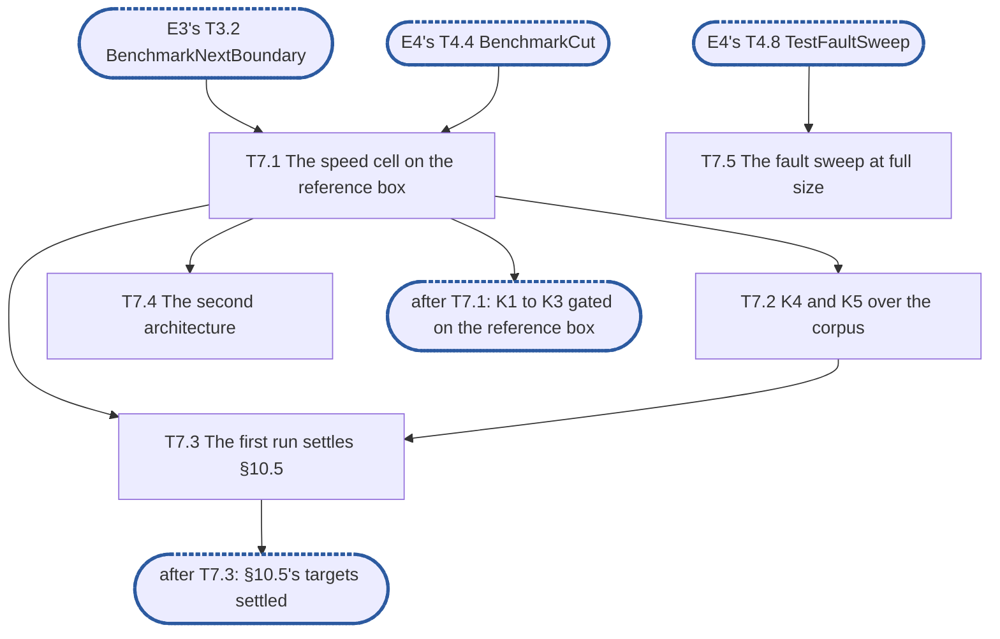

# Epic 7: carver v2 E2E green

**Sources:** [RFC 2](../docs/internals/rfcs/rfc-2-carver.md) §9.1 (K1 to K5, two
architectures, speed apart from quality), §10.5 (the performance targets) and §10.6 (the recorded
fields and the suites), which this epic owns. As the runs they ask for, whose checks are earlier
epics': §10.1 (the Architecture and Benchmark kinds), §10.3 (the fault sweep at full size, the
golden vectors on a second architecture), §10.4 (K1 run nightly, the counts that run per change
instead), §3.4 and Appendix A.2 (the warm-up regression only K1 sees). The
[RFC index](../docs/internals/rfcs/rfc-index.md), "Test tiers": no timed check per change,
recording results, the reference box, a proposed target replaced once by measurement, a
regression tracked and explained, a check that did not run is a failure.
[RFC 29](../docs/internals/rfcs/rfc-29-test-harness.md) §4.1 (the registry's fields), §4.3 (tiers),
§4.9 (a component's suite, group and suites paragraph) and §4.10 (benchmarks and long runs). Every
citation is `develop`'s text. The code lands on `feat/storage-v2`, where E1 creates `pkg/carver`,
E2 `internal/carvetest`, E3 `internal/chunker` and E4 `internal/blake3`, and the paths below are
paths there.
**Track:** the team.
**Epic 7 estimate: 5 subtasks, 8 man-days.**
**Depends on:** **E2**: `carvetest`'s `Targets`, `Vectors` and `TestBLAKE3Modes`, the corpus's
`Dir` and `Entries` at `$DITTOFS_CORPUS_DIR/<kind>/<name>`, and `unit`'s `carver-allocs` option.
**E3**: `BenchmarkNextBoundary`, one sub-benchmark per entry of `carvetest.Targets` over 64 MiB
of seeded random bytes (its T3.2), and `carve.NewSettings` (its T3.1). **E4**: `BenchmarkCut` with
its `Random`, `BLAKE3`, `Zeros` and `Period64` sub-benchmarks per `Target` (its T4.4), `Cut`, and
`TestFaultSweep`, reduced under `-short` (its T4.8, D6). **E5**: the fold's tests, which the
second-architecture run includes. E6 closes nothing here early: none of this epic's subtasks
waits on it.
**Blocks:** no epic. Every later reader of the carver's figures reads the series this epic starts:
E6's report compares against it, and a change of profile or of BLAKE3 backing is judged against
the reference box's last result.

---

## 1. Goal

Epic 7 runs what no per-change suite may run: the speed measures on real hardware, the quality
measures over real files, and the long and second-architecture runs of checks earlier epics
wrote. It writes almost no carver code. What it builds is the cells, one script that runs and
records the benchmarks, and one small program that holds each speed figure to its §10.5 ratio
against BLAKE3 measured in the same run.

**At the end of the epic:**

- `carver-bench`, the `carver` group's suite, runs K1 to K3 nightly on the reference box, records
  every figure with the toolchain, the SIMD extensions and the box, and fails when a profile's
  figure falls below its ratio to BLAKE3 alone in the same run (T7.1);
- `carver-bench/corpus` runs K4 and K5 by hand over the pinned corpus at every profile, under the
  unkeyed and the keyed table, records each figure and fails on a missed target (T7.2);
- the first run on the reference box has replaced §10.5's proposed speed targets with the
  measured value less headroom, stated beside the result in RFC 2, and the quality figures are
  recorded beside theirs (T7.3);
- `carver-bench/arm64` runs the carver's checks nightly on an arm64 machine, golden vectors and
  allocation counts gated, and records K1 to K3 there without gating them (T7.4);
- `unit/carver-sweep` runs §10.3's fault sweep at full size nightly, outside every raced and every
  per-change run (T7.5);
- RFC 2's suites paragraph names each of these, and `docs/internals/testing.md` is regenerated
  (T7.1, T7.2, T7.4, T7.5).

### 1.1 In scope

`test/carver/bench.sh`; the ratio checker `pkg/carver/internal/carvetest/ratios`;
`BenchmarkCorpus`, K4 and K5 as benchmarks with their own metrics; the `carver` group, the
`carver-bench` suite with its `arm64` and `corpus` options, and `unit`'s `carver-sweep` option;
their lines in `tests.yml`'s plan select; the size switch of `TestFaultSweep`; the first run on
the reference box and the RFC 2 §10.5 edit it makes; RFC 2's §10.6 suites paragraph and
`docs/internals/testing.md`; the import-test rows of what this epic adds.

### 1.2 Out of scope

- The benchmark functions K1 to K3 run, and the per-change counts that stand in for timing on every
  pull request (allocations, the average chunk size over 256 MiB, edit stability on seeded input):
  E3 and E4. K5's "average chunk size, random input, within 10 % of `Target`" is E3's per-change
  count (§10.4); the corpus run reports the corpus's average beside it, as a figure.
- §10.5's "memory per call": E4, whose `Cut` holds no buffer but the caller's.
- §9.1's full-stack rule (data that does not deduplicate, bytes stored against bytes written) and
  Appendix C's sweep: E6, through the RFC 8 offload plan's composed pipeline.
- `unit/carver-allocs` and the nightly `fuzz` suite, and fuzzing past the seeds: E2, and the
  targets of E2 to E5. This epic adds no fuzz target (§2, rule 2).
- The index's three measurements the reference box must hold before a decision that depends on
  numbers (raw stage costs, the dedup ratio, the journal-shape benchmark): the programme's, not
  RFC 2's. `BenchmarkCut`'s `BLAKE3` sub-benchmark is the hash's raw cost on that box, recorded
  here, and nothing more is claimed for it.
- Posting a red reference-box cell anywhere: the dedicated host reports in its own run's status,
  as `journal-bench-data` does (RFC 29 §4.5). No change to the harness.

### 1.3 Names used here

- **E1**, epic 1, interfaces: the root contract, `carve` and `assembler` stubbed, the import test
  `pkg/carver/imports_test.go`, one row per package.
- **E2**, epic 2, test foundations: `internal/carvetest` (vectors, the BLAKE3 modes check, the
  reference chunker, seeded inputs, `Targets`), its `corpus` package and fetch, `unit`'s
  `carver-allocs` option and the nightly `fuzz` suite.
- **E3**, epic 3, the chunker: `NewSettings`, the gear tables, `internal/chunker`'s
  `NextBoundary`, and `BenchmarkNextBoundary`, K1's function. Track A.
- **E4**, epic 4, the carver and identity: `internal/blake3`, `Cut`, `BenchmarkCut`, K2's and K3's
  function and K2's baseline, and `TestFaultSweep`. Track B.
- **E5**, epic 5, the block assembler. Track C.
- **E6**, epic 6, integration: RFC 2 Appendix C's sweep through the real offload path, after S3,
  which freezes the default `Target`.
- **E7**, this epic.
- **S3**, the RFC 8 offload plan's synchronisation point "a pass runs end to end", where E6
  starts. Nothing here waits on it.
- **The RFC 8 offload plan**, [`rfc-8-offload-engine-plan.md`](rfc-8-offload-engine-plan.md),
  which composes the carver into the engine.
- **The reference box**: the harness's dedicated host, which a cell reaches with
  `needs: [linux, host:dedicated]` and which runs develop's latest commit each night.
- **D1** to **D8** are this epic's decisions (§4). A decision of another epic is written with the
  epic named ("E4's D6").

## 2. How the general rules apply

The rules are those of
[the RFC 2 plan's §1.5](rfc-2-carver-plan.md#15-general-rules-for-each-epic), cited by number and
title and not copied.

| Rule | Subtasks | How |
| --- | --- | --- |
| rule 1, independent unit tests ([`CLAUDE.md`, "Writing tests"](../CLAUDE.md#writing-tests)) | T7.1, T7.2 | the ratio checker is a function of the benchmark text, tested over text written in the test, which is its input and not a double; `BenchmarkCorpus` cuts the real files through the real `Cut`. No test double anywhere |
| rule 2, fuzz tests where relevant ([`CLAUDE.md`, "Writing tests", "By kind"](../CLAUDE.md#writing-tests)) | none | the checker reads what `go test` wrote in the same cell, not bytes off a wire or another program's disk, so it has a table test and no fuzz target. Every carver target already runs past its seeds in E2's nightly `fuzz` suite; on arm64 their seeds run in T7.4's checks, and fuzzing past them there is not done, since what differs between the two architectures is BLAKE3's code path, which the golden vectors and the published vectors cover, and the fold, which hashes nothing, has no such path (D6) |
| rule 3, observability follows RFC 25, with RFC 2's exception | none | nothing here is a carver package; the cells' figures go through `dt`'s results, not a registry |
| rule 4, profiling | T7.1, T7.4 | the checker fails a recorded K1 to K3 line with an allocation, so the nightly run counts allocations at 64 MiB as well as the per-change counts at small sizes; T7.4 runs the allocation counts on arm64. Nothing here starts a goroutine or holds a descriptor in carver code |
| rule 5, public interface and internals ([`CLAUDE.md`, "Verifying a change"](../CLAUDE.md#verifying-a-change)) | T7.1 | the ratio is checked on the very file `dt` records, so the gate and the series cannot disagree; the checker's own test runs where the cell calls it |
| rule 6, known failures shrink | none | `carver-bench` and `unit/carver-sweep` keep no `known.yaml`: a missed ratio or target is a finding to fix or a design finding against RFC 2 (T7.3), never a listed failure, as `journal-bench` decides |
| rule 7, v2 ignores v1, and imports only what RFC 0 §1.2 allows | T7.1, T7.2 | `ratios` imports the standard library and `carvetest` alone, a row in E1's import test, as E2's `corpus/fetch` has; `carve`'s test row admits `internal/carvetest/corpus`, which E2 left unadmitted until this epic. v1's measurements and their code are not read |
| rule 8, real dependencies for properties of those dependencies | all | the whole epic: the speed ratios on the reference box and on a real arm64 machine, the golden vectors on that machine's BLAKE3 path, K4 and K5 on real files of the three kinds |
| rule 9, code comment conventions ([`CLAUDE.md`, "Code comments"](../CLAUDE.md#code-comments)) | T7.1, T7.4, T7.5 | `decision:` markers for D1 at the checker's targets, D3 at the script's record, D5 in the `arm64` option's comment and D7 at `TestFaultSweep`'s size switch; the registry's comments carry each cell's reason, as the existing entries do |
| rule 10, a test must be able to fail | all | each cell is seen red on a planted break before its pull request opens: a full-chunk warm-up for K1, a vector byte for arm64, a part-built chunk emitted for the sweep, fixed-size cuts for K4 |
| rule 11, a symbol is exported only if the RFC's interface uses it | none | nothing is exported: `ratios` is a command and `BenchmarkCorpus` a test function |
| rule 12, each subtask creates only what it declares | all | each file lands with the cell that runs it; `bench.sh` gains its `corpus` group with T7.2, not before |

## 3. Requirements and invariants

Every obligation the sources above place on this epic's runs, numbered so subtasks and tests can
cite them. Where the check a run executes is another epic's, the row says so.

**The speed measures**

| # | Requirement | Kind | Source | Subtasks |
| --- | --- | --- | --- | --- |
| R1 | K1: `NextBoundary` over 64 MiB of seeded random bytes, at every profile, reporting MiB/s and its allocations, run nightly on the reference box | test row | RFC 2 §9.1 K1, §10.1 (Benchmark), §9 ("One fixed profile **MUST NOT** be the only settings under test"); E3's T3.2 | T7.1 |
| R2 | K2: `Cut` over the same input, hashing included, beside BLAKE3 alone over the same bytes, each reporting MiB/s, so the difference is the carver's own cost | test row | RFC 2 §9.1 K2; E4's T4.4 | T7.1 |
| R3 | K3: `Cut` over all-zero and short-period input, where chunks run to `Max`, reporting MiB/s | test row | RFC 2 §9.1 K3, §3.8 | T7.1 |
| R4 | Each speed target is stated against BLAKE3 alone over the same bytes on the same box, in the same run: K1 at least 10 × BLAKE3's rate, K2 at least 90 % of it, K3 at least 50 % of K2, at every profile; a run below one fails | bound | RFC 2 §10.5; RFC index, Recording results ("A target is stated against something measured on the same box") | T7.1, T7.3 |
| R5 | K1 to K3 make no allocation | bound | RFC 2 §9.1 K1 ("zero allocations"), §10.5 (allocations: none) | T7.1 |
| R6 | K1, run nightly, is what sees a warm-up that crept back over the whole chunk, which changes no output and so no count: the boundary search falls from over 20 × BLAKE3's rate to about 2 × | invariant | RFC 2 §10.4 (last paragraph), §3.4, Appendix A.2 | T7.1 |
| R7 | K1 to K3 run on at least two CPU architectures, because the ratios differ between them | MUST | RFC 2 §9.1, Appendix A.2 | T7.1, T7.4 |
| R8 | Speed and quality are measured separately, and speed alone never decides a profile: no speed figure stands in for K4 or K5 | invariant | RFC 2 §9.1 | T7.1, T7.2 |
| R9 | No timed check runs per change: K1 to K3 run nightly, K4 and K5 by hand | MUST NOT | RFC index, Test tiers ("No timed check runs per change"); RFC 2 §10.1 (Benchmark), §10.4 | T7.1, T7.2 |

**Recording**

| # | Requirement | Kind | Source | Subtasks |
| --- | --- | --- | --- | --- |
| R10 | Every result is recorded in absolute numbers, with the commit, the box (its CPU and memory), the operating system and the row's concurrency, and with the CPU's SIMD extensions BLAKE3 used and the toolchain version | MUST | RFC index, Recording results; RFC 2 §10.6 | T7.1, T7.2, T7.4 |
| R11 | One named reference box carries the series; results from another box are compared only with themselves, never gated against the reference box's | invariant | RFC index, Recording results | T7.1, T7.4 |
| R12 | A row more than 10 % worse on a measured path than the last result on the reference box needs a recorded decision before the next result becomes its baseline, so each night's figures are kept per run where that comparison can be made | invariant | RFC index ("A regression is tracked, and explained") | T7.1 |
| R13 | Each proposed benchmark target of §10.5 is replaced once, by the first run on the reference box, with the measured value plus headroom stated beside the result; a target that run misses is a design finding against RFC 2, and is never relaxed to pass | MUST | RFC index ("A proposed target is replaced once, by measurement"); RFC 2 §10.5 ("Proposed target") | T7.3 |

**The quality measures**

| # | Requirement | Kind | Source | Subtasks |
| --- | --- | --- | --- | --- |
| R14 | K4: a corpus file, then the same file with one byte inserted near the start; the fraction of chunk hashes the two share, and every chunk that starts more than 2 × `Max` bytes past the edit shared, on a 1 GiB corpus file | test row, bound | RFC 2 §9.1 K4, §10.5 K4, §9 (B4 shift resistance) | T7.2 |
| R15 | K5: the chunk-size histogram against `Min`, `Target` and `Max` over real files of several kinds, source trees, VM images and media; at most 1 % of chunks at `Max` on a corpus with no repetitive regions | test row, bound | RFC 2 §9.1 K5, §10.5 K5 | T7.2 |
| R16 | K4 and K5 are not timed, and run on a fixed corpus so a change of profile is compared against the last run on the same bytes | invariant | RFC 2 §9.1 | T7.2 |
| R17 | Seeded random input never stands in for K4 or K5: it holds no edits to survive and no structure to find | MUST NOT | RFC 2 §9.1 ("the wrong one for K4 and K5") | T7.2 |
| R18 | No check fetches the corpus; a run of K4 and K5 without it fails, never passing having measured nothing | MUST NOT | RFC 2 §10.4, §1.3; RFC index ("A check that did not run is a failure") | T7.2 |

**The second architecture and the full size**

| # | Requirement | Kind | Source | Subtasks |
| --- | --- | --- | --- | --- |
| R19 | The golden vectors, chunks and names, run on a second CPU architecture nightly, since BLAKE3 takes different code paths on each | MUST | RFC 2 §10.1 (Architecture), §10.3, §10.4, §3.1 B2 | T7.4 |
| R20 | The allocation counts pass on the second architecture nightly | invariant | RFC 2 §10.4 (allocations); RFC 2 plan, epic 7 (Done when) | T7.4 |
| R21 | The reader fails at every byte offset of the fault sweep's stretch, at full size, nightly, with the same prefix-and-retry assertions as the reduced sweep | MUST | RFC 2 §10.3, §10.6; RFC 2 plan, D8; E4's T4.8 (`TestFaultSweep`) | T7.5 |
| R22 | The full sweep runs in no per-change run and in no raced run: under `-short` or the race detector `TestFaultSweep` runs its reduced size | bound | RFC 2 plan, D8; RFC 2 §10.6 (the race detector); E4's D6 | T7.5 |

**The suites**

| # | Requirement | Kind | Source | Subtasks |
| --- | --- | --- | --- | --- |
| R23 | K1 to K3 on the reference box, the fault sweep at full size and the golden vectors on a second architecture run nightly, and K4 and K5 by hand, in a suite named for the carver, `carver-bench`, which a `carver` group holds | invariant | RFC 2 §10.6 (Suites); RFC 29 §4.9 (a component's group); RFC 2 plan, §1.4, epic 7 | T7.1, T7.2, T7.4, T7.5 |
| R24 | RFC 2's suites paragraph names each suite, option and group registered, and says which planned checks no suite runs yet | invariant | RFC 29 §4.9; RFC 2 §10.6 | T7.1, T7.2, T7.4, T7.5 |

How each row is enforced once this epic lands, where no test of this epic can break it: R9 by the
registry, whose `carver-bench` cells are `nightly` and `manual` and which `tests.yml` never plans on
a pull request; R11 by `needs: [linux, host:dedicated]` on the gated cell and by the arm64
option's `record` mode (D5); R12 by `metrics: go-bench`, which puts each night's medians in
`dt history`, while the decision itself is the owner's, by hand; R23 and R24 by `lint-repo`'s
`dt docs --check` for a name the registry lacks, and by review for a registered cell the paragraph
leaves out; R22's `-short` half by E4's own sweep test, and its race half by T7.5's switch.

The candidates of the owned sections that bind other epics are theirs: §9.1's full-stack **MUST**
(E6); §10.5's memory per call (E4); K5's average on random input (E3's per-change count, §10.4);
§10.3's two buffer sizes and the reduced sweep (E4); §10.6's `unit` checks, the allocation option
and the fuzz suite (E2 to E5). §10.1's "no crash test, no soak and no concurrency test" describes
the design, and binds nothing here.

## 4. Decisions this epic takes

- **D1, the ratio gate reads the recorded run.** One `go test -bench -count=10` run of
  `BenchmarkNextBoundary` and `BenchmarkCut` writes `{out}/speed.txt`, which `dt`'s go-bench
  reader records, and `ratios` reads the same file: for each `Target` of `carvetest.Targets`, the
  median MB/s of K1, K2 and K3 against the median of `BenchmarkCut/<Target>/BLAKE3`, with the
  targets of R4 as constants beside a `decision:` that cites §10.5 and says T7.3 replaces them
  once. Medians, keyed as `dt` keys them ("NAME UNIT", `readGoBench` on `feat/storage-v2`,
  checked), so one slow sample neither fails the gate nor moves the series. A missing
  sub-benchmark fails as loudly as a missed ratio: a profile that did not run is a check that did
  not run. Not a Go test calling `testing.Benchmark`, as RFC 29's `TestBLAKE3FasterThanSHA256`
  does (checked, `pkg/block/hash_bench_test.go` on develop): the two benchmarks live in two
  packages, `testing.Benchmark` returns no sub-benchmark's result, and it would take one sample
  where the record keeps ten, so the gate and the series would measure different runs. Prior
  art: that test, the shape of a ratio against a hash in the same process; `unit --nonrace`,
  RFC 29 §4.10's nightly throughput gate. Applied by T7.1.

- **D2, the sub-benchmark names are a contract E3 and E4 write.** The checker reads
  `BenchmarkNextBoundary/<Target>` and `BenchmarkCut/<Target>/<Random|BLAKE3|Zeros|Period64>`,
  where `<Target>` is the decimal byte count, `strconv.Itoa(t)` for each `t` of
  `carvetest.Targets` (`BenchmarkCut/262144/BLAKE3`). E3's and E4's documents name the
  sub-benchmarks but not their spelling; this is it, and a benchmark spelled otherwise fails the
  checker by name rather than passing unread. With `GOMAXPROCS` set to 1 in the cell (D3), `go
  test` adds no `-N` suffix, so the names are the same on every box. Prior art: `go test`'s own
  sub-benchmark naming (from memory). Applied by T7.1.

- **D3, the record: what `go test` prints, plus `meta.txt`.** `go test -bench` already heads its
  output with `goos`, `goarch` and `cpu`, the CPU's model, and `dt`'s summary holds the commit.
  `bench.sh` writes `{out}/meta.txt` beside it once per run: `go version`; `go env GOARCH GOAMD64
  GOARM64`; the kernel (`uname -srm`); the memory (`/proc/meminfo`'s `MemTotal` on Linux, `sysctl
  -n hw.memsize` on macOS); `GOMAXPROCS`, 1, which is the rows' concurrency, since neither `Cut`
  nor the boundary search starts a goroutine; the SIMD extensions the CPU offers among those a
  BLAKE3 implementation dispatches on, AVX-512F, AVX2 and SSE4.1 from `/proc/cpuinfo`'s flags on
  amd64 and `hw.optional.arm.AdvSIMD` on macOS arm64 (checked on an M-series Mac); and the backing `internal/blake3` is built on, the
  module path `go list -deps ./internal/blake3` names (E4's D1 picks it). Which path that backing
  takes follows from those two lines: `lukechampine.com/blake3`'s `guts` takes AVX-512 when the
  CPU has AVX-512F, else AVX2, and has no arm64 assembly (checked, v1.4.1's `guts/compress_amd64.go`
  and `compress_noasm.go`). The device, the filesystem and its mount options are not recorded: the
  inputs are built in memory before the timer starts and nothing measured touches a device. A
  `decision:` at the record says so, and that it is withdrawn if a carver benchmark ever reads a
  file. Prior art: `test/journal/bench-data.sh`'s `meta.txt` on `feat/storage-v2` (checked).
  Applied by T7.1 and T7.4.

- **D4, K4 and K5 are benchmarks that report their own metrics.** `BenchmarkCorpus` runs at
  `-benchtime=1x -count=1`, one sub-benchmark per corpus entry, `Target` and table, and reports
  each figure with `b.ReportMetric`, so the same go-bench reader records it and `carver-bench`'s
  options share one shape. The figures are deterministic, a function of the pinned bytes and the
  settings, so one count is the whole sample. It fails with `b.Errorf` on a missed K4 or K5
  target, which a pinned corpus can only show for a change of code or profile. Each entry is read
  up to its first 1 GiB, the size K4's target names, through `Cut` with a buffer of 2 × `Max`;
  the edit is one byte, `0x5A`, inserted at offset 4,096. The metrics: `shared-frac`, the fraction
  of the edited file's chunks whose hash the original has; `far-unshared`, how many chunks that
  start more than 2 × `Max` past the edit the original lacks, which K4's target holds at 0;
  `mean-B`; `at-max-frac`, which K5's target holds at 0.01 on an entry not marked
  `Repetitive`; and the histogram as four fractions, `[Min, T/2)`, `[T/2, T)`, `[T, 2T)` and
  `[2T, Max)`, named `lt-half-frac`, `lt-target-frac`, `lt-double-frac` and `lt-max-frac`. The
  corpus run is not timed, so it needs no reference box: it runs by hand on any machine with the
  corpus, and its figures are comparable across boxes. Prior art: `golang.org/x/benchmarks`,
  which records quality figures as custom benchmark metrics (from memory); Go's
  `testing.B.ReportMetric` (checked, the standard library). Applied by T7.2.

- **D5, arm64 gates the checks and records the speeds.** The `arm64` option runs the carver's own
  tests once without the race detector, under `-short`, so the golden vectors, BLAKE3's published
  vectors through `internal/blake3`, the allocation counts and every fuzz target's seeds pass on
  arm64 or turn the cell red; then it runs `bench.sh speed` in `record` mode, which writes the
  same file and meta and skips the ratio check. K2's 90 % target sits about 6 % under the 96 %
  measured on arm64 (Appendix A.2), a margin a noisy neighbour on a shared hosted runner crosses
  with no code change, and R11 forbids gating another box against the reference box's targets
  anyway. The cell is the harness's macOS host, arm64 (`needs: [macos]`), the one non-x86 runner
  it has. A `decision:` in the option's comment says the speeds are recorded, not checked, and
  that they become checked if an arm64 machine is ever set aside as a reference box. Prior art:
  `journal-bench-data`'s "collected, never checked" (checked). Applied by T7.4.

- **D6, no fuzzing past the seeds on arm64.** E2's nightly `fuzz` suite fuzzes every carver target
  on amd64. What differs on arm64 is BLAKE3's code path, which the golden and published vectors
  hold; the chunker is integer arithmetic over a table, and the fold hashes nothing, so a crasher
  arm64 alone finds would need a compiler bug, which the seeds' run on arm64 already exercises.
  This hands E5's "`FuzzFold` at full size on the second architecture" back as its seeds on arm64
  each night, with the reason. Prior art: none found. Applied by T7.4.

- **D7, the full sweep switches on the race detector too.** `unit` passes `-short` only on pull
  requests (`args: { pr: "-short" }` in `test/suites.yaml` on `feat/storage-v2`, checked), so after
  a merge and nightly it runs every test without it, under `-race`. A sweep that grows to full
  size whenever `-short` is absent would run its 655,360 offsets there, raced, against `unit`'s 25
  minute limit. `TestFaultSweep` therefore runs full size only when `!testing.Short() &&
  !prof.RaceEnabled`, with a `decision:` at the switch saying why; `unit`'s raced runs keep the
  reduced sweep. `unit/carver-sweep` runs it full: `go test -timeout=60m -run=^TestFaultSweep$
  ./pkg/carver/carve/`, nightly, no race detector, which a sweep over output needs none of, since
  nothing in `Cut` is shared between goroutines. Prior art: `unit --nonrace` in RFC 29 §4.1, an
  option of `unit` for what the raced run cannot measure (checked). Applied by T7.5.

- **D8, settling §10.5.** The first run on the reference box replaces each speed target, a floor,
  by the larger of the proposed value and 90 % of the measured median ratio, rounded down to two
  significant figures: the headroom is the index's 10 % regression line, so a drift that the index
  asks a decision for also trips the gate, and a target the RFC chose is never loosened by a box
  that beat it. A measured ratio below the proposed floor is R13's design finding: the run is
  recorded, T7.3 stops, and the RFC's author decides. K4 and K5 are deterministic on a pinned
  corpus, so they have no noise to leave room for: their targets stand as written, with the first
  run's figures recorded beside them. §10.5 states each result with the commit, the box, the
  toolchain and the SIMD path (R10), and `ratios`' constants change in the same pull request.
  Prior art: the index's rule, which this applies (checked). Applied by T7.3.

## 5. Target tree

```text
test/carver/
  bench.sh                        T7.1, T7.2  speed and corpus groups, meta.txt; D3's decision:
pkg/carver/
  imports_test.go                 T7.1, T7.2  rows: ratios (std, carvetest); carve's tests admit
                                              internal/carvetest/corpus
  internal/carvetest/ratios/
    main.go                       T7.1  the checker; D1's decision:
    main_test.go                  T7.1  the rule over written benchmark text
  carve/
    corpus_bench_test.go          T7.2  BenchmarkCorpus (K4, K5)
    errors_test.go                T7.5  TestFaultSweep's size switch; D7's decision:
test/suites.yaml                  T7.1, T7.2, T7.4, T7.5  carver group; carver-bench with its
                                                          arm64 and corpus options; unit's
                                                          carver-sweep option
.github/workflows/tests.yml       T7.4, T7.5  carver-bench/arm64 and unit/carver-sweep in the
                                              plan's select
docs/internals/rfcs/rfc-2-carver.md  T7.1, T7.2, T7.3, T7.4, T7.5  §10.6's suites paragraph;
                                                                  §10.5's settled targets (T7.3)
docs/internals/testing.md         T7.1, T7.2, T7.4, T7.5  regenerated by dt docs
```

## 6. Subtasks

### T7.1 The speed cell on the reference box

**Subtask T7.1 estimate: 2.5 man-days.**

- **Track:** the team. **Depends on:** none. It runs E3's and E4's benchmarks, so it lands after
  E3's T3.2 and E4's T4.4.
- **Covers:** R1 to R12, R23, R24.
- **Deliverables:**
  - `test/carver/bench.sh GROUP OUT`, its `speed` group: `go test -count=10 -run '^$' -bench
    '^(BenchmarkNextBoundary|BenchmarkCut)$' -timeout=25m ./pkg/carver/internal/chunker/
    ./pkg/carver/carve/ > OUT/speed.txt`, then `go run ./pkg/carver/internal/carvetest/ratios
    OUT/speed.txt` unless `CARVER_RATIOS` is `record`, then `meta.txt` (D3), with D3's `decision:`;
    the script's exit is the first failure's. Consumed by the `carver-bench` cell, T7.2, T7.3 and
    T7.4.
  - `pkg/carver/internal/carvetest/ratios`, with D1's `decision:` at its targets. Consumed by the
    `speed` group:
    ```go
    // Command ratios reads go test -bench output and checks RFC 2 §10.5's speed targets at every
    // profile of carvetest.Targets, on medians, against BLAKE3 alone in the same run. It exits 1
    // naming each target missed or benchmark absent, and 2 on a file it cannot read.
    package main

    // Targets of RFC 2 §10.5, as ratios of medians (D1, D8).
    const (
        k1OverBLAKE3 = 10.0 // NextBoundary's rate over BLAKE3's
        k2OverBLAKE3 = 0.90 // Cut's rate over BLAKE3's, random input
        k3OverK2     = 0.50 // Cut's rate on Zeros and on Period64 over its rate on Random
    )

    // medians reads go test -bench output: each benchmark's median per unit, keyed "NAME UNIT"
    // as dt's go-bench reader keys them, with any "--- FAIL" line returned as an error.
    func medians(r io.Reader) (map[string]float64, error)

    // check applies the targets to every profile of targets, D2's names, and returns one line
    // per target missed, benchmark absent or allocation counted.
    func check(m map[string]float64, targets []int) []string
    ```
  - Its row in E1's `imports_test.go`: the standard library and `internal/carvetest`.
  - In `test/suites.yaml`: the group `carver: [carver-bench]`, and the suite, with each field's
    reason in its comment, as `journal-bench-data`'s:
    ```yaml
    carver-bench:
      cmd: test/carver/bench.sh {test} {out}
      tests: [speed]
      env: { GOMAXPROCS: "1" }
      format: exit
      metrics: go-bench
      tier: nightly
      needs: [linux, host:dedicated]
      timeout: { test: 30m, cell: 40m }
    ```
  - RFC 2 §10.6's suites paragraph: K1 to K3 nightly on the reference box in `carver-bench`, the
    `carver` group's suite, each checked against its §10.5 ratio to BLAKE3 in the same run; the
    corpus, arm64 and full-sweep runs still planned. `docs/internals/testing.md` regenerated.
- **Acceptance criteria:**
  - `dt run carver-bench` on a Linux amd64 machine writes `speed.txt` with ten samples of every
    sub-benchmark of D2 at every `Target`, `meta.txt` with every field of D3, and passes.
  - With E3's warm-up replaced by one from the chunk's start, the same run fails, naming K1 at
    every `Target`.
  - `dt docs --check` passes.
- **Tests:** `main_test.go`, at `check` and `medians` as the script calls them, over benchmark text
  written in the test: every target met passes; K1 at 9.9 × BLAKE3 at one `Target` fails naming
  it; K2 at 0.89 fails; `Period64` at 0.49 of `Random` fails; one sample of ten far below the rest
  does not move the median past a target; a `Target` with no `BLAKE3` line, or a missing profile,
  fails naming it; a line with `allocs/op` above 0 fails; a `--- FAIL` line is an error. Each is
  seen to fail with its constant moved or its absence check removed. The run with the warm-up
  planted (R6), on a developer's machine, is the check that the cell can turn red on the
  regression it exists for. No test double: the benchmark text is the checker's input.
- **Rules:** rule 4, the allocation check; rule 7, the row; rule 9, D1's and D3's `decision:`.
  Others as §2 says.

### T7.2 K4 and K5 over the corpus

**Subtask T7.2 estimate: 2 man-days.**

- **Track:** the team. **Depends on:** T7.1.
- **Covers:** R8 to R10, R14 to R18, R23, R24.
- **Deliverables:**
  - `pkg/carver/carve/corpus_bench_test.go`, `BenchmarkCorpus` (D4): for each entry of
    `corpus.Entries`, under `corpus.Dir(b)`, each `Target` of `carvetest.Targets` and each table,
    unkeyed and keyed under `Vectors.ChunkingKey`, with settings from `carve.NewSettings` and
    `Vectors.ChunkIDKey`, a sub-benchmark `BenchmarkCorpus/<kind>/<Target>/<unkeyed|keyed>` that
    cuts the entry's first 1 GiB and the same bytes with the edit, and reports D4's metrics. Both
    cuts read the file through `Cut`'s reader, so no input is held whole. Consumed by the `corpus`
    group.
  - `bench.sh`'s `corpus` group: it exits 2 naming `DITTOFS_CORPUS_DIR` when the variable is unset
    or names no directory, before `go test` runs, as `journal-bench` refuses an unset
    `DITTOFS_BENCH_DIR`; otherwise `go test -count=1 -benchtime=1x -run '^$' -bench
    '^BenchmarkCorpus$' -timeout=55m ./pkg/carver/carve/ > OUT/corpus.txt`, and `meta.txt`.
  - In E1's `imports_test.go`, `carve`'s test row admits `internal/carvetest/corpus`.
  - `carver-bench`'s `corpus` option: `tests: [corpus]`, `tier: manual`, `needs: [linux]`, in place of
    the suite's dedicated host, since D4's figures hold on any box, and
    `timeout: { test: 60m, cell: 70m }`.
  - RFC 2 §10.6's suites paragraph names `carver-bench/corpus`; `testing.md` regenerated.
- **Acceptance criteria:**
  - With the corpus fetched, `dt run carver-bench --corpus` reports every metric of D4 for every
    entry, `Target` and table, and fails on any `far-unshared` above 0, and on an `at-max-frac`
    above 0.01 for an entry not marked `Repetitive`.
  - With `DITTOFS_CORPUS_DIR` unset, the cell fails naming the variable, and no `go test` runs.
- **Tests:** the run itself, seen to fail on a planted break before the pull request opens: the
  boundary search replaced by cuts at every multiple of `Target`, which shifts every later
  boundary after the edit, turns `far-unshared` above 0 (R14); the mask past `Target` widened by
  four bits, so fewer bytes pass, turns `at-max-frac` above 0.01 on the source tree (R15); the unset variable (R18). No test double: the files are the pinned corpus, and the
  carver the real one.
- **Rules:** rule 7, the row; rule 8, the real files. Others as §2 says.

### T7.3 The first run on the reference box settles §10.5

**Subtask T7.3 estimate: 1.25 man-days.**

- **Track:** the team. **Depends on:** T7.1, T7.2.
- **Covers:** R4, R10, R13.
- **Deliverables:**
  - `bench.sh speed` run on the reference box from a `feat/storage-v2` checkout, by its owner, and
    `bench.sh corpus` on any machine with the corpus: the first results, kept with the commit.
  - RFC 2 §10.5: each speed target replaced as D8 says, the measured median ratio, the commit, the
    box, the toolchain and the SIMD path beside it; K4's and K5's figures beside their targets,
    which stand. `ratios`' constants changed to the settled values in the same change.
- **Acceptance criteria:**
  - Every speed target of §10.5 is either at least its proposed value and at most 90 % of what was
    measured, or, where the measurement fell below the proposed value, left as written with the
    finding recorded for RFC 2's author, and the change stops there.
  - `dt run carver-bench` on the reference box passes against the settled constants.
- **Tests:** `main_test.go`'s cases move with the constants, each seen to fail at its new floor
  less 0.01; the reference-box run against them. No test double.
- **Rules:** rule 8, the reference box. Others as §2 says.

### T7.4 The second architecture

**Subtask T7.4 estimate: 1.25 man-days.**

- **Track:** the team. **Depends on:** T7.1.
- **Covers:** R7, R10, R11, R19, R20, R23, R24.
- **Deliverables:**
  - `carver-bench`'s `arm64` option, with D5's `decision:` in its comment:
    ```yaml
    arm64:
      cmd:
        - go test -short -timeout=20m ./pkg/carver/... ./internal/blake3/
        - test/carver/bench.sh {test} {out}
      env: { GOMAXPROCS: "1", CARVER_RATIOS: record }
      needs: [macos]
      timeout: { test: 50m, cell: 60m }
    ```
  - In `.github/workflows/tests.yml`'s plan select, `carver-bench/arm64` beside `unit/windows`.
  - RFC 2 §10.6's suites paragraph names `carver-bench/arm64`; `testing.md` regenerated.
- **Acceptance criteria:**
  - On an arm64 machine, `dt run carver-bench --arm64` passes, and its `meta.txt` names arm64,
    the backing, and the CPU's `AdvSIMD` flag.
  - With one byte of `carvetest`'s `vectors.json` changed, the same run fails in its first
    command, before any benchmark runs.
  - A `workflow_dispatch` of `tests.yml` on `feat/storage-v2` at the nightly tier plans and runs
    the cell on the macOS runner.
- **Tests:** the planted vector byte (R19), and a planted per-chunk allocation in `Cut` (R20),
  each seen to fail the cell on an arm64 machine. No test double.
- **Rules:** rule 4, the counts on arm64; rule 8, a real arm64 machine; rule 9, D5's
  `decision:`. Others as §2 says.

### T7.5 The fault sweep at full size

**Subtask T7.5 estimate: 1 man-days.**

- **Track:** the team. **Depends on:** none. It changes E4's `TestFaultSweep`, so it lands after
  E4's T4.8.
- **Covers:** R21 to R24.
- **Deliverables:**
  - `TestFaultSweep`'s size switch (D7), `!testing.Short() && !prof.RaceEnabled`, with its
    `decision:`.
  - `unit`'s `carver-sweep` option, D7's command, `tier: nightly`, and a `timeout` of three times
    the full sweep's measured time on a hosted Linux runner, measured by a `workflow_dispatch` run
    and recorded in the pull request with the runner's CPU and its SIMD flags.
  - In `tests.yml`'s plan select, `unit/carver-sweep`.
  - RFC 2 §10.6's suites paragraph names `unit/carver-sweep`; `testing.md` regenerated.
- **Acceptance criteria:**
  - `dt run unit --carver-sweep` runs the sweep at all 655,360 offsets of E4's D6 and passes.
  - `go test -race -run=^TestFaultSweep$ ./pkg/carver/carve/`, without `-short`, runs the reduced
    sweep and finishes in under a minute on a developer machine.
  - The measured full sweep fits the nightly tier's budget; if it takes more than 30 minutes on
    the hosted runner, the cell is not registered and the figure goes to RFC 2's author as a §10.3
    amendment, rather than a smaller stretch chosen in the test.
- **Tests:** the full sweep, seen to fail with a part-built chunk emitted on a reader error at one
  offset only, one the reduced sweep does not sample (R21); the raced run without `-short`,
  seen to run full size with the race term removed from the switch (R22). No test double: the
  sweep's `failAt` is E4's fault wrapper around a real reader (kind 3).
- **Rules:** rule 9, D7's `decision:`. Others as §2 says.

## 7. Order of work



T7.1 is the blocker: the script, the checker and the suite every other cell but the sweep
extends. The path then runs T7.1, T7.2, T7.3, since the settling run needs both the speed and the
corpus groups, and T7.2 goes before T7.4 as the riskier, a corpus target that a first run can miss.
T7.4 extends T7.1 alone. T7.5 needs nothing of this epic and is a branch of its own, open beside
the rest once E4's sweep has landed. Checkpoints after T7.1 (K1 to K3 gated) and after T7.3
(§10.5 settled).

## 8. Suggested pull requests

| PR | Subtasks | Man-days | After | Why together |
| --- | --- | --- | --- | --- |
| 1 | T7.1 | 2.5 | — | the speed cell, its checker and the suite the others extend |
| 2 | T7.2, T7.3 | 3.25 | PR 1 | K4 and K5, and the first run that settles §10.5 over both groups |
| 3 | T7.4 | 1.25 | PR 1 | the arm64 option; open beside PR 2 |
| 4 | T7.5 | 1 | — | the full sweep, which reads nothing of PR 1; open beside the others |

A suggestion only: one pull request per subtask works as well.

## 9. Open points

1. **Estimate against the RFC 2 plan's figure.** The plan says 5 subtasks and 8.5 man-days; this
   document says 5 and 8. The checker over the recorded run (D1) costs about as much as the plan's
   in-process ratio tests would, the settling run (T7.3) is new, and K4 and K5 as benchmarks in
   the one suite (D4) and a `record` mode on arm64 (D5) take back the rest.
2. **The sub-benchmark names (D2) are not in E3's and E4's documents** (#5939, #5974, open). Their
   owners spell them as D2 says when T3.2 and T4.4 land; a different spelling fails the checker by
   name, and the fix is one line in whichever side moves.
3. **E4's D6 runs the full sweep in `unit`'s raced runs after a merge**, since `unit` passes
   `-short` on pull requests only (D7). That would time `unit` out on `feat/storage-v2` at E4's
   own merge, before this epic exists, so E4's pull request (#5974) is the place for D7's switch;
   T7.5 makes the change if E4 lands without it.
4. **No nightly runs on `feat/storage-v2`.** The schedule runs `tests.yml` on develop only, and
   the dedicated host runs develop's latest commit, so every cell here starts its nightly series
   when `feat/storage-v2` reaches develop. Until then each cell is accepted by a hand run: a
   `workflow_dispatch` at the nightly tier for the hosted ones, and the host owner running
   `bench.sh` from a `feat/storage-v2` checkout for the reference box (T7.3).
5. **The full sweep's cost is computed, not measured** (E4's open point 4): about 600 GiB of
   hashing per run, minutes to tens of minutes. T7.5 measures it and sizes the timeout; over 30
   minutes, the answer is an RFC 2 §10.3 amendment.
6. **AVX-512 may run nowhere.** If neither the reference box nor the hosted runners offer
   AVX-512F, `guts`' AVX-512 path, if E4 picks it, is never exercised by the golden vectors;
   `meta.txt` shows which flags each run had. Not checked against the hosts.
7. **Needs of E2's cells, outside this epic.** `unit/carver-allocs` runs in CI only as a step of
   `tests.yml`'s unit job, as `unit/adapter-allocs` does, and the nightly `fuzz` suite only once
   the plan's select names it; E2's document says neither. Its owner adds both with T2.4, or no
   allocation count and no fuzz target of RFC 2 runs in CI.
