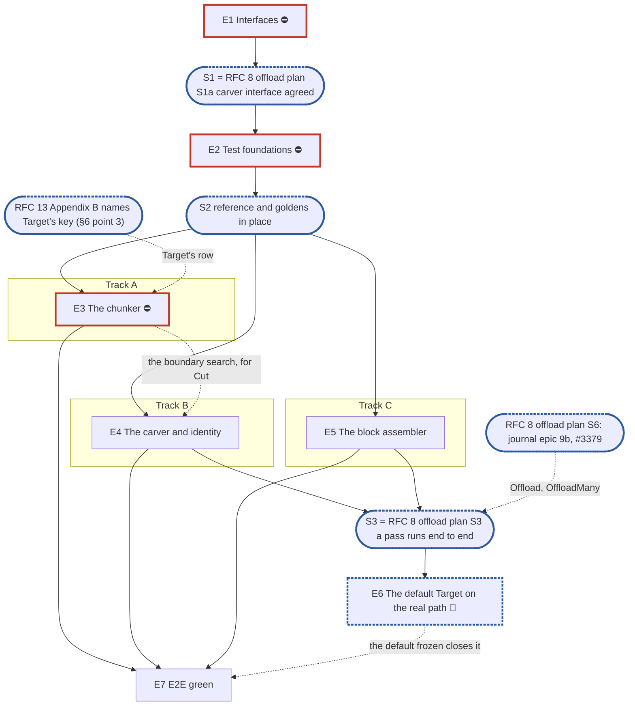

# RFC 2 — the carver: implementation plan

**Scope:** all of [RFC 2, the carver](../docs/internals/rfcs/rfc-2-carver.md): the chunker,
the carver, chunk and block identity, and the block assembler. Its status is `draft`, not
`deferred`, and the whole RFC is planned. Related RFCs, all **constraints only**:
- [RFC 0](../docs/internals/rfcs/rfc-0-data-lifecycle.md) (§1.2, §2.1, §2.2, §5.2) and
  [RFC 1](../docs/internals/rfcs/rfc-1-journal.md) (§3.2, §3.3: holes and offers), which shape
  the carver's inputs; [RFC 28](../docs/internals/rfcs/rfc-28-journal-format.md) is not touched.
- [RFC 3](../docs/internals/rfcs/rfc-3-syncer.md), [RFC 4](../docs/internals/rfcs/rfc-4-remote-tier.md)
  and [RFC 5](../docs/internals/rfcs/rfc-5-transforms.md), the other three components of the
  offload programme, each with its own plan: the seams this plan assumes with them are in §3.2
  and §4.2.
- [RFC 8](../docs/internals/rfcs/rfc-8-engine.md), whose offload part composes the carver and the
  assembler (§2.1, §2.4, §2.6, §6.2 to §6.7, §7.8); that composition is
  [`rfc-8-offload-engine-plan.md`](rfc-8-offload-engine-plan.md)'s, being written alongside this one.
- [RFC 6](../docs/internals/rfcs/rfc-6-block-metadata.md) (§3.5 zero refs, §4.1 one commit per block),
  [RFC 9](../docs/internals/rfcs/rfc-9-gc.md) (relocation mints a new name),
  [RFC 12](../docs/internals/rfcs/rfc-12-snapshots.md), [RFC 13](../docs/internals/rfcs/rfc-13-configuration.md)
  (Appendix B: `Target`, the block target, the keys), [RFC 16](../docs/internals/rfcs/rfc-16-metadata-store.md)
  (§4.2.1, the namespace ID's raw bytes), [RFC 26](../docs/internals/rfcs/rfc-26-catalog-backups.md),
  [RFC 27](../docs/internals/rfcs/rfc-27-namespace-migration.md) (§2.4, §2.7: imports and re-homes).
- [RFC 25](../docs/internals/rfcs/rfc-25-observability.md) and [RFC 29](../docs/internals/rfcs/rfc-29-test-harness.md):
  the rules every epic follows (§1.5 rules 3 and 6).

**Tracks:** A, B and C (§3.4).
**Programme:** [#5488](https://github.com/cubbit/dittofs/issues/5488), "offload: RFC 2–5 and the
engine's offload part", release v1.1; roadmap epic [#3618](https://github.com/cubbit/dittofs/issues/3618).
It builds on the journal-only engine, #3119's stage 3
([`rfc-8-journal-only-engine-plan.md`](rfc-8-journal-only-engine-plan.md)), and on the journal
([`rfc-1-journal-plan.md`](rfc-1-journal-plan.md)). Composing the carver into the engine and the
node is the RFC 8 offload plan's, so this plan's integration keeps only what is the carver's own,
and what waits on that composition is planned after a synchronisation point named for it (§3.2).
GC (RFC 9) is not in the programme.
**Naming:** **v1** is `pkg/block/carver` and `pkg/block/chunker`, with the rest of the v1 block
tier, deleted by #3119's stage 4 (D8 of [`rfc-16-store-cutover-stage4-plan.md`](rfc-16-store-cutover-stage4-plan.md),
PR #5484). **v2** is the carver RFC 2 describes, built here at a new path, `pkg/carver`, as the
programme decided for all four offload components; nothing waits on #5484.
**Cross-plan contract:** the five offload plans agreed one contract after their joint review: the
synchronisation points are the RFC 8 offload plan's, cited as `RFC 8 offload plan S<x> <name>`
(§3.2); an edge from the engine's wiring to the carver is allowed by amended RFC 0 §1.2, which the
RFC 8 offload plan's pull request carries; one nightly `fuzz` suite, the golden-vector script and
the corpus fetch are registered here and shared (§1.4).
**RFC 2 amendments in this pull request:** §5.1, §5.7: the dedup lookup lands with its first
caller, the dedup oracle (D3); §10.4, §10.6: the allocation counts run per pull request, the
second architecture nightly, and K4 on the corpus by hand (§1.4).
**Transition:** new installations only, as #3119 decided. v1 and v2 never run in one binary, so no
name carries a version, and v2 neither reads nor migrates anything v1 wrote. No epic touches v1
code.
**Inputs settled with the user (Step 0):** the RFC path; v1 and its deletion; the related RFCs as
constraints only; the branch, `develop`; the programme #5488; no dashboards; the output path; the
whole RFC planned; the package path and the deferral of what has no caller in v1.1. **Defaults used:** none beyond those. Epic issues are not created before this
plan merges; epic 2 needs none (§1.4).

---

## 1. Introduction

### 1.1 What we are building

The carver and the block assembler of RFC 2's "Start here" and §1: pure functions from bytes to
chunk boundaries and IDs, and from chunk streams to block plans, with the block name of §4.2. They
read no disk, call no network and hold no state (RFC 2 §1.1, §1.3), so every epic tests them with a
byte slice and a closure.

| v1 | v2 |
| --- | --- |
| `pkg/block/chunker` | `pkg/carver/internal/chunker` (D1, D2) |
| `pkg/block/carver`, block assembly included (RFC 2 Appendix A, last row) | `pkg/carver` and `pkg/carver/assembler` (D1) |
| the chunk profile per share, from the host file (RFC 13 Appendix A, row C1) | `Target` per namespace, a bound setting (RFC 13 Appendix B), declared by epic 3 |
| `blockstore.journal.chunk_size`, `.chunk_max` | dropped (RFC 13 Appendix C's dropped keys) |
| on-disk content cut by v1 | none: new installations only |

**Dependency limits.** RFC 2 §1.1 allows the standard library and a BLAKE3 implementation, and
an import test enforces it from epic 1. The repository already depends on
`lukechampine.com/blake3`, which has the key-derivation and keyed modes and the extendable output
RFC 2 §3.2 and §4.2 use (`go.mod:35` on `feat/storage-v2`, v1.4.1: `DeriveKey`, `New` with a
key, `Hasher.XOF`); `pkg/metadata/entity/fold.go` imports it too, so #5484's deletion of v1 keeps
it. Epic 2 checks each mode against an independent vector.

### 1.2 How the plan is organised

Epics 1 and 2 are the team's and run first: the frozen surface, and the test components every
later epic checks against (a reference chunker written straight from RFC 2 §3.2, golden vectors
computed by an independent implementation, seeded inputs and the corpus). Three middle epics
follow RFC 2's seams, one per track: the chunker (§3, §6), the carver with chunk and block
identity (§2, §4, §7), and the block assembler (§5). Composing the carver into the engine is the RFC 8 offload plan's
(its epics 15 and 21), so this plan's one integration epic, epic 6, freezes the default `Target`
once a pass runs end to end (S3). Epic 7 runs what no per-change suite runs: the benchmarks on
the reference box, fuzzing at full size, the second architecture.

### 1.3 What epic 1 must deliver

The exported surface of D1's packages, frozen at S1, which is RFC 8 offload plan S1a "carver
interface agreed", with stub bodies. S1 is final: epic 1 also settles the assembler inputs the
pipeline supplies (D3): the key budget (§6 point 2), the lookup (deferred), the all-zero flag
and each chunk's age.

- `carver`: the settings value built from a namespace's `Target`, its encryption flag, its
  chunking key and its chunk-ID key (RFC 2 §3.2, §3.7, §4.1, §6; D4); `Cut` (§1.2, §2.1, §2.2,
  §2.4); `Chunk` (§1.2); the chunk-ID function RFC 4's codec verifies reads with (§4.1, RFC 4
  §3.4); the block name (§4.2), which the RFC 8 pipeline and RFC 4's whole-block read call (D9);
  the error set of §1.2, §3.7, §7 and §10.2.
- `assembler`: the concrete fold of §5.1, with no lookup in the first release, and its
  constructor, which refuses a block target out of §5.2's range (D2, D3).
- RFC 2 §1.1's import test over every package of the tree, test packages included in its
  allowlist (rule 7), following the `go/build` walk of the journal's `TestImportRule`
  (`pkg/block/journal/imports_test.go:50` on `feat/storage-v2`), which the engine's
  `pkg/block/engine/imports_test.go` repeats with a per-package allowlist (lines 25, 82). v1's
  `pkg/block/carver/foreign_imports_test.go` is not the model (rule 7).

The chunker's boundary search stays internal (D2): no consumer outside the carver calls it.
Nothing in epic 1 declares an interface: the engine declares its own over these concrete types
(RFC 8 §2.1).

### 1.4 What epic 2 must deliver

**No red suite, and no epic issue needed for it.** RFC 2's suites paragraph (§10.6, as amended
here) puts every check in `unit`, and the allocation counts in an option of `unit` named for the
carver, `carver-allocs`, `tier: pr`. Neither keeps a `known.yaml`, so no test of this plan lands
red: each lands green with the epic that makes it pass.

**Registered by epic 2** in `test/suites.yaml`, each with its line in RFC 2's suites paragraph and
`docs/internals/testing.md` regenerated with `dt docs`. No `carver` group: a group lists suites,
not options (`test/suites.yaml:11` on `feat/storage-v2`), and the one suite here is shared.
- `unit`'s `carver-allocs` option, `tier: pr`, running the allocation counts by name, as
  `adapter-allocs` does (`test/suites.yaml:124`).
- The one nightly `fuzz` suite of the offload plans, a `go test -fuzz` per target, with the
  reference chunker's own bounds property as its first target; epics 3 to 5 add theirs, and the
  RFC 4, 5 and 8 plans add their own targets and their RFCs' suites-paragraph lines. §1.5's instruction says epic issues exist before epic 2's pull request
because red tests name them; here no test is red, so that clause has nothing to apply to.

**The scenario catalogue, by source.** Each check lands in the epic named:
- RFC 2 §9's rows: the chunker rows in epic 3; the carver and name rows in epic 4; the consumer
  rows in the plans of their consumers (§6.1).
- RFC 2 §5.7's check table, and A1 to A7: epic 5.
- RFC 2 §10.1's golden, property, differential and fault kinds, §10.2's edge cases and §10.3's
  fault sweep: epic 3 for the chunker's, epic 4 for the carver's, sized for `unit` as D8 says.
- RFC 2 §10.4's per-change counts, as amended: epics 3 and 4; §9.1's K1 to K5 and §10.5's
  targets: epic 7.
- RFC 2 "Start here"'s five scenarios: each is one of the rows above, run as written.
- From v1's history, as regression checks the rows above already make: RFC 2 Appendix A.1 (masks
  that ignore `Target`), A.2 (warm-up over the whole chunk), and the "not yet" answer of
  Appendix A's sixth row.

**The test components**, in `pkg/carver/internal/carvetest`:
- **The reference chunker**: RFC 2 §3.2's derivation written literally, one byte at a time, by an
  engineer other than epic 3's. It is the independent implementation §9's derivation row and
  §10.1's differential kind ask for, and computes the golden boundaries (D6).
- **The golden vectors** of D6, from one script, and the check of the BLAKE3 library's three
  modes against them. The RFC 5 plan adds its chain-ID vector to the same script.
- **Seeded inputs** of RFC 2 §10.2's content kinds.
- **The corpus** fetch and cache, for K4 and K5 (D7), which RFC 5's plan reuses.

The awkward readers of RFC 2 §10.2 are `testing/iotest`'s and an `io.MultiReader` over an error
reader; the one `iotest` lacks, zero bytes with no error, is a few lines in epic 4's tests.

### 1.5 General rules for each epic

> **Instruction for whoever expands an epic into its detailed description and subtasks,
> human or AI:**
>
> - **Creating an epic from this plan: use the `epic-breakdown` skill.** Whenever the user
>   asks to create an epic from this plan, or to expand, detail or break one down, run the
>   `epic-breakdown` skill (`.claude/skills/epic-breakdown/SKILL.md`) on this plan and that
>   epic, rather than writing the epic document freehand. It extracts the RFC's MUST and
>   MUST NOT into numbered requirements, estimates each subtask in man-days and suggests
>   the pull requests. A human doing it by hand follows the same skill.
> - **Epic and subtask, nothing else.** The units of work are the epic and its subtasks,
>   with subtask ids `<e>.<n>` (`subtask 4.3`, or `T4.3` for short), assigned by the epic
>   document. No other word names
>   them: not task, ticket, story, step or phase, in headings, tables, ids or prose.
> - **The epic stands alone for what to build.** Its requirements, subtasks and decisions
>   are in the epic document itself, which never refers to this plan for them or says "see
>   the plan": the RFC sections it implements, the interfaces it builds on, the
>   subtasks, and a short legend of the names it borrows from this plan (E1, E2, S1, the
>   integration epic, …). It cites the numbered rules below, without copying them, in a
>   table of how each applies: each row names its rule by number and bold title, which
>   says what the rule requires, and the table links this §1.5 with a full link (the
>   plan's path and the section's anchor) and the `CLAUDE.md` sections that hold a rule,
>   so the epic reads alone and its reader can still open each rule's text in one click.
> - **The epic document records decisions, not progress, like this plan.** It has no
>   status fields, no checkboxes to tick and no sections to keep up to date as the work
>   goes on. It is revised through a pull request only when a decision changes.
> - **Subtasks are not pull requests.** A subtask is ideally up to 5 man-days. The owner
>   ships subtasks as they see fit, one pull request each or several together; the epic
>   document only suggests a grouping, each suggested pull request ideally up to 15
>   man-days. Cut and group by logic, readability, dependencies and a deliverable that can
>   be named, not to hit a number.
> - **Every subtask states how it meets each rule that applies to it.** A rule that does
>   not apply is named, with the reason.
> - **In the issue tracker, once each document merges,** following `epic-breakdown`
>   Step 6, their one description. Issues point at the documents and copy nothing; once
>   created, their `Estimate` and blocked-by links are the current estimate and
>   dependencies, and the documents are not revised to follow them. The
>   epic issues exist before E2's pull request lands, because each red test's
>   `known.yaml` entry names one; subtask issues come once their epic document has
>   merged. The release an epic ships in is set by the RFC's roadmap epic that its epic
>   issue sits under, never in a document and never on the epic issue on its own: the epic
>   issue and its subtask issues copy that roadmap epic's milestone, and an epic changes
>   release only by moving under the roadmap epic of the other release.

1. **Independent unit tests.** Each epic carries its own unit tests, over epic 2's components
   and the packages of the epics it depends on once landed. The carver needs no test double at
   all (RFC 2 §1.3); the assembler's lookup is a function over a map (RFC 2 §5.7). E1 declares no
   internal interface for a test to stand in for (rule 12).
2. **Fuzz tests where relevant** (`CLAUDE.md`, "Writing tests", "By kind"). The carver parses
   nothing off a disk or a wire, so its fuzz targets are RFC 2 §10.1's properties: random bytes and
   random valid settings into the chunker and `Cut`, asserting §8's C2 to C4 and C7 and agreement
   with the reference chunker; random settings into the settings constructor, asserting §3.7's
   refusals; random chunk streams into the assembler, asserting §5.7's A1, A2 and A4 to A7.
3. **Observability follows RFC 25, with RFC 2's exception.** RFC 2 §1.1 limits the carver's
   dependencies, and §2.3 with RFC 25 §2.8 says it keeps no counters: its caller derives the
   `carver_` series. So no epic here takes a logger, a registry or a tracer, and the bridge to RFC
   25 is the engine's, not this plan's integration epics' (§6.1).
4. **Profiling.** No package starts a goroutine or opens a descriptor, so leak checks do not
   apply. The hot paths carry allocation assertions: the boundary search and `Cut` (RFC 2 §10.4),
   and the assembler's memory against chunk size (RFC 2 §5.5). They run in `unit`'s
   `carver-allocs` option on every pull request (§1.4).
5. **Public interface and internals.** Tests cover the internal chunker and the exported surface.
   A value carried to a consumer outside this plan (a chunk ID into RFC 4's header, a plan into
   the RFC 8 pipeline) is tested at that consumer (`CLAUDE.md`, "Verifying a change"; RFC 2
   §10.1's last paragraph). No concurrency test: RFC 2 §10.1 says there is nothing two calls share.
6. **Known failures shrink.** No suite here keeps a `known.yaml` (§1.4), so no test lands red; a
   test written ahead of its code waits in its epic's branch.
7. **v2 ignores v1.** No import of, copy from, or behavioural dependence on v1's
   `pkg/block/carver` or `pkg/block/chunker`, its code and its measurements' code included.
   Epic 1's import test enforces RFC 2 §1.1, which is stricter: every package of the tree, its
   allowlist naming each exception per package, test packages included. Amended RFC 0 §1.2
   allows the engine's wiring to import the carver, never the other way. v1 is deleted by #5484.
8. **Real dependencies for properties of those dependencies** (`CLAUDE.md`, "Writing tests").
   Three checks need the real thing: the golden vectors on a second CPU architecture (RFC 2 §10.1
   "Architecture", B2), the speed measures on the reference box (RFC 2 §9.1 K1 to K3), and the
   default `Target` measured through the real offload path (RFC 2 Appendix C). Everything else is
   a pure function of bytes and settings.
9. **Code comment conventions** (`CLAUDE.md`, "Code comments"). RFC 2 §6's `ponytail:` goes at
   the keyed gear table's construction, and §5.2's `decision:` at the block-target check.
10. **A test must be able to fail** (`CLAUDE.md`, "Writing tests"), and nothing else would catch
    the change it guards. The golden vectors guard the derivation; agreement with the reference
    chunker guards nothing the goldens do not unless it runs over random input and settings,
    which is why it is a property.
11. **A symbol is exported only if the RFC's interface uses it.** The consumers are the RFC 8
    pipeline and RFC 4's codec (§1.3). Everything exported is frozen at S1; the chunker is
    internal.
12. **Each subtask creates only what it declares.** No empty package and no stub without a
    caller: `internal/chunker` lands with epic 3, `internal/carvetest` with epic 2, each with its
    first consumer. The dedup lookup lands with the dedup oracle (RFC 2 §5.1, as amended).

## 2. Epics at a glance

| # | Epic | Content | Subtasks | Man-days | Track | Blocks |
| --- | --- | --- | --- | --- | --- | --- |
| 1 | **Interfaces** ⛔ | the exported surface of `carver` and `assembler`, stubbed, the pipeline's inputs settled; the error set; the §1.1 import test | 4 | 3.5 | team | **everything** |
| 2 | **Test foundations** ⛔ | the reference chunker, the golden-vector script and the BLAKE3 modes check, seeded inputs, the corpus fetch; `carver-allocs` and the nightly `fuzz` suite registered | 5 | 8.5 | team | 3, 4, 5, 7 |
| 3 | **The chunker** ⛔ | settings derivation and refusal, `Target` in RFC 13's settings table, the gear tables, the boundary search | 7 | 12 | A | 4, 7 |
| 4 | **The carver and identity** | `Cut`, artificial ends, errors, chunk IDs, block names | 7 | 13.5 | B | 6, 7 |
| 5 | **The block assembler** | the fold without a lookup, P1 to P6, the short last block, the block-target range | 6 | 9.5 | C | 6, 7 |
| 6 | **Integration: the default `Target` on the real path** 🔀 | RFC 2 Appendix C's measurement plan through the composed pipeline; §11's default frozen before the release writes content | planned after S3 | planned after S3 | team | 7 |
| 7 | **E2E green** | K1 to K5 by hand on the reference box, full-size fuzzing nightly, the second architecture | 4 | 7 | team | — |
| | **Total** | | **33** | **54** | | |

**Plan estimate: 33 subtasks, 54 man-days, not counting epic 6.**

RFC 2 is 1,582 lines, which gives N = 4. Its cohesive areas are three: the chunker and the
carver, RFC 2 §1.2's two layers, and the block assembler, which §1 and §5 make a separate layer.
The block name joins the carver, since §1.2 puts all of §4 there, rather than make a fourth epic
of about two man-days. Composing the carver into the engine is not an epic here: it is the RFC 8
offload plan's epics 15 and 21 (§6.1).

⛔ = blocker: other epics cannot finish until this one has delivered.
🔀 = synchronisation point: the team converges, or the epic waits on what another plan delivers.

## 3. Synchronisation points, blockers and the split

### 3.1 Dependency graph



### 3.2 Synchronisation points

The points the offload plans share are the RFC 8 offload plan's, by its names. This plan's S1
and S3 are two of them; S2 is its own.

- **S1 🔀 RFC 8 offload plan S1a carver interface agreed** (end of epic 1). The team reviews every
  exported signature with the RFC 8 offload plan's and RFC 4 plan's authors, since their code
  calls it. It is final: the inputs the pipeline supplies to the fold are settled in epic 1
  (D3, §6 point 2), not after it.
- **S2 🔀 Reference and goldens in place** (end of epic 2). The reference chunker agrees with the
  golden tables and boundaries; the BLAKE3 modes match the independent vectors; the inputs, the
  corpus fetch and the two suites exist. Epics 3, 4 and 5 start.
- **S3 🔀 RFC 8 offload plan S3 a pass runs end to end** (external). A workload written through
  the journal is offloaded through the carver, the assembler and the syncer, with offers bounded
  and widened as RFC 8 §6.7 says; it is the end of the RFC 8 offload plan's epic 16. It needs
  epics 4 and 5 landed (its S5, with RFC 3's syncer), and its S6, the journal's offload half: on
  `feat/storage-v2` `Offload` and `OffloadMany` are declared and answer `ErrNotImplemented`
  (`pkg/block/journal/offload.go:56`, `:107`) until the journal plan's epic 9b (#3379) lands.
  Epic 6 starts here.

### 3.3 Blockers

| Epic | Blocks | Why |
| --- | --- | --- |
| ⛔ E1 | every epic | the frozen surface every test calls |
| ⛔ E2 | E3, E4, E5, E7 | the reference chunker, goldens, inputs, corpus fetch and suites |
| ⛔ E3 | E4 (`Cut`, dotted), E7 | `Cut` asks the chunker for every boundary; E7 benchmarks it |
| E4 | S3, E7 | the pipeline calls `Cut` and the name; E7 benchmarks `Cut` |
| E5 | S3, E7 | the pipeline drives the fold; E7 fuzzes it at full size |
| E6 | E7 (dotted) | E7 closes once the default is frozen; nothing else in it waits |
| S3 (external) | E6 | the composed pipeline the sweep runs through; it waits on the journal plan's epic 9b (#3379) |
| RFC 13 Appendix B (external) | E3 (dotted) | `Target`'s row has no key the node's table can declare (§6 point 3) |

**Release gate.** Epic 6 lands before the release writes content: RFC 2 §3.6 makes a later change
of the default a migration. The programme holds it as a v1.1 release gate in #5488.

### 3.4 Splitting the work

- **Track A — the chunker.** Epic 3, from S2. It lands the boundary search first, since track B's
  `Cut` needs it, then the keyed tables, `Target`'s settings row and the conformance rows. After
  it, epic 7's K1 benchmark and the second-architecture cell.
- **Track B — the carver and identity.** Epic 4, from S2. Until epic 3's boundary search lands it
  builds what needs no chunker: the chunk-ID function, the block name and its golden vector, the
  fault-sweep harness. Then `Cut`, its edge cases and faults. After it, epic 7's K2 and K3 and the
  full-size fuzz runs.
- **Track C — the assembler.** Epic 5, from S2; it needs nothing of tracks A and B, since its
  tests fold synthetic chunk streams. After it, epic 7's K4 and K5 reports, then epic 6 at S3.
- **Where the team converges.** Epics 1 and 2 at the start; epic 6 at S3. Once epic 7's pieces
  are done, tracks A and B have nothing left in this plan, and track C waits on S3: those idle
  stretches are named here and filled outside this plan.

## 4. Implementation decisions

### 4.1 Directory layout

```text
pkg/carver/                    E1 → E4: the settings value, Cut, Chunk, chunk ID, block name, errors
pkg/carver/imports_test.go     E1: RFC 2 §1.1's import rule over the tree
pkg/carver/internal/chunker/   E3: gear tables, masks, the boundary search
pkg/carver/internal/carvetest/ E2: reference chunker, seeded inputs, golden script, corpus fetch
pkg/carver/assembler/          E1 → E5: the fold of RFC 2 §5
pkg/carver/*/testdata/         E2: golden vectors; E3 to E5: fuzz seeds
```

### 4.2 Decisions

- **D1. The carver lives at `pkg/carver`**, the chunker internal to it, as the programme decided
  for the four offload components (`pkg/carver`, `pkg/syncer`, `pkg/remote`, `pkg/transform`). It
  starts without waiting on #5484, and the import test covers the whole tree from one root.
  Prior art: the journal-only engine plan, which built v2 beside v1 at `pkg/block/enginev2` until
  #3645 deleted v1 and moved v2 to the plain name; `pkg/carver` needs no such move.
  Applied by epic 1.
- **D2. The chunker is an internal package; the assembler is a concrete type.** RFC 2 §1.2's
  shapes are indicative. No consumer outside the carver calls the boundary search, so it is not
  exported; the package boundary still keeps RFC 2 §1.2's two layers apart, since the carver
  sees no fingerprint. RFC 2 §5.1 shows `Assembler` as an interface; the engine declares its own
  interface over the concrete type, so the lookup added with deduplication is additive and costs
  no migration. Prior art: restic's `chunker` package exports one chunker type and keeps its
  tables internal (from memory); Go's "return concrete types" convention. Applied by epics 1, 3
  and 5.
- **D3. The pipeline's inputs to the fold are settled at S1.** The dedup lookup is not one: it
  lands with the dedup oracle (RFC 2 §5.1 as amended), so the first release's fold carries every
  chunk that is not all zeros, and returns no error. Each chunk's input carries its all-zero
  flag, set by the caller, which holds the bytes in `emit` (the assembler never sees bytes, RFC 2
  §5.5), and the time of its oldest byte, supplied by the caller; `Finish` takes the current time
  from the engine's clock (RFC 2 §5.4). The journal's offer carries versions and no time
  (`journal.Offer`, `pkg/block/journal/offload.go:13` on `feat/storage-v2`); its one age is per
  file, the oldest dirty write `Handle.DirtyFiles` yields (`handle.go:393`). Deriving a chunk's age
  is the RFC 8 offload plan's Carve state (its epic 15), and the fold only takes it (§6 point 5).
  The key budget is §6 point 2's. Prior art: none found. Applied by epics 1 and 5.
- **D4. The settings constructor takes the encryption flag beside the keys**, since the carver
  cannot otherwise know it for RFC 2 §3.2's refusal of a keyed table. It refuses a chunking key
  without encryption and encryption without a key, and builds the table itself, so no
  inconsistent pair can be built (C10's cutter half). Prior art: none found. Applied by epics 1
  and 3.
- **D5. A reader that makes no progress 100 times in a row fails `Cut` with `io.ErrNoProgress`**
  (RFC 2 §10.2 leaves the bound open). Prior art: `bufio.Reader`, the same bound and error (from
  memory). Applied by epic 4.
- **D6. The goldens come from implementations the code under test does not share**, from one
  script in `carvetest`. The gear tables, a chunk ID and a block name are computed with BLAKE3's
  reference implementation (its `b3sum` tool or its official Python binding, named once with the
  commands beside the vectors); the name vector's chain ID is laid out by hand from RFC 5 §2.8's
  table, and the RFC 5 plan adds its own chain-ID vector to the same script. Boundaries come from
  epic 2's reference chunker. Prior art: BLAKE3's own `test_vectors.json`, produced by its
  reference implementation (from memory). Applied by epic 2.
- **D7. The corpus is public tarballs pinned by SHA-256, fetched once and cached outside the
  repository**, by one fetch in `carvetest` the RFC 5 plan reuses. K4 and K5 need "real files of
  several kinds" (RFC 2 §9.1), and a check may not fetch (RFC 2 §1.3), so they run only in a
  `manual` suite; the per-change edit stability runs on seeded input (RFC 2 §10.4 as amended).
  Prior art: `golang.org/x/benchmarks` fetches its inputs (from memory). Applied by epics 2 and 7.
- **D8. Under `-short`, the heavy rows run a reduced size**, and their full size runs in the
  nightly `fuzz` suite's sibling cell (epic 7). RFC 2 §10.3's sweep at every byte offset is
  quadratic in the stretch, and §10.4's 256 MiB per profile and §9's 64 MiB of zeros at every
  `Target` add up past what `unit` can spend. Under `-short` the sweep covers every chunk end and
  buffer refill, one byte either side, and a seeded sample of other offsets, at the smallest valid
  `Target`. Prior art: Go's own `testing.Short()` convention in the standard library's tests.
  Applied by epics 3 and 4.
- **D9. The block name takes plain byte arrays** for the scope, the nonce, the chain ID and the
  chunk IDs (RFC 2 §4.2). It imports nothing of RFC 5's or RFC 16's packages (RFC 2 §1.1), and it
  draws no nonce. The engine computes it and passes it to RFC 4's codec, which does not import the
  carver. The arrays match the store's records, so the engine converts without copying field by
  field: `entity.ChunkHash` and `entity.BlockName` are `[32]byte`, `entity.NamespaceID` `[16]byte`,
  and the zero `ChunkHash` is a zero ref (`pkg/metadata/entity/content.go:14`, `:160` on
  `feat/storage-v2`). Prior art: none found. Applied by epic 4.

### 4.3 Knowingly simple implementations

- **The keyed gear table** (RFC 2 §6's `ponytail:`): its ceiling and upgrade are the RFC's,
  carried at the table's construction (rule 9). Epic 3. The upgrade is a ledger row (§6.1).

## 5. The epics in detail

### Epic 1 — Interfaces ⛔

**Epic 1 estimate: 4 subtasks, 3.5 man-days.**

The surface §1.3 lists, with stub bodies, reviewed at S1, which is final. **Owns:** RFC 2 §1.1
(the import rule), §1.2's split into packages, §5.1's inputs as the pipeline supplies them.
**Done when:** the import test passes over the tree, and the surface, the fold's inputs included,
is agreed with the RFC 8 offload plan's and RFC 4 plan's authors.

**Expected content:**
- `carver`: the settings value and constructor, `Cut`, `Chunk`, the chunk-ID and name functions,
  the errors.
- `assembler`: the fold's type, constructor, chunk input and plan types, with D3's inputs and §6
  point 4's key budget.
- The import test.

### Epic 2 — Test foundations ⛔

**Epic 2 estimate: 5 subtasks, 8.5 man-days.**

The components and the two suites of §1.4; no red test. **Owns:** RFC 2 §1.3 (checks need no
fixture), §10.1's golden kind's inputs, §10.6's suites as amended. **Done when:** the reference
chunker matches the tables of D6; the BLAKE3 library's three modes match D6's vectors; the inputs
have their tests; `carver-allocs` and the nightly `fuzz` suite run, named in RFC 2's suites
paragraph.

**Expected content:**
- The reference chunker, literal from RFC 2 §3.2, by an engineer other than epic 3's.
- The golden-vector script of D6 and the check of the BLAKE3 modes against it.
- Seeded inputs of RFC 2 §10.2's content kinds.
- The corpus fetch and cache of D7.
- `unit`'s `carver-allocs` option and the nightly `fuzz` suite registered, with the reference
  chunker's bounds property as the first target; `dt docs` regenerated.

### Epic 3 — The chunker ⛔

**Epic 3 estimate: 7 subtasks, 12 man-days.**

The boundary function and its settings. **Owns:** RFC 2 §3.1 to §3.5, §3.7, §3.8, §6 (the tables
and the cutter's refusal); `Target`'s row of RFC 13 Appendix B. **Done when:** RFC 2 §9's chunker
rows; B1 to B5 (§3.1); C2, C3, C10's cutter half, and C4's bounds on what the chunker returns
(§8); §10.4's counts for the chunker; §10.2's settings edge cases; the RFC 13 plan's Appendix B
check (its D3, `TestAppendixBMatchesTheTable`, `internal/node/appendixb_test.go:558` on
`feat/storage-v2`) passing with `Target` declared.

**Expected content:**
- The settings derivation and refusal, and the mask derived from `Target` with its start-up check.
- `Target` declared in the node's settings table (`newTable`, `internal/node/settings.go:13`),
  namespace-scoped and bound, validated by the settings constructor (§6 point 3). A bound key is
  then recorded at the namespace's creation by `settings.Table.Bound`
  (`pkg/settings/bound.go:34`).
- The unkeyed and keyed gear tables, with §6's `ponytail:` at the keyed one.
- The boundary search with normalisation and the 64-byte warm-up, landed first for track B.
- §9's chunker rows, repetitive input among them, sized by D8.
- Property fuzzing against the reference chunker, in the `fuzz` suite; the allocation count.
- K1's benchmark function, run by epic 7.

### Epic 4 — The carver and identity

**Epic 4 estimate: 7 subtasks, 13.5 man-days.**

`Cut` over one stretch, and the names of §4. **Owns:** RFC 2 §2.1, §2.2, §2.4, §4.1 to §4.3, §7.
**Done when:** RFC 2 §9's carver and name rows; C1, C7, and C4's last chunk at a real or an
artificial stretch end (§8); §10.2's stretch-shape, buffer-edge, reader and content cases;
§10.3's fault sweep, sized by D8, and its two-buffer-size determinism; §10.4's counts for `Cut`
and the name vector.

**Expected content:**
- The chunk-ID function and the block name with its golden vector, first, while epic 3 lands.
- `Cut`: the refill loop, borrowed bytes, `consumed`, the buffer-size refusal.
- The artificial end, checked as offers re-offered from `consumed` against one long stretch.
- Errors: a reader or `emit` failure, no short chunk, D5's bound.
- The edge cases of RFC 2 §10.2, and edit stability on seeded input (§10.4 as amended).
- §10.3's sweep; property fuzzing of C1, C4, C7, in the `fuzz` suite.
- K2 and K3's benchmark functions, and the allocation count.

### Epic 5 — The block assembler

**Epic 5 estimate: 6 subtasks, 9.5 man-days.**

The fold of RFC 2 §5, without the dedup lookup (D3). **Owns:** RFC 2 §5.1 to §5.7. **Done when:**
RFC 2 §5.7's A1 to A7 and every row of its check table but the two that need the lookup (RFC 2
§5.7 as amended); §10.2's block-target edge cases.

**Expected content:**
- The constructor and the block-target range, with §5.2's `decision:` at the check.
- The fold: whole chunks, the target in carried bytes, the count cap, the key budget as S1 settles
  it (P1, P2, P4, P5).
- Zero refs (P3); repeats within a block (P6), carried once as the store's block commit requires:
  `kvstore.BlockCommit` keeps carried chunks apart from refs, and its commit refuses a chunk
  carried twice (`pkg/metadata/kvstore/offload.go:54`, `:115` on `feat/storage-v2`).
- Packing across files, contiguous per file; the short last block and its age (§5.3, §5.4).
- The plan holds no bytes (§5.5), with the memory check; fuzzing of A1, A2, A4 to A7.

### Epic 6 — Integration: the default `Target` on the real path 🔀

**Epic 6 estimate: planned after S3.**

RFC 2 §11's one open question, answered through the pipeline the RFC 8 offload plan composes. It
lands before the release writes content (§3.3, release gate). **Owns:** RFC 2 §11, Appendix C's
measurement plan, §9.1's rule for full-stack benchmarks. **Done when:** Appendix C's plan has run
on the K5 corpus and the default `Target` is frozen in RFC 2 and RFC 13 Appendix B.

**Expected content:**
- The sweep of Appendix C's measurement plan, through the composed pipeline, with its report.
- The default frozen, or changed, in both RFCs.

### Epic 7 — E2E green

**Epic 7 estimate: 4 subtasks, 7 man-days.**

What no per-change suite runs (RFC 2 §10.6's last sentence). **Owns:** RFC 2 §9.1, §10.5, §10.6.
**Done when:** K1 to K5 recorded on the reference box against §10.5's targets, as §10.6 records
them; the golden vectors and allocation counts green on a second architecture nightly; D8's full
sizes run nightly; RFC 2's suites paragraph names each new suite.

**Expected content:**
- A `manual` suite for K1 to K5 (RFC 29 §4.10), with §10.6's SIMD and toolchain fields; K4 and K5
  over D7's corpus, reported.
- D8's full sizes in a nightly cell.
- A nightly cell running the carver's golden vectors and allocation counts on the harness's
  `macos` host, arm64 (`needs: [macos]`).
- RFC 2's suites paragraph and `docs/internals/testing.md` regenerated with `dt docs`.

## 6. Risks and open points

1. **RFC 2 amendments still proposed** — pending the user's answer, proposed to RFC 2's author;
   RFC 2 is `draft`. The plan follows RFC 2 as written meanwhile:
   - §2.3: `carver_chunk_size_bytes`'s buckets become RFC 25 §2.6's `size` set, as RFC 25 §11's
     audit asks.
   - §5.1: the Go block reads "indicative, as §1.2's"; the fold is a concrete type and `Add`
     returns no error (D2, D3); the plan's shape names refs apart from carried entries, which P6
     needs.
   - §3.2: say whether "while the chunk is shorter than `Target`" counts the byte being tested;
     the golden boundaries depend on it. Epic 2's reference chunker takes the reading in which the
     length counts the bytes before the tested one, until the RFC says.
   - Appendix A: once #5484 deletes v1, its table describes nothing; proposed: keep A.1 and A.2 as
     the measurements behind §3.2 and §3.4, and drop the table.
2. **The key budget against P2 and A7** — pending the user's answer, settled in epic 1 for S1.
   RFC 8 §6.3's Assemble closes a block early when its commit would pass RFC 6 §5.2's key budget,
   which RFC 2 P2 and A7 do not allow. Recommended: amend RFC 2 P2 and A7 to allow that close,
   with the budget as an input of the fold; the other option, the pipeline cutting a plan after
   the fold, duplicates P1's chunk boundaries in the engine. Either way the engine must read `K`:
   `kvstore` computes it at open from the backend's limits and exports no accessor
   (`pkg/metadata/kvstore/budget.go:75`, `store.go:166` on `feat/storage-v2`), and no plan names
   one yet; the RFC 8 offload plan's epic 15 is the first reader ("early close within `K`").
3. **`Target` has no owner in RFC 13's plan**, which gives the block target to RFC 4 and the keys
   to RFC 5, and leaves an undeclared Appendix B section to its component's plan. This plan takes
   it, in epic 3. The node's table and the Appendix B check are built, but the check reads a key
   only in RFC 13's key form, lower case and dotted (`internal/node/appendixb_test.go:49`), and
   fails a table key with no row (`:514`). Appendix B's row writes `Target`, which is not one, so
   declaring it needs RFC 13 to name its key first — pending the user's answer.
4. **Burn-down whose size cannot be known**: epic 6's sweep depends on what the pipeline costs to
   run per `Target`; epic 7's second-architecture cell is macOS arm64, the one non-x86 host the
   harness has (`test/suites.yaml`).
5. **A chunk's age is known only per file** — pending the user's answer. RFC 2 §5.1 takes the age
   of each chunk's oldest byte; the journal reports the oldest dirty write per file and none per
   extent (D3). Taking the file's age for every chunk is never younger than the truth, so A3's
   ceiling holds, and a short block may go out earlier than needed; a per-extent time would be a
   journal change, the journal plan's epic 9b's.

### 6.1 Deferral ledger

| Deferred | Why | Owner | Trigger |
| --- | --- | --- | --- |
| Composing the carver into the engine: `Deps.Carver` (absent from `pkg/block/engine/deps.go:19`), the per-namespace settings value at the Carve state, the `enginewire` entry for `pkg/carver` in `pkg/block/engine/imports_test.go` (§1.2) | the engine's wiring (RFC 8 §2.6) | RFC 8 offload plan, epics 15 and 21 | those epics land |
| Deriving and exporting the `carver_` series of RFC 2 §2.3 (§1.5 rule 3) | the carver keeps no counters; its caller derives them (RFC 25 §2.8) | RFC 8 offload plan, epic 15 | the Carve state calls `Cut` |
| RFC 2 §2.4's two exceptions, the age and widening back, and RFC 8 §6.7's run widening (§1.4) | they are the caller's decisions | RFC 8 offload plan, epic 15 | the pipeline offers runs |
| RFC 2 §5.3's "a block never mixes two flows or two namespaces", and §10.1's checks at the consumer, whole chunks and copies made before `emit` returns (§1.5 rule 5) | the pipeline decides what one assembler folds and what `emit` keeps | RFC 8 offload plan, epic 15 | its Assemble state lands |
| Recording which settings produced a namespace's content and reporting a change as a migration (RFC 2 §3.6, RFC 8 §2.4, RFC 13 §5.3) (§1.4) | the engine's validator row, as RFC 13's plan assigns it; the record itself is `settings.Table.Bound`'s once epic 3 declares `Target` bound | RFC 8 offload plan, epic 16 (its D11) | the engine applies settings |
| Re-cutting or refusing an imported chunk longer than `Max` (RFC 2 §3.6, C9, §9's consumer row) (§1.4) | the import and re-home paths are RFC 27's | RFC 27 | a plan for RFC 27 is written |
| The namespace keys: the chunk-ID key drawn for every namespace and never rotated (RFC 2 §4.1), the chunking key drawn only for an encrypting one, refused by fingerprint and never rotated with the data keys (RFC 2 §6, C10's namespace half) (§1.3, D4) | the key table and namespace keys are RFC 5's; the carver takes keys as inputs | RFC 5 | its namespace keys land |
| C8 and C11: the nonce drawn from a cryptographic source, the name minted once with its put intent, a plan refused under another namespace's key (RFC 2 §4.2, §4.3; §9's consumer row) (D9) | the intent step is the pipeline's (RFC 8 §6.6), over `kvstore`'s built `Intend` (`pkg/metadata/kvstore/offload.go:69`) | RFC 8 offload plan, epic 15 | its Intent state lands |
| The block-target key in RFC 13's table (RFC 2 §5.2; epic 5 provides the check) (§6 point 3) | RFC 13's plan gives it to RFC 4 | RFC 4 | its remote-store settings land |
| The dedup lookup and the adopted disposition, with §5.7's two rows that need it, and §4.3's matching rules (D3; RFC 2 §5.1 as amended) | no caller in v1.1: deduplication is off in the first release (RFC 8 §6.5) | RFC 8 | deduplication is re-added, post-v1 |
| RFC 2 §6's keyed PRF upgrade of the keyed gear table (§4.3) | the RFC's `ponytail:` | unowned | a deployment must hide which files it holds from a bucket reader |
| Randomised assembly (RFC 2 §5.6) (epic 5) | sequential assembly is the RFC's proposal; changing it needs no migration | unowned | a measured need to blur the chunk-size fingerprint, post-v1 |

## 7. RFC coverage

| RFC section | Epic(s) |
| --- | --- |
| RFC 2 "Start here", "In short", "Background", Appendix B (prior art) | explanatory; the scenarios run as §1.4 says |
| RFC 2 §1, §1.1 | E1 |
| RFC 2 §1.2 | E1 (packages), E3 (chunker), E4 (carver) |
| RFC 2 §1.3 | E2 |
| RFC 2 §2.1, §2.2, §2.4 | E4; ledger (the age and widening) |
| RFC 2 §2.3 | ledger (RFC 8 offload plan); §6 point 1 |
| RFC 2 §3.1 to §3.5, §3.7, §3.8 | E3 |
| RFC 2 §3.6 | E3 (`Target` declared bound), E6 (default frozen in time); ledger (recording, imports) |
| RFC 2 §4.1, §4.2 | E4; ledger (the keys, the nonce, the intent) |
| RFC 2 §4.3 | E4 (the scope in the name); ledger (matching, C11) |
| RFC 2 §5.1 | E1 (inputs), E5; ledger (the lookup) |
| RFC 2 §5.2 to §5.7 | E5; ledger (§5.3's per-share rule, §5.6, the lookup's rows) |
| RFC 2 §6 | E3; ledger (the keys, the PRF upgrade) |
| RFC 2 §7 | E4 |
| RFC 2 §8 | E3 (C2, C3, C10's cutter half, C4's bounds on the chunker), E4 (C1, C7, C4's last chunk at a stretch end); ledger (C8, C9, C10's namespace half, C11) |
| RFC 2 §9 | E3 (chunker rows), E4 (carver and name rows); ledger (consumer rows) |
| RFC 2 §9.1 | E3, E4 (benchmark functions); E6 (full-stack rule); E7 (runs) |
| RFC 2 §10.1 to §10.3 | E2 (components), E3, E4; ledger (§10.1's consumer checks) |
| RFC 2 §10.4 | E3, E4 (as amended) |
| RFC 2 §10.5 | E7 |
| RFC 2 §10.6 | E2 (suites), E7 |
| RFC 2 §11, Appendix C | E6 |
| RFC 2 Appendix A | E2 (regression checks); §6 point 1 (rewrite) |
| RFC 0 §1.2 | E2 (no fixture), rule 1; rule 7 (as amended by the RFC 8 offload plan) |
| RFC 0 §2.1, §2.2 | E4, E5 |
| RFC 0 §5.2 | constraint on `Cut`'s callers; ledger |
| RFC 1 §3.2, §3.3 | constraint on `Cut`'s callers; E4 |
| RFC 4 §3.2, §3.4 | E1, E4 (the chunk-ID and name functions the engine computes for its codec) |
| RFC 5 §2.8, Appendix B.2 | E2 (the chain ID by hand), E3, E4 (keys as inputs); ledger |
| RFC 6 §3.5, §4.1 | E5 |
| RFC 6 §5.2 | E1, E5 (the key budget, §6 point 2) |
| RFC 8 §2.1, §2.6, §6.3, §6.5 | E1, E5; ledger |
| RFC 8 §2.4, §6.2, §6.6, §6.7, §7.8 | ledger (RFC 8 offload plan) |
| RFC 13 Appendix A, Appendix B | E3 |
| RFC 16 §4.2.1 | E4 |
| RFC 25 §2.6, §2.8 | rule 3; §6 point 1 |
| RFC 27 §2.4, §2.7 | ledger |
| RFC 29 §4.9, §4.10 | E2, E7 |
