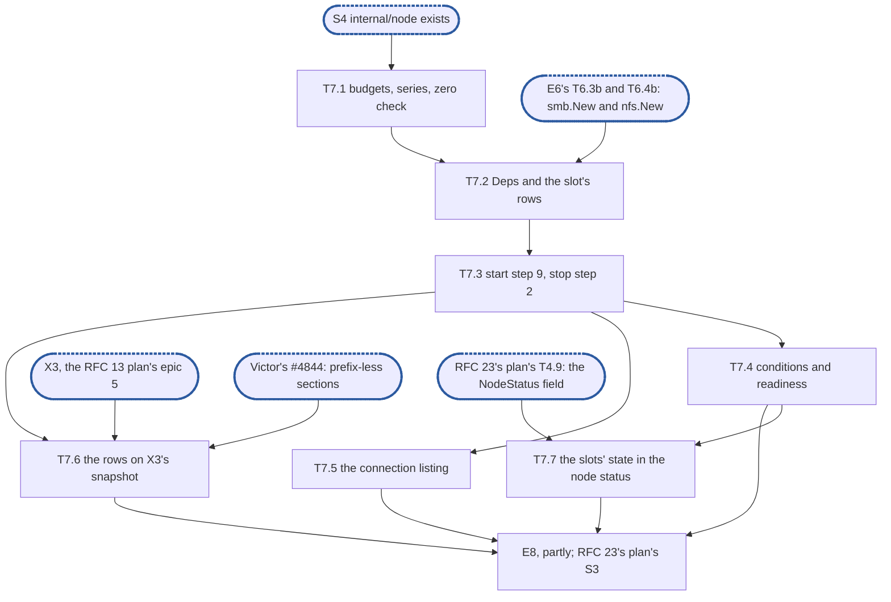

# Epic 7: adapters v2 integration with the node

**Sources:** [RFC 20](../docs/internals/rfcs/rfc-20-adapters.md) §3.1 (the node starts an adapter last, a
stopped adapter never starts again), §3.4 (`Adapter`, `Deps`, the two `New`), §3.5 (the node
runs the sidecars, their order, `sidecar_failed`), §3.6 (`Addrs` supplied by the node, `port`
restart-class, every other adapter setting live, `connection_limit` the node's), §3.7 (liveness,
readiness, `adapter_listener_lost`, `adapter_refused`, no self-probe), §10.1's alerting
sentences, and Appendix B's client-registry row;
[RFC 23](../docs/internals/rfcs/rfc-23-control-plane.md) §2.1 (row 10 of its table, and the adapters `New` does
not build), §2.2 (start steps 8 to 10, stop steps 1 to 3, readiness), §2.3 (the adapter and
sidecar rows, idempotent steps), §3.4, §4.2 (a node's open connections), §8.1's adapter row,
§10's CP4 and CP16, and §12's "§2.2 order"; [RFC 24](../docs/internals/rfcs/rfc-24-resources.md) §2.3, §2.4,
§2.5, §2.7 (the root builds the budgets and checks them at zero), §4.4 (`connection_limit`) and
§10's `memory_pool_reserved_bytes` and `memory_pool_ceiling_bytes`;
[RFC 25](../docs/internals/rfcs/rfc-25-observability.md) §3.4, §3.5, §3.6, §3.7, §3.9's adapter and sidecar
rows, §7 and §8.1; [RFC 13](../docs/internals/rfcs/rfc-13-configuration.md) §2.2, §6's port rule, §9's "§5
adapter port", Appendix B's adapter rows and `connection_limit`, and Appendix C's
`adapters.listen`. Cited, not owned: the settings table, `Check`, `Diff` and `Get` (the RFC 13
plan's epic 5), the adapter routes and `dfsctl adapter` (RFC 23's plan's epics 4 and 6), the
concrete sidecars (the cutover).
**Track:** team.
**Epic 7 estimate: 7 subtasks, 13.5 man-days.**
**Depends on:** **S4, `internal/node` exists**, reached: RFC 23's plan's S2 has `node.New`
building the components, `Start` and `Stop` running RFC 23 §2.2's steps in order, and reconcile's
`apply` slot returning refusals to a loop that owns the backoff (RFC 23's plan's epic 3
document, its D10). **E3 and E4**, merged: `pkg/resources`' budgets and `ConnLimit`; `Server`'s
`Start`, `Reconfigure`, `Stop`, `Addrs`, `Health` and `Connections`; `internal/sidecar`'s
`Runner`. **E6's T6.3b and T6.4b**, for T7.2 on: on `feat/storage-v2` both public constructors,
`pkg/adapter/nfs/nfs.go` and `pkg/adapter/smb/smb.go`, still return "not built". **X3**, the RFC
13 plan's epic 5, for T7.6: `pkg/settings`' `Read`, `Get` and `Diff` have no bodies yet
(`pkg/settings/snapshot.go`).
**Blocks:** E8, partly; RFC 23's plan's S3, "adapters serve through the node", with the RFC 21
and RFC 22 plans' handlers, and through it that plan's epic 8; the two rows the RFC 13 plan
defers to this epic, RFC 13 §9's "§5 adapter port" and the adapter half of RFC 13 §6's port rule
at start (its port-mapper half waits for the concrete sidecars).

---

## 1. Goal

Epic 7 puts the adapters into the node. The node builds the budgets once and hands every adapter
the same `Deps`; reconcile moves each adapter between configured, serving, draining and stopped
as its records say, through the sidecar runner; start step 9 starts them after the first full
reconcile and stop step 2 drains them before anything they call stops; the node raises their
conditions, reads their health into readiness, and lists their connections through the API.

**At the end of the epic:**

- `node.New` builds the four budgets and the connection count once, and registers
  `memory_pool_reserved_bytes` and `memory_pool_ceiling_bytes` over them; after the adapters and
  the filesystem stop, a budget above zero is logged at error, and `nodetest` fails the test;
- an enabled adapter is built through `nfs.New` or `smb.New`, started after the first full
  reconcile, reconfigured on a live change, rebuilt on a `port` change with the other adapter
  serving throughout, and falls back to the last settings that served when its new start fails;
- an adapter refused with nothing serving it is retried on reconcile's backoff until it serves,
  and neither fails the start nor turns the node unready;
- `Stop` syncs every sidecar with the empty set, then drains every adapter at once, bounded by
  the drain deadline plus 30 s, before the runner, the filesystem and the API stop;
- `adapter_listener_lost`, `adapter_refused` and `sidecar_failed` reach the node's status, and a
  lost listener turns readiness `not_ready`;
- `GET /api/v1/nodes/{id}/connections` lists each adapter's `Connections()`;
- once X3 is in, a settings generation reaches the adapters, and RFC 13 §9's "§5 adapter port"
  row passes on a node `nodetest` builds.

### 1.1 In scope

In `internal/node`: the budgets, their series and their zero check; the adapters' `Deps` and
listen addresses; one slot per protocol and its rows, called from `apply`; start step 9, stop step
2 and the part bound it needs (§9, O2); the adapters' conditions and readiness; each slot's state
and running generation, into the node status (T7.7); the hooks the tests reach through in
`export_test.go`; `nodetest`'s check of the zero-check record. In
`internal/node/api` and `pkg/node/apiv1`: the connection listing's route and wire type. In
`internal/sidecar`: `Runner.StopAll` (D2). The node's section type for each adapter, its
protocol's shape with `enabled` beside it, as §9's O1 has it. The edits §9 proposes to the
program's implementation plan, to RFC 23's plan and to the other epic documents are made by
other pull requests.

### 1.2 Out of scope

- The settings table, `Check` on the write path, and reconcile's
  loop over `settings.Diff`: the RFC 13 plan's epic 5 (X3); the adapters' rows in the table are T7.6's. This epic writes what that loop calls
  for an adapter's section, and the control plane's call of `Validate` is that section's.
- The adapter routes, `/api/v1/adapters/{protocol}`, and `dfsctl adapter`: RFC 23's plan's epics
  4 and 6. An adapter's per-node state and generation in its status (RFC 23 §3.4): §9, O7.
- The alert rules for `adapter_unmapped_errors_total` and `adapter_handler_panics_total` (RFC 20
  §10.1, RFC 25 §7): §9, O5.
- `Deps.Retry` and the node's retrier (RFC 20 §3.2, §3.4; RFC 23 §2.2's stop step 2): §9, O6.
- `adapter_record_unreadable` and `adapter_record_decode_failures_total`: their producer, the
  client record, is not built; the deferral ledger's row "RFC 20 §10.1's
  `adapter_translation_refused_total`, `adapter_record_decode_failures_total` and
  `adapter_record_replays_total`".
- The concrete sidecars, mDNS, WS-Discovery, the port mapper and rpcbind registration, their
  enabled settings and `Runner.SetEnabled`'s caller: the ledger's row "concrete sidecars". The
  node builds the runner over no sidecar until then, and RFC 13 §6's port rule against the port
  mapper waits with it.
- RFC 24's `Detect`, `SplitFor`, `memory_limit_bytes`, `memory_limit_below_floors`,
  `fd_limit_low`, `memory_pool_wait_seconds`, `memory_pool_refusals_total` and the count of
  releases past zero: the ledger's rows for the RFC 24 plan (§9, O3).
- RFC 24 §2.7's open-state budget and its zero check: nothing in `pkg/openstate` charges a
  budget yet; the RFC 14 plan's ledger row "RFC 24's `Budget` as a dependency", owner the RFC
  24 plan.
- The conditions' severities (RFC 20 §3.7, RFC 25 §3.9: `adapter_listener_lost` and
  `adapter_refused` unhealthy, `sidecar_failed` degraded): `health.Condition` carries none
  (`pkg/health/evaluator.go`'s `ponytail:`), which RFC 25's plan adds.
- In a cluster: the gateway as `Deps.VFS`, a floating address added by `Reconfigure` on a
  takeover (RFC 15), a namespace move's release of an address (RFC 27).
- The tracer: `node.Config` names none, so `Deps.Tracer` is nil and `Deps.SampleRatio` 0, as RFC
  25 §8.1 sets it while `tracing.endpoint` is unset.
- A mount: the RFC 21 and RFC 22 plans' handlers, and RFC 23's plan's epic 8.

### 1.3 Names used here

- **E1**, epic 1, delete v1 and fix the surface: `pkg/adapter`, `pkg/adapter/settings`,
  `pkg/resources`.
- **E2**, epic 2, test foundations: `testproto`, the import test, `adaptertest.CheckLeaks`.
- **E3**, epic 3, budgets and buffers: the bodies of `pkg/resources`.
- **E4**, epic 4, connections and lifecycle: `Server`, `Reconfigure`, `Health`, `Connections`,
  `ConnLimit`, the sidecar runner.
- **E5**, epic 5, dispatch: the pipeline and `core`'s series.
- **E6**, epic 6, protocol scaffolds: `wire/`, `protocol/` and `New` for SMB and NFS; its T6.3b
  and T6.4b give `smb.New` and `nfs.New` their bodies.
- **E7**, this epic. **E8**, epic 8, end-to-end green.
- **S4**, `internal/node` exists: RFC 23's plan's S2.
- **X3**, the RFC 13 plan's epic 5, as RFC 23's plan names it: `apply` on `settings.Diff` and
  `Get`, the write path on `Check`, the one settings table (its adapters' rows are T7.6's).
- **The slot**: what the node holds for one protocol: its running adapter, the settings it runs,
  the last settings that served, and its last refusal.
- **A row**: one of RFC 23 §2.3's adapter rows (enabled, disabled, live, restart-class), as the
  slot applies it.
- **The deferral ledger**: the list of everything RFC 20 or develop's v1 provides that the
  branch does not serve yet, each row naming the owner that brings it back.
- **The RFC 13, RFC 21, RFC 22, RFC 23 and RFC 25 plans**: the implementation plans of those
  RFCs; their epics are named in words, their subtasks with their prefix ("RFC 23's plan's
  epic 3 document, its D10").

## 2. How the general rules apply

Each of the program's ten general rules for an epic
([`rfc-20-adapters-plan.md` §1.5](rfc-20-adapters-plan.md#15-general-rules-for-each-epic)),
cited by number and title, and how it applies here or why it does not.

| Rule | Subtasks | How |
| --- | --- | --- |
| rule 1, independent unit tests, under `-race` ([`CLAUDE.md`, Writing tests](../CLAUDE.md#writing-tests); [Verifying a change](../CLAUDE.md#verifying-a-change)) | all | node tests are `package node_test` on `nodetest`'s harness, real Badger and the injected `sim.TestClock` (kind 1), observing what the node publishes: its status record, its health endpoints, its registry, the hooks of `export_test.go`. The slot's rows and a part's bound, which need no node, are tested in `package node`, as `lifecycle_internal_test.go` tests `halt`. Adapters are the real ones `nfs.New` and `smb.New` build, over loopback, on `memory.New` (kind 2) where no node is built. A setting is asserted on a connection accepted after the change. Doubles: a sidecar that fails its `Sync` on cue, and a wrapper around a real adapter whose `Health` reports a lost listener, or whose `Stop` holds, on cue (kind 3). A port held by the test is a real socket, not a double. A test that asserts a check fails runs `nodetest` on a recording `testing.TB`, as `internal/prof/prof_test.go`'s recorder does |
| rule 2, fuzz tests where relevant | none | this epic decodes no peer's bytes: the listing's route parses its path as every node route does |
| rule 3, observability follows RFC 25 and RFC 20 §10 | T7.1, T7.4 | the two `memory_pool_*` gauges are a collector the node registers, read at scrape, as `internal/node/stats.go`'s engine series are, and not in RFC 24 §2.8's `pkg/resources/metrics.go`, since a budget is given no registry (the epic 3 document's D7); the conditions are a `health.Source`. An adapter registers `core`'s series through `Deps.Metrics`, and a rebuilt adapter gets the same vectors back (`pkg/metrics/registry.go`'s `register`). No span: `node.Config` names no tracer |
| rule 4, leaks and allocations | T7.1 to T7.7 | every node test that starts an adapter stops the node and passes T7.1's zero check, under `nodetest.Watch` for goroutines; the slot's tests end with `adaptertest.CheckLeaks`. No allocation gate: nothing here is on a request's path |
| rule 5, v2 ignores v1 | all | nothing is lifted. Appendix B's "the client registry fed by `core`: replace with `Connections()`" is T7.5 |
| rule 6, nothing deferred is lost | T7.1, T7.2, T7.4, T7.6 | the rows §9 proposes: alert rules, `Deps.Retry`, the listener's address, `Detect` and `SplitFor`'s new trigger |
| rule 7, code comment conventions ([`CLAUDE.md`, Code comments](../CLAUDE.md#code-comments)) | all | each decision of §4 leaves the marker it names, and so does each §9 decision where it names one; O3's fixed figures leave a `ponytail:`. A marker names what it waits for in code terms, never an epic, a subtask or a synchronisation point. None of RFC 20's own notes that the rule lists is this epic's |
| rule 8, a test must be able to fail ([`CLAUDE.md`, Writing tests](../CLAUDE.md#writing-tests)) | all | each test in §6 names the change that fails it |
| rule 9, a symbol is exported only if RFC 20's interface uses it | T7.3, T7.5, T7.6 | `node` exports nothing new (`TestNodeExports`); `internal/sidecar` gains `Runner.StopAll`, internal to the module (D2); `pkg/node/apiv1` gains the listing's wire type, RFC 23 §4.2's fields; `api.Deps` gains one field; `pkg/adapter/settings` does not change: `enabled` is the node's section type's (O1) |
| rule 10, each subtask creates only what it declares | all | no retrier (O6), no sidecar package, no alert-rule file (O5), no `Detect` or `SplitFor` (O3); the budgets land with their first consumer, the adapters' `Deps` (T7.1 and T7.2 together, §8) |

## 3. Requirements and invariants

`Source` cites RFC 20 unless it names another RFC.

**Building**

| # | Requirement | Kind | Source | Subtasks |
| --- | --- | --- | --- | --- |
| R1 | Each enabled adapter is built through its protocol's public `New`, `nfs.New` or `smb.New`, from the node's `Deps` and its protocol's settings shape; `New` opens nothing; nothing else builds an adapter | MUST | §3.4; RFC 23 §2.1 (row 10, "two things are not built by `New`"), §2.3 | T7.2 |
| R2 | `Deps.VFS` is the `vfs.Service`, the filesystem on one node; the adapter is handed nothing of identity | MUST | §3.4; RFC 23 §2.1 (row 10) | T7.2 |
| R3 | Every adapter gets the same `Deps.Budgets`, the node's receive, reply, connection-state and hold budgets and its one connection count; a rebuilt adapter gets the same ones back; no adapter replaces or closes one | MUST | §3.4, §3.6; RFC 24 §2.7, §4.4 | T7.1, T7.2 |
| R4 | `Deps.Watch` registers each accept loop with the node's watchdog; `Deps.Metrics` is the node's registry and `Deps.Logger` its logger; `Deps.SampleRatio` is 0 while no tracer is configured | MUST | §3.4, §3.7; RFC 25 §3.5, §8.1 | T7.2 |
| R5 | `settings.Adapter.Addrs` is supplied by the node from the host's `adapters.listen`, never from a settings record; the port is the adapter's `port` setting | MUST | §3.6; RFC 13 §2.2, Appendix C; RFC 23 §3.4 | T7.2 |

**Reconcile**

| # | Requirement | Kind | Source | Subtasks |
| --- | --- | --- | --- | --- |
| R6 | An adapter enabled is built with `New` and started; one disabled is drained and stopped; one enabled again is built anew, never started again | MUST | §3.1, §3.4; RFC 23 §2.3, §3.4 | T7.2, T7.6 |
| R7 | A live setting reaches the adapter by `Reconfigure` with its protocol's whole shape, for connections set up afterwards; a refusal leaves the running adapter as it was and the record refused | MUST | §3.1, §3.6; RFC 23 §2.3 | T7.2, T7.6 |
| R8 | A changed `port` builds a new adapter through `New`; a refusal of `New` leaves the old one serving and the record refused; only then the old one is drained and stopped and the new one started, this adapter alone, the others serving throughout; a new one that fails to start is replaced by one built and started with the last settings that served, and the record is reported refused | MUST | §3.6; RFC 23 §2.3, §3.4; RFC 13 Appendix B's `port` row, §9's "§5 adapter port" | T7.2, T7.6 |
| R9 | An effective `port` other than 0 equal to the API's or the metrics listener's port refuses that adapter on that node, as a port conflict does | MUST | RFC 13 §6 | T7.2 |
| R10 | The rows return their refusals through `apply`; one with nothing serving the adapter is retried on reconcile's backoff, 1 s doubling to 30 s, until it serves; one refused while the adapter serves waits for the settings generation to move | MUST | RFC 23 §2.3, §2.4; RFC 23's plan, D12; its epic 3 document, D10 | T7.2, T7.3 |
| R11 | A row run twice on the same records does nothing the second time: an adapter serving with the settings it is given is neither reconfigured nor rebuilt | MUST | RFC 23 §2.3 | T7.2 |
| R12 | Every `Start`, `Reconfigure` and `Stop` the rows make goes through the sidecar runner, so the sidecars are synced in §3.5's order around it | MUST | §3.5; RFC 23 §2.3's sidecar row | T7.2, T7.3 |
| R13 | `connection_limit` is checked against its bound at start and whenever the node applies a change: a value above it refuses the start, or is refused as a change; a change that passes is set with `SetLimit`, live for connections accepted afterwards | MUST | §3.6; RFC 24 §2.7 (its "failure halfway"), §4.4; RFC 13 Appendix B | T7.6 |

**Start and stop**

| # | Requirement | Kind | Source | Subtasks |
| --- | --- | --- | --- | --- |
| R14 | Step 9 starts each enabled adapter, from configured to serving as the records say, after the first full reconcile (step 8) completes and before reconcile's loop (step 10); no adapter listens before the first full reconcile completes | MUST | §3.1; RFC 23 §2.2, §12's "§2.2 order" | T7.3 |
| R15 | An adapter refused at configured does not fail the start: the others serve, and readiness turns true once every enabled adapter is serving or was refused | MUST | §3.7; RFC 23 §2.2, §8.1; RFC 25 §3.6 | T7.3 |
| R16 | Stop step 2, after readiness turns false and reconcile stops: the sidecars are synced with the empty set, then every adapter is stopped, concurrently, under one context whose drain deadline is §9's O2's own decision, the step's start plus the longest `drain_timeout` of the adapters stopped, since RFC 23 §2.2 sets the step's bound but not the deadline; the step's bound is that deadline plus 30 s; a step that misses it leaves open what the adapters call | MUST | §3.1, §3.5; RFC 23 §2.2 | T7.3 |
| R17 | Stop is the reverse of start: the adapters stop before the operation runner, the filesystem and the API, and the API outlives them | invariant | RFC 23 §2.2, §10's CP4 | T7.3 |

**Health and the listing**

| # | Requirement | Kind | Source | Subtasks |
| --- | --- | --- | --- | --- |
| R18 | `adapter_listener_lost` is raised on the node, naming the adapter, while that adapter's `Health` names it; derived at each evaluation | MUST | §3.7; RFC 25 §3.4, §3.9 | T7.4 |
| R19 | `adapter_refused` is raised on the node, naming the adapter and its error, while an enabled adapter's `New` or `Start` failed and nothing serves it; cleared once it serves or is disabled | MUST | §3.7; RFC 25 §3.9 | T7.4 |
| R20 | `sidecar_failed` names each sidecar whose last `Sync` failed, until one succeeds; the adapters keep serving | MUST | §3.5, §3.7; RFC 25 §3.9 | T7.4 |
| R21 | A lost listener turns a started node's readiness `not_ready`; a refused adapter and a failed sidecar do not, nor, as §9's O11 reads it, an adapter being rebuilt | MUST | §3.7; RFC 25 §3.6, §3.7 | T7.4 |
| R22 | Health is read from `Health()`; the node never dials an adapter's port | MUST NOT | §3.7 | T7.4 |
| R23 | `GET /nodes/{id}/connections` answers what each adapter's `Connections()` lists now, protocol, remote address, session and since, from this node, for `viewer`; it pages by `?limit=` (default 100, at most 1,000) and `?after=`, a cursor that resumes from a key, never an offset, the page ending with `next` when more follow; it writes no record | MUST | §3.4; RFC 23 §4.2, §5.2 | T7.5 |
| R24 | No package under the control plane imports an adapter or a sidecar; the node hands the API what it reads | invariant | RFC 23 §10's CP16 | T7.5 |

**Budgets**

| # | Requirement | Kind | Source | Subtasks |
| --- | --- | --- | --- | --- |
| R25 | The node builds the receive and reply budgets as waiting budgets, the connection-state and hold budgets as refusing ones, and the connection count from `connection_limit`, once, before any adapter | MUST | RFC 24 §2.3, §2.5, §2.7, §4.4 | T7.1 |
| R26 | After the adapters and the service have stopped, the node logs at error each budget whose `Reserved()` is not zero, naming the pool and the bytes; the test harness fails on it | MUST | RFC 24 §2.7 | T7.1 |
| R27 | `memory_pool_reserved_bytes{pool}` and `memory_pool_ceiling_bytes{pool}` report each budget | MUST | RFC 24 §10 | T7.1 |

What other epics and plans own of these sections: `Start`, `Reconfigure`, `Stop`, `Addrs`,
`Health` and `Connections` themselves, and the runner's order (E4); `New`'s validation and its
binding on `port` (E1, E6); the settings snapshot, its sections, `Check` and the cross-component
port rule at write time (the RFC 13 plan's epic 5); the adapter routes (RFC 23's plan's epic 4);
the session a connection carries, `ConnInfo.Session` (the RFC 21 and RFC 22 plans); each
condition's severity (RFC 25's plan, §1.2); the listing's route conventions, cursor and `limit`,
which `internal/node/api` already holds (RFC 23's plan's epic 4).
What already holds and is not numbered again: `node.New` and `Start` building and starting the
other components in RFC 23 §2.2's order; `Stop`'s readiness turning `draining` first; a part
that misses its bound leaving what it uses open (`internal/node/lifecycle.go`).

What enforces the rows with no test of their own when this epic lands: R2's "nothing of
identity", `adapter.Deps`, which has no identity field; R22, review and `core`'s own
`decision:` at `Health`; R24, `internal/node/arch_test.go`'s `TestNoComponentImports`, whose
`componentAllowed` admits no adapter or sidecar package.

## 4. Decisions this epic takes

- **D1, `apply` calls the slots only once start step 9 has run.** `apply` already runs twice
  before step 9: at step 4, inside `readRecords`, before the engine starts, and again in the
  first full reconcile (`internal/node/reconcile.go`, `lifecycle.go`). Were it to call the
  slots there, an adapter would listen before the engine and the filesystem, against R14. So
  the node holds a flag that step 9 sets: before it, `apply` reads what the slots are to run
  and calls none; step 9 calls each slot with what the first full reconcile read, and records
  its refusals, with their retry flags, in the reconciler's refusals as a pass records its own,
  so `Refused()`, the node status and the backoff read them; from then on `apply` calls the
  slots. `decision:` at the flag. No prior art sought: the order is RFC 23 §2.2's.
- **D2, the runner stops every adapter in one call.** RFC 23 §2.2's stop step 2 syncs the
  sidecars with the empty set before any adapter drains. `Runner.Stop` syncs one adapter's
  sidecars without it and then drains it, so two run at once let one adapter drain while a
  sidecar still names the other, and run in turn they drain one after the other, against
  "concurrently". `Runner.StopAll` drops every adapter from the serving set, syncs each enabled
  sidecar with the empty set, then calls each adapter's `Stop` at once and joins them,
  returning their errors joined. `decision:` at the call. No prior art sought: the order is RFC
  23's.
- **D3, a pass waiting on a drain reports its loop idle.** A row that disables an adapter or
  rebuilds it for a `port` change waits for the old one's `Stop`, up to its `drain_timeout`
  (90 s by default) plus 30 s, inside a reconcile pass, and `reconcileLoop` reports a turn only
  once the pass returns, while the watchdog fails liveness after 60 s (RFC 25 §3.5). RFC 25
  §3.5 counts a waiting loop's idle report as its heartbeat, at least every 30 s. So the pass
  hands the slots the loop, and a slot waiting on a drain reports it idle every 10 s until the
  drain ends; other changes wait for the pass, as RFC 23 §3.4's "one adapter at a time" has
  them. `decision:` at the wait. No prior art sought.
- **D4, until the settings snapshot can be read, `apply` enables no adapter.** No record can be
  read until `settings.Get` has a body, and an adapter's `enabled` is off by default (§9, O1),
  as `apply` hands the engine its defaults today (`internal/node/reconcile.go`). The node's
  tests set what `apply` hands the slots through `export_test.go`, and T7.6 replaces that source
  with the snapshot. `ponytail:` at `apply`, naming the settings snapshot's `Get` as what it
  waits for.
- **D5, the zero check is a part's stop.** RFC 24 §2.7 checks the budgets once the adapters
  and the service have stopped. A part started before the filesystem's is stopped after it,
  so its stop is where the check runs, with no step of its own in `Stop`. `nodetest` hands the
  node a logger that fails the test on the check's record, as `prof.Watch` fails on a leak.
  `decision:` at the part. No prior art sought.

## 5. Target tree

```text
internal/node/
  budgets.go                  T7.1: the budgets and the count, the memory_pool_* collector,
                              the zero check's part (D5)
  budgets_test.go             T7.1
  adapters.go                 T7.2: the adapters' Deps and addresses (O10), one slot per
                              protocol and its rows; T7.4: the adapters' health.Source;
                              T7.6: each adapter's section type (O1)
  adapters_internal_test.go   T7.2: the rows over real adapters, with no node
  adapters_test.go            T7.3, T7.4, T7.6: the adapters in the node's start, stop, health
                              and settings
  node.go                     T7.1, T7.2: New builds the budgets, the Deps, the slots and the
                              runner; T7.4: adds the adapters' source to the evaluator
  lifecycle.go                T7.3: the first full reconcile, then step 9, then the loop; the
                              adapters' part, what it uses, its own bound (O2); T7.4:
                              readiness (O11)
  lifecycle_internal_test.go  T7.3: a part's own bound
  reconcile.go                T7.3: apply calls the slots once step 9 has run (D1, D4), the
                              loop handed to them (D3); T7.6: on the settings snapshot
  export_test.go              T7.1 to T7.6: the hooks the tests reach through, and T7.6
                              withdrawing D4's
  api_test.go                 T7.5: the listing through the API
  nodetest/harness.go         T7.1: fails a test on the zero check's record
internal/node/api/
  routes.go  res_nodes.go     T7.5: GET /api/v1/nodes/{id}/connections, Deps.Connections
pkg/node/apiv1/
  node.go                     T7.5: Connection
internal/sidecar/
  runner.go  runner_test.go   T7.3: StopAll (D2)
```

Symbols added: `sidecar.Runner.StopAll(ctx, map[string]adapter.Adapter) error`, internal to the
module (T7.3); `apiv1.Connection{Protocol, Remote, Session, Since}` and the field
`api.Deps.Connections`, a function the node hands the API (T7.5). The adapters' section types
are unexported, in package `node`. `node`'s exports and `pkg/adapter/settings` do not change.

## 6. Subtasks

### T7.1 The budgets, their series and the zero check

**Subtask T7.1 estimate: 1.5 man-days.**

- **Track:** team. **Depends on:** nothing in this epic; lands with T7.2, its first consumer
  (rule 10).
- **Covers:** R3 (one set), R25, R26, R27.
- **Deliverables:**
  - In `budgets.go`, the node's `resources.Budgets`, built in `node.New` before anything that
    takes them: `Receive` and `Reply` from `resources.NewWaitBudget`, `Connection` and `Hold`
    from `resources.NewBudget`, named `receive`, `reply`, `connection` and `hold`, at the
    ceilings §9's O3 gives; `Conns` from `resources.NewConnLimit` at the `connection_limit` O3
    derives; the `ponytail:` O3 names.
  - A collector registered in `node.New`, as `engineSeries` is:
    `memory_pool_reserved_bytes{pool}` from each budget's `Reserved()`, and
    `memory_pool_ceiling_bytes{pool}` from the ceiling the node built it with, since a budget
    exports no ceiling.
  - The zero check (D5): a part started before the filesystem's, whose stop logs at error each
    budget whose `Reserved()` is not zero, naming the pool and the bytes, and returns nil.
  - In `nodetest/harness.go`, the harness's logger wrapped so that the check's record fails the
    test. A hook in `export_test.go` reserving from a named budget.
- **Consumers:** T7.2's `Deps.Budgets`; T7.6's `SetLimit`; a scraper, for the series.
- **Acceptance criteria:**
  - After `Start`, the registry reports both series for each of the four pools, the ceiling as
    built and a reserved 0. A reservation of 64 KiB on `hold`, taken through the hook, reads
    65536 under `hold` alone at the next scrape, and 0 once released.
  - A node stopped with 1, 2, 3 and 4 KiB still reserved on `receive`, `reply`, `connection` and
    `hold`, run under `nodetest` on a recording `testing.TB`, since a plain harness run fails the
    test on the check's record before its records can be read, logs one error record per pool,
    each with its own bytes, after the filesystem's part stopped, and that TB is failed; with
    none reserved it logs none.
- **Tests:** in `budgets_test.go`, on `nodetest`. The scrape (catches a gauge registered over
  another budget, which reads the reservation under the wrong pool, and a series not
  registered). The stop with four reservations on the recording `testing.TB`, as
  `internal/prof/prof_test.go`'s recorder (catches a check that runs before the filesystem
  stops, which RFC 24 §2.7 forbids since the filesystem's last calls release replies, a check
  that reads fewer than the four budgets, and a harness that only logs).
- **Rules:** rule 3: the collector; rule 7: D5's `decision:` and O3's `ponytail:`; rule 10: no
  `Detect` or `SplitFor`.

### T7.2 The adapters' `Deps` and the slot's rows

**Subtask T7.2 estimate: 3.5 man-days.**

- **Track:** team. **Depends on:** T7.1.
- **Needs E6:** T6.3b and T6.4b, the bodies of `smb.New` and `nfs.New`.
- **Decided:** §9's O10 sets the parse of `adapters.listen`.
- **Covers:** R1, R2, R3, R4, R5, R6, R7, R8, R9, R10 (the refusals and their retry flag), R11,
  R12.
- **Deliverables:**
  - In `node.New`: `adapters.listen` parsed as §9's O10 has it. One `adapter.Deps`: `VFS` the
    filesystem, `Budgets` T7.1's, `Metrics` and `Logger` the node's, `Watch` returning the
    watchdog's `Loop` for the name it is given (it satisfies `adapter.Loop` as it is), every
    other field zero. The runner, `sidecar.New()` over no sidecar (§1.2).
  - In `adapters.go`, one slot per protocol, `nfs` and `smb`. Its one call takes whether the
    adapter is enabled and its protocol's settings shape, and sets `Addrs` from the parsed list
    (R5).
  - Its rows. Enabled with nothing running: `New`, then `Runner.Start`. Disabled with one
    running: `Runner.Stop`. The same `port`: `Runner.Reconfigure`, or nothing when the settings
    equal those it runs (R11). A changed `port`: `New`, then `Runner.Stop` on the old and
    `Runner.Start` on the new; if that start fails, `New` and `Runner.Start` with the last
    settings that served (R8). A `port` other than 0 equal to the API's or the metrics
    listener's: refused before `New`, as a start on a held port is, with the same fallback (R9).
  - Each wait on an old adapter's `Stop` reports the loop the call is handed idle (D3).
  - Each call returns its refusal: an `entity.RefusedRecord` naming `entity.ResourceAdapter`
    and the protocol, its retry flag set only when nothing serves the adapter after it (R10;
    RFC 23's plan's epic 3 document, D10). The slot keeps the last settings that served and
    the last refusal, which T7.4 reads.
- **Consumers:** T7.3's step 9 and `apply`; T7.4's conditions; T7.5's listing; T7.6.
- **Acceptance criteria**, each on `memory.New`, real budgets and a runner over one sidecar
  declared in the test that serves both protocols:
  - Enabled SMB at `port` 0 on `127.0.0.1` serves: `Addrs` reports `smb` over TCP on a port the
    system picked, the sidecar holds it, and a `NEGOTIATE` over loopback is answered. Applied
    again with the same settings, the port is the same and the sidecar was not synced again.
  - Disabled, its port refuses a dial and the sidecar holds nothing; enabled again, it serves
    from a new adapter.
  - A change of NFS's `Versions.Max` from `4.2` to `3` keeps the adapter and its port; an
    NFSv4 call on a connection accepted after it is answered `PROG_MISMATCH`, and on one
    accepted before it is not.
  - SMB's `port` changed to a port the test reserved: SMB serves on it, its old port refuses a
    dial, and an NFS connection opened before the change has a `NULL` call answered after it.
  - SMB's `port` changed to a port the test holds: the call returns a refusal without retry,
    and SMB serves on the port it served on before. With nothing serving before, a first
    enable on a held port, the refusal carries retry.
  - SMB's `port` changed together with a `DrainTimeout` that `Validate` refuses: a refusal
    without retry, and the old adapter serving on its old port, its connections open.
  - A `port` equal to the API's port given to the slot: refused, nothing built, the old
    adapter serving.
  - Each test ends with `CheckLeaks` over the budgets once both adapters are stopped.
- **Tests:** in `adapters_internal_test.go`, `package node`, with no node; each request is
  written by a helper in the test file from MS-SMB2 2.2.1's and RFC 5531's layouts.
  - The repeated apply (catches a rebuild or a `Reconfigure` on every pass, which reconcile's
    one-second pass would turn into a restart a second, R11).
  - The disable and enable (catch a stopped adapter started again, which `Start` refuses, R6).
  - The version change (catches a rebuild for a live setting, which drops every connection,
    and a range read from `New`'s copy, R7).
  - The port change (catches the other adapter stopped with this one, R8).
  - The held port (catches no fallback, which leaves SMB down on a typo, and a retry flag on a
    refusal while serving, which reruns a full pass every backoff for a conflict that lasts,
    R10).
  - The refused settings with a port change (catches the old adapter stopped before `New`
    accepted the new settings, R8).
  - The API's port (catches the clash bound on another address and served, R9).
  - `CheckLeaks` (catches a rebuilt adapter's connections left charged).
- **Rules:** rule 1: real adapters over loopback, `memory.New`; rule 4: `CheckLeaks`; rule 7:
  D3's `decision:` and O10's `decision:`.

### T7.3 Start step 9 and stop step 2

**Subtask T7.3 estimate: 2.75 man-days.**

- **Track:** team. **Depends on:** T7.2.
- **Decided:** §9's O2 sets the part's own bound.
- **Covers:** R10 (the retry through the loop), R12 (`StopAll`), R14, R15, R16, R17.
- **Deliverables:**
  - In `reconcile.go` and `lifecycle.go`, `Start`'s reconcile step split in three: the first
    full reconcile; a step `adapters`, which calls each slot with what that pass read, never
    fails the start for a refusal, and records its refusals as D1 says; then the step that
    starts reconcile's loop, the status writer and the sweep.
  - `apply` calling the slots only once step 9 has run, with their refusals beside its own
    (D1, D4), and the pass handing them the reconcile loop's `health.Loop` (D3).
  - The `adapters` part. Its stop calls `Runner.StopAll` (D2) under the one context O2 gives,
    then `Runner.Close`. It uses the filesystem's part and the zero check's, so a drain that
    misses its bound leaves both open (RFC 23 §2.2). Its bound is that context's deadline plus
    30 s, which a `part` now carries for itself; every other part keeps `stopBound`.
  - In `internal/sidecar/runner.go`, `StopAll` (D2).
  - Hooks in `export_test.go`: setting what `apply` hands the slots (D4); handing the runner a
    sidecar declared in the test; wrapping each adapter the slots build; and `AdapterAddrs`,
    reading an adapter's `Addrs` (the existing `Addrs` hook reads the API's).
- **Consumers:** T7.4, T7.5, T7.6; RFC 23's plan's epic 8.
- **Acceptance criteria:**
  - With SMB enabled through the hook, `Start` reports its steps in order: the first full
    reconcile, `adapters`, then the loop's. While the first pass is paused (`NewPausing`), a dial
    to the port the test reserved for SMB is refused; once `Start` returns it is answered, and
    `/health/ready` answers `ready`.
  - With SMB's port held by the test at start: `Start` succeeds, the node is ready, NFS serves,
    and `Refused()` names SMB. Once the test frees the port and advances the clock 1 s, SMB
    serves and the refusal is gone.
  - `Stop` with both enabled and a sidecar serving both: the stop's first `Sync` carries the
    empty set while both adapters' `Health` reports serving; both then report stopped before
    the runner's part stops; `/health/ready` answers `draining` while the adapters' part is
    waited on.
  - With a wrapper whose `Stop` holds until released, and both adapters' `drain_timeout` at
    90 s: after the clock advances 31 s the filesystem's part has not stopped; at 120 s the
    stop names `adapters` not stopped and leaves the filesystem and the store open.
  - In `lifecycle_internal_test.go`, a part with a bound of 120 s whose stop has not returned is
    still waited on once the clock has advanced 31 s, and is named not stopped at 120 s.
  - `StopAll` over two `testproto` servers and a sidecar serving both: the sidecar holds the
    empty set before either server leaves serving, and both are stopped when it returns.
  - A slot rebuilding SMB while a wrapper holds the old one's `Stop`: the loop reports idle
    every 10 s on the clock, and `/health/live` answers `live` after 90 s.
- **Tests:** in `adapters_test.go` on `nodetest`, and in `runner_test.go`.
  - The order (catches the adapters started at step 4 or inside the first pass, which RFC 23
    §12's "§2.2 order" row names: a client answered retry-later by a node that has not
    reconciled, R14, D1).
  - The held port (catches a refusal that fails the start, and a refusal never retried, under
    which SMB stays down after a port held a moment at boot, R10, R15).
  - The stop (catches `Runner.Stop` per adapter, under which a sidecar advertises one adapter
    while the other drains, and the adapters stopped after the runner, R16, R17).
  - The held stop (catches the adapters' part given `stopBound`, which fails every drain past
    30 s, and a part that names no `uses`, which stops the filesystem under live adapters, R16).
  - The bound in `lifecycle_internal_test.go` (catches a part's own bound ignored by `halt`).
  - `StopAll`'s own test (catches a drain started before the empty `Sync`, D2).
  - The held rebuild (catches a pass that reports no turn while it waits on a drain, which
    fails liveness and restarts the node, D3).
- **Rules:** rule 1: the wrapper holding `Stop`, kind 3; rule 7: D1's, D2's, D3's and D4's
  markers; rule 9: `StopAll` internal to the module. The 2.75 man-days: 1.5 for the step split
  and the part with its bound, 0.5 for `StopAll`, 0.75 for the drain heartbeat and its tests.

### T7.4 The adapters' conditions and readiness

**Subtask T7.4 estimate: 1.25 man-days.**

- **Track:** team. **Depends on:** T7.3.
- **Decided:** §9's O11 sets the readiness half.
- **Covers:** R18, R19, R20, R21, R22.
- **Deliverables:**
  - In `adapters.go`, a `health.Source` added in `node.New`. For each slot whose running
    adapter's `Health` names `adapter_listener_lost`: that condition on the node, naming the
    adapter (O8). For each enabled slot with nothing serving and a last refusal:
    `adapter_refused`, naming the adapter, its cause the refusal's error. For each name
    `Runner.Failed` returns: `sidecar_failed`, naming the sidecar.
  - In `lifecycle.go`, readiness read per call: `ready` turns `not_ready` while a running
    adapter's `Health` names `adapter_listener_lost` (O11).
- **Consumers:** the status writer, which already writes the evaluator's conditions; the health
  endpoints.
- **Acceptance criteria:**
  - SMB enabled on a held port: the node's status record carries `adapter_refused` naming
    `smb` and the bind's error, and `/health/ready` answers `ready`. Once SMB serves, the
    condition is gone at the next status write.
  - T7.3's wrapper around the real SMB adapter, reporting `adapter_listener_lost` on cue: the
    status carries it naming `smb`, and `/health/ready` answers `not_ready`; off cue, both
    clear.
  - A sidecar failing its `Sync` on cue: `sidecar_failed` naming it, both adapters serving,
    `/health/ready` `ready`. Once its retry succeeds, the condition clears.
- **Tests:** in `adapters_test.go` on `nodetest`.
  - The held port (catches `adapter_refused` latched past the serve, against RFC 25 §3.4, and
    a refusal that turns the node unready, R19, R21).
  - The lost listener (catches a condition read only at start, and readiness that ignores it,
    R18, R21).
  - The failing sidecar (catches a sidecar failure that turns the node unready or stops an
    adapter, R20).
- **Rules:** rule 1: the two kind 3 wrappers; rule 3: conditions through the evaluator; rule 7:
  O11's `decision:`.

### T7.5 The connection listing

**Subtask T7.5 estimate: 1.75 man-days.**

- **Track:** team. **Depends on:** T7.3.
- **Covers:** R23, R24.
- **Deliverables:**
  - In `pkg/node/apiv1/node.go`, `Connection{Protocol, Remote, Session, Since}`, RFC 23
    §4.2's fields with their JSON names.
  - In `internal/node/api`, `Deps.Connections`, a function returning the connections open now,
    and a read row `GET /api/v1/nodes/{id}/connections` for `auth.View`. It pages as RFC 23
    §4.2 says, with `?limit=` and `?after=`, its cursor the last connection's `Since`, `Remote`
    and `Protocol`, the order every page is sorted in; an ID other than this node's is answered
    as §9's O9 has it.
  - In `node.go`, `Deps.Connections` filled from every slot's running adapter's
    `Connections()`. The API imports no adapter (R24): the node turns each `adapter.ConnInfo`
    into a `Connection`.
- **Consumers:** RFC 23's plan's epic 6, `dfsctl`'s listing of a node's clients; RFC 23's plan's
  epic 8.
- **Acceptance criteria:**
  - With both adapters serving and a client connected to each, a `viewer` reads two
    connections, `nfs` and `smb`, each with the client's address and an empty session. Once a
    client closes, it is gone from the next read.
  - With three clients and `?limit=2`, the first page holds the two accepted first and a
    `next`; a client connected before the second read appears on it after the third, and no
    connection appears twice.
  - With no adapter enabled, the read answers an empty page.
  - An ID other than this node's is answered as O9 says; a caller without `View` is refused.
- **Tests:** in `api_test.go` on `nodetest`, through `NewAuthenticating`.
  - The two clients (catches a listing that reads one adapter, or a stale snapshot, R23).
  - The pages (catches an offset cursor, which repeats or skips once a connection opens or
    closes between pages, R23).
  - The empty node (catches a listing that fails with no adapter).
  - The right (catches the row's right left out).
  - `TestNoComponentImports` holds R24.
- **Rules:** rule 5: Appendix B's client registry replaced by `Connections()`; rule 9: the wire
  type. The 1.75 man-days: 1 for the wire type, the row and the node's function, 0.75 for the
  cursor and its tests.

### T7.6 The rows on the settings snapshot

**Subtask T7.6 estimate: 2.25 man-days.**

- **Track:** team. **Depends on:** T7.3.
- **Needs:** X3; §9's O1 and O4 are decided, O4's declaration waiting on Victor's #4844 answer.
- **Covers:** R6, R7 and R8 (from records), R13; RFC 13 §9's "§5 adapter port".
- **Deliverables:**
  - Each adapter's section type, its protocol's shape with `enabled` beside it (O1), for the
    RFC 13 plan's one table.
  - `apply` reading each adapter's section from the snapshot with `settings.Get` and calling
    its slot when its section changed or a retry is due; the slot's refusals reported as a
    section's are.
  - `connection_limit` read from its section (O4) at start and on each change, checked against
    its bound: above it, the start refused or the change refused; otherwise set with
    `SetLimit` (R13).
  - D4's hook and its `ponytail:` withdrawn.
- **Consumers:** RFC 23's plan's epic 8; the RFC 13 plan's epic 6.
- **Acceptance criteria**, each driven by settings records the test writes through kvstore:
  - `adapters.smb.enabled` set: SMB serves after the next pass; unset, it stops.
  - `adapters.smb.port` changed on a serving node: a new adapter on the new port, the old port
    refusing, NFS answering throughout. Changed to a port the test holds: the record reported
    refused in the node's status, and SMB serving again on the last port that served (RFC 13
    §9's "§5 adapter port").
  - `adapters.nfs.versions.max` lowered: a connection accepted after it is refused the version
    removed, one accepted before is not.
  - `connection_limit` lowered to 2: a third connection from two addresses is closed at accept.
    Set above its bound, the change is refused and the limit unchanged; a node started with it
    set above its bound fails its start.
- **Tests:** in `adapters_test.go` on `nodetest`.
  - Enable and disable (catches a section read but not applied).
  - The port rows (catch the restart-class change applied by `Reconfigure`, which refuses it
    with `ErrPortChanged` and leaves the old port, R8).
  - The versions (catches the live change read at `New` only, R7).
  - The limit (catches `SetLimit` never called, and the bound checked on a change but not at
    start, R13).
- **Rules:** rule 6: D4's hook withdrawn with its `ponytail:`; rule 9: no change to
  `pkg/adapter/settings`.

### T7.7 Each slot's state and running generation into the node status

**Subtask T7.7 estimate: 0.5 man-days.**

- **Track:** team. **Depends on:** T7.4.
- **Needs:** RFC 23's plan's T4.9, the `NodeStatus` field its per-node read reads (§9, O7);
  none of it runs before that field merges.
- **Covers:** §9's O7, the node-side write.
- **Deliverables:**
  - The status writer writing, per slot, its state and the settings generation it runs into
    the `NodeStatus` field RFC 23's plan's T4.9 adds (RFC 23 §3.4), from what the slots hold.
- **Consumers:** RFC 23's plan's epic 4 document's per-node read, `/adapters/{protocol}` (its
  R40 and T4.9).
- **Acceptance criteria:**
  - With SMB serving and NFS disabled, the node's status record carries SMB's slot serving,
    on the settings generation it runs, and NFS's slot stopped; with SMB disabled too, the
    next write carries both stopped.
- **Tests:** in `adapters_test.go` on `nodetest`.
  - The states (catches a write that reads the running adapters alone, which loses a disabled
    slot's state).
  - The generation (catches a slot's state written without the settings generation it runs).
- **Rules:** rule 1: on `nodetest`; rule 4: the tests stop the node through the zero check;
  rule 9: `node` exports nothing new.

## 7. Order of work



| When | Subtasks | Man-days |
| --- | --- | --- |
| from S4, written now, landing with T7.2 | T7.1 | 1.5 |
| once E6's T6.3b and T6.4b have landed | T7.2 | 3.5 |
| then | T7.3, then T7.4 and T7.5 side by side | 5.75 |
| once X3 has landed and Victor answers on #4844 | T7.6 | 2.25 |
| once RFC 23's plan's T4.9 has landed | T7.7 | 0.5 |

**The critical path** is E6's T6.3b and T6.4b, then T7.2 and T7.3, 6.25 man-days of this epic,
then X3 for T7.6, whose date is the RFC 13 plan's. T7.4 and T7.5 fill the wait for X3. The least
certain subtasks are T7.6, written against a snapshot whose bodies do not exist yet, and T7.2,
whose fallback paths run on real ports, then T7.3, whose bound and heartbeat edit RFC 23's
lifecycle and reconcile loop.

## 8. Suggested pull requests

| PR | Subtasks | Man-days | After | Why together |
| --- | --- | --- | --- | --- |
| 1 | T7.1, T7.2 | 5 | E6's T6.3b and T6.4b | the budgets land with their first consumer, the adapters' `Deps`, and the rows with the tests that run them |
| 2 | T7.3, T7.4 | 4 | PR 1 | the adapters in the node's start, stop and health: what RFC 23 §2.2 orders |
| 3 | T7.5 | 1.75 | PR 2's T7.3 | the listing route, beside PR 2's health |
| 4 | T7.6 | 2.25 | PR 2, X3, and Victor's answer on #4844 | a settings generation reaches the adapters |
| 5 | T7.7 | 0.5 | PR 2 and RFC 23's plan's T4.9 | the slots' state and generation in the node status, held out of the other PRs by T4.9's wait |

A suggestion only: one pull request per subtask works as well.

## 9. Open points

Each open point was decided on 19 Nov. Each entry below says what the decision changed; a rule the decision settles belongs in the RFC, not in a plan, so those lines are findings for the RFC lines pull request, and the entry points at it.

- **O1, the adapter's `enabled` (RFC gap; the RFC 13 plan's table).** RFC 23 §3.4 gives
  `/adapters/{protocol}` "`enabled` and the protocol's settings", RFC 23 §2.3 and RFC 20 §3.7 act
  on "an adapter enabled", and RFC 20 §3.6 calls `adapters: {nfs: {enabled: true}, smb:
  {enabled: true}}` the least configuration. RFC 13 Appendix B has no row for it, and RFC 20
  §3.6's shapes, as `pkg/adapter/settings/settings.go` holds them, have no field, so a section
  declared over `settings.SMB` alone would refuse the key as unknown.
  **Decided 19 Nov.** Each adapter's section is a node-side type embedding the protocol's
  shape, `Enabled bool` (`json:"enabled" class:"live"`) beside it, off by default (RFC 23's
  plan's D11: a node with no enabled adapter serves only the API), live, at installation
  scope with a node override (`OverrideOnly("Port", "Enabled")`), which `settings.Of` takes
  as it takes any type with a `Validate`; `pkg/adapter/settings` and RFC 20 §3.6 do not
  change, since no adapter reads the key and the shapes carry no field, which is why open
  #4844's one-prefix-per-section rule needs the wrapper. The RFC 13 Appendix B row and the
  RFC 20 §3.6 sentence are findings for the RFC lines pull request (Victor confirms).
- **O2, the adapters' stop bound (cross-owner: RFC 23's node).** RFC 23 §2.2's stop step 2 is
  bounded by the drain deadline plus 30 s; `internal/node/lifecycle.go` bounds every part by
  `stopBound`, 30 s, as RFC 23's plan's epic 3 document decided (its D14). With `drain_timeout`
  at its default 90 s, a drain past 30 s leaves the filesystem and the store open and fails the
  stop.
  **Decided 19 Nov.** RFC 23 §2.2's step 2, as merged (#4533, 17 Nov), gives every `Stop` one
  context, under one drain deadline whose value RFC 23 §2.2 does not set; this decision sets
  it, the step's start plus the longest `drain_timeout` of the adapters stopped. The adapters'
  part is bounded by that deadline plus 30 s, and every other part keeps `stopBound`, which
  supersedes D14 (#4336, Marco's) and `lifecycle.go`'s `stopBound` note. T7.3 adds what the
  rows need: a rebuild's draining old adapter does not hold reconcile's pass more than 30 s
  past its bound, and step 2's `StopAll` joins the drains under the one context. The RFC 23
  §2.2 drain-deadline sentence is a finding for the RFC lines pull request.
- **O3, the budgets' figures without `Detect` and `SplitFor` (RFC 24 has no plan).** RFC 24
  §2.7 sizes the budgets from L and its split, and `pkg/resources/budget.go` has neither
  `Detect` nor `SplitFor` (its package comment's `ponytail:`); the ledger's row names the RFC 24
  plan, triggered "when the node budgets memory", which this epic is.
  **Decided 19 Nov.** The figures stand: RFC 24 §2.3's fractions of a fixed L of 8 GiB, the
  example RFC 24 §2.3 works, so 512 MiB each for receive, reply, connection state and hold,
  and `connection_limit` 4,096, RFC 24 §4.4's derived figure for that node, without the
  open-file half; nothing built from them calls `debug.SetMemoryLimit`; one `ponytail:`
  naming `Detect`, `SplitFor`, `memory_limit_bytes`, `memory_limit_below_floors` and the
  open-file half as the upgrade, and `pkg/resources`' package comment may say "with their
  first caller" of `Detect` and `SplitFor` instead; the ledger row to #3119 (no RFC 24 plan),
  its trigger "before the cutover serves its first client".
- **O4, `connection_limit`'s section (cross-owner: the RFC 13 plan).** RFC 13 Appendix B makes
  it a live node setting and RFC 24 §2.7 has the root check it, but no plan declares its
  section: the RFC 13 plan's epic 5 declares the adapters' and "every other section declared by
  then".
  **Decided 19 Nov.** The node declares it in T7.6, as the component that reads it, at node
  scope, unset meaning derived; its `Validate` checks shape only, an integer at least 1, and
  the node checks the value against this node's derived bound at start and on each change
  (R13; RFC 24 §2.7, RFC 13 Appendix B), since an API node cannot see the target host. This
  differs from the draft: the bound check moves out of the validator. Its declaration needs a
  section: open #4844 cannot declare a prefix-less key today (`upload_workers`,
  `existence_age`, `clone_max_len`, `atime` the same), so Victor's answer is owed; the RFC 13
  §6 sentence and the Appendix B row's wording are findings for the RFC lines pull request.
- **O5, the alert rules (cross-owner: RFC 25's plan).** RFC 20 §10.1 and RFC 25 §7 ticket
  `adapter_unmapped_errors_total` and `adapter_handler_panics_total`, and the program's
  description of this epic builds their rules; the repository holds no alert rule, and RFC 23's
  plan leaves its own to RFC 25's plan for that reason.
  **Decided 19 Nov.** Not built here; the ledger row is owned by RFC 25's plan, its trigger
  "an alert-rule home exists", copied to #3119 by T8.2; the program plan's epic 7 description
  and its §7 coverage cell drop the rules, the edits the last section of this document proposes.
- **O6, `Deps.Retry` and the node's retrier (cross-owner: the RFC 22 plan).** RFC 20 §3.2 and
  §3.4 name it, RFC 23 §2.2 stops it after the adapters, and the epic 4 document calls it this
  epic's; `pkg/adapter/deps.go` has no `Retry` field, and its only caller is a protocol's session
  registry handing it a `Disconnect`.
  **Decided 19 Nov.** Neither the field nor the retrier is built here (rule 10: no caller;
  only a session registry hands it a `Disconnect`). The ledger row: the field, the retrier
  and its stop after the adapters land in one pull request with the first session registry
  that calls it (the RFC 22 plan's T5.2/T5.4, or RFC 21's `DESTROY_SESSION`), on top of T7.3,
  and only once Marco's queue bound is settled (his open "should" on #4533, 17 Nov: RFC 24
  §5.1's row, suggested "one pending Disconnect per client record per adapter"). The merged
  epic 4 document still calls the retrier E7's, and the RFC 22 plan names no `Retry`; the
  RFC 20 §3.2 sentence on the single node and RFC 24 §5.1's row are findings for the RFC
  lines pull request.
- **O7, an adapter's per-node state and generation (cross-owner: RFC 23's plan).** RFC 23 §3.4:
  "The status of an adapter shows, per node, its state and the generation it runs". RFC 23's
  plan's epic 4 document builds `/adapters/{protocol}` with that per-node status, read from the
  node statuses (its R40 and T4.9); `NodeStatus` in `pkg/metadata/entity/node.go` has no field
  for it yet, and only the node can write it from its slots.
  **Decided 19 Nov.** The split the draft made stands: the field and its per-node read are
  RFC 23's plan's T4.9's (Marco); the status writer's write of each slot's state and the
  settings generation it runs is this epic's T7.7, 0.5 man-days, blocked by T4.9 and after
  T7.4, inside the epic's total. The gap this found: RFC 23 §3.4 promises per-node state and
  generation, but RFC 23 §2.4 and RFC 16 §2.3's `NodeStatus` carry no field, and
  `RefusedRecord` cannot derive the running generation; the RFC 23 §2.4 bullet and RFC 16
  §2.3's `Adapters` field are findings for the RFC lines pull request.
- **O8, `adapter_listener_lost`'s subject (RFC gap).** RFC 25 §3.9 names the adapter and the
  address; `adapter.Health.Conditions` holds names only (RFC 20 §3.4), and `core`'s `Health`
  reports the name alone.
  **Decided 19 Nov.** T7.4 names the adapter only. The address is a conflict between RFC 25
  §3.9 ("naming the adapter and address") and RFC 20 §3.4 (`Health` carries names only): the
  ledger row is `unowned`, its trigger RFC 15's floating addresses; the RFC 20 §3.4 amendment
  giving `Health` a `Lost []netip.AddrPort` is a finding for the RFC lines pull request.
- **O9, another node's connections (RFC gap).** RFC 23 §4.2 reads a node's connections "from
  that node", and says nothing of a request for them made on another node.
  **Decided 19 Nov.** On one node, an ID other than this node's is answered `404 not_found`,
  before any adapter is read, as `GET /nodes/{id}` answers a node that never registered (RFC 23
  §4.2, §4.7, §8; release 1 is one node; T4.6's node read already 404s). A `ponytail:` on the
  listing's `Deps` names RFC 23 as the owner of the cluster answer, not RFC 15, which forwards
  only vfs calls; the RFC 23 §4.2 sentence is a finding for the RFC lines pull request (Marco
  confirms the wording).
- **O10, the default of `adapters.listen` (cross-owner: the RFC 13 plan's `pkg/bootstrap`).**
  RFC 13 Appendix C gives the key the default "every interface"; `pkg/bootstrap/config.go` reads
  it as strings with no default and no parse, and `pkg/bootstrap` is the RFC 13 plan's epic 2.
  `core` binds each address on its family's own network, `::` with `IPV6_V6ONLY`
  (`internal/adapter/core/server.go`'s `bind`), so the two wildcards together are every
  interface, and `Validate` accepts one per family. On a host booted with IPv6 off, binding `::`
  fails, and a partial bind is a failed start, so every adapter would be refused there.
  **Decided 19 Nov.** An unset `adapters.listen` resolves in `node.New` to `0.0.0.0`, plus `::`
  only when a TCP6 socket opens on `[::]:0`; an explicit list is bound as written; each literal
  still parses, and one that does not is refused, naming the key and its index but never the
  value, as `node.go` names `api.listen` (RFC 13 §6). This differs from the draft: the probe
  replaces "always both", which would refuse every adapter on an IPv6-less host (a partial
  bind is a failed start, RFC 20 §3.1) and regress v1. `decision:` at the parse; moved into
  `pkg/bootstrap`'s defaults when the RFC 13 plan's epic 2 takes it, so `dfs config show`
  prints what the node binds. The RFC 13 Appendix C default's rewording is a finding for the
  RFC lines pull request (Victor confirms).
- **O11, readiness while an adapter is rebuilt (RFC gap).** RFC 20 §3.7 has "the node is ready
  for clients when every enabled adapter is serving or was refused at configured", and RFC 25
  §3.6 the same; read literally, a node whose SMB adapter is rebuilt for a `port` change, its old
  one draining and its new one configured, is not ready for up to its `drain_timeout`. RFC 25
  §3.6's table of states names no rebuild, and RFC 23 §3.4 rebuilds "one adapter at a time on a
  node, so a change to SMB never drops an NFS client", which an unready node, steered away from
  by its load balancer, would.
  **Decided 19 Nov.** After start, the adapters turn the node unready only for a lost listener;
  a port rebuild or a later enable leaves it ready (RFC 23 §2.2's start gate, RFC 25 §3.6's
  row, RFC 23 §3.4's one adapter at a time, each adapter's own Services). `decision:` at
  readiness. The RFC 20 §3.7 sentence and RFC 25 §3.6's rebuild row are findings for the RFC
  lines pull request; Marco confirms, alongside his open #4533 thread r4596935057 on a
  no-address adapter.

**Settled, recorded here for the reader:**

- Who writes the adapter rows into the node: RFC 23's plan, its D12, and its epic 3 document,
  which leaves start step 9, stop step 2 and the rows in `apply` to this epic; `apply` returns
  refusals and the loop owns the backoff (that document's D10), so this epic adds no loop of its
  own, where RFC 23's plan's sketch retried SMB on one.
- Who builds `GET /nodes/{id}/connections`: RFC 23's plan's epic 4 document has the route land
  with its producer, here (T7.5), and RFC 23's plan's ledger names this epic. Its paging is RFC
  23 §4.2's cursor, keyed here by `Since`, `Remote` and `Protocol`.
- Where the `memory_pool_*` gauges are registered: the node, over each budget's `Reserved()`,
  as the epic 3 document's D7 settled, not RFC 24 §2.8's `pkg/resources/metrics.go`, since a
  budget is given no registry.

**Findings for other documents, not edited here:**

- The program's deferral ledger, its row "the `/clients` and `/mounts` listings", names RFC 23's
  plan for the connection listing; RFC 23's epic 4 document moved it here.
- The epic 1 document names "the config loader" as this epic's; it is X3's.
- `pkg/adapter/deps.go` lags RFC 20 §3.4 beyond `Retry`: no `TraceIDs`, and `DialClient` without
  its `network`. This epic leaves both nil; their owners are the epic 5 document (spans) and the
  RFC 21 plan (callbacks).
- The RFC 13 plan's ledger row on RFC 13 §6's port rule at start names "that adapter or the port
  mapper"; this epic builds the adapter half (T7.2), and the port-mapper half belongs with the
  concrete sidecars, at the cutover.

**Edits this document proposes to the program's implementation plan**, for the coordinator's
pull request:

- epic 7's row in §2, its estimate line, its description and its §7 coverage cell: 7 subtasks,
  13.5 man-days; the alert rules, the retrier and `adapter_record_unreadable` out (O5, O6, §1.2);
  the plan's total grows by the same;
- the ledger: new rows for the alert rules (owner RFC 25's plan, trigger "an alert-rule home
  exists", copied to #3119 by T8.2; O5), `Deps.Retry` (the field, the retrier and its stop with the
  first session registry that calls it, on top of T7.3, once Marco's queue bound is settled;
  O6) and the listener's address (owner `unowned`, trigger RFC 15's floating
  addresses; O8); the row "RFC 24's turns, `Reclaim`, `ShareCap`, `Detect`, `Split`"
  with O3's new trigger; the `/clients` row's listing moved to this epic; the row "concrete
  sidecars" naming their enabled settings, `Runner.SetEnabled`'s caller and the port mapper's
  half of RFC 13 §6's port rule.

**Against the epic's first description.** It had no subtasks and no estimate. Of what it lists,
three items are not built here: the alert rules (O5), and of "`core`'s conditions",
`adapter_record_unreadable`, whose producer is not built (§1.2); the retrier, which the epic 4
document gives this epic, is not built either (O6). The budgets, the listing route, the stop
bound and the drain heartbeat are added, from RFC 24 §2.7, RFC 23's epic 4 document, RFC 23 §2.2
and RFC 25 §3.5.

**Least certain.** T7.6, written against `settings.Read`, `Get` and `Diff`, which have no bodies
yet; then T7.2, whose port fallback runs on real ports a test reserves or holds; then T7.3,
whose bound and heartbeat edit RFC 23's lifecycle and reconcile loop (O2, D3).
