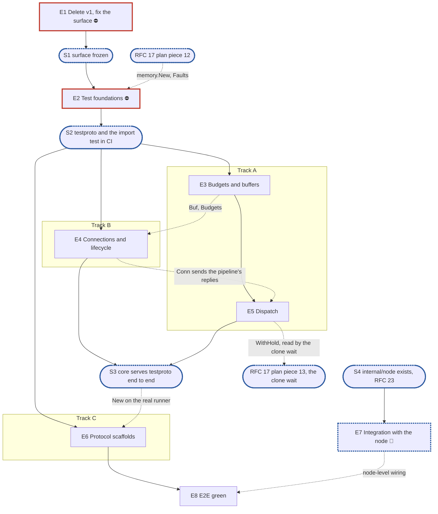

# RFC 20 — adapter model v2: implementation plan

**Scope:** [RFC 20, the adapter model](../docs/internals/rfcs/rfc-20-adapters.md), as far as it is the shape every
adapter shares: the public surface in `pkg/adapter`, the shared `core` (lifecycle, connections,
dispatch, held requests, middleware, error tables, observability), RFC 24's pooled buffers and
budgets, the generic sidecar runner, the import test, and a thin NFS and SMB scaffold on `core`.
No operation handler is built. The decisions this plan starts from are recorded in
[`rfc-20-adapters-design.md`](rfc-20-adapters-design.md). Everything deferred, and everything
develop serves that `feat/storage-v2` stops serving, is in the deferral ledger (§6.2). Related
RFCs, with how far each is in scope:

- [RFC 17](../docs/internals/rfcs/rfc-17-vfs.md), the filesystem service: **constraints only**, except
  `vfs.WithHold` (RFC 17 §5.9), which `pkg/vfs` lacks and epic 5 adds; `vfs.WithRequestID`
  (RFC 17 §4.7) is a ledger row (§6.2). `pkg/vfs` and
  `vfstest.Null` exist on `feat/storage-v2`; tests here use the in-memory service,
  `memory.New`, held to RFC 17 §8's suite, and its fault wrapper, `vfstest.Faults`, which
  RFC 17's plan delivers (ledger, §6.2); `Null` serves the allocation gate and the pipeline
  benchmark only.
- [RFC 24](../docs/internals/rfcs/rfc-24-resources.md), resources: **only the parts this RFC cannot work
  without**: `Budget`, `WaitBudget`, `Reservation`, `Budgets`, `Buf` and `BufPool` in `pkg/resources` (epic 3).
- [RFC 13](../docs/internals/rfcs/rfc-13-configuration.md), configuration: **only the parts this RFC cannot work
  without**: the adapters' settings shapes, their keys and their defaults.
- [RFC 25](../docs/internals/rfcs/rfc-25-observability.md) and [RFC 29](../docs/internals/rfcs/rfc-29-test-harness.md): the
  rules every epic follows (§1.5 rules 3 and 4), and RFC 20 §10's series.
- [RFC 23](../docs/internals/rfcs/rfc-23-control-plane.md), the node: **constraints only**. `internal/node` does
  not exist; RFC 23's plan (#4050) builds it, and the node's wiring of adapters is epic 7, planned
  after S4.
- [RFC 14](../docs/internals/rfcs/rfc-14-open-state.md), [RFC 18](../docs/internals/rfcs/rfc-18-identity.md),
  [RFC 19](../docs/internals/rfcs/rfc-19-authorization.md), [RFC 21](../docs/internals/rfcs/rfc-21-nfs.md) and
  [RFC 22](../docs/internals/rfcs/rfc-22-smb.md): **constraints only**. Their parts of RFC 20 are ledger rows.
- [RFC 15](../docs/internals/rfcs/rfc-15-topology.md) and [RFC 27](../docs/internals/rfcs/rfc-27-namespace-migration.md): **out**,
  beyond the `Reconfigure` listener removal they call.

**Tracks:** A, B and C (§3.4).
**Programme:** stage 5, "adapters", of [#3119](https://github.com/marmos91/dittofs/issues/3119).
Stage 2 built the service the adapters call; stage 7 is the cutover, which wires the adapters
into `dfs` and turns the protocol suites back on.
**Naming:** v1 is today's adapter code (`internal/adapter`, `pkg/adapter`, the Runtime's adapter
half); v2 is RFC 20's. v1 is deleted on `feat/storage-v2` in epic 1, not migrated, and v2 reuses
the `pkg/adapter` and `internal/adapter` paths, so no name carries a version.
**Estimates** are human man-days on the shared scale of `rfc-to-epic-plan`, kept as they are
although the code is written by an agent; a scale for agent-written work is proposed on #3524.
**Defaults used from Step 0:** dashboards none (#9); output path the default (#10). The target
branch is `feat/storage-v2`, on which RFC 17's plan has merged; the plan document itself lands on
`develop` and is cherry-picked, as the other planning documents are.

## 1. Introduction

### 1.1 What we are building

| | v1 (deleted in epic 1) | v2 |
| --- | --- | --- |
| Reaches files through | `pkg/controlplane/runtime`, which hands out the stores | `vfs.Service` only (RFC 20 §2.3) |
| Public surface | `pkg/adapter/{nfs,smb}`: connection loops, dispatch, NLM | `pkg/adapter`: the contract, `Deps`, settings, two `New` |
| Shared code | one accept-and-drain shell; the rest twice | `internal/adapter/core`: lifecycle, connections, pipeline, compound runner, held requests, middleware, error tables |
| Protocol code | handlers, framing, signing and credits inline in each connection loop | `wire/` (pure codecs), `protocol/` (the `core.Protocol` and its stages), `ops/` (tables), the same in both |
| Buffers | a three-class `sync.Pool` of byte slices behind package functions | `pkg/resources`: reference-counted `Buf` behind a `Budget` reservation, shared with any component |
| Drain | cancels every request, 100 ms read deadline | stops accepting, serves what each request's `Role` allows, finishes what the service holds, abandons at the deadline |
| Sidecars | each adapter runs its own group | one runner driven by the serving set |
| Tests | handlers on real stores; four fakes | `core` on a test-only protocol over `memory.New`; the import test from the first commit |

**Dependency limits.** What an adapter may import is RFC 20 §2.3's list, which its §7.1 import
test enforces; this plan does not restate it. Liveness reaches an adapter as `Deps.Watch`, which
the node adapts to RFC 25's watchdog.
`pkg/adapter`, `pkg/adapter/settings` and `pkg/resources` import nothing under `internal/`; only the
two constructor packages, `pkg/adapter/nfs` and `pkg/adapter/smb`, import `internal/adapter/`.

**What v2 serves at the end of the plan.** Nothing a client can mount. Each protocol accepts
connections, frames, decodes its header, routes, and answers every operation "not supported"
through the real pipeline. Operations arrive with RFC 21 and RFC 22.

### 1.2 How the plan is organised

Epic 1 deletes v1 and fixes the surface: the contract, the settings, the constructors, the
budget and buffer API, and `core`'s protocol-facing types. Epic 2 builds the test-only protocol that proves `core`
alone, and the import test. Four middle epics follow on three tracks: track A owns buffers and
dispatch, track B the connection, the lifecycle and the sidecar runner, track C both protocol
scaffolds and, while it waits for S3, part of dispatch. The node's integration waits for S4. The
last epic checks the per-change allocation cell and hands the deferral ledger over.

### 1.3 What epic 1 must deliver

- **Deletion.** `internal/adapter/`, `pkg/adapter/` and the Runtime's adapter half, in one change:
  `pkg/controlplane/runtime/adapters`, the Runtime's adapter fields and methods, the lifecycle
  service's `AdapterLoader`, the adapter health checks, the `/api/v1/adapters` routes and their
  handlers, the settings watcher, `dfsctl adapter`, the `grace.go` and `nfs_clients.go` handlers,
  the identity-mapping config in `pkg/config`, the start path in `cmd/dfs`, the adapter cases of
  the API tests on `testruntime`, the harness fixture's adapter calls, and the e2e files that no
  longer compile. `testruntime` itself imports no protocol and backs share-removal and
  grant-projection tests, so it moves to `internal/controlplane/runtimetest` rather than going.
  The packages left with no importer go too: `pkg/discovery/mdns` and `wsd`, `pkg/auth`,
  `pkg/auth/kerberos`, `pkg/identity/kerberos`, `internal/auth/kerberos` and
  `internal/mfsymlink`, with the Kerberos cases of `test/integration/ad-dc`; their consumers
  lift what they need from develop's history, as Appendix B's keep code is lifted.
  `internal/vfs/arch_test.go` keeps its adapter clause, RFC 17's check that the service imports
  no adapter: its fixtures live in `testdata/arch/`, which Go never builds, so deleting v1 breaks
  nothing there. `docs/guide/cli.md` is regenerated with `go run ./cmd/gendocs`.
- **Suites.** On `feat/storage-v2` what runs is decided by `tests.yml`'s V2 filter, which
  already skips `e2e`, `pjdfstest`, `pynfs`, `wpts`, `smbtorture`, `cthon04`, `nfstest`,
  `clients`, `fio-verify`, `bench-smoke`, `system` and `integration/ad-dc`; `test/suites.yaml`
  stays as develop has it, so each suite keeps one switch. The filter grows by
  `integration/kerberos`, whose package T1.1 deletes, and the required integration job's fixed
  `dt run integration/kerberos` step is removed on the branch, since a fixed step ignores both
  the filter and the registry. A per-change cell vets the adapter packages with `GOOS=windows`
  and `GOOS=darwin`, which the filter's skip of `unit/windows` would otherwise leave unbuilt
  once T4.8's socket options differ by platform; it lands with `core` (T1.7), the first
  package whose files will differ by platform. `test/required-tests.json`, whose every entry names a v1 test, is repinned to the surviving
  authorization gates in `internal/vfs/admit` (`TestNoAnonymousPrincipalFailsClosed`,
  `TestAnUnmappedClaimedRootIsPrivileged`), so `required-tests.sh` neither loses its subject nor
  fails on an empty manifest. A build tag on `lint-go`'s `go vet -tags=` line stays while any file
  behind it compiles; a tag whose files are all deleted leaves the line.
- **`pkg/adapter`** (RFC 20 §3.4, §3.5): `Adapter` (`Reconfigure` taking `settings.Settings`),
  `State` (with `String`), `Health` (`State`, `Conditions`, and `Ready()` derived), `ConnInfo`
  (`Protocol`, `Remote`, `Session`, `Since`), `Sidecar`, `Serving`, `Loop`, `Deps` (`Budgets`;
  `Watch` returning a `Loop`, RFC 20 §3.7; only `VFS` and `Budgets` required).
- **A test with every new package.** `lint-repo` runs `test/new-package-tests.sh`, which fails a
  directory new to the base branch that has no `_test.go`. Each package epic 1 creates lands with
  a test that can fail (rule 8): `pkg/adapter`'s imports checked against RFC 20 §2.3's list (a
  nil `Watch` watching nothing is the accept loop's behaviour, tested with it in T4.7),
  `pkg/resources`' class sizes ascending as RFC 24 §2.5 lists them, the settings' defaults
  validating and every field carrying its key, `New` refusing invalid settings, and for `core` `Bind`, whose body
  lands in T1.7: the `Invocation` its `Decode` returns hands `Bound`, `Resolve`, `Role`,
  `Call` and `Encode` the request it decoded.
- **`pkg/adapter/settings`** (RFC 20 §3.6, RFC 13): `Adapter`, and `NFS` and `SMB` embedding it;
  `TLS`; `Settings{Validate() error; Common() Adapter}`; `DefaultNFS` and `DefaultSMB`; every
  key `adapters.<protocol>.<field>` from a `json` tag; no restart machinery, since every
  adapter setting is live but `Port`, restart-class, which epic 2 adds to the frozen shape
  (its D20) and whose refusal and binding land with `Reconfigure` (T4.6) and `New` (T6.3,
  T6.4).
- **`pkg/adapter/nfs.New`, `pkg/adapter/smb.New`**: signatures and stubs returning an error.
- **`pkg/resources`** (RFC 24 §2.5, §3.1, RFC 20 §6.8): `Budget`, `WaitBudget`, `Reservation`,
  `Budgets`, `Buf`, `BufPool` and `NewBufPool(*WaitBudget)` (only `BufPool` is called a pool,
  since RFC 24's counted pool is a budget, not an allocator), the
  class constants, as signatures.
- **`pkg/metrics` gains one line.** `Deps.Metrics` is `*metrics.Registry`, RFC 23's and RFC
  25's name; T1.6 adds `type Registry = Metrics`, an alias of the branch's type, with a
  `ponytail:` naming the upgrade: grow `Metrics` with RFC 25 §8.2's methods and rename it
  `Registry`, turning the alias around, since a separate struct would break every `*Metrics`
  holder. `Metrics.RegisterProvider` reads a
  snapshot per scrape and cannot resolve a counter at table build; the call that does lands
  with its consumer, `core`'s series, in T5.9 (§6.2).
- **The RFC amendments the surface needs** (T1.9): every point where RFC 20 left the frozen
  surface ambiguous is settled in RFC 20 and RFC 24 before it is written, so S1 freezes a
  surface the RFC states.
- **`internal/adapter/core`'s exported surface, RFC 20 §4.7**, with stub bodies but for `Bind`'s:
  what `testproto`, `core` itself and both scaffolds consume before any implementation. It
  carries what SMB needs from `core` (a connection's handshake and kept state, a session level
  and the protocol's own state per message, held and parked replies, a cancel, chained members
  each with its own header and offset, a per-request drain decision), so RFC 22's plan builds
  on the frozen surface rather than reopening it. This plan does not list the symbols: §4.7 does,
  and rule 9 points there.

### 1.4 What epic 2 must deliver

RFC 20's suites paragraph puts every layer this plan builds in `unit`, the allocation gates
in a non-race cell, and a test only a later change can turn green in a red suite of its own. `unit/nonrace` is nightly, and the nightly runs on develop's schedule, never
on `feat/storage-v2`, so the gates get a per-change cell of their own, `unit/adapter-allocs`, as
the journal's run in `unit/journal-index`. While the branch's `tests.yml` keeps its filter of
the cells it runs, which drops this cell, it runs from a fixed step in the unit job, the job the
ruleset requires, as that cell does; once develop's `tests.yml`, which plans every cell, reaches
the branch, the registry entry alone runs it. Cell and step land with their first gate, `testproto`'s header gate in T2.1; E3 adds `BufPool`'s. `unit` keeps no `known.yaml`, so it cannot hold a red test: **epic 2
registers a red suite of its own, `adapter-conformance`**, behind the `adapter_conformance` build
tag with `known: test/adapter/known.yaml` and `tier: pr`, as `engine-conformance` is (RFC 29
§4.7). A test that is the specification a later epic builds to, and can pass only once that
epic fills a stub, lands there red, one entry each naming the issue of the epic that turns it
green, which removes the entry once CI shows the test passing; every other test lands green with the epic that makes it pass.
Epic 2 builds what those tests stand on:

- **`adaptertest/testproto`**: a protocol of length-prefixed frames with operations that echo,
  panic, take a `Role` an argument sets (for the drain filter and the expiry gate) and make one
  service call; its delays, holds and transient errors come only from `vfstest.Faults` around
  `memory.New`, never from an operation that waits or answers `ErrDelay` itself; toy `Security` (a checksum), `Flow` (a
  counter) and `Replay` (a map) stages, and a `HoldCodec` whose interim and final headers carry
  the credits they grant against a client balance the test reads; a version range for the `Versions` column. Tests drive it
  over a plain `net.Conn`. Its stateful half exercises the rest of RFC 20 §4.7, so the surface frozen
  at S1 is proven at S3 for what SMB needs and not only for what the simplest protocol needs: a
  handshake, session and tree levels, protocol state carried to a related member, kept state
  past the idle timeout, holds with interim and final headers and a cancel, a parked operation
  waiting on a service call that a `Faults` hold keeps until the test releases it, a `Role` decided per request by an argument, as
  SMB's `LOCK`'s is, and chained frames: a related member after a held one, answered at once and
  gone pending; a pending last member; a related member with a bad toy checksum refused; the
  parked operation before the last refused with its waiter withdrawn, and past the pending
  ceiling; a chain's replies wrapped once; a slow member before the last under the interim
  timer, always pending; a cancel that arrives before its target holds, and one after its
  target's reply, gone after 5 s; a drain that cancels a parked operation and leaves it
  unanswered, serves a context operation and a read before a releasing one, and stops a chain
  at a member it refuses with an interim that grants its credits and the later members' (`Interim`'s `after`, read from their headers alone), and no final,
  while a member before it that went pending still gets its final reply, and judges a single-reply compound whole before
  any member runs, leaving one with a refused member unanswered with nothing applied (a release before the refused member
  included), nothing cached and the slot's sequence ID where it was, and running one whose every member is served, or that began before the drain, whole; a cancel or a drain racing a grant (§4.7's `Park`); a member before the last
  answered `ErrDelay` (§4.7's `Pends`); a call the interim timer finds in the service past the
  ceiling, and one past the floor with the hold pool full, each read on the credit balance (§4.6); `Park` with the reply pool
  full (§4.7's `Park`); an expired credential refusing a lock and a write under a break and
  passing an unlock; a parked operation already past its interim sending no second one; a
  cacheable reply under a wrapping `Security`, replayed twice, decoding both times; a connection
  closed on a scripted violation.
- **The import test** (RFC 20 §7.1), reusing the `go/parser` walk of
  `internal/vfs/arch_test.go`, and seeded in its own `testdata` with one violation per rule and one allowed import per
  allowance, which it must not report. It checks the
  adapters' imports; `arch_test.go` keeps checking the other direction, that the service imports
  no adapter. It covers RFC 20 §2.3's list, both directions of `pkg/` and `internal/`, `wire`
  purity, test-only packages imported by no non-test package, and the paths v1 used that v2 does
  not (`pkg/controlplane/runtime/adapters`, `internal/adapter/{common,pool,testruntime,auth}`,
  `internal/adapter/nfs/rpc`, `internal/adapter/smb/{session,handlers}`).
- **The leak checks**: one helper failing when any `Budgets` budget reads above zero, and the
  journal's profiler, moved to `internal/prof`, failing on goroutines (compared by ID from
  `runtime.Stack`), descriptors or heap left behind, no new dependency. The budget check's
  failing test lands red in `adapter-conformance` and turns green in epic 3.

The scenario catalogue of RFC 20 §7.5 needs kernel clients and handlers, and is a ledger row
(§6.2). Its `core`-level forms (drain, slow client, cancel, order) run on `testproto` in epics 4
and 5.

### 1.5 General rules for each epic

> **Instruction for whoever expands an epic into its detailed description and subtasks,
> human or AI:**
>
> - **Creating an epic from this plan: use the `epic-breakdown` skill.** Whenever the user
>   asks to create an epic from this plan, or to expand, detail or break one down, run the
>   `epic-breakdown` skill (`.claude/skills/epic-breakdown/SKILL.md`) on this plan and that
>   epic, rather than writing the epic document freehand. It extracts the RFC's MUST and
>   MUST NOT into numbered requirements, estimates each subtask in man-days and suggests
>   the pull requests. A human doing it by hand follows the same skill.
> - **Epic and subtask, nothing else.** The units of work are the epic and its subtasks,
>   with subtask ids `<epic>.<n>` (`subtask 4.3`, or `T4.3` for short). No other word names
>   them: not task, ticket, story, step or phase, in headings, tables, ids or prose.
> - **The epic stands alone.** Copy the numbered rules below into the epic document word
>   for word, under their own heading — the rules only, not this instruction, which speaks
>   of "this plan". The epic document must not refer to this plan, link to it,
>   or say "see the plan". Everything a reader needs to do the epic is in the epic
>   document itself: the RFC sections it implements, the interfaces it builds on, the
>   rules, the subtasks, and a short legend of the names the rules borrow from this plan
>   (E1, E2, S1, the integration epic, …).
> - **The epic document records decisions, not progress, like this plan.** It has no
>   status fields, no checkboxes to tick and no sections to keep up to date as the work
>   goes on. It is revised through a pull request only when a decision changes.
> - **Subtasks are not pull requests.** A subtask is ideally up to 5 man-days. The owner
>   ships subtasks as they see fit, one pull request each or several together; the epic
>   document only suggests a grouping, each suggested pull request ideally up to 15
>   man-days. Cut and group by logic, readability, dependencies and a deliverable that can
>   be named, not to hit a number.
> - **Every subtask states how it meets each rule that applies to it.** A rule that does
>   not apply is named, with the reason.
> - **In the issue tracker, only when someone asks for issues:** they are not created by
>   default, but by hand when the team is ready to assign an epic's subtasks, and never
>   before the epic document has merged. They point at the epic document and copy
>   nothing: their bodies are a link to its section with a line of context, so a revision
>   of the document never leaves an issue saying something else. The epic is one issue labelled `epic`. Each subtask is its own
>   issue, created as a sub-issue of the epic issue rather than as a checklist in its body.
>   All of them join the "DittoFS" project, each subtask with its man-days in the
>   `Estimate` field. The release an epic ships in is set on its epic issue, never in a
>   document, and its subtask issues take the same release, also when created later.

1. **Independent unit tests, under `-race`.** Each epic carries its own unit tests. It may use
   another epic's implementation once that has landed, `memory.New` and `vfstest.Faults`, and
   E2's `testproto` and leak checks. Every double is one of
   [RFC 29 §4.11](../docs/internals/rfcs/rfc-29-test-harness.md#4.11%20Test%20doubles)'s three kinds. `core` is tested from `package core_test` on `testproto` and
   never through NFS or SMB; no `core` test imports a protocol package. Connections are real TCP
   over loopback, with real deadlines and socket options read back from the socket. Test at the
   layer that consumes a value (`CLAUDE.md`, "Verifying a change"): a setting is asserted on a
   connection accepted after `Reconfigure`, not on the snapshot.
2. **Fuzz tests where relevant.** Go native fuzzing on every decoder of bytes a peer sent: the
   NetBIOS and RPC record framers, the SMB2 header, the RPC call header and AUTH_SYS credential,
   `testproto`'s frame. Seeded with each package's golden vectors. The property: accepted or
   refused, never a panic, never an allocation past the protocol's cap (RFC 20 §5.2, A8).
3. **Observability follows RFC 25 and RFC 20 §10.** Every metric, span and log key lives in
   `core`; protocol code records none. The series are RFC 20 §10.1's that `core` produces here,
   through `pkg/metrics`, resolved once per server, a table's at the first `Route` that returns
   it and what precedes `Route` under the connection's `Stages.Protocol` (the epic 5 document's
   D18), so the request path does an atomic add; the replay, translation, status-mapped and record series arrive with
   their producers. Spans through `Deps.Tracer`, logs through `Deps.Logger`.
4. **Leaks and allocations.** Every test that runs the pipeline ends with E2's leak checks. Hot
   paths carry allocation assertions (`testing.AllocsPerRun`): the header codecs of both
   protocols and `testproto`'s at 0, `BufPool.Get` and `Release` at 0, and the pipeline's
   allocations per request at or under a checked-in number that may only fall. Each gate is
   registered in the per-change `unit/adapter-allocs` cell by the subtask that writes it.
5. **v2 ignores v1.** v1 is deleted in epic 1; nothing is copied from it but what RFC 20
   Appendix B marks **keep**, lifted from `develop`'s history into its new place: the accept
   backoff and the sidecar group's reconcile here, the rest with RFC 21 and 22. The import test
   fails any import of a path v1 used that v2 does not.
6. **Nothing deferred is lost.** A subtask that leaves out part of an RFC 20 obligation, or
   anything develop serves, adds or keeps its row in the deferral ledger, naming the owner that
   brings it back.
7. **Code comment conventions** (`CLAUDE.md`, "Code comments"). A source comment describes the
   code's behaviour and references nothing outside it: no issue or pull request numbers, no CI,
   runner or OS names, no ids from planning documents (epics, subtasks, synchronisation points,
   decisions). A `ponytail:` marker records a knowingly simple implementation, naming its
   ceiling and the upgrade path. A `decision:` marker records deliberate behaviour, naming the
   rule, why it holds and the evidence that would overturn it. RFC 20's notes go at their code
   sites: no attribute cache, parked requests off the hold floor, `Addrs` live, `Pends` asked
   only for an error the service returned, a call in the service pending past the ceiling and the floor, context
   and attribute reads served while draining, a `ponytail:` for the uncharged replay copies, a drain's refusal answered by an interim with no final, the expired
   credential running only releases, a `ponytail:` for the cancel record's 5 s, `unwrap` on the reader, the cap of 64, one goroutine per request,
   `sync.Pool` per class, no self-probe. `pkg/resources`'s missing turns, `Reclaim`, `ShareCap`
   and `Split` each carry a `ponytail:` naming RFC 24.
8. **A test must be able to fail.** Keep a test only if a plausible change would make it fail and
   nothing else would catch that change. The import test proves it can by reporting each of its seeded
   violations, one per rule; the budget leak check by its red specifications, a reservation kept on each budget and one held under `CheckLeaks`, which E3 turns green.
9. **A symbol is exported only if RFC 20's interface uses it.** `pkg/adapter`,
   `pkg/adapter/settings`, `pkg/resources` and the two `New` are the public surface. `core`'s
   exported symbols are those RFC 20 §4.7 names, frozen at S1; everything else in `core` is
   unexported. A symbol §4.7 does not name is added to §4.7 first, by a pull request to the RFC.
10. **Each subtask creates only what it declares.** No empty package and no stub without a
    caller: no empty `ops/`, `callbacks.go`, `gss/`, `translate/` or `dcerpc/`. A package, a stage
    or a test helper lands with its first consumer.

Not adopted from the skill's standard rules: a separate profiling-harness rule (rule 4 covers
leaks and allocations, and RFC 20 §6.9 already asks a change to the connection or pipeline for its
mutex and block profiles); a known-failures rule (only `adapter-conformance` keeps a `known.yaml`, and §1.4 says how
its entries come and go; the skipped suites come back through the ledger); a real-dependencies rule beyond rule 1's real sockets
(nothing here has a property of a store to test).

## 2. Epics at a glance

| # | Epic | Content | Subtasks | Man-days | Track | Blocks |
| --- | --- | --- | --- | --- | --- | --- |
| E1 ⛔ | Delete v1, fix the surface | v1 and the Runtime's adapter half deleted, suites off, required tests repinned; RFC 20 and 24 amended; `pkg/adapter`, `pkg/adapter/settings`, `pkg/resources`, `core`'s §4.7 surface | 9 | 15.5 | team | all |
| E2 ⛔ | Test foundations | `testproto` and its stateful half, the import test, the leak checks, the red suite | 4 | 10.5 | team | E3–E6 |
| E3 | Budgets and buffers | `pkg/resources`: `Budget`, `Reservation`, `Buf`, `BufPool` | 3 | 5.5 | A | E4, E5 (partly) |
| E4 | Connections and lifecycle | `Server` states, accept, limits, `Conn` reader and writer, drain, `Reconfigure`, health, TCP; the sidecar runner | 9 | 20 | B | E5 (partly), E6 via 🔀 S3 |
| E5 | Dispatch | pipeline, tables, compound runner and chains, held and parked requests, middleware, error tables, request context, §10, benchmark | 17 | 26.5 | A | E6 via 🔀 S3 |
| E6 | Protocol scaffolds | `wire/`, `protocol/` and `New` for SMB and NFS; not supported end to end | 8 | 22.5 | C | E8 |
| E7 🔀 | Integration with the node | the budgets and their series, the adapters' `Deps` and the slot's rows, start step 9 and stop step 2, the conditions and readiness, the connection listing, the settings-snapshot rows, each slot's state in the node status | 7 | 13.5 | team | E8 (partly) |
| E8 | E2E green | the allocation cell checked, the ledger handed over | 2 | 1.5 | team | — |
| | **Total** | | **59** | **115.5** | | |

**Plan estimate: 59 subtasks, 115.5 man-days.**

The total leaves out the epic 4 seam work of §5, which epic 4's breakdown prices.

The estimate `N = round(2785 / 400) = 7` against four middle epics: RFC 20's handler, codec,
security and translation areas (§4.3–§4.4, §4.9–§4.10, most of §5) are ledger rows for RFC 21 and
22; the sidecar runner joins the lifecycle it follows; the two scaffolds are one epic because
they are built the same way and each is too small alone. There is no integration epic before the
node exists: the conditions, alert rules, config loader and docs it would hold have no consumer
until epic 7, which builds the conditions and the connection listing, the alert rules and the
docs staying ledger rows, and the config loader the RFC 13 plan's.

Legend: ⛔ blocks every epic after it; 🔀 waits for or opens a synchronisation point.

## 3. Synchronisation points, blockers and the split

### 3.1 Dependency graph



### 3.2 Synchronisation points

- **S1 surface frozen** (after E1). v1 is gone, the branch builds, the protocol suites are off,
  `required-tests.sh` passes on its new pins. `pkg/adapter`, `pkg/adapter/settings`,
  `pkg/resources` and `core`'s §4.7 surface compile with stub bodies; what SMB needs from
  `core` is in that surface, and `testproto`'s stateful half proves it by S3.
  Unblocks E2, and through it every middle epic.
- **S2 testproto and the import test in CI** (after E2). `testproto` runs over a `net.Conn`; the
  import test runs in `unit` and reports each seeded violation and no seeded allowance. Unblocks E3, E4 and E6's `wire/`
  and `protocol/`.
- **🔀 S3 `core` serves `testproto` end to end** (after E4 and E5). A `testproto` request goes
  accept → frame → pipeline → `memory.New` → reply; drain serves what its `Role` allows (RFC 20 §3.1)
  and abandons at the deadline; reconfigure and the leak checks pass; the handshake deadline, kept
  state, held and parked requests, cancel and chains run on `testproto`'s stateful half. Unblocks E6's `New`, which
  wires each `protocol/` to the real runner.
- **🔀 S4 `internal/node` exists** (outside this plan). RFC 23's `node.New` and reconcile loop:
  RFC 23's plan's S2 (#4050). Unblocks E7.

### 3.3 Blockers

| Epic | Blocks | Why |
| --- | --- | --- |
| ⛔ E1 | everything | `pkg/adapter` is recreated at v1's path, and every epic builds on its types |
| ⛔ E2 | E3–E6 | `core` is proven only on `testproto`; the import test must run from the first package |
| RFC 17 plan piece 12 | E2, so E3–E6 | E2's import test needs `memory.New`, and `testproto`'s holds `Faults`' releasable hold |
| E3 | E4, E5, partly | the reader reserves receive bytes before a body; the pipeline reserves the reply. Both start on E1's stubs and finish on E3 |
| E4 | E5, partly | the pipeline's tests that need a socket (the end-to-end specification, a connection not read at the cap, a slow client, a callback's order against a queued reply) run on the real `Conn` over loopback; the rest run at the pipeline's seam, on a recorder that passes the writer's own suite |
| E4, E5 | E6's `New`, via S3 | a scaffold is done only when "not supported" goes through the real pipeline; `protocol/` is built before, against the frozen surface |
| 🔀 S4 | E7 | no node to wire into |
| E6 | E8 | `unit/adapter-allocs` runs every gate, the scaffolds' included |
| E7 | E8, partly | the node-level wiring is built in E7 |

### 3.4 Splitting the work

- **Track A: E3 → E5.** Buffers and budgets first, then the request path through them: the
  pipeline, tables, compound runner, held requests and request context, tested on `testproto`
  at the pipeline's seam, with a recorder in the writer's place that passes the writer's own
  suite; the tests that need a socket run on E4's real `Conn` over loopback, and land once it
  does (the epic 5 document's D2).
- **Track B: E4.** The connection and the adapter's life: `Server`, listeners, accept and its
  limits, the reader and writer, drain, `Reconfigure`, health, TCP, then the sidecar runner. Its
  drain and cancellation tests run the real pipeline, so they land once E5's does, and end to
  end at S3.
- **Track C: E6, with part of E5.** Both `wire/` packages first (about 6 man-days), which need only
  E1's types. Track C would then idle until S3, so it takes three E5 subtasks: the middleware
  chain (T5.6) and the error table (T5.7), which need only E1's types and `testproto`, and
  observability (T5.9), whose resolution at `NewServer` also needs E4's `NewServer`. Then each
  `protocol/` from S2: what epic 6 builds, the `Router` over its tables, is
  unit-tested against the frozen surface, `testproto`'s stateful half and `memory.New`, leaving
  only `New`'s wiring to the real runner for S3. SMB's `Security` and `HoldCodec` are the RFC 22
  plan's (ledger), which can start them at S2 the same way.
- **The team.** E1 and E2 before the tracks start; E8 after them. E7 when S4 is reached.

## 4. Directory layout proposed for epic 1

```text
pkg/
  resources/                  E1 surface, E3 body
    budget.go                 Budget, WaitBudget, Reservation, Budgets
    buf.go                    Buf, BufPool, NewBufPool, classes
  adapter/                    E1
    adapter.go                Adapter, State, Health, ConnInfo, Sidecar, Serving, Socket, Loop
    deps.go                   Deps
    settings/                 Adapter, NFS, SMB, TLS, Settings, DefaultNFS, DefaultSMB
    nfs/  smb/                New: E1 stub, E6 body
internal/
  adapter/
    core/                     E1 types, E4 and E5 bodies
      protocol.go             E1: Protocol, Framer, Stages, stage interfaces, Header
      dispatch.go             E1 types, E5: OpTable, Op (with Role), Invocation, Bind, Needs, Range, Request
      errors.go               E1 type, E5: ErrorTable
      server.go settings.go conn.go                               E4
      pipeline.go compound.go hold.go middleware.go metrics.go    E5
    adaptertest/              E2
      testproto/  imports_test.go  testdata/violation/
    smb/                      E6
      smb.go  wire/  protocol/
    nfs/                      E6
      nfs.go  wire/  protocol/
  sidecar/                    E4
    runner.go
```

### 4.1 Code sketch

The sketch is illustrative: its signatures come from the cited RFC sections or from the code
epic 1 has on its branch, and the epic documents decide the final names. Bodies marked
"planned" do not exist yet; the epic named beside them builds them. The code calls the settings
package `pkg/adapter/settings`, which the layout above lists as `config/`.

The node builds an adapter from its `Deps` and its settings, then drives the `adapter.Adapter`
it gets back (epic 7, after S4; RFC 20 §3.4, §4.7):

```go
// internal/node (planned, epic 7): adapters start last and stop first.
smbA, err := smb.New(adapter.Deps{
	VFS:     svc,     // required
	Budgets: budgets, // required: Receive, Reply, Connection, Hold (RFC 24)
	Metrics: reg, Tracer: tr, Logger: log, Watch: watchdog.Loop,
}, settings.DefaultSMB())
if err != nil {
	return err // invalid settings, or a required Deps field missing
}
if err := smbA.Start(ctx); err != nil { // binds every listener, then StateServing
	return err
}
runner.Sync(ctx, servingSet()) // planned (E4): sidecars follow Addrs()
// ...
err = smbA.Reconfigure(ctx, next) // or New, old Stop, new Start on a rebind (§3.6)
err = smbA.Stop(ctx)              // drain under DrainTimeout, then StateStopped
```

`New` composes and names no operation: tables beside their handlers, one `Protocol`, one
`core.Server` (E1 stub, E6 body; RFC 20 §4.7):

```go
// pkg/adapter/smb/smb.go
func New(d adapter.Deps, s settings.SMB) (adapter.Adapter, error) {
	if err := s.Validate(); err != nil {
		return nil, err
	}
	// d.VFS and d.Budgets are checked here (in code today).
	t := ops.Table(&ops.Handlers{VFS: d.VFS}) // planned (E6): every row answers "not supported"
	return core.NewServer(d, s, core.Listener{
		Services: []string{"smb"}, Network: "tcp", Port: s.Port,
		Protocol: protocol.New(t, d), // planned (E6): framer, header codec, router
	})
}
```

A connection, from accept to the writer (E4 for the connection, E5 for the pipeline; RFC 20
§3.2, §4.1, §6.1). Each step is a stage a protocol supplies or a default `core` fills in:

```go
// internal/adapter/core/conn.go (planned, E4): one reader per connection.
stages := proto.NewConn(c) // nil stages take core's defaults here
for {
	hdr := readN(conn, fr.HeaderLen())
	n, last, err := fr.BodyLen(hdr) // past the cap: close
	if !last {
		n, _ = fr.MaxRecord() // RFC 24 §3.2: a record in fragments reserves its cap's class, never grown
	}
	rec, err := pool.Get(ctx, remote, n) // Budgets.Receive: waits for room, never refuses
	readInto(rec, conn) // not last: the next fragments too, within fr.MaxRecord()'s bytes and fragments
	p.serve(rec) // on the reader: returns once the request is admitted
}

// internal/adapter/core/pipeline.go (planned, E5): one request runs RFC 20 §4.7's
// pipeline, in its order; T5.1a builds it from there. serve runs it up to Admit
// on the reader, so the reader blocks in Admit (§6.9) and the connection is not
// read until a request completes (§4.1); the rest runs on a goroutine per admitted
// request, its final reply on the writer's queue (§6.2), not through Conn.Send.
```

A handler is decode, one `vfs.Service` call, translate, encode. `core.Bind` joins the four into
the `Op.Decode` a table row holds (in code; RFC 20 §4.3). This is `testproto`'s create, which
epic 2 builds; RFC 21 and 22 write theirs the same way:

```go
// internal/adapter/adaptertest/testproto (planned, E2)
func (h *Handlers) createOp() *core.Op { // one row of the table
	return &core.Op{
		Code: OpCreate, Name: "CREATE", Versions: core.Range{First: 1, Last: 2},
		Needs: core.NeedsTree | core.NeedsFH, Cacheable: true,
		Decode: core.Bind(decodeCreate, createBound, nil, nil, nil, h.Create, encodeCreate),
	}
}

func (h *Handlers) Create(ctx context.Context, r *core.Request, m *Msg) (*Reply, error) {
	res, err := h.VFS.Create(ctx, r.Call, currentFH(r), m.Name, vfs.CreateArgs{}) // the only call
	if err != nil {
		return nil, err // the error table answers it, never the handler (§4.5)
	}
	return &Reply{Handle: res.Handle}, nil
}
```

## 5. The epics in detail

### Epic 1 — Delete v1, fix the surface ⛔

**Epic 1 estimate: 9 subtasks, 15.5 man-days.**

Deletes v1 and everything that imports it, keeps the suites that need a served protocol skipped,
repins the required tests, and fixes the public surface and `core`'s protocol-facing types with
stub bodies, after amending RFC 20 and RFC 24 wherever the surface was ambiguous. At the end the branch builds, `unit` and `lint-go` pass, no adapter is served, and
S1 holds. Every client-visible or operator-visible thing deleted here is a ledger row (§6.2).
Every package T1.4 to T1.8 creates lands with a test that can fail, or `lint-repo`'s new-package
check refuses it (§1.3).

RFC sections: §2.5 (layout, `pkg/` and `internal/`), §3.4, §3.5's `Sidecar` and `Serving`, §3.6's
settings, §4.7's types, §6.8's `Buf` surface; RFC 24 §2.5 and §3.1's surface; Appendix B (what is
deleted).

- T1.1 Delete `internal/adapter`, `pkg/adapter` and their importers outside the control plane:
  the start path in `cmd/dfs`, the identity-mapping config in `pkg/config`, the e2e files that no
  longer compile; the packages left with no importer (`pkg/discovery/mdns` and `wsd`,
  `pkg/auth`, `pkg/auth/kerberos`, `pkg/identity/kerberos`, `internal/auth/kerberos`,
  `internal/mfsymlink`) and `ad-dc`'s Kerberos cases. `internal/vfs/arch_test.go`'s adapter
  clause stays. 1.75 man-days.
- T1.2 Delete the Runtime's adapter half: `runtime/adapters`, the Runtime's adapter fields and
  methods, the lifecycle `AdapterLoader`, the adapter health checks, the `/api/v1/adapters`
  routes and handlers, the settings watcher, the `grace` and `nfs_clients` handlers, the
  adapter cases of the `testruntime` API tests, the harness fixture's adapter calls; `dfsctl
  adapter`, and the `dfsctl grace`, `netgroup` and `client` commands whose routes go with them;
  `testruntime` moved to `internal/controlplane/runtimetest`; regenerate `docs/guide/cli.md`.
  3 man-days.
- T1.3 `tests.yml`'s V2 filter extended by `integration/kerberos` and the fixed
  `dt run integration/kerberos` step removed on the branch; `test/required-tests.json` repinned
  to `internal/vfs/admit`'s gate tests; `lint-go`'s vet tags pruned to those with files left.
  1.25 man-days.
- T1.4 `pkg/adapter`: the contract and `Deps`, `Watch` returning a `Loop`; `State`, `Health`
  with `Ready()`, `ConnInfo` as RFC 20 §3.4 states them. 0.75 man-days.
- T1.5 `pkg/adapter/settings`: the three settings shapes, `NFS` and `SMB` embedding `Adapter`;
  `TLS`; `VersionRange` for NFS's `Versions` and SMB's `Dialects`; `Settings` with the `Validate`
  and `Common` methods; `DefaultNFS` and `DefaultSMB`;
  every field's key a `json` tag; `Addrs` supplied by the node and live.
  2 man-days.
- T1.6 `pkg/resources`: `Budget`, `WaitBudget`, `Reservation`, `Budgets`, `Buf`, `BufPool`, `NewBufPool`,
  classes, as stubs; `pkg/metrics`' `Registry` alias. 1.25 man-days.
- T1.7 `internal/adapter/core`'s surface, RFC 20 §4.7, with stub bodies; `Bind`'s body, with
  the test that its `Invocation` hands each closure the request it decoded; `ErrorRow.Hold`,
  `HoldCodec.Pends(h Header, err error) bool` and `Bind`'s decoder returning its length as
  RFC 20 §4.7 states them; `core.Errors()` with its real body; the `GOOS=windows`
  and `GOOS=darwin` vet cell for the adapter packages. 2.5 man-days.
- T1.8 `pkg/adapter/nfs.New` and `pkg/adapter/smb.New` stubs, validating before they refuse.
  0.5 man-days.
- T1.9 RFC 20 and RFC 24 amended, with RFC 13, RFC 17 (`Shares.MoveTarget`), RFC 21 and RFC 23
  where named, where the frozen surface was ambiguous: the settings
  and `Reconfigure`'s parameter, `Validate`, one key tree and defaults as code, every adapter
  setting live, the
  drain's target asked of the service per request, `Health`'s and `ConnInfo`'s fields,
  `Budget` and `WaitBudget` under `Budgets`, `NewBufPool` and `BufPool.Get`'s key, `Deps.Metrics` as `*metrics.Registry`,
  `*resources.Buf` in `core`, the compound row's split (`Op.Decode`'s consumed bytes,
  `Op.Members`, `OpTable.ReadOp`, `Invocation.Count`), `Invocation.Handle` for the drain's
  target, `Interim`'s `after` and `Invocation.Role`'s two cases,
  `Start` after `Stop` refused and `Stop` idempotent, and the prior-art proposals declined.
  2.5 man-days.

### Epic 2 — Test foundations ⛔

**Epic 2 estimate: 4 subtasks, 10.5 man-days.**

What every later test stands on (§1.4). Its green tests run in `unit`; the specifications only
a later epic can turn green run red in `adapter-conformance`, which it registers.

RFC sections: §7 (the layers; the `core` layer on a test-only protocol), §7.1's import checks.

- T2.1 `testproto`: frames, operations (echo, panic, a settable `Role`, one service call), versions;
  driven over a plain `net.Conn`; the unit/adapter-allocs cell with its header gate.
- T2.2 `testproto`'s stateful half, as §1.4 describes, so every symbol of RFC 20 §4.7 a protocol
  implements or calls has a caller in `testproto`, and every other one is on an exemption list.
- T2.3 The import test, on `arch_test.go`'s walker, with one seeded violation per rule and a seed per allowance; `arch_test.go`
  keeps checking that the service imports no adapter.
- T2.4 The leak checks on the moved profiler, and the `adapter-conformance` suite.

### Epic 3 — Budgets and buffers

**Epic 3 estimate: 3 subtasks, 5.5 man-days.**

RFC 24's minimal slice in `pkg/resources`, used by `core` here and by open state and the service
later. A budget is a counter of reserved bytes that waits or refuses at its ceiling; a `Buf` is a
pooled buffer of one of four classes, reserved before it is taken, returned with its reservation
at its last release.

RFC sections: RFC 20 §5.3, §6.8, A18; RFC 24 §2.5 (`Reserve`, `Release`, `Reserved`; wait or
refuse), §3.1 (classes), §2.7's zero-at-close.

- T3.1 `Budget` and `Reservation`: reserve, release, wait or refuse by pool, cancellation while
  waiting, release past zero panics in tests and clamps in production.
- T3.2 `BufPool` and `Buf`: a `sync.Pool` per class, smallest class that holds, unpooled past the
  largest, reference counting, poison on release under `-race`, second release past zero panics.
- T3.3 Reserved-bytes gauges through `pkg/metrics`; a property test of reserve and release
  sequences against a model; the 0-allocation gate on `Get` and `Release`, its package added to
  the `unit/adapter-allocs` cell's command; the budget check's and `ReplayCache`'s red tests in
  `adapter-conformance` turned green, their `known.yaml` entries removed once CI shows them
  passing.

### Epic 4 — Connections and lifecycle

**Epic 4 estimate: 9 subtasks, 20 man-days.**

The adapter's life and its connections, in `core`: the four states, listeners, accept and its
limits, one reader and one writer per connection, drain, `Reconfigure` with its settings
snapshot, health, and the TCP options. Then the sidecar runner in `internal/sidecar`, which
follows those states. Proven on `testproto` over loopback, its drain and cancellation tests on
the real pipeline once E5's lands (§3.4), then end to end against `memory.New` at S3.

E4 also owns its side of the seam with the pipeline, which the epic 5 document's D1 fixes:
every field of `Conn`, the calls into the pipeline (`withDefaults`, `newShared`,
`newPipeline` with the connection's `link`, whose `out` is the writer's enqueue and whose
`close` is `Conn.Close`, `serve`, `drain`, `wait`, `close`), `Conn.Close`'s and `Conn.Settings`'s
bodies (`Conn.Send`'s is T5.1c's, the epic 5 document's D1), and a
writer whose queue is bounded and which passes the suite of `out` that the epic 5
document's T5.1a lands. It counts `adapter_connections`, `adapter_connection_closes_total`
and `adapter_bytes_total` at accept, in the reader and in the writer, a close the pipeline
asks for with D9's error under `reply_wait`; `adapter_connections`
brings back v1's `dittofs_client_connections_active{protocol}`, deleted in T1.2. None of this is
priced in the estimate above: the epic's breakdown prices it.

RFC sections: §3.1 (states, drain, abandon at the deadline, auxiliary listeners all or none),
§3.2 (a connection's lifecycle; the session-keyed cleanup wait as a `core` mechanism), §3.5,
§3.6, §3.7, §6.1, §6.2, §6.4, §6.5's close and drain halves, §6.7, §6.9's connection and registry
rows, A10, A11, A14, A19, A20.

- T4.1 `Server`: configured, serving, draining, stopped; `Start` binds every listener or none;
  `NewServer` refuses a listener naming no service, an empty one or one twice, and two naming
  the same `adapter.Socket` or the same network and nonzero port. `Addrs()`'s body (stub from the
  Serving/Addrs surface change): one `adapter.Socket` per service of each listener, each address
  at the port bound there, binding by the address's family (`tcp4`, `tcp6`) and reporting the
  address as the settings name it, with one test per promise: a listener on `0.0.0.0` is reported
  at `0.0.0.0:<port>`, not `[::]:<port>`; the map and its slices are the caller's (the test
  mutates both, calls `Addrs` again and finds the server unchanged); port 0 is resolved; an
  address `Reconfigure` adds is present and one it removes gone (with T4.6); the map is empty
  before `Start` and after `Stop`. If it moves the first
  failure of `adapter-conformance`'s end-to-end test, it updates that entry's `message`.
- T4.2 Accept: connection limit per node and a quarter per address, closed at accept; the
  connection-state charge; backoff 10 ms to 1 s and `adapter_listener_lost` after 60 s.
- T4.3 `Conn` reader: one small-class read buffer, records cut from it or read into their class,
  receive reservation before the body, frame deadline, hand-off to the pipeline.
- T4.4 `Conn` writer: bounded queue, gathered `net.Buffers` writes, write deadline, a send that
  queues a message ahead of a named reply (RFC 20 §6.2), the reader stopped at a full queue.
- T4.5 Drain, close and cancellation: no accept; the pipeline told the adapter is draining,
  each refused request answered `ErrMoved` or `ErrDraining` as the service says of its share,
  through RFC 17's call (none until RFC 15's topology exists, §6.2);
  in-flight requests awaited up to the drain deadline, then their contexts cancelled and their
  replies dropped; closing cancels each request's context and runs `OnClose`, in `Conn.Close`'s
  body, whose order is the epic 5 document's D1's (the reader stopped, the context cancelled,
  the pipeline's `close`, its `wait`, `OnClose`, the writer stopped); cleanup keyed by
  session before a reconnect of that session is served.
- T4.6 `Reconfigure`: refuse the other protocol's settings or any other type, validate (the
  shape's `Validate`, also run by `New`), refuse a changed `Port` with a sentinel error, one
  field compared (RFC 20 §3.6), open added listeners before swapping the snapshot, close removed
  ones and their connections after; no TLS certificate is loaded: T4.6 makes `settings.NFS`'s
  `Validate` refuse a TLS mode other than off until `StartTLS` (RFC 20 §3.6, the ledger's
  NFS-over-TLS row).
- T4.7 Health (`Health.Ready()` from the state and the conditions, liveness from accept-loop
  `Loop.Turn` and `Idle` through `Deps.Watch`, a nil `Watch` watching nothing, `adapter_listener_lost`; `adapter_refused` is the node's, E7),
  `Connections()` from a connection map in `Server`, the idle timeout that
  passes over a connection while a `Keep` is held, the handshake deadline that `Established`
  disarms; both on `testproto`'s stateful half.
- T4.8 TCP: `TCP_NODELAY`, keepalive 15 s and 3 probes 5 s apart, `TCP_USER_TIMEOUT` on Linux,
  asserted on an accepted socket; buffers left to the kernel.
- T4.9 The sidecar runner, lifted from v1's `pkg/adapter/sidecar.Group` on `develop`, each
  `Serving` built from `Adapter.Addrs()`: `Sync` with
  the serving set after an adapter is serving, before a `Reconfigure` that removes an address
  (that address left out), again after every `Reconfigure` returns, and before it drains, the
  address change tested by adding one, removing one and a removal `Reconfigure` refuses; idempotent, a disabled
  sidecar synced with the empty set, a failing one raising `sidecar_failed` without touching the
  adapters or readiness; tested with `testproto` adapters and a trivial real sidecar, its
  failure given by a fault wrapper.

### Epic 5 — Dispatch

**Epic 5 estimate: 17 subtasks, 26.5 man-days.**

The request path in `core`: §4.1's stages in order with their defaults and refusals, the drain
filter, operation tables and their precondition columns, the reply reservation, the compound
runner, held requests and their re-drive, the middleware chain, the error-table mapping and
request context, and the observability of RFC 20 §10 that the request path produces. Tested on `testproto`,
at the pipeline's seam, and over loopback on E4's real `Conn` for what a socket decides
(§3.4), end to end at S3, against `memory.New` and `vfstest.Faults`. The epic's breakdown,
`rfc-20-adapters-epic5.md`, splits T5.1, T5.2 and T5.5 by letter and is the source for what
each part holds.

RFC sections: §3.1's drain filter, §4.1, §4.2, §4.3's runner and reply budget (the one-call rule
is read from `memory.New`'s record of mutating calls, §7.2), §4.5, §4.6, §4.7's pipeline and middleware, §4.8's table selection, §6.3,
§6.4's request deadline (its request ID: §6.2), §6.5's client-cancel half, §6.6, §6.9's request rows,
§6.10's pipeline row, §10, A4, A6, A7, A15, A16, A17.

- T5.1 The pipeline as RFC 20 §4.7 sketches it: frame to send in order, §4.1's refusals, nil
  stages defaulted, replies out of order; while draining, §3.1's rule, decided per request by
  `Role`.
  With E4's server, it turns `adapter-conformance`'s end-to-end `testproto` test green, whose
  `known.yaml` entry it removes once CI shows the test passing (S3).
- T5.2 `OpTable`, `Bind`, `Invocation` (§4.7); the checks of §4.2 (`Needs`, `Versions`, an
  absent or switched-off operation) and §4.4's expired-credential gate, in §4.7's pipeline order.
- T5.3 Admission: the per-connection cap of 64 where `Flow` is nil; the reply reservation before
  the call, its refusal as `ErrDelay` with `DelayResources`, and one past the reply pool's
  ceiling as `ErrReplyTooBig`; a status's buffer waited for at most 30 s, keeping its record;
  `BufPool.TryGet` and `BufPool.Ceiling` added to `pkg/resources` (RFC 24 §2.5).
- T5.4 The compound runner: stop at the first failure, a cap refused before any operation, one
  reservation of the members' summed bounds refused past a quarter of the reply pool's ceiling
  (`ErrReplyTooBig`; a session's own reply budget: §6.2); chains from one record, each member's
  header decoded, unwrapped, admitted and looked up on its own, the related-request rule, the
  replies joined with `HeaderCodec.Chain`, a chain sending the replies it holds before a member
  that does not fit at once or would take it past that quarter, a related member routed from
  the one before it; the drain
  decision per request through `Invocation.Role`, and a member the drain refuses stopping the
  chain, the members before it answered in a chain with the refused member's interim, and a single-reply compound
  judged whole before any member runs, by each member's operation and own arguments, never the current stateid or filehandle, with the drain read once and no per-member check: one with a refused member runs nothing, answers and caches nothing, and keeps its
  slot's previous sequence ID so a retransmission runs (RFC 20 §4.7); on `testproto`'s chained frames, not on the runner's
  internals alone.
- T5.5 Held requests (moving a held request's receive charge to the hold pool, RFC 24 §4.3,
  while its decoded arguments stay in the retained receive `Buf`, needs a method added to `*Buf`,
  `Recharge(to *Budget) error`: additive after S1, brought by this subtask; RFC 24 §4.3
  states it): interim timer and `HoldCodec.Interim` (`after` 0 on every hold), the final reply under
  `HoldCodec.Final`, re-drive from `Resolve` with a fresh attempt deadline inside the hold bound,
  `vfs.WithHold` added to `pkg/vfs` (RFC 17 §5.9) and passed on every call, asserted on what reaches the service; the test at its reader, the in-memory service's clone wait
  (RFC 17's V30 and V29's clone case, RFC 17 plan piece 13's), is a ledger row (§6.2),
  the per-connection
  floor and the hold pool, the credits on `testproto`'s balance for each case §4.6 and
  `HoldCodec` name (past the ceiling; past the floor with the hold pool full; cancelled; a chain
  member after members already answered), a cancel (`HoldCodec.Cancels`) and close ending a hold with no reply
  to the cancel, and a cancel that arrives first remembered; the write data's `Buf` kept across
  re-drives; chain members held: RFC 20 §4.7. At arrival, in a table that holds, the
  clone-wait row's `Hold` evaluated with the hold's start at now is passed as `vfs.WithHold`
  (none where no row maps the clone wait); `Hold` closures read the live settings. How long a
  request is held is its row's
  `ErrorRow.Hold`, evaluated on each attempt's error from the hold's start, and answered the
  row's status once it passes; `testproto`'s hold operation is given a row with a bound, and a
  row without `Hold` is answered at once; `Pends` asked with the error, a grace or unavailable
  error before the last member included. Past the ceiling no test asserts a count of pending
  calls: a call kept in the service adds one per round trip, and bytes bound them (RFC 20 §4.6).
- T5.6 The middleware chain: recovery (server fault, logged with the stack, the connection's
  other requests unharmed), trace span, metrics, deadline; order pinned by a test.
- T5.7 `ErrorTable`: mapping by error, operations and version, and `NoReply` (`Map`'s reply flag,
  the reply reservation freed with no final reply, and on a table that holds an interim granting the request's credits); a kind named by a typed value under `errors.Is` (RFC 17 §4.3; `vfserr` matches by kind from #3869), most specific row first in §4.7's total order; an unmapped
  error answered server fault and counted. The totality check against `vfs.Errors()`, and the
  helper each protocol's table will call for it, are a ledger row (§6.2).
- T5.8 Request context: the 30 s deadline; cancellation on close and drain.
- T5.9 RFC 20 §10's metrics, spans and logs, all in `core`, but the connection, close and
  byte series, which epic 4 counts; series resolved once per server and table, through the
  resolve-once call `metrics.Registry` gains here, its first consumer.
- T5.10 The pipeline micro-benchmark on `testproto` over `vfstest.Null`, its allocation ceiling
  checked in and registered in `unit/adapter-allocs`.
- T5.11 Parked requests: RFC 20 §4.7's `Park` as its comment states it, on `testproto`'s parked
  operation; the pipeline's close, which T5.1a builds, extended to parks (`Conn.Close`'s body is E4's); the cancel record's 5 s; §3.1's cancel at drain and §6.5.

### Epic 6 — Protocol scaffolds

**Epic 6 estimate: 8 subtasks, 22.5 man-days.**

The least that shows each protocol plugs into `core`, built the same way for both: a pure `wire/`
(framer and header codec), a `protocol/` (the `core.Protocol` and a `Router` over empty tables),
and `New`, internal and public. Every operation is answered as not supported through the real
pipeline: `STATUS_NOT_SUPPORTED` for SMB; `PROG_UNAVAIL`, `PROG_MISMATCH` or `PROC_UNAVAIL` for
NFS as RFC 20 §4.8 says. `wire/` and `protocol/` need only E1's types and E2's `testproto`, so
they start at S2; only `New`, which wires a `protocol/` to the real runner, waits for S3. Golden vectors are read by a small helper inside each `wire` package, as
`pkg/block/journal/internal/format` does.

RFC sections: §2.5's `wire` purity, §4.7's Header and Router rows for both protocols, §4.8's NFS
and SMB rows, §5.1, §5.2, §5.4 for the headers, §6.10's codec gate for the headers.

- T6.1 `smb/wire`: NetBIOS framer with the size cap, SMB2 header codec, golden vectors from
  MS-SMB2's examples, fuzz targets, 0-allocation gate.
- T6.2 `nfs/wire`: record-mark framer with the cap, RPC call and reply header, AUTH_SYS, the XDR
  they need written by hand; golden vectors from RFC 5531's encodings; fuzz targets; 0-allocation
  gate.
- T6.3 `smb/protocol` and `New` (internal and public), `New` binding on `Port` the listener it
  would put on 445 (RFC 20 §3.6) and composing the tables as RFC 20 §4.8's example does, building every one and naming no operation: `Router` by dialect over the
  empty tables;
  `NEGOTIATE` picking the highest dialect offered inside `Dialects`, read from the connection's
  settings snapshot; every command not supported over loopback, leak checks clean.
- T6.4 `nfs/protocol` and `New` (internal and public), `New` binding on `Port` the listeners it
  would put on 2049 (RFC 20 §3.6) and building every table (`protocol.Tables`)
  as RFC 20 §4.8's example does but passing its TCP listener only (the UDP one waits on `core`'s
  datagram listener, in the ledger), no `init()` registration: `Router` by (program, version) over empty
  tables; unknown program, version and procedure each refused as RFC 5531 says over loopback,
  a version outside `Versions` answered `PROG_MISMATCH` naming the range's ends and a minor
  version outside it `NFS4ERR_MINOR_VERS_MISMATCH`, the range read from the connection's
  settings snapshot; leak checks clean.

### Epic 7 — Integration with the node 🔀

**Epic 7 estimate: 7 subtasks, 13.5 man-days.**

Waits for RFC 23's `internal/node`. Then: `node.New` builds the four budgets, their series and
their zero check, and hands every enabled adapter, built through `pkg/adapter/nfs.New` and
`smb.New`, the same `Deps`; reconcile moves each adapter between configured, serving, draining
and stopped as its records say, applies a settings
generation by `Reconfigure` or by `New`, then the old adapter's stop and the new one's start
(RFC 23 §2.3), through the sidecar runner (its `Sync` before a `Reconfigure` that removes an
address and after every `Reconfigure`, RFC 20 §3.5); start step 9 starts them after the first
full reconcile and stop step 2 drains them at once under one deadline before the runner, the
filesystem and the API stop; reports
`Health` and `Connections()` to the control plane's client list (RFC 23 §4.2's
`GET /nodes/{id}/connections`), each slot's state and running generation going into the node
status once RFC 23's plan's T4.9 lands its field, and registers RFC 24 §10's
`memory_pool_reserved_bytes` and `memory_pool_ceiling_bytes`, over each budget's `Reserved` and
ceiling. It also builds what needs a node: `core`'s conditions in
RFC 25 §3.9's registry; the alert rules for `adapter_unmapped_errors_total` and
`adapter_handler_panics_total` are a ledger row's, not this epic's (RFC 25 §7; §6.2). RFC 23's
plan (#4050) leaves these to this epic (its D12, its O7's rebuild of an adapter on a `port`
setting change among them). The epic's breakdown,
[`rfc-20-adapters-epic7.md`](rfc-20-adapters-epic7.md), is the source for its seven subtasks.
The adapters' settings are split three ways. The field `settings.Adapter.Port` is epic 2's (#4000,
D20). The one settings table, and `Check`, wired into the node's
reconcile and into the settings routes, are RFC 13's plan's epic 5 (#4059); the adapters' rows in
that table are this epic's T7.6. This epic writes
what reconcile calls for an adapter: `Reconfigure`, or `New`, then the old one's stop and the
new one's start. An adapter refused with nothing serving, a port held for a moment at boot,
is retried on its own backoff in reconcile, 1 s doubling to 30 s, until it serves; one that serves
is retried only when the settings generation moves.

RFC sections: §3.4's "built by `node.New`", §3.6's sequence, §3.7's conditions; RFC 23 §2.2,
§2.3; RFC 24 §2.7, §10; RFC 25 §3.4 to §3.7, §3.9, §8.1.

### Epic 8 — E2E green

**Epic 8 estimate: 2 subtasks, 1.5 man-days.**

`adapter-conformance`'s `known.yaml` is empty by now (E3 and E5 removed its entries), so nothing
is burned down here, and each gate was registered by the subtask that wrote it. This epic checks the per-change `unit/adapter-allocs`
cell runs every gate of epics 3, 5 and 6 and `testproto`'s, and hands the ledger to the plans
that own its rows.

RFC sections: §6.10's codec and pipeline rows.

- T8.1 The `unit/adapter-allocs` cell runs every allocation gate on `feat/storage-v2`; any
  missing registration fixed.
- T8.2 The ledger's rows copied into the RFC 21, RFC 22, RFC 18 and RFC 24 plans, or into #3119
  for those with no plan yet, each linked back. The RFC 22 plan's acceptance list names RFC 22
  §18's rows for RFC 20 §4.4, §4.6 and §4.7.

## 6. Risks, open points and what is deferred

### 6.1 Risks and open points

1. **Divergence from RFC 17's migration** (RFC 17 §9, [`rfc-17-vfs-plan.md`](rfc-17-vfs-plan.md)).
   Both described adapters moving onto the service behind a shrinking allowlist. This plan deletes
   v1 instead and starts the import test with no allowlist, decided by the owner; RFC 17 §9 is
   amended in the same change to say so. `rfc-17-vfs-plan.md`'s stage 5 wording is not.
2. **`feat/storage-v2` serves no protocol, and loses API and config surface,** from epic 1 until
   the ledger's rows close: no mount, no `/api/v1/adapters`, no `dfsctl adapter`, no NFS client
   list or grace endpoint, no identity-mapping config. develop keeps v1 as the reference for
   parity.
3. ~~**Who builds `internal/node`** (S4, epic 7).~~ Settled: RFC 23's plan (#4050) builds it,
   and its S2 is this plan's S4.
4. **RFC 24 has no plan.** Epic 3 builds its minimal slice; a future RFC 24 plan starts from
   `pkg/resources` as epic 3 leaves it.
5. **RFC 20 §4.4 as an RFC of its own.** The owner expects `gss` to become a separate RFC.
   Until one exists, `gss` sits with the RFC 22 plan, whose SMB sign-in needs it first, but for
   RFC 4121's `Wrap` and `Unwrap`, which no SMB handler calls (§6.2).
6. ~~**NFS XDR, generated or by hand.**~~ Settled: generated (RFC 20 §5.1's decision). Epic 6
   writes only the RPC header's XDR by hand (T6.2); every program's codecs come from the
   generator (T6.6).
7. **`pkg/discovery/mdns` and `wsd` are deleted in epic 1** with the other packages v1 alone
   imported: the cutover's discovery sidecars lift what they need from develop's history (§6.2).
8. **The skills this plan uses are unmerged** (#3524): `rfc-to-epic-plan` and `epic-breakdown`
   live on `docs/skills-epic-plan-breakdown`. §1.5's instruction names a path that exists only
   once that pull request merges.
9. **The critical path is long.** E1 → E2 → E3 → E4 and E5 → S3 → E6's second half → E8 holds
   most of the estimate, and RFC 17's piece 12 must land before E2 ends; track C's share of E5 is
   what keeps the tracks parallel. E5's tests run at the pipeline's seam, on a recorder that
   passes the writer's own suite (the epic 5 document's D2), so of E5 only T5.1c and T5.10,
   2.5 man-days, wait for E4's `Conn`; E4's drain and cancellation tests wait for E5's pipeline
   (§3.4). The recorder and its suite are priced in E5's estimate, and the sidecar runner's
   trivial real sidecar is part of T4.9. `memory.New` and `Faults` are RFC 17 plan piece 12's,
   estimated there.
10. **The first milestone needs two pieces.** An SMB mount with AD sign-in needs `gss` (risk 5)
   and the authenticator behind `SignIn` (keytab, PAC, NTLMv2, NETLOGON, LDAP), which RFC 18's
   plan (#4058) builds: its S2 for NTLM, its E5 to E7 for Kerberos, the PAC, the directory and
   pass-through. The RFC 22 plan builds no half of it (its §6.2, point 1).

### 6.2 Deferral ledger

Every part of RFC 20 this plan does not build, and everything develop serves that epic 1 stops
`feat/storage-v2` serving. The cutover (#3119 stage 7) is done when every row is closed: that is
feature parity with develop. A row leaves only by moving to another owner or by a recorded
decision to drop it (its issue closed as not planned).

| Deferred | Why | Owner | Trigger |
| --- | --- | --- | --- |
| NFSv3 procedures; NFSv4.0, 4.1 and 4.2 operations; the `ops/` tables | handlers are RFC 21's | RFC 21 plan | its handler epics |
| MOUNT, NLM, NSM, `SM_NOTIFY`; NLM and NSM over UDP (RFC 20 §11 q3, which drops MOUNT over UDP) | auxiliary programs are RFC 21's | RFC 21 plan | its auxiliary-services epic |
| rquota `GETQUOTA` (RFC 21 Appendix D), left out of RFC 21 §2.1's programs | no program table serves it | RFC 21 plan | its auxiliary-services epic |
| `core`'s datagram listener (RFC 20 §3.1: a bounded queue, a datagram dropped when it is full), and the UDP listener of RFC 20 §4.8's example | every epic 4 subtask is TCP; only NLM and NSM over UDP need it | RFC 21 plan | with NLM and NSM over UDP |
| RPCSEC_GSS context table and window; NFSv4.1 slots and reply cache, with the session's reply budget (`ca_maxresponsesize`, RFC 20 §4.3) and the bound by a quarter of the slots on calls waiting under `vfs.WithHold` (RFC 20 §4.6), which `core` cannot check without them; the v3 and v4.0 duplicate-request cache (RFC 20 §11 q2) | stage state machines, no driver here | RFC 21 plan | with `EXCHANGE_ID`/`CREATE_SESSION` and GSS `INIT` |
| NFS-over-TLS (`Conn.StartTLS`, `tlsconfig` reload, the `opportunistic` and `require` modes, which `Validate` refuses until then, from epic 4's T4.6) and the certificate loading by `New` and by `Reconfigure`, which reads only `Common`, before the snapshot swap (RFC 20 §3.6, §5.5) | starts at the `NULL` handler; `StartTLS` is a method added to `Conn`, no frozen signature changed | RFC 21 plan | with `NULL` |
| NFS callbacks (`CB_RECALL`, `CB_NOTIFY`, `CB_RECALL_ANY`, NLM `GRANTED` via `Deps.DialClient`) | need sessions and handlers | RFC 21 plan | with delegations and NLM |
| the back channel's down state (RFC 21 §3.4): a `vfs.Service` call by which an adapter reports its client's back-channel connection gone, over `pkg/openstate`'s `ChannelDown`; until then a single node never marks a back channel down | no NFSv4.1 session or back channel is built | RFC 21 plan | a node notices a back-channel connection drop |
| `Deps.DialClient`'s `network` parameter, `"tcp"` or `"udp"`, its nil default dialing that network, and its comment naming NLM's `GRANTED` over tcp and NSM's `SM_NOTIFY` over udp (RFC 20 §3.3, §3.4), a change to the frozen surface | the field has no caller, and `SM_NOTIFY` is its first `"udp"` one | RFC 21 plan | with NLM's `GRANTED` or NSM's `SM_NOTIFY`, whichever comes first |
| `ConnInfo.Session`: the `Conn` call that names the session a connection carries (RFC 20 §3.4) | no session registry here | RFC 21 and RFC 22 plans | with their session registries |
| SMB 2.1–3.1.1 commands and `ioctl/` | handlers are RFC 22's | RFC 22 plan | its handler epics |
| SMB transform header, signing, encryption, credits, message-ID window, multichannel session registry, `Caps` | stage state machines, no driver here | RFC 22 plan | with `NEGOTIATE` and `SESSION_SETUP` |
| SMB callbacks (lease break, change notify, lock wait, revoked) | need sessions and handlers | RFC 22 plan | with leases |
| `IPC$`, `dcerpc`, srvsvc share listing, lsarpc lookups | handlers | RFC 22 plan | with `TREE_CONNECT` |
| `gss`: Kerberos, NTLM, SPNEGO, `Exchanges`, `Identity`, `gsstest` | no handshake to drive it | the RFC 22 plan (E4), until its own RFC (risk 5) | first `SESSION_SETUP` |
| `gss`: RFC 4121 MIC token (`Context.MIC`) | no handshake to drive it | the RFC 22 plan (E4), until its own RFC (risk 5): SPNEGO's mechanism-list MIC over Kerberos | first `SESSION_SETUP` |
| `gss`: RFC 4121 `Wrap`, `Unwrap` | no SMB consumer | RFC 21 plan | RFC 21's first RPCSEC_GSS `INIT` handler |
| `translate` (ACLs, access masks, times, attributes, `Fit`) | no handler calls it | the RFC 22 plan for what SMB calls (its E7, E8, E12); RFC 21 plan for what NFS calls, RFC 19 §5.1's NFSv4 functions included | their first handler epic |
| each protocol's error-table rows and its totality test (RFC 20 §7.3), with the helper it calls | rows are protocol choices, and the helper has no caller before a table must be total | rows and tests: RFC 21/22 plans; the one helper, in `core`'s `errors.go` (RFC 20 §4.5): the RFC 22 plan's T3.8 (#3911), which builds it on this branch, and which the RFC 21 plan's tables call too | with their handlers |
| handler tests on `memory.New` and `vfstest.Faults` (§7.2), the one-call rule read per handler from `vfstest.Mutations`' record of mutating calls, which `memory.New` embeds, each call exempted by its request, never by its operation alone (RFC 20 §7.2) | no handlers | RFC 21/22 plans | every handler epic |
| each operation's tagged structs, handler and table row, and the `READ`, `WRITE`, `GETATTR`, `QUERY_INFO` gates (the codec every operation is written against, its golden-vector suite and its fuzz target are T6.5's and T6.6's) | no handlers | RFC 21/22 plans | with those operations |
| a command added to a table without a vector in its protocol's suite fails that suite: a check that needs the tables, which `wire` cannot import, so it lives in `internal/adapter/smb` and `internal/adapter/nfs` (epic 6's section 9) | over this epic's empty tables it could not fail | the RFC 22 and RFC 21 plans | their first command |
| each request's `vfs.Call` and its `Identity`, built from NFS's credential and SMB's session (RFC 20 §4.4, RFC 21 §11.1, RFC 22 §16.1) | no row reads `Request.Call` before the protocols' first handler | the RFC 21 and RFC 22 plans | their first handler |
| an `IOCTL` buffer decoded by its control code into that code's struct, one with no struct decoding as unknown (RFC 22 §16, §10) | the tagged-struct codecs come with the commands | the RFC 22 plan's T3.5, whose `VALIDATE_NEGOTIATE_INFO` is the first control code, its T13.1 the other codes' structs | the first command that needs it |
| a `QUERY_INFO`, `SET_INFO` or `QUERY_DIRECTORY` buffer decoded by its information class into that class's struct, one with no struct decoding as unknown (RFC 22 §16, Appendix E) | the information-class codecs come with the commands | the RFC 22 plan's T8.2 | the first command that needs it |
| a security descriptor in its self-relative form, its parts found by offsets counted from the descriptor's own start and carrying no lengths (RFC 22 §16, §11) | the descriptor codec comes with the commands, a `SecD` create context's descriptor staying bytes until then | the RFC 22 plan's T12.1 | the first command that needs it |
| `fattr4`'s `attrlist4` decoded into one optional field per attribute its `attrmask` selects (RFC 21 §11) | its attributes come with that plan's NFSv4 operations | the RFC 21 plan, its first operation that carries attributes being `GETATTR` | the first command that needs it |
| the encoder's `resources.Buf` segment, the buffer segment of a `READ`'s reply, for SMB2's generator, once RFC 20 §4.7 or §6.8 names the call whose signature carries it (RFC 20 §5.3, §6.8) | no signature carries the second segment until the RFC names the call | the RFC 22 plan's T7.6, `READ` and `WRITE` | its first `READ` |
| the encoder's `resources.Buf` segment, the same buffer segment of a `READ`'s reply, for XDR's generator (RFC 20 §5.3) | no signature carries the second segment until the RFC names the call | the RFC 21 plan | its first `READ` |
| import test: entry-method call sites (§4.10, §7.1) and the 800-line allowlist (§2.5) | the call sites are vacuous with no handlers; the allowlist would start with `core`'s `pipeline.go`, `hold.go` and `chain.go`, past 800 lines today, and is built with the import test's call sites | RFC 21/22 plans | first handler epic |
| import test: an `ops` file's call of a method of a `wire` type that reads or writes bytes (§2.5, §7.1); the check names `wire.Decoder`, `wire.Encoder` and `wire`'s functions, and a syntactic walk cannot tell a method's receiver | no `ops` file holds a value of a `wire` type yet | RFC 21/22 plans | the first `ops` file that holds one |
| `core`'s non-test files past §2.5's 500 lines: `pipeline.go` (1,526), `hold.go` (852), `chain.go` (832), `server.go` (665), `middleware.go` (536) | §2.5's SHOULD, kept as debt: no plan splits them, and the first handler epic, the 800-line check's trigger, never touches `core` | `unowned` | the next change to `core` |
| the import test's cases for the packages two protocols share, each added with the package's first commit: that a protocol may import `translate` and `gss`, which the test refuses today as another adapter's; that `translate` imports only neutral types (RFC 20 §2.3); `gss`'s own clause; and that `smb/dcerpc` imports no SMB package (epic 2's §9) | the shared packages are not built yet (`translate`, `gss` and `dcerpc` being rows above) | the RFC 21 and RFC 22 plans | each, with the package's first commit |
| scripted client (§8.2) and a shared golden helper | first consumers are wire tests and benchmarks | RFC 21/22 plans | first wire-test or benchmark epic |
| cross-protocol rows (§7.4) | need both protocols' handlers | RFC 21 and 22 plans, jointly | when both serve opens and locks |
| end-to-end rows (§7.5): drain under `tar`, slow client, reconnect, cancel, order, Kerberos and AD, TLS | need kernel clients | RFC 21/22 plans | their e2e epics |
| wire tests against Samba and knfsd (§8) | need handlers | RFC 21/22 plans | their wire-test epics |
| end-to-end benchmark and nightly benchmark tracking (§6.10); a `core` soak under real traffic | need a mountable protocol | RFC 21/22 plans | their E2E green |
| the pipeline micro-benchmark and its allocation gate for NFS (RFC 20 §6.10; SMB's is the RFC 22 plan's T16.7) | no NFS procedure is served on the branch, so a pipeline over NFS's tables answers only `PROC_UNAVAIL` | RFC 21 plan | its first served procedure |
| the authenticator: keytab, PAC, NTLMv2, NETLOGON, LDAP, consolidated as `internal/identity` | RFC 18's | RFC 18's plan (#4058), its S2 and E5 to E7 (risk 10) | before RFC 22's sign-in epic |
| RFC 24's turns, `Reclaim`, `ShareCap`, `Detect`, `Split` | no consumer here | RFC 24 plan | before the cutover serves its first client |
| a cap on parks' reply reservations per client key, `Park`'s `TryGet` refusing once one key's parks hold a share of `Ceiling()` (epic 5's D9) | parks are bounded per connection by `MaxPending`, but for the calls that went pending past it in the service, and across connections only by the reply pool | RFC 24 plan, with the turns | RFC 22's first command that parks, or the first `reply_wait` close counted while requests are parked, whichever comes first |
| a `FlowControl` conformance check in `adaptertest` that each protocol's `Flow` passes: under an ended context `Admit` takes a free place or returns at once (epic 5's D8) | epic 5's T5.3 tests only the default semaphore | RFC 21/22 plans, with their `Flow` | each protocol's first `Flow` |
| RFC 24 §10's `memory_pool_wait_seconds` and `memory_pool_refusals_total`, and the count of releases past zero (§2.7); §8's M1, which settles the 8 KiB overhead, B1 with waiters queued and at 8 and 64 cores, B2 and B3 | `NewBudget` takes no registry and only tests build budgets on the branch; the benchmarks are the reference box's | RFC 24 plan | with the turns |
| the alert rules for `adapter_unmapped_errors_total` and `adapter_handler_panics_total` (RFC 20 §10.1, RFC 25 §7; epic 7's §9, O5) | the repository holds no alert-rule home | the RFC 25 plan | an alert-rule home exists |
| `Deps.Retry` and the node's retrier: the field, the failing `Disconnect` it holds, and its stop after the adapters (RFC 20 §3.2, §3.4; RFC 23 §2.2's stop step 2; epic 7's §9, O6) | no caller: only a session registry hands it a `Disconnect` | the RFC 22 plan, with the first session registry that calls it (its T5.2 and T5.4; RFC 21's `DESTROY_SESSION` the NFS half) | on top of epic 7's T7.3, once the pending-`Disconnect` bound is settled (the open point on #4533: RFC 24 §5.1's row, one pending `Disconnect` per client record per adapter) |
| `adapter_listener_lost`'s address, which RFC 25 §3.9 names beside the adapter and `Health`'s names-only conditions do not carry (RFC 20 §3.4; its amendment giving `Health` a `Lost []netip.AddrPort` is the RFC's, no owner yet; epic 7's §9, O8) | the conflict between RFC 25 §3.9 and RFC 20 §3.4 settles by an RFC pull request | `unowned` | RFC 15's floating addresses |
| the conditions' severities (RFC 20 §3.7, RFC 25 §3.9): `adapter_listener_lost` and `adapter_refused` unhealthy, `sidecar_failed` degraded | `health.Condition` carries none (`pkg/health/evaluator.go`'s `ponytail:`; epic 7's §1.2) | the RFC 25 plan | RFC 25's condition registry is built |
| `Check` wired into reconcile and the settings routes, the one settings table | need `internal/node` and `pkg/settings` | RFC 13's plan (#4059), epic 5 | that epic |
| concrete sidecars: mDNS, WS-Discovery (`pkg/discovery`), the port mapper, rpcbind registration, with their enabled settings and `Runner.SetEnabled`'s caller, and the port mapper's half of RFC 13 §6's port rule at start | need serving protocols | cutover | stage 7 |
| `/api/v1/adapters`, `dfsctl adapter` and the settings watcher (deleted in T1.2) | built on the Runtime | RFC 23's plan (#4050): the adapter and settings routes in its epic 4, the `adapter` and `setting` commands in its epic 6; the watcher becomes reconcile on `settings.Diff`, RFC 13's plan's epic 5 (#4059) | those epics |
| the persisted `NFSAdapterSettings` and `SMBAdapterSettings` rows and the share adapter config (D4 of `rfc-20-adapters-epic1.md`), never mapped onto `pkg/adapter/settings` | RFC 23's plan has no migration tool and refuses a v1 database at start (#4050, its transition policy and epic 3) | unowned: dropped with v1's database by #4050's fresh-installs-only policy | none; a fresh install writes v2's settings records |
| the `/clients` and `/mounts` listings and their registries (deleted in T1.2: nothing can add a record), the `/durable-handles` listing, empty once T1.1 deletes its producers; `dfsctl client` (deleted in T1.2) | read v1's connection and handle state; the connection listing itself is served from the adapters' own `Connections()` | the registries: RFC 23's plan (#4050, D12); the connection listing: epic 7's T7.5, `GET /nodes/{id}/connections` ([`rfc-20-adapters-epic7.md`](rfc-20-adapters-epic7.md)); the `/durable-handles` listing the RFC 22 plan's, its §6.5 carrying the row | with their records; the listing with epic 7's T7.5 |
| RFC 20 §10.1's `adapter_translation_refused_total`, `adapter_record_decode_failures_total` and `adapter_record_replays_total`, and §3.7's `adapter_record_unreadable` condition | their producers, the translations and the client record, are not built | RFC 21/22 plans, neither of which names them yet: each with its `translate` and client-record subtasks | with `translate` and the client record |
| netgroup CRUD under `/api/v1/adapters/{type}/netgroups` (deleted in T1.2) | a control-plane record (RFC 23 §3.5) | RFC 23's plan (#4050, D12) | with RFC 23's records |
| client eviction: `DELETE /api/v1/clients/{id}`, `dfsctl client evict` (`Runtime.DisconnectClient` → `ForceCloseClientConnection`, deleted in T1.2) | RFC 23 §4.2 makes v2's connection listing read-only, so nothing brings it back | an RFC adding an eviction call; until then the account is disabled (RFC 23's plan, #4050, O9) | that RFC |
| `grace` and `nfs_clients` API endpoints (deleted in T1.2) | read NFSv4 state | RFC 21 plan, with cutover | stage 7 |
| `DelegationRecallTimeout` and `CallbackTimeout`, v1's delegation and callback timeouts, which RFC 13 Appendix B does not carry (epic 1's §9) | no delegation exists on this branch to time out; dropping them loses v1 behaviour a customer's NFS setup may rely on | the RFC 21 plan (not written yet) | before the cutover (stage 7) |
| `MaxDelegations` and `DirDelegBatchWindowMs`, v1's delegation limits (epic 1's §9) | the same family: nothing on this branch builds a delegation until the RFC 21 plan does | the RFC 21 plan (not written yet) | before the cutover (stage 7) |
| `MaxClients`, v1's per-adapter client cap (epic 1's §9) | RFC 20 §3.6 caps connections per adapter with `connection_limit`, a different lever; nothing on this branch reads a client cap | the RFC 21 plan (not written yet) | before the cutover (stage 7) |
| the NFS read and write sizes and the NFSv4.1 slot limits v1 held (epic 1's §9) | session slots do not exist on this branch until the RFC 21 plan writes them | the RFC 21 plan (not written yet) | before the cutover (stage 7) |
| the open-unlinked hold's feed (D22): whatever tracks open files in v2, RFC 17's opens through the adapters, sets it (epic 1's §9) | open-file tracking is not built on this branch | cutover | before any protocol is served |
| the share-policy gates (D23): the share gate's flavor and Kerberos-level policy and its netgroup allowlist, re-derived in `internal/vfs/admit`, develop's `export_auth_policy.go` and `share_permission.go` the reference (epic 1's §9) | root's admin bypass is dropped (RFC 18 §6.5's ID6); no plan builds the rest, the RFC 18 plan's §6.1 carrying it unowned, the owner ruling pending (its default: `unowned` until the RFC 21 plan exists) | `unowned`, the owner pending | their owner is ruled on |
| the `require_kerberos` boot refusal (D25) (epic 1's §9) | the branch's boot does not read the key; the refusal returns with the adapter that needs Kerberos, its setting's row kept | the RFC 21 plan, with the NFS adapter | with the NFS adapter |
| the NFS lock grace period setting, which the start path no longer applies (epic 1's §9) | D4 keeps the row that holds it; nothing on the branch applies it | the RFC 21 plan | with the NFS adapter |
| identity-mapping config (deleted in T1.1) | squash and mapping are RFC 18 §6's, per share | RFC 18's plan (#4058): squash in its epic 3; uid and gid mapping deferred by its O2 to RFC 21's plan | its epic 3; RFC 21's plan |
| suites skipped on the branch by `tests.yml`'s V2 filter, `integration/kerberos` added to it and its fixed step removed in T1.3; the e2e build tags | nothing to mount | cutover | each green against v2; the V2 filter deleted once the adapters run on `vfs.Service`, as its own comment says |
| `test/harness/fixture`'s five real-protocol tests (`TestRealSMB`, `TestRealMount`, `TestRealSMBMount`, `TestRealClients`, `TestRealKerberos`), skipped by `needsServedProtocol` inside a suite that still runs | nothing to mount | cutover | each green against v2; `needsServedProtocol` deleted |
| `test/required-tests.json` pins for the adapters' authorization gates | the v1 tests are deleted | RFC 21/22 plans | each gate's test re-written |
| `vfs.WithRequestID` (RFC 17 §4.7), set from the protocol's retry identity | its one reader is the gateway, which RFC 17's plan leaves to the cluster stage (D2) | the cluster stage, in core's pipeline (RFC 20 §6.4), from each protocol's retry identity | when the gateway is built |
| docs: architecture's adapter section, the configuration guide's adapter keys, the user guides | describe v1 | cutover | stage 7 |
| `k8s/dittofs-operator`, which drives the adapter and settings API through its own client | breaks against the branch once T1.2 deletes that API | RFC 30's plan (RFC 23's plan, #4050, O4) | that plan |
| `dfsctl share mount`'s discovery of a non-default port (`ListAdapterPorts`); it uses each protocol's default port | its route is deleted in T1.2 | RFC 23's plan (#4050, D12) | its epic 6 |
| the packages deleted in T1.1 for having no importer: `pkg/discovery/mdns` and `wsd`; `pkg/auth`, `pkg/auth/kerberos`, `pkg/identity/kerberos`, `internal/auth/kerberos`; `internal/mfsymlink` | nothing imports them once v1 is gone | discovery: cutover; Kerberos and `pkg/auth`: RFC 18's plan (#4058); `mfsymlink`: RFC 22 plan | each lifted from develop's history by its consumer |
| `pkg/apiclient`'s adapter and netgroup methods, kept for the e2e helpers `lint-go` vets; their routes answer 404 | compiled tests still call them | RFC 23's plan (#4050): its epic 1 deletes `pkg/apiclient`'s v1 bodies, these included, since its rule 7 does not keep them, and fixes or removes the e2e code that calls them; its epic 4 writes the client again as `pkg/node/apiv1/client` | its epic 1, which overrides D5 of `rfc-20-adapters-epic1.md` for these methods; its epic 4 |
| `metrics.Registry` an alias of `pkg/metrics`' `Metrics` (T1.6), not RFC 25 §8.2's registry; T5.9 adds §8.2's `Spec`, `Buckets` (`None`, `Request`), `Counter`, `Gauge` and `Histogram` to it, unchecked | the rest of the registry (the checks of RFC 25 §2 on a `Spec`, `Collect`, the rename) is not built | RFC 25 | when the registry is built |
| the test of `vfs.WithHold` at its reader: RFC 17's V30, a write into a cloning extent held under `WithHold(10s)` until the clone ends and answered `DelayClone` at once under `WithHold(0)`, and V29's clone case | the clone wait is not on the branch: piece 11 merged (#4157) answering `DelayClone` at once, with no held wait; E5's T5.5b asserts on what reaches the service | unowned on this branch: the RFC 17 plan's piece 13, the held wait behind a clone, is on `develop` (#4239) and reaches this branch with its next sync | stage 5 puts an adapter on `vfs.Service` that passes a hold |
| `vfs.Grace{Until}`, the typed `ErrGrace` carrying the shard's grace end, which an `ErrorRow.Hold` reads to bound a hold (RFC 17 §4.3) | named in RFC 17 by T1.9; not yet in `pkg/vfs`, and no piece of the RFC 17 plan builds it | RFC 17 plan, no piece of it yet: the type in `pkg/vfs`, returned by `*vfs.Filesystem` | RFC 22's first row that bounds a hold by a grace's end; E5's T5.5b hands the error to `ErrorRow.Hold` and reads no field of it |
| `vfs.StateNoGrace`, the `ErrState` kind of a reclaim from a client with nothing left to reclaim (RFC 20 §4.5; RFC 17's `NoGrace`; RFC 14 §4.2's `ErrNoGrace`) | `pkg/vfs` has no such kind and no piece of the RFC 17 plan builds it (epic 1's §1.2) | RFC 17 plan, with RFC 14's per-shard grace; its reader the RFC 21 plan's reclaim rows | RFC 21's first reclaim row |

## 7. RFC coverage

| RFC 20 section | Epic(s) |
| --- | --- |
| §2.1, §2.2, §2.4 (what an adapter holds and decides) | rules here; checked by RFC 21's and 22's handler tests (§6.2) |
| §2.3 (imports) | E2 |
| §2.5 (layout, `pkg/` and `internal/`, `wire` purity; file sizes: §6.2) | E1, E2 |
| §3.1 (states, drain, auxiliary services) | E4 (states, drain), E5 (drain filter); auxiliary programs: §6.2 |
| §3.2 (a connection's lifecycle) | E4 |
| §3.3 (callbacks) | E4 (the writer's ordered send); callbacks: §6.2 |
| §3.4 (interface, `Deps`, `New`) | E1, E6 |
| §3.5 (sidecars) | E1 (types), E4 (runner); concrete sidecars: §6.2 |
| §3.6 (settings while serving) | E1 (shapes), E4 (`Reconfigure`), E7 (node) |
| §3.7 (health) | E4, E7 |
| §4.1 (pipeline) | E5 |
| §4.2 (operation table) | E1 (types), E5 |
| §4.3 (one mutating call, compound runner) | E5 (runner, each operation's reply reserved before it runs); a session's reply budget and per handler: §6.2 |
| §4.4 (identity, `gss`) | §6.2 |
| §4.5 (error tables) | E5 (type); totality helper and rows: §6.2 |
| §4.6 (held requests) | E5; NFSv4.1's bound by slots: §6.2 |
| §4.7 (wiring, stages, `Bind`, middleware; connection state, holds, park, chains) | E1 (types), E2 (`testproto`'s stateful half), E4 (`Established`, `Keep`, `Settings`, `Conn.Close`'s body), E5 (with `Conn.Send`'s body) |
| §4.8 (versions) | E5 (selection), E6 (routers) |
| §4.9, §4.10 | §6.2 |
| §5.1, §5.2, §5.4 (codecs) | E6 (headers); operations: §6.2 |
| §5.3 (no copies) | E3, E4 |
| §5.5 (transforms, TLS) | §6.2 |
| §6.1, §6.2 (reader, writer) | E4 |
| §6.3 (flow control) | E5 (cap of 64); slots and credits: §6.2 |
| §6.4 (deadlines and limits) | E4, E5 |
| §6.5 (cancellation) | E4 (close, drain), E5 (client cancel) |
| §6.6 (throughput) | E4, E5 |
| §6.7 (TCP) | E4 |
| §6.8 (buffers) | E3 |
| §6.9 (concurrency in code) | E4, E5 |
| §6.10 (benchmarks) | E3, E5, E6, E8 (micro); end to end: §6.2 |
| §7 (layers), §7.1 | E2; call sites and file sizes: §6.2 |
| §7.2, §7.3 | §6.2 |
| §7.4, §7.5, §8 | §6.2 |
| §9 (invariants) | A4, A6, A7, A10, A11, A14–A18, A20: E3–E5; A1: E2; A19: E4; A2, A3, A5, A8, A9, A12, A13: rules here, proven by RFC 21's and 22's handlers (§6.2) |
| §10 (observability) | E5; the connection, close and byte series: E4; the translation and record series: §6.2; conditions in the registry: E7; the alert rules: §6.2 |
| §11 (open questions) | §6.2 (q2, q3), §6.1 point 6 (q1 with RFC 22) |
| Appendix B (where v1 differs) | E1 (deletion), rule 5 (what is kept) |

| Related RFC section | Epic(s) |
| --- | --- |
| RFC 17 §5.9 (`WithHold`) | E5 |
| RFC 17 §4.7 (`WithRequestID`) | §6.2 |
| RFC 24 §2.5, §3.1, §2.7's zero check | E3, E7 |
| RFC 13 adapter settings | E1, E7 |
| RFC 23 §2.2, §2.3 | E7 |
| RFC 25 §2, §3.9, §6 | E5, E7; RFC 25 §7's alert rules: §6.2 |
| RFC 29 §4.10 | E5, E8 |
