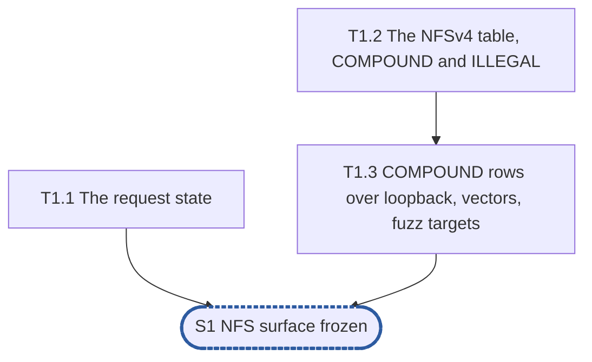

# Epic 1: NFS adapter v2 surface

**Sources:** [RFC 21](../docs/internals/rfcs/rfc-21-nfs.md) §2.1's minor-version rules, §2.3's
paragraph on a session's reply budget in `Request.State`, §5.2's current stateid, §11's paragraph
on decoding a `COMPOUND`, §11.5's paragraphs on `core`'s own refusals, the `COMPOUND` tag and the
fault status, §11.7's request span, and §12's N26 for the operation codes;
[RFC 20](../docs/internals/rfcs/rfc-20-adapters.md) §4.2's needs row, §4.3's compound cap, §4.7's
`Request.State`, `Op`, `Invocation`, `OpTable` and `NewOpTable` as a compound row uses them, §4.8's
NFSv4 row and its `New` example, §5.4's rule that a command without a vector fails its suite, and
§10.1's `protocol` label. Every RFC 20 and RFC 21 citation is `develop`'s text, which holds
amendment A1 and, once this document's pull request merges, RFC 21 §3.1's and §11.5's sentences on
the compound cap of 128 and §2.3's on the session's reply budget, which it adds; they reach
`feat/storage-v2` with the cherry-pick of RFC changes.
Cited, not owned: RFC 8881 and RFC 7530 for the bytes and status values; RFC 20 §2.5's layout of
`ops/`.
**Track:** the team.
**Epic 1 estimate: 3 subtasks, 3.75 man-days.**
**Depends on:** nothing in this programme. It builds on what RFC 20's epics already landed on
`feat/storage-v2`: `core`'s frozen surface and compound runner, and NFS's scaffold, whose
`nfs/protocol` header stage reads a `COMPOUND`'s tag and minor version and whose `nfs.go` builds an
empty NFSv4 table with its `NFS4ERR_MINOR_VERS_MISMATCH` row.
**Blocks:** E2, and through S1 every epic after it. E5, E6, E8, E9, E10 and E12 add members to this
epic's members' table and read or set its request state; E3 adds `core`'s other refusals to its
error tables and the `COMPOUND` row's `Cacheable` and `Needs` columns; E8 grants a session's
`ca_maxoperations` up to the compound cap, refuses a compound past it, and sets the reply budget.

---

## 1. Goal

Epic 1 fixes what the NFSv4 epics on three tracks fill before any of them is built: the request
state a `COMPOUND`'s members share, and the one NFSv4 table, its `COMPOUND` row and the members'
table each NFSv4 operation becomes a row of. Nothing in it calls the service.

**At the end of the epic:**

- every `COMPOUND` the router accepts carries its own `protocol.State`, built with its request in
  one allocation: the current and saved filehandles and stateids, and the session's reply budget,
  empty until a member sets them; no other call carries one;
- `internal/adapter/nfs/ops/v4` exists, with `Handlers`, `Table`, the `COMPOUND` row and the
  members' table every minor version shares, and the `ILLEGAL` row;
- over loopback through `core`, a `COMPOUND` naming an operation code no minor version defines is
  answered `NFS4ERR_OP_ILLEGAL`, one past the compound cap `NFS4ERR_TOO_MANY_OPS` over NFSv4.1 and
  `NFS4ERR_RESOURCE` over NFSv4.0, each with its tag echoed, and the minor-version refusal RFC 20's
  scaffold built still answers as before, as `TestEachRefusalIsAnswered`'s existing case shows;
- `internal/adapter/nfs` holds the check that fails a row of any NFS table no golden vector
  reaches, and `ops/v4` fuzz targets that hold the `COMPOUND` row's decoder to the header parse and
  every generated struct to a round trip.

What an NFSv4 operation is then written against: a `<op>.go` file in `ops/v4` holding its tagged
request and reply structs and its handler, one `core.Row` line in `Table`'s member list with the
minor versions it serves, a golden vector of its arguments and of its reply, and, where it reads or
moves the current filehandle or stateid, `protocol.State` through `r.State`.

### 1.1 In scope

`internal/adapter/nfs/protocol/state.go` and the router's change that sets it; the new package
`internal/adapter/nfs/ops/v4` with its tests, its generated codec and its fuzz targets;
`internal/adapter/nfs/nfs.go` building the NFSv4 table from `v4.Table`; the vector check in
`internal/adapter/nfs`; the generator's list of the structs it generated, for the fuzz targets; the
hand-written golden vectors of this epic's two rows.

### 1.2 Out of scope

- `core`'s other refusals in NFSv4's two tables, `ErrNoFH` as `NFS4ERR_NOFILEHANDLE` among them,
  the status layers and every service error's row: E3 and each handler epic.
- The `COMPOUND` row's `Cacheable` column for the NFSv4.0 duplicate-request cache, and the needs a
  resolved credential sets: E3.
- Reading `SEQUENCE` before dispatch, setting the reply budget, granting `ca_maxoperations` as the
  lesser of the client's ask and the cap and refusing a session's compound past what it granted
  (RFC 21 §3.1), and the runner asking a `READ`'s hook again before it runs (A1, below): E8.
- The wire rows that an NFSv4.1 or NFSv4.2 code sent under an earlier minor version is answered
  `NFS4ERR_OP_ILLEGAL`: a test row in each epic that adds such a code's row (E5, E8, E12), since no
  such row exists here. This epic tests the mapping (`ErrVersion` and `EncodeResult`) at the table.
- `PUTFH`, `SAVEFH`, `RESTOREFH` and the other operations that move the current filehandle, and
  the `NFS4ERR_NOTSUPP` rows of the operations a single node does not serve: E5 and E12. Resolving
  the current stateid an operation quotes: E9.
- The callbacks value and the client record's `Adapter` bytes: E8, their first consumer.
- The six `nfs_*` series and the three `adapter_*` series only NFS code can count: nothing here
  records a metric, as rule 3 has it while who records those series is open with the RFC's author.

### 1.3 Names used here

- **E1**, this epic: the NFS surface.
- **E16**, E2E green: the suites, the end-to-end rows and the totality test of every error table.
- **E2**, epic 2, test foundations: NFS's cases on the handler runner both adapters share, knfsd's captures cut into golden files,
  and the service's `NoGrace`.
- **E3**, the RPC layer: credentials, `NULL`, TLS, `core`'s refusals in every table, the `Replay`
  stage and the scripted client.
- **E5**, the NFSv4 namespace, attributes and data path, which adds the filehandle operations and
  `READ`.
- **E6**, the NFSv4 ACL attributes. **E8**, clients and sessions, which owns `SEQUENCE`.
- **E9**, opens, stateids and locks. **E10**, delegations and the back channel.
- **E12**, the NFSv4.2 operations.
- **A1**, an amendment to RFC 20 §4.3 and §4.7, agreed in #5166: the compound runner asks a
  member's `Bound` hook again just before the member runs.
- **S1**, the NFS surface frozen: this epic's exports compile, with its loopback rows, and stop
  changing.

## 2. How the general rules apply

The rules are those of [the RFC 21 implementation plan's §1.5](rfc-21-nfs-plan.md#15-general-rules-for-each-epic),
cited by number and title and not copied.

| Rule | Subtasks | How |
| --- | --- | --- |
| rule 1, independent unit tests, under `-race` ([`CLAUDE.md`, "Writing tests"](../CLAUDE.md#writing-tests)) | all | the state and the tables are tested as pure values and through `core`'s real pipeline over loopback, on `vfstest.Null` where a server needs a service, since nothing here calls one; no test double |
| rule 2, fuzz tests where relevant | T1.3 | the `COMPOUND` row's decoder and `ILLEGAL`'s read a peer's bytes: T1.3's `FuzzCompound` holds the first to the header parse as an independent decoder, and `FuzzCodec` round-trips every struct the generator wrote for `ops/v4`, seeded with the vectors (R22) |
| rule 3, observability follows RFC 25 and RFC 20 §10 | T1.2, T1.3 | no recorder in NFS code; the NFSv4 table is labelled `nfs4` and its rows named `COMPOUND` and `ILLEGAL`, which `core` turns into RFC 21 §11.7's span names, as `core`'s `TestEachMemberHasASpan` checks for any compound row, and, lower-cased, the `op` label, checked over loopback (R21) |
| rule 4, profiling: leaks, allocations and contention | T1.1, T1.3 | the router still allocates once per call, a `COMPOUND`'s state included (D3); every loopback test ends with `adaptertest.CheckLeaks`; no registry, table or timer here, so no mutex profile |
| rule 5, public interface and internals, at the layer that consumes a value ([`CLAUDE.md`, "Verifying a change"](../CLAUDE.md#verifying-a-change)) | T1.1, T1.3 | the cap and `ILLEGAL` are asserted on the reply bytes a client reads over loopback; the state's filehandle on the `Request.Level` `core`'s needs check reads |
| rule 6, known failures shrink | none | no `pynfs`, `cthon04` or `nfstest` test runs before the cutover, and nothing here is listed in a `known.yaml` |
| rule 7, v2 ignores v1 | all | nothing from `develop`'s `v4` package; the cap's value is decided in §4, not copied |
| rule 8, real dependencies for properties of those dependencies | T1.3 | golden vectors written by hand from RFC 8881's and RFC 7530's XDR, never from the encoder under test; real TCP over loopback through `core` |
| rule 9, code comment conventions ([`CLAUDE.md`, "Code comments"](../CLAUDE.md#code-comments)) | T1.1, T1.2 | `decision:` markers for D2, D3, D4, D5 and D6 at their code sites; `nfs.go`'s marker on its empty tables rewritten to name the four tables still empty |
| rule 10, a test must be able to fail | all | each test names the break it catches; none asserts a stub's answer |
| rule 11, a symbol is exported only if an interface uses it | T1.1, T1.2 | exported: `protocol.State`, `Current`, `Stateid` and `SetFH` for `ops/v4`; `v4.Handlers` and `v4.Table` for `nfs.go`. Everything else in `ops/v4` is unexported. Frozen at S1 |
| rule 12, each subtask creates only what it declares | all | `ops/v4` arrives with its first rows; no operation file, translation or callback before the epic that calls it; each export names its consumer |
| rule 13, translate, never decide | T1.2 | no handler here calls the service; the operation-code mapping is a pure, total function (R17) |
| rule 14, nothing deferred is lost | all | §1.2 names the owner of each part of an obligation this epic leaves out |

## 3. Requirements and invariants

Every MUST and MUST NOT that RFC 21 and RFC 20 place on this epic, numbered so that subtasks and
tests can cite them.

**The request state**

| # | Requirement | Kind | Source | Subtasks |
| --- | --- | --- | --- | --- |
| R1 | The router sets `Request.State` for an NFSv4 `COMPOUND`: NFS's session, as the reply budget its `SEQUENCE` resolved (R4), and current filehandle, which `core` carries from member to member and never reads | MUST | RFC 20 §4.7 (`Request`) | T1.1 |
| R2 | The state holds the current filehandle, which an operation's needs column is checked against through the request's `Level` | MUST | RFC 20 §4.2 (needs), §4.7 (`Needs`, `NeedsFH`, `ErrNoFH`) | T1.1 |
| R3 | The state holds the NFSv4.1 current stateid, so it is resolved inside the compound: the one the previous operation returned. This epic holds it; E9 resolves it | MUST | RFC 21 §5.2 | T1.1 |
| R4 | The state holds the reply budget the compound's own `SEQUENCE` copies from its session, which a `READ`'s or `READ_PLUS`'s `Bound` hook reads to keep the reply within `ca_maxresponsesize`. This epic holds it; E8 sets it, and E5 and E12 read it | MUST | RFC 21 §2.3; RFC 20 §4.7 (`Invocation.Bound`) | T1.1 |
| R5 | The minor version is the client's choice per `COMPOUND`: nothing remembers one per client or per connection | MUST NOT | RFC 21 §2.1 | T1.1, T1.3 |

**The `COMPOUND` row and the members' table**

| # | Requirement | Kind | Source | Subtasks |
| --- | --- | --- | --- | --- |
| R6 | One table for program 100003 version 4, every minor version; the `COMPOUND`'s minor version selects each row's `Versions` column | MUST | RFC 20 §4.8 | T1.2 |
| R7 | `COMPOUND` is a compound row: its own `Decode` reads the tag, the minor version and the count, sets `Invocation.Count` and returns the bytes it took; its members are decoded one by one, each by its own row's decoder, through `Op.Members` | MUST | RFC 21 §11; RFC 20 §4.7 | T1.2 |
| R8 | The tag is echoed whole in every reply that carries the compound's status, a refusal's included; an accept state other than success, or a denied reply, carries none | SHOULD | RFC 21 §11.5 (the `COMPOUND` tag) | T1.2, T1.3 |
| R9 | `EncodeHead`'s size does not depend on the status or the count it writes; already enforced by `core`, which closes the connection on a head rewritten at another size, so T1.3's loopback case with a result fails | MUST NOT | RFC 20 §4.7 (`Invocation.EncodeHead`) | T1.2, T1.3 |
| R10 | The tag has no cap of its own: only the record bounds it, and no reservation grows with it | invariant | RFC 21 §11.5 (the `COMPOUND` tag) | T1.2 |
| R11 | A member whose arguments do not decode is `NFS4ERR_BADXDR`; a `COMPOUND` whose own arguments do not is `GARBAGE_ARGS` | MUST | RFC 21 §11, §11.5 (`ErrDecode`) | T1.2, T1.3 |
| R12 | The compound row carries `MaxMembers`, and its members' table a `ReadOp` and an `EncodeResult`; the table holding it maps `ErrTooLong` and `ErrReplyTooBig` in rows naming neither operations nor versions | MUST | RFC 20 §4.7 (`Op.MaxMembers`, `NewOpTable`) | T1.2 |
| R13 | A `COMPOUND` past the compound cap of 128 operations is refused before any of its operations runs: `ErrTooLong`, answered `NFS4ERR_TOO_MANY_OPS`, and `NFS4ERR_RESOURCE` over NFSv4.0, which has no such status | MUST | RFC 20 §4.3; RFC 21 §11.5 (`ErrTooLong`, the compound cap) | T1.2, T1.3 |
| R14 | `ErrReplyTooBig` is answered `NFS4ERR_REP_TOO_BIG`, and `NFS4ERR_RESOURCE` over NFSv4.0 | MUST | RFC 21 §11.5 (`ErrReplyTooBig`) | T1.2 |
| R15 | An operation code the minor version does not define, an NFSv4.1 code sent under NFSv4.0 included, is answered `NFS4ERR_OP_ILLEGAL` | MUST | RFC 21 §11.5 (`core`'s own refusals) | T1.2, T1.3 |
| R16 | A `COMPOUND` whose minor version is outside the range is answered `NFS4ERR_MINOR_VERS_MISMATCH`, its tag echoed, no results, no operation run; the row RFC 20's scaffold built keeps answering it once it moves to this epic's table, which the scaffold's loopback test of a minor version 3 already asserts (T1.2 names it) | MUST | RFC 21 §2.1, §11.5 (`ErrVersion`) | T1.2 |
| R17 | The operation-code mapping is total and pure: every code reaches one row or the `ILLEGAL` row, never a default | invariant | RFC 21 §11, §12 (N26) | T1.2 |
| R18 | The fault status is `NFS4ERR_SERVERFAULT` in NFSv4's table and in its members' table | MUST | RFC 21 §11.5 (the fault status) | T1.2 |
| R19 | An operation the minor version defines and the adapter does not serve is `ErrNotSupported`, answered `NFS4ERR_NOTSUPP` in the members' table, and a procedure NFSv4's table lacks `PROC_UNAVAIL` | MUST | RFC 21 §11.5 (`core`'s own refusals) | T1.2, T1.3 |

**Tests, vectors and names**

| # | Requirement | Kind | Source | Subtasks |
| --- | --- | --- | --- | --- |
| R20 | A row added to an NFS table without a golden vector in the protocol's suite fails the suite; vectors come from the specifications or the reference captures, never only from the codec under test | MUST | RFC 20 §5.4 | T1.3 |
| R21 | A `COMPOUND`'s request records under the `nfs4` label, its span `adapter.nfs4.COMPOUND` with one child per operation named by its row; no label names a share, a client or a file | MUST | RFC 21 §11.7; RFC 20 §10.1 (`protocol`, `op`) | T1.2, T1.3 |
| R22 | Every decoder of a peer's bytes is fuzzed: no panic, every read inside the buffer, and a decoded value that matches an independent decoder or re-encodes to bytes that decode to the same value | MUST | RFC 20 §5.4; RFC 21 §11.6 | T1.3 |

Not obligations of this epic: RFC 21 §11's sentence that the `Identity` and `r.Call` are built by
the pipeline once per member (E3); §11.5's `ErrNotSupported`, `ErrNoFH`, drain and session rows (E3,
and E8 for the session's); §2.3's clamp of a `READ` (E5) and a session's budget (E8).

## 4. Decisions this epic takes

- **D1. One NFSv4 table and one members' table, built here, each operation a row of it.** Six
  epics on three tracks add members, so the `COMPOUND` row's decode, head and members' table are
  settled once, at S1, and a member is one `core.Row` line in `Table`'s list naming its minor
  versions. Changing the shape after S1 would touch every NFSv4 epic's rows. Prior art: knfsd's one
  `nfsd4_ops` table for every minor version (from memory). No marker: it is the layout RFC 20 §4.8
  gives.
- **D2. What the state holds, and what it leaves to the request.** `protocol.State` holds the
  current pair and SAVEFH's copy, each a filehandle and a stateid with a flag saying the stateid is
  set, and the session's reply budget, `MaxReply` and `MaxCached` (`ca_maxresponsesize`, and
  `ca_maxresponsesize_cached` where `sa_cachethis` is set), zero until a `SEQUENCE` runs. It holds
  no minor version, which is the request's `Version` per compound (R5), and no session: the router
  builds `r.Call.Session` from the session a `SEQUENCE` names, as RFC 20 §4.4 has it, once E8's
  header codec reads that `SEQUENCE` before dispatch, and E8's members reach the adapter's own
  session through its registry by that reference. A stateid is
  held in its wire form, `Stateid`, a struct with `stateid4`'s two fields that `ops/v4`'s tagged
  `stateid4` converts to and from, since the generator reads no type of another package; E9
  decodes it with the codec it uses for an explicit stateid, so the current stateid takes the same
  path. A filehandle may alias the request's record, which `core` retains for the request's life.
  `SetFH` is the one way a member sets the current filehandle: it raises `NeedsFH` in
  `r.Level` and leaves the current stateid unset, as RFC 8881 does after an operation that changes
  the filehandle without returning a stateid (from memory, RFC 8881 §16.2.3.1.2); `SAVEFH` and
  `RESTOREFH` copy the pair whole, stateid included (from memory, the same section). Changing a
  field after S1 costs every NFSv4 epic's handlers. The state has no session field, as the user
  decided: E8 pays one registry lookup, under its lock, per member that needs the session, and no
  placeholder type is declared ahead of its epic. RFC 21 §2.3, as this document's pull request
  amends it, says the same: the hook reads the budget the compound's own `SEQUENCE` copies from its
  session into `Request.State`, not the session. This reads RFC 20 §4.7's comment that
  `Request.State` holds "NFS's session" as the session's budget; RFC 20 is left as it is, since the
  comment describes rather than binds, and the RFC 21 implementation plan's §1.3 says the same.
  A `decision:` marker at `State`.
- **D3. The request and its state in one allocation.** The router allocates a `COMPOUND`'s
  `core.Request` and its `State` together, as one struct holding both, so `Route` keeps its one
  allocation per call; every other call carries no state. Prior art: none found. A `decision:`
  marker at `Route`, overturned if `core` ever releases a request before its compound's members
  finish with the state.
- **D4. The compound cap is 128 operations.** RFC 20 §4.3 leaves the cap to the protocol RFC,
  and `feat/storage-v2`'s RFC 21 named none, so the user chose 128 over 50 and 200 and this branch
  adds it to RFC 21 §11.5, with §3.1's rule that a session's `ca_maxoperations` is the lesser of the
  client's ask and the cap. 128 is above every compound a supported client was seen to send and is
  what `develop`'s server answered (RFC 20 Appendix B, and `develop`'s `negotiateChannelAttrs`
  grants the same lesser value); knfsd's limit was 50 and later 200 (from memory). `MaxMembers`
  enforces only the cap; a session granted fewer is refused by E8 at `SEQUENCE`. A `decision:`
  marker at the constant names the ceiling: a client that sends more is refused whole.
- **D5. `ILLEGAL` takes every byte after an undefined operation code.** An undefined code's
  arguments cannot be known, so `ILLEGAL`'s decoder consumes what is left of the compound; the
  members before it run, `ILLEGAL` fails, and the compound is answered `NFS4ERR_OP_ILLEGAL` there,
  rather than refused whole as `GARBAGE_ARGS` for the bytes after it. Prior art: knfsd stops
  decoding a compound at an illegal operation and answers it (from memory, `nfsd4_decode_compound`).
  A `decision:` marker at `ILLEGAL`'s decoder, overturned if a client is seen relying on
  `GARBAGE_ARGS` there.
- **D6. How a code reaches `ILLEGAL`.** `ReadOp` reads no minor version (RFC 20 §4.7's signature),
  so it turns a code no minor version defines (below 3, or above `REMOVEXATTR`'s 75, but
  `OP_ILLEGAL` itself) into `OP_ILLEGAL`'s code, and a code a minor version defines reaches its
  row, whose `Versions` refuses it under another minor version with `ErrVersion`; the members'
  table maps that to `NFS4ERR_OP_ILLEGAL`, and its `EncodeResult` writes `OP_ILLEGAL` as the
  result's operation for that status, so the client reads `ILLEGAL`'s result either way; it also
  writes `OP_ILLEGAL` for a code no minor version defines, the 0 `core` passes for a member whose
  code it could not read among them, so a result never names an operation that does not exist. A code
  a minor version defines and no row holds yet is `ErrNotSupported`, answered `NFS4ERR_NOTSUPP`
  (R19), also under a minor version that lacks the code, until the operation's own row lands with
  its `Versions` (E5, E8, E12). Prior art: knfsd turns an out-of-range code into
  `OP_ILLEGAL` with its minor-version range check (from memory). A `decision:` marker at
  `ReadOp`.
- **D7. The two rows' codecs.** The `COMPOUND` row's `Decode` and `ILLEGAL`'s arguments are written
  by hand, since a compound row builds its `Invocation` itself to set `Count` (RFC 20 §4.7) and
  `ILLEGAL`'s arguments have no layout; `ILLEGAL`'s reply, a status alone, is generated by the
  package's `codec_gen.go`, as every later operation's is. Prior art: RFC 20 §4.7's compound row.
- **D8. One golden-file convention, and the vector check that reads it.** Every NFS golden file,
  written by hand or cut from knfsd, is one whole RPC message, the record mark stripped, in
  `wire/testdata/golden`, named `<source>-<label>-<what>-{call,reply}.hex`: `<source>` is `rfc`
  for one written from a specification and `knfsd` for one cut from a capture, `<label>` the
  table's (`nfs3`, `nfs4`), `<what>` free text; the scaffold's existing files keep their names.
  The check lives in `internal/adapter/nfs`, the one package that imports every table, where
  RFC 20 §5.4 puts the suite "in its `wire/`" only for files, since `wire` cannot import the
  `ops` packages: it strips each call's RPC header with `wire.ParseCall`, routes it to its table,
  decodes a `COMPOUND`'s members through the members' table, and fails for every row of every
  table that no file reaches, naming it. File names are not read, so a capture counts as a
  vector the moment it is cut. The reply files are compared by each row's handler test, since only
  a handler makes a reply. Prior art: RFC 20 §5.4. A `decision:` marker at the check names why it
  is not in `wire/`.
- **D9. Each table's codec is fuzzed in its own `ops` package.** RFC 20 §5.4's target picks a
  command and checks its decode against a re-encode. `wire` cannot import `ops`, so the generator,
  which already writes `codec_gen.go`, also writes a `codec_types_gen_test.go` listing every struct
  it generated, and each `ops` package's `FuzzCodec` round-trips the one its input picks; the
  generator's runtime keeps its own target against a second decoder in `wire`. The `COMPOUND`
  row's hand-written decoder has its own target against the header parse, an independent
  decoder. Prior art: `wire`'s `FuzzCodec`. A `decision:` marker at the generator's list.

## 5. Target tree

```text
internal/adapter/nfs/
  nfs.go                       T1.2  the NFSv4 table from v4.Table; its empty table and two constants removed
  nfs_test.go                  T1.2, T1.3  new cases of TestEachTableMapsCoresRefusals and TestEachRefusalIsAnswered
  rows_test.go                 T1.3  every row is reached by a golden file (D8)
  protocol/
    state.go                   T1.1  State, Current, Stateid, SetFH
    state_test.go              T1.1
    stages.go                  T1.1  Route sets State on a COMPOUND
  ops/v4/
    handlers.go                T1.2  Handlers
    table.go                   T1.2  Table, the members' table, ReadOp, EncodeResult, the cap
    errors.go                  T1.2  the two error tables and the nfsstat4 values they answer
    compound.go                T1.2  the COMPOUND row: Decode, and EncodeHead over wire.AppendCompoundStatus
    illegal.go                 T1.2  ILLEGAL's arguments, reply and handler
    codec_gen.go               T1.2  generated
    codec_types_gen_test.go    T1.3  generated: the structs FuzzCodec round-trips (D9)
    v4_test.go                 T1.2  ReadOp, EncodeResult, the COMPOUND row's decoder
    fuzz_test.go               T1.3  FuzzCompound, FuzzCodec
  wire/gen/                    T1.3  writes codec_types_gen_test.go beside codec_gen.go
  wire/testdata/golden/
    rfc-nfs4-*.hex             T1.3  hand-written from RFC 8881 and RFC 7530 (D8)
```

## 6. Subtasks

### T1.1 The request state

**Subtask T1.1 estimate: 1 man-days.**

- **Track:** the team. **Depends on:** none.
- **Covers:** R1, R2, R3, R4, R5.
- **Deliverables:** `nfs/protocol/state.go`:
  ```go
  // State is one COMPOUND's state, which its members read and set in turn.
  type State struct {
  	Cur, Saved Current // the current filehandle and stateid, and SAVEFH's copy
  	MaxReply   int     // the session's ca_maxresponsesize, set by SEQUENCE; 0: no SEQUENCE ran
  	MaxCached  int     // its ca_maxresponsesize_cached where sa_cachethis is set; 0: not cached
  }
  type Current struct {
  	FH         vfs.Handle // nil: none
  	Stateid    Stateid
  	HasStateid bool
  }
  type Stateid struct { // stateid4; ops/v4's tagged stateid4 converts to it
  	Seqid uint32
  	Other [12]byte
  }
  func SetFH(r *core.Request, fh vfs.Handle)
  ```
  `Route` in `stages.go` builds a `COMPOUND`'s request and state in one allocation (D3). Consumed
  by E5 (the filehandle operations, `READ`'s hook), E8 (`SEQUENCE`), E9 (stateids) and E12.
- **Acceptance criteria:**
  - Each `COMPOUND` routed gets a new, empty state; `NULL` of version 4, and every NFSv3, MOUNT,
    NLM and NSM call, gets none.
  - `SetFH` sets the current filehandle, clears `HasStateid` and raises `NeedsFH` in `r.Level`,
    leaving its other bits.
  - `Route` still allocates once per call.
- **Tests:** at `Route`, which `core` calls: two `COMPOUND`s routed on one stage, the first's state
  changed, the second's still empty (catches a state kept per connection, R5); a `NULL` with no
  state (catches a state on every call). The minor version per request is already held by
  `TestTheHeaderVersions`. `TestHeaderStageAllocs` extended to a `COMPOUND`, still one allocation
  (catches a second one, D3). At `SetFH`, whose `Level` `core`'s needs check reads: the bit raised
  from `NeedsSession` without lowering it, and the stateid unset (catches an `r.Level`
  overwritten, R2, or a stale current stateid, R3). No test double.
- **Rules:** rule 11's exports listed above; rule 9's `decision:` markers for D2 and D3.

### T1.2 The NFSv4 table, its `COMPOUND` row and `ILLEGAL`

**Subtask T1.2 estimate: 1.5 man-days.**

- **Track:** the team. **Depends on:** none.
- **Covers:** R6, R7, R8, R9, R10, R11, R12, R13, R14, R15, R16, R17, R18, R19, R21.
- **Deliverables:** the package `internal/adapter/nfs/ops/v4`:
  ```go
  type Handlers struct{ VFS vfs.Service }
  func Table(h *Handlers) *core.OpTable
  ```
  `Table` returns the table labelled `nfs4` holding the `COMPOUND` row (procedure 1, named
  `COMPOUND`, `Versions` 0 to 2, `MaxMembers` 128 by D4, `Needs` nothing) and the members' table
  with `ILLEGAL` (code 10044, named `ILLEGAL`, `Versions` 0 to 2), `ReadOp` and `EncodeResult`
  (D6). `errors.go`: the table's rows, `ErrDecode` `GARBAGE_ARGS`, `ErrNotSupported`
  `PROC_UNAVAIL`, `ErrVersion` `NFS4ERR_MINOR_VERS_MISMATCH`, `ErrTooLong` `NFS4ERR_TOO_MANY_OPS`
  and `ErrReplyTooBig` `NFS4ERR_REP_TOO_BIG`, each of these two with an NFSv4.0 row answering
  `NFS4ERR_RESOURCE`, fault `NFS4ERR_SERVERFAULT`; the members' table's rows, `ErrDecode`
  `NFS4ERR_BADXDR`, `ErrNotSupported` `NFS4ERR_NOTSUPP`, `ErrVersion` and `ILLEGAL`'s error
  `NFS4ERR_OP_ILLEGAL`, fault `NFS4ERR_SERVERFAULT`. `compound.go`: `Decode` reading the tag
  (bounded by the bytes left alone), the minor version and the count, and `EncodeHead` as
  `wire.AppendCompoundStatus`, which the header stage already writes a refusal with and which
  `compound-two-results.hex` and `compound-minor-mismatch.hex` pin. `illegal.go`: `ILLEGAL`'s
  decoder taking every byte left (D5), its handler returning its error, its generated void reply.
  `nfs.go` builds `V4` as `v4.Table(&v4.Handlers{VFS: d.VFS})` and drops its two NFSv4 constants.
  Consumed by `nfs.go`, T1.3, and every NFSv4 epic's rows (E5, E6, E8, E9, E10, E12).
- **Acceptance criteria:**
  - `core.NewOpTable` accepts both tables (R12) and `core.NewServer` both labels and names (R21).
  - Every operation code maps to a row or to `ILLEGAL` (R17); codes 0, 1, 2, 76 and 2^32−1 reach
    `ILLEGAL`; 3 to 75 their own code.
  - `ErrTooLong` and `ErrReplyTooBig` map to the NFSv4.0 status at minor version 0 and to the
    NFSv4.1 status at 1 and 2.
- **Tests:** new cases of `nfs_test.go`'s `TestEachTableMapsCoresRefusals`, at the tables `core`
  maps through, extended to a minor version and to the members' table: each row by error and minor
  version (catches a 4.0 row that does not win, R13, R14, a `GARBAGE_ARGS` in the members' table,
  R11, a fault other than `NFS4ERR_SERVERFAULT`, R18, a missing `NFS4ERR_NOTSUPP`, R19, and
  `ErrVersion` not answered `NFS4ERR_OP_ILLEGAL`, R15). In `v4_test.go`: at `ReadOp`, a property
  test that every 32-bit code reads as itself or as `OP_ILLEGAL` and every defined one as itself
  (catches a default, R17); at `EncodeResult`, `OP_ILLEGAL` written for an `NFS4ERR_OP_ILLEGAL`
  status whatever the code (R15); at the `COMPOUND` row's decoder, `nfsv4-compound-call.hex`'s and
  `nfsv4-compound-short-tag.hex`'s arguments decoding to their tag, minor version and count, a tag
  running past the bytes refused, and a tag of 64 KiB accepted (catches a cap of its own, R10). No
  test double. R16 stays held by `TestEachRefusalIsAnswered`'s existing case of a minor version 3,
  which fails if the moved row stops answering it.
- **Rules:** rule 9's `decision:` markers for D4, D5 and D6, and `nfs.go`'s marker rewritten; the
  `nfsstat4` values commented with their RFC 7530 §13 and RFC 8881 §15 sources; rule 7: the codes
  and statuses from the RFCs, none from `develop`.

### T1.3 The `COMPOUND` rows over loopback, the vector check and the fuzz targets

**Subtask T1.3 estimate: 1.25 man-days.**

- **Track:** the team. **Depends on:** T1.2.
- **Covers:** R5, R8, R9, R11, R13, R15, R19, R20, R21, R22.
- **Deliverables:** new cases of `nfs_test.go`'s `TestEachRefusalIsAnswered`; `rows_test.go`'s
  vector check (D8); the generator's `codec_types_gen_test.go` and `ops/v4`'s `FuzzCodec` and
  `FuzzCompound` (D9); the golden files of this epic's cases, written by hand from RFC 8881 and
  RFC 7530 under D8's names. Consumed by every epic that adds a row, which adds the files that
  reach it, and by every later `ops` package, whose generated list `FuzzCodec` reads.
- **Acceptance criteria:**
  - Over loopback through `core`, in `TestEachRefusalIsAnswered`: a `COMPOUND` of no operation
    answered `NFS4_OK` with its tag and no result; one counting two members whose first is code
    9999 followed by eight bytes, answered `NFS4ERR_OP_ILLEGAL` as its only result, under
    `OP_ILLEGAL`, its tag echoed; the same counting 128 operations, the cap itself, answered at its
    first member, `NFS4ERR_OP_ILLEGAL`, not `NFS4ERR_TOO_MANY_OPS`; one of 129 operations answered
    `NFS4ERR_TOO_MANY_OPS` at minor version 1 and `NFS4ERR_RESOURCE` at 0, one after the other on
    the connection, with its tag and no result; one whose count runs past its bytes answered
    `NFS4ERR_BADXDR` there; one naming `READ`, code 25, which no row holds yet, answered
    `NFS4ERR_NOTSUPP`; one cut after its minor version, before its count, answered `GARBAGE_ARGS`
    by the `COMPOUND` row's decoder. Each counts under `nfs4`.
  - A row no golden file reaches fails the check, naming it.
  - `FuzzCompound`: for any call `wire.ParseCall` accepts, the row's decoder takes no more than the
    arguments and, where it decodes, the tag `EncodeHead` echoes is `wire.Call.Tag`'s, and the
    count the word after `MinorVersion`; `ILLEGAL`'s decoder takes exactly the bytes it is
    handed. `FuzzCodec`: a struct its input picks decodes within the
    bytes and re-encodes to bytes that decode to the same value.
- **Tests:** the loopback cases above, against their hand-written reply files, in a test that
  already starts with `adaptertest.CheckLeaks` (catch a tag dropped from a refusal, R8, a head
  rewritten at another size, R9, a cap of 127 or 129, or answered per minor version wrongly, R13,
  an undefined code answered `NFS4ERR_NOTSUPP` or `GARBAGE_ARGS`, R15, R11, a defined code with
  no row answered the fault, R19, a version remembered from the call before, R5, and a refusal
  counted under `nfs3`, R21); the vector check run once against a table built in the test with a
  row no file reaches (catches a check that passes vacuously, R20); the two fuzz targets, seeded
  with every golden file (R22). No test double: `vfstest.Null` is the service `New` needs.
- **Rules:** rule 2 and rule 8: the fuzz targets and the vectors by hand from the RFCs; rule 9's
  `decision:` markers for D8 and D9.

## 7. Order of work



T1.1 and T1.2 are independent and each a blocker: E5, E8, E9 and E12 read the state, and every
NFSv4 epic writes rows into the table. Checkpoint after T1.3: S1, the surface frozen, which E2's
handler cases build on.

## 8. Suggested pull requests

| PR | Subtasks | Man-days | After | Why together |
| --- | --- | --- | --- | --- |
| 1 | T1.1, T1.2, T1.3 | 3.75 | — | the NFSv4 surface whole: the state, the table and its two rows, answered over loopback, frozen as S1 |

A suggestion only: one pull request per subtask works as well, T1.1 and T1.2 at once.

## 9. Open points

None. A defined code with no row is answered `NFS4ERR_NOTSUPP`, also under a minor version lacking
it, until its own row lands (D6); each epic adding an NFSv4.1 or NFSv4.2 code's row (E5, E8, E12)
owns the wire row that the code is answered `NFS4ERR_OP_ILLEGAL` under an earlier minor version, as
§1.2 says, and E16's totality test checks the end state. A1, agreed in
[#5166](https://github.com/cubbit/dittofs/issues/5166), lets a `READ`'s hook read `MaxReply`; E5
and E8 read it.
