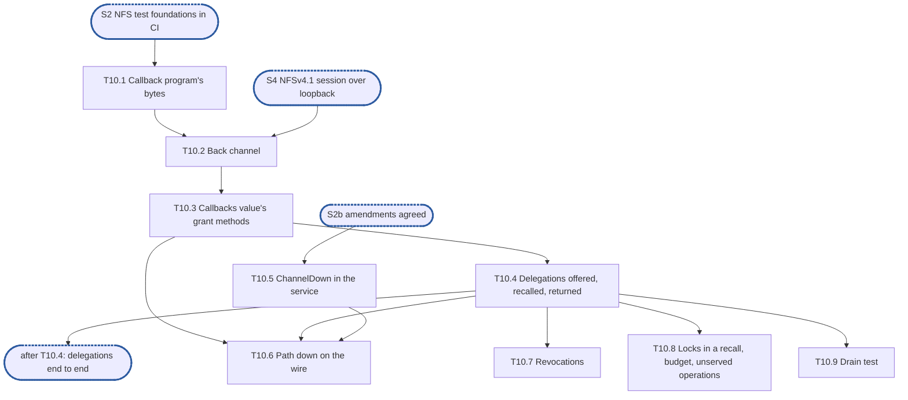

# Epic 10: NFS adapter v2 delegations and the back channel

**Sources:** [RFC 21](../docs/internals/rfcs/rfc-21-nfs.md) §3.1's back-channel slot count,
§3.4's callbacks, security and path down, §5.1's administrator's revoke, §5.2's rule 3 for a
delegation's `seqid` and rule 6, §5.3, §11.4's grant, `AckRecall` and `Reach.Down` rows and its
paragraph on the `OPEN4_SHARE_ACCESS_WANT_*` flags, §11.5's `ErrState` (`NoRecall`) row and "What
runs while draining" for `DELEGRETURN`, §11.6's golden vectors for the delegation types, its single
codec suite for the callback program and its drain test, §12's N6 and N14 on one node and N24's
revoke clause, §13's "§3.4 path down", "§5.3 no v4.0 delegations", "§5.3 revoked delegation *(1
node)*", "§5.2 delegation stateid", "§5.2 stateids *(1 node)*"'s recall-timeout step and "§5.1
administrator's revoke *(1 node)*", and Appendix D's `DELEGRETURN`, `WANT_DELEGATION` and
`GET_DIR_DELEGATION` rows;
[RFC 20](../docs/internals/rfcs/rfc-20-adapters.md) §3.3's NFS callbacks, §4.7's `Conn.Send`,
`Conn.Keep` and `RoleRelease` as `DELEGRETURN` and the drain use them;
[RFC 17](../docs/internals/rfcs/rfc-17-vfs.md) §3.1's `ChannelDown` and §3.2's back-channel and
callback rules, with their §8 row, for the service's half of amendment A2;
[RFC 14](../docs/internals/rfcs/rfc-14-open-state.md) §5.1, §5.4 and §5.5 for what a delegation is
and when one is offered or asked back;
[RFC 24](../docs/internals/rfcs/rfc-24-resources.md) §5.1's "callbacks to clients" row and §6.1 for
a pending callback. Every citation is `develop`'s text, which holds amendment A2 and reaches
`feat/storage-v2` with the cherry-pick of RFC changes.
Cited, not owned: RFC 8881 §20 for the callback program's bytes, §18.16 for `open_delegation4`,
§18.39 for `GET_DIR_DELEGATION`; RFC 5531 for the RPC reply; RFC 20 §2.5's layout of `ops/cb`.
**Track:** A.
**Epic 10 estimate: 9 subtasks, 23.5 man-days.**
**Depends on:** **S2**, NFS's test foundations in CI: E1's request state and members' table (T1.1,
T1.2), E2's `nfsharness` (T2.2) and knfsd's `nfs41/` delegation capture with its `CB_RECALL` (T2.3).
**S4**, an NFSv4.1 session over loopback, for every loopback row. **S2b**, met: amendment A2 is in
RFC 17. Beyond them, pieces of epics broken down beside this one, each named in the subtask that
takes it and listed as assumptions in §9: **E3**'s scripted client with its call encoder and reply
decoder (T3.2, its D11) and its drain rows (T3.4); **E8**'s callbacks value and `Handlers` field,
its session registry with each session's back-channel connections, callback program, security and
slot count, and its `SEQUENCE` flags from `ClientStatus`; **E9**'s `OPEN`, its stateid codec and
rules, `TEST_STATEID`, `FREE_STATEID`, `LOCK` and `LOCKT`, and the `ErrState` (`Revoked`) row;
**E5**'s `READ`, `WRITE` and `SETATTR`, its not-supported handler (T5.8) and its `ErrDelay` row.
**Blocks:** E16, whose suites, end-to-end rows and the "§5.3 lock recall" and "§5.3 handle-cached
deny mode" rows run over this epic's delegations.

---

## 1. Goal

Epic 10 makes the server call the client. It builds the NFSv4.1 back channel: `CB_COMPOUND` sent on a
connection the client bound for it, `CB_SEQUENCE`'s slots, the replies the client sends back on the
fore connection. Over it, the callbacks value's grant methods recall delegations and ask for
some back. It offers read and write delegations with `OPEN`, takes them back through `DELEGRETURN`,
answers what was revoked, marks the back channel down when its connection goes, with the service's
half of amendment A2 that clears it again, and runs the drain test against Linux's compounds once
every operation it names exists.

**At the end of the epic:**

- over loopback, an NFSv4.1 client that opens a file alone is offered a read or write delegation as
  its `OPEN4_SHARE_ACCESS_WANT_*` flags allow; a second client's conflicting open is answered
  `NFS4ERR_DELAY` and the first receives `CB_RECALL` on its back channel; its `DELEGRETURN` lets the
  second's retry through;
- an NFSv4.0 client is offered none, and nothing dials its callback address;
- a recall left unanswered past its deadline is `NFS4ERR_DELEG_REVOKED` on the delegation's
  stateid, flagged on `SEQUENCE` until freed; an administrator's revoke keeps the client's session;
- when the back channel's last connection closes, the next `SEQUENCE` carries
  `SEQ4_STATUS_CB_PATH_DOWN` and no delegation is offered, until the client binds a back channel
  again;
- a node stopping answers Linux's compounds as RFC 21 §11.6 says: releases and context run whole,
  everything else no reply, and a compound begun before the drain runs whole.

### 1.1 In scope

`ops/cb`, the callback program's generated structs; the call encoder and reply decoder in `wire`,
moved there from `nfsclient`; `protocol`'s back channel and the router's hand-off of a reply to it;
the callbacks value's `RecallGrant`, `RecallAny`, `Notify` and `LockWaitOver` for an NFSv4 client and
`Revoked` for a grant and an administrator's revoke; `OPEN`'s delegation half, `DELEGRETURN`,
`GET_DIR_DELEGATION` and `WANT_DELEGATION`'s rows; I/O under a delegation stateid; `ChannelDown` in
`pkg/vfs`, `internal/vfs` and `vfstest`, and `Connect` clearing `Reach.Down`; `SEQUENCE`'s
`SEQ4_STATUS_CB_PATH_DOWN`; `memory.New`'s clock and an administrator's revoke for tests; the
loopback and handler rows named in §3, and the drain test.

### 1.2 Out of scope

- `CREATE_SESSION`'s and `BIND_CONN_TO_SESSION`'s binding of a back channel, its security choice
  among `csa_sec_parms` and its slot count, `BACKCHANNEL_CTL`, and the re-registration through
  `Connect`: E8. This epic sends on what E8 records.
- `OPEN` itself, its claim types (`CLAIM_DELEGATE_CUR` and `CLAIM_DELEG_CUR_FH` among them), the
  stateid codec and rules 1 to 5, `TEST_STATEID`, `FREE_STATEID`, `FreeState` on an NFSv4.0 client's
  behalf, the `ErrState` (`Revoked`) row, and the per-request drain roles of `WRITE`, `LOCK` and
  `OPEN`: E9. `SEQUENCE`'s revoked-state flags from `ClientStatus`: E8.
- The fence after a missed recall, the grant budget's count and when a grant is offered: the
  service's (RFC 14 §5.3 to §5.5), held by open state's own suite.
- §13's "§5.3 lock recall" with NLM and SMB, "§5.3 handle-cached deny mode", and "§5.2 delegation
  stateid" under Kerberos at `e2e/kerberos`: E16. This epic runs the last at the handler with two
  proven principals (T10.4).
- "§3.4 callback routing", `Rebind` on another node, and a drain naming another gateway, whose
  `WRITE` gets `NFS4ERR_MOVED`: the RFC 21 implementation plan's deferral ledger, row "RFC 21's
  (cluster) parts". A single node's `MoveTarget` names no gateway.
- `CB_NOTIFY_LOCK` (D10): the deferral ledger's row for it.
- `nfs_cb_path_down_total`: this epic is its producer, but rule 3 records nothing in NFS code while
  who records the series only NFS code can count is open with the RFC's author. If that settles
  before T10.6 lands, T10.6 adds it, about 0.5 man-days inside its figure; after, the epic the
  decision names.
- A production caller of an administrator's revoke: no RFC 23 endpoint exists (§9, gap 1).

### 1.3 Names used here

- **E1**, epic 1, the NFS surface: `protocol.State` and `ops/v4`'s members' table.
- **E2**, epic 2, test foundations: `adaptertest/nfsharness` and knfsd's captures cut into golden
  files.
- **E3**, the RPC layer: the scripted client `adaptertest/nfsclient` and `core`'s refusals in each
  table, `ErrDraining` and `ErrMoved` among them.
- **E5**, the NFSv4 namespace, attributes and data path: `READ`, `WRITE`, `SETATTR` and the one
  not-supported handler.
- **E7**, identity's NFS side, which resolves an `AUTH_SYS` caller.
- **E8**, clients and sessions: the callbacks value, the session registry, `CREATE_SESSION`,
  `BIND_CONN_TO_SESSION` and `SEQUENCE`.
- **E9**, opens, stateids and locks: `OPEN`, the stateid codec and rules, `LOCK`, `TEST_STATEID`,
  `FREE_STATEID`.
- **E10**, this epic.
- **E11**, NLM, NSM and the datagram path, which sends NLM's callbacks through the same call encoder.
- **E13**, RPCSEC_GSS, which a Kerberos run of a row needs.
- **E16**, E2E green: the suites, the totality test and the end-to-end rows.
- **S0**, the shared test pieces the RFC 22 implementation plan's epic 2 builds, `vfstest.Mutations`
  among them.
- **S2**, NFS's test foundations in CI, after E1, E2 and S0.
- **S2b**, amendments A1 to A3 agreed, met: they are in RFC 20 and RFC 17.
- **S4**, an NFSv4.1 session over loopback, after E3, E5 and E8.
- **S6b**, Kerberos sign-in, the RFC 18 implementation plan's epic 5, behind `SignIn`.
- **A2**, the amendment to RFC 17 §3.1 and §3.2: `ChannelDown`, and `Connect` clearing a downed back
  channel.

## 2. How the general rules apply

The rules are those of [the RFC 21 implementation plan's §1.5](rfc-21-nfs-plan.md#15-general-rules-for-each-epic),
cited by number and title and not copied.

| Rule | Subtasks | How |
| --- | --- | --- |
| rule 1, independent unit tests, under `-race` ([`CLAUDE.md`, "Writing tests"](../CLAUDE.md#writing-tests)) | all | handlers on `nfsharness` over `memory.New` (kind 2) with `vfstest.Faults` (kind 3); the back channel over loopback through `core`, the client's side played by E3's scripted client; `memory.New`'s test clock advanced past a recall's deadline (kind 1, T10.7); the service's half against `vfstest`'s conformance suite; no other double |
| rule 2, fuzz tests where relevant | T10.1 | `FuzzParseReply`, the RPC reply decoder that reads the client's answer to a callback, against a second decoder written by hand from RFC 5531; the callback program's structs join `wire`'s `FuzzCodec` and its golden suite (R10). The want flags are a bit set mapped by a total function, held by a property test rather than a fuzz target |
| rule 3, observability follows RFC 25 and RFC 20 §10 | T10.2, T10.6 | no recorder in NFS code; `nfs_cb_path_down_total` waits as §1.2 says; no log line or attribute added here carries a client address, a file handle or a principal (RFC 25 §5.4) |
| rule 4, profiling: leaks, allocations and contention | T10.2, T10.3, T10.9 | every loopback test starts with `adaptertest.CheckLeaks`; a back channel's slot table is shared by every recall to its client, so T10.2 reports its mutex profile under 16 concurrent sends; no codec gate applies, since the callback program carries no `READ`, `WRITE` or `GETATTR` |
| rule 5, public interface and internals, at the layer that consumes a value ([`CLAUDE.md`, "Verifying a change"](../CLAUDE.md#verifying-a-change)) | all | a recall asserted on the `CB_COMPOUND` bytes the client's connection receives; a delegation on the `OPEN` reply the client decodes; path down on the `SEQUENCE` reply; `ChannelDown` on the next `OPEN`'s answer, not only on the record |
| rule 6, known failures shrink | none | no `pynfs`, `cthon04` or `nfstest` test runs before the cutover; pynfs's `DELEG*` tests under NFSv4.0 and its `GET_DIR_DELEGATION` tests stay on RFC 21 §13's known-divergence list |
| rule 7, v2 ignores v1 | all | nothing from `develop`'s delegation or callback code; the back channel follows RFC 8881 §2.10 and §20 and RFC 21 §3.4 |
| rule 8, real dependencies for properties of those dependencies | T10.1, T10.2, T10.4 | `CB_COMPOUND` golden files cut from knfsd's capture, or written by hand from RFC 8881 §20, never vectors the encoder under test made; real TCP over loopback for the back channel |
| rule 9, code comment conventions ([`CLAUDE.md`, "Code comments"](../CLAUDE.md#code-comments)) | T10.2, T10.3, T10.4, T10.5, T10.6, T10.8 | RFC 21 §5.3's `decision:` notes, no delegations for NFSv4.0 and no directory delegations, at `OPEN`'s want mapping and `GET_DIR_DELEGATION`'s handler; the `decision:` markers §4 names; `internal/vfs/clients.go`'s `decision:` rewritten (T10.5) |
| rule 10, a test must be able to fail | all | each test names the break it catches; none asserts a stub's answer |
| rule 11, a symbol is exported only if an interface uses it | T10.1, T10.2, T10.5 | `ops/cb`'s structs for `protocol` and `nfs`; `wire.AppendCall` and `ParseReply` for `nfsclient`, `protocol` and E11's `rpcclient`; `protocol.BackChannel` for `nfs` and E8's `ops/v4` members; `vfs.Clients.ChannelDown` and `OpChannelDown` through A2, already in RFC 17 §3.1; under Q1, `RecallGrant`'s handle through an RFC 17 pull request first |
| rule 12, each subtask creates only what it declares | all | `ops/cb` holds only the operations sent; the call codec moves into `wire` with its first server-side sender; no callbacks method is filled before the subtask that sends it |
| rule 13, translate, never decide | T10.3, T10.4, T10.6 | the want flags, `open_delegation4` and a delegation stateid's I/O are pure translations; whether a grant is offered, recalled, revoked or fenced is the service's; `DELEGRETURN` makes one mutating call, `AckRecall`; `ChannelDown` is made outside any handler, on a connection's close |
| rule 14, nothing deferred is lost | all | §1.2 names the owner of each part of an obligation this epic leaves out; §9 the gaps |

## 3. Requirements and invariants

Every MUST and MUST NOT that RFC 21, RFC 20, RFC 17, RFC 14 and RFC 24 place on this epic, numbered
so that subtasks and tests can cite them.

**The back channel**

| # | Requirement | Kind | Source | Subtasks |
| --- | --- | --- | --- | --- |
| R1 | A callback to an NFSv4.1 client is sent on a connection the client opened for its back channel, through `core`'s writer (`Conn.Send`); the server opens no connection for it | MUST | RFC 21 §3.4; RFC 20 §3.3, §4.7 | T10.2, T10.3 |
| R2 | A client's latest back-channel registration receives every later callback: after `BIND_CONN_TO_SESSION`, or a `CREATE_SESSION` with `CREATE_SESSION4_FLAG_CONN_BACK_CHAN`, callbacks go there | invariant | RFC 21 §3.4, §12 (N6, its single-node half) | T10.3, T10.6 |
| R3 | A callback with no live back-channel connection fails, with an error the service takes as the client not answering | MUST | RFC 21 §3.4; RFC 20 §3.3; RFC 17 §3.2 | T10.3 |
| R4 | A callback returns once its message is queued, never after the client's answer, and within its context's deadline whether or not the client answers | MUST | RFC 20 §3.3; RFC 17 §3.2 | T10.2, T10.3 |
| R5 | A pending callback has no goroutine of its own and waits in no queue of the adapter's: only the writer's queue, bounded by the callback deadline | MUST NOT | RFC 24 §5.1 ("callbacks to clients"), §6.1 | T10.2 |
| R6 | The back channel's credential is `AUTH_NONE` or `AUTH_SYS`, as the client asked in `csa_sec_parms`; Kerberos (`RPCSEC_GSS`) is never sent on it | MUST | RFC 21 §3.4 | T10.2 |
| R7 | No more callbacks are in flight on a session's back channel than the slots `CREATE_SESSION` granted it, at most 16 | bound | RFC 21 §3.1 | T10.2 |
| R8 | A connection carrying a back channel holds `Conn.Keep` while it does, so the idle timeout passes it over | MUST | RFC 20 §4.7 (`Keep`) | T10.2 |
| R9 | The per-client callbacks value knows the client's connections and nothing about files | invariant | RFC 20 §3.3 | T10.3 |
| R10 | The callback program's procedures join the one golden-vector suite and the one fuzz target every program has, and every decoder of bytes the client sends back is fuzzed | MUST | RFC 21 §11.6 | T10.1 |

**Delegations**

| # | Requirement | Kind | Source | Subtasks |
| --- | --- | --- | --- | --- |
| R11 | Read and write delegations are offered to NFSv4.1 and NFSv4.2 clients under RFC 14 §5.4, and the client's `OPEN4_SHARE_ACCESS_WANT_*` flags are honoured | MUST | RFC 21 §5.3 | T10.4 |
| R12 | Every NFSv4.0 `OPEN` returns `OPEN_DELEGATE_NONE`, and the server makes no connection to the client's callback address | MUST | RFC 21 §5.3, §13 ("§5.3 no v4.0 delegations") | T10.4 |
| R13 | A read delegation is a read grant and a write delegation a read and write grant; neither is ever a handle grant | invariant | RFC 21 §5.3, §11.4, §12 (N14); RFC 14 §5.1 | T10.4 |
| R14 | The `OPEN4_SHARE_ACCESS_WANT_*` flags are not access: they ask for a grant, and change neither `Access` nor `Deny` | MUST | RFC 21 §11.4 (access and deny) | T10.4 |
| R15 | `CB_RECALL` is the recall: `RecallGrant` with no session and no openers sends it for the delegation on the client's back channel | MUST | RFC 21 §5.3; RFC 17 §3.2; RFC 20 §3.3 | T10.3, T10.4 |
| R16 | `DELEGRETURN` is `AckRecall` to `GrantNone`; an unasked one is a return, and `ErrState` (`NoRecall`), never met, is answered the fault by its own row | MUST | RFC 21 §11.4, §11.5, App. D | T10.4 |
| R17 | `DELEGRETURN` is a release, served while draining | MUST | RFC 21 §11.5 (what runs while draining); RFC 20 §4.7 | T10.4 |
| R18 | I/O under a delegation stateid belongs to the client: it is refused `NFS4ERR_BAD_STATEID` unless the delegation is held, unrevoked, by the call's client, and is then authorised afresh as anonymous I/O | MUST | RFC 21 §5.2 (rule 6), §13 ("§5.2 delegation stateid") | T10.4 |
| R19 | A delegation is never changed in place, so its stateid keeps the `seqid` it was granted with | invariant | RFC 21 §5.2 (rule 3) | T10.4 |
| R20 | `CB_RECALL_ANY` is sent when a client reaches its grant budget at one primary, naming 2048 to keep; for an NFSv4.0 client `RecallAny` answers nil and sends nothing | MUST | RFC 21 §5.3; RFC 14 §5.5; RFC 17 §3.2; RFC 20 §3.3 | T10.3, T10.8 |
| R21 | `GET_DIR_DELEGATION` returns `GDD4_UNAVAIL` with `will_signal_deleg_avail` false | MUST | RFC 21 §5.3 | T10.8 |
| R22 | `WANT_DELEGATION` is not supported | MUST | RFC 21 App. D | T10.8 |
| R23 | No `CB_NOTIFY` is sent: no directory delegation exists for it to ride on | invariant | RFC 21 §5.3; RFC 20 §3.3 | T10.3 |

**Recalls and revocations**

| # | Requirement | Kind | Source | Subtasks |
| --- | --- | --- | --- | --- |
| R24 | A `LOCK` or `LOCKT` from another client on a file under a delegation recalls it before the lock is decided; while the recall runs it is `NFS4ERR_DELAY` and leaves no waiter, never `NFS4ERR_DENIED` | MUST | RFC 21 §5.3, §12 (N14, its NFSv4 half) | T10.8 |
| R25 | The adapter keeps no recall deadline of its own: it learns of a revocation only from the service, through `Revoked` with `RevokedGrant`, `Renew`'s `ClientStatus` and `ErrState` (`Revoked`) | invariant | RFC 21 §5.3 | T10.3, T10.7 |
| R26 | A delegation revoked at its recall deadline is `NFS4ERR_DELEG_REVOKED`, never `NFS4ERR_BAD_STATEID`, for a `WRITE` under it and for its `TEST_STATEID`; `SEQ4_STATUS_RECALLABLE_STATE_REVOKED` is set until it is freed, and its `FREE_STATEID` succeeds | test row | RFC 21 §13 ("§5.3 revoked delegation *(1 node)*", "§5.2 stateids *(1 node)*"'s recall step) | T10.7 |
| R27 | An administrator's revoke keeps the client and its sessions: the next `SEQUENCE` succeeds on the same session with `SEQ4_STATUS_ADMIN_STATE_REVOKED`, and each revoked stateid, a delegation's included, is `NFS4ERR_ADMIN_REVOKED`, never `NFS4ERR_DELEG_REVOKED`, until freed | MUST | RFC 21 §5.1, §12 (N24), §13 ("§5.1 administrator's revoke *(1 node)*") | T10.3, T10.7 |

**The path down**

| # | Requirement | Kind | Source | Subtasks |
| --- | --- | --- | --- | --- |
| R28 | When the connection holding a client's back channel goes, that node's adapter calls `ChannelDown` | MUST | RFC 17 §3.2; RFC 21 §3.4 | T10.6 |
| R29 | `ChannelDown` sets the record's `Reach.Down` only while `Reach.Callback` names the calling node, and changes nothing otherwise; it is `StateError` `StaleClient` once the record is released | MUST | RFC 17 §3.1, §3.2 | T10.5 |
| R30 | A `Connect` that re-registers a back channel clears `Reach.Down` through `Rebind`, on the node that marked it down as on any other, a single node included | MUST | RFC 17 §3.2; RFC 21 §3.4 | T10.5 |
| R31 | While `Reach.Down` is set, the client's next `SEQUENCE` reply sets `SEQ4_STATUS_CB_PATH_DOWN` | MUST | RFC 21 §3.4, §11.4 | T10.6 |
| R32 | While the path is down no delegation is offered to the client; once a re-bind clears it, one is offered again | MUST NOT | RFC 21 §3.4, §13 ("§3.4 path down"); RFC 14 §5.4 | T10.6 |
| R33 | A lost back channel is offered no grant until re-registered, on one node too: after `ChannelDown`, `Record` shows `Reach.Down` and the next open is offered no delegation; the next `Connect` clears it; a `ChannelDown` from a node the record no longer names changes nothing | test row | RFC 17 §8 (§3.2's lost back channel row) | T10.5 |

**Draining**

| # | Requirement | Kind | Source | Subtasks |
| --- | --- | --- | --- | --- |
| R34 | The drain against Linux's compounds, on the only node stopping: `SEQUENCE`, `PUTFH`, `GETATTR`, `CLOSE`, and the same with `DELEGRETURN`, run whole; NFSv4.0's `PUTFH`, `GETATTR` of `fsid` and `fs_locations`, `RENEW` is answered in full; `EXCHANGE_ID` gets no reply; `SEQUENCE` under NFSv4.0 is `NFS4ERR_OP_ILLEGAL`; `SEQUENCE`, `PUTFH`, `WRITE` gets no reply, not a results array cut short, and its slot keeps its previous sequence ID and reply, so its retransmission is refused again, never `NFS4ERR_RETRY_UNCACHED_REP`; `SEQUENCE`, `PUTFH`, `CLOSE`, `PUTFH`, `READ` gets no reply and runs nothing; a compound whose `CLOSE` ran before the drain began runs whole and is answered | test row | RFC 21 §11.6, §7.4; RFC 20 §4.7 | T10.9 |

## 4. Decisions this epic takes

- **D1. How `CB_RECALL` names its file. Pending the user's answer** (Q1). `CB_RECALL` carries the
  file's handle (RFC 8881 §20.2), but `RecallGrant` hands the adapter a `CachingGrant`, whose `File`
  is a `FileID`, and handles are the service's to mint (RFC 7 §6.1). Recommended: RFC 17 §3.2's
  `RecallGrant` gains the grant's file handle, which `internal/vfs`'s sink mints with
  `entity.NewHandle` as its other calls do, `RecallGrant(ctx, s, openers, g, h Handle, to)`. The
  other implementations today are `vfstest.Callbacks`, `vfstest.CallbackFaults` and one test helper
  in `internal/vfs`; no adapter implements it yet. The alternative, a map from `GrantID` to handle
  kept on the callbacks value from `OPEN` to `DELEGRETURN`, breaks R9 and misses every delegation
  granted through another node once the back channel moves (cluster). Prior art: knfsd keeps the
  handle in the delegation's file state and encodes it from there (from memory). A `decision:`
  marker at `callbacks.go`'s `RecallGrant` only under the alternative.
- **D2. The connection a callback goes on.** The callbacks value holds the client's sessions on this
  node, and each session's `BackChannel` its connections in the order they were bound. A callback
  goes on the most recently bound connection still live, of the session most recently bound, so
  N6's latest registration wins on one node. `ChannelDown` is called when the last back-channel
  connection of the client on this node closes, not each one. Prior art: knfsd picks the callback
  connection from the client's most recent session with a back channel (from memory). A
  `decision:` marker at `BackChannel.Unbind`, overturned if a client is seen expecting a callback on
  a connection other than its latest.
- **D3. `CB_SEQUENCE` as the requester.** `csa_cachethis` false and `csa_referring_call_lists`
  empty, as knfsd sends (from memory). A slot's sequence ID advances when its call is answered; a
  call that gets no answer leaves the slot busy until the answer arrives or the connection closes,
  and the next call on it, after a close, repeats the same sequence ID, as RFC 8881 §2.10.6.1 asks
  of a requester. An answer `NFS4ERR_SEQ_MISORDERED` or `NFS4ERR_RETRY_UNCACHED_REP` advances the
  slot and counts that callback failed, which the service takes as no answer. A `decision:` marker
  at the slot table on the empty referring-call lists, overturned if a client is seen misordering a
  recall against the `OPEN` reply that granted it.
- **D4. No slot free is a failed callback, at once.** RFC 24 §5.1 bounds a callback by the writer's
  queue and its deadline and gives the adapter no queue of its own (R5), so a `Send` that finds
  every slot busy, or the writer refusing, returns the error the service counts as no answer. A
  `decision:` marker at `BackChannel.Send`, overturned if delegations are seen revoked because 16
  slots were busy with a slow client's answers.
- **D5. Where `SEQUENCE` reads `Reach.Down`. Pending the user's answer** (Q2). `ClientStatus` has no
  field for it, so `Renew` does not report it. Recommended: E8's renewal step, which calls `Renew` at
  most once per renewal interval, also reads `Record` then and keeps `Reach.Down` with the cached
  `ClientStatus`; this node's own `ChannelDown` and its re-registration through `Connect` drop the
  cache, so on one node the next `SEQUENCE` is exact, and another node's report reaches the client
  up to one renewal interval late, the staleness RFC 14 §5.3 already accepts for revoked-state
  flags. Prior art: knfsd sets the flag from its in-memory callback state on every `SEQUENCE` (from
  memory). A `decision:` marker at the renewal step naming the interval.
- **D6. The want flags.** `OPEN4_SHARE_ACCESS_WANT_NO_PREFERENCE`, `WANT_ANY_DELEG` and
  `WANT_WRITE_DELEG` ask for read and write, `WANT_READ_DELEG` for read, `WANT_NO_DELEG` and
  `WANT_CANCEL` for none; the push and signal flags are hints and never answered, since nothing
  pushes a delegation or signals one available. A want code RFC 8881 does not define is
  `NFS4ERR_INVAL`, as an access value outside the protocol's set is (RFC 21 §11.4). Under minor
  version 0 the want is none whatever the bits. An `OPEN` that asked for a delegation by name and
  got none is answered `OPEN_DELEGATE_NONE_EXT`, `WND4_NOT_WANTED` for `WANT_NO_DELEG` and
  `WANT_CANCEL` and `WND4_CONTENTION` otherwise, with neither push nor signal promised; one that
  stated no preference, `OPEN_DELEGATE_NONE`. Prior art: knfsd answers `WND4_CONTENTION` or
  `WND4_RESOURCE` in `OPEN_DELEGATE_NONE_EXT` (from memory). A `decision:` marker beside RFC 21
  §5.3's on NFSv4.0, at the mapping.
- **D7. What a delegation carries.** Its stateid is the grant's `StateRef` through E9's codec with
  `seqid` 1, the value it keeps (R19); a delegation stateid quoted with `seqid` 0 means current, any
  other than 1 is `NFS4ERR_BAD_STATEID`. `recall` is false; a write delegation's
  `nfs_space_limit4` is `NFS_LIMIT_SIZE` at the largest size, and its `permissions` an empty
  `ACE4_ACCESS_ALLOWED_ACE_TYPE` entry, which tells the client to check access with the server.
  `CB_RECALL`'s `truncate` is false. Prior art: knfsd sends `seqid` 1, no space limit and an empty
  ACE (from memory). No marker: each value is RFC 8881's own default.
- **D8. `WANT_DELEGATION` is `NFS4ERR_NOTSUPP`. Pending the user's answer** (Q3). Appendix D has it
  "answered as this RFC says of each", but RFC 21 says nothing of it. Its row points at E5's one
  not-supported handler (T5.8). Prior art: RFC 8881 makes the operation optional, and knfsd does not
  serve it (from memory). The document's pull request proposes the sentence for RFC 21 §5.3.
- **D9. `GET_DIR_DELEGATION` makes no service call.** It needs a current filehandle
  (`NFS4ERR_NOFILEHANDLE` otherwise, E3's row) and answers `GDD4_UNAVAIL` whatever the handle names,
  a file included, rather than reading it for `NFS4ERR_NOTDIR`. A `decision:` marker at the handler,
  overturned if a client is seen relying on `NFS4ERR_NOTDIR` there. Prior art: none checked.
- **D10. `CB_NOTIFY_LOCK` is not sent.** RFC 21 §5.5 makes it optional and the poll decides, so
  `LockWaitOver` for an NFSv4 client sends nothing and answers neither refused nor an error. A
  `decision:` marker at `LockWaitOver`, overturned by the deferral ledger's trigger for it: a
  supported client shown to wait on it rather than poll. Prior art: knfsd sends it, Linux clients
  poll regardless (from memory).
- **D11. `Revoked` ends nothing an NFS client still uses.** NFS holds no request pending on a grant
  or on state an administrator revoked: a recall's slot waits for its own answer, and the session,
  its back channel and the client's slots stay (R27). For `RevokedGrant` and `RevokedByAdmin` the
  callbacks value therefore does nothing; E8's `Renew` carries the flags and E9's rows the errors. A
  `decision:` marker at `Revoked`, overturned if NFS ever holds a request on a grant.
- **D12. The call encoder and reply decoder move into `wire/call.go`** from `nfsclient`, as E3's D11
  foresees, when the back channel sends its first call; `nfsclient` keeps its surface and calls them.
  E11's `rpcclient` uses the same pair, so whichever of E10 and E11 lands first moves them, and the
  other only uses them. No marker.
- **D13. `memory.New` exposes its clock and an administrator's revoke.** `memory.Service.Clock` is
  the test clock its open state already reads (kind 1), so a test advances it past a recall's
  deadline; `memory.Service.Revoke(ctx, cl)` calls open state's `Revoke`, the real path an
  administrator's revoke takes, which no `vfs.Service` method reaches yet (§9, gap 1). No marker:
  the methods' doc comments say what they drive.

## 5. Target tree

```text
pkg/vfs/
  callbacks.go                     T10.3  RecallGrant's handle, under Q1
  service.go                       T10.5  Clients.ChannelDown, OpChannelDown
  vfstest/mutations.go, null.go, faults.go   T10.5  ChannelDown
  vfstest/callbacks.go             T10.3  RecallGrant's handle, under Q1
  vfstest/suite/clients.go         T10.5  RFC 17 §8's lost back channel row
  vfstest/memory/memory.go         T10.7  Clock, Revoke
internal/vfs/
  clients.go                       T10.5  ChannelDown, Connect's Rebind, the decision rewritten
  sink.go                          T10.3  RecallGrant's handle, under Q1
internal/adapter/nfs/
  callbacks.go                     T10.3  RecallGrant, RecallAny, Notify, LockWaitOver, Revoked for grants and an administrator's revoke; T10.6  ChannelDown at the last back channel's close
  delegation_test.go               T10.4, T10.6, T10.7, T10.8  loopback rows
  drain_test.go                    T10.9  the drain against Linux's compounds
  wire/
    call.go                        T10.1  AppendCall, ParseReply, moved from nfsclient
    call_fuzz_test.go              T10.1  FuzzParseReply
    testdata/golden/               T10.1, T10.4  knfsd-nfs41-cb-*.hex, rfc-cb-recall-any-*.hex, delegation types
  protocol/
    backchannel.go                 T10.2  BackChannel: connections, slots, CB_SEQUENCE, Send, Reply
    stages.go                      T10.2  Route hands a reply to its connection's back channel
  ops/
    cb/types.go                    T10.1  generated CB_COMPOUND, CB_SEQUENCE, CB_RECALL, CB_RECALL_ANY
    v4/open_deleg.go               T10.4  the want flags, open_delegation4
    v4/delegreturn.go              T10.4  DELEGRETURN
    v4/errors.go                   T10.4  ErrState (NoRecall) at the fault
    v4/getdirdeleg.go              T10.8  GET_DIR_DELEGATION
    v4/handlers.go                 T10.8  WANT_DELEGATION's row to the not-supported handler
    v4/sequence.go                 T10.6  SEQ4_STATUS_CB_PATH_DOWN (E8's file)
internal/adapter/adaptertest/nfsclient/
  client.go                        T10.1  the codec from wire
```

## 6. Subtasks

### T10.1 The callback program's bytes

**Subtask T10.1 estimate: 2 man-days.**

- **Track:** A. **Depends on:** S2, E3's T3.2.
- **Covers:** R10.
- **Deliverables:**
  - `ops/cb/types.go`, generated by `wire/gen` from RFC 8881 §20's XDR: `CB_COMPOUND`'s arguments
    and results, and the operations this epic sends, `CB_SEQUENCE`, `CB_RECALL` and
    `CB_RECALL_ANY`, with `nfs_cb_argop4` and `nfs_cb_resop4` over those three and `CB_ILLEGAL`.
    No `Handlers` and no table: the server serves none of it. Consumed by T10.2 (`CB_SEQUENCE`) and
    T10.3 (`CB_RECALL`, `CB_RECALL_ANY`).
  - `wire/call.go`, moved from `nfsclient` (D12):
    ```go
    type Auth struct {
    	Flavour uint32
    	Body    []byte
    }
    type Reply struct {
    	XID       uint32
    	Denied    bool
    	Stat      uint32
    	Verf      Auth
    	Low, High uint32
    	Body      []byte
    }
    func AppendCall(dst []byte, xid, prog, vers, proc uint32, cred, verf Auth) []byte // the header; the arguments follow
    func ParseReply(rec []byte) (Reply, error)                                     // one record's reply; ErrNotReply for a call
    ```
    `nfsclient`'s `Auth` and `Reply` become aliases of these, its surface unchanged. Consumed by
    `nfsclient`, T10.2 and E11's `rpcclient`.
  - `wire/call_fuzz_test.go`: `FuzzParseReply` against a second decoder written in the test from
    RFC 5531 §9: no panic, every length inside the record, and the two decoders agreeing.
  - Golden files: knfsd's `CB_COMPOUND` call and reply cut from E2's `nfs41/` delegation capture
    (T2.3), a `CB_RECALL_ANY` call and reply written by hand from RFC 8881 §20.6, each added to the
    golden suite and as a seed of `FuzzCodec`.
- **Acceptance criteria:**
  - Each golden `CB_COMPOUND` decodes into the generated structs and encodes back to its bytes.
  - `ParseReply` reads every reply golden file `nfsclient`'s tests already read, to the same fields.
- **Tests:** the golden cases at `ops/cb`'s structs, which T10.2 and T10.3 encode with (catch a field
  out of place); `FuzzCodec` with the new seeds and `FuzzParseReply` (catch a decoder that reads past
  its record or disagrees with RFC 5531, R10); E3's `nfsclient` tests, unchanged, over the moved codec
  (catch a move that changes the bytes). No test double.
- **Rules:** rule 11's exports above; rule 12: `ops/cb` holds only the operations sent.

### T10.2 The back channel

**Subtask T10.2 estimate: 3.5 man-days.**

- **Track:** A. **Depends on:** T10.1, S4, E8's session registry.
- **Covers:** R1, R4, R5, R6, R7, R8.
- **Deliverables:** `protocol/backchannel.go`:
  ```go
  // BackChannel is one session's back channel on this node.
  type BackChannel struct{ /* bound connections in order, slot table, program, credential */ }
  func NewBackChannel(sess [16]byte, minor uint32, prog uint32, cred wire.Auth, slots int) *BackChannel
  func (b *BackChannel) Bind(c *core.Conn)   // takes Keep on c
  func (b *BackChannel) Unbind(c *core.Conn) (last bool) // releases Keep; last: no connection left
  func (b *BackChannel) Send(ctx context.Context, ops []cb.NfsCbArgop4) error // CB_SEQUENCE first, on the latest live connection, once queued
  func (b *BackChannel) Reply(c *core.Conn, r wire.Reply) bool // an answer to one of b's calls: frees its slot
  ```
  `ErrNoBackChannel` and `ErrNoSlot` for D4's failures. E8's `CREATE_SESSION` with
  `CREATE_SESSION4_FLAG_CONN_BACK_CHAN`, and its `BIND_CONN_TO_SESSION`, call `NewBackChannel` and
  `Bind` with what they accepted; E8's connection close calls `Unbind`. `stages.go`'s `Route` hands a
  reply on a connection that carries a back channel to its `Reply` and drops it, as it drops any
  message that is not a call; a reply matching no call is dropped too. An outstanding call is a slot
  record, not a goroutine. Consumed by T10.3, T10.6 and E8.
- **Acceptance criteria:**
  - Over loopback, a session created with a back channel and slot count 2 receives, on its
    connection, a `CB_COMPOUND` to the session's callback program whose `CB_SEQUENCE` names its
    session, slot 0 and sequence ID 1, under `AUTH_SYS` when the session asked for it and `AUTH_NONE`
    when it asked for that.
  - `Send` returns before the client answers; the client's answer on the fore connection frees the
    slot, and the next call on that slot carries sequence ID 2.
  - With both slots unanswered, a third `Send` fails `ErrNoSlot` at once; with the connection
    closed, `ErrNoBackChannel`.
  - A bound connection outlives the idle timeout on the server's injected clock, and closes after it
    once unbound.
- **Tests:** over loopback through `core` on `memory.New`, the client's side played by E3's
  scripted client reading the call with `Read` and answering with `Send` (the layer that receives a
  callback): the call's bytes against T10.1's golden encoding with this session's fields (catch a
  credential other than the one asked, R6, a call on another connection, R1); `Send` returning with
  the reply unread (catches a wait for the answer, R4); the sequence ID after an answer and after a
  close (catch D3's rules broken); the third `Send` (catches a queue, R5, or a slot past the grant,
  R7); `runtime.NumGoroutine` unchanged across 16 outstanding calls (catches a goroutine per call,
  R5); the idle timeout (catches a back channel left without `Keep`, R8); a reply whose XID matches
  no call, dropped with no answer and the connection still serving (catches a reply routed as a
  call). No test double.
- **Rules:** rule 4, the slot table's mutex profile under 16 concurrent `Send`s; rule 9, D3's and
  D4's `decision:` markers.

### T10.3 The callbacks value's grant methods

**Subtask T10.3 estimate: 2.5 man-days.**

- **Track:** A. **Depends on:** T10.2, E8's callbacks value.
- **Covers:** R1, R2, R3, R4, R9, R15, R20, R23, R25, R27.
- **Deliverables:** in `nfs/callbacks.go`, on E8's per-client value, which holds the client's
  sessions on this node:
  - `RecallGrant`: `CB_RECALL` of the delegation's stateid and file handle (D1, D7) through the
    latest bound session's `BackChannel` (D2), answering `sent` once queued, and the error when no
    back channel is live or no slot is free (R3, D4).
  - `RecallAny`: `CB_RECALL_ANY` with `craa_objects_to_keep` the service's `keep` and the read and
    write delegation types in its mask; nil and nothing sent for an NFSv4.0 client.
  - `Notify`: nil and nothing sent (R23). `LockWaitOver` for an NFSv4 client: nothing sent, neither
    refused nor an error (D10).
  - `Revoked` with `RevokedGrant` or `RevokedByAdmin`: nothing ended (D11). E9 adds the state
    reasons; E11 NLM's.
  - Under Q1's recommended answer, the RFC 17 §3.2 pull request first, then `RecallGrant`'s handle in
    `pkg/vfs/callbacks.go`, minted in `internal/vfs/sink.go`, and carried by `vfstest.Callbacks`,
    `vfstest.CallbackFaults` and `internal/vfs`'s test helper.
  Consumed by the service through E8's `Connect`, T10.4's recall row and T10.6.
- **Acceptance criteria:**
  - A `RecallGrant` with a zero session and no openers puts one `CB_COMPOUND`, `CB_SEQUENCE` then
    `CB_RECALL` naming the delegation's stateid and handle, on the client's latest back channel.
  - After a `BIND_CONN_TO_SESSION` of a second connection for the back channel, the next recall
    arrives there and not on the first.
  - With no back channel live, `RecallGrant` answers an error and sends nothing.
  - `RecallAny(2048)` sends `CB_RECALL_ANY` keeping 2048; for an NFSv4.0 client it answers nil.
  - `Revoked` of either reason leaves the client's sessions, back channel and slots as they were.
- **Tests:** over loopback after S4, on `memory.New`, each method called through the `vfs.Callbacks`
  E8's `Connect` registered with the service, the call read by the scripted client (the layer the
  callback reaches): the recall's bytes (catch a recall of the wrong stateid or file, R15); the
  second connection (catches callbacks pinned to the first registration, R2); the closed back
  channel (catches a callback reported sent with nowhere to go, R3); `RecallAny` for both minor
  versions (catch a wrong keep count, or a call to an NFSv4.0 client, R20); `Revoked` of a grant and
  of the client by administrator, followed by a `SEQUENCE` on the same session that succeeds
  (catches a session torn down, R27); every method returning with the client silent, under a
  context of 1 s (catches a wait for the answer, R4). R9 is held by the value's fields, which name
  sessions and no file; R23 by `Notify`, which nothing an NFS client holds can reach, since no watch
  is registered (T10.8). No test double.
- **Rules:** rule 9, D10's and D11's `decision:` markers; rule 11, under Q1, the RFC 17 pull request
  before `pkg/vfs`'s signature changes.

### T10.4 Delegations offered, recalled and returned

**Subtask T10.4 estimate: 3.5 man-days.**

- **Track:** A. **Depends on:** T10.3, E9's `OPEN` and stateid codec, E5's `READ`, `WRITE` and
  `SETATTR`.
- **Covers:** R11, R12, R13, R14, R15, R16, R17, R18, R19.
- **Deliverables:**
  - `ops/v4/open_deleg.go`: `func want(minor uint32, shareAccess uint32) (vfs.GrantKind, error)`, a
    pure, total function over the want bits (D6), never giving a handle grant; `func
    delegation(g *vfs.CachingGrant, wanted bool, w vfs.GrantKind) openDelegation4` encoding
    `OPEN_DELEGATE_READ`, `OPEN_DELEGATE_WRITE`, `OPEN_DELEGATE_NONE` or `OPEN_DELEGATE_NONE_EXT`
    (D6, D7). E9's `OPEN` passes `want`'s kind as `OpenRequest.Want` and encodes `delegation`'s answer
    in its reply.
  - `ops/v4/delegreturn.go`: `DELEGRETURN`, one `AckRecall` to `GrantNone` with the stateid's
    `GrantID`, `Role` `RoleRelease`, a delegation `seqid` other than 0 and 1 refused
    `NFS4ERR_BAD_STATEID` before the call (R19).
  - The `READ`, `WRITE` and `SETATTR` arm for a stateid of the grant type: `vfs.Delegated(g, fh)`
    with the current filehandle, no other check in the adapter (R18).
  - `ops/v4/errors.go`: `ErrState` (`NoRecall`) at `NFS4ERR_SERVERFAULT`, by its own row.
  - The golden file of §11.6's delegation types: each want code and its `GrantKind`, each grant and
    its `open_delegation4`, NFS → neutral → NFS.
  Consumed by T10.6, T10.7, T10.8, T10.9 and E16.
- **Acceptance criteria:**
  - Over loopback, an NFSv4.1 `OPEN` for write of a file no other client holds, with no want flag,
    is offered a write delegation; an `OPEN` for read with `WANT_READ_DELEG` a read one; with
    `WANT_NO_DELEG` none,
    `OPEN_DELEGATE_NONE_EXT` with `WND4_NOT_WANTED`.
  - A second client's `OPEN` for write is `NFS4ERR_DELAY`; the first receives `CB_RECALL`; after its
    `DELEGRETURN`, the second's retry is granted.
  - An NFSv4.0 client with a callback address the test listens on opens the file read-only, then for
    write: `OPEN_DELEGATE_NONE` both times, and nothing connects to the address.
  - Every want code, generated, maps to a kind or `NFS4ERR_INVAL`, never a handle grant, and never
    changes `Access` or `Deny`.
- **Tests:** at `want` and `delegation`, which E9's `OPEN` calls: the golden file (catches a kind
  mapped differently, R11, R13), and a property test over all 32-bit share-access values that the
  access and deny bits `OPEN` passes are those without the want bits (catches a want bit read as
  access, R14). On `nfsharness` over `memory.New` with two proven principals of one client: alice's
  `OPEN` of a 0644 file she owns with a read delegation, then bob's `READ` under its stateid served
  and his `WRITE` `NFS4ERR_ACCESS`, and another client's `READ` under it `NFS4ERR_BAD_STATEID` (catch
  delegation I/O not reauthorised, or served for another client, R18); `DELEGRETURN` with `seqid` 2
  `NFS4ERR_BAD_STATEID` and with 1 accepted (catch R19); `DELEGRETURN`'s one `Mutations` entry,
  `AckRecall` (catches a second call, R16); the `NoRecall` row asserted as a matched row, with
  `adapter_unmapped_errors_total` at 0 (R16). Over loopback after S4, the recall and the NFSv4.0
  cases above, the listener's accept count 0 (catch a delegation to NFSv4.0, R12, a recall missing,
  R15). R17 is held by `DELEGRETURN`'s row, which T10.9's drain test runs.
- **Rules:** rule 9, RFC 21 §5.3's `decision:` on NFSv4.0 and D6's at `want`; rule 13, `want` and
  `delegation` pure and total.

### T10.5 `ChannelDown` in the service, and `Connect` clearing it

**Subtask T10.5 estimate: 2 man-days.**

- **Track:** A. **Depends on:** S2b.
- **Covers:** R29, R30, R33.
- **Deliverables:**
  - `pkg/vfs/service.go`: `Clients.ChannelDown(ctx context.Context, c Call, cl ClientID) error`, as
    RFC 17 §3.1 states it, and `OpChannelDown` with its name.
  - `internal/vfs/clients.go`: `ChannelDown` over open state's `ChannelDown` when the record's
    `Reach.Callback` names this node, the zero node ID on one node, and nothing otherwise;
    `StaleClient` once released. `Connect` of an NFSv4 client already recorded calls open state's
    `Rebind` with this node after `Connect` succeeds. The file's `decision:` keeps its zero node ID
    and loses its sentence that nothing calls `ChannelDown` or `Rebind`.
  - `vfstest.Mutations` recording it, `vfstest.Null` and `vfstest.Faults` passing it through.
  - `vfstest/suite`: RFC 17 §8's lost back channel row.
  Consumed by T10.6 and, through `memory.New`, every row after it.
- **Acceptance criteria:**
  - RFC 17 §8's row passes against `internal/vfs` over the memory store.
  - A `ChannelDown` from a record naming another node changes nothing.
- **Tests:** the suite row, at the service every adapter calls: after `ChannelDown`, `Record` shows
  `Reach.Down` and an `Open` asking for a read grant gets none; after `Connect`, `Record` shows it
  clear and the next `Open` gets one (catch a `ChannelDown` that sets nothing, R29, or a `Connect`
  that leaves it set, R30, R33); a record whose `Reach.Callback` names another node, written through
  the memory store, unchanged by `ChannelDown` (catches a report racing a rebind, R29); a
  `ChannelDown` after `Destroy` is `StaleClient` (R29). No test double: the memory store is kind 2.
- **Rules:** rule 9, `internal/vfs/clients.go`'s `decision:` rewritten; rule 11, `ChannelDown` is
  RFC 17 §3.1's.

### T10.6 The path down on the wire

**Subtask T10.6 estimate: 2.5 man-days.**

- **Track:** A. **Depends on:** T10.3, T10.4, T10.5, E8's `SEQUENCE` flags.
- **Covers:** R2, R28, R31, R32.
- **Deliverables:**
  - `callbacks.go`: when `Unbind` answers that the client's last back-channel connection on this
    node closed, `ChannelDown` for the client, and the cached `ClientStatus` dropped (D5).
  - E8's renewal step reading `Reach.Down` with `ClientStatus` (D5, under Q2), and
    `ops/v4/sequence.go` setting `SEQ4_STATUS_CB_PATH_DOWN` while it is set.
  - The loopback row "§3.4 path down", with a delegation offered again after the re-bind.
  Consumed by E16.
- **Acceptance criteria:**
  - With the client's only back-channel connection closed, its next `SEQUENCE` on another connection
    carries `SEQ4_STATUS_CB_PATH_DOWN`, and an `OPEN` that would have been offered a delegation is
    offered none.
  - After `BIND_CONN_TO_SESSION` of a new connection for the back channel, the next `SEQUENCE` clears
    the flag, the next `OPEN` is offered a delegation, and its recall arrives on the new connection.
  - With two back-channel connections, closing one changes nothing.
- **Tests:** over loopback after S4 on `memory.New`, the scripted client holding two connections of
  one session (the layer that reads the flag and the offer): the close and the next `SEQUENCE`
  (catches `ChannelDown` never called, R28, or the flag not set, R31); the `OPEN` while down (catches
  a delegation offered with no path, R32); the re-bind, the `OPEN` after it and its recall (catch a
  path never cleared, R32, or a recall on the old connection, R2); the second connection kept
  (catches a path marked down while one connection lives, D2). `vfstest.Mutations` shows one
  `ChannelDown`. No test double.
- **Rules:** rule 3, `nfs_cb_path_down_total` as §1.2 says; rule 9, D2's and D5's `decision:`
  markers.

### T10.7 Revocations

**Subtask T10.7 estimate: 3 man-days.**

- **Track:** A. **Depends on:** T10.4, E9's `TEST_STATEID`, `FREE_STATEID` and `ErrState` (`Revoked`)
  row, E8's `SEQUENCE` flags.
- **Covers:** R25, R26, R27.
- **Deliverables:**
  - `pkg/vfs/vfstest/memory`: `Service.Clock`, the test clock its open state reads, and
    `Service.Revoke(ctx context.Context, cl vfs.ClientID) error` over open state's `Revoke` (D13).
  - The loopback rows "§5.3 revoked delegation *(1 node)*", "§5.2 stateids *(1 node)*"'s
    recall-timeout step and "§5.1 administrator's revoke *(1 node)*", its NFSv4.0 steps over E9's
    `FreeState` on the client's behalf.
  Consumed by E16.
- **Acceptance criteria:**
  - A delegation whose recall the client never answers, the clock advanced past one lease period
    while the client renews: its stateid's `WRITE` and `TEST_STATEID` are `NFS4ERR_DELEG_REVOKED`, the
    next `SEQUENCE` carries `SEQ4_STATUS_RECALLABLE_STATE_REVOKED`, and after its `FREE_STATEID`
    neither.
  - An NFSv4.1 client holding an open, a lock and a delegation, revoked by administrator: its next
    `SEQUENCE` succeeds on the same session with `SEQ4_STATUS_ADMIN_STATE_REVOKED` and without
    `SEQ4_STATUS_RECALLABLE_STATE_REVOKED`; `READ` under the open's stateid and `TEST_STATEID` of the
    lock's and the delegation's are each `NFS4ERR_ADMIN_REVOKED`; after `FREE_STATEID` of each the flag
    clears and a new `OPEN` under the same client ID succeeds.
  - Over NFSv4.0, a `READ` under the revoked open's stateid is `NFS4ERR_ADMIN_REVOKED` once, then
    `NFS4ERR_BAD_STATEID`.
- **Tests:** the rows above over loopback after S4 on `memory.New`, the clock advanced through
  `Service.Clock` (kind 1) and the revoke through `Service.Revoke`, each asserted on the replies the
  scripted client reads: the revoked delegation (catches `NFS4ERR_BAD_STATEID` for it, or a flag
  never set, R26, or a deadline the adapter kept itself, which would revoke before the service did,
  R25); the administrator's revoke (catches a session torn down, a delegation answered as a missed
  recall, or a reopen refused `NFS4ERR_STALE_CLIENTID`, R27). No test double.
- **Rules:** rule 14, the missing production caller of an administrator's revoke named in §9.

### T10.8 Locks during a recall, the grant budget and the operations not served

**Subtask T10.8 estimate: 2 man-days.**

- **Track:** A. **Depends on:** T10.4, E9's `LOCK` and `LOCKT`, E5's T5.8.
- **Covers:** R20, R21, R22, R24.
- **Deliverables:**
  - `ops/v4/getdirdeleg.go`: `GET_DIR_DELEGATION` answering `GDD4_UNAVAIL`, `will_signal_deleg_avail`
    false, with no service call (D9), and RFC 21 §5.3's `decision:` on directory delegations.
  - `WANT_DELEGATION`'s row in `ops/v4`'s members' table, pointing at E5's not-supported handler
    (D8, under Q3); both rows `Versions` 1 and 2, so NFSv4.0 meets `NFS4ERR_OP_ILLEGAL`.
  - The handler row of an NFSv4 lock met during a recall, and the loopback row of the grant budget.
  Consumed by E16.
- **Acceptance criteria:**
  - On `memory.New`, client A holding a write delegation: client B's `LOCK` and `LOCKT` over a range
    are each `NFS4ERR_DELAY`, A is sent `CB_RECALL`, and no waiter is left (B's `LOCK` after A's
    `DELEGRETURN` is granted at once, without a poll's reserved place).
  - A client opening 4096 files alone, each offered a delegation, receives one `CB_RECALL_ANY`
    keeping 2048, and its next `OPEN` is offered none.
  - `GET_DIR_DELEGATION` with a current filehandle answers `GDD4_UNAVAIL`, without one
    `NFS4ERR_NOFILEHANDLE`; `WANT_DELEGATION` answers `NFS4ERR_NOTSUPP`; neither leaves a
    `Mutations` entry.
- **Tests:** on `nfsharness` over `memory.New`, the lock cases at the `LOCK` and `LOCKT` replies
  (catch `NFS4ERR_DENIED` during a recall, or a waiter left, R24); over loopback after S4, the budget
  at the `CB_RECALL_ANY` the scripted client reads (catches a request never sent or a wrong count,
  R20); the two operations' replies against hand-written golden files (catch R21, R22). No test
  double.
- **Rules:** rule 9, D9's marker; rule 12, `WANT_DELEGATION` adds a row, not a handler.

### T10.9 The drain against Linux's compounds

**Subtask T10.9 estimate: 2.5 man-days.**

- **Track:** A. **Depends on:** T10.4, E3's T3.4, E9's `CLOSE` and `READ`.
- **Covers:** R17, R34.
- **Deliverables:** `nfs/drain_test.go`: RFC 21 §11.6's drain test over loopback through `core` on
  `memory.New`, the node drained by `core.Server`'s `Stop` under a context that keeps it draining,
  with every single-node step of R34. Consumed by E16, whose totality test and suites run beside it.
- **Acceptance criteria:**
  - Every step of R34 holds, each compound sent by the scripted client as Linux sends it.
  - The compound begun before the drain: its `CLOSE` held in the service by `vfstest.Faults`' delay,
    `Stop` begun, then released: the whole compound runs and is answered.
- **Tests:** the steps above at the replies the scripted client reads, and at `vfstest.Mutations`
  (catch a release refused while draining, R17, a results array cut short under `NFS4_OK`, a slot
  advanced by a compound that ran nothing, a `CLOSE` applied with its reply unsent, R34);
  `vfstest.Faults`' delay is kind 3. The step with `NFS4ERR_MOVED` needs a gateway named by
  `MoveTarget`, which one node never has: the deferral ledger's row for the cluster's parts.
- **Rules:** rule 4, `adaptertest.CheckLeaks` after `Stop`; rule 14, the cluster step named.

## 7. Order of work



T10.1 to T10.4 are one path, each sending what the one above it built: the bytes, the channel, the
callbacks, the delegations they recall. T10.4 is the blocker of the rest. T10.5 waits for nothing
but S2b, which is met, and can run beside any of them; it sits before T10.6, its one consumer. T10.7
to T10.9 are tests over what T10.4 offers and can run in any order.

## 8. Suggested pull requests

| PR | Subtasks | Man-days | After | Why together |
| --- | --- | --- | --- | --- |
| 1 | T10.1, T10.2, T10.3 | 8 | — | the server calling the client, from the bytes to the callbacks the service makes |
| 2 | T10.4 | 3.5 | PR 1 | delegations offered, recalled and returned end to end |
| 3 | T10.5, T10.6 | 4.5 | PR 2 | the path down, the service's half and the wire's; T10.5 can open beside PR 1 |
| 4 | T10.7, T10.8, T10.9 | 7.5 | PR 2 | the rows over delegations: revocations, locks in a recall, the budget, the drain |

A suggestion only: one pull request per subtask works as well; PR 3 and PR 4 can be open at once.

## 9. Open points

Questions pending the user's answer. Each recommended option is written in place above.

- **Q1. How `CB_RECALL` names its file** (D1). RFC 17 §3.2's `RecallGrant` hands a `CachingGrant`
  whose `File` is a `FileID`, and the adapter cannot mint a handle.
  - (a) **Recommended:** RFC 17 §3.2 amended, `RecallGrant(ctx context.Context, s SessionRef,
    openers []Principal, g CachingGrant, h Handle, to GrantKind) (sent bool, err error)`, `h` the
    grant's file, minted by the filesystem's sink with `entity.NewHandle`; SMB ignores it. Today it
    changes `pkg/vfs`, `internal/vfs/sink.go`, `vfstest.Callbacks`, `vfstest.CallbackFaults` and one
    test helper, inside T10.3's figure; once the SMB adapter implements `Callbacks`, every change
    costs both adapters. knfsd encodes the handle from the delegation's file state (from memory).
  - (b) The callbacks value keeps a map from `GrantID` to the handle `OPEN` resolved, dropped at
    `DELEGRETURN`, revocation and the client's end. No RFC change, but it breaks RFC 20 §3.3's value
    that knows nothing about files (R9), and a back channel moved to another node finds no handle
    (cluster).
- **Q2. Where `SEQUENCE` reads `Reach.Down`** (D5). `ClientStatus` has no field for it.
  - (a) **Recommended:** E8's renewal step reads `Record` with `Renew`, once per renewal interval,
    and this node's `ChannelDown` and re-registration drop the cache. No RFC change; one more read
    per client per interval; another node's report up to 10 s late.
  - (b) RFC 14 §11.3's `ClientStatus` gains `ChannelDown bool`, reported by `Renew` from what open
    state already holds of `Reach.Down`, with RFC 17 §3.2's `ClientStatus` paragraph amended; no
    extra read, the same staleness, a change to open state and two RFCs.
  - (c) `SEQUENCE` reads `Record` every time: exact, one store read per compound.
- **Q3. `WANT_DELEGATION`'s answer** (D8). RFC 21 Appendix D says "answered as this RFC says", and
  RFC 21 does not say.
  - (a) **Recommended:** `NFS4ERR_NOTSUPP` through E5's one handler, with the sentence "`WANT_DELEGATION`
    is not supported: a client asks for a delegation with `OPEN`'s want flags" proposed for RFC 21
    §5.3 in this document's pull request. RFC 8881 makes the operation optional; knfsd does not
    serve it (from memory).
  - (b) Serve it as a want on an open the client already holds, through a new RFC 17 call, since
    `Open` is the only way a grant is offered; more service surface for an operation Linux does not
    send.

Gaps, not questions:

1. **An administrator's revoke has no production caller.** Open state's `Revoke` is reached by no
   `vfs.Service` method and no RFC 23 endpoint; T10.7 drives it through `memory.Service.Revoke`
   (D13). The deferral ledger's row "The grace and `nfs_clients` API endpoints" names neither a
   revoke nor its owner; a row of its own, or that row widened, comes through a pull request against
   the RFC 21 implementation plan when the user asks for it.
2. **"§5.2 delegation stateid" under Kerberos.** T10.4 runs it at the handler with two proven
   principals; the wire row under Kerberos is assumed to be E16's, at `e2e/kerberos`, with E13 and
   S6b.
3. **The drain's `NFS4ERR_MOVED` step** needs a gateway `MoveTarget` names, which a single node never
   has: the deferral ledger's row "RFC 21's (cluster) parts", `fs_locations` naming another gateway.

What this epic takes from epics broken down beside it, assumed until their documents settle it:

- **E8:** a per-client callbacks value in `nfs/callbacks.go`, registered at `Connect`, holding the
  client's sessions on this node, with methods answering "not built" until their epic; each session
  recording its back channel's callback program, its security from `csa_sec_parms` (`AUTH_NONE` or
  `AUTH_SYS` and its body) and its granted back-channel slot count, and calling T10.2's
  `NewBackChannel`, `Bind` and `Unbind` at `CREATE_SESSION`, `BIND_CONN_TO_SESSION` and a
  connection's close; its renewal step caching `ClientStatus` once per renewal interval, which T10.6
  extends under Q2.
- **E9:** `OPEN` passing `OpenRequest.Want` and encoding T10.4's `open_delegation4`; the stateid
  codec giving a grant-typed stateid's `GrantID`; the `ErrState` (`Revoked`) row by cause;
  `TEST_STATEID`, `FREE_STATEID`, `LOCK`, `LOCKT`, `CLOSE` and `FreeState` on an NFSv4.0 client's
  behalf; the per-request drain roles of `WRITE`, `LOCK` and `OPEN`.
- **E11:** uses `wire.AppendCall` and `ParseReply` (D12); if it lands first, it moves them and
  T10.1 only uses them, its figure 0.5 man-days lower.
