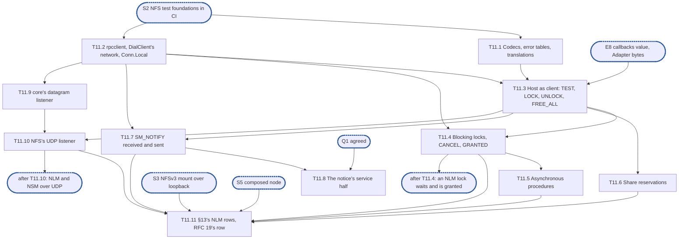

# Epic 11: NFS adapter v2 NLM, NSM and the datagram path

**Sources:** [RFC 21](../docs/internals/rfcs/rfc-21-nfs.md) §2.1's rule that NFS v3, MOUNT v3, NLM v4
and NSM v1 are served together, §2.2's UDP exception and its sentence on `SM_NOTIFY`, §5.1's paragraph
on an administrator's revoke of an NLM host, §5.5's one-range rule for `NLMPROC4_LOCK` and
`NLMPROC4_UNLOCK`, §6.1, §6.2, §11.4's NLM cells (the client table's `Name`, `Boot` and `Owner` rows,
the `Adapter` bytes' restart-notice fields, the `LockReq`, `LockOwner` and `ErrBlocked` rows), §11.5's
NLM column and its paragraph on what runs while draining, §11.6's golden vectors and fuzz target for
NLM, §12's N1 for UDP, N15 and N21, §13's rows "§2.2 TCP only", "§6.1 host binding", "§6.1 waiter
lifetime", "§6.1 NLM on a Kerberos-only share *(1 node)*", the NLM steps of "§5.5, §6.1 conflict
holder" and of "§5.1 revoke across a restart *(1 node)*", and Appendix D's NLM and NSM rows;
[RFC 20](../docs/internals/rfcs/rfc-20-adapters.md) §3.1's datagram listener, §3.3's NLM and NSM
callbacks, §3.4's `DialClient` with its network and its `Serving` sockets, §4.4's `Call.Client` for
NLM, §4.7's `Protocol` and `Listener` for a datagram, §4.8's UDP listener and §11's question 3;
[RFC 14](../docs/internals/rfcs/rfc-14-open-state.md) §2.3's ranges, §2.10's waiters and §4.5, for
what the adapter does with them; [RFC 17](../docs/internals/rfcs/rfc-17-vfs.md) §3.2's
`LockWaitOver` and `Revoked`; [RFC 19](../docs/internals/rfcs/rfc-19-authorization.md) §3.8 and its §9
row, run over NLM. Every citation is `develop`'s text, which reaches `feat/storage-v2` with the
cherry-pick of RFC changes.
Cited, not owned: RFC 1813's NLM v4 and NSM appendices and the Open Group's XNFS for the wire
structures, RFC 1833 for the port mapper's `GETPORT`, RFC 17 §4.9's admission (amendment A3, built by
E4), RFC 18 §5.4.
**Track:** B.
**Epic 11 estimate: 11 subtasks, 30 man-days.**
**Depends on:** **S2**, NFS's test foundations in CI: E2's `nfsharness` on `memory.New` and knfsd's
NLM and NSM captures (`test/pcap-corpus/nlm/`) cut into golden files. From the epics on other tracks,
before the subtasks that name them: E3's T3.2, the scripted client and its call encoder, and T3.4,
the `ops/nlm` and `ops/nsm` packages with their `NULL` rows; E8's first content, the per-client
callbacks value, the `Handlers` field `New` sets on `nlm.Handlers`, and the `Adapter` bytes codec with
an NLM host's fields; E4's T4.1, admission at `Claimed` for a call whose `Protocol` is NLM (A3); E7's
T7.1, without which `memory.New` refuses every `Claimed` caller. **S3** for the loopback rows, and
**S5** for the restart row.
**Blocks:** E16, which runs NLM against SMB, the lock recall with NLM, NLM grace and `SM_NOTIFY` on a
restart of the one node, cthon04's lock tests, and the totality test over NLM's and NSM's tables.

---

## 1. Goal

Epic 11 serves NFSv3's locking: NLM v4's procedures as RFC 14 locks and share reservations held by a
client record per NLM host, blocking locks granted later by a call to the host, NSM's restart notices
in both directions, and both programs over UDP as well as TCP. It adds `core`'s datagram listener, the
local address a callback leaves from, `DialClient`'s network, and `nfs/rpcclient`, the package for the
calls the server makes to a client.

**At the end of the epic:**

- an NLM `LOCK`, `TEST`, `UNLOCK`, `CANCEL`, `SHARE`, `UNSHARE` and `FREE_ALL`, and their `*_MSG`
  forms, reach `memory.New` as one service call each, for a client record keyed by the host's
  `caller_name` and source address, and are answered with RFC 21 §11.5's NLM statuses;
- a blocked lock is answered `NLM4_BLOCKED` at once, and `NLMPROC4_GRANTED` reaches the host on a
  connection the server opens from the address the host used, once per `LockWaitOver`, with the
  host's answer handed back to the service; a `CANCEL` is answered only once `CancelLock` returns;
- a received `SM_NOTIFY` or `FREE_ALL` expires the host's old client only from the address its record
  holds, and a lost shard's report sends `SM_NOTIFY` by UDP to every NLM host the report names;
- over UDP on the adapter's port, NLM and NSM answer and NFS and MOUNT answer nothing;
- the NLM rows of RFC 21 §13 and RFC 19 §9 pass over loopback, and the revoke-across-a-restart row's
  NLM steps on the composed node.

### 1.1 In scope

`internal/adapter/core`'s datagram listener and `Conn.Local`; `pkg/adapter/deps.go`'s `DialClient`
network argument; `nfs/rpcclient`; `wire`'s call encoder and reply decoder, moved out of the scripted
client; `ops/nlm`'s and `ops/nsm`'s procedures past `NULL`, their structs, error tables and
translations; `nfs/callbacks.go`'s `LockWaitOver` and `Revoked` for an NLM host; `nfs.go`'s UDP
listener; the scripted NLM host and the UDP sender in `adaptertest/nfsclient`; the service half of the
NSM notice amendment (D11, Q1); the golden files and fuzz target of each.

### 1.2 Out of scope

- Admission at `Claimed` for a call whose `Protocol` is NLM (A3's service half): E4's T4.1. This
  epic's rows drive it.
- What a `Claimed` caller resolves to, and the share's flavour policy: E7's T7.1 and E3's T3.1.
- The per-client callbacks value, the `Handlers` field that reaches it, and the `Adapter` bytes codec,
  NLM's fields included: E8, which builds the encoding whole (RFC 21 §11.4).
- The recall an NLM lock starts on a delegated file, and the NFSv4 side of a conflict's holder: the
  service and E9; this epic maps only the answers the service gives (R33).
- The resend schedule of an unanswered grant: the service's, already built (`internal/vfs/sink.go`
  calls `LockWaitOver` again every 10 s while the host gives no answer); this epic sends once per call.
- Rows that need both adapters, a kernel client or a restart of the one node with its grace: E16, as
  "§6.1 NLM against SMB", "§5.3 lock recall", "§6.1 NLM grace", "§6 NLM" with cthon04 and its
  `SM_NOTIFY` step, and "§2.2 TCP only"'s `proto=udp` mount. The totality test over NLM's and NSM's
  tables: E16.
- `nfs_nlm_waiters` (RFC 21 §14): its producer is T11.4, but nothing here records it while who records
  the series only NFS code can count is open with the RFC's author (the RFC 21 implementation plan's
  §6.1, point 4). If that settles before T11.4 lands, T11.4 adds it, about 0.5 man-days inside its
  figure; after, the epic the decision names.
- The port mapper answering on UDP and TCP, and rpcbind registration: the RFC 21 implementation plan's
  deferral ledger, its port-mapper row, owned by the cutover.
- `SM_NOTIFY` after a failover between nodes, from a node holding a moved address, or for a moved
  namespace (RFC 21 §6.2, §7.4): the same ledger's rows for RFC 21's (cluster) parts and for the
  namespace move.
- MOUNT over UDP: never served (RFC 20 §11, question 3).

### 1.3 Names used here

- **E2**, epic 2, test foundations: `adaptertest/nfsharness` and knfsd's captures cut into golden
  files.
- **E3**, epic 3, the RPC layer: the `Identity` with its source address, `Call.Protocol` by program
  (NLM and NSM `ProtocolNLM`), the scripted client, `protocol.ErrorTable`, and the `ops/nlm` and
  `ops/nsm` packages with `NULL`.
- **E4**, epic 4, NFSv3 and MOUNT, with A3's admission in its T4.1. **E7**, identity's NFS side, with
  `Claimed` callers resolved in its T7.1. **E8**, clients and sessions, which lands the callbacks
  value and the `Adapter` bytes first. **E9**, opens, stateids and locks. **E10**, delegations and the
  back channel. **E16**, E2E green: the suites, the totality test and the end-to-end rows.
- **S2**, NFS's test foundations in CI, after E1, E2 and the shared test pieces: what this epic starts
  from.
- **S3**, an NFSv3 mount over loopback, after E3 and E4: what this epic's loopback rows start from.
- **S5**, the composed in-process node, built outside this programme by RFC 23's implementation
  plan's epic 3 with RFC 20's epic 7: what the restart row runs on.
- **A3**, the amendment to RFC 17 §4.9 agreed in #5166: an NLM call meets a share's `MinProof` lowered
  to `Claimed` and no `MinProtection`.

## 2. How the general rules apply

The rules are those of [the RFC 21 implementation plan's §1.5](rfc-21-nfs-plan.md#15-general-rules-for-each-epic),
cited by number and title and not copied.

| Rule | Subtasks | How |
| --- | --- | --- |
| rule 1, independent unit tests, under `-race` ([`CLAUDE.md`, "Writing tests"](../CLAUDE.md#writing-tests)) | all | handlers through `nfsharness` on `memory.New` (kind 2), errors through `vfstest.Faults` (kind 3), the one-call rule from `vfstest.Mutations`; `core`'s datagram listener on `testproto` over real UDP; callbacks against the scripted NLM host (T11.2), a peer on `127.0.0.1:0` that keeps the calls it received and answers as its script says, its refusals and silences injected by that script (kind 3); `DialClient` supplied by the test, as RFC 20 §3.4 allows, dialling the real loopback listener; no other double |
| rule 2, fuzz tests where relevant | T11.1, T11.2 | `FuzzNLMLock` over an NLM lock request's translation into a `LockReq`, RFC 21 §11.6's target (R49); the call reply decoder `rpcclient` reads a host's bytes with, checked against a second decoder written by hand from RFC 5531 (T11.2). NLM's and NSM's codecs join the XDR codec's one target over every program |
| rule 3, observability follows RFC 25 and RFC 20 §10 | T11.4, T11.9 | no recorder in NFS code; `nfs_nlm_waiters` waits on the recorder decision (§1.2); the datagram listener records through `core`'s existing series under the listener's label; no log line or attribute carries a `caller_name`, a `mon_name`, an owner handle or a host address (RFC 25 §5.4) |
| rule 4, profiling: leaks, allocations and contention | T11.2, T11.4, T11.9 | every loopback test ends with `adaptertest.CheckLeaks`, including the goroutines of the datagram queue and of `rpcclient`'s per-host connections; the waiting-request table (T11.4) is a change to "the NLM grant timers" the rule names, so T11.4 reports its mutex and block profiles under 64 hosts blocking at once |
| rule 5, public interface and internals, at the layer that consumes a value ([`CLAUDE.md`, "Verifying a change"](../CLAUDE.md#verifying-a-change)) | all | each translation asserted on the reply bytes a host reads, through `nfsharness` or over loopback; a grant on the `NLMPROC4_GRANTED` the scripted host receives, its source address included; a notice on the `SM_NOTIFY` datagram the host receives; the host binding on the lock `memory.New` still holds after another address's `UNLOCK` |
| rule 6, known failures shrink | none | no `cthon04` or `nfstest` test runs before the cutover; E16 burns them down |
| rule 7, v2 ignores v1 | all | nothing from `develop`'s `nlm`, `nsm` or `portmap` packages; behaviour from RFC 21 §6, RFC 1813's appendices and RFC 1833 |
| rule 8, real dependencies for properties of those dependencies | T11.1, T11.2, T11.9, T11.10, T11.11 | golden files cut from knfsd's NLM and NSM captures (E2) or written by hand from RFC 1813 and RFC 1833, never vectors the encoder under test made; real TCP and UDP over loopback, on `127.0.0.2` and `127.0.0.3` where an address is asserted; the composed node for the restart row |
| rule 9, code comment conventions ([`CLAUDE.md`, "Code comments"](../CLAUDE.md#code-comments)) | all | RFC 21 §6.1's two `decision:` notes at their code sites, the host binding at the `Name` encoding (T11.1) and the `Claimed` admission at the rows that set `Call.Protocol` (kept as E3 and E4 wrote it); the markers of §4 at theirs; `nfs.go`'s comment that no listener reads UDP rewritten (T11.10) |
| rule 10, a test must be able to fail | all | each test names the break it catches; none asserts the scripted host's own answer, only what the adapter did with it; the absence of a reply over UDP is a bounded wait, the one assertion no clock can make, and says so |
| rule 11, a symbol is exported only if an interface uses it | T11.1, T11.2, T11.9, T11.10 | `core.Conn.Local` and the datagram `Listener` through an RFC 20 pull request first (Q2); `adapter.Deps.DialClient`'s network, already RFC 20 §3.4's text; `rpcclient`'s functions for `nfs/callbacks.go` and `ops/nlm`; `wire`'s call encoder and reply decoder for `rpcclient` and the scripted client; `nlm.Handlers` and `nsm.Handlers` for `nfs.go`; `nfsclient.Host` and `nfsclient.DialUDP` for this epic's and E16's tests |
| rule 12, each subtask creates only what it declares | all | `rpcclient` arrives with `GETPORT` and its first caller's test; the waiting-request table with the first blocking lock; the share table with `SHARE`; the scripted host with the first callback it receives |
| rule 13, translate, never decide | all | every NLM field maps to a neutral value or a named refusal by a pure function (R47); a handler makes one service call, beside the `Connect` its row's `Resolve` makes; whether a lock conflicts, is granted, waits or is authorised is the service's, and so is when a grant is sent again |
| rule 14, nothing deferred is lost | all | §1.2 names the owner of each part of an obligation this epic leaves out; §9 the gaps, with the RFC each needs |

## 3. Requirements and invariants

Every MUST and MUST NOT that RFC 21, RFC 20, RFC 14, RFC 17 and RFC 19 place on this epic, numbered so
that subtasks and tests can cite them.

**The datagram path**

| # | Requirement | Kind | Source | Subtasks |
| --- | --- | --- | --- | --- |
| R1 | NFS and MOUNT are never served over UDP: a call to either sent by UDP is answered nothing | MUST NOT | RFC 21 §2.2, §12 (N1) | T11.10 |
| R2 | NLM and NSM are served over UDP as well as TCP, on the port the TCP listener binds, while RFC 20 §11's UDP question stands | MUST | RFC 21 §2.2; RFC 20 §4.8, §11 (question 3) | T11.10 |
| R3 | NFS v3, MOUNT v3, NLM v4 and NSM v1 are served together or not at all, over UDP as over TCP: under a range of only 4.x, NLM and NSM are not served by UDP either | MUST | RFC 21 §2.1; RFC 20 §4.8 | T11.10 |
| R4 | A datagram listener reads into a bounded queue and drops a datagram that arrives at a full one | MUST | RFC 20 §3.1 | T11.9 |
| R5 | A datagram listener runs the same stages as a connection, one record per datagram | MUST | RFC 20 §4.7 (`Protocol`) | T11.9 |
| R6 | A datagram listener starts with its adapter, all or none: one that cannot bind fails the adapter's start, and it stops with the adapter | MUST | RFC 20 §3.1 | T11.9 |
| R7 | `Addrs` reports `nlm` and `nsm` over `udp` as `Socket`s of their own, each bound address at its port; an address `Reconfigure` adds binds the port the listener already holds, and a taken one is a refusal | MUST | RFC 20 §3.4 (`Serving`, `Socket`), §4.7 (`Listener`) | T11.9 |
| R8 | Apart from the port mapper's answers and NLM and NSM replies over UDP, `SM_NOTIFY` is the only UDP the server sends, and it carries no file operation | invariant | RFC 21 §6.2 | T11.2, T11.7 |

**Calls the server makes**

| # | Requirement | Kind | Source | Subtasks |
| --- | --- | --- | --- | --- |
| R9 | `DialClient` takes its network, `"tcp"` or `"udp"`, and the local address the client reached; nil is a `net.Dialer` bound to that address, dialling that network | MUST | RFC 20 §3.4 (`DialClient`) | T11.2 |
| R10 | An NLM callback (`NLMPROC4_GRANTED`, a `*_RES` reply) is a call to the host's NLM service on a connection the server opens, never a reply on the request's connection; its port is found through the host's port mapper, `GETPORT` for NLM version 4 over TCP | MUST | RFC 21 §6.1, §12 (N15); RFC 20 §3.3 | T11.2, T11.4, T11.5 |
| R11 | Every call to a host leaves from the floating address its requests arrived on, never a node's own address | MUST | RFC 21 §6.1, §6.2, §12 (N15) | T11.2, T11.3 |
| R12 | One connection is kept per host while it has a grant or reply to send, and closed after; `SM_NOTIFY` keeps none | MUST | RFC 20 §3.3 | T11.2 |
| R13 | A host whose port mapper or NLM service cannot be reached is a callback that failed | MUST | RFC 21 §6.1; RFC 20 §3.3 | T11.2, T11.4 |
| R14 | A callback returns within its context's deadline whether or not the host answers | MUST | RFC 20 §3.3; RFC 17 §3.2 | T11.2, T11.4, T11.7 |

**Hosts as clients**

| # | Requirement | Kind | Source | Subtasks |
| --- | --- | --- | --- | --- |
| R15 | An NLM host's client record is keyed by its `caller_name` together with the source address of the request that created it, both its `Name`; its `Boot` is its NSM state number, big-endian in the low four bytes | MUST | RFC 21 §6.1, §11.4 (`Name`, `Boot`) | T11.1, T11.3 |
| R16 | A request naming a host's `caller_name` from another address is another client, and can neither test, unlock nor free the first host's locks | MUST | RFC 21 §6.1 | T11.3, T11.11 |
| R17 | `NLMPROC4_FREE_ALL` and a received `SM_NOTIFY` expire a host's client only when they come from the address its record holds | MUST | RFC 21 §6.1, Appendix D (`FREE_ALL`) | T11.3, T11.7 |
| R18 | A host's first NLM call registers it for restart notification: `Connect` with its `caller_name` as the monitor name, its `mon_name` and `priv` kept in the record's `Adapter` bytes; `SM_MON` and `SM_UNMON` are never served to a peer | MUST | RFC 21 §6.2, §11.4 (the `Adapter` bytes), Appendix D (`SM_MON`) | T11.3, T11.7 |
| R19 | A lock request carrying a new NSM state number is a `Connect` under the host's name with a new `Boot`: a reboot, which expires the old client | MUST | RFC 14 §4.5; RFC 21 §11.4 (`Boot`) | T11.3 |
| R20 | An NLM row's `Resolve` sets `Client` on its `r.Call` to the ID of the host's client record | MUST | RFC 20 §4.4 (the `Call`) | T11.3 |
| R21 | A `StaleClient` refusal makes the adapter `Connect` the host afresh and send the request once more; it never reaches the host as `NLM4_DENIED`, and one met again on the retry is `NLM4_DENIED_GRACE_PERIOD` | MUST | RFC 21 §6.1, §11.5 (`StaleClient`); RFC 14 §4.5 | T11.3 |
| R22 | An NLM host's record has no `Owner`, so two callers' uids on one host lock under one client | MUST | RFC 21 §11.4 (`Owner`); RFC 14 §2.1 | T11.3 |

**Locks**

| # | Requirement | Kind | Source | Subtasks |
| --- | --- | --- | --- | --- |
| R23 | An NLM lock is an RFC 14 lock under the file's anonymous open: it names no open, and is passed with the request's file handle | MUST | RFC 21 §6.1, Appendix D (`TEST`) | T11.3 |
| R24 | `NLMPROC4_LOCK` and `NLMPROC4_UNLOCK` each name one range, passed to the service as a one-element list | MUST | RFC 21 §5.5 | T11.3 |
| R25 | An NLM length of 0 is a range to end of file, held as reaching 2⁶⁴−1 and never computed as offset plus length; any other range's last byte is offset + length − 1 | MUST | RFC 14 §2.3 | T11.1 |
| R26 | An NLM lock owner is its `svid` and `oh`, and its locks merge and split (`LockOwner.Stack` false) | MUST | RFC 21 §11.4 (`LockOwner`) | T11.1 |
| R27 | An `NLMPROC4_UNLOCK` of a range the owner holds in part or not at all releases what it holds and succeeds; `ErrRangeNotLocked` is never answered | MUST | RFC 21 §5.5, §11.5 (`ErrRangeNotLocked`) | T11.3 |
| R28 | A lock outside an open needs read access or ownership, and a write lock no more than a read lock; the service decides it, and the adapter neither checks nor widens it | MUST | RFC 21 §6.1; RFC 19 §3.8 | T11.3, T11.11 |
| R29 | A store error resolving the caller fails the lock, never authorises it as anonymous | MUST NOT | RFC 21 §6.1; RFC 18 §5.4 | T11.11 |
| R30 | Every NLM procedure and `*_MSG` form is admitted at `Claimed` on a share whose `MinProof` is higher, its caller still resolved and gated | MUST | RFC 21 §6.1; RFC 17 §4.9 | T11.11 |
| R31 | During grace a lock that is no reclaim is `NLM4_DENIED_GRACE_PERIOD`, and a request with `reclaim` set is a reclaim | MUST | RFC 21 §6.1, §5.4 (the table) | T11.1, T11.3 |
| R32 | An `NLMPROC4_TEST` refused by an NFSv4 or SMB lock reports a holder with `svid` 0 and an empty `oh`: an internal owner never reaches the wire | MUST NOT | RFC 21 §6.1, §5.5 | T11.3 |
| R33 | An NLM lock on a file under another client's delegation, while the recall runs, is `NLM4_BLOCKED` with a waiter if blocking and `NLM4_DENIED_GRACE_PERIOD` if not, never `NLM4_DENIED` | MUST | RFC 21 §6.1, §5.3 | T11.1, T11.4 |

**Blocking locks and grants**

| # | Requirement | Kind | Source | Subtasks |
| --- | --- | --- | --- | --- |
| R34 | An `NLMPROC4_LOCK` with `block` set that conflicts or meets a recall is answered `NLM4_BLOCKED` at once, as a callback waiter (`ErrBlocked`); no worker waits | MUST | RFC 21 §6.1, §11.4 (`LockReq`); RFC 14 §2.10 | T11.4 |
| R35 | The adapter never drops a waiter on a timer of its own, and the waiting request is exempt from the per-call deadline | MUST NOT | RFC 21 §6.1, §12 (N21); RFC 14 §2.10 | T11.4 |
| R36 | A waiter ended by its share's removal or move, reported through `Revoked` or `LockWaitOver` not granted, is answered nothing, NLM having no message that withdraws `NLM4_BLOCKED`; the host's next request on the share's handles is `NLM4_STALE_FH` | MUST | RFC 21 §6.1, §11.5 (`ErrStale`, the share row); RFC 20 §3.3 (`Revoked`) | T11.4, T11.11 |
| R37 | `NLMPROC4_CANCEL` calls `CancelLock` and is answered only once it returns; if the lock was granted first, it stands and `NLMPROC4_GRANTED` is sent as for any grant | MUST | RFC 21 §6.1, §12 (N21); RFC 14 §2.10 | T11.4 |
| R38 | Each `LockWaitOver` granting a lock sends one `NLMPROC4_GRANTED`, bounded by its context, and returns `refused` false for an acknowledgement, `refused` true for `NLM4_DENIED` or any other status in the reply, and an error when the host said nothing by the deadline | MUST | RFC 21 §6.1, §11.4 (`ErrBlocked`); RFC 17 §3.2 | T11.4 |
| R39 | A granted lock is never released for a silence: no answer is reported as an error, never as a refusal | invariant | RFC 21 §6.1, §12 (N21) | T11.4 |

**Asynchronous procedures and share reservations**

| # | Requirement | Kind | Source | Subtasks |
| --- | --- | --- | --- | --- |
| R40 | The `*_MSG` procedures are served as their synchronous forms and answered by the matching `*_RES` call on the host's NLM callback service, from the floating address | MUST | RFC 21 §6.1, Appendix D (`*_MSG`) | T11.5 |
| R41 | NLM `SHARE` and `UNSHARE` are an `Open` and a `Close` of an anonymous-owner open with a deny mode, so they conflict with SMB and NFSv4 deny modes; `ErrShareViolation` is `NLM4_DENIED` for `SHARE` | MUST | RFC 21 §6.1, §11.5 (`ErrShareViolation`), Appendix D (`SHARE`) | T11.6 |

**NSM**

| # | Requirement | Kind | Source | Subtasks |
| --- | --- | --- | --- | --- |
| R42 | A received `SM_NOTIFY` is `HostRestarted` for the host it names, which expires its old client | MUST | RFC 21 Appendix D (`SM_NOTIFY`); RFC 14 §4.5 | T11.7 |
| R43 | When a shard in which an NLM host held locks loses its open state, a restart of the one node included, `SM_NOTIFY` is sent by UDP to the host's NSM service, at the address its `Adapter` bytes hold, from the floating address, naming the server name the client monitored and carrying the new state number | MUST | RFC 21 §6.2, §2.2; RFC 20 §3.3; RFC 14 §4.5 | T11.7, T11.8 |
| R44 | An administrator's revoke of an NLM host is an expiry: no `SM_NOTIFY` is sent to it at a later restart, a reclaim it sends is `NLM4_DENIED` (`NoGrace`) in grace and after, and its next ordinary lock creates a new client record | MUST | RFC 21 §5.1, §11.5 (`NoGrace`) | T11.1, T11.11 |

**Errors and translation**

| # | Requirement | Kind | Source | Subtasks |
| --- | --- | --- | --- | --- |
| R45 | NLM's table answers RFC 21 §11.5's NLM cells: `ErrDelay` and `DelayResources`, `ErrGrace` and `NoReclaim` `NLM4_DENIED_GRACE_PERIOD`; `ErrBlocked` `NLM4_BLOCKED`; the share's `ErrStale` `NLM4_STALE_FH`; `NoGrace`, `ReclaimConflict`, `ErrLocked` and `SHARE`'s `ErrShareViolation` `NLM4_DENIED`; `ErrLogonFailure` `SYSTEM_ERR` | MUST | RFC 21 §11.5 | T11.1 |
| R46 | Every neutral error in `vfs.Errors()` maps to one status in NLM's table, the rows RFC 21 §11.5 gives no NLM cell included | MUST | RFC 21 §11.6, §12 (N26); RFC 20 §4.5 | T11.1 |
| R47 | Every NLM → neutral translation is total and pure: each wire value maps to one neutral value or a named refusal, never a default | invariant | RFC 21 §11, §12 (N26) | T11.1 |
| R48 | Golden files for NLM's `svid` and `oh` table and for NLM's §11.5 rows assert NLM → neutral → NLM gives the golden neutral value and back the golden wire value | test row | RFC 21 §11.6 ("§11.1–§11.5 golden vectors") | T11.1 |
| R49 | The translation of an NLM lock request into a `LockReq` is fuzzed, seeded with truncated and corrupt requests: no panic, and a valid request or a refusal | test row | RFC 21 §11.6 ("§11.4 decoders fuzzed") | T11.1 |
| R50 | While draining, NLM's `UNLOCK` and `CANCEL` run as releases and every other NLM procedure is refused with the drain's error | MUST | RFC 21 §11.5 ("What runs while draining") | T11.3, T11.4 |

**RFC 21 §13's rows, and RFC 19's**

| # | Requirement | Kind | Source | Subtasks |
| --- | --- | --- | --- | --- |
| R51 | "§2.2 TCP only": NFS and MOUNT probed by UDP get no reply; NLM and NSM answer there | test row | RFC 21 §13 | T11.10 |
| R52 | "§6.1 host binding": `FREE_ALL` and `UNLOCK` naming host A from another address leave A's lock held; `NLMPROC4_GRANTED` comes from the floating address A used, and still arrives, on a connection the server opened, after the blocking request's connection closed | test row | RFC 21 §13 | T11.11 |
| R53 | "§6.1 waiter lifetime": a waiter outlives a 5-minute hold and is granted; `CANCEL` racing the unlock 10³ times leaves either no lock and a cancel answered or a grant told; unacknowledged grants are resent for 5 minutes with the lock kept, and stop at the acknowledgement; a refused grant releases the lock to the next waiter; a removed share ends the waiter and its next request is `NLM4_STALE_FH` | test row | RFC 21 §13 | T11.11 |
| R54 | "§6.1 NLM on a Kerberos-only share *(1 node)*": over `AUTH_SYS` on a `Ticket` share, a lock by a uid that can read the file granted, one that can neither read nor own a 0600 file refused, a store error resolving the caller refused | test row | RFC 21 §13 | T11.11 |
| R55 | "§5.5, §6.1 conflict holder", its NLM step: an `NLMPROC4_TEST` against an NFSv4 lock decodes `svid` 0 and `oh` of length 0 | test row | RFC 21 §13 | T11.11 |
| R56 | "§5.1 revoke across a restart *(1 node)*", its NLM steps: host H revoked, its lock taken by another, the node restarted: no `SM_NOTIFY` to H, a reclaim from H's name and address `NLM4_DENIED` in grace and after, an ordinary lock from H granted under a new record | test row | RFC 21 §13 | T11.11 |
| R57 | RFC 19's "§3.8 locks outside an open" over NLM: bob's read and write locks on alice's 0600 file refused, both allowed on a 0644 file, alice's write lock on her own 0200 file allowed | test row | RFC 19 §9 | T11.11 |

## 4. Decisions this epic takes

- **D1. One outbound package, `nfs/rpcclient`.** NLM's `GRANTED` and `*_RES`, the port mapper's
  `GETPORT` and `SM_NOTIFY` go through it, over `Deps.DialClient`; E10's back channel sends on the
  session's own connection and shares only `wire`'s call header. The call encoder and reply decoder
  move from `adaptertest/nfsclient` into `wire/call.go` when this epic first sends a call, unless E10
  has moved them first (E3's D11), with a fuzz target on the reply decoder, which reads a peer's bytes.
  A host's connection is kept while a grant or reply to it is pending and closed when none is, as RFC
  20 §3.3 says, by a per-host count of the calls in flight. Prior art: knfsd and NFS-Ganesha each use
  one sunrpc client for lockd callbacks and statd (from memory, not checked). No marker: it is the
  layout RFC 20 §2.5 gives.
- **D2. An NLM host's `Name` is its source address, then its `caller_name`.** The record is durable and
  indexed by (protocol, name), so the encoding is settled now: the 16 bytes of the source address in
  its IPv6 form, an IPv4 address mapped, then the `caller_name` bytes as sent. A `SM_NOTIFY` and a
  `FREE_ALL` build the same `Name` from their own source address, so one from elsewhere names another
  client (R17). Changing it once records exist strands every host's record until its next reboot.
  RFC 21 §6.1's `decision:` on the host binding sits here, at the encoder. Prior art: knfsd's
  `nlm_host` lookup matches name and address (from memory).
- **D3. An owner's `Name` is `svid` big-endian, then `oh`.** RFC 14 caps an owner at 1,024 bytes and an
  `oh` may hold 1,024, so an `oh` over 1,020 bytes is a named refusal, answered `NLM4_FAILED`, never
  truncated. Not durable: locks are volatile, so the encoding may change with no migration. A
  `decision:` marker at the check, overturned if a client is seen sending an `oh` that long. Prior
  art: none found; Linux's own `oh` is a short host-and-pid string (from memory).
- **D4. The NLM cells RFC 21 §11.5 does not give.** NLM v4 has ten statuses; for a neutral error whose
  row names only NFSv3's status, NLM's table answers `NLM4_ROFS` for `ErrReadOnly`, `NLM4_STALE_FH` for
  a released file's `ErrStale`, `NLM4_FBIG` for a range past 2⁶⁴ (a translation refusal), and
  `NLM4_FAILED` for every other, `ErrAccess` included, so a refused permission is never read by the
  client as a conflict to wait out. **Pending the user's answer** (Q3), with the RFC 21 §11.5 cells
  this document's pull request proposes. Prior art: knfsd's lockd answers `nlm_failed` for a file it
  cannot open and `nlm_stale_fh` for a stale handle under NLM v4 (from memory). A `decision:` marker at
  the table.
- **D5. A call with no NSM state finds its client in a per-node host table.** Only `nlm4_lockargs`
  carries the state, and `Connect` with another `Boot` is a reboot (R19), so `TEST`, `UNLOCK`,
  `CANCEL`, `SHARE` and `UNSHARE` cannot `Connect` with a guessed one. Each `Connect` the adapter
  makes records the host's `Name` with the `ClientID` and state it got, in memory; a call naming no
  state looks the host up there and connects afresh on `StaleClient` (R21). A miss is a host that has
  locked nothing through this node since it started: `TEST`, `UNLOCK` and `CANCEL` then run with a zero
  `Client`, holding nothing for the service to find, and `SHARE` connects under state 0, which a live
  host never sends, so its next `LOCK` replaces that instance. **Pending the user's answer** (Q4). A
  `ponytail:` marker at the table: one entry per host ever connected, dropped with `FREE_ALL` and
  `SM_NOTIFY`; bound it if host churn shows. A `decision:` marker on the miss, overturned when a node
  can be reached by a host whose locks another node took (the cluster stage). Prior art: knfsd keeps
  NLM hosts in an in-memory table keyed by name and address (from memory).
- **D6. The waiting request's wire form, kept until its waiter ends.** `LockWaitOver` hands back a
  `LockWaiter` naming the file by `FileID` and no handle, while `NLMPROC4_GRANTED` must carry the
  handle. Before a blocking `LOCK`, the handler reads the handle's `File` through `GetAttr` and keeps
  the request's handle, cookie and floating address under (`FileID`, owner, range); `LockWaitOver`
  takes the entry, and `CancelLock`'s return, a grant, a refusal or a share's `Revoked` removes it. A
  `ponytail:` marker: one extra `GetAttr` per blocking `LOCK`; upgrade to a handle carried on RFC 14's
  `LockWaiter` when a profile shows it (Q7). Prior art: knfsd keeps the blocked request in its
  `nlm_block` list (from memory).
- **D7. A grant is always the synchronous `NLMPROC4_GRANTED`.** RFC 21 §6.1 allows either form; the
  synchronous call's reply is the host's answer, so no `GRANTED_RES` needs matching to a pending
  grant, and `LockWaitOver` returns with it (R38). Prior art: knfsd sends `GRANTED_MSG` (from memory);
  Linux's client lock manager serves both. A `decision:` marker at the send, overturned if a supported
  client is shown to serve only `GRANTED_MSG`.
- **D8. A `CANCEL` is answered `NLM4_GRANTED`** once `CancelLock` returns, whether it dropped the
  waiter or reported the lock granted first, in which case the grant follows through `LockWaitOver`
  (R37). Prior art: knfsd answers a cancel it found `nlm_granted` (from memory). A `decision:` marker at
  the handler.
- **D9. A `*_MSG` call is answered with an empty reply, and its `*_RES` sent in the background.** The
  handler makes its one service call and the call's RPC reply carries no result; the result goes by
  `rpcclient` under the callback deadline, and one that cannot be delivered is dropped, the host's own
  timer resending its `*_MSG`. A `decision:` marker at the send. Prior art: none checked.
- **D10. A share reservation's open is kept in a per-node table.** `UNSHARE` names the handle and `oh`,
  not the open, so `SHARE` keeps the `StateRef` `Open` returned under (`ClientID`, handle, `oh`),
  dropped by `UNSHARE`, `FREE_ALL`, a received `SM_NOTIFY` and a `Revoked` of the client. A `ponytail:`
  marker: per node, lost with it; upgrade when a host can reach another node with its opens kept (the
  cluster stage). Prior art: none found.
- **D11. `SM_NOTIFY` is resent until the host's monitor answers.** A `Revoked` naming a lost shard hands
  each host's notice to one per-adapter sender, which returns at once (R14) and sends by UDP every 10 s
  for at most 15 minutes, until the reply arrives or the adapter stops. The state number and the
  report after a restart need an RFC 17 change (Q1): this document writes option (a), a `State` field
  on `Revocation` and the reports of a start held for the NLM `Callbacks` the adapter registers when
  it starts, whose service half is T11.8. A `ponytail:` marker at the sender: a host silent for 15
  minutes is never told; upgrade to the node's retrier if one is seen coming back later. Prior art:
  nfs-utils' `sm-notify` retries for 15 minutes by default (from memory).
- **D12. `GETPORT` goes over TCP to port 111.** R8 leaves UDP to `SM_NOTIFY` and replies, so the port
  mapper is asked over TCP, version 2's `PMAPPROC_GETPORT`, from the floating address, once per call
  the adapter makes; nothing is cached. A `ponytail:` marker: one `GETPORT` per grant, upgrade to a
  cache per host if a profile shows them. Prior art: RFC 1833 §3.2.
- **D13. A datagram is a connection of one record.** `core`'s datagram listener reads into a queue of
  256 datagrams of at most 8 KiB, each buffer taken from the node's request pool, dropping a datagram
  that finds the queue full, the pool spent, or does not fit; each one queued becomes a `Conn` of one
  record, from the socket's settings snapshot and with its source as `Remote` and the address it
  arrived on as `Local` (on an unspecified bind, read from the packet's information), whose stages are
  built by `NewConn`, whose reply is one `WriteTo` from that address, and which takes no connection
  count and no connection-state charge. Two `ponytail:` markers: the queue's length and buffer size,
  upgrade by setting if drops are seen with the pool not spent; and the stages built per datagram,
  upgrade to stages per socket if a profile shows them. Prior art: knfsd's `svc_udp_recvfrom` hands
  each datagram to a request of its own and replies from the destination address it read with
  `IP_PKTINFO` (from memory). RFC 20 §4.7 gains `Conn.Local` and the datagram `Listener` (Q2).
- **D14. A program a UDP listener does not serve is answered nothing.** The UDP listener's protocol
  holds only NLM's and NSM's tables, and its stages' table maps a program it lacks to no reply, so NFS
  and MOUNT by UDP see what a host with no UDP NFS shows (R1). A `decision:` marker at the row,
  overturned if a client is found that waits on a `PROG_UNAVAIL` over UDP before trying TCP. Prior
  art: RFC 21 §13's row asks for no reply.
- **D15. An NLM holder's `svid` and `oh` reach the wire only for the asking host's own owners.** A
  conflicting lock of another client, NLM or not, is reported `svid` 0 and an empty `oh`, so no owner
  name is ever decoded from another client's bytes (R32). A `decision:` marker at the reply, overturned
  if a client is shown to act on another host's `svid`. Prior art: knfsd reports the holding host's
  `svid` (from memory).
- **D16. `NM_LOCK` is not served.** RFC 21 lists it nowhere, so it is answered `PROC_UNAVAIL` as every
  procedure NLM's table lacks; **pending the user's answer** (Q6). A `decision:` marker at the table,
  overturned if a supported client sends it.

## 5. Target tree

```text
internal/adapter/core/
  conn.go                        T11.2  Local; T11.9  a datagram's Conn
  datagram.go                    T11.9  the datagram listener (RFC 20 §3.1)
  datagram_linux.go, _other.go   T11.9  the destination address of a datagram on an unspecified bind
  server.go                      T11.9  binding, Addrs and Reconfigure for "udp"
  datagram_test.go               T11.9  on testproto over UDP
  testdata/surface/core.golden   T11.2, T11.9
internal/adapter/adaptertest/
  testproto/                     T11.9  a datagram case
  nfsclient/
    host.go, host_test.go        T11.2  Host: a scripted port mapper, NLM and NSM service on loopback
    udp.go                       T11.10 DialUDP
pkg/adapter/deps.go              T11.2  DialClient's network
internal/adapter/nfs/
  nfs.go                         T11.3  nlm.Handlers and nsm.Handlers; T11.10  the UDP listener
  callbacks.go                   T11.4  LockWaitOver for an NLM host; T11.7  Revoked for an NLM host
  wire/
    nlm.go                       T11.1  NLMHostName (D2)
    call.go                      T11.2  the call encoder and reply decoder, moved from nfsclient (D1)
    fuzz_test.go                 T11.2  FuzzReply
    testdata/golden/             T11.1 to T11.7  NLM and NSM calls and replies
  protocol/
    stages.go                    T11.10 the UDP listener's stages' row for a program it lacks (D14)
  ops/nlm/
    types.go                     T11.1  NLM v4's structs and statuses
    translate.go                 T11.1  Name, owner, range, share mode: pure functions
    errors.go                    T11.1  NLM's error table
    fuzz_test.go                 T11.1  FuzzNLMLock
    hosts.go                     T11.3  the per-node host table (D5) and Resolve
    test.go, lock.go, unlock.go, free_all.go   T11.3
    waiting.go                   T11.4  the waiting-request table (D6)
    cancel.go                    T11.4
    msg.go                       T11.5  the *_MSG rows and *_RES sends
    share.go, unshare.go         T11.6  the share table (D10)
  ops/nsm/
    notify.go                    T11.7  SM_NOTIFY received
    notice.go                    T11.7  SM_NOTIFY sent, its resend (D11)
  rpcclient/
    rpcclient.go                 T11.2  Call, by TCP from the floating address; Notify, by UDP
    getport.go                   T11.2  GETPORT over TCP (D12)
pkg/vfs/, pkg/openstate/, internal/vfs/   T11.8  Revocation.State; a start's reports held for NLM Callbacks (Q1)
```

## 6. Subtasks

### T11.1 NLM's and NSM's codecs, error tables and translations

**Subtask T11.1 estimate: 3 man-days.**

- **Track:** B. **Depends on:** S2, E3's T3.4.
- **Covers:** R15, R25, R26, R31, R33, R44, R45, R46, R47, R48, R49.
- **Deliverables:**
  - `ops/nlm/types.go`: NLM v4's argument and result structs, `xdr`-tagged for the generator, its
    procedure numbers and its ten statuses; `ops/nsm`'s `SM_NOTIFY` argument. Consumed by every later
    subtask and by T11.2's scripted host.
  - `wire.NLMHostName(caller []byte, src netip.Addr) []byte` (D2), exported because `ops/nsm` builds
    the same `Name` for `HostRestarted`. Consumed by T11.3 and T11.7.
  - `ops/nlm/translate.go`, unexported pure functions: `owner(svid uint32, oh []byte) (vfs.LockOwner, error)` (D3); `lockRange(off, n
    uint64) (vfs.ByteRange, error)` (R25, `NLM4_FBIG` past 2⁶⁴); `lockReq(args *nlm4LockArgs, wait
    bool) (vfs.LockReq, error)`; the share mode and access to `Access` and `Deny`. Consumed by T11.3,
    T11.4, T11.6 and T11.7.
  - `ops/nlm/errors.go`: NLM's table on E3's `protocol.ErrorTable`, with R45's cells and D4's (Q3).
    Consumed by every NLM row.
  - Golden files of NLM's `svid` and `oh` table and NLM's §11.5 rows, hand-written from RFC 1813
    where E2's captures do not hold them; `FuzzNLMLock`.
- **Acceptance criteria:**
  - Each golden row goes NLM → neutral → NLM and gives its golden value both ways.
  - A length of 0 holds to 2⁶⁴−1; an offset of 2⁶⁴−1 with length 2 is `NLM4_FBIG`, never wrapped.
  - Every error of `vfs.Errors()` maps to a row of NLM's table, none by the fault's fallback.
  - An `oh` of 1,021 bytes is refused, never truncated.
- **Tests:** at the functions every NLM handler calls: the golden table (catches a field mapped
  differently, R48); a property test over generated `nlm4_lockargs` that each maps to a `LockReq` or a
  named refusal (catches a default, R47); the range cases (catch an overflow or a to-end-of-file
  length computed as a sum, R25); a loop over `vfs.Errors()` asserting a matched row and `core`'s
  `adapter_unmapped_errors_total` at 0 through `nfsharness` (catches a missing cell, R46); the R45
  cells each asserted by status (catch `ErrDelay` answered `NLM4_DENIED`, R33, and `NoGrace` as
  anything but `NLM4_DENIED`, R44); `FuzzNLMLock` seeded with truncated and corrupt requests (R49);
  `NLMHostName` of an IPv4 address and of its mapped form equal, and state 5 as the `Boot` bytes
  0,0,0,0,0,0,0,5 (catch a host split in two or states misordered, R15); the owner golden rows (R26).
  No test double.
- **Rules:** rule 9's `decision:` markers of D2, D3 and D4.

### T11.2 `rpcclient`, `DialClient`'s network and `Conn.Local`

**Subtask T11.2 estimate: 3.5 man-days.**

- **Track:** B. **Depends on:** S2, E3's T3.2.
- **Covers:** R8, R9, R10, R11, R12, R13, R14.
- **Deliverables:**
  - `pkg/adapter/deps.go`: `DialClient func(ctx context.Context, network string, from netip.Addr, to
    netip.AddrPort) (net.Conn, error)`, as RFC 20 §3.4 has it; its nil default a `net.Dialer` bound to
    `from` for `network`. Consumed by `rpcclient`.
  - `core`: `func (c *Conn) Local() netip.Addr`, the address the client reached, unmapped, through
    an RFC 20 pull request first (Q2), with `core.golden` updated. Consumed by T11.3, which keeps it
    with the host, and T11.9's datagram `Conn`.
  - `wire/call.go`: the call encoder and reply decoder moved out of `nfsclient` (D1); `FuzzReply`.
  - `rpcclient`: `Call(ctx context.Context, dial DialFunc, from netip.Addr, host netip.Addr, prog,
    vers, proc uint32, args []byte) ([]byte, error)`, which asks `GETPORT` over TCP (D12), dials the
    host's port from `from`, sends one call and reads its reply, keeping one connection per host while
    calls to it are in flight; `Notify(ctx context.Context, dial DialFunc, from, host netip.Addr, args
    []byte) error`, one `SM_NOTIFY` datagram to the port the host's port mapper names for NSM version 1
    over UDP. Consumed by T11.4, T11.5 and T11.7.
  - `adaptertest/nfsclient.Host`: a port mapper, NLM callback service and NSM service on
    `127.0.0.1:0` or a given loopback address, keeping each call it received with its source address,
    answering by a script whose refusals and silences are fault injection (kind 3). Consumed by this
    subtask's tests, T11.4, T11.5, T11.7, T11.11 and E16.
- **Acceptance criteria:**
  - A call leaves from `from` and reaches the host's NLM port that `GETPORT` named, over TCP.
  - A host whose port mapper refuses, or whose service is silent, is an error by the context's
    deadline.
  - Two calls to one host in flight share one connection, which closes once neither is.
  - `Local` is the address the connection was accepted on, for a listener bound to `127.0.0.3` and
    for one bound to the unspecified address.
- **Tests:** at what the host receives: calls from a server bound to `127.0.0.3` arrive at `Host` on
  `127.0.0.2` from `127.0.0.3` (catches a node address, R11); `GETPORT` arrives over TCP and the call
  on the named port (catches a callback on the request's connection or a fixed port, R10, and UDP
  for `GETPORT`, R8); a silent `Host` makes `Call` return by its deadline (catches a send that blocks
  past it, R14, or that is reported as anything but an error, R13); the open connections counted
  through `Host` before and after (catches a connection kept with nothing pending, R12); `FuzzReply`
  against a second decoder written by hand; with `DialClient` nil, `Notify` reaches `Host` over UDP
  from `from` (catches a default that ignores the network or the address, R9). No test double but
  `Host` and the test's `DialClient`.
- **Rules:** rule 11's exports above, `Conn.Local` through the RFC first.

### T11.3 An NLM host as a client: `TEST`, `LOCK`, `UNLOCK` and `FREE_ALL`

**Subtask T11.3 estimate: 3.5 man-days.**

- **Track:** B. **Depends on:** T11.1, T11.2, and E8's callbacks value and `Adapter` bytes codec.
- **Covers:** R11, R15, R16, R17, R18, R19, R20, R21, R22, R23, R24, R27, R28, R31, R32, R50.
- **Deliverables:**
  - `ops/nlm/hosts.go`: the host table of D5 (Q4) and the rows' `Resolve`, which `Connect`s an NLM host
    with `ClientInfo{Protocol: ProtocolNLM, Name, Boot, Adapter, Recovery: RecoverNotice}` and E8's
    callbacks value, its `Adapter` bytes holding the `caller_name` as `mon_name`, `priv`, the host's
    address and the floating address from `Conn.Local`, and sets `r.Call.Client`.
  - `nlm.Handlers{VFS vfs.Service, …}` with E8's callbacks field, set by `nfs.go`.
  - Rows `TEST`, `LOCK` without `block`, `UNLOCK` and `FREE_ALL`, each one service call on the
    anonymous open with the request's handle (`TestLock`, `Lock`, `Unlock`, `HostRestarted`); the
    `StaleClient` retry (R21); `UNLOCK` with the release role; a `TEST` holder as D15.
  - Consumed by T11.4 to T11.7 and T11.11.
- **Acceptance criteria:**
  - Each row makes one service call besides `Resolve`'s `Connect`, and `vfstest.Mutations` records
    it with the client's ID (R20), the anonymous open on the request's handle (R23) and, for `LOCK`
    and `UNLOCK`, a one-element range list (R24).
  - `LOCK` with a new state ends the old client: its locks are gone from `memory.New`.
  - A `StaleClient` injected once through `vfstest.Faults` is answered after a second `Connect`; twice,
    `NLM4_DENIED_GRACE_PERIOD`.
  - Locks by two uids from one host are one client's.
- **Tests:** through `nfsharness` on `memory.New`: `UNLOCK` and `FREE_ALL` naming host A's
  `caller_name` from another address leave A's lock held (catch a host keyed by name alone, R16, R17);
  the reboot case (catches a state ignored, R19); the `StaleClient` cases (catch `NLM4_DENIED`, R21);
  the two-uid case (catches an owner on the record, R22); an `UNLOCK` of a range held in part
  answered `NLM4_GRANTED` with the held part released (catches `ErrRangeNotLocked` answered, R27); a
  `TEST` against an NFSv4 lock and against another host's lock decoding `svid` 0 and an empty `oh`
  (catches an internal owner on the wire, R32); a reclaim `LOCK` during grace granted and an ordinary
  one `NLM4_DENIED_GRACE_PERIOD` (catches `reclaim` dropped, R31); the drain's error refusing `LOCK`
  and not `UNLOCK` (R50); the `Adapter` bytes `Record` returns, decoded by E8's codec, holding the
  floating address (catches the notice address lost, R18, R11). Kind 2 and kind 3 only.
- **Rules:** rule 13: `Resolve`'s `Connect` is the one call outside the handler's, as RFC 20 §4.4
  gives `Resolve` the client.

### T11.4 Blocking locks, `CANCEL` and `NLMPROC4_GRANTED`

**Subtask T11.4 estimate: 3.5 man-days.**

- **Track:** B. **Depends on:** T11.3, T11.2.
- **Covers:** R10, R13, R14, R33, R34, R35, R36, R37, R38, R39, R50.
- **Deliverables:**
  - `ops/nlm/waiting.go`: the waiting-request table of D6, with its `GetAttr` before a blocking
    `LOCK`; `LOCK` with `block` set as a callback waiter; `cancel.go`, `CancelLock` then the answer of
    D8, with the release role.
  - `nfs/callbacks.go`'s `LockWaitOver` for an NLM host: granted, one synchronous `GRANTED` through
    `rpcclient.Call` (D7), its reply mapped to `refused`, no reply an error; not granted, the entry
    dropped and nothing sent. `Revoked` of a share or of the client drops its entries. Consumed by
    the service.
- **Acceptance criteria:**
  - A blocked `LOCK` is answered `NLM4_BLOCKED` before the conflict ends, and the adapter holds no
    goroutine for it until `LockWaitOver`.
  - `GRANTED` names the request's handle, `svid`, `oh` and range.
  - A `CANCEL` is answered only after `CancelLock` returns: with a test hook pausing `CancelLock`'s
    return, set per instance from `export_test.go`, no reply leaves.
  - A host answering `NLM4_DENIED` to `GRANTED` gets the lock released to the next waiter; a silent
    host keeps it, and the next `LockWaitOver` sends again.
- **Tests:** through `nfsharness` and `Host`, on `memory.New`: a conflicting blocking `LOCK`, then the
  holder's `UNLOCK`, and `GRANTED` received by `Host` with the request's fields (catches a grant on
  the request's connection or with another handle, R10, R38); the paused `CancelLock` (catches a
  cancel answered first, R37); a `Host` scripted to refuse, then to stay silent (catch a silence
  reported as a refusal, R39, and a refusal ignored, R38); the drain's error leaving `CANCEL` to run
  (R50); a waiter kept across a `memory.New`
  `LockWaitOver(granted=false)` sends nothing (R36); a lock on a delegated file answered
  `NLM4_BLOCKED`, granted when the recall ends (R33, R34); `-race` with 64 hosts blocking on one range
  and released in turn, its mutex and block profiles reported (rule 4). That no adapter timer drops a
  waiter is checked in T11.11's 5-minute step on the composed node's clock (R35).
- **Rules:** rule 9's markers of D6, D7 and D8; rule 4's profiles.

### T11.5 The asynchronous procedures

**Subtask T11.5 estimate: 1.5 man-days.**

- **Track:** B. **Depends on:** T11.4.
- **Covers:** R10, R40.
- **Deliverables:** `ops/nlm/msg.go`: `TEST_MSG`, `LOCK_MSG`, `CANCEL_MSG` and `UNLOCK_MSG` rows,
  each the synchronous handler's service call, answered with an empty reply and the matching `*_RES`
  sent through `rpcclient.Call` in the background under the callback deadline (D9). Consumed by hosts
  that lock asynchronously.
- **Acceptance criteria:**
  - Each `*_MSG` gets its `*_RES` at `Host`, from the floating address, with the result its
    synchronous form would have answered and the request's cookie.
- **Tests:** through `nfsharness` and `Host`: each of the four, and a `LOCK_MSG` that blocks, then
  is granted (catches a result sent on the request's connection, R10, or with another cookie, R40).
- **Rules:** rule 9's marker of D9.

### T11.6 Share reservations

**Subtask T11.6 estimate: 2 man-days.**

- **Track:** B. **Depends on:** T11.3.
- **Covers:** R41.
- **Deliverables:** `ops/nlm/share.go` and `unshare.go`: `Open` of an anonymous-owner open with the
  deny mode `SHARE` names, its `reclaim` as a reclaim, and `Close` of it, through the share table of
  D10. Consumed by hosts using DOS-era share modes.
- **Acceptance criteria:**
  - A `SHARE` denying write refuses an SMB open for write on `memory.New`, and an `UNSHARE` lifts it.
  - A second `SHARE` that the first denies is `NLM4_DENIED`.
- **Tests:** through `nfsharness` on `memory.New`, with an SMB-protocol `Call` opening the file
  directly on the service: the deny in both directions (catches a deny mode held for NLM only, R41);
  `FREE_ALL` releases the share (catches a share table left behind).
- **Rules:** rule 9's marker of D10.

### T11.7 NSM: `SM_NOTIFY` received and sent

**Subtask T11.7 estimate: 2.5 man-days.**

- **Track:** B. **Depends on:** T11.3, T11.2.
- **Covers:** R8, R14, R17, R18, R42, R43.
- **Deliverables:**
  - `ops/nsm/notify.go`: the `SM_NOTIFY` row, `HostRestarted` with `wire.NLMHostName` from the
    datagram's or connection's source; `nsm.Handlers{VFS vfs.Service; Forget func(name []byte)}`, set
    by `nfs.go`, `Forget` dropping the host's entries of D5 and D10 in `ops/nlm`, so a call after the
    notice never reconnects under the old state.
  - `ops/nsm/notice.go` and `nfs/callbacks.go`'s `Revoked` for an NLM host: on `RevokedShardState`,
    the notice queued to D11's sender, which sends `SM_NOTIFY` through `rpcclient.Notify` from the
    floating address in the `Adapter` bytes, naming that address, with the report's state number.
    Consumed by the service's report, and after a restart by T11.8's.
- **Acceptance criteria:**
  - A `SM_NOTIFY` received from the host's address expires its client; from another, nothing.
  - A report of a lost shard sends one datagram per host, resent every 10 s until `Host`'s NSM service
    replies, and `Revoked` returns before the first send ends.
  - `SM_MON` and `SM_UNMON` from a peer are `PROC_UNAVAIL`.
- **Tests:** through `nfsharness` and `Host`: the two `SM_NOTIFY` sources (catch a host freed from
  another address, R17); `Revoked` called on the callbacks value with an `Adapter` bytes value E8's
  codec wrote, and the datagram `Host` receives from `127.0.0.3`, its state and server name decoded
  (catch a notice from a node address or to the wrong host, R43); `Host` silent for two resends, then
  answering, on an injected clock (catches a single send, D11); `Revoked`'s return timed against a
  silent `Host` (catches a callback past its deadline, R14).
- **Rules:** rule 9's marker of D11.

### T11.8 The NSM notice's service half

**Subtask T11.8 estimate: 2.5 man-days.**

- **Track:** B. **Depends on:** T11.7.
- **Covers:** R43.
- **Deliverables:** once Q1 is agreed, as its option (a): `pkg/openstate` and `pkg/vfs`'s
  `Revocation.State`, the NSM state number a `RevokedShardState` carries, set where the number is
  raised; `internal/vfs` holding a start's `RevokedShardState` reports of NLM clients until a
  `Callbacks` for NLM is registered at the node, and delivering them to it; `memory.New` the same,
  with RFC 17's suite row. `nfs.New`'s `Start` registers its NLM callbacks value. Consumed by T11.7's
  sender and E16's restart rows.
- **Acceptance criteria:**
  - On `memory.New` restarted over its store with an NLM host holding a lock, the adapter started
    after the restart sends that host one `SM_NOTIFY` carrying the raised number.
- **Tests:** on `memory.New` over a store kept across two services, the restart case at the datagram
  `Host` receives (catches a report dropped for want of `Callbacks`, R43); RFC 17's suite row on the
  service alone. No test double.
- **Rules:** rule 13: the service decides which hosts are told and with what number; the adapter only
  sends.

### T11.9 `core`'s datagram listener

**Subtask T11.9 estimate: 4 man-days.**

- **Track:** B. **Depends on:** T11.2.
- **Covers:** R4, R5, R6, R7.
- **Deliverables:** `core/datagram.go` and its per-OS files: a `Listener` with `Network: "udp"` bound
  on each of `Addrs`, all or none at `Start`, D13's queue and per-datagram `Conn`, replies by
  `WriteTo` from the address the datagram arrived on; `Addrs` and `Serving` reporting `udp` sockets;
  `Reconfigure` adding and removing its addresses at the port it holds; `NewServer`'s refusal of a
  non-TCP listener removed. RFC 20 §4.7's `Listener` comment amended (Q2). Consumed by T11.10.
- **Acceptance criteria:**
  - On `testproto` over UDP, one datagram is one request, answered once, to its source, from its
    destination address.
  - With the queue full, a datagram is dropped and the next one after a drain is answered.
  - A taken UDP port fails `Start`, and the TCP listener it was started with is closed again.
- **Tests:** on `testproto` over real UDP on loopback: request and reply (R5); a test hook pausing the
  workers, set per instance from `export_test.go`, filling the queue and asserting the 257th datagram
  unanswered and the server serving after (catches an unbounded queue, R4); the taken port (catches a
  partial start, R6); `Addrs` and a `Reconfigure` adding `127.0.0.2` (R7); leak checks after `Stop`.
  No test double.
- **Rules:** rule 9's markers of D13; rule 4's leak check on the queue's goroutines.

### T11.10 NFS's UDP listener

**Subtask T11.10 estimate: 1.5 man-days.**

- **Track:** B. **Depends on:** T11.9, T11.3.
- **Covers:** R1, R2, R3, R51.
- **Deliverables:** `nfs.go`'s second listener, `nlm` and `nsm` over `udp` on the TCP listener's port,
  over `protocol.New` with NLM's and NSM's tables only; the stages' row of D14; `nfsclient.DialUDP`.
  Consumed by hosts locking over UDP and E16.
- **Acceptance criteria:**
  - Over UDP, NLM's and NSM's `NULL` and an NLM `TEST` are answered; NFS's and MOUNT's `NULL` get
    nothing.
  - Under a range of `4.1` only, NLM's `NULL` by UDP gets nothing either.
- **Tests:** over loopback by `DialUDP`: the four `NULL`s and `TEST` (catch a listener left serving
  NFS, R1, or not serving NLM, R2); the 4.x range (catches the unit split, R3). An absent reply is a
  bounded wait, the comment saying so, since no clock can be injected into a socket.
- **Rules:** rule 9: `nfs.go`'s comment rewritten.

### T11.11 RFC 21 §13's NLM rows, and RFC 19's

**Subtask T11.11 estimate: 2.5 man-days.**

- **Track:** B. **Depends on:** T11.4, T11.5, T11.6, T11.7, T11.10, E4's T4.1, E7's T7.1. S3 for the
  loopback rows, S5 for the restart row.
- **Covers:** R16, R28, R29, R30, R35, R36, R44, R52, R53, R54, R55, R56, R57.
- **Deliverables:** the rows over loopback through `core` on `memory.New`, by `nfsclient` and `Host`,
  and the restart row on the composed node. Consumed by E16, which runs them again through a kernel
  client.
- **Acceptance criteria:** each row's assertions as R52 to R57 state them.
- **Tests:** "§6.1 host binding" (R52, R16); "§6.1 waiter lifetime" (R53): its holds and resends on the
  composed node's injected clock after S5, the 10³ cancel races and the share removal on `memory.New`
  (catch a waiter dropped on a timer, R35, and the share's waiter answered, R36); "§6.1 NLM on a
  Kerberos-only share" with a store error injected through `vfstest.Faults` (R54, R29, R30); the
  conflict holder's NLM step (R55); the revoke across a restart's NLM steps on the composed node
  (R56, R44); RFC 19's "§3.8 locks outside an open" (R57, R28). Kind 2 and kind 3 only.
- **Rules:** rule 8: the composed node for the restart.

## 7. Order of work



T11.1 and T11.2 are the blockers: every handler reads T11.1's translations, and the grant, the
asynchronous replies and the notice all call through T11.2. The lock path follows, T11.3 to T11.6,
then NSM, T11.7 and T11.8. The datagram listener, T11.9 and T11.10, is a path of its own that needs
only T11.2's `Conn.Local` and a served NLM row; it is the riskiest subtask and can run beside the lock
path. T11.11 closes the epic once S3 holds, its restart row once S5 does.

## 8. Suggested pull requests

| PR | Subtasks | Man-days | After | Why together |
| --- | --- | --- | --- | --- |
| 1 | T11.1, T11.2 | 6.5 | — | the NLM translations and the outbound client every handler and callback builds on |
| 2 | T11.3, T11.4, T11.5 | 8.5 | PR 1 | NLM locking end to end: a host's client, its locks, a blocked lock granted, the asynchronous forms |
| 3 | T11.6, T11.7, T11.8 | 7 | PR 2 | share reservations and NSM's notices, the service half once Q1 is agreed |
| 4 | T11.9, T11.10 | 5.5 | PR 1 | the datagram path, from `core`'s listener to NLM and NSM over UDP; open beside PR 2 |
| 5 | T11.11 | 2.5 | PR 3, PR 4 | the RFC's rows over loopback and on the composed node |

A suggestion only: one pull request per subtask works as well; PR 2 and PR 4 can be open at once.

## 9. Open points

Questions pending the user's answer. Each recommended option is written in place above.

- **Q1. How a restart's `SM_NOTIFY` learns its state number and reaches the adapter** (D11, T11.8;
  RFC 17 §3.2, RFC 14 §4.5). `Revocation` carries no NSM state number, and a report raised while a
  shard begins after a restart finds no `Callbacks` registered, so `internal/vfs` drops it: on one
  node no `SM_NOTIFY` is ever sent.
  - (a) **Recommended:** RFC 17 §3.2's `Revocation` gains `State uint32`, the NSM state number of a
    `RevokedShardState`; and the service holds the reports of a start for NLM clients until the node's
    NFS adapter registers its NLM `Callbacks` at `Start`, delivering them then. The push path stays
    the one a failover between nodes uses. T11.8 builds the service half after the RFC pull request.
  - (b) A read, `Clients.Notices(ctx, c) (state uint32, hosts []Revocation, err error)`, the adapter
    calls at `Start`; a second path beside `Revoked` for one case.
  - (c) No notice on a single node's restart, a hole RFC 21 §6.2 forbids; listed only to say why not.
- **Q2. `Conn.Local` and the datagram listener in RFC 20 §4.7** (D13, T11.2, T11.9). Rule 11 adds a
  symbol `core` lacks to RFC 20 first.
  - (a) **Recommended:** one RFC 20 pull request adding `func (c *Conn) Local() netip.Addr // the
    address the client reached, unmapped: a callback leaves from it` to §4.7's `Conn` list, and to
    §3.1's datagram bullet that each datagram is a `Conn` of one record replied to from its
    destination address; joined to E3's Q2 pull request (`Conn.Remote`) if that is still open.
  - (b) `core` sets the local address on `r.Call` or a field of `Request`; nothing in RFC 17's `Call`
    names it, so it would be a second change to RFC 17.
- **Q3. NLM's cells for the rows RFC 21 §11.5 leaves without one** (D4). This document's pull request
  proposes them in the "NFSv3 / NLM" column.
  - (a) **Recommended:** `NLM4_ROFS` for `ErrReadOnly`, `NLM4_STALE_FH` for any `ErrStale`,
    `NLM4_FBIG` for a range past 2⁶⁴, `NLM4_FAILED` for the rest, `ErrAccess` included; knfsd
    answers `nlm_failed` where it cannot open a file (from memory).
  - (b) `NLM4_DENIED` for `ErrAccess` and `ErrPerm`, the rest `NLM4_FAILED`: a client reads a refused
    permission as a conflict and, for a blocking lock, may loop.
- **Q4. How a call that carries no NSM state finds its host's client** (D5).
  - (a) **Recommended:** the per-node host table of D5, with no RFC change; its miss case is safe on
    one node and recorded for the cluster stage.
  - (b) RFC 17 §3.1's `Connect` amended so an NLM `ClientInfo` with a zero `Boot` returns the
    current record of its `Name`, and creates one under it if none, with no reboot; no adapter table,
    one more rule in open state.

A second batch, after those:

- **Q5. `priv`** (R18; RFC 21 §6.2, §11.4). RFC 21 keeps an NLM host's `priv` cookie in the `Adapter`
  bytes, but `priv` travels only between a host's lock manager and its own monitor (`SM_MON`), never
  between peers, so no NLM call carries it. Recommended: RFC 21 drops it from §6.2 and §11.4, and E8's
  codec stores no `priv`; until then T11.3 writes it empty.
- **Q6. `NM_LOCK`** (D16): not served, as written, or served as `LOCK` with no monitoring.
- **Q7. The handle a grant names** (D6): the `GetAttr` per blocking `LOCK`, as written, or RFC 14 §2.10's
  `LockWaiter` carrying the request's handle, which the table already holds in `LockReq.Open`.

Gaps and assumptions, not questions:

- The RFC 21 implementation plan's §4.3 lists "NLM grants resent by one timer each" for this epic,
  but the service already resends an unanswered grant every 10 s (`internal/vfs/sink.go`), so the
  adapter sends once per `LockWaitOver` (§1.2) and carries no timer; the plan's line is stale, for a
  plan revision when the user asks.
- E8's `Adapter` bytes codec is assumed to hold, for an NLM host, `mon_name`, `priv` (Q5), the host's
  address and the floating address its requests arrived on, which RFC 21 §6.2 has the notice sent to
  and from. If E8's codec lacks the two addresses, they are E8's to add before it writes its first
  record, since the encoding is settled whole there (RFC 21 §11.4).
- E8's callbacks value is assumed to dispatch `LockWaitOver` and `Revoked` to NLM code for a client
  connected through `nlm.Handlers`' field, and E10 not to have moved `wire/call.go` first; if it has,
  T11.2 drops that deliverable and its estimate falls by about 0.5 man-days.
- The composed node of S5 is assumed to take an injected clock, which T11.11's 5-minute steps
  advance; without it those steps move to E16, which runs them against a kernel client in real time.
- D5's and D10's per-node tables are lost with a gateway node while a primary elsewhere keeps the
  host's locks and opens. That is a (cluster) case, under the RFC 21 implementation plan's deferral
  row for RFC 21's cluster parts, which does not yet name it; a pull request against the plan adds it.
- The proposed RFC text: Q2's sentence in RFC 20 §4.7 and §3.1, Q3's cells in RFC 21 §11.5, and Q5's
  removal in RFC 21 §6.2 and §11.4 go in this document's pull request against the RFCs once answered;
  Q1's and Q4's option (b) would be RFC 17 pull requests of their own.
