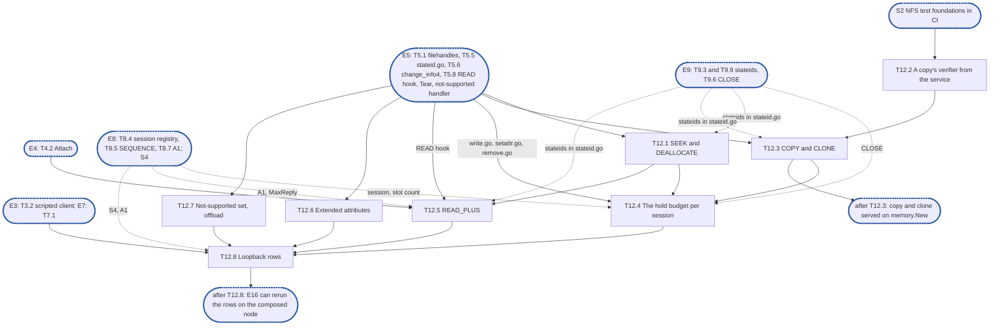

# Epic 12: NFS adapter v2 NFSv4.2 operations

**Sources:** [RFC 21](../docs/internals/rfcs/rfc-21-nfs.md) §9.3 and §9.4, Appendix C, Appendix D's
NFSv4.2 rows, §2.3's `READ_PLUS` clamp and its `LISTXATTRS` decision, §11.5's rows for the
service errors this epic's operations meet (`ErrPastEnd`, `ErrCross` of `CrossNamespace`,
`ErrInvalid` and `ErrIncomplete` of a copy or clone, `ErrDelay` of `DelayClone`, and `ErrIO` and
the read errors on a `READ_PLUS`), its `core` refusal of an NFSv4.2 code under an earlier minor
version and the drain roles of its operations, §11.6's golden vectors for those rows, §12's N22
and N26 for its translations, and §13's rows named in §3 below;
[RFC 17](../docs/internals/rfcs/rfc-17-vfs.md) §3.0's `CopyResult` and `XattrMode`, §3.1's `Seek`,
§5.2's allocated ranges, §5.8's write verifier and §5.9's `WithHold`, for what the adapter passes
and reads;
[RFC 20](../docs/internals/rfcs/rfc-20-adapters.md) §4.3's clamp of a `READ_PLUS`, §4.6's
`vfs.WithHold` per NFSv4.1 session, §4.7's `Invocation.Bound` and `Role`, and §5.4's vectors for
this epic's codecs. Every citation is `develop`'s text, which reaches `feat/storage-v2` with the
cherry-pick of RFC changes.
Cited, not owned: RFC 7862 and RFC 8276 for the bytes, operation codes and status values; RFC 8
§9.1 for what a clone does below the service.
**Track:** C.
**Epic 12 estimate: 8 subtasks, 20 man-days.**
**Depends on:** **S2**, NFS's test foundations in CI: E1's request state and members' table,
E2's `nfsharness` and the `nfs42/` area of knfsd's captures, S0's `vfstest.Mutations`. Beyond S2,
pieces of five epics, each named by id where a subtask takes it (§9, point 5): **E5**'s current
and saved filehandles (T5.1), `stateid.go` (T5.5), `change_info4` from a `WCC` (T5.6), the `READ`
row's `Bound` hook, its short-read rows and `vfstest.Faults`' `Tear` (T5.8), and its one
not-supported handler (T5.8, E5's D13); **E4**'s `Attach` for a reply's data segment (T4.2);
**E9**'s stateids, which extend `stateid.go` to open, lock and delegation stateids (T9.3, T9.9),
and its `CLOSE` (T9.6); **E8**'s session registry, which holds each session's fore-channel slot
count, `Session.Fore.Slots` (T8.4), its `SEQUENCE`, whose `Route` resolves `r.Call.Session` (T8.5),
and A1's runner change with the session's `MaxReply` (T8.7); **E3**'s scripted client (T3.2) and **E7**'s
resolution of a `Claimed` caller (T7.1), for the loopback rows, which also need **S4**.
**Blocks:** E16, which runs this epic's rows on the composed node, the steps that need a clone
the engine really runs among them, and RFC 21 §13's "§9.3 NFSv4.2" row with xfstests.

---

## 1. Goal

Epic 12 serves RFC 21 §9.3's subset of NFSv4.2: holes, server-side copy and clone, and extended
attributes, each operation one row of E1's members' table at minor version 2 and at most one
mutating service call, and the per-session bound on how many calls may wait behind a clone.

**At the end of the epic:**

- `SEEK`, `DEALLOCATE` and `READ_PLUS` answer from the service's `Seek`, `Deallocate` and `Read`,
  holes only where the service reports one, a `READ_PLUS` clamped to its room as a `READ` is;
- `COPY` and `CLONE` are one `Copy` or one `Clone` each, always answered synchronously, a `COPY`
  with the bytes copied, `UNSTABLE4` and the write verifier, and their refusals answered as RFC 21
  §9.3 has them;
- in an NFSv4.1 or NFSv4.2 session, at most the larger of 1 and a quarter of the fore-channel
  slots carry a non-zero `vfs.WithHold` at once; past that a call meets a running clone with
  `NFS4ERR_DELAY` at once;
- `GETXATTR`, `SETXATTR`, `LISTXATTRS` and `REMOVEXATTR` reach the records SMB's extended
  attributes reach;
- `ALLOCATE`, `COPY_NOTIFY`, an inter-server `COPY`, `IO_ADVISE`, `WRITE_SAME`, `LAYOUTERROR` and
  `LAYOUTSTATS` answer `NFS4ERR_NOTSUPP`, `OFFLOAD_STATUS` and `OFFLOAD_CANCEL`
  `NFS4ERR_BAD_STATEID`, and every NFSv4.2 code sent under NFSv4.0 or NFSv4.1 is answered
  `NFS4ERR_OP_ILLEGAL`.

### 1.1 In scope

`ops/v4`'s rows for `SEEK`, `DEALLOCATE`, `READ_PLUS`, `COPY`, `CLONE`, `GETXATTR`, `SETXATTR`,
`LISTXATTRS`, `REMOVEXATTR`, `OFFLOAD_STATUS` and `OFFLOAD_CANCEL`, and the not-supported rows of
`ALLOCATE`, `COPY_NOTIFY`, `IO_ADVISE`, `WRITE_SAME`, `LAYOUTERROR` and `LAYOUTSTATS`, each at
minor version 2 with its drain role; their NFSv4 error rows and golden files; the service's write
verifier on a copy (T12.2, pending the user's answer, §9 point 1); the hold budget per session and
its call sites in the operations RFC 21 §9.3 lists; the hold a held call carried, read through
`vfstest.Faults`; the loopback rows named in §3.

### 1.2 Out of scope

- `xattr_support`, `clone_blksize` and `change_attr_type` in `GETATTR`, and `ACCESS`'s `XAREAD`,
  `XAWRITE` and `XALIST` at minor version 2: E5 (its T5.4 and T5.5). `mode_umask`: E6.
- The layout and device operations' `NFS4ERR_NOTSUPP` (N20): E5. `CB_OFFLOAD`, never sent, has
  nothing to build.
- Open, lock and delegation stateids, their principal check and drain roles per request: E9 (T9.3,
  T9.9) and E10 (T10.4). This epic's operations take their stateids through `stateid.go`, which answers the two
  special stateids from E5 on and the rest once E9 extends it.
- A session's slot count, `SEQUENCE`, and A1's runner change through which a `READ_PLUS`'s hook
  reads the session's budget: E8 (T8.4, T8.5, T8.7).
- NFSv3's and NFSv4.0's hold, the request's remaining deadline: `core` already passes it
  (`internal/adapter/core/middleware.go`'s `withHold`); this epic only lowers it to zero in a
  session past its budget.
- The steps of RFC 21 §13's "§9.3 copy and clone" and "§9.3 hold budget *(1 node)*" that need a
  clone the engine really runs: a `WRITE` held into a running 512 MiB `CLONE` and answered after
  it, a `COPY` of 4 GiB against a continuous writer, a Lost run carried to the destination, a
  crash mid-clone, Linux `cp` falling back after `NFS4ERR_XDEV`, an NFSv3 write held until the
  clone ends; and N22's held-I/O half. `memory.New`'s content completes a clone at once and holds
  nothing behind it, so these run on the composed node: E16, its T16.14 for the node's steps and
  N22's held I/O, its T16.7 for Linux `cp` (§9, point 3; this document's pull request carries
  the matching edit of the plan's Epic 12 and Epic 16 **Done when**).
  RFC 21 §13's "§9.3 NFSv4.2" row: E16, its xfstests steps in the plan's deferral ledger, row
  "RFC 21 §13's rows no suite runs".
- `CLONE` across shards (`ErrCross` of `OtherShard`): a (cluster) part, in the plan's deferral
  ledger, row "RFC 21's (cluster) parts". Asynchronous `COPY` and its copy state: RFC 21 §9.4
  decides it is not offered.
- `ALLOCATE` served: RFC 21 §9.3's `decision:` refuses it until a lower RFC defines a per-file
  reservation; no row is owed. The user guide's lines advertising v1's `ALLOCATE`
  (`README.md`'s NFSv4.2 row, `docs/guide/nfs.md`'s NFSv4.2 rows) are E15's, at the cutover, in
  the plan's deferral ledger, row "The user guide's NFS pages (E15)".
- An SMB set whose name folds onto two stored xattrs that NFS made differing only in case (D7):
  the RFC 22 implementation plan's open point 20, the case-insensitive `XattrMode`, its epic 8.

### 1.3 Names used here

- **E1**, epic 1, the NFS surface: `protocol.State` and the NFSv4 members' table.
- **E2**, epic 2, test foundations: `nfsharness` and knfsd's captures cut into golden files, the
  `nfs42/` area among them.
- **E3**, the RPC layer, with the scripted client `adaptertest/nfsclient` (T3.2).
- **E4**, NFSv3 and MOUNT, which builds `(*resources.Buf).Attach` (T4.2).
- **E5**, the NFSv4 namespace, attributes and data path: the filehandle operations (T5.1),
  `stateid.go` (T5.5), `change_info4` (T5.6), `READ` with its hook, `Tear` and the not-supported
  handler (T5.8).
- **E6**, the NFSv4 ACL attributes. **E7**, identity's NFS side: a `Claimed` caller resolved
  (T7.1).
- **E8**, clients and sessions: `SEQUENCE`, the session registry and its slot counts, A1's runner
  change.
- **E9**, opens, stateids and locks, with `CLOSE`. **E10**, delegations and the back channel.
- **E12**, this epic.
- **E16**, E2E green: the composed node's rows, the suites and the totality test.
- **A1**, an amendment to RFC 20 §4.3 and §4.7, agreed in #5166: the compound runner asks a
  member's `Bound` hook again just before the member runs.
- **S0**, the shared test pieces of the RFC 22 implementation plan's epic 2: `vfstest.Mutations`
  keeping each call's reference and answer, `adaptertest/golden`.
- **S2**, NFS's test foundations in CI, after E2 and S0: what this epic starts from.
- **S4**, an NFSv4.1 session over loopback, after E3, E5 and E8.
- **S5**, the composed in-process node, on which E16 runs the rows this epic cannot.
- **E11**, NLM, NSM and the datagram path, whose amendments share batch two's RFC pull requests.

## 2. How the general rules apply

The rules are those of [the RFC 21 implementation plan's §1.5](rfc-21-nfs-plan.md#15-general-rules-for-each-epic),
cited by number and title and not copied.

| Rule | Subtasks | How |
| --- | --- | --- |
| rule 1, independent unit tests, under `-race` ([`CLAUDE.md`, "Writing tests"](../CLAUDE.md#writing-tests)) | all | each handler on `nfsharness` against `memory.New` (kind 2), errors through `vfstest.Faults` (kind 3), a short copy through `Tear` (kind 3), calls kept in flight through `Faults.Hold` (kind 3), which reports the hold each carried and, through `Hold.Clone`, stages a wait behind a clone through the session's gate, the one-call rule from S0's `vfstest.Mutations`; T12.2's service change in `internal/vfs`'s and `contenttest`'s own suites; the budget as a pure function of its count; no other double |
| rule 2, fuzz tests where relevant | none new | every struct this epic adds is generated and so already in E1's `FuzzCodec`, against `wire`'s second decoder; its translations (`sa_what`, `SETXATTR`'s option, a `LISTXATTRS` cookie) are total functions of one decoded integer each, held by table tests over every value (R31) rather than a target of their own |
| rule 3, observability follows RFC 25 and RFC 20 §10 | all | no recorder in NFS code; each row named after its operation, so `core` names its span and `op` label; `adapter_reads_shortened_total` is `core`'s and counts a short `READ_PLUS` with no NFS code (R6, R35); no label, attribute or log line carries an xattr name, a path or an owner |
| rule 4, profiling: leaks, allocations and contention | T12.4, T12.8 | every loopback test ends with `adaptertest.CheckLeaks`; T12.4's count on the session registry's sessions reports its mutex and block profiles under 64 writers on one session; no `READ_PLUS` gate, since RFC 20 §6.10 names `READ`, `WRITE` and `GETATTR` only |
| rule 5, public interface and internals, at the layer that consumes a value ([`CLAUDE.md`, "Verifying a change"](../CLAUDE.md#verifying-a-change)) | all | each translation asserted on the reply bytes a client decodes, through `nfsharness` or the scripted client; the hold asserted on the context the service receives, the layer that waits on it; the copy's verifier on the `COPY` reply a client compares with its `COMMIT`'s |
| rule 6, known failures shrink | none | no `pynfs`, `cthon04` or `nfstest` test runs before the cutover, and nothing here is listed in a `known.yaml` |
| rule 7, v2 ignores v1 | all | nothing from `develop`'s `v4` package, its NFSv4.2 handlers and xattr code included; operation codes and statuses from RFC 7862 and RFC 8276 |
| rule 8, real dependencies for properties of those dependencies | T12.1, T12.3, T12.5 to T12.8 | golden files cut from knfsd's `nfs42/` captures where they hold the operation, written by hand from RFC 7862 and RFC 8276 where they do not (`READ_PLUS`, `ALLOCATE`'s reply, `OFFLOAD_*`); real TCP over loopback through `core`; a clone the engine really runs is the composed node's, E16's (§1.2) |
| rule 9, code comment conventions ([`CLAUDE.md`, "Code comments"](../CLAUDE.md#code-comments)) | T12.3 to T12.7 | each decision of §4 leaves the marker it names; RFC 21 §9.3's `decision:` on `ALLOCATE` at its row and §9.4's on synchronous copies at `copy.go`; RFC 21 §2.3's `decision:` on an unclamped `LISTXATTRS` at its hook; `core`'s `withHold` `decision:` rewritten to name the budget (T12.4) |
| rule 10, a test must be able to fail | all | each test names the break it catches; none asserts a stub's answer; a golden vector comes from a capture or a specification, never from the encoder under test |
| rule 11, a symbol is exported only if an interface uses it | T12.1 to T12.4 | exported: `CopyResult.Verifier` in `pkg/vfs`, for both adapters (T12.2); `Seek`'s `eof`, for both adapters (T12.1); `WithWaitGate` and `WaitGate` in `pkg/vfs`, for both adapters and the service (T12.4); the session's hold, for `ops/v4` (T12.4); `Hold.Bound` and `Hold.Clone` on `vfstest.Faults`, for every adapter's tests (T12.4); `Tear` on `OpCopy`, for every adapter's tests (T12.3). Every handler and translation stays unexported in `ops/v4` |
| rule 12, each subtask creates only what it declares | all | each row lands with its handler, error rows, golden files and tests; the hold helper with its call sites; the verifier field with its first reader, T12.3; nothing for an operation another epic owns |
| rule 13, translate, never decide | all | each handler makes the calls Appendix D names, at most one mutating, and one read Appendix D does not name: D2's `GetAttr` of a `COPY` or `CLONE` source for a count of 0, which changes nothing and judges no range; overlap, `clone_max_len`, a range past the source and a namespace crossing are the service's refusals, answered through rows, never checked in a handler; holes come from `Seek` only; the hold budget is the adapter's count by RFC 21 §9.3 and decides nothing about a file. Three gaps in RFC 17 are raised against it in batch two's RFC 17 pull request rather than composed in a handler: a copy's verifier (T12.2, D1), `Seek` answering end of file (T12.1, D4) and the service telling the adapter when a call starts waiting behind a clone (T12.4, D3) |
| rule 14, nothing deferred is lost | all | §1.2 names the owner of each part of an obligation this epic leaves out; §9, point 3 proposes moving the running-clone steps to E16 |

## 3. Requirements and invariants

Every MUST and MUST NOT that RFC 21, RFC 17 and RFC 20 place on this epic, numbered so that
subtasks and tests can cite them.

**Holes**

| # | Requirement | Kind | Source | Subtasks |
| --- | --- | --- | --- | --- |
| R1 | `DEALLOCATE` is one `Deallocate` on the reference its stateid names, over the range it carries | MUST | RFC 21 App. C, App. D | T12.1 |
| R2 | `SEEK` is `Seek`, `NFS4_CONTENT_DATA` asking for data and `NFS4_CONTENT_HOLE` for a hole; a `SEEK` from an offset at or past the file's end is `ErrPastEnd`, answered `NFS4ERR_NXIO` | MUST | RFC 21 App. C, §11.5 (`ErrPastEnd`); RFC 17 §3.1 (`Seek`), §5.2 | T12.1 |
| R3 | `Seek`'s answer of the file's size, when it finds none before the end, is reported to the client as end of file | MUST | RFC 17 §3.1 (`Seek`), §5.2 | T12.1 |
| R4 | Holes and data come only from the service's allocation answer: no handler derives a hole from reads, and zeros written as data stay data | MUST NOT | RFC 21 App. C; RFC 17 §5.2 | T12.1, T12.5 |
| R5 | `READ_PLUS` is `Read` and `Seek`, a hole returned as an `NFS4_CONTENT_HOLE` segment only where `Seek` reports one | MUST | RFC 21 App. C, App. D | T12.5 |
| R6 | A `READ_PLUS` is clamped by its row's `Bound` hook to what is left of the record cap, answered short, never below one byte; in a session the hook also lowers its room by what the session's `ca_maxresponsesize`, copied into `Request.State`, falls short of the cap | MUST | RFC 21 §2.3; RFC 20 §4.3, §4.7 (`Invocation.Bound`) | T12.5 |
| R7 | On a `READ_PLUS`, `ErrIO`, `ErrUnavailable`, `ErrCorrupt` and `ErrLost` are a short read of the verified bytes, then `NFS4ERR_DELAY` for `ErrUnavailable` and `NFS4ERR_IO` for the others; a reply is never padded with zeros for the bytes that failed | MUST | RFC 21 §11.5 (`ErrIO`; the read errors); RFC 17 §5.2 | T12.5 |

**Copy and clone**

| # | Requirement | Kind | Source | Subtasks |
| --- | --- | --- | --- | --- |
| R8 | `COPY` is one `Copy` and `CLONE` one `Clone`, both from the saved filehandle's file into the current one's, each through the reference its stateid names | MUST | RFC 21 §9.3 (one mechanism), App. C, App. D | T12.3 |
| R9 | `CLONE` passes its whole range as one extent and is answered only once `Clone` has returned | MUST | RFC 21 §9.3 (`CLONE` is atomic), §12 (N22) | T12.3 |
| R10 | `COPY` answers the bytes `Copy` reports as `wr_count`, a short count at the deadline included, and never more | MUST | RFC 21 §9.3 (`COPY` is not atomic), §12 (N22) | T12.3 |
| R11 | A count of 0 is first turned into the source's size less `ca_src_offset`, so a copy from the end of the file is an empty copy answered `NFS4_OK` with `wr_count` 0; a range ending past the source's size is `NFS4ERR_INVAL` before anything is copied | MUST | RFC 21 §9.3 (`COPY` is not atomic) | T12.3 |
| R12 | A `COPY`'s `wr_committed` is `UNSTABLE4`, with the write verifier of §9.1 | MUST | RFC 21 §9.3, §12 (N23); RFC 17 §3.0 (`CopyResult`), §5.8 | T12.2, T12.3 |
| R13 | Every `COPY` is answered synchronously, `ca_synchronous` false included: no copy stateid is issued | MUST | RFC 21 §9.4 | T12.3 |
| R14 | `OFFLOAD_STATUS` and `OFFLOAD_CANCEL` are answered `NFS4ERR_BAD_STATEID` by the adapter, with no service call | MUST | RFC 21 §9.4, App. C, App. D | T12.7 |
| R15 | A `COPY` or `CLONE` of overlapping ranges of one file, and a `CLONE` longer than `clone_max_len`, are `NFS4ERR_INVAL` and change nothing | MUST | RFC 21 §9.3, §11.5 (`ErrInvalid`), §12 (N22) | T12.3, T12.8 |
| R16 | A `COPY` or `CLONE` between shares in different namespaces is `ErrCross` (`CrossNamespace`), answered `NFS4ERR_XDEV`, and changes nothing | MUST | RFC 21 §9.3, §11.5 (`ErrCross`), §12 (N22) | T12.3, T12.8 |
| R17 | A `COPY` or `CLONE` from a source the service refuses `ErrIncomplete` is `NFS4ERR_IO`; `ErrIO` reading its source is `NFS4ERR_IO` | MUST | RFC 21 §11.5 (`ErrIncomplete`, `ErrIO`) | T12.3 |
| R18 | `COPY_NOTIFY` and an inter-server `COPY` are `NFS4ERR_NOTSUPP` | MUST | RFC 21 §9.3, App. C | T12.3, T12.7 |
| R19 | `ALLOCATE`, `IO_ADVISE`, `WRITE_SAME`, `LAYOUTERROR` and `LAYOUTSTATS` are `NFS4ERR_NOTSUPP`; an `ALLOCATE` is never answered success | MUST NOT | RFC 21 §9.3 (and its `decision:`), App. C | T12.7 |

**The hold budget**

| # | Requirement | Kind | Source | Subtasks |
| --- | --- | --- | --- | --- |
| R20 | In an NFSv4.1 or later session, a call passes `vfs.WithHold` with its remaining deadline while fewer than the larger of 1 and a quarter of the session's fore-channel slots are waiting behind a clone, and zero past that, so a further call meets `ErrDelay` with `DelayClone` at once | MUST | RFC 21 §9.3 (hold budget); RFC 20 §4.6; RFC 17 §5.9 | T12.4 |
| R21 | The budget covers each call RFC 21 §9.3 says is held behind a clone: `WRITE`, `DEALLOCATE`, a `SETATTR` of `size`, a `COPY` or `CLONE` whose destination is a running clone's range, and a `REMOVE` or last `CLOSE` that would release a running clone's destination; a listed call that does not wait takes no place | MUST | RFC 21 §9.3 | T12.4 |
| R22 | NFSv3 and NFSv4.0 calls pass their remaining deadline, so every held call is bounded by its own deadline and none is refused for want of a session | MUST | RFC 21 §9.3 (hold budget); RFC 20 §4.6 | T12.4 |
| R23 | `ErrDelay` with `DelayClone`, a call held past its own deadline or past what its session lets wait, is `NFS4ERR_DELAY` | MUST | RFC 21 §11.5 (`ErrDelay`) | T12.4 |

**Extended attributes**

| # | Requirement | Kind | Source | Subtasks |
| --- | --- | --- | --- | --- |
| R24 | `GETXATTR` and `LISTXATTRS` are `Xattrs`, `SETXATTR` `SetXattr` and `REMOVEXATTR` `RemoveXattr`, in the user namespace only, reaching the same records SMB's extended attributes reach | MUST | RFC 21 §9.3, App. C, App. D | T12.6 |
| R25 | `SETXATTR`'s option maps to `XattrMode`'s `Create`, `Replace` or `Either`; any other value is a named refusal, never a default | MUST | RFC 17 §3.0 (`XattrMode`); RFC 21 §12 (N26) | T12.6 |
| R26 | A `LISTXATTRS`'s `lxa_maxcount` is not clamped to the room: a compound whose `LISTXATTRS`, with the operations around it, would pass the cap is refused | MUST NOT | RFC 21 §2.3 (`LISTXATTRS` decision) | T12.6 |
| R27 | A `GETXATTR`, `SETXATTR` of `Replace` or `REMOVEXATTR` of a name the file does not hold, and a `SETXATTR` whose value passes the service's bound, are answered the statuses RFC 8276 defines for each, not `NFS4ERR_NOENT` or `NFS4ERR_INVAL`; a name the service refuses (empty, holding a NUL, past the name length limit) and a file's xattr past its count bound are each answered their own status, never `NFS4ERR_XATTR2BIG` (pending the user's answer, §9 point 2) | MUST | RFC 21 App. C; RFC 17 §3.1; RFC 13 (xattr bounds); RFC 8276, cited | T12.6 |

**Rows, versions and roles**

| # | Requirement | Kind | Source | Subtasks |
| --- | --- | --- | --- | --- |
| R28 | Every row this epic adds is served at minor version 2 only: each of its codes sent under NFSv4.0 or NFSv4.1 is routed to the `ILLEGAL` row and answered `NFS4ERR_OP_ILLEGAL` | MUST | RFC 21 §11.5 (`core`'s own refusals) | T12.1, T12.3, T12.5, T12.6, T12.7, T12.8 |
| R29 | Every row this epic adds declares its drain role none, so the drain refuses it | MUST | RFC 21 §11.5 (what runs while draining); RFC 20 §4.7 (`Role`) | T12.1, T12.3, T12.5, T12.6, T12.7 |
| R30 | Every row added has a golden vector from the specifications or the reference captures, never only from the codec under test, and §11.6's golden file holds each §11.5 row added here for NFSv4.2 | MUST | RFC 20 §5.4; RFC 21 §11.6 (golden vectors) | T12.1, T12.3, T12.5, T12.6, T12.7 |
| R31 | Every translation here is total: each kind of content a `SEEK` asks for, each `SETXATTR` option and each `LISTXATTRS` cookie maps to a neutral value or a named refusal, and each service error these operations meet to one status | invariant | RFC 21 §12 (N26), §11.6 (total mapping) | T12.1, T12.3, T12.6 |

**RFC 21 §13's rows run here**

| # | Requirement | Kind | Source | Subtasks |
| --- | --- | --- | --- | --- |
| R32 | "§9.3 copy and clone"'s steps on one node that need no running clone: a `CLONE` and a `COPY` of one file onto an overlapping range of itself `NFS4ERR_INVAL` and the file unchanged, a `CLONE` one byte over `clone_max_len` `NFS4ERR_INVAL`, and a `COPY` and a `CLONE` between namespaces `NFS4ERR_XDEV` | test row | RFC 21 §13 | T12.8 |
| R33 | "§9.3 hold budget *(1 node)*"'s adapter half: on a session of 16 fore-channel slots, 8 writes into a running clone's source, the clone's wait staged by `vfstest.Faults` since `memory.New` holds nothing, at most 4 are let wait, the others `NFS4ERR_DELAY` at once, a `READ` of another file served meanwhile, and writes in flight to files with no clone take no place; on a session of 2 slots, one; over NFSv3, a write carries its remaining deadline. The step on a running 512 MiB `CLONE` is E16's (§1.2) | test row | RFC 21 §13 | T12.8 |
| R34 | "§9.4 copies are synchronous": a `COPY` with `ca_synchronous` false answered synchronously with no copy stateid, a short `wr_count` at the deadline from which a resent `COPY` finishes, and `OFFLOAD_STATUS` of any stateid `NFS4ERR_BAD_STATEID` | test row | RFC 21 §13 | T12.8 |
| R35 | "§2.3 a compound's reply under the record cap"'s NFSv4.2 step: `SEQUENCE, PUTFH, READ_PLUS(1 MiB)` and the fixed-size `GETATTR`s, the `READ_PLUS` answered short, with at least one byte and end of file false, each `GETATTR` answered, and `adapter_reads_shortened_total` rising by one | test row | RFC 21 §13 | T12.8 |

## 4. Decisions this epic takes

- **D1. A copy's write verifier comes from the service, in `CopyResult` (pending the user's
  answer, §9 point 1).** RFC 21 §9.3 answers a `COPY` `UNSTABLE4` with the write verifier, but
  RFC 17 §3.0's `CopyResult` carries only the count and the `WCC`, and neither the engine's
  `Copy` nor the service's returns a verifier; the adapter cannot sample one, since RFC 17 §5.8
  makes it the engine's. T12.2 adds `Verifier` to `CopyResult`, sampled as `Write` samples its
  own, before the copy's first chunk is staged, so a loss before the destination's `COMMIT` makes
  that `COMMIT`'s verifier differ and the client copies again. Adding the field after E16 or RFC
  22's copychunk read `CopyResult` costs only its readers' rebuild, since it is additive. Prior
  art: knfsd answers a `COPY` with its boot-time write verifier (from memory). The marker is a
  `decision:` at `CopyResult` naming the sample point.
- **D2. A count of 0 is resolved by a `GetAttr` of the source.** RFC 21 §9.3 turns a `COPY`'s
  count of 0 into the source's size less `ca_src_offset`, and RFC 7862 gives `CLONE`'s count of 0
  the same meaning (from memory). `Copy` and `Clone` take explicit extents, so the handler reads
  the source's size with one `GetAttr`, which makes no change, and passes one extent of
  `max(size − offset, 0)` bytes, for `Copy` as for `Clone`, which takes exactly one: from the size
  it is an empty extent ending at the size, answered with a count of 0, and from past the size an
  empty extent ending past it, which the service refuses `ErrInvalid` (RFC 17 §5.9 step 2), as RFC
  7862 refuses an offset past the size; the handler judges no range. A `decision:` marker says a
  source grown between the two calls is copied to its old
  size, which is what the client saw, and a source truncated between them ends the copy short or
  refused by the service, as any truncate racing a copy does. Overturned if RFC 17's `Extent`
  gains a to-the-end length. Prior art: none checked.
- **D3. The hold budget counts calls that wait, through a gate the service takes as a wait
  begins (pending the user's answer, §9 point 8).** RFC 21 §9.3 counts the session's calls
  waiting behind a clone, but RFC 17 §5.9 gives the adapter only a bound, `WithHold`, and never
  says when a call starts waiting; counting the listed calls in flight instead would refuse a
  write into a running clone's source while other writes, to files with no clone, fill the
  places. So batch two's RFC 17 pull request adds a gate beside the bound:
  ```go
  // WithWaitGate lets the caller admit a call's wait behind a running clone or
  // copy chunk as it begins: the service calls admit once, before its first
  // wait in the call; ok false answers ErrDelay(DelayClone) at once, and
  // release is called once when the wait ends.
  func WithWaitGate(ctx context.Context, admit func() (release func(), ok bool)) context.Context

  // WaitGate returns the gate WithWaitGate set, and false when the call has none.
  func WaitGate(ctx context.Context) (admit func() (release func(), ok bool), ok bool)
  ```
  The service still counts nothing about holds (RFC 17 §5.9): it asks the gate in its one wait,
  `internal/vfs`'s `held`, at the first `DelayClone`, where it now reads `Hold`. The adapter puts
  the session's gate, `Session.Hold`, on every call R21 lists, a `SETATTR` only when it sets
  `size`, beside `core`'s remaining deadline; which `CLOSE` is the last and which `COPY` meets a
  running clone's range is the service's to find, so only a call that really waits takes a
  place. A `decision:` marker at `Session.Hold` names the rule and that a refused wait is
  answered at once. If the user prefers no RFC 17 change, the fallback is an RFC 21 §9.3
  amendment counting the listed calls in flight (§9 point 8, (b)). Prior art: none found;
  knfsd holds no call behind a clone (from memory).
- **D4. `SEEK`'s end of file comes from `Seek` (pending the user's answer, §9 point 7).** `Seek`
  answers the size when it finds nothing before the end, but the adapter does not know the size,
  and a client turns a `SEEK` for data that reaches the end into `ENXIO` only when told it is the
  end. RFC 17 §5.2 says an adapter reads that answer as end of file without giving it a way to:
  a gap in RFC 17, which rule 13 raises against it rather than closing with a second call in the
  handler. Batch two's RFC 17 pull request has `Seek` answer `(off int64, eof bool, err error)`,
  `eof` judged under the same admission lock as the size it answered, and T12.1 changes the
  service to match, so `SEEK` stays one `Seek`. No marker: the rule is the RFC's once amended.
  An `sa_what` other than data or hole is `NFS4ERR_UNION_NOTSUPP`, as RFC 7862 has it (from
  memory). Prior art: knfsd sets the end flag when the answered offset equals the inode's size
  (from memory).
- **D5. A `READ_PLUS` answers one segment.** From its offset it asks `Seek` for a hole: data
  before it is one data segment, read with one `Read` into a segment `Attach` lends, its end of
  file `Read`'s; a hole at the offset is one hole segment up to `Seek`'s next data, clamped to the
  count, not at end of file, so a hole reaching the end is confirmed by the client's next
  `READ_PLUS`. A `Seek` past the
  end (`ErrPastEnd`) is answered end of file with no segment, as RFC 7862 answers a read there
  (from memory). The `Bound` hook is E5's `READ` hook with the count lowered by one segment's
  header, so the clamp and the session budget are one function. A `ponytail:` marker names the
  ceiling: a file of many small holes reads one segment a round trip; upgrade to a segment list
  filling the count when T12.5's benchmark, a sparse file read whole by `READ_PLUS` against
  `READ`, shows `READ_PLUS` taking more round trips per byte than `READ`. Linux's NFSv4.2 client
  sends `READ_PLUS` for ordinary reads (from memory), so the ceiling is met in normal use.
  Prior art: knfsd's `READ_PLUS` encodes a data or hole segment per extent up to the count (from
  memory).
- **D6. A `LISTXATTRS` cookie is the index of the next name** in `Xattrs`' name order, 0 to start;
  a cookie at or past the list's end answers an empty page at end of list, never
  `NFS4ERR_BAD_COOKIE`, since a removal between pages moves a valid cookie there and RFC 8276
  §8.4.3.4 asks the server to avoid failing a listing; a first name that does not fit
  `lxa_maxcount` is `NFS4ERR_TOOSMALL` (RFC 8276 §8.4.3.3). The order is the service's: `Xattrs`
  answers names in byte order, a case T12.6 adds to `vfstest/suite`. A `ponytail:` marker names
  the ceiling: a set or removal between two pages can repeat or skip one name, or end the listing
  early; RFC 13 bounds a file at 1024 xattrs, so a listing rarely takes a second page. Upgrade to a cookie of the last name's digest when a
  client is seen paging a list that changes. Prior art: knfsd's cookie counts the names already
  returned (from memory).
- **D7. An xattr's wire name is its stored name, compared byte for byte (pending the user's
  answer, §9 point 4).** RFC 8276 names carry no namespace prefix and Linux maps them to `user.*`
  on the client (from memory); SMB's extended attributes carry none either. So the name passes
  unchanged to `Xattrs`, `SetXattr` and `RemoveXattr`, and every stored xattr is listed. NFS
  names are case-sensitive: RFC 8276 §8.1 says the server "MUST NOT interpret the contents of
  xattrkey4", and the service compares names byte for byte, so `foo` and `FOO` set over NFS are
  two records, and SMB, which folds EA names (RFC 22 §9.5), lists both. What an SMB set folding
  onto both does is the SMB side's (§1.2). A `decision:` marker at `setxattr.go` names the rule,
  its ceiling, that a share both protocols write can hold two EAs Windows treats as one, and that
  under it a future security-namespace label (RFC 21 §8.2) would be listed and writable over NFS
  like any other name; overturned if RFC 22's fold moves into the service for every caller. Prior art: knfsd
  prefixes `user.` before calling the local filesystem (from memory), which has other namespaces;
  RFC 7's store has none.
- **D8. Xattr refusals by operation (pending the user's answer, §9 point 2).** RFC 21 §11.5 maps
  `ErrNotFound` to `NFS4ERR_NOENT` and `ErrInvalid` to `NFS4ERR_INVAL`, while RFC 8276 answers an
  absent name `NFS4ERR_NOXATTR` and a value too large `NFS4ERR_XATTR2BIG` (from memory). This
  epic adds rows naming the xattr operations that win there: `ErrNotFound` from `SetXattr` or
  `RemoveXattr` is `NFS4ERR_NOXATTR`, and a `GETXATTR` of a name `Xattrs` does not list
  `NFS4ERR_NOXATTR`, answered by the handler, which found it absent. `ErrInvalid` names no cause
  (E5's D14), so no RFC yet says which `SetXattr` refusal is a value too large: the service
  validates no xattr name and applies no bound today (`internal/vfs`'s `SetXattr`). Batch two's
  RFC 17 pull request (§9 points 2 and 7) has `SetXattr` refuse an empty name or one holding
  a NUL (`ErrInvalid`) and one past the share's name length limit (`ErrNameTooLong`), as RFC 7
  §3.2 refuses an entry name, a
  value past RFC 13's bound `ErrInvalid` with cause `TooBig`, and a file's xattr past RFC 13's
  count `ErrNoSpace`; T12.6 builds that in `internal/vfs`. The rows are then: cause `TooBig`
  `NFS4ERR_XATTR2BIG`, any other `ErrInvalid` `NFS4ERR_INVAL`, `ErrNameTooLong`
  `NFS4ERR_NAMETOOLONG` and `ErrNoSpace` `NFS4ERR_NOSPC`, all in RFC 8276's SETXATTR error list.
  RFC 21 §11.5's rows gain these cells by amendment; until agreed, a `decision:` marker at the
  rows names the departure.
- **D9. `GETXATTR`'s reply bound is 64 KiB.** A member's bound is fixed before it runs, and the
  value's size is not known before it is read; RFC 13's xattr value bound defaults to 64 KiB,
  Linux's own. A `decision:` marker names the ceiling: a share whose bound is raised past 64 KiB
  answers a larger value `NFS4ERR_XATTR2BIG` rather than passing the reservation. Overturned by a
  bound read from the share's settings when RFC 13's bound is raised. RFC 13's 64 KiB is one byte
  past what SMB's `FILE_FULL_EA_INFORMATION` can carry (a 16-bit length, 65535): a value of
  exactly 64 KiB set over NFS is one SMB cannot list, which §9 point 4 raises for RFC 13 and the
  RFC 22 plan, not changed here. Prior art: Linux's `XATTR_SIZE_MAX` (from memory).
- **D10. The not-supported rows share E5's one handler.** `ALLOCATE`, `COPY_NOTIFY`, `IO_ADVISE`,
  `WRITE_SAME`, `LAYOUTERROR` and `LAYOUTSTATS` point at E5's not-supported handler (E5's D13); an
  inter-server `COPY`, one whose `ca_source_server` names any server, is refused by `COPY`'s own
  handler before any call. `OFFLOAD_STATUS` and `OFFLOAD_CANCEL` share one handler answering
  `NFS4ERR_BAD_STATEID`. Prior art: knfsd's operation table points unsupported operations at one
  stub (from memory). No marker.
- **D11. `GETXATTR` and `LISTXATTRS` read every value.** RFC 17 §3.1 offers only `Xattrs`, which
  answers each name with its value, so one `GETXATTR` of a 4-byte value or one `LISTXATTRS` page
  reads every value the file holds, up to 64 MiB at RFC 13's bounds (1024 values of 64 KiB), and a
  compound can repeat it. A `ponytail:` marker at `getxattr.go` names that ceiling; upgrade to an
  RFC 17 read by name and a names-only listing when a profile of an xattr-heavy workload shows
  `Xattrs`' bytes, or a share raises RFC 13's bounds. Prior art: Linux reads one xattr by name
  (`getxattr(2)`) and lists names without values (`listxattr(2)`).

## 5. Target tree

```text
internal/adapter/nfs/
  ops/v4/
    seek.go, deallocate.go           T12.1
    errors.go                        T12.1  ErrPastEnd; T12.3, T12.5  their codes in E5's I/O rows; T12.6  the xattr rows (D8)
    copy.go, clone.go                T12.3  copy.go: RFC 21 §9.4's decision
    hold.go                          T12.4  the helper putting the session's gate on each listed call (D3)
    write.go, setattr.go, remove.go  T12.4  E5's handlers, taking a place
    close.go                         T12.4  E9's handler, taking a place
    read_plus.go                     T12.5  and its benchmark beside READ (D5's trigger)
    getxattr.go, setxattr.go, listxattrs.go, removexattr.go   T12.6
    offload.go                       T12.7  OFFLOAD_STATUS, OFFLOAD_CANCEL
    table.go                         T12.1, T12.3, T12.5 to T12.7  the rows, minor version 2; ALLOCATE's row with RFC 21 §9.3's decision
    loopback42_test.go               T12.8
  protocol/
    sessions.go                      T12.4  E8's session: its count of held calls
  wire/testdata/golden/
    knfsd-nfs42-*.hex                T12.1, T12.3, T12.6  cut by E2
    rfc-nfs42-*.hex                  T12.1, T12.3, T12.5, T12.7  by hand where no capture holds the message
internal/adapter/core/
  middleware.go                      T12.4  withHold's decision: rewritten
pkg/vfs/
  types.go                           T12.2  CopyResult.Verifier
  service.go                         T12.1  Seek's eof
  hold.go                            T12.4  WithWaitGate, WaitGate
  vfstest/faults.go                  T12.1  Seek's eof; T12.3  Tear on OpCopy: the count cut short;
                                     T12.4  Hold.Bound, and Hold.Clone: a held call waiting as behind a clone, through the gate
  vfstest/mutations.go, null.go      T12.1  Seek's eof
  vfstest/suite/suite.go             T12.6  Xattrs answering names in byte order
internal/vfs/
  data.go                            T12.1  Seek answering eof under its admission lock
  hold.go                            T12.4  held asking the gate at its first wait
  copy.go, filesystem.go             T12.2  the verifier through Copy
  attrs.go                           T12.6  SetXattr's name and bound refusals (D8)
  contenttest/memory.go, faults.go, suite.go   T12.2
pkg/engine/
  clone.go                           T12.2  Copy samples the verifier
```

## 6. Subtasks

### T12.1 `SEEK` and `DEALLOCATE`

**Subtask T12.1 estimate: 2.25 man-days.**

- **Track:** C. **Depends on:** T5.1, T5.5. T5.5's `stateid.go` serves the two special stateids,
  and E9's extension the rest once it lands, with no change here. Also batch two's RFC 17 pull
  request, for `Seek`'s `eof` (D4, §9 point 7).
- **Covers:** R1, R2, R3, R4, R28, R29, R30, R31.
- **Deliverables:** the service's `Seek` answering `(off int64, eof bool, err error)` (D4): in
  `pkg/vfs`, `internal/vfs`'s `data.go`, `eof` judged under the admission lock its size is read
  under, and `vfstest`'s `Faults`, `Mutations` and `Null`, with its case in `internal/vfs`'s own
  tests. `seek.go`: one `Seek` through `stateid.go`'s reference, its `eof` reported; `sa_what` mapped by a total function, an
  unknown value `NFS4ERR_UNION_NOTSUPP` with no call. `deallocate.go`: one `Deallocate`. Both rows
  at minor version 2, drain role none. `errors.go`: `ErrPastEnd` as `NFS4ERR_NXIO`; `DEALLOCATE`
  added to E5's I/O rows, so `ErrLocked` and `ErrShareViolation` on it are `NFS4ERR_LOCKED`.
  Golden files from knfsd's `nfs42/` captures, a reply by hand from RFC 7862 where the capture
  holds only the call. Consumed by T12.5 (`Seek` and the `ErrPastEnd` row), T12.4 (`DEALLOCATE`'s
  place in the budget) and T12.8.
- **Acceptance criteria:**
  - On a file written as data, a hole made by `DEALLOCATE` and data, `SEEK` for data from the
    hole answers the second data's offset, and for a hole from the first data the hole's offset,
    neither at end of file.
  - `SEEK` for a hole inside the last data answers the size, at end of file; for data in a trailing
    hole, the size, at end of file.
  - `SEEK` from the size is `NFS4ERR_NXIO`.
  - `DEALLOCATE` of a range then `READ` of it reads zeros, and `SEEK` for a hole finds it;
    `DEALLOCATE` of length 0 reaches `Deallocate` once and changes nothing.
- **Tests:** on `nfsharness` against `memory.New`: each criterion, the reply bytes compared
  (catch a hole reported where data is, R2, R4, an end of file dropped, R3, `ErrPastEnd`
  unmapped, R2); a file whose data is zeros written by `WRITE`, `SEEK` for a hole answering the
  size (catches a hole derived from the bytes, R4); `sa_what` of every value from 0 to 3 as a
  table (catches a default for an unknown one, R31); `ErrLocked` and `ErrDelay` of `DelayClone`
  injected on `Deallocate` through `vfstest.Faults`, `NFS4ERR_LOCKED` and `NFS4ERR_DELAY` (catch
  `DEALLOCATE` missing from the I/O rows); one mutating call from `Mutations` (the harness's
  check); as bob on alice's 0600 file, `SEEK` and `DEALLOCATE` `NFS4ERR_ACCESS` with nothing
  changed, on `memory.New` with two users (catches the wrong handle or `Call` passed, which an
  injected `ErrAccess` cannot); each row's `Role` and minor versions read from the table (R28,
  R29); the golden files (R30). No test double beyond `vfstest.Faults`.
- **Rules:** rule 13: a hole and the end of file only from `Seek`.

### T12.2 A copy's write verifier from the service

**Subtask T12.2 estimate: 2 man-days.**

- **Track:** C. **Depends on:** S2. Pending the user's answer to §9, point 1: if the answer is
  RFC 21's amendment instead, this subtask is dropped and T12.3 answers as that amendment says.
- **Covers:** R12.
- **Deliverables:** `pkg/vfs`: `CopyResult{N int64; Verifier Verifier; WCC WCC}`; the content
  interface's `Copy` in `internal/vfs/filesystem.go` returning `(int64, vfs.Verifier, error)`,
  sampled before the first chunk is staged as `Write` samples its own (D1), in `pkg/engine`'s
  `Copy`, `contenttest.Memory` and `contenttest.FaultContent`; `internal/vfs`'s `Copy` passing it
  through. `contenttest.Subject` gains `PauseCopy`, beside `Lose`: a hook that holds a copy after
  its first chunk is staged until released, set per instance, from `export_test.go` for the
  engine and on `Memory` for itself; nil skips the case, naming it. The pull request carries the RFC 17 §3.0 and RFC 8 §12.1 text. Consumed by T12.3, and by
  RFC 22's copychunk, which ignores it.
- **Acceptance criteria:**
  - A copy's verifier equals a `Write`'s before any loss, and a copy held after its first chunk
    is staged, then a loss, then the copy finishing and a `Commit`, answers a verifier the
    `Commit`'s differs from.
- **Tests:** in `contenttest`'s conformance suite, which the engine and `Memory` both pass: a
  copy held through `PauseCopy` after its first chunk is staged, a loss, then the copy finishing
  and a `Commit`, the copy's verifier differing from the `Commit`'s (catches a verifier sampled
  at the copy's end, or a constant); with no loss, the two equal (catches a verifier drawn fresh
  per copy). The service passing it through is asserted at its consumer, T12.3's `COPY`
  and `COMMIT` over `nfsharness`, not in `internal/vfs` (rule 5). No test double: the conformance
  suite holds `Memory` to the engine.
- **Rules:** rule 11: `Verifier` exported for both adapters; rule 9: D1's `decision:` at the
  field.

### T12.3 `COPY` and `CLONE`

**Subtask T12.3 estimate: 3.25 man-days.**

- **Track:** C. **Depends on:** T12.2, T5.1, T5.5, T5.8.
- **Covers:** R8, R9, R10, R11, R12, R13, R15, R16, R17, R18, R28, R29, R30, R31.
- **Deliverables:** `copy.go`: the saved filehandle as the source and the current one as the
  destination, a missing saved filehandle `ErrNoFH`; both stateids through `stateid.go`; a
  `ca_source_server` naming any server `NFS4ERR_NOTSUPP` with no call (D10); a count of 0 through
  one `GetAttr` (D2); one `Copy` of one extent; the reply synchronous whatever `ca_synchronous`
  says, with no callback ID, `wr_count` the count `Copy` answered, `wr_committed` `UNSTABLE4` and
  `wr_writeverf` its verifier, and the consecutive and synchronous requirements both met; RFC 21
  §9.4's `decision:` at the handler. `clone.go`: the same filehandles and stateids, D2's count,
  one `Clone`, answered after it returns. Both rows at minor version 2, drain role none; `COPY`
  and `CLONE` added to E5's I/O rows. `vfstest.Faults`' `Tear` on `OpCopy`, a kind 3 fault that
  lets the copy run and cuts the count it answers to n, as the service's own short answer, with
  its test in `faults_test.go`. Golden files from knfsd's `COPY` and `CLONE` captures. Consumed by
  T12.4 (both handlers take a place) and T12.8.
- **Acceptance criteria:**
  - A `COPY` of 1 MiB between two files answers `wr_count` 1 MiB, `UNSTABLE4` and the verifier
    `Copy` returned; the destination reads the source's bytes.
  - A `COPY` with `ca_synchronous` false is answered the same way, with no callback ID.
  - A `COPY` torn to 64 KiB answers `wr_count` 64 KiB and `NFS4_OK`.
  - A `COPY` of count 0 from offset 10 of a 100-byte file copies 90 bytes; from offset 100 answers
    `NFS4_OK` and 0; from offset 101 `NFS4ERR_INVAL`. A `CLONE` of count 0 from offset 10 clones 90
    bytes as one extent, and from offset 100 answers `NFS4_OK` (D2).
  - A `COPY` then a `COMMIT` of the destination answer one verifier.
  - A `COPY` or `CLONE` of one file onto an overlapping range of itself is `NFS4ERR_INVAL` and the
    file reads unchanged.
  - A `COPY` naming a source server is `NFS4ERR_NOTSUPP`, and no service call is made.
- **Tests:** on `nfsharness` against `memory.New`: each criterion, reply bytes compared (catch
  the count answered as asked rather than copied, R10, a `FILE_SYNC4` or zero verifier, R12, a
  copy stateid issued, R13, a count of 0 passed through, R11, a `CLONE` of count 0 sent as no
  extent, which the service refuses, D2, the overlap checked in the handler
  or not at all, which `Mutations` shows as no call or a changed file, R15); `ErrCross` of
  `CrossNamespace`, `ErrIncomplete`, `ErrIO` and `ErrDelay` of `DelayClone` injected on `Copy` and
  on `Clone` through `vfstest.Faults`, answered `NFS4ERR_XDEV`, `NFS4ERR_IO`, `NFS4ERR_IO` and
  `NFS4ERR_DELAY` (R16, R17); `ErrLocked` on `Copy`, `NFS4ERR_LOCKED`; `CLONE` reaching `Clone`
  with exactly one extent of the asked length (catches a clone split into chunks, R9); a `COPY`
  then a `COMMIT` of the destination, the two verifiers compared as the client compares them
  (catches a verifier that is not the one `COMMIT` answers, the service dropping `Verifier` on the
  way included, R12, N23); a `COPY`
  with no saved filehandle `NFS4ERR_NOFILEHANDLE`; `Tear`'s own test, a copy cut to n answering n.
  On `memory.New` with two users, as a table: bob's `COPY` and `CLONE` from alice's 0600 file,
  and bob's `COPY` into alice's 0644 file, each `NFS4ERR_ACCESS` with both files unchanged
  (catches the current filehandle passed as the source, or the wrong `Call`, which an injected
  `ErrAccess` cannot).
  The one-call rule from `Mutations`, `GetAttr` making no change. No test double beyond
  `vfstest.Faults` and its `Tear`.
- **Rules:** rule 9: D2's marker, RFC 21 §9.4's `decision:`; rule 11: `Tear` on `OpCopy` for
  every adapter's tests; rule 13: no range check in the handler.

### T12.4 The hold budget per session

**Subtask T12.4 estimate: 3 man-days.**

- **Track:** C. **Depends on:** T12.1, T12.3, T5.5, T5.6, T5.8, T8.4, T8.5, T9.6. T8.4 and T8.5
  resolve `r.Call.Session` to a session with its fore-channel slot count; T9.6 is `CLOSE`. Also
  batch two's RFC 17 pull request, for the wait gate (D3, §9 point 8).
- **Covers:** R20, R21, R22, R23.
- **Deliverables:** `pkg/vfs`'s `WithWaitGate` and `WaitGate` (D3), and `internal/vfs`'s `held`
  asking the gate once, at its first `DelayClone`, before it waits, a refusal answered at once and
  the release called when the wait ends, with its case in `internal/vfs`'s own tests. In
  `protocol/sessions.go`, on E8's session, a count of waiting calls and
  ```go
  // Hold admits one call's wait behind a clone into the session's places: the
  // larger of 1 and a quarter of its fore-channel slots. ok false past them;
  // release gives the place back and is called once. It is a wait gate.
  func (s *Session) Hold() (release func(), ok bool)
  ```
  with D3's `decision:`. `ops/v4/hold.go`: `held(ctx, r) context.Context`, which in a session
  returns `vfs.WithWaitGate(ctx, s.Hold)` beside `core`'s remaining deadline, and outside a session
  ctx unchanged; its calls in `deallocate.go`, `copy.go` and
  `clone.go`, and in other epics' handlers once they have landed, the edit this subtask's alone:
  E5's `write.go` (T5.8), `setattr.go` for a `size` set only (T5.5) and `remove.go` (T5.6), and E9's
  `close.go` (T9.6). Neither E5 nor E9 adds a hold call of its own. `vfstest.Faults`' `Hold`
  reports the hold its held call's context carried, `func (h *Hold) Bound() (max time.Duration,
  ok bool)`, read from `vfs.Hold` as the call arrives, and `func (h *Hold) Clone() *Hold` makes
  the held call wait as the service waits behind a clone, a kind 3 delay on cue: it asks the
  context's gate as `held` does, answers `ErrDelay` with `DelayClone` at once when the gate or a
  zero hold refuses, and otherwise waits for `Release` and gives the place back. `core`'s `withHold` `decision:` rewritten: NFSv4.1's bound is lowered per call by the NFS
  adapter. Consumed by T12.8, and by the operations above.
- **Acceptance criteria:**
  - A session of 16 slots gives 4 places, one of 5, 3 or 2 gives 1; a fifth wait on 16 gets
    none, and a place given back is taken again.
  - In a session whose places are taken, a `WRITE` waiting behind a clone is answered
    `NFS4ERR_DELAY` at once; within them, it waits with `core`'s remaining deadline.
  - A listed call that does not wait takes no place: writes in flight to files with no clone
    leave every place to the writes that do wait.
  - An NFSv4.0 `WRITE`, with no session, reaches `Write` with its remaining deadline, whatever
    other calls are in flight.
  - A `SETATTR` setting only `mode` takes no place.
- **Tests:** `Hold` as a function of slots and waits, for 1, 2, 3, 4, 5, 16 and 64 slots (catches
  a budget rounding to 0 at 2 slots, or a quarter rounded up, which 5 slots answers 2); on
  `nfsharness` against `memory.New` with E8's session in the request state: 4 `WRITE`s to another
  file kept in flight by a plain `Hold`, then 8 `WRITE`s each waiting through `Hold.Clone`, exactly
  4 admitted and the other 4 `NFS4ERR_DELAY` at once, and after one is released and answered a
  ninth admitted (catches a budget never applied, a place never given back, R20, and calls in
  flight counted as waiting, R21); the same waits over `DEALLOCATE`, `SETATTR` of `size`,
  `REMOVE`, `CLOSE`, `COPY` and `CLONE` (catches a listed call carrying no gate, R21); a
  `SETATTR` of `mode` carrying no gate (catches every `SETATTR` counted); `internal/vfs`'s `held`
  with a gate that refuses, `DelayClone` at once, and one that admits, its release called once when
  the clone ends (catches the gate asked per retry or never released); the NFSv4.0 case (catches a v4.0 call refused at once, R22);
  `ErrDelay` of `DelayClone` on `Write` through `vfstest.Faults`, `NFS4ERR_DELAY` (R23); a `-race`
  run of 64 goroutines taking and giving back places on one session, its mutex and block profiles
  reported (rule 4); `Bound`'s own test in `faults_test.go`. No test double beyond
  `vfstest.Faults`, kind 3.
- **Rules:** rule 4: the profiles; rule 9: D3's marker and `core`'s rewritten `decision:`; rule
  11: `WithWaitGate` and `WaitGate` for both adapters and the service, `Session.Hold` for `ops/v4`,
  `Hold.Bound` and `Hold.Clone` for every adapter's tests.

### T12.5 `READ_PLUS`

**Subtask T12.5 estimate: 2.75 man-days.**

- **Track:** C. **Depends on:** T12.1, T5.5, T5.8, T4.2, T8.7.
- **Covers:** R4, R5, R6, R7, R28, R29, R30.
- **Deliverables:** `read_plus.go`: E5's `READ` hook lowered by one segment's header (D5); the
  segment from `Seek` and `Read` (D5), the data in a segment `Attach` lends; `ErrPastEnd` answered
  end of file with no segment; the read errors answered as a short read, then the error, as E5's
  `READ` answers them; drain role none; `READ_PLUS` added to E5's I/O rows. Golden files by hand
  from RFC 7862, since E2's captures hold no `READ_PLUS`. Consumed by T12.8.
- **Acceptance criteria:**
  - A file of data alone answers one data segment and end of file.
  - From inside a hole followed by data, one hole segment to the data, not at end of file; with
    the data past the count, the segment ends at the count.
  - From inside data followed by a hole, one data segment up to the hole, not at end of file.
  - From a trailing hole, one hole segment to the size; the next `READ_PLUS`, from the size,
    answers end of file with no segment.
  - Zeros written by `WRITE` answer a data segment.
  - The hook handed 1 MiB of room with `MaxReply` 512 KiB set leaves the count within 512 KiB; with
    room for less than one byte, `ok` false.
  - A `Read` torn after 100 bytes with `ErrUnavailable` answers those bytes, then on the next
    `READ_PLUS` from there `NFS4ERR_DELAY`.
- **Tests:** on `nfsharness` against `memory.New`, files shaped by `WRITE` and `DEALLOCATE`: each
  criterion, the segment decoded from the reply bytes (catch a hole from zeros, R4, a hole not
  from `Seek`, R5, an end of file answered inside a file, R5); the hook as a function of room and
  state (catches a count past the room or a zero count, R6); `Read` torn through `Tear` with each
  of the four errors (catches zero padding or a lost short read, R7); the data segment the very
  buffer `Read` filled (catches a copy); as bob on alice's 0600 file, `NFS4ERR_ACCESS` on
  `memory.New` with two users; `Role` and minor versions from the table (R28, R29). D5's
  trigger as a benchmark on `nfsharness`: a 64 MiB file of 64 KiB data runs and 4 KiB holes read
  whole by `READ_PLUS` and by `READ`, reporting round trips per MiB for each. No test double
  beyond `vfstest.Faults` and its `Tear`.
- **Rules:** rule 9: D5's marker and its trigger's benchmark.

### T12.6 Extended attributes

**Subtask T12.6 estimate: 3.75 man-days.**

- **Track:** C. **Depends on:** T5.1, T5.6. Also batch two's RFC 17 pull request, for D8's `SetXattr`
  refusals (§9 point 2).
- **Covers:** R24, R25, R26, R27, R28, R29, R30, R31.
- **Deliverables:** `internal/vfs`'s `SetXattr` refusing a name, a value past RFC 13's bound and
  a file's xattr past its count as D8 has them, once batch two's RFC 17 pull request settles them
  (§9 point 2), with its cases in `internal/vfs`'s own tests; `vfstest/suite`'s case of `Xattrs`
  answering names in byte order (D6). `getxattr.go`: one `Xattrs`, the named value or
  `NFS4ERR_NOXATTR` (D8), its bound 64 KiB with D9's marker, D11's marker; `setxattr.go`: one `SetXattr` on `vfs.Target{H: current}`, the
  option through a total function into `XattrMode`, an unknown one `NFS4ERR_INVAL` with no call,
  D7's `decision:`, `change_info4` from the file's own `WCC`, the one `SetXattr` answers, through
  E5's T5.6 conversion; `listxattrs.go`: one `Xattrs`, D6's cookie, the
  names that fit `lxa_maxcount`, end of list, RFC 21 §2.3's `decision:` at its unclamped hook;
  `removexattr.go`: one `RemoveXattr`, `change_info4` from its file's `WCC` as `SETXATTR`'s. Names passed unchanged (D7). Rows at minor
  version 2, drain role none; D8's rows in `errors.go`. Golden files from knfsd's `nfs42/` xattr
  captures. Consumed by T12.8.
- **Acceptance criteria:**
  - `SETXATTR` of `Create` then `GETXATTR` returns the value; a second `Create` is `NFS4ERR_EXIST`;
    `Replace` of an absent name `NFS4ERR_NOXATTR`; `Either` sets both ways.
  - An xattr set through `SetXattr` as an SMB call is read by `GETXATTR` under the same name.
  - `LISTXATTRS` of 10 names with a `lxa_maxcount` holding 4 answers 4 and a cookie from which the
    next call answers the next names, the last page at end of list; a cookie at or past the
    list's end, a removal between pages included, answers an empty page at end of list; a
    `lxa_maxcount` too small for the first name `NFS4ERR_TOOSMALL`.
  - `REMOVEXATTR` of an absent name is `NFS4ERR_NOXATTR`; of a present one, its `change_info4`
    moves.
  - A value past the share's bound is `NFS4ERR_XATTR2BIG` and nothing is stored.
  - `foo` and `FOO` set over NFS are two xattrs, each `GETXATTR` answering its own value.
- **Tests:** on `nfsharness` against `memory.New`: each criterion, reply bytes compared (catch an
  absent name answered `NFS4ERR_NOENT`, R27, a mode mapped wrongly, R25, a cookie that repeats or
  skips on a static list, R31); the SMB case through the service with an SMB `Call` (catches a
  name prefixed or stripped, R24); a `COMPOUND` of `LISTXATTRS` with a 1 MiB `lxa_maxcount` and a
  `GETATTR` refused before it runs (catches the count clamped, R26); the option as a table over
  every value (R31); `ErrAccess` on `SetXattr` through `vfstest.Faults`, `NFS4ERR_ACCESS`; a
  table of `SETXATTR` inputs on `memory.New`, an empty name, one holding a NUL, one past the
  name length limit, a value one byte past the bound and the file's 1025th xattr, answered
  `NFS4ERR_INVAL`, `NFS4ERR_INVAL`, `NFS4ERR_NAMETOOLONG`, `NFS4ERR_XATTR2BIG` and
  `NFS4ERR_NOSPC`, nothing stored (catches every `ErrInvalid` answered `XATTR2BIG`, R27); `foo`
  then `FOO`, and the SMB case listing both through an SMB `Call` (catches a fold in the NFS
  path, D7); as bob on alice's 0600 file, each of the four operations `NFS4ERR_ACCESS` and
  nothing changed, on `memory.New` with two users (catches the wrong handle or `Call`). No test
  double beyond `vfstest.Faults`.
- **Rules:** rule 9: D6's, D7's, D8's, D9's and D11's markers, RFC 21 §2.3's `decision:`.

### T12.7 The not-supported set and the offload operations

**Subtask T12.7 estimate: 0.5 man-days.**

- **Track:** C. **Depends on:** T5.8.
- **Covers:** R14, R18, R19, R28, R29, R30.
- **Deliverables:** rows for `ALLOCATE`, `COPY_NOTIFY`, `IO_ADVISE`, `WRITE_SAME`, `LAYOUTERROR`
  and `LAYOUTSTATS` at minor version 2 pointing at E5's not-supported handler (D10), with RFC 21
  §9.3's `ALLOCATE` `decision:` at its row; `offload.go`: `OFFLOAD_STATUS` and `OFFLOAD_CANCEL`,
  one handler answering `NFS4ERR_BAD_STATEID` with no call. Golden files: knfsd's `ALLOCATE`
  request from E2, every reply by hand from RFC 7862. Consumed by T12.8.
- **Acceptance criteria:**
  - Each of the six is `NFS4ERR_NOTSUPP` and makes no service call.
  - `OFFLOAD_STATUS` and `OFFLOAD_CANCEL` of any stateid are `NFS4ERR_BAD_STATEID` and make no
    service call.
- **Tests:** on `nfsharness` against `memory.New`: each row's reply bytes, and `Mutations`'
  record empty (catch an `ALLOCATE` answered success or reaching `Deallocate` or `Write`, R19, an
  offload operation reaching a mutating call, R14). That an offload handler makes no read either is
  a review rule, since its body holds no service call (rule 10). No test double.

### T12.8 Loopback rows

**Subtask T12.8 estimate: 2.5 man-days.**

- **Track:** C. **Depends on:** T12.1, T12.3, T12.4, T12.5, T12.6, T12.7, T3.2, T7.1, T8.7. Also
  S4.
- **Covers:** R15, R16, R28, R32, R33, R34, R35.
- **Deliverables:** `ops/v4/loopback42_test.go`, through `core` over loopback on `memory.New`,
  wrapped by `vfstest.Faults` where a step injects, sent by E3's scripted client in an NFSv4.2
  session that E8's `EXCHANGE_ID`, `CREATE_SESSION` and `SEQUENCE` open: every NFSv4.2 code this
  epic adds a row for, sent under NFSv4.0 and in an NFSv4.1 session, answered
  `NFS4ERR_OP_ILLEGAL`; RFC 21 §13's rows of §3's last table. Consumed by E16, which reruns them on
  the composed node with the steps §1.2 gives it.
- **Acceptance criteria:**
  - "§9.3 copy and clone"'s steps of R32 pass: the overlap through the service's own refusal, the
    `clone_max_len` and namespace refusals injected through `vfstest.Faults`, since `memory.New`'s
    content has no clone length bound and its store one namespace.
  - "§9.3 hold budget *(1 node)*"'s adapter half (R33) on sessions of 16 and 2 slots, the clone's
    wait staged by `vfstest.Faults`' `Hold.Clone`, writes to another file kept in flight by a plain
    `Hold` taking no place, a `READ` of another file answered meanwhile; an NFSv3 `WRITE` carrying
    a non-zero hold.
  - "§9.4 copies are synchronous" (R34): the short count through `Tear`, a resent `COPY` from it
    leaving the destination equal to the source.
  - "§2.3 a compound's reply under the record cap"'s NFSv4.2 step (R35) on a file of 2 MiB.
- **Tests:** the loopback cases above, in a test that starts with `adaptertest.CheckLeaks`, each
  failing on its assertion when the rule it guards is broken: an NFSv4.2 code served under an
  earlier minor version (R28), an overlap or a crossing not refused (R15, R16), a session's places
  never counted or counted for calls that do not wait (R33), a copy answered asynchronously or its count overstated (R34), a `READ_PLUS`
  answered whole past the cap (R35). No test double beyond `vfstest.Faults`: the scripted client
  speaks the wire and `memory.New` is the service.
- **Rules:** rule 4: the leak check; rule 5: every assertion on the bytes the scripted client
  decodes, or on the hold the service received.

## 7. Order of work



T12.1 goes first: `SEEK`'s use of `Seek` and its `ErrPastEnd` row are what `READ_PLUS` builds on,
and `DEALLOCATE` is one of the hold budget's calls. T12.2 and T12.3 follow, the copy path, which
the budget and the loopback rows also need; T12.2 is a service change and the highest risk, since
it waits on the user's answer. T12.4 then applies the budget to every listed call. T12.5, T12.6
and T12.7 are independent branches, each finished before the next. T12.8 needs every row and S4.
E9's stateids reach T12.1, T12.3 and T12.5 through `stateid.go` with no change here; until E9
lands, those rows serve the two special stateids. Checkpoints: after T12.3, a copy and a clone run
on `memory.New` through `nfsharness`; after T12.8, E16 can rerun the rows on the composed node.

## 8. Suggested pull requests

| PR | Subtasks | Man-days | After | Why together |
| --- | --- | --- | --- | --- |
| 1 | T12.1 | 2.25 | E5's T5.1 and T5.5, batch two's RFC 17 pull request | `SEEK` and `DEALLOCATE`, the hole operations the rest builds on, with `Seek`'s end of file |
| 2 | T12.2 | 2 | the user's answer on §9, point 1 | a service and engine change, reviewed by their owners apart from the adapter |
| 3 | T12.3, T12.4 | 6.25 | PRs 1 and 2, E5's T5.6 and T5.8, E8's T8.4 and T8.5, E9's T9.6 | copy and clone, then the budget that bounds what waits behind them |
| 4 | T12.5, T12.6, T12.7 | 7 | PR 1, batch two's RFC 17 pull request, E4's T4.2, E8's T8.7 | `READ_PLUS`, the xattrs and the not-supported rows: the rest of the operation set |
| 5 | T12.8 | 2.5 | PRs 3 and 4, S4, E3's T3.2, E7's T7.1 | every row over loopback |

A suggestion only: one pull request per subtask works as well. PRs 1 and 2 can be open at once,
and PR 4 beside PR 3.

## 9. Open points

1. **A copy's write verifier (D1, T12.2), pending the user's answer.** RFC 21 §9.3 answers a
   `COPY` `UNSTABLE4` with the write verifier, which no layer below the adapter returns for a copy.
   Options: (a) as D1, `CopyResult.Verifier`, sampled by the engine's `Copy` as `Write` samples
   its own, `Copy(...) (int64, vfs.Verifier, error)` in RFC 8 §12.1 and RFC 17 §3.0, 1.75
   man-days in T12.2; (b) an RFC 21 §9.3 amendment answering `wr_committed` `FILE_SYNC4`, since
   RFC 8 §9.1's clone syncs what it copies before it answers, so no verifier is read and T12.2 is
   dropped, at the cost of a loss during that sync going unreported, which RFC 17 §5.8 guards for a
   stable `WRITE` and nothing would guard here; (c) a `Commit` of the destination range after the
   copy, its verifier answered with `FILE_SYNC4`, no service change but a second call and a sync
   per `COPY`. (a) is recommended: it keeps RFC 21's text and N23's guarantee, and knfsd answers a
   `COPY` with its write verifier (from memory). The document is written for (a).
2. **Xattr statuses (D8, T12.6), pending the user's answer.** RFC 21 §11.5 answers `ErrNotFound`
   `NFS4ERR_NOENT` and `ErrInvalid` `NFS4ERR_INVAL` for every operation, while RFC 8276 answers an
   absent xattr `NFS4ERR_NOXATTR` and a value too large `NFS4ERR_XATTR2BIG` (from memory). Options:
   (a) as D8, rows naming the xattr operations, with an RFC 21 §11.5 amendment adding the cells,
   carried by batch two's one RFC 21 pull request, opened with E8's document pull request; (b) keep §11.5 as written, so Linux's `getfattr` of an
   absent name reads `ENOENT` rather than `ENODATA` (from memory), which breaks tools that test for
   `ENODATA`. (a) is recommended. Either way, no RFC says which names `SetXattr` refuses or what
   it answers past RFC 13's value and count bounds, and the service checks none of them, so (a)
   also carries D8's RFC 17 text in batch two's RFC 17 pull request (point 7): the name refused
   as RFC 7 §3.2 refuses an entry name, a value too large `ErrInvalid` with cause `TooBig`, the
   1025th xattr `ErrNoSpace`; 0.5 man-days in T12.6. Without it, `ErrInvalid` stays causeless and
   T12.6 answers it `NFS4ERR_INVAL` for every cause.
3. **The running-clone steps on the composed node, pending the user's answer; this document's
   pull request carries the plan's edit for (a)**, in its Epic 12 and Epic 16 **Done when** and
   §7's N22 row. The plan names RFC 21 §13's "§9.3 copy and
   clone" single-node steps and "§9.3 hold budget *(1 node)*" in this epic's done-when, and N22.
   `memory.New`'s content runs a clone at once and never holds a call behind one, so the steps that
   need a clone the engine really runs (§1.2) cannot fail here. Options: (a) as §1.2, those steps
   move to E16, on the composed node, and this epic runs the adapter's half (R32, R33); (b) this
   epic builds them over a composed service of its own, `internal/vfs` over the engine, which an
   adapter test cannot import, so that would be a test package outside the adapter, about 2
   man-days more and a second copy of what S5 builds. (a) is recommended, and E16's document
   takes the steps: its R61 and R63 (the node's steps, the NFSv4.1 hold budget) and R64 (N22's
   held I/O) in T16.14, its R62 (Linux `cp` after `NFS4ERR_XDEV`) in T16.7; R41 there already holds
   the NFSv3 hold step, in T16.14 too.
4. **An xattr's stored name (D7), pending the user's answer.** RFC 21 §9.3 has NFS reach the records
   SMB's extended attributes reach. Options: (a) as D7, the wire name stored unchanged, as SMB
   stores its EA name, so `user.foo` on a Linux client and `foo` over SMB are one record; (b) a
   `user.` prefix added by the adapter, leaving room for other namespaces in the store, so SMB
   would have to add the same prefix, an RFC 22 change. (a) is recommended: RFC 7 §2.7's store
   holds no namespace, and RFC 21 §8.2 serves no other. Under (a), case: RFC 22 §9.5 folds EA
   names on SMB while RFC 8276 §8.1 forbids the server to interpret an xattr name, so NFS stays
   byte for byte (D7) and `foo` and `FOO` can be two records SMB lists both of. The other options
   were a `SetXattr` refusing (`ErrExist`) a name that folds onto another stored one, which
   interprets the name and fails a Linux `setfattr` a local filesystem accepts, or the service
   folding for every caller, as v1's resolver did, which rewrites what an NFS client stored. What
   an SMB set folding onto two records does is for the RFC 22 plan's open point 20, its epic 8.
   That plan should also note that RFC 13's 64 KiB value bound is one byte past what SMB's 16-bit
   EA length carries (D9).
5. **What this epic takes from other epics, settled with their documents.** E8: T8.4's
   `protocol.Session`, reached from `r.Call.Session` (set by T8.5's `Route`) through `Sessions.Get`,
   holding its granted fore-channel slot count `Fore.Slots`, on which T12.4 adds its count and
   `Hold`; T8.7's `SEQUENCE` setting `protocol.State`'s `MaxReply` and A1's runner change; S4 (T8.8).
   E9: `stateid.go` extended to open, lock and delegation stateids (T9.3, T9.9), which this epic's
   handlers call unchanged, and T9.6's `close.go`, which T12.4 edits after T9.6 lands; E9 adds no
   hold call of its own. E5, from its document:
   T5.1, T5.5, T5.6 and T5.8, including `Tear` and the not-supported handler, and its I/O rows of
   `ErrLocked` and `ErrShareViolation`, to which T12.1, T12.3 and T12.5 add their operations. E4:
   T4.2's `Attach`, for `READ_PLUS`'s data inside an array of unions; if the generator's segment
   field does not reach a union arm, T12.5 adds that case to the generator, about 0.5 man-days.
6. **The estimate against the plan's 13 man-days.** 18.5 at first: the plan's figure had no service change
   for the verifier (T12.2, 1.75), for `Seek`'s end of file (in T12.1, 0.25) or for the wait gate
   (in T12.4, 0.5), counted no edit of other epics' handlers for the budget, and priced the xattrs
   and the not-supported rows lightly; the loopback rows are as the plan had them. With §9 point
   1's (b), the figure is 16.75; with point 8's (b) as well, 16.25. 20 after the review that
   added the paused copy to the verifier's test (T12.2, 0.25), two-user refusal tests (T12.3 and
   T12.6, 0.25 each), the `READ_PLUS` benchmark D5's trigger reads (T12.5, 0.25) and the service's
   xattr name and bound refusals (T12.6, 0.5): with point 1's (b) 18, with point 8's (b) as well
   17.5, with point 2's (b) 0.5 less again. The plan's Epic 12 row still reads 13; its programme
   totals reconcile when the breakdown pull requests merge, and this document leaves them alone.
7. **Which pull request carries which RFC amendment.** Batch two's one RFC 17 pull request, with
   E9's D1, E10's Q1 and E11's Q1, opened before E9's PR 1, carries four of this epic's: point 1's
   (a), RFC 17 §3.0's `CopyResult` and `Copy` with RFC 8 §12.1, for T12.2; `Seek` answering
   `(off int64, eof bool, err error)` in RFC 17 §3.1 and §5.2 (D4), for T12.1, pending the user's
   answer, since the alternative, a `Read` of no byte after `Seek` in the handler, is the sequence
   rule 13 forbids; point 8's (a), the wait gate in RFC 17 §5.9, for T12.4; and point 2's
   `SetXattr` refusals (D8), for T12.6. Each subtask waits
   for it. Point 2's §11.5 cells, and point 1's and point 8's §9.3 text if (b) is chosen, go in
   batch two's one RFC 21 pull request. Point 3's edit is to the RFC 21 implementation plan, not
   an RFC.
8. **Counting the calls that wait (D3, T12.4), pending the user's answer.** RFC 21 §9.3 counts
   the session's calls waiting behind a clone, and RFC 17 §5.9 never tells the adapter when a
   call starts to wait. Options: (a) as D3, RFC 17 §5.9 gains `WithWaitGate`, which the service
   asks once at its first wait (`internal/vfs`'s `held`, one place), so only calls that wait take
   a place and RFC 21 stays as written, 0.5 man-days in T12.4; (b) an RFC 21 §9.3 amendment
   counting every listed call in flight, no service change, at the cost that writes to files with
   no clone fill the places and a write into a running clone's source is then answered
   `NFS4ERR_DELAY` at once (on 16 slots, a fifth write while 4 others are in flight), and every
   `CLOSE` counted where RFC 21 names the last. (a) is recommended: it is the rule RFC 21 states,
   and the service still counts nothing.
9. **Wire offsets past `int64`.** An NFSv4 offset or count is a `uint64`, and one of 2⁶³ or more
   turns negative as an `int64` extent (D2's `max(size − offset, 0)` among them). No epic states
   the conversion rule, and it spans E1's codec and E4's and E5's I/O as much as this epic's
   operations, so it is left to the plan as an unowned follow-up rather than settled here; this
   epic's handlers apply whatever rule that settles, with no rule of their own.
