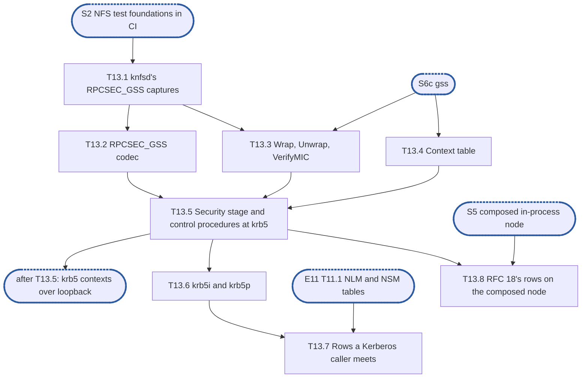

# Epic 13: NFS adapter v2 RPCSEC_GSS

**Sources:** [RFC 21](../docs/internals/rfcs/rfc-21-nfs.md) §10 (RPCSEC_GSS), §11's paragraph on
decoding (the credential with the RPC header), §11.1's `RPCSEC_GSS` rows, "Where they are judged",
"Export flavour policy" and "GSS contexts" bullets, §8.1's privilege over `RPCSEC_GSS`, §11.5's
`ErrWrongSecurity` row as a Kerberos caller meets it and its sentence leaving `ErrNotNegotiated`,
`ErrNoSession`, `ErrNoTree` and `ErrExpired` to the GSS tables, §12's N3 for GSS contexts, §13's
rows "§10 context table *(1 node)*", "§8.1 privilege *(1 node)*"'s Kerberos steps and "§6.3 `MNT` on
a Kerberos-only share *(1 node)*"'s `sec=krb5` step, and §14's `nfs_gss_contexts` row;
[RFC 20](../docs/internals/rfcs/rfc-20-adapters.md) §4.4 (`gss.Context`'s `Wrap` and `Unwrap`, the
pieces table's NFS column, the `Identity` per request, and its tests without a domain), §4.5 for the
rows above, §4.7's `Security` and `HeaderCodec.ReplyLen` contracts and its stage table's Security row,
§5.2 and §5.4 for the credential's decoder and the tokens' targets, and §5.5's rows for the
`RPCSEC_GSS` header verifier, `krb5i` and `krb5p`;
[RFC 18](../docs/internals/rfcs/rfc-18-identity.md) §3.1's sign-in contract as the adapter meets it,
§3.3's NFS wire half (an AP-REQ handed to `SignIn` for the NFS service name), §3.7 and §3.8 as an
NFS context meets them, §7.3's sentence on GSS contexts, and §10's rows "expiry" over `sec=krb5`
and "disable takes effect"'s GSS half. Every clause cited reads the same on `develop` and on
`feat/storage-v2`.
Cited, not owned: RFC 2203 for the RPCSEC_GSS messages, RFC 4121 for the per-message tokens, RFC
5531 for `auth_stat`, RFC 17 §4.9's admission, RFC 24's connection-state pool.
**Track:** B.
**Epic 13 estimate: 8 subtasks, 19.5 man-days.**
**Depends on:**
- **S2**, NFS's test foundations in CI, with E2's capture recipe, which T13.1 extends to a KDC.
- **S6c**, the RFC 22 implementation plan's epic 4: `gss`'s `Context`, `Exchanges`, the Kerberos
  mechanism, `Identity`, RFC 4121's MIC token and `gsstest`'s Kerberos initiator. T13.3 and T13.4
  build on it; nothing of this epic but T13.1 and T13.2 starts without it.
- **S6b**, Kerberos sign-in behind `SignIn`, which already holds on `feat/storage-v2`
  (`internal/identity`'s `signInKerberos`, with `identitytest.Realm` minting tickets), so this epic's
  rows where an `INIT` succeeds do not wait for it. **S6a** holds as well, so a Kerberos caller
  resolves.
- E3's T3.1 (`Route` builds `r.Call`), T3.2 (the scripted client), T3.3 (the duplicate-request
  cache) and T3.4 (every table's shared rows), which T13.5 and T13.7 extend.
- For T13.7's rows only: E4's T4.4 and T4.6 (`GETATTR`, `MNT`), E5's T5.1, T5.4, T5.5 and T5.8
  (`PUTFH`, `GETATTR`, `SETATTR`, `READ`), E7's T7.2 (the owner schemes a `chown` parses under),
  E11's T11.1 (NLM's and NSM's error tables, which T13.7 adds rows to).
- **S5**, the composed in-process node, for T13.8 only.

**Blocks:** E16, which runs `e2e/kerberos` with the Linux kernel client once E15 has turned the
suites on: the `sec=krb5`, `krb5i` and `krb5p` mounts, `tar xpf` of §8.1's row, and the Kerberos
halves of E7's rows over NFS.

---

## 1. Goal

Epic 13 serves Kerberos on NFS: an `RPCSEC_GSS` context set up through `gss`'s Kerberos mechanism and
the service's `SignIn`, held in a bounded table on the node, checked on every call by NFS's
`Security` stage, and its per-message protection, `krb5i` and `krb5p`, applied in place.

**At the end of the epic:**

- over loopback through `core` on `memory.New`, a client of `gsstest`'s Kerberos initiator sets up a
  context with `INIT`, then sends NFSv3, MOUNT and NFSv4 calls under it at `krb5`, `krb5i` and
  `krb5p`; each reaches the handler with an `r.Call` whose `Identity` is `Ticket` with the matching
  protection and the principal `SignIn` bound, and each reply verifies at the client;
- §13's context-table row holds: a forged `DESTROY` changes nothing, a forged call above the window
  leaves it where it was, `MAXSEQ` and a ticket's end delete the context, one principal looping
  `INIT` evicts only its own contexts, and a context survives a reconnect;
- a `sec=krb5` `GETATTR` on the handle an `AUTH_SYS` `MNT` returned is served, a `krb5` call on a
  share requiring `krb5i` is refused `AUTH_TOOWEAK` over NFSv3 and `NFS4ERR_WRONGSEC` over NFSv4,
  and §8.1's Kerberos steps give an `admin` principal and a principal linked to root the answers
  RFC 18's resolution gives them;
- the scaffold's interim `AUTH_BADCRED` for every `RPCSEC_GSS` credential is gone;
- after S5, RFC 18's "expiry" and "disable takes effect" rows hold for an NFS GSS context on the
  composed node.

### 1.1 In scope

`gss`'s RFC 4121 `Wrap` and `Unwrap`, and the check of a peer's MIC token (D11, Q3), with their
initiator side in `gsstest`; `nfs/wire`'s `RPCSEC_GSS` credential, control bodies and protected
bodies; `nfs/protocol`'s context table, `Security` stage and control table; the `Identity` of a GSS
call; the duplicate-request cache's key for a GSS call; the rows for `ErrExpired`, `ErrNoSession`,
`ErrNotNegotiated` and `ErrNoTree` that §1.2 does not give to E8; the scripted client's
`RPCSEC_GSS` side; knfsd's `RPCSEC_GSS` captures; the rows of §3 over loopback and, for RFC 18's
two rows, on the composed node.

### 1.2 Out of scope

- `gss`'s `Exchanges`, its Kerberos, NTLM and SPNEGO mechanisms, its `Identity` and RFC 4121's MIC
  token: S6c. Verifying a ticket, the keytab, the replay cache, AES only, the logon throttle and
  logon events: the authenticator behind `SignIn` (RFC 18 §3.1, §3.3), built.
- `ErrWrongSecurity`'s rows: E3's T3.4 (`AUTH_TOOWEAK` in the NFSv3-family tables) and E5's T5.1
  (`NFS4ERR_WRONGSEC`). This epic drives them with a Kerberos caller below a share's level (R29).
- `SECINFO` and `SECINFO_NO_NAME`, which list the `krb5` pseudo-flavours: E5's T5.1.
- The back channel's security, where `RPCSEC_GSS` is not offered (RFC 21 §3.4): E8's T8.4 (its D11)
  and E10's T10.2.
- `ErrNotNegotiated`, `ErrNoSession` and `ErrNoTree` in NFSv4's members' table, which turn on what
  a session means for an NFSv4.1 member: E8's T8.5, by its D6.
- The `e2e/kerberos` rows with the Linux kernel client, `tar xpf` of §8.1's row among them, and the
  Kerberos halves of RFC 18 §10's rows E7 runs over `AUTH_SYS`: E16, after E15.
- "disable takes effect"'s SMB half: the RFC 22 implementation plan, and E16 for the row whole.
- `nfs_gss_contexts`, whose producer is T13.4's table: nothing records it while who records the
  series only NFS code can count is open with the RFC's author, as rule 3 has it. If that settles
  before T13.4 lands, T13.4 adds it, about 0.5 man-days inside its figure; after, the epic the
  decision names.
- The `require_kerberos` boot refusal, which the RFC 20 implementation plan's deferral ledger gives
  here: not built, pending the user's answer (Q4); if the answer is to build it, a subtask of its own
  is added after T13.7.

### 1.3 Names used here

- **E2**, test foundations: NFS's handler harness and knfsd's captures, recorded from the client
  network namespaces of `test/nfs-mount/netns.sh`.
- **E3**, the RPC layer: the credential as `Identity` (T3.1), the scripted client (T3.2), the
  duplicate-request cache (T3.3) and every table's shared rows (T3.4).
- **E4**, NFSv3 and MOUNT. **E5**, the NFSv4 namespace, attributes and data path. **E7**, identity's
  NFS side, with its owner schemes (T7.2). **E8**, clients and sessions. **E10**, delegations and the
  back channel. **E11**, NLM, NSM and the datagram path. **E12**, the NFSv4.2 operations. **E13**, this epic. **E14**, the capture diffs against knfsd. **E15**, integration
  with the node, which turns the NFS suites on. **E16**, E2E green.
- **S0**, the shared test pieces the RFC 22 implementation plan's epic 2 builds, `adaptertest/golden`
  among them.
- **S2**, NFS's test foundations in CI: what every middle epic starts from.
- **S5**, the composed in-process node, `internal/node/nodetest`, serving NFS.
- **S6a**, `Spell`, `Find` and resolution through `vfs.Service`: RFC 18's plan's S2.
- **S6b**, Kerberos sign-in behind `SignIn`: RFC 18's plan's epic 5.
- **S6c**, `gss`: the RFC 22 implementation plan's epic 4.

## 2. How the general rules apply

The rules are those of [the RFC 21 implementation plan's §1.5](rfc-21-nfs-plan.md#15-general-rules-for-each-epic),
cited by number and title and not copied.

| Rule | Subtasks | How |
| --- | --- | --- |
| rule 1, independent unit tests, under `-race` ([`CLAUDE.md`, "Writing tests"](../CLAUDE.md#writing-tests)) | all | the table as a state machine on an injected clock (kind 1, D6); the stage on golden vectors and capture vectors with no socket; loopback rows through `core` on `memory.New` (kind 2) with `vfstest.Mutations`, a recording wrapper that passes each call through; `gsstest`'s Kerberos initiator and `identitytest.Realm`'s tickets, real Kerberos messages under test keys; RFC 18's rows on `nodetest`. No other double |
| rule 2, fuzz tests where relevant | T13.2, T13.3 | `FuzzGSSCred` over the credential and the control and protected bodies, against a second decoder written by hand from RFC 2203 (R32); `FuzzWrapToken` and `FuzzMICToken` over RFC 4121's token parsing in `gss`, seeded with the capture's tokens |
| rule 3, observability follows RFC 25 and RFC 20 §10 | T13.4 | no recorder in NFS code; `nfs_gss_contexts` is §1.2's; no attribute or log line added here carries a principal, a handle or an address (RFC 25 §5.4) |
| rule 4, profiling: leaks, allocations and contention | T13.4, T13.5, T13.6 | the table's mutex and block profiles under 64 connections and 1 000 contexts, reported in T13.4's pull request; every loopback test ends with `adaptertest.CheckLeaks`; `krb5p`'s `Unwrap` and `Wrap` allocate nothing per call past the token (R23) |
| rule 5, public interface and internals, at the layer that consumes a value ([`CLAUDE.md`, "Verifying a change"](../CLAUDE.md#verifying-a-change)) | T13.5, T13.6, T13.7, T13.8 | the `Identity` asserted on the `r.Call` a handler receives over loopback, the window and eviction on the replies a client reads, a forged call on `vfstest.Mutations` staying empty, each reply's verifier checked by the client that reads it |
| rule 6, known failures shrink | none | no `pynfs`, `cthon04` or `nfstest` test runs before the cutover |
| rule 7, v2 ignores v1 | all | nothing from `develop`'s `rpc/gss`; behaviour from RFC 21 §10, RFC 2203 and RFC 4121; the GSS per-message code RFC 20 Appendix B keeps is `gss`'s, moved there by S6c |
| rule 8, real dependencies for properties of those dependencies | T13.1, T13.2, T13.3, T13.6 | knfsd's captures with the Linux client and a real KDC, decrypted under the test realm's committed keytab (D13); RFC 2203's layouts written by hand; RFC 4121's tokens checked against the Linux client's and knfsd's; real TCP over loopback. A real KDC with a kernel client runs at `e2e/kerberos`, E16's |
| rule 9, code comment conventions ([`CLAUDE.md`, "Code comments"](../CLAUDE.md#code-comments)) | T13.4, T13.5, T13.6, T13.7 | RFC 21 §10's `ponytail:` on the cap and idle timeout at the table's constants; the `decision:` markers of §4 at their sites; `stages.go`'s marker on `RPCSEC_GSS` removed with the refusal it explains |
| rule 10, a test must be able to fail | all | each test names the break it catches; a forged call is asserted on the table's state and on the service never called, not only on the status |
| rule 11, a symbol is exported only if an interface uses it | T13.2, T13.3, T13.5 | `gss.Context`'s `Wrap`, `Unwrap` and `VerifyMIC` for `nfs/protocol` (RFC 20 §4.4, Q3); `wire`'s GSS codec for `nfs/protocol` and `nfsclient`; `nfsclient`'s GSS calls for every later Kerberos row; nothing else |
| rule 12, each subtask creates only what it declares | all | the codec lands with its fuzz target and its first consumer's vectors; the table with its state-machine tests before the stage that drives it; the control table with `INIT`, its first row |
| rule 13, translate, never decide | T13.5, T13.7 | a GSS call becomes a neutral `Identity` by a pure function of the context and the credential's service (R16); the adapter maps no principal and decides no privilege, and §8.1's answers come from resolution (R19) |
| rule 14, nothing deferred is lost | all | §1.2 names the owner of each part of an obligation this epic leaves out, §9 the assumptions and gaps |

## 3. Requirements and invariants

Every MUST and MUST NOT that RFC 21, RFC 20 and RFC 18 place on this epic, numbered so that
subtasks and tests can cite them.

**The context and its table**

| # | Requirement | Kind | Source | Subtasks |
| --- | --- | --- | --- | --- |
| R1 | A GSS context is held in the memory of the gateway node that created it, and is never shared or stored; after the node's loss, on one node its restart, the client's next call on the old handle is answered `RPCSEC_GSS_CREDPROBLEM` | MUST | RFC 21 §10, §12 (N3); RFC 20 §4.4 (the pieces table's context-table row) | T13.4, T13.5 |
| R2 | A context is keyed by its handle, not by the TCP connection that created it, so a reconnect or another connection keeps using it | MUST | RFC 21 §10 | T13.4, T13.5 |
| R3 | At most 10 000 contexts per gateway node, charged to RFC 24's connection-state pool | bound | RFC 21 §10; RFC 18 §7.3 | T13.4 |
| R4 | When the table is full, the same principal's least recently used context is evicted first, then the least recently used overall, so one principal looping `INIT` evicts only its own | MUST | RFC 21 §10 | T13.4 |
| R5 | A context idle 8 hours is evicted; only a call whose header MIC verified touches its idle time | MUST | RFC 21 §10 | T13.4, T13.5 |

**The sequence window and the checks of a call**

| # | Requirement | Kind | Source | Subtasks |
| --- | --- | --- | --- | --- |
| R6 | The window is 128. A call whose sequence number is below the window, or already seen within it, is dropped unanswered; one above it advances the window once its verifier checksum passes | MUST | RFC 21 §10 | T13.4, T13.5 |
| R7 | A call whose verifier checksum fails is rejected `RPCSEC_GSS_CREDPROBLEM` and leaves the window, and the context's idle time, as they were | MUST | RFC 21 §10 | T13.4, T13.5 |
| R8 | Neither a dropped nor a rejected call runs | MUST | RFC 21 §10 | T13.5 |
| R9 | A call on a context past its ticket's end time, or with a sequence number at or above `MAXSEQ`, deletes the context and is answered `RPCSEC_GSS_CTXPROBLEM`; both are checked only after the header MIC verifies. Over NFS this is the expired-credential answer RFC 18 §3.1 asks for; the release calls RFC 18 §3.8 lets through are Q2's | MUST | RFC 21 §10; RFC 18 §3.1, §3.8 | T13.4, T13.5 |
| R10 | `RPCSEC_GSS_DESTROY` needs a valid header MIC and an in-window sequence number; one without either is refused and the context kept | MUST | RFC 21 §10 | T13.5 |

**Setting up a context**

| # | Requirement | Kind | Source | Subtasks |
| --- | --- | --- | --- | --- |
| R11 | The `RPCSEC_GSS` control procedures, `INIT`, `CONTINUE_INIT` and `DESTROY`, are routed by the RPC router, `INIT` and `CONTINUE_INIT` to `gss.Exchanges`; the context table and sequence window are the NFS adapter's, in `nfs/protocol`, in memory only | MUST | RFC 20 §4.4 (the pieces table) | T13.4, T13.5 |
| R12 | The ticket reaches the service's `SignIn` as an AP-REQ for the NFS service name with the connection's address as its `Client`; the adapter holds only the result, opens no connection to a KDC and reads no keytab. A ticket for another service name, `cifs/` over NFS among them, is refused by `SignIn` and answered as R13 says | MUST | RFC 20 §4.4; RFC 18 §3.1, §3.3 | T13.5 |
| R13 | Every error `SignIn` returns, `ErrLogonFailure`, `ErrInvalid` or `ErrUnavailable`, is answered as GSS's logon failure, `CREDPROBLEM`, and never becomes an anonymous or guest context | MUST NOT | RFC 20 §4.4 (failure handling); RFC 18 §3.1; RFC 21 §11.5 (`ErrLogonFailure`) | T13.5 |
| R14 | The evidence `SignIn` returned is the context's for its life: every call on the context acts as that principal, and the adapter never maps the name again | MUST NOT | RFC 18 §3.1 (evidence is bound) | T13.5 |
| R15 | Nothing of a GSS context reaches the core but the `Identity` `SignIn` returned: its keys and window stay on the node | invariant | RFC 21 §11.1 (GSS contexts); RFC 20 §4.4 | T13.5 |

**The caller**

| # | Requirement | Kind | Source | Subtasks |
| --- | --- | --- | --- | --- |
| R16 | An `RPCSEC_GSS` call becomes an `Identity` of `Proof` `Ticket`, `Protection` `None` at `krb5`, `Integrity` at `krb5i` and `Privacy` at `krb5p`, `Evidence.Principal` the ticket's principal from `Service.SignIn`, no `Claims`, and the connection's source address | MUST | RFC 21 §11.1 (the table); RFC 20 §4.4 | T13.5, T13.6 |
| R17 | The `Identity` is built afresh for each request from the GSS context, by the router, never by a handler; a `COMPOUND`'s members read the `r.Call` its route built | MUST | RFC 20 §4.4; RFC 21 §11 (decoding) | T13.5 |
| R18 | Any cache keyed on identity carries every field the `Identity` has: the duplicate-request cache never answers one context's call with another context's reply | MUST | RFC 20 §4.4 | T13.5 |
| R19 | The adapter maps no principal to IDs, applies no squash and decides no privilege: over `RPCSEC_GSS`, an `admin` grant and a Kerberos name linked to root reach privilege only through resolution | MUST NOT | RFC 20 §4.4; RFC 21 §8.1 (which NFS callers are privileged) | T13.5, T13.7 |
| R20 | The credential is decoded with the RPC header only as its `opaque_auth` envelope; an `RPCSEC_GSS` credential's body is judged by the GSS stage, at unwrap | MUST | RFC 21 §11 (decoding), §11.1 (where they are judged) | T13.2, T13.5 |
| R21 | An `RPCSEC_GSS` credential whose body does not decode inside its opaque is rejected `AUTH_BADCRED` and runs nothing, never treated as anonymous; the scaffold's refusal of every `RPCSEC_GSS` credential is withdrawn | MUST | RFC 21 §11.1 (refused credentials) | T13.5 |

**Integrity, privacy and their answers**

| # | Requirement | Kind | Source | Subtasks |
| --- | --- | --- | --- | --- |
| R22 | The `Security` stage checks the header verifier and the sequence window and writes the reply verifier; at `krb5i` it checks the body's checksum and strips it, and appends the checksum to the results; at `krb5p` it decrypts the body and encrypts the results | MUST | RFC 20 §5.5 (the transforms table), §4.4 (step 3); RFC 21 §10 | T13.5, T13.6 |
| R23 | Unwrap runs on the reader, Wrap on the worker; both write into the buffer they read from, never a further copy | MUST | RFC 20 §5.5 | T13.6 |
| R24 | A failed integrity or privacy check is `GARBAGE_ARGS`, an accepted reply whose verifier is the checksum of the request's sequence number under the context its header verifier proved, with no results: signed, and not sealed | MUST | RFC 20 §5.5 | T13.6 |
| R25 | A refusal at unwrap comes back with its header and §5.5's verdict: `RPCSEC_GSS_CREDPROBLEM` carries no verifier; a refusal after unwrap is wrapped under the header `Unwrap` returned, as any reply is; `Unwrap` returns a header or an error, never neither | MUST | RFC 20 §4.7 (`Security`), §5.5 | T13.5 |
| R26 | `ReplyLen` covers the transform `Wrap` adds in place, so a reply's reservation holds its wrapped size | MUST | RFC 20 §4.7 (`HeaderCodec.ReplyLen`) | T13.6 |
| R27 | RFC 4121's `Wrap` and `Unwrap` are `gss.Context`'s, called from NFS's `Security` stage | MUST | RFC 20 §4.4 (`Context`, the pieces table) | T13.3 |
| R28 | Each transform is tested on its own with the specifications' vectors, RFC 4121 tokens against published vectors, and the pipeline's tests run every message kind through each transform and back | test row | RFC 20 §5.5, §4.4 (tested without a domain) | T13.3, T13.6 |
| R29 | A call below the share's minimum level is refused by admission, `ErrWrongSecurity`, answered `NFS4ERR_WRONGSEC` over NFSv4 and by rejecting the RPC `AUTH_TOOWEAK` over NFSv3. The rows are E3's T3.4 and E5's T5.1; this epic drives them with a Kerberos caller | MUST | RFC 21 §10, §11.1 (export flavour policy), §11.5 (`ErrWrongSecurity`) | T13.7 |
| R30 | `ErrNotNegotiated`, `ErrNoSession`, `ErrNoTree` and `ErrExpired` have rows in every NFS table, settled with the GSS tables; the totality test fails until they do. Their answers are Q1's | MUST | RFC 21 §11.5 (what runs while draining); RFC 20 §4.5 | T13.7 |

**Decoders and vectors**

| # | Requirement | Kind | Source | Subtasks |
| --- | --- | --- | --- | --- |
| R31 | The credential's decoder, and the control and protected bodies', check every length against the bytes remaining and the cap before they allocate or read | MUST | RFC 20 §5.2 | T13.2 |
| R32 | The `RPCSEC_GSS` credential and `gss`'s Kerberos tokens each have a fuzz target: no panic, no read or allocation past the buffer or the cap, and a decoded value checked against a second decoder written by hand | MUST | RFC 20 §5.4 | T13.2, T13.3 |
| R33 | Golden vectors come from the specifications' examples or from captures of the reference server, never only from the codec under test | MUST | RFC 20 §5.4 | T13.1, T13.2, T13.3 |

**The RFCs' rows**

| # | Requirement | Kind | Source | Subtasks |
| --- | --- | --- | --- | --- |
| R34 | "§10 context table": a `DESTROY` with a corrupted header MIC refused and the context still usable; a call above the window whose verifier fails `CREDPROBLEM` and the window unchanged, so a call at the old window's top still runs; a call at `MAXSEQ` `CTXPROBLEM` and the context gone; with the table's share sized to four contexts, one principal opening a fifth evicts its own oldest, never another's; a reconnect on a new TCP connection keeps its context | test row | RFC 21 §13 (§10 context table *(1 node)*) | T13.5 |
| R35 | "§6.3 `MNT` on a Kerberos-only share"'s `sec=krb5` step: a `GETATTR` with the handle an `AUTH_SYS` `MNT` returned, over `sec=krb5`, answered | test row | RFC 21 §13 (§6.3 `MNT` on a Kerberos-only share *(1 node)*) | T13.7 |
| R36 | "§8.1 privilege"'s Kerberos steps: over Kerberos as the `admin` principal, `chown` of another user's file and a read of a mode-0600 file of another user both succeed; on a `sec=krb5` export, a principal the mapping links to uid 0 restores other owners with `no_root_squash`, and with `root_squash` is squashed and refused `NFS4ERR_PERM` | test row | RFC 21 §13 (§8.1 privilege *(1 node)*), §8.1 | T13.7 |
| R37 | "expiry": over `sec=krb5`, a context kept open past its ticket's `Expires` has its next request refused with the expired-credential answer | test row | RFC 18 §10 (expiry), §3.1 | T13.5, T13.8 |
| R38 | "disable takes effect"'s GSS half: bob's NFS GSS context, one call a cache hit; disable bob; before the `State` is applied the next call is served; once applied, every call refused | test row | RFC 18 §10 (disable takes effect), §3.7 | T13.8 |
| R39 | The NFS handshake end to end over loopback, driven by `gss`'s Kerberos initiator, which the package carries for tests only: the context's `Identity` asserted, and every authenticator error the logon failure, never a guest session | test row | RFC 20 §4.4 (tested without a domain) | T13.5 |

Not obligations of this epic: RFC 20 §5.5's check "what the client chose, the adapter checks" at
unwrap, since RFC 21 §10 puts the Kerberos level in admission (R29); RFC 18 §3.8's in-place
re-authentication, which `RPCSEC_GSS` does not have (a client sets up a new context, so
`SignInStep.Context` stays nil); the back channel's security (RFC 21 §3.4, E8 and E10); RFC 18 §3.3's
key rotation, AES-only rule, clock skew and replay cache, and §3.1's throttle and logon events, which
are the authenticator's and already tested at its Tier 1; `SECINFO`'s flavours (E5).

## 4. Decisions this epic takes

- **D1. One `Security` stage on every connection.** RFC 20 §4.7's stage table has "GSS where the
  flavour is `RPCSEC_GSS`, else nil", but `Stages` are fixed per connection at accept, and one
  connection carries both flavours: a Linux client's `NULL` pings and an `nconnect` peer's calls may
  be `AUTH_SYS` while its user's calls are `RPCSEC_GSS`. So `NewConn` sets NFS's GSS stage on every
  connection, and its `Unwrap` and `Wrap` return a call of any other flavour unchanged, one flavour
  compare per call. Prior art: knfsd chooses the authenticator per request by its flavour
  (`svc_authenticate`, from memory). A `decision:` marker at `NewConn`, overturned if `core` ever lets
  a stage be chosen per message.
- **D2. The control procedures get a table of their own.** `INIT`, `CONTINUE_INIT` and `DESTROY`
  are calls to procedure `NULL` whose credential names a control procedure (RFC 2203 §5.2); their
  replies carry RFC 2203's `rpc_gss_init_res` or nothing, not the program's `NULL` reply. `Route`
  returns `protocol`'s control table for a credential naming one, whatever the program, and
  refuses one naming another procedure than `NULL` `AUTH_BADCRED`. `INIT` and `CONTINUE_INIT` pass
  `Unwrap` unverified, since no context exists yet, and must carry an `AUTH_NONE` verifier;
  `DESTROY` is verified as a data call is (R10). The table's error rows answer `SignIn`'s three
  errors and an exchange `gss` refuses `CREDPROBLEM` (R13). Prior art: knfsd's `svcauth_gss_accept`
  switches on the control procedure before dispatch and refuses one on a procedure other than
  `NULL` `AUTH_BADCRED` (from memory). A `decision:` marker at the `NULL`-only refusal.
- **D3. A context handle is 16 bytes from `crypto/rand`.** A node that restarts must never hand out
  a handle a client still holds for an old context (R1): with a counter, a restarted node's new
  context could take an old handle, and only the header MIC would then tell them apart. A handle of
  another length is unknown, `CREDPROBLEM`. Prior art: RFC 2203 leaves the handle opaque; knfsd
  draws it from a counter seeded at boot (from memory). No marker: the code says it.
- **D4. The table: one mutex over a map, a global list and a list per principal.** `Insert`, `Get`
  and `Delete` are O(1): the map by handle, a `container/list` least-recently-used list over every
  context, and one per principal, so R4's eviction takes the principal's tail, else the global
  tail. The idle eviction is lazy: every `Insert` and `Get` first evicts from the global tail while
  its context has been idle 8 hours, so no sweeper runs and an idle context is never served. The
  window lives in each context under the context's own mutex, so calls on two contexts contend only
  on the map. A `ponytail:` marker at the mutex: one lock over the table, shard it by handle when
  T13.4's mutex profile, or a later one, shows contention. Prior art: knfsd's `rsc` cache, a hash
  table whose entries expire on lookup (from memory).
- **D5. The window is a 128-bit bitmap behind the highest sequence number seen.** RFC 2203
  §5.3.3.1's sliding window, checked and advanced under the context's mutex only after the header
  MIC verifies (R6, R7). Prior art: knfsd's `gss_check_seq_num` keeps the same bitmap (from
  memory). No marker.
- **D6. The table's clock is an input.** `protocol.New` takes a `Clock` (`Now() time.Time`) beside
  E3's budgets; `nfs.New` passes the host's clock, and a test builds its adapter with its own clock
  per instance through `export_test.go`, so idle eviction and ticket ends are driven, never slept
  for. Prior art: `internal/identity`'s and `internal/vfs`'s own `Clock` interfaces. No marker.
- **D7. The duplicate-request cache keys a GSS call by its context.** E3's D5 key hashes the
  credential's flavour and an `AUTH_SYS` caller's ids; for an `RPCSEC_GSS` call it hashes the
  context's handle and the credential's service instead, and the arguments as `Unwrap` left them,
  after the sequence number and checksum, so a retransmission, which a client sends under a new
  sequence number, still hits, while a call from another context with the same XID runs (R18). A
  hit is wrapped under the retransmission's own header, as `core` wraps every cached copy. Prior
  art: knfsd looks up its DRC after the GSS layer has unwrapped the call (from memory). A `decision:`
  marker at the key.
- **D8. A context's charge is its size, and a pool that refuses with nothing to evict drops the
  call.** Each context reserves from `Budgets.Connection` its fixed size plus its evidence's name
  and SIDs, released when it is deleted. A refused reservation evicts as R4 says and retries once;
  if the table holds nothing to evict, the `INIT` is dropped unanswered, so the client's
  retransmission is its retry once the pool frees: RPC has no retry-later answer for `INIT`, and
  `CREDPROBLEM` would end the client's attempt. Prior art: none found. A `decision:` marker at the
  drop, overturned if a supported client is shown to give up on a dropped `INIT` sooner than on a
  refusal.
- **D9. The GSS `Identity` is built by `gss.Identity`.** `Route` calls RFC 20 §4.4's
  `gss.Identity(c, nil, proto, addr)` with the context `Unwrap` attached to the header and sets
  `Protection` from the credential's service, whatever E3's Q1 decides for `AUTH_SYS`. Prior art:
  RFC 20 §4.4. No marker: it is the RFC's text.
- **D10. An `INIT`'s failure is `CREDPROBLEM`, as RFC 20 §4.4 has it, not `rpc_gss_init_res` with a
  GSS major status.** RFC 2203 lets the server answer a failed accept either way; RFC 20's
  pieces table decides it. Prior art: knfsd answers a failed accept with the major status in
  `rpc_gss_init_res` (from memory), which E14's diff will show as a divergence. A `decision:`
  marker at the control table's rows, overturned if a supported client is shown to retry a
  `CREDPROBLEM` where it would give up on the major status.
- **D11. `Wrap`, `Unwrap` and `VerifyMIC` on `gokrb5`'s primitives, with neither RFC 4121 sequence
  check.** `gss` already builds on `gokrb5`, whose `gssapi` package parses MIC and unsealed Wrap
  tokens but cannot seal, so `krb5p`'s `Wrap` and `Unwrap` encrypt and decrypt with `gokrb5`'s
  `crypto` under RFC 4121's key usages, the token header and checksum framed by hand, handling a
  nonzero right rotation count on receipt. Received tokens' sequence numbers are not checked:
  `RPCSEC_GSS` keeps its own window (R6) and its clients ask for no GSS replay or sequence
  detection. Each context's sent tokens take their sequence number from an atomic counter, so
  workers wrap in parallel (R23). The direction is a parameter, so `gsstest`'s initiator uses the
  same code with the initiator's key usages. `VerifyMIC` is Q3's. Prior art: MIT's `k5sealv3.c`
  and `k5unsealiov.c` (from memory); `gokrb5`'s `gssapi.WrapToken` supports integrity only (from
  memory). A `decision:` marker on the sequence check left out, overturned if a client is ever seen
  asking for GSS sequence detection.
- **D12. `ErrExpired` and the session errors' rows.** **Pending the user's answer** (Q1): written
  as Q1's recommended option, `RPCSEC_GSS_CTXPROBLEM` in the NFSv3-family tables and
  `NFS4ERR_DELAY` in NFSv4's, `ErrNotNegotiated`, `ErrNoSession` and `ErrNoTree` at the fault in the
  NFSv3-family tables. A `decision:` marker at each row.
- **D13. The captures commit the test realm's keytab.** knfsd's `RPCSEC_GSS` exchanges are recorded
  against the harness's KDC image (`dittofs-dt-kdc`) under a realm made for the capture, and its
  `nfs/` service keytab is committed beside the capture, so a test decrypts the ticket in an `INIT`
  to its session key and checks the Linux client's and knfsd's tokens against `gss`'s. The keys
  protect nothing but the capture. Prior art: the corpus's `kerberos/` capture, recorded against a
  test KDC. Recorded in the capture's `CAPTURE.md`, no marker.

## 5. Target tree

```text
internal/adapter/gss/
  wrap.go                 T13.3  Wrap, Unwrap (RFC 4121 §4.2.6.2), VerifyMIC (Q3); the direction parameter
  wrap_test.go            T13.3  vectors, capture tokens
  fuzz_test.go            T13.3  FuzzWrapToken, FuzzMICToken
  gsstest/                T13.3  the initiator's MIC, Wrap and Unwrap
internal/adapter/nfs/
  nfs.go                  T13.5  the clock to protocol.New
  export_test.go          T13.5  an adapter on a test clock
  nfs_gss_test.go         T13.5, T13.6, T13.7  loopback rows
  wire/
    gss.go                T13.2  the credential, rpc_gss_init_arg and _res, the integrity and privacy bodies, the auth_stat values, MAXSEQ
    fuzz_test.go          T13.2  FuzzGSSCred
    testdata/golden/      T13.1  rpcsec-gss-*.hex cut from the capture; T13.2
  protocol/
    gss.go                T13.4  the context table; T13.5  the Security stage, the control table; T13.6  the protected bodies
    gss_test.go           T13.4, T13.5, T13.6
    stages.go             T13.5  checkAuth leaves RPCSEC_GSS to the stage; Route builds its Identity
    replay.go             T13.5  the key of a GSS call (D7)
    errors.go             T13.7  ErrExpired, ErrNotNegotiated, ErrNoSession, ErrNoTree
  ops/v4/errors.go        T13.7  ErrExpired
internal/adapter/adaptertest/
  nfsclient/gss.go        T13.5  INIT and calls at krb5; T13.6  krb5i, krb5p
  imports_test.go         T13.5  NFS may import gss, where S6c's clause names SMB alone
internal/node/
  nfs_gss_test.go         T13.8  RFC 18's rows on nodetest
test/nfs-mount/
  nfs-record.sh           T13.1  the gss area
test/pcap-corpus/nfs-gss/
  reference.pcap, reference.skel, CAPTURE.md, nfs.keytab  T13.1
```

## 6. Subtasks

### T13.1 knfsd's `RPCSEC_GSS` captures

**Subtask T13.1 estimate: 1.5 man-days.**

- **Track:** B. **Depends on:** S2.
- **Covers:** R33.
- **Deliverables:** `nfs-record.sh`'s `gss` area: the harness's KDC image under a realm made for
  the capture, knfsd exported `sec=krb5:krb5i:krb5p`, and the Linux client in a namespace of
  `netns.sh` mounting each flavour in turn, NFSv3 with MOUNT, then NFSv4.0 and NFSv4.1, each running
  `stat`, a small write and a read, then unmounting; `test/pcap-corpus/nfs-gss/` with
  `reference.pcap`, `reference.skel`, the `nfs/` keytab (D13) and `CAPTURE.md`; golden files cut by
  S0's `adaptertest/golden`: an `INIT` call and its reply, a data call and reply at each service, a
  `DESTROY`. Consumed by T13.2 (credential and body vectors), T13.3 (token vectors) and T13.6 (the
  stage over captured calls).
- **Acceptance criteria:**
  - `CAPTURE.md` reproduces the capture from a clean host with the commands it lists.
  - Each golden file names its message and decodes with `tshark`'s RPCSEC_GSS dissector to the
    fields its name says.
  - The ticket in the captured `INIT` decrypts under the committed keytab.
- **Tests:** `TestParseCaptured`, E2's, loads the new files (catches a file cut from another
  program); a test in `wire` that decrypts the captured ticket under the keytab with `gokrb5`
  (catches a keytab of another realm or version, which would leave T13.3's checks vacuous). No test
  double.
- **Rules:** rule 8, the Linux client and knfsd against a real KDC; rule 7, knfsd, never
  `develop`'s adapter. The script runs by hand, as E2's does.

### T13.2 The `RPCSEC_GSS` codec in `wire`

**Subtask T13.2 estimate: 1.5 man-days.**

- **Track:** B. **Depends on:** T13.1.
- **Covers:** R20, R31, R32, R33.
- **Deliverables:** `wire/gss.go`, decoded by hand beside `AUTH_SYS`, as RFC 21 §11 has the
  credential:
  ```go
  type GSSCred struct {
  	Proc    uint32 // RPCSEC_GSS_DATA, _INIT, _CONTINUE_INIT, _DESTROY
  	Seq     uint32
  	Service uint32 // rpc_gss_svc_none, _integrity, _privacy
  	Handle  []byte // into the record, at most 400 bytes with the rest of the body
  }
  func DecodeGSSCred(body []byte) (GSSCred, error)
  func DecodeGSSInitArg(args []byte) (token []byte, err error)
  func AppendGSSInitRes(dst, handle []byte, major, minor, window uint32, token []byte) []byte
  func GSSIntegBody(args []byte) (body, checksum []byte, err error) // rpc_gss_integ_data
  func GSSPrivBody(args []byte) (wrapped []byte, err error)         // rpc_gss_priv_data
  ```
  with the constants `GSSProcData` … `GSSProcDestroy`, `GSSSvcNone` … `GSSSvcPrivacy`,
  `AuthCredProblem` (13) and `AuthCtxProblem` (14) of RFC 5531's `auth_stat`, and `GSSMaxSeq` (`0x80000000`). `FuzzGSSCred` over
  the four decoders, against a second decoder written in the test from RFC 2203 §5. Consumed by
  T13.5's stage and control table, and by `nfsclient`'s GSS side.
- **Acceptance criteria:**
  - Each captured credential and body decodes to the fields `tshark` reads in it.
  - A credential of version other than 1, a handle running past its opaque, bytes left after the
    handle, and a body whose length runs past the arguments are refused before anything is
    allocated.
- **Tests:** at the decoders T13.5 calls: the capture's golden files, and hand-written ones from
  RFC 2203 for `CONTINUE_INIT` and `DESTROY` if the capture lacks them (catch a field out of place,
  R33); the refusals above (catch a length read past the buffer, R31); `FuzzGSSCred` (R32). No test
  double.
- **Rules:** rule 2's target; rule 11, exported for `nfs/protocol` and `nfsclient`.

### T13.3 RFC 4121's `Wrap`, `Unwrap` and `VerifyMIC` in `gss`

**Subtask T13.3 estimate: 2.5 man-days.**

- **Track:** B. **Depends on:** S6c, T13.1.
- **Covers:** R27, R28, R32, R33.
- **Deliverables:** in `gss`, beside S6c's `MIC`, on `gss.Context`:
  ```go
  Wrap      func(msg []byte) ([]byte, error)      // RFC 4121 §4.2.6.2, sealed: krb5p
  Unwrap    func(tok []byte) ([]byte, error)      // in place: the plaintext is a slice of tok
  VerifyMIC func(msg, tok []byte) error          // a peer's MIC token (Q3)
  ```
  over one implementation taking the direction (D11), so `gsstest`'s Kerberos initiator gains its
  side of the three and of `MIC`; the RFC 20 §4.4 pull request for `VerifyMIC` (Q3); `FuzzWrapToken`
  and `FuzzMICToken`. Consumed by T13.5 (the header verifier and the reply verifier), T13.6
  (`krb5i` and `krb5p`) and `nfsclient`'s GSS side through `gsstest`.
- **Acceptance criteria:**
  - The Linux client's MIC and Wrap tokens in T13.1's capture verify and unwrap under the session
    key its ticket carries, and knfsd's verify at the initiator.
  - A token whose checksum, token ID, flags or filler is altered is refused; one with a nonzero
    right rotation count unwraps.
  - `Wrap` then `Unwrap` in the other direction gives the message back; a token of the acceptor's
    direction is refused where the initiator's is expected.
- **Tests:** at `Context`, which T13.5 and T13.6 call: RFC 3962's AES vectors through the key
  derivation and the published RFC 4121 token vectors RFC 20 §4.4 names (catch a wrong key usage or
  a checksum over the wrong bytes, R28); the capture's tokens (catch a token Linux sends that `gss`
  refuses, R33); the altered tokens (catch a check skipped); `FuzzWrapToken` and `FuzzMICToken`
  (R32). No test double: the capture's tokens are a real peer's.
- **Rules:** rule 9's `decision:` marker for D11; rule 11, the three fields for `nfs/protocol`,
  after the RFC 20 change.

### T13.4 The context table

**Subtask T13.4 estimate: 3 man-days.**

- **Track:** B. **Depends on:** S6c.
- **Covers:** R1, R2, R3, R4, R5, R6, R7, R9, R11.
- **Deliverables:** `protocol/gss.go`'s table, unexported, built by `protocol.New` and shared by
  every connection of the adapter:
  ```go
  type gssContext struct { /* handle, *gss.Context, its principal, the window (D5), idle time */ }
  func newGSSTable(b *resources.Budget, c Clock, max int) *gssTable
  func (t *gssTable) insert(g *gss.Context) (handle [16]byte, err error) // D3, D4, D8
  func (t *gssTable) get(handle []byte) (*gssContext, bool)              // evicts the idle first
  func (t *gssTable) delete(handle []byte)
  func (c *gssContext) check(seq uint32, now time.Time) verdict          // after the header MIC: run, drop, or ctxProblem
  ```
  `max` is RFC 21 §10's 10 000, with its `ponytail:` marker beside the 8-hour idle time. Consumed by
  T13.5's stage and control table.
- **Acceptance criteria:**
  - A context is found by its handle from any connection, and from no other adapter instance.
  - The 10 001st context, or one the budget refuses, evicts the inserting principal's least recently
    used context, and the global least recently used only when that principal holds none.
  - A context idle 8 hours on the clock is gone at the next `insert` or `get`; `check` alone moves
    its idle time.
  - In the window: a repeated or too-old number drops; one above advances it; one at or above
    `MAXSEQ`, or past the ticket's end, deletes the context.
  - Every deletion releases its reservation: the budget is back to zero once the table is empty.
- **Tests:** at the table T13.5 drives, on an injected clock (kind 1): a property test of random
  `insert`, `get`, `check` and clock steps against a model of RFC 21 §10's rules (catch an eviction
  of another principal's context, R4, a context served past 8 hours, R5, a window advanced by a
  drop, R6); the budget sized to four contexts, with two principals (catches eviction by insertion
  order, R3, R4); a `check` the caller never reaches for a failed MIC leaving the window and idle
  time as they were, read back (R7); `MAXSEQ` and the ticket's end (R9); the budget's balance after
  every deletion (catches a leaked charge, R3). A `-race` run of 64 goroutines over 1 000 contexts
  reports the mutex and block profiles (rule 4). No test double.
- **Rules:** rule 9's `ponytail:` markers of RFC 21 §10 and D4, and D8's `decision:`; rule 3, the
  `nfs_gss_contexts` producer, §1.2.

### T13.5 The `Security` stage and the control procedures at `krb5`

**Subtask T13.5 estimate: 4.5 man-days.**

- **Track:** B. **Depends on:** T13.2, T13.3, T13.4, T3.1, T3.2, T3.3, T3.4.
- **Covers:** R1, R2, R5, R6, R7, R8, R9, R10, R11, R12, R13, R14, R15, R16, R17, R18, R19, R20,
  R21, R22, R25, R34, R37, R39.
- **Deliverables:**
  - `protocol/gss.go`: the stage implementing `core.Security`, set on every connection (D1). Its
    `Unwrap` decodes the credential, finds the context, checks the header MIC through `VerifyMIC`,
    then the window and ends through `check`, and attaches the context and service to the header,
    or refuses: `AUTH_BADCRED` for a body that does not decode (R21), `CREDPROBLEM` with no verifier
    for an unknown handle or a failed MIC, `CTXPROBLEM` for an ended context, a drop through a
    no-reply row of `Stages.Errors`; its `Wrap` writes the reply verifier, the `MIC` of the
    sequence number.
  - The control table (D2): `INIT` and `CONTINUE_INIT` through `gss.Exchanges.Step` with S6c's
    Kerberos mechanism, whose `SignIn` names the NFS service, the NFS transport and the
    connection's address; on success a context in T13.4's table and RFC 2203's `rpc_gss_init_res`
    with the window 128 and the AP-REP, its verifier the `MIC` of the window; `DESTROY` deleting the
    verified context once its reply is wrapped; every failure `CREDPROBLEM` (D10).
  - `stages.go`: `checkAuth` passing an `RPCSEC_GSS` credential to the stage, its `decision:`
    marker removed; `Route` building the `Identity` by `gss.Identity` (D9).
  - `replay.go`: D7's key.
  - `protocol.New` taking the clock (D6), `nfs.New` passing the host's, `export_test.go` building an
    adapter on a test clock.
  - `nfsclient/gss.go`, over `gsstest`'s initiator context:
    ```go
    type GSS struct{ /* the handle, the next sequence number, the initiator's context */ }
    func (c *Client) InitGSS(ctx context.Context, token []byte) (*GSS, Reply, error)
    func (c *Client) DoGSS(ctx context.Context, g *GSS, svc uint32, call Call) (Reply, error) // next sequence number; the reply's verifier checked
    func (g *GSS) Encode(call Call, proc, svc, seq uint32) []byte                            // one call's bytes, for a test to alter and Send
    ```
  - The import test's clause letting NFS import `gss`, where S6c's names SMB alone.
  - Consumed by T13.6, T13.7, T13.8, E16's `e2e/kerberos` rows and E14's scripts under Kerberos.
- **Acceptance criteria:**
  - An `INIT` with a ticket of `identitytest.Realm` for `nfs/` answers a handle, the window 128 and
    an AP-REP the initiator accepts; a `GETATTR` at `krb5` then reaches its handler with `Ticket`,
    `None`, the ticket's principal, no claims and `127.0.0.1`.
  - A `cifs/` ticket, a replayed AP-REQ and a ticket under a key the service lacks are each
    `CREDPROBLEM`, with no context added and no guest call served.
  - §13's context-table row holds over loopback (R34).
  - With the test clock past the ticket's end, the next call is `CTXPROBLEM` and the handle is
    then unknown, `CREDPROBLEM`.
  - A second adapter over the same `memory.New` answers the first's handle `CREDPROBLEM`, and no
    `INIT` adds a mutating call to `vfstest.Mutations`.
  - An `AUTH_SYS` call on the same connection as `krb5` calls is served as before.
- **Tests:** over loopback through `core` on `memory.New`, with E3's scripted client and a test
  table whose one row records the `r.Call` its handler receives and makes one mutating call:
  - the `Identity` on that `r.Call` (catches a principal or protection dropped between the stage and
    the handler, R16, R17, R39);
  - R34's five steps, each asserting the reply and the table's state read back, the forged calls
    leaving `vfstest.Mutations` empty (catch an unauthenticated teardown, R10, a window moved by a
    forgery, R7, one principal evicting another, R4, a context keyed by connection, R2, a dropped or
    rejected call run, R8);
  - two contexts sending one XID and the same arguments: two entries in `vfstest.Mutations`; one
    context retransmitting under a new sequence number: one (catch a cache key without the
    context, R18, or one that misses a retransmission, D7);
  - the three refused tickets and a `SignIn` refusal from a principal with no record (catch an error
    answered as a guest, R13, R39, or a ticket for another service, R12);
  - the ticket's end and `MAXSEQ` on the test clock (R9, R37 on `memory.New`);
  - the second adapter (catches a stored context, R1, R15);
  - the user's Kerberos name moved to another principal after `INIT`: the next call on the context
    still carries the first principal (catches a name mapped again, R14);
  - every `CREDPROBLEM` reply read with an `AUTH_NONE` verifier (catches a refusal signed under a
    key nothing proved, R25).
  - R12's clause that no adapter package reads a keytab is held by RFC 20's import test, which
    refuses `internal/identity` to every NFS package; R15's that no key reaches the core, by
    `Identity`, which has no key field.
  - `stages.go`'s refusal cases rewritten: a GSS credential that does not decode `AUTH_BADCRED`, a
    control procedure on a procedure other than `NULL` `AUTH_BADCRED` (R21, D2).
  - Each ends with `adaptertest.CheckLeaks`. No test double: tickets are the test realm's, accepted
    by the real identity server (§9, assumption 1).
- **Rules:** rule 9's `decision:` markers for D1, D2, D7 and D10, and `stages.go`'s removed; rule
  11's exports above.

### T13.6 `krb5i` and `krb5p`

**Subtask T13.6 estimate: 2.5 man-days.**

- **Track:** B. **Depends on:** T13.5.
- **Covers:** R16, R22, R23, R24, R26, R28.
- **Deliverables:** in the stage, `Unwrap` checking `rpc_gss_integ_data`'s checksum through
  `VerifyMIC`, or unwrapping `rpc_gss_priv_data` through `Unwrap` in place, checking that the body's
  sequence number is the credential's, and leaving `Args` the plain arguments; `Wrap` appending the
  checksum or sealing the results in place; `HeaderCodec.ReplyLen` growing by the service's overhead;
  the refusal of a failed check as `GARBAGE_ARGS` with the request's sequence number signed and
  nothing sealed (R24). `nfsclient`'s `DoGSS` at both services. Consumed by T13.7 and E16.
- **Acceptance criteria:**
  - Calls at `krb5i` and `krb5p` reach the handler with `Integrity` and `Privacy`, and their replies
    verify and unseal at the client.
  - T13.1's captured `krb5i` and `krb5p` calls, replayed through the stage under their context's
    keys, give the arguments `tshark` decrypts.
  - A flipped byte in a protected body, or a body sequence number other than the credential's, is
    `GARBAGE_ARGS` with a verifier the client checks and no results.
  - A reply as large as `READ`'s at the transfer size fits the reservation `ReplyLen` made.
- **Tests:** the stage on golden and captured vectors with no socket: each message kind through
  `Unwrap` and `Wrap` and back (catch a transform missing for one kind, R28); the captured calls
  (catch a body framed otherwise than Linux frames it, R22); the flipped byte at each service
  (catches an unchecked body, R24); `testing.AllocsPerRun` over `Unwrap` and `Wrap` at `krb5p`
  (catches a copy, R23); over loopback, a `READ` of the largest size at `krb5p` (catches a
  reservation short of the wrapped reply, R26) and the `Identity` at each service (R16). No test
  double.
- **Rules:** rule 4, the allocation check; rule 8, the captured calls.

### T13.7 The rows a Kerberos caller meets

**Subtask T13.7 estimate: 2.5 man-days.**

- **Track:** B. **Depends on:** T13.6, T4.4, T4.6, T5.1, T5.4, T5.5, T5.8, T7.2, T11.1.
- **Covers:** R19, R29, R30, R35, R36.
- **Deliverables:**
  - `protocol.ErrorTable`'s rows for `ErrExpired`, `ErrNotNegotiated`, `ErrNoSession` and
    `ErrNoTree` in the NFSv3, MOUNT, NLM and NSM tables, and `ErrExpired` in `ops/v4/errors.go`, as
    D12 writes them (Q1), each with its golden reply; Q1's RFC 21 §11.5 text goes in batch two's
    one RFC 21 pull request (§9).
  - Loopback rows in `nfs_gss_test.go`, on `memory.New` with users holding Kerberos names of
    `identitytest.Realm`: §13's §6.3 `sec=krb5` step, after E4's `AUTH_SYS` `MNT`; a `krb5` call on
    a share whose `MinProtection` is `Integrity`, over NFSv3 and NFSv4.0, and the same at `krb5i`;
    §8.1's Kerberos steps over NFSv4.0, `tar xpf` replaced by a `CREATE` and a `SETATTR` of `owner`
    to another principal, the kernel's run being E16's.
  - Consumed by E16's totality test and `e2e/kerberos`.
- **Acceptance criteria:**
  - The `GETATTR` at `krb5` on the handle `MNT` returned over `AUTH_SYS` is served (R35).
  - `krb5` below `Integrity` is `AUTH_TOOWEAK` over NFSv3 and `NFS4ERR_WRONGSEC` over NFSv4.0;
    `krb5i` is served (R29).
  - As the `admin` principal, the `chown` and the read of the 0600 file succeed; as the principal
    linked to root, the `SETATTR` of `owner` succeeds on an export with no squash and is
    `NFS4ERR_PERM` with root squashed (R36).
  - Each new row maps its error, `core`'s unmapped-error counter staying 0.
- **Tests:** the loopback rows above, each against the reply a client decodes (catch a handle that
  skips the minimum or refuses Kerberos, R35, a protection mapped one level up, R29, a privilege
  decided in the adapter or lost on the way to resolution, R19, R36); the table cases per row, as
  E3's `TestEachTableMapsCoresRefusals` holds them (catch a row missing, R30). Each ends with
  `adaptertest.CheckLeaks`. No test double.
- **Rules:** rule 9's `decision:` markers for D12; rule 14, `tar xpf` with a kernel client named for
  E16.

### T13.8 RFC 18's rows on the composed node

**Subtask T13.8 estimate: 1.5 man-days.**

- **Track:** B. **Depends on:** T13.5, S5.
- **Covers:** R37, R38.
- **Deliverables:** `internal/node/nfs_gss_test.go`, on `nodetest` with the test realm's keytab as
  `identity.keytab` and the node's injected clock (§9, assumption 4), driving E3's scripted client
  through `InitGSS` and `DoGSS`: RFC 18 §10's "expiry" over `sec=krb5`, and "disable takes effect"'s
  NFS GSS half. No later subtask consumes it: it ends the epic.
- **Acceptance criteria:**
  - Past the ticket's `Expires`, the next request is `CTXPROBLEM`.
  - After bob is disabled, his next call is served until the identity `State` is applied, and every
    call after it is refused.
- **Tests:** the two rows (catch a context served past its ticket, R37, a cached caller outliving a
  disable, R38), each ending with `adaptertest.CheckLeaks`. No double: the node is real.
- **Rules:** rule 14: the SMB half of "disable takes effect" is the RFC 22 implementation plan's.

## 7. Order of work



T13.1 comes first: the capture is the riskiest piece, needing a KDC beside the kernel server and
client, and both T13.2's and T13.3's vectors come from it. T13.2 follows on that path, then T13.3,
which also waits for S6c, and T13.4, which needs only S6c's `Context` and can run beside T13.1 to
T13.3. T13.5 joins them; T13.6 and T13.7 finish that branch before T13.8, which waits for S5. E3's,
E4's, E5's and E7's subtasks named in T13.5's and T13.7's dependencies land on other tracks well
before track B reaches this epic.

## 8. Suggested pull requests

| PR | Subtasks | Man-days | After | Why together |
| --- | --- | --- | --- | --- |
| 1 | T13.1, T13.2 | 3 | — | the reference capture and the codec its vectors anchor |
| 2 | T13.3 | 2.5 | PR 1, S6c | `gss`'s per-message tokens, with the RFC 20 §4.4 change, reviewed by `gss`'s owners |
| 3 | T13.4, T13.5 | 7.5 | PR 1, PR 2 | the table and the stage that drives it: Kerberos at `krb5` end to end |
| 4 | T13.6, T13.7 | 5 | PR 3 | integrity and privacy, and the rows that need them, with the RFC 21 §11.5 change |
| 5 | T13.8 | 1.5 | PR 3, S5 | RFC 18's rows on the composed node |

A suggestion only: one pull request per subtask works as well; T13.4 can open beside PR 1 once S6c
holds, and PR 5 beside PR 4.

## 9. Open points

Questions pending the user's answer. Each recommended option is written in place above.

- **Q1. The rows of `ErrExpired`, `ErrNoSession`, `ErrNotNegotiated` and `ErrNoTree`** (D12, R30).
  RFC 21 §11.5 leaves them "settled with the session and GSS tables", and E16's totality test pins
  them. The stage refuses an expired context before `Route` (R9), so `core`'s per-member check meets
  only a ticket that ends between unwrap and a member.
  - (a) **Recommended:** `ErrExpired` rejects the RPC `RPCSEC_GSS_CTXPROBLEM` in the NFSv3, MOUNT,
    NLM and NSM tables, as §10 answers an expired context, and is `NFS4ERR_DELAY` in NFSv4's
    members' table, since a member cannot reject an RPC whose earlier members ran, and the client's
    retry meets the expired context at unwrap and renews; `ErrNotNegotiated`, `ErrNoSession` and
    `ErrNoTree` are never met in the NFSv3-family tables, where every route resolves a credential and
    nothing negotiates, so they are the fault, as `ErrLogonFailure` is; NFSv4's three are E8's.
    Proposed for §11.5: "| `ErrExpired` — a ticket that ended after the call's header verified
    (§10) | `NFS4ERR_DELAY` | the RPC is rejected `RPCSEC_GSS_CTXPROBLEM`; NLM likewise |".
  - (b) `NFS4ERR_ACCESS` in NFSv4's table: the application sees `EACCES` once instead of the client
    renewing.
  - (c) The fault everywhere, as never met, leaving the race answered as a server fault.
  Prior art: knfsd checks a context's expiry once, before dispatch (from memory), so it has no
  per-operation answer.
- **Q2. An expired context and RFC 18 §3.8's release calls** (R9). RFC 18 §3.1 and §3.8 let a
  context past `Expires` still run the calls that only release state; RFC 21 §10 deletes it and
  answers `CTXPROBLEM` at unwrap, so over NFS none runs.
  - (a) **Recommended:** RFC 21 §10 governs `RPCSEC_GSS`: the client releases what it holds under a
    new context, since NFS's state belongs to its client and owners, not to a context. RFC 18 §3.8
    gains: "Over `RPCSEC_GSS`, which has no re-authentication, RFC 21 §10 deletes an expired context
    at unwrap; the client releases its state under a new one."
  - (b) Keep the context past `Expires` for release calls only and answer the rest `CTXPROBLEM`:
    contradicts §10's deletion, keeps a dead key in memory, and needs the stage to know each
    operation's role before `Route`.
  Prior art: knfsd answers an expired context `RPCSEC_GSS_CTXPROBLEM` (from memory, not checked).
- **Q3. Checking a client's MIC token** (D11, T13.3). RFC 20 §4.4's `gss.Context` has `MIC`, which
  makes a token, and `Wrap` and `Unwrap`, but the header verifier and `krb5i`'s checksum are a
  client's MIC tokens to check (RFC 2203 §5.3). S6c checks SPNEGO's mechanism-list MIC,
  so `gss` holds the code, but RFC 20 names no field for it.
  - (a) **Recommended:** `VerifyMIC func(msg, tok []byte) error` beside `Wrap` and `Unwrap`, added by
    this epic unless S6c adds it first, in one RFC 20 §4.4 pull request with its comment "RFC 4121: a
    peer's MIC token, the `RPCSEC_GSS` verifier and `krb5i`".
  - (b) `Unwrap` checks MIC tokens too, telling them from Wrap tokens by the token ID: no new field,
    one field with two meanings.
- **Q4. The `require_kerberos` boot refusal** (§1.2). The RFC 20 implementation plan's deferral
  ledger gives it here: v1 refused to boot when a share required Kerberos, Kerberos was off and an
  NFS adapter was enabled. In v2 no setting switches Kerberos off, the keytab is a live secret set
  through the API (RFC 23 §3.5), and an adapter may not read it (RFC 20 §4.4).
  - (a) **Recommended:** not built; the ledger row closes by decision. On a node holding no key,
    every `INIT` is `CREDPROBLEM` (`SignIn`'s `ErrUnavailable`) and every `AUTH_SYS` call on the share
    `AUTH_TOOWEAK`, which is v2's answer; a warning that a share requires Kerberos with no key held
    would be identity's health, the RFC 18 implementation plan's.
  - (b) A start check in `nfs.New` refusing to serve while a share requires `Ticket` and no key is
    held: needs a service call RFC 17 lacks, and keys can arrive after start, so it would refuse a
    node an operator is about to fix.

Assumptions on other plans, and what is settled with the other epics' documents:

1. S6c makes `memory.New`'s `SignIn` accept tickets of a test realm, as the RFC 22 implementation
   plan's T4.3 has `gsstest`'s initiator "accepted through `memory.New`'s `SignIn`"; today
   `identitymem` passes no secrets and answers `ErrUnavailable`. If it does not, T13.5 adds a keytab
   option to `memory.New`, about 0.5 man-days inside its figure.
2. Settled with E8's document: its T8.5 writes `ErrNotNegotiated`, `ErrNoSession` and `ErrNoTree`
   in NFSv4's members' table by its D6 (`NFS4ERR_OP_NOT_IN_SESSION` for `ErrNoSession`, the fault for
   the other two); E3's §1.2 gave all four to "E8 and E13", and this epic writes `ErrExpired` in
   every table and the three in the NFSv3, MOUNT, NLM and NSM tables (T13.7).
3. S6c's `gsstest` Kerberos initiator exposes the context it sets up, so T13.3 can give it the
   initiator's `MIC`, `Wrap`, `Unwrap` and `VerifyMIC`.
4. S5's `nodetest` takes a keytab as `identity.keytab` and an injected clock that the identity
   server's `State` follows, as E7's T7.6 assumes it takes a directory; if not, T13.8's rows move to
   E16's T16.3, which accepts them with the composed node's other identity rows, and this figure
   falls by T13.8's.
5. Settled with E14's document: E14 writes no Kerberos script, since its scripts speak only
   `AUTH_SYS` (its §9, point 3); T13.5's `RPCSEC_GSS` side of `nfsclient` is the trigger its
   proposed ledger row names. E16's T16.3 drives the composed node's Kerberos rows through T13.5's
   calls.

Gaps, not questions:

- The figure is 19.5 man-days against 16: T13.1's capture with a KDC, T13.3's sealing that `gokrb5`
  lacks (D11), and T13.8's composed-node rows were not separate items before.
- E3's T3.3 cache key changes in T13.5 (D7); E3's document names no GSS field because none existed.
- Which pull request carries which RFC change: Q3's RFC 20 §4.4 `VerifyMIC` joins the programme's one
  RFC 20 pull request, opened by E3's Q2, unless S6c has added the field first; PR 2 waits for it.
  Q1's RFC 21 §11.5 row goes in batch two's one RFC 21 pull request, opened with E8's document pull
  request, beside E8's, E11's and E12's §11.5 cells. Q2's RFC 18 §3.8 sentence goes in this
  document's pull request, if agreed.
