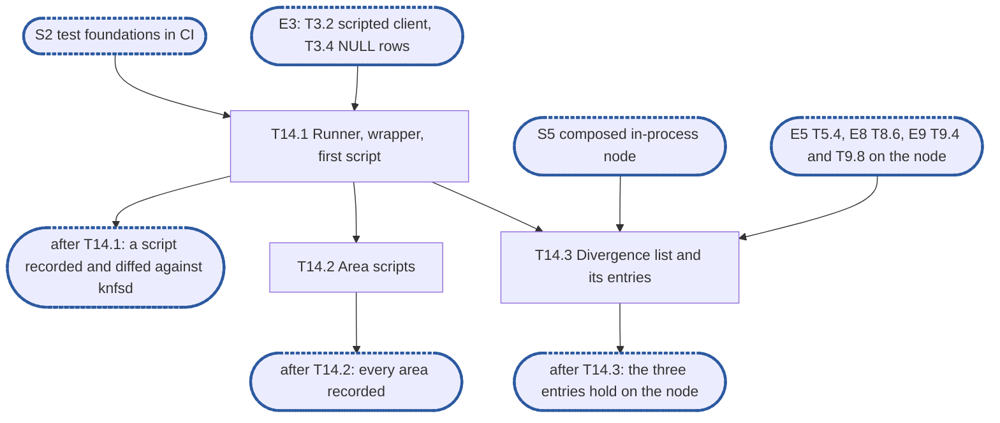

# Epic 14: NFS adapter v2 capture diffs against knfsd

**Sources:** [RFC 20](../docs/internals/rfcs/rfc-20-adapters.md) §8.1–§8.5 (wire tests: what they are
for, differential runs, normalisation, divergences, what they cover and when they run) and
Appendix C's reference profile for NFS;
[RFC 21](../docs/internals/rfcs/rfc-21-nfs.md) §13's paragraph on the wire tests, which owns the NFS
divergence list, with §2.2 (TCP only), §5.1 (no courtesy clients) and §7.4 (no referrals) for the
three entries, and §13's rows "§2.2 TCP only" and "§5.1 no courtesy" for what each entry looks like
on the wire. Every citation is `develop`'s text, which reaches `feat/storage-v2` with the
cherry-pick of RFC changes.
Cited, not owned: RFC 20 §5.4 (the reference captures are the source of golden vectors, which is
E2's); [RFC 29](../docs/internals/rfcs/rfc-29-test-harness.md) §4.7 (known-failure grading, whose
rules §8.4 says the divergence list follows); the `test/pcap-corpus` README's layout.
**Track:** A.
**Epic 14 estimate: 3 subtasks, 6.75 man-days.**
**Depends on:** **S2**, NFS's test foundations in CI: E2's recipe for running knfsd in a client
network namespace and its captures in `test/pcap-corpus/`; **E3**'s scripted client,
`adaptertest/nfsclient` (E3's T3.2), and the `NULL` rows of its loopback server (T3.4); and, for the
DittoFS side of every diff, **S5**, the composed in-process node, serving what the three entries'
scripts send: E5's `fs_locations` (T5.4), E8's lease and `SEQUENCE` (T8.6), E9's `OPEN` and `LOCK`
(T9.4, T9.8).
**Blocks:** E16, which runs the capture diffs with the rest and answers §13's rows "§2.2 TCP only"
and "§5.1 no courtesy" end to end.

---

## 1. Goal

Epic 14 puts RFC 20 §8's differential run in place for NFS: a script written against the scripted
client is sent to the Linux kernel NFS server and to DittoFS, each run is captured, normalised and
compared, and a difference is either red or a recorded divergence. It builds on the tools
`test/pcap-corpus/` already has, `pcap-diff.sh` and `normalize.py`, and adds the scripts, the
wrapper that records and diffs them, the divergence list and the check that reads it. It runs by
hand: no suite runs the diffs.

**At the end of the epic:**

- `test/pcap-corpus/nfs-wire.sh` records one named script against a server and diffs two
  recordings, keeping both captures and the normalised diff, and failing, never skipping, when the
  server cannot be reached;
- the scripts of NFS's areas, each with its knfsd recording in `test/pcap-corpus/nfs-wire/`, run
  through E3's scripted client and send the same bytes to either server;
- the NFS divergence list, `test/pcap-corpus/nfs-wire/divergences.yaml`, holds RFC 21 §13's three
  entries: no UDP, no courtesy clients, no referrals. Each names its script, its field, the two
  values and the RFC 21 rule, and a check fails on a difference no entry names and on an entry
  whose difference is gone;
- from S5, the same scripts run against DittoFS on the composed node, and the three entries'
  scripts show exactly the entries' differences.

### 1.1 In scope

The scripts and their XDR helper; the recording wrapper; the fixes `pcap-diff.sh` and
`normalize.py` need for NFS (a dissector hint for the candidate's port, the stateid rules of RFC 20
§8.3); the divergence list and its check; the three divergence scripts; knfsd's recordings of every
script, committed.

### 1.2 Out of scope

- knfsd's captures for golden vectors and the recipe that runs knfsd in a client namespace: E2.
- Fixing a difference the first DittoFS run shows: the epic that owns the area. A red diff is a bug
  report against it, never an entry written to make the run green.
- The suite that runs the diffs, and their nightly run (RFC 20 §8.5): a row of the RFC 21
  implementation plan's §6.6 deferral ledger ("A suite running E14's capture diffs"), owned by RFC
  21, by a pull request to §13's suites paragraph.
- RFC 21 §13's rows "§2.2 TCP only" and "§5.1 no courtesy" as checks over a kernel client (a mount
  with `proto=udp`, a lock taken by a new client): E16. The diffs here are the same two rules read
  off the wire.
- NLM's and NSM's UDP exception (RFC 21 §2.2): a UDP probe here sends NFS and MOUNT only, which
  never answer there; NLM and NSM answer over UDP on both servers once E11's datagram listener
  lands.
- Areas with no script here, listed in §9 point 3: Kerberos's security exchange, delegation grants,
  NLM and NSM, NFSv4.2 and a script per status of every error table.

### 1.3 Names used here

- **E2**, epic 2, test foundations: knfsd's captures, `test/pcap-corpus/nfs*/`, and the recipe that
  runs knfsd in a client network namespace (`test/nfs-mount/netns.sh`).
- **E3**, epic 3, the RPC layer: the scripted client, `adaptertest/nfsclient`, and the loopback
  server its rows start.
- **E5**, epic 5, the NFSv4 namespace, attributes and data path, with `fs_locations`.
- **E8**, epic 8, clients and sessions, with the lease. **E9**, epic 9, opens, stateids and locks.
- **E10**, epic 10, delegations and the back channel.
- **E11**, epic 11, NLM, NSM and the datagram path.
- **E12**, epic 12, the NFSv4.2 operations.
- **E13**, epic 13, RPCSEC_GSS.
- **E14**, this epic: capture diffs against knfsd.
- **E16**, epic 16, E2E green.
- **S2**, NFS's test foundations in CI, after E2 and the shared test pieces.
- **S5**, the composed in-process node, `internal/node/nodetest`, serving NFS: what the DittoFS
  side of a diff runs on.
- **S6b**, Kerberos sign-in. **S6c**, `gss`: both needed before a Kerberos script can run.

## 2. How the general rules apply

The rules are those of [the RFC 21 implementation plan's §1.5](rfc-21-nfs-plan.md#15-general-rules-for-each-epic),
cited by number and title and not copied.

| Rule | Subtasks | How |
| --- | --- | --- |
| rule 1, independent unit tests, under `-race` ([`CLAUDE.md`, "Writing tests"](../CLAUDE.md#writing-tests)) | all | the runner is tested over the loopback server E3's rows start, on `memory.New`; the divergence check over skeleton fixtures that are data; no double. The live diffs need knfsd and `tcpdump`, run by hand under the `wirediff` tag (D2) |
| rule 2, fuzz tests where relevant | T14.1 | the XDR reader decodes a peer's bytes: `FuzzReader`, seeded from E2's golden replies. Nothing else here decodes bytes |
| rule 3, observability follows RFC 25 and RFC 20 §10 | none | test tooling: no series, span or log line |
| rule 4, profiling: leaks, allocations and contention | T14.1 | the runner's loopback test ends with `adaptertest.CheckLeaks`; no hot path, no allocation gate |
| rule 5, public interface and internals, at the layer that consumes a value ([`CLAUDE.md`, "Verifying a change"](../CLAUDE.md#verifying-a-change)) | T14.1, T14.3 | the skeleton tests feed PDML to `normalize.py`, which `pcap-diff.sh` consumes; the divergence check reads the diff `pcap-diff.sh` writes, and its list is the file the run loads |
| rule 6, known failures shrink | none | no suite with a `known.yaml` is registered; the divergence list is §8.4's own mechanism and is not a `known.yaml` |
| rule 7, v2 ignores v1 | all | the reference is the Linux server; scripts come from RFC 1813, RFC 7530, RFC 8881 and RFC 5531, never from `develop`'s adapter |
| rule 8, real dependencies for properties of those dependencies | T14.1, T14.2, T14.3 | real knfsd, real TCP and UDP, real `tcpdump` and `tshark` for the recordings; the composed node for the DittoFS side |
| rule 9, code comment conventions ([`CLAUDE.md`, "Code comments"](../CLAUDE.md#code-comments)) | T14.1, T14.3 | D3's and D5's `ponytail:` markers and D4's `decision:` marker at their code sites |
| rule 10, a test must be able to fail | all | each test names the change it catches; the checks that need knfsd are run by hand and say so |
| rule 11, a symbol is exported only if an interface uses it | all | nothing is exported: `nfswire`'s tests are in the package and `nfs-wire.sh` calls `go test` |
| rule 12, each subtask creates only what it declares | all | the XDR helper arrives with the first script; the checker with the first entry; node mode with S5's run |
| rule 13, translate, never decide | none | no handler is touched |
| rule 14, nothing deferred is lost | T14.1, T14.2 | the areas without a script and the Kerberos exchange are named in §1.2 and §9 with their owners or a proposed ledger row |

## 3. Requirements and invariants

Every MUST and MUST NOT that RFC 20 §8 and RFC 21 §13 place on this epic, numbered so that subtasks
and tests can cite them.

**Runs and scripts**

| # | Requirement | Kind | Source | Subtasks |
| --- | --- | --- | --- | --- |
| R1 | A wire test is a script, a sequence of requests written against a scripted client that sends exactly what it is told, run once against the reference server and once against DittoFS, each on a fresh share with the same starting tree | invariant | RFC 20 §8.2 | T14.1 |
| R2 | Both runs are captured on the wire, decoded by a protocol dissector into fields, normalised, and compared field by field, request by request | MUST | RFC 20 §8.2 | T14.1 (in part, D3) |
| R3 | Scripts drive the protocol, never a kernel client | invariant | RFC 20 §8.2 | T14.1, T14.2, T14.3 |
| R4 | Scripts are written, not replayed from captures | invariant | RFC 20 §8.2 | T14.1, T14.2, T14.3 |
| R5 | Encryption and signing are switched off where the protocol allows, so the dissector sees the messages | MUST | RFC 20 §8.2 | T14.1, T14.2 |
| R6 | One script per protocol runs with them on, to compare the security exchange itself | MUST | RFC 20 §8.2 | T14.2 (in part, §9 point 3) |
| R7 | The reference for NFS is the Linux kernel NFS server, one reference per protocol; on a non-standard port the dissector is hinted | invariant | RFC 20 Appendix C | T14.1 |

**Normalisation**

| # | Requirement | Kind | Source | Subtasks |
| --- | --- | --- | --- | --- |
| R8 | Values that mean nothing to a client (times, nonces, verifiers, client and session IDs, file handles, file IDs, `READDIR` cookies, the `other` field of an ordinary stateid, `fsid`s, signatures, server and domain names and scopes) are replaced by a stable token, consistently within a run | MUST | RFC 20 §8.3 | T14.1 (in part, D3) |
| R9 | An ordinary stateid's `seqid` is compared; the special stateids, all zeros, all ones and the current stateid, are compared as they are | MUST | RFC 20 §8.3 | T14.1 |
| R10 | A normalisation rule names a field, never a message | MUST | RFC 20 §8.3 | T14.1 |
| R11 | Everything else is compared: statuses, flags, which optional fields are present, attribute sets and values, sizes, counts and offsets, the order of entries a reply lists | MUST | RFC 20 §8.3 | T14.1 (in part, D3) |

**Divergences**

| # | Requirement | Kind | Source | Subtasks |
| --- | --- | --- | --- | --- |
| R12 | A difference that survives normalisation is a bug, and the run is red, or a recorded divergence | MUST | RFC 20 §8.4 | T14.3 |
| R13 | A recorded divergence is an entry naming the script, the field, the two values and the protocol RFC rule that makes DittoFS differ; an entry with no rule to cite is not accepted | MUST | RFC 20 §8.4 | T14.3 |
| R14 | An entry excuses one named field in one named script; a difference it does not name still fails | MUST | RFC 20 §8.4 | T14.3 |
| R15 | An entry that no longer differs fails until it is removed | MUST | RFC 20 §8.4 | T14.3 |
| R16 | Where the reference server departs from the specification, the specification wins and the entry says so | MUST | RFC 20 §8.4 | T14.3 (review, D4) |
| R17 | The NFS divergence list holds an entry for no UDP, one for no courtesy clients and one for no referrals, each citing the RFC 21 rule that makes DittoFS differ: §2.2, §5.1 and §7.4 | MUST | RFC 21 §13 | T14.3 |

**Coverage and running**

| # | Requirement | Kind | Source | Subtasks |
| --- | --- | --- | --- | --- |
| R18 | A script exists per area the protocol's RFC owns: negotiation and security setup, opens and caching grants, locks, directory listing at buffer edges, attribute and information queries, errors for every status its error table produces, and the operations it answers not supported | MUST | RFC 20 §8.5 | T14.1, T14.2 (in part, §9 point 3) |
| R19 | A new status in an error table needs a script that provokes it | MUST | RFC 20 §8.5 | T14.2 (in part, §9 point 4) |
| R20 | A script runs on demand, alone | MUST | RFC 20 §8.5 | T14.1 |
| R21 | A red run keeps both captures and the normalised diff as artifacts | MUST | RFC 20 §8.5 | T14.1 |
| R22 | A run that could not reach a reference server is a failure, never a skip | MUST NOT | RFC 20 §8.5 | T14.1 |

Not obligations of this epic: RFC 20 §8.5's nightly run against the reference servers, which no
suite makes (§1.2); §8.5's sentence that the captures are the source of §5.4's golden vectors,
which is E2's; §8.1, background; the sentence in §8.4 that lists SMB's first entry, "no short names
generated"; Appendix C's choice of `tshark`'s JSON output, a profile (D3 keeps the PDML the corpus
already reads).

## 4. Decisions this epic takes

- **D1. Scripts are Go in `adaptertest/nfswire`, written in hand-built XDR.** A script is a function
  of a session holding E3's scripted client; it builds each call's arguments with a small writer
  of its own and reads only the few fields it chases (a file handle, a client ID, a session ID, a
  stateid) with a bounds-checked reader. It does not use the procedure structs the handler epics
  generate: those stay unexported (rule 11), and a script must not share a codec with the server it
  checks (RFC 20 §5.4). Prior art: pynfs builds every compound from XDR classes of its own, apart
  from any server's (from memory).
- **D2. Recording is a shell wrapper over `pcap-diff.sh`; live runs are tests under the `wirediff`
  tag.** `nfs-wire.sh record` starts `tcpdump`, runs `go test -tags=wirediff -run TestRunScript`
  with the script and target in the environment, stops `tcpdump` and writes the capture and its
  skeleton; `nfs-wire.sh diff` calls `pcap-diff.sh` and keeps the artifacts. The tag keeps a run
  that needs knfsd and a capture tool out of `unit`, where it would skip and count for nothing, and
  goes into `lint-go`'s `go vet -tags=` list. Everything that can run without them is untagged.
  The reference is knfsd in a client namespace, as E2's recipe sets it up. Prior art: RFC 20
  Appendix C's `tcpdump` and dissector run; the corpus's recipes in `nfsv4-acl/CAPTURE.md`. No
  marker: the corpus README records it.
- **D3. The diff stays `pcap-diff.sh`'s structural skeleton, with two fixes, and is weaker than RFC
  20 §8.2 and §8.3 ask; pending the user's answer.** The skeleton is a sorted set of field paths,
  with an enum label only for the fields `normalize.py` lists, and it drops volatile fields rather
  than replacing each by a token. So it shows a field present on one side only, and a status or
  opcode that differs; it does not align requests, order entries or compare a size, count or offset
  (R2, R8, R11 in part). The fixes are the ones NFS needs: the dissector hint of `pcap-diff.sh`
  names `nbss`, which is SMB's, so an NFS candidate on a non-standard port is not decoded (a
  `--candidate-dissector` option, `rpc` for NFS, on both TCP and UDP); and R9's rule for a stateid.
  A `ponytail:` marker at `normalize.py`'s header names the ceiling: a wrong size, a reordered
  listing or a handle used in the wrong request passes unseen unless it changes a status. The
  upgrade is a per-packet ordered skeleton keyed by the RPC transaction ID, with tokens numbered
  by first appearance, about 1.5 man-days, to be built when a divergence of that class is found by
  other means or RFC 20 §8.2 is held to its words. The question is in §9 point 1. Prior art: RFC 20
  Appendix C compares `tshark`'s decoded fields with a small matcher; Wireshark's own dissector
  tests compare decoded fields per packet (from memory).
- **D4. The divergence list is a YAML file read by a Go check; an entry excuses prefix-matched
  lines.** `test/pcap-corpus/nfs-wire/divergences.yaml` holds entries of `script`, `field` (a
  skeleton path), `reference` and `dittofs` (an enum label, or `absent`), `rule` (an RFC 21
  section) and `note`. The check takes the unified diff of a script's two skeletons: every `-`
  and `+` line must fall under one entry of that script, on the side its value names, and an
  entry whose two lines are not both in the diff fails as "no longer differs", so one entry
  excuses one field and nothing else (R14, R15). A load that finds an entry with no `rule` fails
  (R13). A `decision:` marker at the prefix match says that an entry's `absent` side excuses a
  whole subtree, which is what a reply that never comes needs, and that it is withdrawn if an
  entry is found masking a second field. R16 has no check: `note` says where the reference
  departs from the specification, and a reviewer reads it. Prior art: Samba's `knownfail`
  list, which fails a listed test that passes (from memory); RFC 29 §4.7's known-failure rule,
  which §8.4 names.
- **D5. The lease wait is real time, on knfsd's lease set to DittoFS's.** The no-courtesy script
  lets a client's lease run out, and knfsd keeps no clock a script can advance. knfsd's lease is
  set through `nfsv4leasetime` to 90 seconds, RFC 14 §4.1's value, before it starts, and the
  script waits the lease and a margin. A `ponytail:` marker at the wait names the ceiling: a run
  takes about two minutes, and the wait is the assertion since no clock reaches a remote server
  (CLAUDE.md, "Synchronise on events"). If S5's node exposes the service's injected clock, the
  DittoFS side advances it instead (§9 point 5). Prior art: pynfs's lease tests wait out the
  server's lease (from memory).
- **D6. The UDP probe is a datagram the script sends itself.** `nfsclient` is TCP, so the
  `udp-null` script opens a UDP socket, sends one `NULL` call of NFS and one of MOUNT without a
  record mark, and reads for a bounded time; no reply within it is the DittoFS answer. knfsd's UDP
  is switched on in the recording host's `nfs.conf`, since it is off by default (RFC 21's Appendix A
  says so of knfsd). Prior art: RFC 21 §13's "§2.2 TCP only" row probes the same way.

## 5. Target tree

```text
internal/adapter/adaptertest/nfswire/
  xdr.go, xdr_test.go              T14.1  hand-built XDR writer and bounds-checked reader; FuzzReader
  script.go, run.go, run_test.go   T14.1  a script, the registry, the runner; closed-port and loopback tests
  run_wire_test.go                 T14.1  TestRunScript, tag wirediff
  scripts_mount.go                 T14.1  mount-null
  scripts_v3.go                    T14.2  v3-names, v3-attrs, v3-io, v3-readdir
  scripts_v4.go                    T14.2  v41-session, v41-open-lock, v4-readdir, v4-notsupp, tls-probe
  scripts_test.go                  T14.2  each script and its recording stay in step
  scripts_diverge.go               T14.3  udp-null, courtesy-lease, referral
  diverge.go, diverge_test.go      T14.3  the divergence list and its check
  diverge_wire_test.go             T14.3  TestCheckDivergences, tag wirediff; the DittoFS side on nodetest
  testdata/diverge/                T14.3  skeleton fixtures and entry files
test/pcap-corpus/
  pcap-diff.sh                     T14.1  --candidate-dissector, --skeleton-dir
  normalize.py                     T14.1  the stateid rules
  normalize_test.sh, testdata/     T14.1  PDML fixtures
  nfs-wire.sh                      T14.1  record, diff
  nfs-wire/CAPTURE.md              T14.1  the recipe; each later subtask adds its scripts' notes
  nfs-wire/<script>.reference.{pcap,skel}   T14.1, T14.2, T14.3
  nfs-wire/divergences.yaml        T14.3
  README.md                        T14.1  the NFS recipe and the dissector hint
test/suites.yaml                   T14.1  wirediff in lint-go's tag list; normalize_test.sh in lint-repo
```

## 6. Subtasks

### T14.1 The script runner, the recording wrapper and the first script

**Subtask T14.1 estimate: 2.5 man-days.**

- **Track:** A. **Depends on:** S2, T3.2, T3.4.
- **Covers:** R1, R2, R3, R4, R5, R7, R8, R9, R10, R11, R18, R20, R21, R22.
- **Deliverables:**
  - `nfswire/xdr.go`: a writer (unsigned 32 and 64-bit integers, fixed and variable opaques with
    their padding) and a reader that fails on a length past the buffer. Consumed by every script
    (D1).
  - `nfswire/script.go` and `run.go`: a script is a name, the areas it covers and a function of a
    session holding the scripted client under `AUTH_SYS` (E3's `nfsclient.Dial`, `Do`, `AuthSys`)
    with one helper that sends a call and returns the accepted body or an error naming the step
    and the reject. A registry of scripts by name, and the runner `run(ctx, addr, name)`, which
    returns an error on an unknown name, an unreachable address or a step's failure. Consumed by
    T14.2's and T14.3's scripts and by `TestRunScript`.
  - `run_wire_test.go`, tag `wirediff`: `TestRunScript` reads `NFSWIRE_SCRIPT` and
    `NFSWIRE_TARGET`, and fails, naming the variable, when either is unset.
  - `scripts_mount.go`: `mount-null`, the negotiation area: `NULL` of NFSv3, NFSv4 and MOUNT, then
    MOUNT's `MNT` of the export and of a path that is not exported, `EXPORT` and `UMNT`, each on a
    share the recipe exports empty.
  - `test/pcap-corpus/nfs-wire.sh`: `record --script S --target HOST:PORT --out DIR [--iface I]`,
    which starts `tcpdump` as root, runs the test, stops `tcpdump` and writes
    `S.<side>.pcap` and `S.<side>.skel`, nonzero with no skeleton if the test failed; `diff
    --script S --reference F --candidate F`, which runs `pcap-diff.sh` with `--skeleton-dir` into
    the output directory and leaves both captures, both skeletons and the diff there. Consumed by
    T14.2, T14.3 and E16.
  - `pcap-diff.sh`: `--candidate-dissector` (default `nbss`, so SMB's callers are unchanged), applied
    to the candidate's port on TCP and UDP; `--skeleton-dir`. `normalize.py`: a stateid's `seqid`
    kept as a value, an ordinary stateid's `other` dropped, the special stateids kept whole (R9);
    the normalised names stay a list of field names (R10). `normalize_test.sh`, run from
    `lint-repo`; `README.md`'s NFS recipe, which no longer says `--candidate-port` alone decodes
    NFS.
  - `suites.yaml`: `wirediff` in `lint-go`'s tag list; `normalize_test.sh` in `lint-repo`'s list.
  - `nfs-wire/CAPTURE.md` with the recipe (kernel version, `exports` line, namespace, the
    `tcpdump` interface, `nfs.conf`) and `mount-null`'s `reference.pcap` and `reference.skel`.
- **Acceptance criteria:**
  - `mount-null` run against knfsd twice gives two skeletons `pcap-diff.sh` calls identical: no
    transaction ID, handle or time leaks into the skeleton (recorded in `CAPTURE.md`).
  - `record` against a closed port exits nonzero and names the target; `diff` with a missing
    capture exits 2, as `pcap-diff.sh` does; nothing in either skips.
  - With `--candidate-dissector rpc --candidate-port N` a capture of E3's loopback server has NFS
    fields in its skeleton; without the option, SMB's callers behave as before.
  - The skeleton of a stateid with another `seqid` differs; one with another `other` does not; a
    stateid of all zeros differs from an ordinary one.
- **Tests:**
  - `xdr_test.go`, at the writer the scripts call: RFC 4506's examples encode to their bytes and
    read back, and a truncated opaque is an error (catches a padding or length slip, R1).
    `FuzzReader`: any input neither panics nor reads past the buffer, and what an opaque read
    consumed re-encodes to the same bytes, padding aside, seeded from E2's golden replies and
    committed crashers under `testdata/fuzz/` (catches a length trusted past the buffer). No
    double.
  - `run_test.go`, at the runner `TestRunScript` calls: `mount-null`'s `NULL` steps run against
    the loopback server E3's rows start on `memory.New`, ending with `adaptertest.CheckLeaks`
    (catches a step sent to the wrong program or version, or a reply's reject read as success,
    R1, R3); a run against a closed port returns an error (catches a run that skips or swallows
    the failure, R22). The server is real, so no double.
  - `normalize_test.sh`, at `normalize.py`, which `pcap-diff.sh` feeds: PDML fixtures that differ in
    a stateid's `seqid`, in its `other`, and in a special stateid (catch `seqid` dropped, `other`
    compared, a special stateid masked, R9); a fixture whose message carries a normalised name
    beside a compared status, which must keep the status (catches a rule that masks the message,
    R10); the profile's list read for any entry that is a protocol name (catches a message-wide
    rule). Data fixtures, no double.
  - By hand at recording, and said so in `CAPTURE.md`: the self-diff of two knfsd recordings
    (catches a volatile value left in, R8, in part).
- **Rules:** rule 2: `FuzzReader`; rule 4: `CheckLeaks`; rule 9: D3's `ponytail:` marker at
  `normalize.py`'s header; rule 12: the XDR helper lands with `mount-null`, its first consumer.

### T14.2 The area scripts

**Subtask T14.2 estimate: 2 man-days.**

- **Track:** A. **Depends on:** T14.1.
- **Covers:** R3, R4, R5, R6, R18, R19.
- **Deliverables:** nine scripts, each with its knfsd recording in `nfs-wire/`, on the share the
  recipe exports empty, each creating the tree it needs by its own first requests:
  - `scripts_v3.go`: `v3-names` (`LOOKUP`, `CREATE` in each mode, `MKDIR`, `SYMLINK`, `READLINK`,
    `LINK`, `REMOVE`, `RMDIR`, `RENAME`, with the statuses the area produces: `NOENT`, `EXIST`,
    `NOTEMPTY`, `NOTDIR`); `v3-attrs` (`GETATTR`, `SETATTR` with and without a guard, `ACCESS`,
    `FSSTAT`, `FSINFO`, `PATHCONF`); `v3-io` (`READ`, `WRITE` in each stability, `COMMIT`);
    `v3-readdir` (`READDIR` and `READDIRPLUS` at the `count` that fits one entry, one byte less,
    and a cookie verifier that does not match).
  - `scripts_v4.go`: `v41-session` (`EXCHANGE_ID`, `CREATE_SESSION`, `SEQUENCE`,
    `RECLAIM_COMPLETE`, a replayed and a misordered `SEQUENCE`, `DESTROY_SESSION`,
    `DESTROY_CLIENTID`); `v41-open-lock` (`OPEN` creating and not, `LOCK`, a conflicting `LOCKT`,
    `LOCKU`, `CLOSE`, `TEST_STATEID`, `FREE_STATEID`, a stateid of the wrong `seqid`);
    `v4-readdir` (`READDIR` at `maxcount` edges, `NFS4ERR_TOOSMALL`); `v4-notsupp` (each operation
    both servers answer `NFS4ERR_NOTSUPP`, listed from knfsd's recording, with `ALLOCATE` left out
    since RFC 21 §9.3 makes DittoFS differ there); `tls-probe` (a `NULL` call with the `AUTH_TLS`
    flavour, RFC 9289's probe, whose reply is the security exchange R6 names).
  - `scripts_test.go`: a script declares the operation labels it covers.
  - Consumed by E16, which runs the diffs, and by whoever reads a red diff.
- **Acceptance criteria:**
  - Each script runs against knfsd twice with identical skeletons (the self-diff of T14.1).
  - Every script uses `AUTH_SYS` and no TLS but `tls-probe`; none drives a kernel client or
    replays bytes from a capture.
  - Where the recording host's knfsd cannot answer a script's step (`tls-probe` without `tlshd`
    or a kernel before 6.5), `CAPTURE.md` names the script, the step and what was recorded, and the
    script stays registered.
- **Tests:** `scripts_test.go`, at the committed recordings `nfs-wire.sh diff` reads: for each script,
  every operation label it declares occurs in its `reference.skel`, and every script has a
  recording (catches a step added to a script without recording it again, or a recording from
  another script version, R18). By hand at recording: the self-diff per script, in `CAPTURE.md`.
  Data, no double.
- **Rules:** rule 14: `ALLOCATE`'s departure is named here and in §9 point 2.

### T14.3 The divergence list and its three entries

**Subtask T14.3 estimate: 2.25 man-days.**

- **Track:** A. **Depends on:** T14.1, S5, T5.4, T8.6, T9.4, T9.8. T5.4 answers `referral`'s
  `fs_locations` on the node; T8.6, T9.4 and T9.8 answer `courtesy-lease`'s `SEQUENCE`, `OPEN` and
  `LOCK`.
- **Covers:** R3, R4, R12, R13, R14, R15, R16, R17.
- **Deliverables:**
  - `diverge.go`: the entry type, the loader of `divergences.yaml`, and
    `check(script, diff, entries)`, which returns every unexcused line and every entry whose lines
    are not both in the diff (D4). Consumed by `TestCheckDivergences` and by `nfs-wire.sh diff`
    through it.
  - `divergences.yaml`, three entries: `udp-null`, no reply over UDP to NFS's and MOUNT's `NULL`,
    RFC 21 §2.2; `courtesy-lease`, a client whose lease ran out for 90 seconds with an open and a
    lock, whose next `SEQUENCE` and whose conflicting second client's `LOCK` are answered by knfsd
    as the recording shows and by DittoFS `NFS4ERR_BADSESSION` and a lock at once, RFC 21 §5.1;
    `referral`, a `LOOKUP` of a directory knfsd exports with `refer=` and a `GETATTR` of its
    `fs_locations`, knfsd answering `NFS4ERR_MOVED` and DittoFS the directory with no location,
    RFC 21 §7.4. The values are those the recordings show; the three scripts of
    `scripts_diverge.go` and their knfsd recordings are part of it.
  - `diverge_wire_test.go`, tag `wirediff`: `TestCheckDivergences` reads the two skeletons and the
    script's name from the environment; the DittoFS side runs the script against the node
    `nodetest` serves (S5) and prints the port for `nfs-wire.sh record` to capture. `nfs-wire.sh
    diff` ends by calling it.
  - `testdata/diverge/`: skeleton fixtures and entry files for the unit tests.
- **Acceptance criteria:**
  - The three entries each name a script, a field, two values and an RFC 21 rule of §2.2, §5.1 or
    §7.4; a file with an entry that names no rule does not load.
  - On the S5 node each of the three scripts diffs against knfsd with every difference under its
    entry, and the same diff with the list empty is red.
  - An entry whose difference is gone fails the run, naming the entry; a difference no entry names
    fails, naming the line; an entry of another script excuses nothing.
  - A difference on an entry's field in the other direction (the values swapped) is not excused.
- **Tests:**
  - `diverge_test.go`, at `check`, which the live run calls, over skeleton fixtures that are data:
    an excused diff passes; a diff with one extra line fails, naming it (R14); identical skeletons
    with an entry fail as "no longer differs" (R15); an entry for another script excuses nothing
    (R14); swapped values are not excused; a file with an entry and no rule does not load (R13);
    the `absent` side excuses the subtree and not a sibling (D4's marker). No double.
  - `TestDivergenceListHoldsThree`, over the committed file: three entries whose rules are §2.2,
    §5.1 and §7.4 (catches an entry dropped or its rule changed, R17).
  - The live check on the node, run by hand from S5 and noted in `CAPTURE.md`, since only a run of
    both servers shows an entry's two values.
- **Rules:** rule 9: D4's `decision:` marker and D5's `ponytail:` marker at the lease wait; rule 14:
  a difference the node shows beyond the three is reported to the epic that owns its area (§9
  point 2).

## 7. Order of work



T14.1 is the blocker: both later subtasks run scripts through it. T14.2 comes before T14.3 because
it needs only knfsd and so can run before S5, while T14.3 waits for the node. Checkpoint after
T14.1: E16 can call `nfs-wire.sh`; after T14.3: the epic's done condition holds.

## 8. Suggested pull requests

| PR | Subtasks | Man-days | After | Why together |
| --- | --- | --- | --- | --- |
| 1 | T14.1 | 2.5 | S2, E3's T3.2 and T3.4 | the runner, the wrapper, the tool fixes and one recorded script, proving the path end to end |
| 2 | T14.2 | 2 | PR 1 | the area scripts and their recordings, mostly data |
| 3 | T14.3 | 2.25 | PR 1, S5, E5's T5.4, E8's T8.6, E9's T9.4 and T9.8 | the divergence check and its three entries, which need the node |

A suggestion only: one pull request per subtask works as well. PR 2 and PR 3 can be open at once.

## 9. Open points

1. **The diff is weaker than RFC 20 §8.2 and §8.3 (D3), pending the user's answer.** The tools
   `test/pcap-corpus/` has compare a set of field paths; the RFC asks for tokens, request-by-request
   alignment and sizes, counts, offsets and entry order compared. This epic builds the NFS fixes and
   leaves R2, R8 and R11 met in part, with a `ponytail:` marker. Options: (a) as written, about
   1.5 man-days saved, the gap named at the marker; (b) build the ordered, tokenised skeleton in
   T14.1, which becomes about 4 man-days; (c) amend RFC 20 §8.2 and §8.3 to the weaker rule. The
   recommendation is (a): the first S5 diff is what shows whether the gap hides anything.
2. **Differences RFC 21 already makes beyond the three.** §10 answers an NFSv3 call with a refused
   flavour `AUTH_TOOWEAK` where knfsd answers `NFS3ERR_ACCES`, and §9.3 answers `ALLOCATE`
   `NFS4ERR_NOTSUPP`. Both are decisions with a stated rule, and a script that provoked either
   would be red with no entry. The scripts avoid them; the list holds the three RFC 21 §13 names.
   Proposed: RFC 21 §13's sentence names these two as entries too, in batch two's one RFC 21 pull
   request, opened with E8's document pull request.
3. **Areas with no script, which RFC 20 §8.5 asks for.** Kerberos's security exchange (R6's one
   script runs with security on: `tls-probe` is the only one, since a Kerberos script needs S6b and
   S6c and a scripted client that speaks `RPCSEC_GSS`, which E13's T13.5 adds to `nfsclient`);
   delegation grants (a script needs the scripted client to answer a back channel, as E10's T10.2
   tests do); NLM and NSM (E11's T11.2 `nfsclient.Host` and its rows); NFSv4.2's operations (E12's
   T12.8). Proposed: a row for each in the RFC 21 implementation plan's §6.6 deferral ledger, owner
   the epic that builds the missing piece, trigger that subtask, by a pull request to the plan,
   which this document does not make.
4. **A script per status (R19).** The scripts provoke the statuses of their areas; RFC 20 §8.5's
   rule that a new status in an error table gets a script has no check. Proposed: E16's totality
   test (RFC 20 §7.3) lists each status no script provokes, which needs each script to declare the
   statuses it expects. E16's document does not take it: its T16.11 totality test reads the
   tables, not the scripts. Pending the user's answer; until then the scripts declare operations
   only (T14.2).
5. **S5's node.** T14.3 assumes `nodetest` serves NFS on a TCP address a script can reach, with a
   share an `AUTH_SYS` caller may use, and is started from a test with a `testing.TB`. It does not
   assume the node's clock can be advanced; if it can, the DittoFS side of `courtesy-lease` advances
   it and the wait of D5 stays on knfsd's side alone.
6. **The recording host.** Root, a kernel of 5.19 or later (courtesy clients), `nfs.conf` with UDP
   on, an export with `refer=`, `tlshd` and a kernel of 6.5 or later for `tls-probe`, `tshark` and
   `tcpdump`. Each recording names the kernel and what the host could not do, and a recording that
   cannot be made is a gap in `CAPTURE.md`, not a skipped script.
7. **The estimate.** The RFC 21 implementation plan holds this epic at 2 subtasks and 4 man-days.
   The breakdown is 3 subtasks and 6.75: the plan's figure leaves out the tool fixes, the XDR helper
   with its fuzz target and nine scripts with a recording each. The plan is changed only when the
   user asks, through a pull request.
