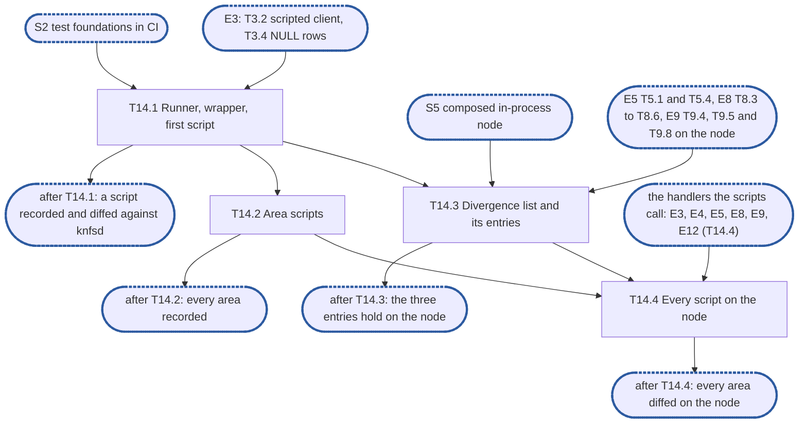

# Epic 14: NFS adapter v2 capture diffs against knfsd

**Sources:** [RFC 20](../docs/internals/rfcs/rfc-20-adapters.md) §8.1–§8.5 (wire tests: what they are
for, differential runs, normalisation, divergences, what they cover and when they run) and
Appendix C's reference profile for NFS;
[RFC 21](../docs/internals/rfcs/rfc-21-nfs.md) §13's paragraph on the wire tests, which owns the NFS
divergence list, with §2.2 (TCP only), §5.1 (no courtesy clients) and §7.4 (no referrals) for the
three entries, and §13's rows "§2.2 TCP only" and "§5.1 no courtesy" for what each entry looks like
on the wire. Every citation is `develop`'s text, which reaches `feat/storage-v2` with the
cherry-pick of RFC changes.
Cited, not owned: RFC 20 §5.4 (the reference captures are the source of golden vectors, which is
E2's); [RFC 29](../docs/internals/rfcs/rfc-29-test-harness.md) §4.7 (known-failure grading, whose
rules §8.4 says the divergence list follows); the `test/pcap-corpus` README's layout.
**Track:** A.
**Epic 14 estimate: 4 subtasks, 11.5 man-days.**
**Depends on:** **S2**, NFS's test foundations in CI: E2's recipe for running knfsd in a client
network namespace and its captures in `test/pcap-corpus/`; **E3**'s scripted client,
`adaptertest/nfsclient` (E3's T3.2), and the `NULL` rows of its loopback server (T3.4); and, for the
DittoFS side of every diff, **S5**, the composed in-process node, serving what the three entries'
scripts send: E5's `PUTROOTFH` and `LOOKUP` (T5.1) and `fs_locations` (T5.4), E8's session set-up
(T8.3, T8.4), `SEQUENCE` and lease (T8.5, T8.6), E9's `OPEN`, the file it creates and `LOCK` (T9.4,
T9.5, T9.8); and, for every other script on the node (T14.4), the handlers those scripts
call, listed there.
**Blocks:** E16, whose in-process rows encode their calls with T14.1's XDR writer and reader
(pending E16's Q5). No suite runs the diffs (§1.2), so nothing else waits on them.

---

## 1. Goal

Epic 14 puts RFC 20 §8's differential run in place for NFS: a script written against the scripted
client is sent to the Linux kernel NFS server and to DittoFS, each run is captured, normalised and
compared, and a difference is either red or a recorded divergence. It builds on the tools
`test/pcap-corpus/` already has, `pcap-diff.sh` and `normalize.py`, and adds the scripts, the
wrapper that records and diffs them, the divergence list and the check that reads it. It runs by
hand: no suite runs the diffs.

**At the end of the epic:**

- `test/pcap-corpus/nfs-wire.sh` records one named script against a server and diffs two
  recordings, keeping both captures and the normalised diff, and failing, never skipping, when the
  server cannot be reached;
- the scripts of NFS's areas, each with its knfsd recording in `test/pcap-corpus/nfs-wire/`, run
  through E3's scripted client and send the same bytes to either server;
- the NFS divergence list, `test/pcap-corpus/nfs-wire/divergences.yaml`, holds RFC 21 §13's three
  entries: no UDP, no courtesy clients, no referrals. Each names its script, its field, the two
  values and the RFC 21 rule, and a check fails on a difference no entry names and on an entry
  whose difference is gone;
- from S5, the same scripts run against DittoFS on the composed node, and the three entries'
  scripts show exactly the entries' differences.

### 1.1 In scope

The scripts and their XDR helper; the recording wrapper; the fixes `pcap-diff.sh` and
`normalize.py` need for NFS (a dissector hint for the candidate's port, the stateid rules of RFC 20
§8.3); the divergence list and its check; the three divergence scripts; knfsd's recordings of every
script, committed.

### 1.2 Out of scope

- knfsd's captures for golden vectors and the recipe that runs knfsd in a client namespace: E2.
- Fixing a difference the first DittoFS run shows: the epic that owns the area. A red diff is a bug
  report against it, never an entry written to make the run green.
- The suite that runs the diffs, and their nightly run (RFC 20 §8.5): a row of the RFC 21
  implementation plan's §6.6 deferral ledger ("A suite running E14's capture diffs"), owned by RFC
  21, by a pull request to §13's suites paragraph.
- RFC 21 §13's rows "§2.2 TCP only" and "§5.1 no courtesy" as DittoFS's own checks: the UDP probe
  and NLM and NSM answering there, E11's T11.10; the `proto=udp` mount, E16's T16.7; a lease expired
  with no conflict and a new client taking the lock, E9's T9.11. The diffs here are the same rules
  read off the wire beside knfsd.
- NLM's and NSM's UDP exception (RFC 21 §2.2): a UDP probe here sends NFS and MOUNT only, which
  never answer there; NLM and NSM answer over UDP on both servers once E11's datagram listener
  lands.
- Areas with no script here, listed in §9 point 3: Kerberos's security exchange, the TLS handshake
  after `tls-probe`'s `AUTH_TLS` probe, delegation grants, NLM and NSM, NFSv4.2 (§9 point 3); a script per
  status of every error table (§9 point 4).
- The two-client conflict captures E2 hands here, a second client's `OPEN` answered
  `NFS4ERR_DELAY`: a row of the RFC 21 implementation plan's §6.6 deferral ledger ("The two-client
  conflict captures"), unowned, since every script records from client 1's namespace alone.

### 1.3 Names used here

- **E2**, epic 2, test foundations: knfsd's captures, `test/pcap-corpus/nfs*/`, and the recipe that
  runs knfsd in a client network namespace (`test/nfs-mount/netns.sh`).
- **E3**, epic 3, the RPC layer: the scripted client, `adaptertest/nfsclient`, and the loopback
  server its rows start.
- **E5**, epic 5, the NFSv4 namespace, attributes and data path, with `fs_locations`.
- **E8**, epic 8, clients and sessions, with the lease. **E9**, epic 9, opens, stateids and locks.
- **E10**, epic 10, delegations and the back channel.
- **E11**, epic 11, NLM, NSM and the datagram path.
- **E12**, epic 12, the NFSv4.2 operations.
- **E13**, epic 13, RPCSEC_GSS.
- **E14**, this epic: capture diffs against knfsd.
- **E16**, epic 16, E2E green.
- **S2**, NFS's test foundations in CI, after E2 and the shared test pieces.
- **S5**, the composed in-process node, `internal/node/nodetest`, serving NFS: what the DittoFS
  side of a diff runs on.
- **S6b**, Kerberos sign-in. **S6c**, `gss`: both needed before a Kerberos script can run.

## 2. How the general rules apply

The rules are those of [the RFC 21 implementation plan's §1.5](rfc-21-nfs-plan.md#15-general-rules-for-each-epic),
cited by number and title and not copied.

| Rule | Subtasks | How |
| --- | --- | --- |
| rule 1, independent unit tests, under `-race` ([`CLAUDE.md`, "Writing tests"](../CLAUDE.md#writing-tests)) | all | the runner is tested over the loopback server E3's rows start, on `memory.New`; the divergence check over skeleton fixtures that are data; no double. The live diffs need knfsd and `tcpdump`, run by hand under the `wirediff` tag (D2) |
| rule 2, fuzz tests where relevant | T14.1 | the XDR reader decodes a peer's bytes: `FuzzReader`, seeded from E2's golden replies. Nothing else here decodes bytes |
| rule 3, observability follows RFC 25 and RFC 20 §10 | none | test tooling: no series, span or log line |
| rule 4, profiling: leaks, allocations and contention | T14.1 | the runner's loopback test ends with `adaptertest.CheckLeaks`; no hot path, no allocation gate |
| rule 5, public interface and internals, at the layer that consumes a value ([`CLAUDE.md`, "Verifying a change"](../CLAUDE.md#verifying-a-change)) | T14.1, T14.3 | the skeleton tests feed PDML to `normalize.py`, which `pcap-diff.sh` consumes; the divergence check reads the diff `pcap-diff.sh` writes, and its list is the file the run loads |
| rule 6, known failures shrink | none | no suite with a `known.yaml` is registered; the divergence list is §8.4's own mechanism and is not a `known.yaml` |
| rule 7, v2 ignores v1 | all | the reference is the Linux server; scripts come from RFC 1813, RFC 7530, RFC 8881 and RFC 5531, never from `develop`'s adapter |
| rule 8, real dependencies for properties of those dependencies | T14.1, T14.2, T14.3, T14.4 | real knfsd, real TCP and UDP, real `tcpdump` and `tshark` for the recordings; the composed node for the DittoFS side |
| rule 9, code comment conventions ([`CLAUDE.md`, "Code comments"](../CLAUDE.md#code-comments)) | T14.1, T14.3 | D3's and D5's `ponytail:` markers and D4's `decision:` marker at their code sites |
| rule 10, a test must be able to fail | all | each test names the change it catches; the checks that need knfsd are run by hand and say so |
| rule 11, a symbol is exported only if an interface uses it | T14.1 | `nfswire`'s XDR writer and reader, for E16's in-process rows (pending E16's Q5); nothing else: `nfswire`'s tests are in the package and `nfs-wire.sh` calls `go test` |
| rule 12, each subtask creates only what it declares | all | the XDR helper arrives with the first script; the checker with the first entry; node mode with S5's run |
| rule 13, translate, never decide | none | no handler is touched |
| rule 14, nothing deferred is lost | T14.1, T14.2, T14.4 | the areas without a script, the Kerberos exchange and the TLS handshake are named in §1.2 and §9 and are rows of the plan's §6.6 deferral ledger; a difference the node shows beyond the three entries is reported to its area's epic |

## 3. Requirements and invariants

Every MUST and MUST NOT that RFC 20 §8 and RFC 21 §13 place on this epic, numbered so that subtasks
and tests can cite them.

**Runs and scripts**

| # | Requirement | Kind | Source | Subtasks |
| --- | --- | --- | --- | --- |
| R1 | A wire test is a script, a sequence of requests written against a scripted client that sends exactly what it is told, run once against the reference server and once against DittoFS, each on a fresh share with the same starting tree | invariant | RFC 20 §8.2 | T14.1 |
| R2 | Both runs are captured on the wire, decoded by a protocol dissector into fields, normalised, and compared field by field, request by request | MUST | RFC 20 §8.2 | T14.1 (in part, D3) |
| R3 | Scripts drive the protocol, never a kernel client | invariant | RFC 20 §8.2 | T14.1, T14.2, T14.3 |
| R4 | Scripts are written, not replayed from captures | invariant | RFC 20 §8.2 | T14.1, T14.2, T14.3 |
| R5 | Encryption and signing are switched off where the protocol allows, so the dissector sees the messages | MUST | RFC 20 §8.2 | T14.1, T14.2 |
| R6 | One script per protocol runs with them on, to compare the security exchange itself | MUST | RFC 20 §8.2 | T14.2 (in part, §9 point 3) |
| R7 | The reference for NFS is the Linux kernel NFS server, one reference per protocol; on a non-standard port the dissector is hinted | invariant | RFC 20 Appendix C | T14.1 |

**Normalisation**

| # | Requirement | Kind | Source | Subtasks |
| --- | --- | --- | --- | --- |
| R8 | Values that mean nothing to a client (times, nonces, verifiers, client and session IDs, file handles, file IDs, `READDIR` cookies, the `other` field of an ordinary stateid, `fsid`s, signatures, server and domain names and scopes) are replaced by a stable token, consistently within a run | MUST | RFC 20 §8.3 | T14.1 (in part, D3) |
| R9 | An ordinary stateid's `seqid` is compared; the special stateids, all zeros, all ones and the current stateid, are compared as they are | MUST | RFC 20 §8.3 | T14.1 |
| R10 | A normalisation rule names a field, never a message | MUST | RFC 20 §8.3 | T14.1 |
| R11 | Everything else is compared: statuses, flags, which optional fields are present, attribute sets and values, sizes, counts and offsets, the order of entries a reply lists | MUST | RFC 20 §8.3 | T14.1 (in part, D3) |

**Divergences**

| # | Requirement | Kind | Source | Subtasks |
| --- | --- | --- | --- | --- |
| R12 | A difference that survives normalisation is a bug, and the run is red, or a recorded divergence | MUST | RFC 20 §8.4 | T14.3 |
| R13 | A recorded divergence is an entry naming the script, the field, the two values and the protocol RFC rule that makes DittoFS differ; an entry with no rule to cite is not accepted | MUST | RFC 20 §8.4 | T14.3 |
| R14 | An entry excuses one named field in one named script; a difference it does not name still fails | MUST | RFC 20 §8.4 | T14.3 |
| R15 | An entry that no longer differs fails until it is removed | MUST | RFC 20 §8.4 | T14.3 |
| R16 | Where the reference server departs from the specification, the specification wins and the entry says so | MUST | RFC 20 §8.4 | T14.3 (review, D4) |
| R17 | The NFS divergence list holds an entry for no UDP, one for no courtesy clients and one for no referrals, each citing the RFC 21 rule that makes DittoFS differ: §2.2, §5.1 and §7.4 | MUST | RFC 21 §13 | T14.3 |

**Coverage and running**

| # | Requirement | Kind | Source | Subtasks |
| --- | --- | --- | --- | --- |
| R18 | A script exists per area the protocol's RFC owns: negotiation and security setup, opens and caching grants, locks, directory listing at buffer edges, attribute and information queries, errors for every status its error table produces, and the operations it answers not supported | MUST | RFC 20 §8.5 | T14.1, T14.2 (in part, §9 point 3) |
| R19 | A new status in an error table needs a script that provokes it | MUST | RFC 20 §8.5 | T14.2 (in part, §9 point 4) |
| R20 | A script runs on demand, alone | MUST | RFC 20 §8.5 | T14.1 |
| R21 | A red run keeps both captures and the normalised diff as artifacts | MUST | RFC 20 §8.5 | T14.1 |
| R22 | A run that could not reach a reference server is a failure, never a skip | MUST NOT | RFC 20 §8.5 | T14.1 |

Not obligations of this epic: RFC 20 §8.5's nightly run against the reference servers, which no
suite makes (§1.2); §8.5's sentence that the captures are the source of §5.4's golden vectors,
which is E2's; §8.1, background; the sentence in §8.4 that lists SMB's first entry, "no short names
generated"; Appendix C's choice of `tshark`'s JSON output, a profile (D3 keeps the PDML the corpus
already reads).

## 4. Decisions this epic takes

- **D1. Scripts are Go in `adaptertest/nfswire`, written in hand-built XDR.** A script is a function
  of a session holding E3's scripted client; it builds each call's arguments with a small writer
  of its own and reads only the few fields it chases (a file handle, a client ID, a session ID, a
  stateid) with a bounds-checked reader. It does not use the procedure structs the handler epics
  generate: those stay unexported (rule 11), and a script must not share a codec with the server it
  checks (RFC 20 §5.4). Prior art: pynfs builds every compound from XDR classes of its own, apart
  from any server's (from memory).
- **D2. Recording is a shell wrapper over `pcap-diff.sh`; live runs are tests under the `wirediff`
  tag.** `nfs-wire.sh record` starts `tcpdump`, runs `go test -tags=wirediff -run TestRunScript`
  with the script and target in the environment, stops `tcpdump` and writes the capture and its
  skeleton; `nfs-wire.sh diff` calls `pcap-diff.sh` and keeps the artifacts. The tag keeps a run
  that needs knfsd and a capture tool out of `unit`, where it would skip and count for nothing, and
  goes into `lint-go`'s `go vet -tags=` list. Everything that can run without them is untagged.
  The reference is knfsd on the host, as E2's recipe sets it up: `nfs-wire.sh` sources
  `test/nfs-mount/netns.sh` and runs the `go test` inside client 1's namespace through
  `client_ns_exec`, with the target `10.51.0.1`, so the script's calls cross the bridge as a
  remote client's do. There is one `tcpdump` wrapper, not two: T14.1 moves the capture start and
  stop of E2's `nfs-record.sh` into two functions of a sourced `test/pcap-corpus/capture.sh`,
  which both scripts call. The capture is filtered on client 1's address, not on a port, so it
  holds the NFS calls and MOUNT's, whose port is not NFS's: the recipe pins `mountd` to a fixed
  port in `nfs.conf` (`[mountd] port=`), passed as `NFSWIRE_MOUNT_TARGET` (unset on the node, which
  serves MOUNT on its NFS port), and `pcap-diff.sh`
  hints that port on the reference's side (`--reference-port`, T14.1), since only 2049 decodes
  unhinted. The node serves every program on its one TCP port (E3's R38), MOUNT included, so its
  side needs one capture port and one hint. Root is used only to enter the namespace and to start `tcpdump`, which drops to
  the invoking user (`-Z`); the `go test` runs as that user, dropped inside the namespace, since
  `client_ns_exec` runs its command as root (`test/nfs-mount/netns.sh`): `client_ns_exec 1 setpriv
  --reuid="$SUDO_UID" --regid="$SUDO_GID" --init-groups -- env PATH="$PATH" HOME="$(getent passwd
  "$SUDO_USER" | cut -d: -f6)" USER="$SUDO_USER" LOGNAME="$SUDO_USER" NFSWIRE_SCRIPT=… go test …`,
  the drop `dt`'s fixture makes (`test/harness/fixture/client.go`, `asUser`), since `setpriv` keeps
  root's `HOME` and `go test` writes its build cache under it. `--script` must name a registered
  script (`[a-z0-9-]+`) before it becomes a file name. The host's `nfs.conf`, lease and exports are
  restored by a trap; the export is limited to the namespace subnet and carries `insecure`, since
  the dropped client binds no reserved port and knfsd's default `secure` and `mountd` refuse one
  above 1023. A trap does not run on `SIGKILL`, so `nfs-wire.sh` copies the guard of
  `test/nfs-mount/test-user.sh`: it saves the host's files under a marker of its own before the
  first change, and a run that finds that marker restores from it before anything else, rather than
  saving the changed files as the originals. `record` fails before any change when `SUDO_UID` is
  unset or 0, since the drop would then keep root. Setting the lease or UDP
  restarts nfsd, and knfsd then answers a non-reclaim `OPEN` or `LOCK` `NFS4ERR_GRACE` until its
  grace period ends, so the recipe also sets `[nfsd] grace-time` to 10 seconds, the least knfsd
  takes (from memory, checked at recording), and `nfs-wire.sh` waits that and a margin after the
  restart before its first capture; a remote server's grace has no clock a script can advance, so
  the wait is the assertion, as D5's is. `capture_start` runs `tcpdump -U` and returns once its
  `listening on` line is on standard error, `capture_stop` stops it with `SIGINT` and `wait`s for
  it, and `record` fails before it starts if client 1's namespace holds an NFS mount
  (`findmnt -t nfs,nfs4`), since a kernel client's traffic would enter the capture. The DittoFS side of T14.3 runs
  on the host's loopback, outside any namespace, since the node is in the test's own process.
  Prior art: RFC 20
  Appendix C's `tcpdump` and dissector run; the corpus's recipes in `nfsv4-acl/CAPTURE.md`. No
  marker: the corpus README records it.
- **D3. The diff stays `pcap-diff.sh`'s structural skeleton, with three fixes, and is weaker than RFC
  20 §8.2 and §8.3 ask; open for review.** The skeleton is one sorted set of field paths over every
  packet of the capture, with an enum label only for the fields `normalize.py` lists, and it drops
  volatile fields rather than replacing each by a token. A status sits under its operation's
  path (`nfs/nfs.ops.count/nfs.opcode=GETATTR (9)/nfs.status=OK (0)`), so the set holds each
  (operation, status) pair once, whichever request it answered. The diff therefore shows a field
  present on one side only, and an (operation, status) pair that occurs on one side only; it does
  not show a status that differs for one request when the same pair occurs elsewhere on both
  sides. For NFSv3 and MOUNT it holds less: the RPC dissector adds the procedure as a flat sibling
  in the program's tree, and the status sits flat beside it (`nfs/nfs.procedure_v3=LOOKUP (3)`,
  `nfs/nfs.status=ERR_NOENT (2)`), so the set holds a script's statuses, not pairs, and a `v3-names`
  answering `EXIST` to a `LOOKUP` and `NOENT` to a `CREATE` diffs clean while both statuses occur
  somewhere (Wireshark's `packet-rpc.c` and `packet-nfs.c`; not run). `v3-names` and `v4-readdir` send many calls of one operation, so a `NOENT` answered to
  the wrong `LOOKUP` passes unseen as long as both sides answer `NOENT` to some `LOOKUP`. Nor does
  it align requests, order entries or compare a size, count or offset (R2, R8, R11 in part). The
  fixes are the ones NFS needs: the dissector hint of `pcap-diff.sh` names `nbss`, which is SMB's,
  so an NFS candidate on a non-standard port is not decoded (a `--candidate-dissector` option,
  `rpc` for NFS, on both TCP and UDP); `KEEP_ENUM`'s list extended to every status and procedure
  field NFS's recordings carry that `nfs.status` does not already label. Wireshark adds a hidden
  `nfs.status` beside every NFSv4 and NFSv3 status, the compound's included, so the compound's
  status (`nfs/nfs.status=OK (0)` in the committed `nfsv4-acl` skeleton, beside an unlabelled
  `nfs.nfsstat4`) and NFSv3's (`nfs.status3`) need nothing; NFSv3's and MOUNT's procedure fields
  (`nfs.procedure_v3` among them), MOUNT's status (`mount.status`) and RPC's reply fields (`rpc.msgtyp`,
  `rpc.replystat`, `rpc.state_accept`, `rpc.state_reject`, `AUTH_ERROR`'s reason and the
  verifier's flavour) carry a refusal no program status shows
  (names from memory, each checked against `tshark -G fields` and the first recording), with
  `nfs-wire.sh` passing `--proto rpc --proto nfs --proto mount`; and R9's rule for a stateid, keyed
  by the path under `nfs.stateid`, since `nfs.seqid` also names an open-owner's sequence; today
  `nfs.stateid` is in `DROP_FIELDS` and `walk` descends past a dropped field without adding it to
  the path (`normalize.py`'s `walk`), so `nfs.stateid` leaves `DROP_FIELDS` and the rule acts on
  its children. An enum
  label is `tshark`'s display text cut after its first `NAME (n)`: `tshark` appends annotations
  that carry a reply's values (`ACCESS (3), [Allowed: RD LU …]` and `ACL (12) (3 ACEs)` in the
  committed `nfsv4-acl` skeleton), and left in they would put the request's and the reply's lines,
  and the two sides' lines, under different paths for one operation or attribute. What an
  annotation shows is a count, which this skeleton does not compare, or the access bits, which
  `KEEP_ENUM` then keeps as values: the `nfs.access_*` fields under `nfs.access_rights` are added,
  each labelled with its `show` value (0 or 1), since a bit field has no `NAME (n)`; without them,
  cutting the annotation would leave no comparison of the rights an `ACCESS` reply grants. Each committed `.skel` starts with the `tshark` version that wrote it,
  for a reader; `diff` needs no version check,
  since `pcap-diff.sh` rebuilds both skeletons from the captures with the local `tshark`, which runs
  with `WIRESHARK_CONFIG_DIR` set to an empty directory, so a user's preferences change no field. An RPC
  reply's own fields are flat siblings of the call's under `rpc`, so `normalize.py` nests a reply's
  RPC fields under `rpc/rpc.msgtyp=Reply (1)`, giving the reply a path of its own, and drops
  Wireshark's request and response tracking (`rpc.repframe`, `rpc.reqframe`, `rpc.time`, names
  from memory, checked like the rest), which is about the capture, not the wire, and whose
  presence on a call depends on whether its reply was captured. A `ponytail:` marker at `normalize.py`'s header names the ceiling: a
  wrong size, a reordered listing, a handle used in the wrong request or a status answered to the
  wrong one of several like requests passes unseen unless it makes an (operation, status) pair
  occur on one side only, and for NFSv3 and MOUNT, per script, unless the status occurs on one side
  only. The
  upgrade is a per-packet ordered skeleton keyed by the RPC transaction ID, with tokens numbered
  by first appearance, about 1.5 man-days more, to be built when a divergence of that class is found by
  other means or RFC 20 §8.2 is held to its words. The question is in §9 point 1. Prior art: RFC 20
  Appendix C compares `tshark`'s decoded fields with a small matcher; Wireshark's own dissector
  tests compare decoded fields per packet (from memory).
- **D4. The divergence list is a YAML file read by a Go check; an entry excuses the lines under
  one path, each side by its own value.** `test/pcap-corpus/nfs-wire/divergences.yaml` holds
  entries of `script`, `field`, `reference` and `dittofs`, `rule` (an RFC 21 section) and `note`.
  A side's value is an enum label (the label cut as D3 cuts it), `present` (that side has lines
  under `field` and the other none: a subtree, with no label to name it) or `absent` (that side
  has no line under `field`). `field` is the skeleton path of the operation, or of the attribute,
  that differs (`nfs/nfs.ops.count/nfs.opcode=SEQUENCE (53)`), or of the part of the attribute only
  one side sends, or the RPC reply's path (`rpc/rpc.msgtyp=Reply (1)`, D3) for a reply that never
  comes, never a single leaf: a `SEQUENCE` answered `OK (0)` carries result fields that one
  answered `ERR_BADSESSION (10052)` does not (a status label is `tshark`'s spelling of the hidden
  `nfs.status`, `ERR_` and the number, as the committed `nfsv4-acl` skeletons show; the numbers here
  from memory, checked against the first recording), and those lines differ too. The check takes the unified
  diff of a script's two skeletons; a `-` line is the reference's side and a `+` line DittoFS's,
  and a line under an entry's `field` prefix is excused by its side's value: by `present`, always;
  by a label, when the line ends in that label or carries no label in its last element (a result
  field); by `absent`, never. So a labelled line is excused only by its own side's value: a `+`
  line ending in `ERR_SEQ_MISORDERED (10063)` under `courtesy-lease`'s `SEQUENCE` is not, whichever
  compound it came from. An entry on an NFSv4 operation's path whose side is a label also excuses
  that side's compound status line, `nfs/nfs.status=` followed by that label, since a compound's
  status is that of its last operation run (RFC 8881 §16.2.3, from memory) and the script's
  compound holds that operation last; no other compound status is excused. Every other line
  fails. An entry holds while the diff has, under its prefix or as its compound status line, a
  line its `present` side excuses or one ending in one of its labels on that label's side, and
  fails as "no longer differs" otherwise, since D3's set can hide a labelled line when another
  request of the same operation shows it on both sides (R14, R15). The load is strict: it fails on
  an entry with no `rule` (R13), an unknown key, a second entry for the same `(script, field)`, an
  entry whose two sides are both `present` or both `absent`, and a `field` above an operation's,
  an attribute's or the RPC reply's path, since an entry on `nfs` would excuse everything. A
  `decision:` marker at the prefix match says that an entry excuses its path's whole subtree on a
  `present` side, and every unlabelled line under it on a labelled side, in its one script, which is
  what a status that changes the reply's shape, a reply that never comes and an attribute one side
  fills both need, and that it is withdrawn if an entry is found masking a second difference of
  that operation in its script. R16 has no check: `note` says where the reference
  departs from the specification, and a reviewer reads it. Prior art: Samba's `knownfail`
  list, which fails a listed test that passes (from memory); RFC 29 §4.7's known-failure rule,
  which §8.4 names.
- **D5. The lease wait is real time, on knfsd's lease set to DittoFS's.** The no-courtesy script
  lets a client's lease run out, and knfsd keeps no clock a script can advance. knfsd's lease is
  set through `nfsv4leasetime` to 90 seconds, RFC 14 §4.1's value, before it starts, and the
  script waits the lease and a margin. A `ponytail:` marker at the wait names the ceiling: a run
  takes about two minutes, and the wait is the assertion since no clock reaches a remote server
  (CLAUDE.md, "Synchronise on events"). The wait is a step of the script's session, `WaitLease`,
  whose body the runner's caller sets, since the bytes the script sends are the same on both sides:
  `TestRunScript` sleeps the lease and the margin; `TestRunOnNode` advances `nodetest`'s
  `Harness.Clock()`, which only a test advances, past the lease, or sleeps if E8's lease turns out
  not to read that clock (§9 point 5). Prior art: pynfs's lease tests wait out the
  server's lease (from memory).
- **D6. The UDP probe is a datagram the script sends itself.** `nfsclient` is TCP, so the
  `udp-null` script opens a UDP socket, sends one `NULL` call of NFS and one of MOUNT without a
  record mark, and reads for a bounded time; no reply within it is the DittoFS answer. knfsd's UDP
  is switched on in the recording host's `nfs.conf`, since it is off by default (RFC 21's Appendix A
  says so for NFSv4). The socket is a deliberate copy of what E11's `nfsclient.DialUDP` (T11.10)
  will offer: a dozen lines, against making T14.3 wait for E11's datagram listener. If T11.10 has
  landed when T14.3 starts, the script uses `DialUDP` instead. Prior art: RFC 21 §13's "§2.2 TCP
  only" row probes the same way.

## 5. Target tree

```text
internal/adapter/adaptertest/nfswire/
  xdr.go, xdr_test.go              T14.1  hand-built XDR writer and bounds-checked reader; FuzzReader
  script.go, run.go, run_test.go   T14.1  a script, the registry, the runner; closed-port and loopback tests;
                                   T14.3  the session's WaitLease hook in run.go
  run_wire_test.go                 T14.1  TestRunScript, tag wirediff
  scripts_mount.go                 T14.1  mount-null
  scripts_v3.go                    T14.2  v3-names, v3-attrs, v3-io, v3-readdir
  scripts_v4.go                    T14.2  v41-session, v41-open-lock, v4-readdir, v4-notsupp, tls-probe
  scripts_test.go                  T14.2  each script and its recording stay in step
  scripts_diverge.go               T14.3  udp-null, courtesy-lease, referral
  diverge.go, diverge_test.go      T14.3  the divergence list and its check
  diverge_wire_test.go             T14.3  TestRunOnNode on nodetest, TestCheckDivergences; tag wirediff
  testdata/diverge/                T14.3  skeleton fixtures and entry files
test/pcap-corpus/
  pcap-diff.sh                     T14.1  --candidate-dissector, --reference-port, --skeleton-dir
  normalize.py                     T14.1  the stateid rules, KEEP_ENUM's NFS, RPC and access-bit fields, labels cut, replies nested
  capture.sh                       T14.1  capture_start, capture_stop, moved out of nfs-record.sh
  nfs-record.sh                    T14.1  calls capture.sh
  normalize_test.sh, testdata/     T14.1  PDML fixtures
  nfs-wire.sh                      T14.1  record, diff; T14.3  record --target node
  nfs-wire/CAPTURE.md              T14.1  the recipe; each later subtask adds its scripts' notes
  nfs-wire/<script>.reference.{pcap,skel}   T14.1, T14.2, T14.3
  nfs-wire/divergences.yaml        T14.3
  README.md                        T14.1  the NFS recipe and the dissector hint
test/suites.yaml                   T14.1  wirediff in lint-go's tag list; normalize_test.sh in lint-repo
```

## 6. Subtasks

### T14.1 The script runner, the recording wrapper and the first script

**Subtask T14.1 estimate: 4.75 man-days.**

- **Track:** A. **Depends on:** S2, T3.2, T3.4.
- **Covers:** R1, R2, R3, R4, R5, R7, R8, R9, R10, R11, R18, R20, R21, R22.
- **Deliverables:**
  - `nfswire/xdr.go`: a writer (unsigned 32 and 64-bit integers, fixed and variable opaques with
    their padding) and a reader that fails on a length past the buffer. Consumed by every script
    (D1), and, exported as `Writer` and `Reader`, by E16's in-process rows, which cannot reach the
    `ops` packages' unexported structs (pending E16's Q5).
  - `nfswire/script.go` and `run.go`: a script is a name, the areas it covers and a function of a
    session holding the scripted client under `AUTH_SYS` (E3's `nfsclient.Dial`, `Do`, `AuthSys`)
    with one helper that sends a call and returns the accepted body or an error naming the step
    and the reject. A registry of scripts by name, and the runner `run(ctx, addr, name)`, which
    returns an error on an unknown name, an unreachable address or a step's failure. Consumed by
    T14.2's and T14.3's scripts and by `TestRunScript`.
  - `run_wire_test.go`, tag `wirediff`: `TestRunScript` reads `NFSWIRE_SCRIPT`, `NFSWIRE_TARGET`
    and `NFSWIRE_MOUNT_TARGET`, which defaults to `NFSWIRE_TARGET` (D2), and fails, naming the
    variable, when either of the first two is unset.
  - `scripts_mount.go`: `mount-null`, the negotiation area: `NULL` of NFSv3, NFSv4 and MOUNT, then
    MOUNT's `MNT` of the export and of a path that is not exported, `EXPORT` and `UMNT`, each on a
    share the recipe exports empty.
  - `test/pcap-corpus/capture.sh`, sourced: `capture_start IFACE FILTER OUT`, which returns once
    `tcpdump -U` has printed `listening on`, and `capture_stop`, which sends `SIGINT` and `wait`s,
    moved out of E2's `nfs-record.sh`, which then calls them, so the corpus has one `tcpdump`
    wrapper (D2). E2's five `reference.skel` (`nfs3/` to `nfs42/`) are regenerated from their
    captures with `nfsv4-acl`'s, since `normalize.py`'s changes reach them too.
  - `test/pcap-corpus/nfs-wire.sh`: `record --script S --target HOST:PORT --out DIR [--iface I]`,
    which sources `netns.sh` and `capture.sh`, starts the capture as root on the bridge, runs the
    test inside client 1's namespace through `client_ns_exec` as the invoking user (D2), stops the capture and writes
    `S.<side>.pcap` and `S.<side>.skel`, nonzero with no skeleton if the test failed; `diff
    --script S --reference F --candidate F`, which runs `pcap-diff.sh` with `--skeleton-dir` into
    the output directory and leaves both captures, both skeletons and the diff there. Consumed by
    T14.2 and T14.3.
  - `pcap-diff.sh`: `--candidate-dissector` (default `nbss`, so SMB's callers are unchanged), applied
    to the candidate's port on TCP and UDP, and `--reference-port`, repeatable, applying the same
    dissector to each named port of the reference on TCP and UDP (knfsd's `mountd`, D2, whose UDP
    port `udp-null`'s MOUNT `NULL` reaches); `--skeleton-dir`; exit 2, checked before `tshark` runs,
    on a capture that is missing, exit 2 when `tshark` exits nonzero (a corrupt capture), read from
    the pipeline's status, and exit 2 on a skeleton with no fields, since today a `tshark` failure
    surfaces as `normalize.py`'s parse error, exit 1, read as a divergence, and a capture where
    nothing decodes is "structurally identical (0 fields)", exit 0. `normalize.py`: a stateid's `seqid` kept as a
    value, an ordinary stateid's `other` dropped, the special stateids kept whole, matched by the
    path under `nfs.stateid`, which leaves `DROP_FIELDS` so that path exists (R9); the
    `nfs.access_*` bits kept as values (D3); `KEEP_ENUM` extended with the field names that E2's `nfs3/`
    recording shows for NFSv3's and MOUNT's procedure and for MOUNT's status, and with RPC's reply fields, `AUTH_ERROR`'s reason and the verifier's flavour (D3), read from
    that recording and `tshark -G fields`, not from memory; an enum label cut after its first
    `NAME (n)` (D3); a reply's RPC fields nested under `rpc/rpc.msgtyp=Reply (1)` and RPC's request
    and response tracking dropped (D3); the normalised names stay a list of field names (R10). `normalize_test.sh`, run
    from `lint-repo`; `README.md`'s NFS recipe and `nfsv4-acl/CAPTURE.md`'s, which no longer say
    `--candidate-port` alone decodes NFS; `nfsv4-acl`'s two `.skel` files regenerated from their
    captures, since the stateid rule and the new labels change them.
  - `suites.yaml`: `wirediff` in `lint-go`'s tag list; `normalize_test.sh` in `lint-repo`'s list.
  - The recording host's setup, scripted in `nfs-wire.sh` and restored by its trap (D2): the exports' `insecure`, the marker guard
    and the `SUDO_UID` check (D2), UDP on,
    `nfsv4leasetime`, `grace-time` at 10 seconds and the wait for grace to end after nfsd restarts,
    `mountd`'s port, `referral`'s second export with `refer=`, `tlshd`; `record` refuses to start
    while client 1's namespace holds an NFS mount.
  - `nfs-wire/CAPTURE.md` with the recipe (kernel and `tshark` versions, `exports` line, namespace,
    the `tcpdump` filter, `nfs.conf`), the check made before a capture is committed (no host name,
    user name or uid of the recording machine in it, read in `EXCHANGE_ID`'s `eir_server_owner`
    and `eir_server_impl_id`, which carry the node name and kernel release, and in owner strings'
    idmap domain; a recording that holds one is made again under a UTS namespace and a neutral
    domain), and `mount-null`'s `reference.pcap` and
    `reference.skel`.
- **Acceptance criteria:**
  - `mount-null` run against knfsd twice gives two skeletons `pcap-diff.sh` calls identical: no
    transaction ID, handle or time leaks into the skeleton (recorded in `CAPTURE.md`).
  - `record` against a closed port exits nonzero and names the target; a missing capture exits 2,
    checked before `pcap-diff.sh` runs, and a skeleton with no fields fails; nothing in either
    skips.
  - With `--candidate-dissector rpc --candidate-port N` a capture of E3's loopback server has NFS
    fields in its skeleton; without the option, SMB's callers behave as before; with
    `--reference-port` naming `mountd`'s port, `mount-null`'s reference skeleton has MOUNT's
    procedure labels.
  - A reply's RPC fields sit under `rpc/rpc.msgtyp=Reply (1)` and a call's do not; a call whose
    reply was not captured has the same call lines as one whose reply was, the two skeletons
    differing only under `rpc/rpc.msgtyp=Reply (1)`.
  - `ACCESS (3), [Allowed: …]` and `ACL (12) (3 ACEs)` are `ACCESS (3)` and `ACL (12)` in the
    skeleton, and two `ACCESS` replies granting different rights still differ, in an access bit; a corrupt capture exits 2.
  - The skeleton of a stateid with another `seqid` differs; one with another `other` does not; the
    current stateid (`seqid` 1, `other` all zeros) differs from an ordinary stateid of `seqid` 1.
  - Two replies that differ only in an NFSv3 status, in a MOUNT status, in a compound's status,
    in an RPC accept status or in an `AUTH_ERROR` reason give skeletons that differ; an `MNT` of an unexported path answered OK
    differs from one refused; `mount-null`'s skeleton carries a label for every NFSv3 and MOUNT
    procedure it calls.
- **Tests:**
  - `xdr_test.go`, at the writer the scripts call: RFC 4506's examples encode to their bytes and
    read back, and a truncated opaque is an error (catches a padding or length slip, R1).
    `FuzzReader`: any input neither panics nor reads past the buffer, and what an opaque read
    consumed re-encodes to the same bytes, padding aside, seeded from E2's golden replies and
    committed crashers under `testdata/fuzz/` (catches a length trusted past the buffer). No
    double.
  - `run_test.go`, at the runner `TestRunScript` calls: `mount-null`'s `NULL` steps run against
    the loopback server E3's rows start on `memory.New`, ending with `adaptertest.CheckLeaks`
    (catches a step sent to the wrong program or version, or a reply's reject read as success,
    R1, R3); a run against a closed port returns an error (catches a run that skips or swallows
    the failure, R22). The server is real, so no double.
  - `normalize_test.sh`, at `normalize.py`, which `pcap-diff.sh` feeds: PDML fixtures that differ in
    a stateid's `seqid`, in its `other`, and between the current stateid and an ordinary one of
    `seqid` 1 (catch `seqid` dropped, `other` compared, a special stateid masked, R9); two replies
    that differ only in `ACCESS`'s annotation or an ACL's ACE count, which give one skeleton (catches
    an annotation left in a path), and two whose granted bits differ, which give two (catches the
    access bits left unlabelled once the annotation is cut); and in an
    open-owner's `nfs.seqid` outside a stateid (catches the rule applied by name, not path); a
    capture with nothing decoded (catches an empty skeleton passing); a fixture whose message carries a normalised name
    beside a compared status, which must keep the status (catches a rule that masks the message,
    R10); the profile's list read for any entry that is a protocol name (catches a message-wide
    rule); fixtures cut from E2's `nfs3/` recording and from a compound reply, differing only in an
    NFSv3 status, a MOUNT status, a compound status and an RPC accept status, and an unexported
    `MNT` answered OK against one refused (catch a status field neither `KEEP_ENUM` nor the hidden
    `nfs.status` labels, under which MOUNT's `MNT` and RPC's refusals would compare no status at all,
    R11); a `NULL` call with its
    reply against the same call alone, which differ only under `rpc/rpc.msgtyp=Reply (1)` (catches
    a reply field left flat, or a tracking field kept, either of which leaves `udp-null`'s entry
    with a line it cannot excuse). Data fixtures, no double.
  - By hand at recording, and said so in `CAPTURE.md`: the self-diff of two knfsd recordings
    (catches a volatile value left in, R8, in part); a `diff` of `mount-null` against another
    script's recording, which must exit 1 and leave both captures, both skeletons and the diff in
    the output directory (catches a red run that keeps no artifacts, R21). Both need `tshark` and
    a recording, so they run on the recording host.
- **Rules:** rule 2: `FuzzReader`; rule 4: `CheckLeaks`; rule 9: D3's `ponytail:` marker at
  `normalize.py`'s header; rule 12: the XDR helper lands with `mount-null`, its first consumer.

### T14.2 The area scripts

**Subtask T14.2 estimate: 4 man-days.**

- **Track:** A. **Depends on:** T14.1.
- **Covers:** R3, R4, R5, R6, R18, R19.
- **Deliverables:** nine scripts, each with its knfsd recording in `nfs-wire/`, on the share the
  recipe exports empty, each creating the tree it needs by its own first requests:
  - `scripts_v3.go`: `v3-names` (`LOOKUP`, `CREATE` in each mode, `MKDIR`, `SYMLINK`, `READLINK`,
    `LINK`, `REMOVE`, `RMDIR`, `RENAME`, with the statuses the area produces: `NOENT`, `EXIST`,
    `NOTEMPTY`, `NOTDIR`); `v3-attrs` (`GETATTR`, `SETATTR` with and without a guard, `ACCESS`,
    `FSSTAT`, `FSINFO`, `PATHCONF`); `v3-io` (`READ`, `WRITE` in each stability, `COMMIT`);
    `v3-readdir` (`READDIR` and `READDIRPLUS` at the `count` that fits one entry, one byte less,
    and a cookie verifier that does not match).
  - `scripts_v4.go`: `v41-session` (`EXCHANGE_ID`, `CREATE_SESSION`, `SEQUENCE`,
    `RECLAIM_COMPLETE`, a replayed and a misordered `SEQUENCE`, `DESTROY_SESSION`,
    `DESTROY_CLIENTID`); `v41-open-lock` (`OPEN` creating and not, `LOCK`, a conflicting `LOCKT`,
    `LOCKU`, `CLOSE`, `TEST_STATEID`, `FREE_STATEID`, a stateid of the wrong `seqid`);
    `v4-readdir` (`READDIR` at `maxcount` edges, `NFS4ERR_TOOSMALL`); `v4-notsupp` (each operation
    both servers answer `NFS4ERR_NOTSUPP`, listed from knfsd's recording, with `ALLOCATE` left out
    since RFC 21 §9.3 makes DittoFS differ there); `tls-probe` (a `NULL` call with the `AUTH_TLS`
    flavour, RFC 9289's probe; it upgrades nothing, so it compares the RPC half of the exchange
    R6 names, and the TLS handshake after it is §9 point 3's).
  - `scripts_test.go`: a script declares the operation labels it covers. `nfs-wire.sh diff`
    requires each declared label in both freshly built skeletons, through the same check
    (`TestDeclaredLabels`, tag `wirediff`), so a `KEEP_ENUM` field renamed by a newer `tshark`, or
    a hidden `nfs.status` it no longer adds, fails the run instead of unlabelling both sides alike.
  - Consumed by T14.4, which runs them against the node, and, once the deferral ledger's row "A
    suite running E14's capture diffs" is answered, by that suite.
- **Acceptance criteria:**
  - Each script runs against knfsd twice with identical skeletons (the self-diff of T14.1).
  - `v41-session`'s `CREATE_SESSION` asks for no back channel (`CREATE_SESSION4_FLAG_CONN_BACK_CHAN`
    clear) and `v41-open-lock`'s `OPEN`s send `OPEN4_SHARE_ACCESS_WANT_NO_DELEG`, so knfsd grants
    no delegation and probes no callback, a difference no entry names.
  - Every script uses `AUTH_SYS` and no TLS but `tls-probe`; none drives a kernel client or
    replays bytes from a capture.
  - Where the recording host's knfsd cannot answer a script's step (`tls-probe` without `tlshd`
    or a kernel before 6.5), `CAPTURE.md` names the script, the step and what was recorded, and the
    script stays registered.
- **Tests:** `scripts_test.go`, at the committed recordings `nfs-wire.sh diff` reads: for each script,
  every operation label it declares (`ACCESS (3)`, the label as D3 cuts it, matched whole) occurs
  in its `reference.skel`, and every script has a recording (catches a step added to a script
  without recording it again, or a recording from another script version, R18); no
  `reference.skel` holds grace's status label, as `tshark` spells it (`ERR_GRACE (10013)`,
  checked against the first recording), a granted delegation or a callback's line (catches a
  recording made in grace or with a delegation, which would diff on the node with no entry). By hand at recording: the self-diff per script, in `CAPTURE.md`.
  Data, no double.
- **Rules:** rule 14: `ALLOCATE`'s departure is named here and in §9 point 2.

### T14.3 The divergence list and its three entries

**Subtask T14.3 estimate: 2.25 man-days.**

- **Track:** A. **Depends on:** T14.1, S5, T5.1, T5.4, T8.3, T8.4, T8.5, T8.6, T9.4, T9.5, T9.8.
  T5.1 answers `referral`'s `PUTROOTFH` and `LOOKUP`, T5.4 its `fs_locations` on the node; T8.3
  and T8.4 set up `courtesy-lease`'s session, T8.5 and T8.6 answer its `SEQUENCE` and its lease,
  T9.4, T9.5 and T9.8 its `OPEN`, the file that `OPEN` creates, and its `LOCK`.
- **Covers:** R3, R4, R12, R13, R14, R15, R16, R17.
- **Deliverables:**
  - `diverge.go`: the entry type, the loader of `divergences.yaml`, and
    `check(script, diff, entries)`, which returns every unexcused line and every entry with no line
    of its values in the diff (D4). Consumed by `TestCheckDivergences` and by `nfs-wire.sh diff`
    through it.
  - `divergences.yaml`, three entries, each excusing one operation's path (D4): `udp-null`, no
    reply over UDP to NFS's and MOUNT's `NULL` (DittoFS's side `absent`), RFC 21 §2.2, its `field`
    the RPC reply's path, `reference` `present`;
    `courtesy-lease`, a client whose lease ran out with an open and a lock and no conflict, whose
    next compound, `SEQUENCE` alone, knfsd answers `OK (0)`, keeping it as a courtesy client, and DittoFS
    `ERR_BADSESSION (10052)`, RFC 21 §5.1, its `field` the `SEQUENCE` operation's path so the result
    fields only an `OK` reply carries fall under it; `referral`, a `LOOKUP` of directory `ref`
    and a `GETATTR` of `fs_locations` alone, with no `GETFH` after the `LOOKUP`: RFC 7530 §8.7.1
    answers that `GETFH` `NFS4ERR_MOVED`, and §8.3.1 answers a `GETATTR` in an absent file system
    `NFS4ERR_MOVED` unless its mask holds `fs_locations` and trims any attribute it cannot serve
    there, so neither is provoked and no second field differs; knfsd lists a
    location and DittoFS none, RFC 21 §7.4 ("every other time the attribute lists no location"),
    its `field` the `fs_locations` attribute's path, `reference` `present`, `dittofs` `absent`: no
    field under it carries a label, the attribute's own line is on both sides once D3 cuts its
    annotation, and `fs_root` falls under the same path, since RFC 21 §7.4 sets no `fs_root` for the
    empty answer and knfsd's names the `refer=` path. The skeleton is a set, so a component count
    never shows; only an `fs_root` with components on one side and none on the other does, as a
    `-` line the entry excuses. A `+` line there (DittoFS's `fs_root` holding a field knfsd's does
    not) is not excused and is reported to E5's T5.4. `referral` runs on a second share of its own,
    `wire-ref`, which holds `ref` before the script starts, so the share every other script runs on
    stays empty on both servers and no listing sees `ref`: on knfsd `ref` is the directory the
    recipe exports with `refer=` under the second export, and on the node `TestRunOnNode` makes an
    ordinary directory of that name in a second share of the same name before the script runs. The
    script sends the same bytes to either server (R1). The script sends no
    second client's `LOCK`: knfsd expires a courtesy client that another client's request conflicts
    with (from memory), so that answer depends on the order of the two requests and would be a
    second field; a new client taking the lock on DittoFS is E9's T9.11. `courtesy-lease` waits
    out the lease through the session's `WaitLease` (D5), set by `TestRunScript` to a real sleep
    and by `TestRunOnNode` to an advance of `Harness.Clock()`. knfsd's answers here are
    from memory; the entries hold the values the recordings show. The three scripts of
    `scripts_diverge.go` and their knfsd recordings are part of it.
  - `diverge_wire_test.go`, tag `wirediff`: `TestRunOnNode`, the DittoFS side, starts `nodetest`'s
    node (S5), writes the port it serves on beside the capture, waits for `nfs-wire.sh` to write
    that its capture has started, then runs `NFSWIRE_SCRIPT` against it; `nfs-wire.sh record
    --target node` starts `tcpdump` on loopback filtered on that port, TCP and UDP, so neither the
    ICMP port-unreachable `udp-null` provokes nor other loopback traffic enters it, and `diff`
    passes that port as `--candidate-port`. The node serves MOUNT on that port too (E3's R38),
    so MOUNT's traffic is in the capture; knfsd's `mountd` port is passed as `--reference-port`.
    `TestCheckDivergences` reads the two skeletons and the script's name from the environment and
    runs `check`; `nfs-wire.sh diff` ends by calling it.
  - `testdata/diverge/`: skeleton fixtures and entry files for the unit tests.
- **Acceptance criteria:**
  - The three entries each name a script, a field, two values and an RFC 21 rule of §2.2, §5.1 or
    §7.4; a file with an entry that names no rule does not load.
  - On the S5 node each of the three scripts diffs against knfsd with every difference under its
    entry, and the same diff with the list empty is red.
  - An entry whose difference is gone fails the run, naming the entry; a difference no entry names
    fails, naming the line; an entry of another script excuses nothing.
  - A difference on an entry's field in the other direction (the values swapped) is not excused;
    a labelled line under an entry that ends in neither side's value is not excused.
- **Tests:**
  - `diverge_test.go`, at `check`, which the live run calls, over skeleton fixtures that are data:
    an excused diff passes; a diff with one extra line fails, naming it (R14); identical skeletons
    with an entry fail as "no longer differs" (R15); an entry for another script excuses nothing
    (R14); swapped values are not excused; a file with an entry and no rule does not load (R13),
    nor one with an unknown key, a duplicate `(script, field)` or an `absent` entry on `nfs`
    (catches a list that excuses more than one operation, R14);
    an entry excuses the subtree under its operation's path on both sides and not a sibling
    operation, with a `SEQUENCE` fixture whose `OK (0)` result fields appear on one side only
    and whose compound status differs (excused), and the same with a second compound status of
    another value on one side (not excused) (D4's marker); `courtesy-lease`'s entry with a `+`
    line `SEQUENCE (53)/nfs.status=ERR_SEQ_MISORDERED (10063)` (not excused: a label is excused only
    by its own side's value); a `referral`-shaped fixture, unlabelled `-` lines under the
    location's path, held and excused by `present`, the same with those lines gone failing as "no
    longer differs", and a `+` line there not excused by `absent`; a file with both sides
    `present` does not load. No double.
  - `TestDivergenceListHoldsThree`, over the committed file: three entries whose rules are §2.2,
    §5.1 and §7.4 (catches an entry dropped or its rule changed, R17).
  - The live check on the node, run by hand from S5 and noted in `CAPTURE.md`, since only a run of
    both servers shows an entry's two values.
- **Rules:** rule 9: D4's `decision:` marker and D5's `ponytail:` marker at the lease wait.

### T14.4 Every script on the node

**Subtask T14.4 estimate: 0.5 man-days.**

- **Track:** A. **Depends on:** T14.2, T14.3, T3.6, T4.4, T4.5, T4.6, T4.8, T4.9, T4.10, T4.11,
  T4.12, T5.1, T5.7, T5.8, T8.3, T8.4, T8.5, T8.6, T8.9, T9.4, T9.5, T9.6, T9.8, T9.10, T12.7. These serve
  what the scripts of T14.1 and T14.2 call on the node: E3's NFS over TLS for `tls-probe`, E4's
  NFSv3 procedures and MOUNT, E5's file-handle operations, `READDIR` and not-supported rows, E8's sessions, E9's opens,
  creates, locks and stateid tests, and E12's not-supported set.
- **Covers:** R12, R18.
- **Deliverables:** each script of T14.1 and T14.2 run against the S5 node through `nfs-wire.sh
  record --target node` and diffed against its knfsd recording; `CAPTURE.md` notes each result.
- **Acceptance criteria:**
  - Every script has a noted result; a difference outside the three entries is reported to the
    epic that owns its area (§9 point 2), never added as an entry.
- **Tests:** none of its own: the runs use T14.1's wrapper and T14.3's check, whose tests are
  theirs, by hand on the recording host.
- **Rules:** rule 14: a difference the node shows beyond the three is reported to its area's epic.

## 7. Order of work



T14.1 is the blocker: every later subtask runs scripts through it. T14.2 comes before T14.3 because
it needs only knfsd and so can run before S5, while T14.3 waits for the node. T14.4 waits for the
handlers every script calls, so it comes last; nothing waits on it. Checkpoint after T14.1: E16 can
build its calls with `nfswire`'s `Writer` and `Reader`; after T14.3: the three entries hold on
the node; after T14.4: every area is diffed on the node, and the plan's done condition holds.

## 8. Suggested pull requests

| PR | Subtasks | Man-days | After | Why together |
| --- | --- | --- | --- | --- |
| 1 | T14.1 | 4.75 | S2, E3's T3.2 and T3.4 | the runner, the wrapper, the tool fixes and one recorded script, proving the path end to end |
| 2 | T14.2 | 4 | PR 1 | the area scripts and their recordings, mostly data |
| 3 | T14.3 | 2.25 | PR 1, S5, E5's T5.1 and T5.4, E8's T8.3 to T8.6, E9's T9.4, T9.5 and T9.8 | the divergence check and its three entries, which need the node |
| 4 | T14.4 | 0.5 | PR 2, PR 3, the handlers T14.4 lists | notes in `CAPTURE.md`, once every handler a script calls is on the node |

A suggestion only: one pull request per subtask works as well. PR 2 and PR 3 can be open at once.

## 9. Open points

1. **The diff is weaker than RFC 20 §8.2 and §8.3 (D3), open for review.** The tools
   `test/pcap-corpus/` has compare one set of field paths over a whole capture; the RFC asks for
   tokens, request-by-request alignment and sizes, counts, offsets and entry order compared. The
   set holds each (operation, status) pair once, so a status answered to the wrong one of several
   like requests is seen only when the pair occurs on one side alone: `v3-names` and `v4-readdir`
   can answer `OK` to a request on one side and `NOENT` on the other and still diff clean. For
   NFSv3 and MOUNT the set holds only a script's statuses, not pairs, since the procedure and the
   status are flat siblings (D3), which is one more reason for (d). This
   epic builds the NFS fixes and leaves R2, R8 and R11 met in part, with a `ponytail:` marker.
   Options: (a) as written, the gap named at the marker; (b) build the ordered, tokenised skeleton
   in T14.1, keyed by the RPC transaction ID, which becomes about 6.25 man-days; (c) amend RFC 20
   §8.2 and §8.3 to the weaker rule; (d) a per-packet skeleton in capture order, one block of
   lines per call and per reply, with no tokens: the scripts send their calls one at a time, so
   capture order aligns requests and every status is compared against its own request's, about
   1 man-day more, which includes rewriting D4's matcher and its fixtures for per-packet blocks,
   where one path repeats once per request; the order of entries and the sizes still not
   compared, and, with no tokens, RFC 20 §8.3 amended as under (c). The first S5 diff
   cannot show what the set hides, so it does not settle the choice. Recommended: (d), as the
   cheapest that compares a status per request; the estimate here stays (a)'s until the answer.
2. **Differences RFC 21 already makes beyond the three.** §10 answers an NFSv3 call with a refused
   flavour `AUTH_TOOWEAK` where knfsd answers `NFS3ERR_ACCES`, and §9.3 answers `ALLOCATE`
   `NFS4ERR_NOTSUPP`. Both are decisions with a stated rule, and a script that provoked either
   would be red with no entry. The scripts avoid them; the list holds the three RFC 21 §13 names.
   Proposed: RFC 21 §13's sentence names these two as entries too, in batch two's one RFC 21 pull
   request, opened with E8's document pull request. Until then RFC 20 §8.5's security-setup area
   has no refused-flavour script (`AUTH_SYS` to a `sec=krb5` export), a row of the plan's §6.6
   deferral ledger, added by this pull request, whose trigger is that RFC 21 change.
3. **Areas with no script, which RFC 20 §8.5 asks for.** Kerberos's security exchange (R6's one
   script runs with security on: `tls-probe` is the only one, since a Kerberos script needs S6b and
   S6c and a scripted client that speaks `RPCSEC_GSS`, which E13's T13.5 adds to `nfsclient`);
   delegation grants (a script needs the scripted client to answer a back channel, as E10's T10.2
   tests do); NLM and NSM (E11's T11.2 `nfsclient.Host` and its rows); NFSv4.2's operations (E12's
   T12.8); and the TLS handshake after `tls-probe`'s probe, whose fields are each side's TLS
   library's (`tlshd`'s GnuTLS against Go's `crypto/tls`) rather than NFS's, so a diff of them
   would be red with no RFC 21 rule to cite. Each is a row of the RFC 21 implementation plan's §6.6
   deferral ledger, added by this pull request, owner `unowned` until a stage or RFC takes it,
   trigger the subtask that builds the missing piece.
4. **A script per status (R19).** The scripts provoke the statuses of their areas; RFC 20 §8.5's
   rule that a new status in an error table gets a script has no check. Proposed: E16's totality
   test (RFC 20 §7.3) lists each status no script provokes, which needs each script to declare the
   statuses it expects. E16's document does not take it: its T16.11 totality test reads the
   tables, not the scripts. Open for review; until then the scripts declare operations
   only (T14.2), and the check is a row of the plan's §6.6 deferral ledger, added by this pull
   request, owner `unowned`, trigger E16 taking it or RFC 20 §8.5's rule being amended.
5. **S5's node.** T14.3 assumes `nodetest` serves NFS on a TCP address a script can reach, with a
   share an `AUTH_SYS` caller may use, and is started from a test with a `testing.TB`. `nodetest`
   already passes its `Harness.Clock` to the node as its `Clock`, which only a test advances, so
   `TestRunOnNode`'s `WaitLease` advances it (D5); if E8's lease does not read that clock, the
   hook sleeps as knfsd's side does.
6. **The recording host.** Root, a kernel of 5.19 or later (courtesy clients), `nfs.conf` with UDP
   on, `mountd`'s port pinned and `grace-time` at 10 seconds, a second export for `referral` holding a `refer=` export, limited to the namespace subnet, `tlshd`
   and a kernel of 6.5 or later for `tls-probe`, `tshark` and `tcpdump`; `nfs-wire.sh` sets these
   and restores them in a trap (T14.1). Each recording names the kernel, the `tshark` version and
   what the host could not do, and a recording that cannot be made is a gap in `CAPTURE.md`, not a
   skipped script.
7. **The estimate.** The RFC 21 implementation plan held this epic at 2 subtasks and 4 man-days.
   The breakdown is 4 subtasks and 11.5: the plan's figure leaves out the tool fixes, the XDR
   helper with its fuzz target, the recording host's setup, nine scripts with a recording each and
   their run on the node. This pull request sets the plan's E14 row and heading to it; the
   programme totals reconcile when the breakdown pull requests merge.
8. **The XDR helper's second consumer, open for review (E16's Q5).** E16's in-process rows
   run from `internal/node`, where the `ops` packages' generated structs, unexported, cannot be
   reached. Recommended, written in place: T14.1 exports `nfswire`'s `Writer` and `Reader` and E16
   builds its calls with them; the alternative, exporting the generated structs, changes rule 11
   for every handler epic. Either way this epic's figure does not move: the argument builders
   E16's calls need, about 1 man-day, are E16's work and are priced in its figure once its Q5 is
   answered.
