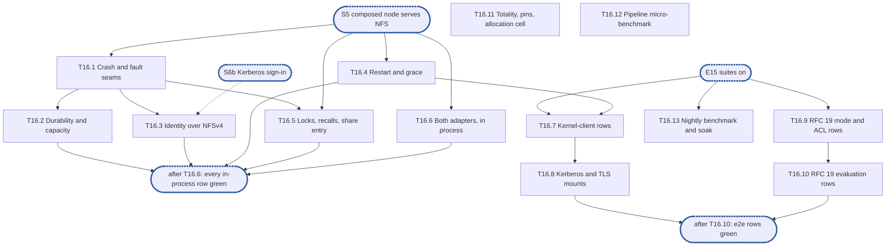

# Epic 16: NFS adapter v2 E2E green

**Sources:** [RFC 21](../docs/internals/rfcs/rfc-21-nfs.md) §11.5's totality sentence and its
"What runs while draining" paragraph, §11.6's "§11.1–§11.5 total mapping" row and its two
cross-protocol rows, §12's N13, N14, N17, N23 and N24 for one node and N22's held-I/O half, and
§13's opening, "What must not
stand in" and suites paragraphs with the rows that need the composed node, a restart, a kernel client
or both adapters: "§11.5 full journal", "§9.1 stability", "§9.1 loss verifier", "§9.1 failed stable
write *(1 node)*", "§9.2 close-to-open and WCC *(1 node)*", "§5.4 single-node restart", "§5.2, §5.4
lock across a restart *(1 node)*", "§5.4 NFSv4.0 signal", "§5.1 revoke across a restart *(1
node)*"'s NFSv4 steps, "§6.1 NLM grace", "§6 NLM", "§5.3 lock recall", "§5.3 handle-cached deny
mode", "§5.5, §6.1 conflict holder"'s SMB step, "§8.1 ctime", "§8.1 privilege *(1 node)*", "§11.1
refused credentials *(1 node)*" on the composed node, "§11.3 audit entries" and "§11.3 ACL
attributes"' administrator steps, "§11.3 read-only marker"'s SMB steps, "§9.3 NFSv4.2"'s steps other
than xfstests, "§9.3 copy and clone"'s steps that need a clone the engine runs, "§9.3 hold budget
*(1 node)*"'s NFSv4.1 steps on the composed node and its NFSv3 step, "§5.2 delegation stateid" under
Kerberos and "§2.2 TCP only"'s mount step;
[RFC 20](../docs/internals/rfcs/rfc-20-adapters.md) §6.10's pipeline micro-benchmark and end-to-end
benchmark for NFS, §7's `unit/adapter-allocs` sentence, §7.3, §7.4's NFS halves, §7.5's NFS halves
("§3.1 drain", "§3.2 reconnect", "§4.4 Kerberos and AD", "§5.5 TLS"), §8.5's suites paragraph and
§9's A7 and A18; [RFC 19](../docs/internals/rfcs/rfc-19-authorization.md) §9's rows through both
adapters, their NFS halves, with its "What must not stand in" and suites paragraphs;
[RFC 18](../docs/internals/rfcs/rfc-18-identity.md) §10's Tier 2 rows that E7's document hands here:
"one uid, two proofs"' Kerberos read, the `sec=krb5` steps of "admin needs proof" and "owner
strings", "error is not "unknown"" on the composed node, and the `AUTH_SYS` rows E7 runs over NFSv3,
over NFSv4; and the `SP4_MACH_CRED` step of "no file spelling" with a Kerberos machine principal,
which E8's document hands here; [RFC 29](../docs/internals/rfcs/rfc-29-test-harness.md) §2's R10 and §4.10. From
[RFC 20's implementation plan](rfc-20-adapters-plan.md)'s deferral ledger (its §6.2): the
`test/required-tests.json` pins for the adapters' authorization gates, and "a `core` soak under real
traffic". Every RFC citation is `origin/feat/storage-v2`'s text; of the sections owned, `develop`'s
copy differs only in RFC 20 §6.10's sentence on goroutines per record, which this epic holds (R9).
Cited, not owned: RFC 21 §13's "Tests expected to fail" (the burn-down, §1.2); RFC 1 §1.3 on crashes
simulated beneath the code under test; RFC 24 §6.1.
**Track:** the team.
**Epic 16 estimate: 13 subtasks, 47 man-days.**
**Depends on:**
- **S5**, the composed in-process node, `internal/node/nodetest`, serving NFS (and SMB, for T16.6),
  for T16.1 to T16.6.
- **E15**, which turns the NFS rows of `e2e`, `e2e/kerberos` and `e2e/cross-protocol` on under
  `tests.yml`'s V2 filter, and RFC 23's implementation plan's epic 8, which rebuilds the e2e helpers
  and the server fixture they start `dfs` through, for T16.7 to T16.10 and T16.13.
- **S6b** and **E13** for every Kerberos step (T16.3, T16.8, the Kerberos rows of T16.9 and T16.10).
- The handler epics whose rows these are: E4, E6 and E7 (their composed-node and end-to-end halves),
  E8 and E9 (sessions, stateids, reclaims), E10 (recalls, revokes), E11 (NLM, NSM, `rpcclient`), E12
  (`READ_PLUS`, `CLONE`, the hold budget), and every table for T16.11.
- Outside this programme's NFS epics: RFC 22's implementation plan for SMB on the composed node and
  its scripted client (T16.6), its negotiation epic's totality helper in `core`'s `errors.go`
  (T16.11), and its epic 16, which writes the SMB halves of the rows two adapters share (D2).
**Blocks:** nothing in this programme. The cutover's switch-off of the V2 filter for NFS's suites
waits for the burn-down this epic gains once E15 lands (§1.2).

---

## 1. Goal

Epic 16 runs every NFS row no lower layer can show: on the composed node, faults and crashes
injected beneath it, across a restart and through both adapters; through Linux kernel clients, with
Kerberos and TLS; and the benchmarks and soak. It closes the totality test over every NFS table and
pins NFS's authorization gates so that removing one is a visible edit.

**At the end of the epic:**

- a test fails when any NFS table lacks a row for an error the service or `core` can return, for any
  operation and version the table distinguishes;
- on the composed node, a stable reply survives a crash, a lost unstable write reaches the next
  `COMMIT` as a new verifier, a full journal is answered retry-later and never "no space", and a
  quota at once;
- a restart of the one node opens a new grace instance that NFSv4.0, NFSv4.1 and NLM clients each
  see by their own signal, reclaim in, and cannot use to reclaim state an administrator revoked;
- a lock from another client recalls a delegation before it is decided, over NFSv4 and NLM alike, and
  a quiesced or netgroup-restricted share is refused on every NFS entry path;
- the rows reaching one file through NFS and SMB pass, in process for the wire answers and with
  `nfs4_setfacl` and `smbcacls` for RFC 19's;
- Linux kernel clients survive a drain under `tar`, a restart under a held lock and session, mount
  with `krb5`, `krb5i`, `krb5p` and `xprtsec=tls`, and see close-to-open consistency;
- the pipeline micro-benchmark gates NFSv3's and NFSv4.1's allocations per request in
  `unit/adapter-allocs`, a nightly step measures NFS end to end against knfsd, and a soak under
  kernel traffic ends with nothing leaked;
- `test/required-tests.json` names NFS's authorization gates, and every package holding an
  allocation gate is in `unit/adapter-allocs`.

### 1.1 In scope

The composed node's crash and fault seams; the in-process rows on the composed node (durability,
capacity, identity over NFSv4, restart and grace, locks and recalls, share entry, the rows through
both adapters whose assertions are wire answers); the kernel-client rows in `e2e`, `e2e/kerberos`
and `e2e/cross-protocol`, with a capture helper; RFC 19 §9's NFS halves with real tools; the
totality test; the pins; the pipeline micro-benchmark; the nightly end-to-end benchmark step and the
soak; RFC 21 §13's suites paragraph amended to say where the in-process rows run (D1).

### 1.2 Out of scope

- **The burn-down of `pynfs`, `cthon04` and `nfstest`** to RFC 21 §13's "Tests expected to fail",
  the pynfs steps of "§3.1, §3.2 sessions *(1 node)*", "§3.2 reply cache", "§4.2 v4.0 owners *(1
  node)*", "§5.2 stateids *(1 node)*" and "§8 attributes", cthon04 and nfstest over NFSv3 among them.
  It is planned after E15 (D7): v2's failures in those suites are known only once E15 turns them on,
  so this document gains its subtask, sized then, by a pull request.
- **Cross-node steps** of every row: the cluster stage, the RFC 21 implementation plan's deferral
  ledger, row "RFC 21's (cluster) parts". "§3.2 reply cache"'s node loss with no grace and "§9.2
  change info"'s two-node step among them.
- **"§11.5 full journal" with the store unreachable**: that ledger's row "A remote outage on the
  composed node", owned by RFC 8's second part. The step making the store deny puts needs the same
  remote tier and goes with it (§9, point 5).
- **xfstests and pynfs's reboot tests** (§9.3, "§5.4 reboot *(1 node)*"): that ledger's row "RFC 21
  §13's rows no suite runs".
- **RFC 20 §7.5's "§6.1 slow client", "§6.5 cancel" and "§6.2 order"**: each names SMB alone, so
  none has an NFS step. RFC 22's implementation plan's epic 16 runs them (§9, point 4).
- **The SMB halves** of the rows through both adapters: RFC 22's implementation plan's epic 16 (D2).
- **The rows' halves on `memory.New`**, which the handler epics own: E4's NFSv3 steps, E6's RFC 19
  halves (its R43 and R44), E7's `AUTH_SYS` rows over NFSv3 (its T7.6), E9's "§11.3 read-only marker"
  with the marker set through the service, E10's lock met during a recall, E11's "§5.1 revoke across
  a restart"'s NLM steps, E12's NFSv4.2 rows and E13's Kerberos steps of "§8.1 privilege" against
  `memory.New`.
- **RFC 19 §9's rows with no NFS step**: "§3.3 walk and maximal access" (the service's, and the wire
  tests' against reference servers), "§2.3 deny-only", "§2.4 generic rights", "§2.8 no partial set",
  "§3.1 `via`", "§3.4 maximal access", "§3.4 what an open holds", "§2.8 lookup failure", and "§3.8
  locks outside an open", which names NFSv3's lock manager and is E11's.
- **The error label's list of sentinel names** (RFC 20 §7.3), which no protocol owns: the totality
  helper's owner, RFC 22's implementation plan's negotiation epic.

### 1.3 Names used here

- **E3**, the RPC layer and the scripted client, `adaptertest/nfsclient`.
- **E4**, NFSv3 and MOUNT. **E5**, the NFSv4 namespace, attributes and data path. **E6**, the NFSv4
  ACL attributes. **E7**, identity's NFS side.
- **E8**, clients and sessions. **E9**, opens, stateids and locks. **E10**, delegations and the back
  channel. **E11**, NLM, NSM and the datagram path. **E12**, the NFSv4.2 operations. **E13**,
  RPCSEC_GSS. **E14**, the capture diffs against knfsd.
- **E15**, the integration with the node: `settings.NFS`, and the NFS suites turned on under the V2
  filter.
- **S5**, the composed in-process node, `internal/node/nodetest`, serving NFS.
- **S6b**, Kerberos sign-in behind `SignIn`: RFC 18's implementation plan's epic 5.
- **S7**, the node serves NFS through `dfs`: the cutover, which E15 waits for.
- **RFC 22's epic 16**, the SMB counterpart of this epic in RFC 22's implementation plan.

## 2. How the general rules apply

The rules are those of [the RFC 21 implementation plan's §1.5](rfc-21-nfs-plan.md#15-general-rules-for-each-epic),
cited by number and title and not copied.

| Rule | Subtasks | How |
| --- | --- | --- |
| rule 1, independent unit tests, under `-race` ([`CLAUDE.md`, "Writing tests"](../CLAUDE.md#writing-tests)) | T16.1 to T16.6, T16.11 | the in-process rows run in `unit` under `-race` on the real composed node, driven by E3's scripted client and RFC 22's; a fault is the journal kit's `kit.Seam` or `kvtest.FaultKV` around the real store (kind 3), time the node's test clock (kind 1); no other double |
| rule 2, fuzz tests where relevant | none | nothing here decodes a peer's bytes; the decoders' targets are the middle epics' |
| rule 3, observability follows RFC 25 and RFC 20 §10 | T16.2, T16.13 | no series is added; the soak reads `adapter_unmapped_errors_total` and `adapter_handler_panics_total`, and T16.2 reads none of the series pending the RFC's author |
| rule 4, profiling: leaks, allocations and contention | T16.1 to T16.6, T16.12, T16.13 | every in-process row ends with `adaptertest.CheckLeaks`; T16.12 is RFC 20 §6.10's allocation gate; the soak asserts the pools empty and no goroutine growth (R15) |
| rule 5, public interface and internals, at the layer that consumes a value ([`CLAUDE.md`, "Verifying a change"](../CLAUDE.md#verifying-a-change)) | all | each row asserts what a client reads: the status on the wire, the bytes read back, the file a kernel mount sees, the descriptor `smbcacls` prints |
| rule 6, known failures shrink | none, until the burn-down | `e2e` and `unit` keep no `known.yaml`; the burn-down's subtask, added after E15, removes entries (§1.2) |
| rule 7, v2 ignores v1 | all | the rows come from the RFCs; `develop`'s e2e tests are not ported, and only `test/e2e/framework`'s mount, Kerberos and netns helpers, which import nothing of v1, are reused |
| rule 8, real dependencies for properties of those dependencies | all | the composed node with Badger under `t.TempDir()` and the journal on a real directory for durability; Linux kernel clients, `tlshd`, a real KDC, `nfs4-acl-tools` and `smbcacls` for client behaviour; knfsd as the nightly reference |
| rule 9, code comment conventions ([`CLAUDE.md`, "Code comments"](../CLAUDE.md#code-comments)) | T16.13 | the soak's `ponytail:` (D5); D3's and D6's `decision:` markers at their sites |
| rule 10, a test must be able to fail | all | each test names the change that fails it; the totality test fails on a row removed; the allocation gate on one allocation added; the cell check on a package dropped from the cell |
| rule 11, a symbol is exported only if an interface uses it | T16.1, T16.7 | exported: `nodetest`'s `Faults`, `Seam`, `KV` and `Crash`, for this epic's in-process rows and RFC 22's epic 16; `framework.Capture` and `framework.TsharkFields`, for T16.7 and T16.8. Nothing else |
| rule 12, each subtask creates only what it declares | all | each helper lands with its first consumer: the seams with T16.2, the capture with T16.7 |
| rule 13, translate, never decide | none | no adapter code is written here; the rows assert the service's decisions as the adapter carries them |
| rule 14, nothing deferred is lost | all | every row's step left out is named in §1.2 with its owner; the burn-down waits as a recorded decision (D7) |

## 3. Requirements and invariants

Every MUST and MUST NOT that RFC 20, RFC 21, RFC 19, RFC 18 and RFC 29 place on this epic, numbered
so that subtasks and tests can cite them. A section cited with no RFC named is RFC 21's.

**Totality and pins**

| # | Requirement | Kind | Source | Subtasks |
| --- | --- | --- | --- | --- |
| R1 | Every error an NFS table can receive, each sentinel of `vfs.Errors()` and `core.Errors()` and one value of every typed kind, has a row in each NFS table, for every operation and version the table distinguishes; a new service error fails the test until NFS says what it means | MUST | RFC 20 §7.3, §9 (A7); §11.5, §11.6 ("§11.1–§11.5 total mapping"), §12 (N26) | T16.11 |
| R2 | The same test pins each NFS table's `NotFailure` rows: none | MUST | RFC 20 §7.3 | T16.11 |
| R3 | `ErrNotLast`, `ErrTooManyPending` and `ErrCancelled` map to the table's fault; `ErrNotNegotiated`, `ErrNoSession`, `ErrNoTree` and `ErrExpired` have rows with the session and GSS tables, and the totality test fails until they do | MUST | §11.5 ("What runs while draining") | T16.11 |
| R4 | NFS's authorization gates are named in `test/required-tests.json`, so a test guarding one cannot be removed unseen | MUST | RFC 20 implementation plan, deferral ledger (`test/required-tests.json` pins) | T16.11 |
| R5 | Every NFS allocation gate runs per change in the non-race cell, `unit/adapter-allocs`, since the gates skip under `-race` | MUST | RFC 20 §6.10, §7 | T16.11, T16.12 |

**Benchmarks and soak**

| # | Requirement | Kind | Source | Subtasks |
| --- | --- | --- | --- | --- |
| R6 | The pipeline micro-benchmark runs NFS's whole pipeline over loopback against a null service, for NFSv3 and NFSv4.1, per change in the non-race cell, reporting ns and allocations per request; ns carries no gate until a baseline is checked in | MUST | RFC 20 §6.10 | T16.12 |
| R7 | Allocations per request are asserted equal to a checked-in number that may only fall: a count below it fails until the number is lowered; tracing off | bound | RFC 20 §6.10 | T16.12 |
| R8 | At ratio 0.01, with `Deps.TraceIDs` returning only IDs the ratio rule rejects, warm-up included, `testing.AllocsPerRun` equals tracing off's | bound | RFC 20 §6.10 | T16.12 |
| R9 | Over every run, with tracing off and at ratio 0.01, each record starts one goroutine and leaves none running once its requests end | bound | RFC 20 §6.10; RFC 24 §6.1 | T16.12 |
| R10 | The end-to-end benchmark measures small operations (`GETATTR`, `LOOKUP`) per second on one connection and on the node, driven by the scripted client with a fixed number in flight, never by a kernel mount | MUST | RFC 20 §6.10 | T16.13 |
| R11 | Throughput uses kernel clients: `fio` sequential 1 MiB read and write on an NFSv3 and an NFSv4.1 mount, on one connection and on four with `nconnect` | MUST | RFC 20 §6.10 | T16.13 |
| R12 | Latency under load: the p99 of a 4 KiB write while a second client holds the node at half its request budget | MUST | RFC 20 §6.10 | T16.13 |
| R13 | The end-to-end benchmark runs nightly on the dedicated host, tracked and not gated: a fall below its 7-day median is flagged and fails nothing (§9, Q3) | MUST | RFC 20 §6.10; RFC 29 §4.10 | T16.13 |
| R14 | A soak runs the node under real NFS traffic and fails on any unmapped error or handler panic | MUST | RFC 20 implementation plan, deferral ledger ("a `core` soak under real traffic"); RFC 20 §9 (A7) | T16.13 |
| R15 | Once the soak's traffic stops, the node's pools hold zero reserved bytes | invariant | RFC 20 §9 (A18) | T16.13 |

**The composed node: faults, durability and capacity**

| # | Requirement | Kind | Source | Subtasks |
| --- | --- | --- | --- | --- |
| R16 | A row that injects a fault below the server injects it beneath the single node composed as in production, through the composed harness, and a crash loses what the journal had not synced; nothing stands in for the node | MUST | §13 (opening, suites paragraph); RFC 1 §1.3 | T16.1 |
| R17 | "§9.1 stability": `DATA_SYNC` survives a crash with its `size` and `mtime`; 10^4 `FILE_SYNC` appends with the metadata store stalled are all answered; a `FILE_SYNC` overwrite of committed bytes with the store stalled gets no success before the store commits, `NFS4ERR_DELAY` within the deadline, and its reply follows the write's existence commit; the same for unstable overwrites and `COMMIT` | test row | §13 | T16.2 |
| R18 | "§9.1 loss verifier": unstable writes, the sync window holding them failed, then `COMMIT` succeeds with a verifier different from the writes', the client resends and the data reads back | test row | §13 | T16.2 |
| R19 | "§9.1 failed stable write *(1 node)*" on the composed node: the journal sync failed under a `FILE_SYNC` `WRITE` is `NFS4ERR_DELAY` / `NFS3ERR_JUKEBOX`, and the resent `WRITE` succeeds and reads back | test row | §13 | T16.2 |
| R20 | "§11.5 full journal"'s steps a single node without a remote tier can run: the journal full, and one share's journal limit reached, answered `NFS4ERR_DELAY` (v4) and `NFS3ERR_JUKEBOX` (v3), never `NFS4ERR_NOSPC`, and the writes succeed once room returns; a user quota exceeded `NFS4ERR_DQUOT` at once, a project and a share-wide quota `NFS4ERR_NOSPC` at once | test row | §13 | T16.2 |
| R21 | N17 on one node: a stability reply waits for its range's journal sync and for the existence commit of every pending overwrite of committed content in it, never for an append's or hole fill's; a transient capacity refusal is retry-later as long as it lasts, never "no space" because a deadline passed; only a logical quota or a permanent cause is answered at once | invariant | §12 (N17) | T16.2 |
| R22 | N23: a loss of unstable writes reaches the next `COMMIT` as a changed verifier, never a success under the old one | invariant | §12 (N23) | T16.2 |

**Identity and authorization over NFSv4 on the composed node**

| # | Requirement | Kind | Source | Subtasks |
| --- | --- | --- | --- | --- |
| R23 | RFC 18 §10's Tier 2 rows over NFSv4.1 on the composed node: "one uid, two proofs"' Kerberos read granted through `Finance`; "admin needs proof"'s `sec=krb5` read granted; "owner strings"' `sec=krb5` `chown` to `alice@corp.example` succeeding and to `alice@other.example` refused `NFS4ERR_BADOWNER`, and a deleted user's file shown `nobody@…`; "client in the key", "root" and "squash order follows the proof", with their Kerberos steps | test row | RFC 18 §10; E7's document, §1.2 | T16.3 |
| R24 | RFC 18 §10's "error is not "unknown"" on the composed node: a store error on the `uid` index during an `AUTH_SYS` call to a share with an everyone grant of `read-write` is a retryable error, and nothing is created | test row | RFC 18 §10 | T16.3 |
| R25 | "§8.1 privilege *(1 node)*" over NFSv4: on `Squash=root` with uid 1500 granted `admin`, `AUTH_SYS` as 1500 is `NFS4ERR_PERM` for another's `chown` and `NFS4ERR_ACCESS` for another's mode-0600 file; root is squashed; over Kerberos as the `admin` principal both succeed; on a `sec=krb5` export, a principal mapped to uid 0 restores other owners with `tar xpf` under `no_root_squash` and is squashed, `NFS4ERR_PERM`, under `root_squash` | test row | §13 | T16.3, T16.8 |
| R26 | "§11.1 refused credentials *(1 node)*" on the composed node: a truncated `AUTH_SYS` credential, one with 17 gids, one with a 256-byte machine name, an `AUTH_DH` and an unknown flavour, each sent with a `CREATE` to a share with an everyone grant, are each `AUTH_BADCRED`, and nothing is created | test row | §13 | T16.3 |
| R27 | "§11.3 audit entries" and "§11.3 ACL attributes"' administrator steps over the wire, as a proven caller, on NFSv4.0 and NFSv4.1: `sacl` and audit entries in `acl` read and set | test row | §13 | T16.3 |
| R65 | "§5.2 delegation stateid" under Kerberos: alice opens a 0644 file over NFSv4.1 and gets a read delegation; bob, from the same client, `READ`s under its stateid, served, and `WRITE`s, `NFS4ERR_ACCESS`; a second client quoting it, `NFS4ERR_BAD_STATEID` | test row | §13; E10's document, §9 | T16.3 |
| R66 | RFC 18 §10's "no file spelling", its `SP4_MACH_CRED` step with a Kerberos machine principal: a second principal's state operation on the first's `SP4_MACH_CRED` client record is refused | test row | RFC 18 §10; E8's document, §1.2 | T16.3 |

**Restart and grace on the one node**

| # | Requirement | Kind | Source | Subtasks |
| --- | --- | --- | --- | --- |
| R28 | "§5.4 single-node restart": after a client's `RECLAIM_COMPLETE` and lock, a restart raises the shard's incarnation, the client's reclaim is granted rather than `NFS4ERR_NO_GRACE`, and a second client's conflicting lock is refused until the reclaim | test row | §13 | T16.4 |
| R29 | "§5.2, §5.4 lock across a restart *(1 node)*": over NFSv4.0 the first `WRITE` after the restart is `NFS4ERR_STALE_STATEID`, never `NFS4ERR_BAD_STATEID`, `RENEW` is `NFS4ERR_STALE_CLIENTID`, and after `SETCLIENTID` and the confirm the lock's reclaim is granted in grace while a second client's conflicting lock is refused throughout; over NFSv4.1 the `SEQUENCE` carries `SEQ4_STATUS_RESTART_RECLAIM_NEEDED`; a Linux writer's I/O resumes without an error | test row | §13 | T16.4, T16.7 |
| R30 | "§5.4 NFSv4.0 signal" on a restart: an NFSv4.0 client's `RENEW` is `NFS4ERR_STALE_CLIENTID`, a `READ` under its open's stateid `NFS4ERR_STALE_STATEID`, and after `SETCLIENTID` and the confirm the client ID is unchanged and its reclaim granted; a Linux client completes recovery without looping | test row | §13 | T16.4, T16.7 |
| R31 | "§5.1 revoke across a restart *(1 node)*"'s NFSv4 steps: client X's open and lock revoked by an administrator and taken by Y, then a restart: X's reclaims `NFS4ERR_NO_GRACE`, Y's granted, X's new `OPEN` after grace granted and listing the shard again | test row | §13 | T16.4 |
| R32 | "§6.1 NLM grace" on a restart: with an NLM host and an NFSv4.1 client holding locks, the NFSv4.1 client's `RECLAIM_COMPLETE` does not end grace before its whole lease period | test row | §13 | T16.4 |
| R33 | "§6 NLM"'s `SM_NOTIFY` step on a restart: `SM_NOTIFY` reaches the host's statd, and the host reclaims | test row | §13 | T16.4 |
| R34 | RFC 20 §7.5's "§3.2 reconnect", its NFS half: a restart under an NFSv4.1 client holding a session and a lock: `NFS4ERR_BADSESSION`, a new session, the lock reclaimed in grace | test row | RFC 20 §7.5 | T16.4, T16.7 |
| R35 | N13 on one node: a restart opens a new grace instance, never a repeated one, signalled by `SEQ4_STATUS_RESTART_RECLAIM_NEEDED` or, to NFSv4.0, `NFS4ERR_STALE_CLIENTID` | invariant | §12 (N13) | T16.4 |
| R36 | N24: a stateid whose record is gone is `NFS4ERR_STALE_STATEID` when its bits name an earlier grace instance, `NFS4ERR_BAD_STATEID` otherwise; an administrator's revoke outlives a restart and is never reclaimed | invariant | §12 (N24) | T16.4 |
| R37 | A single-node run tests only what binds one node: no row here is counted for a cross-node step, and the restart rows run against a restart of the single node. A review rule: no test can tell a row counted for a cross-node step | MUST NOT | §13 ("What must not stand in", opening) | T16.4 |

**Locks, recalls and share entry on the composed node**

| # | Requirement | Kind | Source | Subtasks |
| --- | --- | --- | --- | --- |
| R38 | "§5.3 lock recall": with A holding a write delegation, B's NLM lock and B's NFSv4 `LOCK` over a range A locked locally each send `CB_RECALL` before B's answer; after the recall B's `LOCK` is `NFS4ERR_DENIED`, a non-blocking NLM lock `NLM4_DENIED`, a blocking one `NLM4_BLOCKED` then `NLMPROC4_GRANTED` when A unlocks; with a read delegation and no local lock, `CB_RECALL` before B is granted; while A delays `DELEGRETURN`, `NFS4ERR_DELAY`, `NLM4_BLOCKED` then `NLMPROC4_GRANTED`, and `NLM4_DENIED_GRACE_PERIOD` for a non-blocking NLM lock, never `NFS4ERR_DENIED` or `NLM4_DENIED` | test row | §13 | T16.5 |
| R39 | N14: a lock request from another client recalls a read or write delegation before the lock is decided, and is meanwhile answered retry or blocked, never denied | invariant | §12 (N14) | T16.5 |
| R40 | A quiesced share and a netgroup-restricted one are refused on every NFS entry path: `PUTFH` of a held handle, a walk from `PUTROOTFH`, `LOCK` naming only an open, `MNT` | test row | RFC 20 §7.4 | T16.5 |
| R41 | "§9.3 hold budget *(1 node)*"'s NFSv3 step: a write into a running `CLONE`'s source is held and answered success after the clone, not `NFS3ERR_JUKEBOX` | test row | §13 | T16.5 |
| R42 | "§9.3 NFSv4.2"'s steps other than xfstests: `READ_PLUS` over a file with holes reads zeros where holes are, and `ALLOCATE` is `NFS4ERR_NOTSUPP` | test row | §13 | T16.5 |
| R61 | "§9.3 copy and clone"'s steps that need a clone the engine runs, on the composed node: a `WRITE` into a running 512 MiB `CLONE`'s source answered success only after the `CLONE` is, never `NFS4ERR_DELAY` within its deadline, the destination equal to the source before the write; a `COPY` of a 4 GiB file under a continuous writer holding no source write longer than one 64 MiB chunk, and a `COPY` cut by its deadline answering a short `wr_count` the client continues from; a source with a Lost run cloned, the destination reading that run as Lost, not zeros; a crash mid-clone leaving the destination equal to the source at the clone's point | test row | §13; E12's document, §1.2 | T16.5 |
| R63 | "§9.3 hold budget *(1 node)*"'s NFSv4.1 steps on the composed node: a session of 16 fore-channel slots writing from 8 slots into a running 512 MiB `CLONE`'s source holds at most 4 calls, the others `NFS4ERR_DELAY` at once, while a `READ` of another file is served; on a session of 2 slots one call is held | test row | §13; E12's document, §1.2 | T16.5 |
| R64 | N22's held-I/O half on one node: I/O into a running clone's or chunk's ranges is held until it ends, and `NFS4ERR_DELAY` only past its own deadline | invariant | §12 (N22) | T16.5 |

**Through both adapters**

| # | Requirement | Kind | Source | Subtasks |
| --- | --- | --- | --- | --- |
| R43 | "§6.1 NLM against SMB": an NLM lock and an SMB byte-range lock over one range, in each order: the second refused; an SMB write into the NLM range admitted, an NFSv3 write into the SMB range refused | test row | §11.6 | T16.6 |
| R44 | "§11.4 SMB deny-write against an NFS write open": an SMB open with `FILE_SHARE_READ` only and no lease; an NFSv4 `OPEN` for write is `NFS4ERR_SHARE_DENIED` and an NFSv3 `WRITE` `NFS3ERR_ACCES`, both succeeding once the SMB open closes; the reverse, an NFSv4 `OPEN4_SHARE_DENY_WRITE` then an SMB `CREATE` for write, is `STATUS_SHARING_VIOLATION` | test row | §11.6 | T16.6 |
| R45 | "§5.3 handle-cached deny mode": with an SMB deny-write held only by an RWH lease's handle cache, an NFSv4 open for write and an NFSv3 write are each `NFS4ERR_DELAY` / `NFS3ERR_JUKEBOX` while the break runs, then succeed; with the handle in use, `NFS4ERR_SHARE_DENIED` and `NFS3ERR_ACCES` only after the break | test row | §13 | T16.6 |
| R46 | "§6 NLM"'s SMB steps: an NLM lock against an SMB byte-range lock, and an SMB deny mode against `NLMPROC4_SHARE` | test row | §13 | T16.6 |
| R47 | "§5.5, §6.1 conflict holder"'s step with the range held by an SMB byte-range lock: `LOCK` and `LOCKT` from NFSv4 decode as `NFS4ERR_DENIED`, client ID 0 and owner length 0 | test row | §13 | T16.6 |
| R48 | RFC 20 §7.4's other NFS halves: an NFS write against an SMB deny mode, an NFS lock against an SMB lease, a rename over NFS of a directory marked delete on close over SMB | test row | RFC 20 §7.4 | T16.6 |
| R49 | "§8.1 ctime": an SMB client sets −1 on all four times of an open and writes through it; an NFSv3 `GETATTR` shows `ctime` moved | test row | §13 | T16.6 |
| R50 | "§11.3 read-only marker"'s steps through SMB: the marker set over SMB on a file and an empty directory refuses NFS's writes, removes and opens for write as the row lists, and clearing it over SMB lets each succeed | test row | §13 | T16.6 |
| R51 | RFC 19 §9's rows on modes and ACLs, their NFS halves through both adapters with real clients' tools: "§2.3 well-known matching", "§2.3 kinds", "§2.7 stored order", "§2.8 server-built lists", "§2.8 count", "§4.1 what a mode bit grants", "§4.1 shown is evaluated", "§4.2 the two identities", "§4.2, §4.3 the group bits are a mask", "§4.3 the merge raises no allow a deny follows", "§4.2 everyone-like principals", "§4.4 inheritance", "§4.4 create-time ACL", "§5.2, Z8 round trip", "RFC 22 §11 fold", "§5.2 deleted principal", "Z1, §2.4 masks", "Z9", "Z11" | test row | RFC 19 §9 | T16.9 |
| R52 | RFC 19 §9's rows on evaluation, their NFS halves through both adapters: "§3.2 ceiling", "§3.1 read-only cause", "§3.1 through an open", "§3.1 creating open", "§3.1 order", "§3.1 sticky", "§3.1 traverse", "§3.4 privilege in access queries", "§3.5 system security", "§3.6 audit selection", "§3.7 access-based enumeration" | test row | RFC 19 §9 | T16.10 |
| R53 | A round trip proves Z8 only through the store between the write and the read, never through the translation alone; a check on the mode-only path stands in for none on the ACL path, nor the reverse | MUST NOT | RFC 19 §9 ("What must not stand in") | T16.9 |

**Kernel clients**

| # | Requirement | Kind | Source | Subtasks |
| --- | --- | --- | --- | --- |
| R54 | RFC 20 §7.5's "§3.1 drain", its NFS half: a source tarball extracted onto an NFSv3 hard mount while the node stops with a 30 s drain deadline and starts again finishes, and its tree matches a local extraction byte for byte | test row | RFC 20 §7.5 | T16.7 |
| R55 | "§9.2 close-to-open and WCC *(1 node)*"'s kernel step: two clients on the one node, one writes and closes, the other opens and reads the new data | test row | §13 | T16.7 |
| R56 | "§2.2 TCP only"'s mount step: a mount with `proto=udp` falls back or fails | test row | §13 | T16.7 |
| R57 | RFC 20 §7.5's "§4.4 Kerberos and AD", its NFS half: NFSv4.1 mounts with `sec=krb5`, `krb5i` and `krb5p` act as their principal; `krb5p` traffic is unreadable in a capture; a failed handshake never falls back to an anonymous mount; after the keytab is rotated a new mount succeeds while the first stays mounted | test row | RFC 20 §7.5 | T16.8 |
| R58 | RFC 20 §7.5's "§5.5 TLS": an NFSv4.1 mount with `xprtsec=tls` shows no readable RPC after the `AUTH_TLS` probe; with `mode: require` a plaintext mount fails; certificate files replaced, a new mount presents the new certificate while the first stays mounted | test row | RFC 20 §7.5 | T16.8 |
| R59 | Where each row runs: RFC 20 §7.5's in `e2e` (drain after every merge, the rest nightly), its Kerberos mounts in `e2e/kerberos`, RFC 19 §9's rows through both adapters with real tools in `e2e/cross-protocol`, and the in-process rows in `unit` (D1) | MUST | RFC 20 §7.5, §8.5; §13 (suites); RFC 19 §9 (suites) | T16.3, T16.7, T16.9 |
| R60 | Not run is never passed: a kernel-client row whose prerequisite the host lacks, a need unmet, fails the cell rather than passing by a skip (T16.7 to T16.9 name each tool they need) | MUST | RFC 29 §2 (R10) | T16.7, T16.8, T16.9 |
| R62 | "§9.3 copy and clone"'s Linux step: between shares in different namespaces, `cp` falls back after `NFS4ERR_XDEV` and copies the bytes | test row | §13; E12's document, §1.2 | T16.7 |

## 4. Decisions this epic takes

- **D1. Rows whose assertions are wire answers run in process; kernel clients only for what a
  client does** (pending Q1). RFC 21 §13's suites paragraph puts in `unit` only the rows that inject
  a fault below the server, and its other single-node rows, and those reaching one file over NFS and
  SMB, in `e2e` and `e2e/cross-protocol`. Most of those rows assert bytes on the wire (a `CB_RECALL`
  before an answer, `NFS4ERR_STALE_STATEID` and not `BAD`, a deny mode `NFS4ERR_SHARE_DENIED`) or need
  an SMB request no Linux tool sends (−1 times, `FILE_SHARE_READ` alone, an RWH lease cached). Such a
  row runs in process on the composed node, driven by E3's scripted client and RFC 22's, in `unit`;
  a kernel client runs where the row asserts what the client does (recovery without looping, a
  drain under `tar`, close-to-open, mounts, `xprtsec`, `sec=krb5p`), and RFC 19 §9's rows run with
  real tools as RFC 19 says. A row with both halves is split that way, the wire half in T16.4 and the
  kernel half in T16.7. Batch two's one RFC 21 pull request carries the sentence for RFC 21 §13's
  suites paragraph (§9). Prior art: RFC
  18 §10's Tier 2 and RFC 20 §8.5's placement of §7.4 do exactly this; pynfs, the NFS conformance
  tool, is itself a scripted client (from memory). Changing it later costs moving test files between
  packages, nothing more.
- **D2. A row through both adapters is one test, written by whichever epic 16 reaches it first.**
  RFC 20's implementation plan's ledger gives the cross-protocol rows to the two plans jointly. One
  test per row lives in one file (`internal/node/crossproto_test.go`, `test/e2e/crossprotocol_*_test.go`);
  the first epic to land writes the row with its own steps and the other's as the RFC states them,
  using both scripted clients or both mounts; the second adds what its adapter still lacks and
  removes nothing. Each epic's figure counts the whole row, which double-counts at most the second
  epic's review of it. Prior art: the plans' rule for `translate` (RFC 22's implementation plan,
  §6.2, point 5).
- **D3. The composed node's crash and faults are the journal kit's seam and the store's fault
  wrapper, below the node.** `nodetest.Faults()` builds the journal device behind a `kit.Seam` and
  the KV behind `kvtest.FaultKV`; `Crash` abandons the node without `Stop`, crashes the seam, which
  drops what no sync covered, and builds a node again over what is left, as `journaltest.Fixture`'s
  `Crash` does for a journal alone. No node-level fault seam is added: `node.Config.Fault` is a row
  of RFC 23's implementation plan's deferral ledger, not this epic's. A `decision:` marker at
  `Faults` says a fault reaches the node only through its storage, and should be withdrawn if a row
  ever needs a fault above it. Settled now because RFC 22's epic 16 builds its durability rows on the
  same four symbols; changing them then rewrites both epics' rows. Prior art: `journaltest.Fixture`'s
  `Crash` over `kit.Seam`, and `kvtest.FaultKV`, both in the repository.
- **D4. The nightly NFS benchmark is a step of `bench/ditto/night.sh` against knfsd, scored apart**
  (pending Q2). `nfs_night.sh` serves one share from DittoFS and one from knfsd on the dedicated host,
  each in turn, and runs RFC 20 §6.10's points over NFSv3 and NFSv4.1, plus the untar of 40,000 small
  files of RFC 21's "In plain words"; `score.py` scores NFS's points as an area of their own against
  knfsd, outside SMB's night figure, so the 7-day medians of the existing figure stay comparable.
  A file of its own keeps `night.sh` as the SMB night it is, with one call added. Prior art:
  `night.sh`'s own DittoFS-against-Samba design; RFC 20 Appendix C names knfsd as NFS's reference.
- **D5. The soak is a test of `e2e`'s `stress` option.** Kernel NFSv3 and NFSv4.1 mounts run `fio`
  mixed I/O and repeated untars for 20 minutes, then go idle; the test asserts the node's
  `adapter_unmapped_errors_total` and `adapter_handler_panics_total` at 0, the pools at zero reserved
  bytes and the goroutine count back at its start. A `ponytail:` marker says the soak is bounded by
  the option's 30-minute cell, and to move it to the dedicated host for hours when a leak shows only
  past it (pending Q4). Prior art: the `stress` option already exists for this kind of run.
- **D6. The pins are chosen from the gates that landed, and a check holds the allocation cell
  whole.** T16.11 names in `test/required-tests.json` every top-level NFS test asserting a refusal by
  flavour, share entry, squash or `admin` proof (the `LOCK` over `AUTH_SYS` on a Kerberos-only share,
  `MNT`'s handle refused `AUTH_TOOWEAK`, the NLM lock on a Kerberos-only share, refused credentials,
  `admin needs proof`), read from E3, E4, E7, E9, E11 and E13 as they landed. A test in
  `adaptertest` lists the packages under `internal/adapter` whose tests call `testing.AllocsPerRun`
  and fails when one is missing from `unit/adapter-allocs`'s command, since a gate that skips under
  `-race` and runs nowhere else is never run. A `decision:` marker at that test says it reads
  `test/suites.yaml` as text. Prior art: `test/required-tests.json`'s own comment.
- **D7. The burn-down is planned after E15.** Its size is v2's failures in three suites, unknown
  until they run; a figure now would be a guess. `develop`'s 58 pynfs entries are a floor.
- **D8. Captures in `e2e` are `tcpdump` on loopback, read with `tshark`.** `framework.Capture` writes
  a pcap of one port and `framework.TsharkFields` decodes fields with a display filter; T16.7 reads
  `NFS4ERR_BADSESSION` with them and T16.8 shows `krb5p` and TLS traffic unreadable. Prior art:
  `test/pcap-corpus/pcap-diff.sh` already depends on `tshark`.

## 5. Target tree

```text
internal/node/nodetest/
  harness.go                   T16.1  Faults option, Seam, KV, Crash (D3)
  harness_test.go              T16.1  a crash drops unsynced bytes; a fault reaches the node
internal/node/
  nfs_durability_test.go       T16.2  §9.1 rows, full journal, N17, N23
  nfs_identity_v4_test.go      T16.3  RFC 18 Tier 2 over NFSv4, §8.1, §11.1, §11.3 admin steps
  nfs_restart_test.go          T16.4  restart, grace, revoke, NLM grace, SM_NOTIFY, reconnect
  nfs_locks_test.go            T16.5  lock recall, share entry gates, NFSv3 hold, NFSv4.2, running clones
  crossproto_test.go           T16.6  the rows through both adapters, in process (D2)
test/e2e/
  framework/capture.go         T16.7  Capture, TsharkFields (D8)
  nfs_kernel_test.go           T16.7  drain, reconnect, lock across a restart, v4.0 signal,
                                      close-to-open, proto=udp, cp across namespaces
  nfs_kerberos_test.go         T16.8  krb5, krb5i, krb5p, keytab rotation, §8.1's tar steps
  nfs_tls_test.go              T16.8  xprtsec=tls, require, certificate replaced
  crossprotocol_acl_test.go    T16.9  RFC 19 §9 mode and ACL rows (D2)
  crossprotocol_eval_test.go   T16.10 RFC 19 §9 evaluation rows (D2)
  stress_nfs_test.go           T16.13 the soak (D5)
internal/adapter/nfs/
  errors_total_test.go         T16.11 totality over every NFS table
  pipeline_bench_test.go       T16.12 pipeline micro-benchmark, NFSv3 and NFSv4.1
  testdata/pipeline-allocs.txt T16.12 the checked-in allocation counts
internal/adapter/adaptertest/
  allocs_cell_test.go          T16.11 every allocation gate's package is in unit/adapter-allocs
test/required-tests.json       T16.11 NFS's authorization gates (D6)
test/suites.yaml               T16.7  e2e needs tshark and tlshd; T16.12 adapter-allocs gains NFS's packages
bench/ditto/
  nfs_night.sh                 T16.13 the NFS step against knfsd (D4)
  nfsops/main.go               T16.13 small operations by the scripted client
  night.sh, score.py           T16.13 the step called; NFS scored as its own area
docs/internals/rfcs/rfc-21-nfs.md  T16.3  §13's suites paragraph (D1, pending Q1)
```

## 6. Subtasks

### T16.1 The composed node's crash and fault seams

**Subtask T16.1 estimate: 2.5 man-days.**

- **Track:** the team. **Depends on:** S5.
- **Covers:** R16.
- **Deliverables:** in `internal/node/nodetest` (D3):
  - `func Faults() Option`: the journal device reached through a `kit.Seam` with `journal.WithStorage`,
    and the metadata KV wrapped in `kvtest.FaultKV`, on disk (not with `InMemory`);
  - `func (h *Harness) Seam() *kit.Seam` and `func (h *Harness) KV() *kvtest.FaultKV`, for a row to
    schedule a failed sync, hold a sync or a commit, fill the device, or fail an index read;
  - `func (h *Harness) Crash(t testing.TB, opts ...kit.CrashOption)`: the node abandoned without
    `Stop`, the seam crashed, and a node built again over the same directories.
  Consumed by T16.2 and T16.3, and by RFC 22's epic 16.
- **Acceptance criteria:**
  - After a write the journal synced and one it did not, `Crash` reopens a node that reads the
    first and not the second.
  - A fault scheduled on the seam or set on the KV reaches the node's service calls; with none set,
    the node behaves as without `Faults`.
- **Tests:** in `harness_test.go`, at the service the adapters call: a file written and synced,
  another written unsynced, then `Crash`, read back (catches a crash that is a clean stop, which
  keeps the unsynced bytes); a KV fault on one read failing the next `GetAttr` (catches a wrapper not
  on the node's path); the node's own harness tests run again under `Faults` with nothing scheduled
  (catches a wrapper that changes behaviour). Kind 3 doubles around the real journal and store.

### T16.2 Durability and capacity on the composed node

**Subtask T16.2 estimate: 4 man-days.**

- **Track:** the team. **Depends on:** T16.1, E4, E5, E8.
- **Covers:** R17, R18, R19, R20, R21, R22.
- **Deliverables:** `internal/node/nfs_durability_test.go`, driving E3's scripted client over NFSv3
  and NFSv4.1 on a `Faults` node: "§9.1 stability", "§9.1 loss verifier", "§9.1 failed stable write
  *(1 node)*" and "§11.5 full journal"'s single-node steps (§1.2 names the parked ones), with the
  test clock advanced past each deadline. No later subtask consumes it.
- **Acceptance criteria:**
  - Each row's statuses are those R17 to R20 list, on both versions where the row names both.
  - The journal filled to its limit and the share's limit reached are retry-later until room
    returns, at the clock past the caller's deadline too.
- **Tests:** at the NFS reply the client reads: `DATA_SYNC` then `Crash` and read back (catches a
  stable reply before the sync, R17); 10^4 `FILE_SYNC` appends under a held KV commit, every reply
  arriving (catches an append waiting on a metadata transaction, R21); an overwrite under the held
  commit answered only after release (catches an overwrite answered before its existence commit,
  R21); a failed sync window then `COMMIT` (catches a loss answered as an error or under the old
  verifier, R18, R22); a failed sync under `FILE_SYNC` (R19); the journal filled, a write answered
  `NFS4ERR_DELAY` and `NFS3ERR_JUKEBOX` with the clock past the deadline (catches "no space" at a
  deadline, R20, R21); each quota (catches a quota answered retry, R20). Each ends with
  `adaptertest.CheckLeaks`. Kind 3 faults only.
- **Rules:** rule 8: the journal on a real directory, the crash beneath it.

### T16.3 Identity and authorization over NFSv4 on the composed node

**Subtask T16.3 estimate: 4.5 man-days.**

- **Track:** the team. **Depends on:** T16.1, E6, E7, E8, E10, E13, S6b.
- **Covers:** R23, R24, R25, R26, R27, R59, R65, R66.
- **Deliverables:** `internal/node/nfs_identity_v4_test.go` on `nodetest` with `identitytest`'s
  directory, over E3's scripted client with `AUTH_SYS` and E13's `RPCSEC_GSS` driven by `gsstest`'s
  initiator with the test realm's tickets: R23's rows, "error is not "unknown"" through
  `KV().SetFault` on the `uid` index, "§8.1 privilege *(1 node)*"'s steps but `tar xpf`, the refused
  credentials with a `CREATE`, and the administrator's `sacl` and `acl` steps; "§5.2 delegation
  stateid" with alice and bob as Kerberos principals of one NFSv4.1 client, over E10's T10.4
  delegation; "no file spelling"'s `SP4_MACH_CRED` step with a Kerberos machine principal, over E8's
  T8.3 and T8.9. If S5's node takes no keytab or clock, E13's T13.8 rows ("expiry", "disable takes
  effect"'s GSS half) come here too, with their figure (§9). No later subtask consumes it.
- **Acceptance criteria:**
  - Each step's NFSv4 status is the one its row gives, over NFSv4.1, and over NFSv4.0 where the row
    names it.
  - The refused credentials leave the share's directory empty.
- **Tests:** at the NFSv4 reply: the Kerberos read through `Finance` and the `AUTH_SYS` claim of the
  same uid refused (catches a cache keyed on numbers, R23); the `uid` index faulted (catches an error
  read as not found, R24); the `admin` grant over `AUTH_SYS` and over Kerberos (catches `admin` from a
  uid, R25); each malformed credential (catches one served as anonymous, R26); `sacl` as owner and as
  administrator (catches the gate on one minor version, R27); bob's `WRITE` under alice's
  delegation (catches delegation I/O authorised by the stateid alone, R65); the second principal's
  `DESTROY_CLIENTID` on the machine principal's record (catches the owner check skipped for a
  Kerberos caller, R66). Each ends with the leak check. Kind 2 directory, kind 3 fault.

### T16.4 Restart and grace on the one node

**Subtask T16.4 estimate: 4.5 man-days.**

- **Track:** the team. **Depends on:** S5, E8, E9, E10, E11.
- **Covers:** R28, R29, R30, R31, R32, R33, R34, R35, R36, R37.
- **Deliverables:** `internal/node/nfs_restart_test.go` on an on-disk `nodetest`, with `Restart`:
  the wire steps of R28 to R34 by E3's scripted client over NFSv4.0 and NFSv4.1, an administrator's
  revoke through the node's API, and an NLM host played by the scripted client from its own
  address with an NSM listener for `SM_NOTIFY`, as "§5.1 revoke across a restart" has the harness
  do. Consumed by T16.7, whose kernel halves follow these.
- **Acceptance criteria:**
  - Every status R28 to R34 lists, and the incarnation and grace instance after each restart higher
    than before.
  - Grace ends no earlier than one lease period after the restart, whatever `RECLAIM_COMPLETE`s
    arrive while the NLM host has not reclaimed.
- **Tests:** at the reply: a stateid from before the restart answered `STALE` and one never issued
  `BAD` (catches the two swapped, R36); two restarts in a row, each signalled (catches a repeated
  instance, R35); X's reclaim after the revoke (catches a revoke forgotten at a restart, R31, R36);
  the NFSv4.1 client's `RECLAIM_COMPLETE` with the NLM host's lock unreclaimed, the clock advanced to
  just before the lease period (catches grace ended by a guess, R32); `SM_NOTIFY` received by the
  host's listener and its reclaim granted (catches no notification, R33); the session's
  next `SEQUENCE` `NFS4ERR_BADSESSION` and the reclaim in a new one (R34). Each ends with the leak
  check. No double: the restart is the node's own.

### T16.5 Locks, recalls and share entry on the composed node

**Subtask T16.5 estimate: 5 man-days.**

- **Track:** the team. **Depends on:** S5, T16.1, E9, E10, E11, E12.
- **Covers:** R38, R39, R40, R41, R42, R61, R63, R64.
- **Deliverables:** `internal/node/nfs_locks_test.go`: "§5.3 lock recall"'s three variants with
  client A a scripted NFSv4.1 client that holds the delegation, sends its local lock on
  `CB_RECALL` and returns or delays `DELEGRETURN`, and B both a scripted NLM host and an NFSv4
  client; RFC 20 §7.4's four NFS entry paths against a share quiesced through the API and one whose
  netgroup excludes the client's address; the NFSv3 write into a running `CLONE`'s source; `READ_PLUS`
  over a sparse file and `ALLOCATE`; the running-clone steps E12's document hands here: the `WRITE`
  held behind a 512 MiB `CLONE`, the 4 GiB `COPY` under a writer and cut by its deadline, a Lost
  run cloned, a crash mid-clone through T16.1's `Crash`, and the NFSv4.1 hold budget on sessions of
  16 and 2 slots. If S5's node takes no injected clock, E11's T11.11 "§6.1 waiter lifetime"
  5-minute holds and resends come here too, run in real time (§9). No later subtask consumes it.
- **Acceptance criteria:**
  - In each variant the client's back channel receives `CB_RECALL` before B's reply is sent.
  - Each entry path is refused for both shares, and served once the share is enabled or the address
    admitted.
- **Tests:** at the reply and the back channel: the recall order (catches a lock decided before the
  recall, R38, R39); the read-delegation variant (catches only write delegations recalled, R39); B's
  answers while `DELEGRETURN` waits (catches "denied" during a recall, R38); each entry path (catches
  a path routing around the share gate, R40); the held NFSv3 write (catches it refused at once for
  want of a session, R41); zeros in the holes and `NFS4ERR_NOTSUPP` (R42); the write's answer after
  the clone's, and the destination read before it (catches a write let into a running clone, or
  refused at once, R61, R64); the longest source-write wait under the `COPY` (catches a copy
  freezing the whole source, R61); the Lost run read back (catches it copied as zeros, R61); the
  destination after the crash (catches a mix of old and new, R61); the held calls counted per
  session (catches a budget rounding to 0, R63). Each ends with the leak check.

### T16.6 Rows through both adapters, in process

**Subtask T16.6 estimate: 4 man-days.**

- **Track:** the team. **Depends on:** S5, E9, E10, E11, and RFC 22's implementation plan's SMB on
  the composed node with its scripted client.
- **Covers:** R43, R44, R45, R46, R47, R48, R49, R50.
- **Deliverables:** `internal/node/crossproto_test.go`, one test per row (D2), with E3's scripted
  client and RFC 22's on one share of one `nodetest` node: R43 to R50. No later subtask consumes it.
- **Acceptance criteria:**
  - Each NFS step's status is the one its row gives, and each SMB step's the one its row gives, on
    one file reached through both adapters.
  - Undoing the SMB step (closing the open, releasing the lock, clearing the marker) lets every
    refused NFS step succeed.
- **Tests:** at the NFS reply: the deny-write in both directions (catches a deny mode enforced
  within one protocol, R44, R48); the cached handle's break before the answer (catches a refusal
  by a deny only a handle cache held, R45); NLM and SMB locks in each order and the writes across
  them (catches NFS locks treated as mandatory or SMB's as advisory, R43, R46); the holder decoded
  as client 0 and owner length 0 (catches an internal owner encoded, R47); the rename of a directory
  marked delete on close (R48); `ctime` after −1 times (catches SMB suspension freezing NFS's
  `ctime`, R49); the marker's refusals and their release (catches the marker enforced for SMB only,
  R50). Each ends with the leak check.

### T16.7 Kernel-client rows

**Subtask T16.7 estimate: 4.5 man-days.**

- **Track:** the team. **Depends on:** T16.4, E15, and RFC 23's implementation plan's epic 8 (the e2e
  helpers and the server fixture).
- **Covers:** R29, R30, R34, R54, R55, R56, R59, R60, R62.
- **Deliverables:** `test/e2e/framework/capture.go` (D8): `func Capture(t *testing.T, port int) (stop
  func() string)`, returning the pcap's path, and `func TsharkFields(t *testing.T, pcap, filter
  string, fields ...string) [][]string`, consumed here and by T16.8. `test/e2e/nfs_kernel_test.go`:
  the drain's NFS half under `tar` (joint with RFC 22's epic 16, D2); a Linux NFSv4.1 client holding
  a lock and a session through a restart, its `NFS4ERR_BADSESSION` read from the capture; the
  NFSv4.0 writer under a lock through a restart, and its recovery; two mounts, close-to-open; a
  `proto=udp` mount; `cp` between mounts of two shares in different namespaces. `test/suites.yaml`'s `e2e` gains `tshark` among its needs.
- **Acceptance criteria:**
  - The extraction's tree matches a local one byte for byte after the drain and the start.
  - After each restart the client's lock is still held against a second client, and its I/O
    resumes with no error returned to the application and no more than one recovery in the capture.
- **Tests:** in `e2e`, at the kernel client: the tree compared (catches a drained request dropped
  or answered with a final error, R54); the second client's lock refused throughout the restart
  (catches the reclaim skipped, R29, R34); the count of `SETCLIENTID` in the capture (catches a
  recovery loop, R30); the read after the other mount's close (R55); the UDP mount (catches a UDP
  listener left for NFS, R56); the copied file's bytes and `NFS4ERR_XDEV` in the capture (catches a
  cross-namespace copy attempted, or a client left without its fallback, R62). A missing `tshark`
  fails the cell (R60).

### T16.8 Kerberos and TLS mounts

**Subtask T16.8 estimate: 3 man-days.**

- **Track:** the team. **Depends on:** T16.7, E3, E13, S6b.
- **Covers:** R25, R57, R58, R60.
- **Deliverables:** `test/e2e/nfs_kerberos_test.go`, on the framework's KDC helper: mounts at
  `krb5`, `krb5i` and `krb5p`, a file created by each owned by its principal, `krb5p` read through
  `Capture`, a mount with a ticket the server refuses, keytab rotation, and "§8.1 privilege"'s `tar
  xpf` steps under `no_root_squash` and `root_squash`; `test/e2e/nfs_tls_test.go`: an `xprtsec=tls`
  mount, `require`, the certificate files replaced. `test/suites.yaml`'s `e2e` gains `tlshd` among
  its needs. No later subtask consumes them.
- **Acceptance criteria:**
  - No RPC field decodes from the `krb5p` capture or from the TLS capture after the probe.
  - The first mount keeps working after the keytab and the certificates change.
- **Tests:** in `e2e/kerberos` and `e2e`, at the kernel client: the owner of each created file
  (catches a mount acting as anonymous, R57); `TsharkFields` empty for RPC after the probe (catches
  TLS dropped, R58); the plaintext mount under `require` (R58); the owners after `tar xpf` (catches
  root over Kerberos treated otherwise than root over `AUTH_SYS`, R25). A missing KDC or `tlshd`
  fails the cell, as `DITTOFS_E2E_REQUIRE_KERBEROS` already does for Kerberos (R60).

### T16.9 RFC 19's mode and ACL rows through both adapters

**Subtask T16.9 estimate: 3.5 man-days.**

- **Track:** the team. **Depends on:** E6, E15, and RFC 23's implementation plan's epic 8.
- **Covers:** R51, R53, R59, R60.
- **Deliverables:** `test/e2e/crossprotocol_acl_test.go` (D2): one NFS mount and one SMB mount of
  one share, users and groups made through the API, and R51's rows driven with `chmod`, `nfs4_setfacl`,
  `nfs4_getfacl`, `smbcacls` and file operations; rows needing an administrator or an authenticated
  caller named `…Kerberos…`, so `e2e/kerberos` runs them. The fixture of users, groups and mounts is
  consumed by T16.10.
- **Acceptance criteria:**
  - Each row's NFS step answers as the row says, and each read over the other protocol shows what
    the store holds.
- **Tests:** in `e2e/cross-protocol` and `e2e/kerberos`, at the tool's output: Z8's byte-equal
  descriptors after an NFSv4 read and write-back (catches an entry left out, R51, R53); the fold read
  over SMB and back (R51); `chmod` to the file's own mode and the ACL read over SMB unchanged
  (catches the merge raising an allow, R51); 64 and 65 `OWNER@` entries (R51). Each round trip goes
  through the store (R53). A missing `smbcacls` or `nfs4-acl-tools` fails the cell (R60).

### T16.10 RFC 19's evaluation rows through both adapters

**Subtask T16.10 estimate: 3.5 man-days.**

- **Track:** the team. **Depends on:** T16.9.
- **Covers:** R52.
- **Deliverables:** `test/e2e/crossprotocol_eval_test.go` on T16.9's fixture: R52's rows, the
  share's grant, read-only policy and audit settings changed through the API; audit events read
  from the node's audit output. No later subtask consumes it.
- **Acceptance criteria:**
  - Each refusal R52's rows name happens over NFS, and over SMB where the row says both.
- **Tests:** in `e2e/cross-protocol` and `e2e/kerberos`: the ceiling's refusals over NFS as the
  file's owner (catches an owner bypassing the share's grant, R52); a write through an open after
  the grant is removed (catches authorization at open only, R52); the sticky and traverse removals
  (R52); `ACCESS` as uid 0 on a mode-000 file (R52); one audit event per refused write and none for
  `ACCESS` (R52); access-based enumeration listing both folders over NFS (R52).

### T16.11 Totality, pins and the allocation cell

**Subtask T16.11 estimate: 2 man-days.**

- **Track:** the team. **Depends on:** E3, E4, E5, E6, E8, E9, E10, E11, E12, E13.
- **Covers:** R1, R2, R3, R4, R5.
- **Deliverables:** `internal/adapter/nfs/errors_total_test.go`, which takes every table `nfs.New`'s
  tables carry, the stages' table among them, through the totality helper in `core`'s `errors.go`;
  `test/required-tests.json` gaining NFS's authorization gates (D6);
  `internal/adapter/adaptertest/allocs_cell_test.go` (D6). If RFC 22's negotiation epic has not
  built the helper, this subtask builds it at that epic's figure (§9, point 6). No later subtask
  consumes them.
- **Acceptance criteria:**
  - Every table has a row for every error, operation and version, and no `NotFailure` row.
  - `test/required-tests.sh` passes with the new names.
- **Tests:** the totality test, failing with any row removed (R1, R3) or a `NotFailure` row added
  (R2); `required-tests.sh` failing when a named test is renamed (R4); the cell check failing when a
  package holding `testing.AllocsPerRun` is dropped from the cell's command (R5).

### T16.12 The pipeline micro-benchmark

**Subtask T16.12 estimate: 2.5 man-days.**

- **Track:** the team. **Depends on:** E4, E8.
- **Covers:** R5, R6, R7, R8, R9.
- **Deliverables:** `internal/adapter/nfs/pipeline_bench_test.go`: NFS's pipeline built with
  `vfstest.Null` as `Deps.VFS`, driven over loopback by E3's scripted client with an NFSv3 `GETATTR`
  and an NFSv4.1 `SEQUENCE, PUTFH, GETATTR`; the benchmark reporting ns and allocations per request;
  the gate tests asserting allocations against `testdata/pipeline-allocs.txt`, tracing off and at
  ratio 0.01, and the goroutines started and left per record. `unit/adapter-allocs` gains
  `./internal/adapter/nfs/` and every `ops` package holding a codec gate. No later subtask consumes
  it.
- **Acceptance criteria:**
  - The two counts equal the checked-in ones; the ratio 0.01 count equals tracing off's.
  - Each record starts one goroutine, and none is left once its requests end.
- **Tests:** in `unit/adapter-allocs`, without `-race`: one allocation added to a request's path
  fails the gate, and one removed fails it until the file is lowered (R7); a trace ID admitted by
  mistake fails the ratio check (R8); a goroutine leaked per record fails its count (R9).

### T16.13 Nightly benchmark and soak

**Subtask T16.13 estimate: 3.5 man-days.**

- **Track:** the team. **Depends on:** E15, and RFC 23's implementation plan's epic 8.
- **Covers:** R10, R11, R12, R13, R14, R15.
- **Deliverables:** `bench/ditto/nfs_night.sh` (D4), called once from `night.sh` after the SMB
  steps: knfsd exporting a directory on the host's data drive, then DittoFS, each serving one share;
  `nfsops/main.go`, a program driving E3's scripted client at fixed depths for `GETATTR` and `LOOKUP`
  on one connection and across the node; `fio` 1 MiB sequential read and write on NFSv3 and NFSv4.1
  mounts with `nconnect` 1 and 4; the 4 KiB write p99 with a second client at half the request
  budget; the untar of 40,000 files. `score.py` scoring them as an NFS area against knfsd, apart from
  SMB's figure. `test/e2e/stress_nfs_test.go` (D5), under the `stress` option.
- **Acceptance criteria:**
  - A night reports each NFS point for both targets and NFS's area score, with the 7-day flag
    `score.py` already applies.
  - The soak ends with zero unmapped errors, zero panics, empty pools and its starting goroutine
    count.
- **Tests:** `score.py`'s own tests gain an NFS night, scored apart and flagged below its median
  (catches NFS points folded into SMB's figure, R13); the soak's final assertions, each failing on a
  leaked buffer or goroutine (R14, R15). The benchmark's figures gate nothing (R13).
- **Rules:** rule 9: D5's `ponytail:` at the soak.

## 7. Order of work



Checkpoint after T16.6: every in-process row passes in `unit`. Checkpoint after T16.10: every
kernel-client row passes in `e2e`, `e2e/kerberos` and `e2e/cross-protocol`. T16.11 and T16.12 need
only their handler epics and can be done at any point once those land; T16.12 can start as soon as
E4 and E8 serve their first procedures.

## 8. Suggested pull requests

| PR | Subtasks | Man-days | After | Why together |
| --- | --- | --- | --- | --- |
| 1 | T16.1, T16.2, T16.3 | 11 | — | the composed node's seams with the rows that need them |
| 2 | T16.4, T16.5 | 9.5 | PR 1 | NFS's own state across a restart, under recalls and behind running clones |
| 3 | T16.6 | 4 | — | the in-process rows through both adapters |
| 4 | T16.7, T16.8 | 7.5 | PR 2 | the kernel-client rows and the capture helper they share |
| 5 | T16.9, T16.10 | 7 | — | RFC 19's rows on one fixture |
| 6 | T16.11, T16.12 | 4.5 | — | the per-change gates: totality, pins, allocations |
| 7 | T16.13 | 3.5 | — | the nightly step and the soak |

A suggestion only: one pull request per subtask works as well. PR 2 follows PR 1, whose `Crash`
its running clones use. PR 1, 3 and 6 can be open at once; PR 4, 5 and 7 wait for E15.

## 9. Open points

Questions pending the user's answer. Each recommended option is written in place above.

- **Q1. Where RFC 21's wire-answer rows run** (D1). RFC 21 §13's suites paragraph places the
  non-fault single-node rows and the cross-protocol rows in `e2e` and `e2e/cross-protocol`.
  - (a) **Recommended:** in process in `unit` on the composed node, kernel clients only for client
    behaviour, and §13's suites paragraph amended: "Rows whose checks are wire answers, and the
    rows through both adapters that need a request no client's tool sends, run in `unit` on the
    composed single-node harness, driven by the scripted clients; the steps that check what a
    kernel client does run in `e2e`." RFC 18 §10's Tier 2 and RFC 20 §8.5 already place theirs so.
  - (b) As the RFC is: every such row in `e2e`, the scripted client run against the `dfs` the e2e
    fixture starts; slower, after merge only, and each row waits for E15.
  - (c) Both: in process per change and again in `e2e`; twice the work for no failure the first
    cannot catch.
- **Q2. The nightly NFS reference and its host** (D4).
  - (a) **Recommended:** `nfs_night.sh` against knfsd on the dedicated host, its own area in
    `score.py`; needs knfsd installed there, and adds about 40 minutes to a night of about 1 h 30
    min within `perf-night`'s 3 h (estimated, not measured).
  - (b) A nightly cell of its own with `fio` and the scripted client against DittoFS only, tracked by
    `dt history`, no reference server; no host change.
  - (c) NFS's points folded into the SMB figure; breaks the 7-day medians' continuity.
- **Q3. RFC 20 §6.10's "three nights below the 7-day median adds a note to the develop-status
  issue"** against RFC 29 §4.10, where a flag fails nothing and the dedicated host posts nothing
  there.
  - (a) **Recommended:** RFC 20 §6.10 amended to RFC 29 §4.10's flag, for both protocols; R13 is
    written so.
  - (b) This epic adds the note to `score.py` and a post from the host, for SMB too.
- **Q4. The soak's length** (D5).
  - (a) **Recommended:** 20 minutes in `e2e`'s `stress` option, nightly on a hosted runner, with its
    `ponytail:`.
  - (b) Hours on the dedicated host, after `perf-night`; needs the host's time.

Gaps, not questions:

1. **This epic's figure is 47 man-days against the plan's 25.5.** The rows the middle epics'
   documents hand here (E3's composed-node refused credentials, E4's composed-node stability rows
   and NFSv3 hold step, E5's "§8.1 ctime", E6's RFC 19 halves through both adapters and its
   administrator steps, E7's Kerberos and NFSv4 halves, E8's Kerberos machine principal, E10's
   "§5.2 delegation stateid" under Kerberos, E12's running-clone steps) and RFC 19 §9's thirty rows
   through both adapters account for most of the difference. The plan's figure moves by a pull
   request against it, if the user asks.
2. **What the middle epics hand here, and where each lands.** Accepted, by subtask: E3's
   refused credentials on the composed node, T16.3 (R26); E4's §9.1 rows on the composed node, T16.2
   (R17 to R19), its NFSv3 hold step, T16.5 (R41), its close-to-open step, T16.7 (R55), its
   pipeline micro-benchmark, T16.12, and the totality test, T16.11; E5's "§8.1 ctime", T16.6 (R49),
   and its "§9.1 loss verifier", T16.2 (R18); E6's RFC 19 halves, T16.9 and T16.10, and its
   administrator steps, T16.3 (R27); E7's Kerberos and NFSv4 halves and "error is not "unknown"",
   T16.3 (R23, R24) and T16.8 (R25); E8's "no file spelling" with a Kerberos machine principal,
   T16.3 (R66), and its restart rows, T16.4; E9's restart rows, T16.4, and its handle-cached deny
   mode and conflict holder's SMB step, T16.6; E10's "§5.2 delegation stateid" under Kerberos, T16.3
   (R65), and "§5.3 lock recall", T16.5; E11's NLM grace and `SM_NOTIFY`, T16.4, its NLM against SMB,
   T16.6, its `proto=udp` mount, T16.7, and its lock recall, T16.5; E12's running-clone steps, T16.5
   (R61, R63, R64) and T16.7 (R62); E13's Kerberos mounts, T16.8. Accepted if S5's node lacks what
   the giver assumes: E11's T11.11 "§6.1 waiter lifetime" 5-minute steps (no injected clock), in
   T16.5 in real time, and E13's T13.8 rows (no keytab or clock), in T16.3; each moves with its
   figure. Not taken: E4's §9.2 two-node change-info step, which is the deferral ledger's row "RFC
   21's (cluster) parts" (§1.2), and every pynfs, cthon04 and nfstest step, which waits for the
   burn-down (D7). Not taken either: E14's proposal that the totality test list each status no
   capture script provokes (its §9, point 4), since T16.11 reads the tables and not the scripts;
   that question is the user's.
3. **The burn-down's subtask** is added by a pull request once E15 lands (D7).
4. **The plan's expected content names "slow client, cancel, order" as NFS halves** of RFC 20 §7.5,
   but those rows name SMB alone (§1.2); the plan's line is corrected by a pull request against it.
5. **"§11.5 full journal"'s step making the store deny puts** needs a remote tier as the parked
   unreachable-store step does, but the ledger row names only the latter; widening the row is a
   pull request against the plan. On a journal-only node, the row's "once offload resumes" is read
   as "once room returns": T16.2 frees it by removing files, which the RFC's author confirms.
6. **The totality helper** is RFC 22's implementation plan's negotiation epic's. If it has not
   landed when T16.11 starts, T16.11 builds it and that plan's figure moves, as the plans' shared
   pieces do.
7. **The e2e prerequisites** (`tlshd` for `xprtsec=tls`, `tshark`, knfsd on the dedicated host) are
   host setup the runners lack today; each is named in `needs:` so a runner without it fails rather
   than skips.
8. **Which pull request carries which RFC amendment.** D1's sentence for RFC 21 §13's suites
   paragraph (Q1) goes in batch two's one RFC 21 pull request, opened with E8's document pull
   request. Q3's RFC 20 §6.10 change joins the programme's one RFC 20 pull request, opened by E3's
   Q2.
