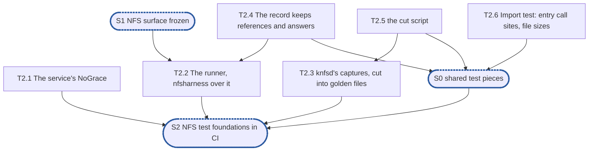

# Epic 2: NFS adapter v2 test foundations

**Sources:** [RFC 20](../docs/internals/rfcs/rfc-20-adapters.md) §7.2 (handlers against a
verified service) for NFS, §4.3's one-call rule as §7.2 reads it, §4.7's compound reply
(`Members.EncodeResult` before a member's `Encode`), §5.4's vectors from captures of the reference
server, and Appendix C's reference profile for NFS; for both adapters, §7.2's record keeping each
call's reference and answer, §5.4's golden files cut from captures, and §7.1's entry call sites
(with §4.10's entry handlers) and 800-line allowlist (with §2.5's file sizes, and the sentence on
generated files this epic's pull request adds);
[RFC 14](../docs/internals/rfcs/rfc-14-open-state.md) §4.2's `ErrNoGrace`, with §2.1's, §4.3's and
§5.3's sentences that name it, §11.3's declaration and §12's rows L3 and L50 for it;
[RFC 17](../docs/internals/rfcs/rfc-17-vfs.md) §4.3's `NoGrace` kind;
[RFC 21](../docs/internals/rfcs/rfc-21-nfs.md) §2.1's programs, for the capture areas, and §11.5's
`NoGrace` row, for the service's half. Every citation is `develop`'s text, which holds the RFC 21
implementation plan's amendments A1 to A4 and reaches `feat/storage-v2` with the cherry-pick of RFC
changes. RFC 20 §2.5's `adaptertest/nfsharness/`, NFS's handler harness, is this epic's too.
Cited, not owned: [RFC 29](../docs/internals/rfcs/rfc-29-test-harness.md) §4.11 (test doubles);
the `test/pcap-corpus` README's layout.
**Track:** the team.
**Epic 2 estimate: 6 subtasks, 13.5 man-days.**
**Depends on:** **S1**, E1's request state and members' table, which `nfsharness` hands a member.
S0's three shared pieces are built here (D6), so nothing outside this epic is waited for but S1.
**Blocks:** every middle epic through S2: E3, E4, E5, E7, E11 and E12 directly, and through them the
rest. Every handler epic tests on `nfsharness`; E3, E4 and E5 take vectors from the captures; E9,
E11 and E16 answer and test reclaims on `NoGrace`; E4's and E5's entry handlers land in the
files T2.6's call-site rule names. Outside RFC 21, the RFC 22 implementation plan's epic 2 builds
SMB's handler harness over T2.2's runner and T2.4's record, and cuts Samba's captures with T2.5's
script.

---

## 1. Goal

Epic 2 gives NFS's tests what they stand on: S0's three pieces, which both adapters share (the
mutating-call record keeping each call's reference and answer, the script that cuts captures into
golden files, and the import test's call-site and file-size rules); NFS's handler harness, a thin
wrapper over the protocol-neutral runner this epic builds in `adaptertest`, proven on one NFS
procedure and one member of a `COMPOUND` against the real service in memory; the Linux server's
captures of every program area, cut into golden files; and the one service answer every NFSv4
reclaim row needs, `NoGrace`. No red suite is registered: `unit` and `e2e` keep no known failures,
and the `pynfs`, `cthon04` and `nfstest` suites stay off until the cutover.

**At the end of the epic:**

- `memory.New` answers a reclaim from a client with nothing left to reclaim
  `&vfs.StateError{Kind: vfs.StateNoGrace}`, and one from a client still owing reclaims elsewhere
  `NoReclaim`, as RFC 14 §4.2 divides them;
- `vfstest.Mutations` keeps the operation, reference and answer of each call that may change
  state, those outside the one-call rule included;
- the handler runner lives in `adaptertest`, naming no protocol, with the one-call rule and its
  exemptions by request, ready for SMB's harness to call;
- `test/pcap-corpus`'s cut script, beside `normalize.py`, cuts a capture's messages into golden
  files through `tshark`, for either protocol's framing (D7);
- the import test fails an entry method called outside §4.10's entry files, and a hand-written
  adapter file over 800 lines that its allowlist does not hold;
- `adaptertest/nfsharness`, over that runner, runs request bytes through an NFSv3 row and through
  one member of the NFSv4 members' table, with a request state the test builds and the member's
  result head, against `memory.New`, errors injected through `vfstest.Faults`, and fails a test on
  a second mutating call or on a missing one;
- `test/pcap-corpus` holds knfsd's captures of NFSv3 with MOUNT, NLM with NSM, NFSv4.0, NFSv4.1 and
  NFSv4.2, each reproducible from its `CAPTURE.md`, and their messages cut into golden files that a
  test loads.

### 1.1 In scope

`pkg/openstate`'s `ErrNoGrace` and its check, `pkg/vfs`'s `StateNoGrace`, `internal/vfs`'s mapping,
and the tests of each; `vfstest.Mutations`' record of references and answers; the runner, built in
`adaptertest`, and `adaptertest/nfsharness` over it with NFS's two cases; the cut script;
the import test's call-site and file-size rules; the recording script for all five areas, over a
loopback mount against knfsd, the five capture directories and the golden files cut from them,
which the existing `TestParseCaptured` loads.

### 1.2 Out of scope

- SMB's handler harness, which decodes `smb/wire`'s header into the runner's request, and Samba's
  captures: the RFC 22 implementation plan's epic 2, over this epic's runner, record and cut
  script (D2, D6).
- The entry handlers themselves: E4's `MNT` and `EXPORT`, E5's `PUTROOTFH`, `PUTPUBFH` and
  `SECINFO`, in the files T2.6's rule already names, and SMB's in the RFC 22 implementation plan.
- The import test's rule on an `ops` file calling a method of a `wire` type that reads or writes
  bytes: its own row in RFC 20's plan's deferral ledger, triggered once an `ops` package holds a
  value of such a type.
- Any protocol's mapping of `NoGrace` to a status: `NFS4ERR_NO_GRACE` in E9's T9.4, `NLM4_DENIED`
  in E11, as RFC 21 §11.5 has it.
- Handler tests themselves, and the vectors of each procedure: each handler epic, on `nfsharness`.
- Captures of `RPCSEC_GSS` exchanges, which need a KDC: E13. The diff scripts that compare DittoFS
  with these captures, and the two-client conflict captures (a second client's `OPEN` answered
  `NFS4ERR_DELAY`), recorded from a host with client namespaces, which loopback cannot give (D1):
  E14.
- The scripted client and loopback rows: E3.

### 1.3 Names used here

- **E1**, epic 1, the NFS surface: the request state `protocol.State` and the NFSv4 members' table.
- **E2**, this epic: test foundations.
- **E3**, the RPC layer. **E4**, NFSv3 and MOUNT. **E5**, the NFSv4 namespace, attributes and data
  path. **E7**, identity's NFS side.
- **E8**, clients and sessions, with `RECLAIM_COMPLETE`. **E9**, opens, stateids and locks, the
  first NFSv4 reclaims.
- **E11**, NLM, NSM and the datagram path. **E12**, the NFSv4.2 operations. **E13**, RPCSEC_GSS.
- **E14**, the capture diffs against knfsd. **E16**, E2E green, with the restart rows.
- **S0**, the shared test pieces both adapters use: the record of T2.4, the cut script of T2.5
  and the import rules of T2.6, built by this epic (D6).
- **S1**, the NFS surface frozen, after E1.
- **S2**, NFS's test foundations in CI, after this epic: what every middle epic starts from.

## 2. How the general rules apply

The rules are those of [the RFC 21 implementation plan's §1.5](rfc-21-nfs-plan.md#15-general-rules-for-each-epic),
cited by number and title and not copied.

| Rule | Subtasks | How |
| --- | --- | --- |
| rule 1, independent unit tests, under `-race` ([`CLAUDE.md`, "Writing tests"](../CLAUDE.md#writing-tests)) | all | `NoGrace` is tested in `pkg/openstate` over its own durable-record tests and on `memory.New`; the runner is built from the allowed kinds: `memory.New` (kind 2, held to RFC 17 §8's suite), `vfstest.Faults` (kind 3) and T2.4's recording wrapper, which records and passes through, never answering |
| rule 2, fuzz tests where relevant | none | nothing here decodes a peer's bytes: `tshark` cuts the captures at recording time (D7), so no Go code reads a capture file, and the captures seed E1's `FuzzCompound` and `FuzzCodec` and later epics' targets |
| rule 3, observability follows RFC 25 and RFC 20 §10 | none | no series, span or log line is added; `NoGrace` is a value of the service's closed error set, counted by `core` where an adapter answers it |
| rule 4, profiling: leaks, allocations and contention | T2.2 | the runner calls `adaptertest.CheckLeaks` first, on the top-level test, as its contract asks, so every handler test checks leaks and none runs in parallel; nothing here takes a lock on a hot path |
| rule 5, public interface and internals, at the layer that consumes a value ([`CLAUDE.md`, "Verifying a change"](../CLAUDE.md#verifying-a-change)) | T2.1, T2.4, T2.2, T2.3 | `NoGrace` asserted on the error `memory.New` returns, which an adapter maps; the record's references and answers asserted where the runner reads them; the runner returns the bytes a client would read; the cut golden files checked where they are read, by `TestParseCaptured` |
| rule 6, known failures shrink | none | no suite with a `known.yaml` is run or registered |
| rule 7, v2 ignores v1 | T2.3 | the captures are of the Linux server, never of `develop`'s adapter |
| rule 8, real dependencies for properties of those dependencies | T2.2, T2.3 | the real filesystem in memory for the service's answers; knfsd's own bytes for golden files, never vectors the codec under test made |
| rule 9, code comment conventions ([`CLAUDE.md`, "Code comments"](../CLAUDE.md#code-comments)) | T2.1, T2.4, T2.2, T2.6 | D5's `decision:` marker at its code site; `openstate`'s comments on `admit` and `ErrNoReclaim` rewritten to name `ErrNoGrace`; `pkg/vfs`'s comment on `Mutates`; the file-size rule's `decision:` on what it counts (§9, point 1); T2.6's `ponytail:` on its match by method name; T2.2's `decision:` on the protocol test packages' imports |
| rule 10, a test must be able to fail | all | NFS's runner cases fail on a second or a missing mutating call, and the runner's own on each exemption misapplied; `NoGrace`'s tests fail with the check removed; `TestParseCaptured` fails on a file of another program; the import test reports each seeded violation exactly once |
| rule 11, a symbol is exported only if an interface uses it | T2.1, T2.4, T2.2 | `openstate.ErrNoGrace` and `vfs.StateNoGrace` are exported, for the adapters' rows; the record's entries, for the runner; the runner's exports, for `nfsharness` and SMB's harness; `nfsharness`'s, for every NFS handler epic's tests |
| rule 12, each subtask creates only what it declares | all | T2.4's record is read by T2.2; `nfsharness` holds only what NFS adds to the runner, the request state and a member's head, and arrives with its two cases, whose next consumers are E3's and E4's handler tests; T2.5's script with T2.3's golden files, and those with E3's, E4's and E5's vectors; T2.6's rules with their seeded violations, the entry files with E4 and E5 |
| rule 13, translate, never decide | T2.1, T2.2, T2.6 | the service decides `NoGrace`, so no handler splits a reclaim's refusal by grace (RFC 21 §11.5); the runner enforces the one-call rule on every handler test; the call-site rule keeps a share's entry to its one handler |
| rule 14, nothing deferred is lost | T2.3 | the `RPCSEC_GSS` captures are E13's, named in its expected content, and the diff scripts E14's, as §1.2 names; a `CLONE` the recording filesystem cannot make is recorded as a gap (§9, point 2) |

## 3. Requirements and invariants

Every MUST and MUST NOT that RFC 14, RFC 17, RFC 20 and RFC 21 place on this epic, numbered so that
subtasks and tests can cite them.

**`NoGrace`**

| # | Requirement | Kind | Source | Subtasks |
| --- | --- | --- | --- | --- |
| R1 | A reclaim from a client with nothing left to reclaim, no shard its record lists being in a grace instance it has not finished, is `ErrNoGrace`; it is a test on the client, checked before anything else | MUST | RFC 14 §4.2, §11.3 (`ErrNoGrace`) | T2.1 |
| R2 | Finished is a `ReclaimComplete` naming the (shard, instance), never `Done` alone; refusal and notice never finish | MUST | RFC 14 §4.2 | T2.1 |
| R3 | A client the record lists in no shard, an administrator's revoke having emptied the list included, or one with no record at all, gets `ErrNoGrace`, in or out of grace | MUST | RFC 14 §4.2, §5.3 | T2.1 |
| R4 | Every other reclaim a shard refuses, from a client that still owes reclaims somewhere, is `ErrNoReclaim`: a shard the list does not name, a dropped shard, or state the shard does not hold | MUST | RFC 14 §2.1, §4.2, §4.3 | T2.1 |
| R5 | It refuses a reclaim, never a `Reconnect`: a reconnect whose open is gone is `ErrNoReclaim`, in or out of grace | MUST NOT | RFC 14 §4.2 | T2.1 |
| R6 | The service answers it as its own `ErrState` kind, `NoGrace`, apart from `NoReclaim`, so no adapter splits a reclaim's refusal by grace | MUST | RFC 17 §4.3; RFC 21 §11.5 (`NoGrace`); RFC 20 §4.5 (`StateNoGrace`) | T2.1 |
| R7 | RFC 14 L3's steps that answer `ErrNoGrace`: lose the client records, restart, reclaim; after its `ReclaimComplete` for a shard's instance, a client's next reclaim anywhere | test row | RFC 14 §12 (L3) | T2.1 |
| R8 | RFC 14 L50's step: revoke a client, let another take its lock, restart: its reclaim is `ErrNoGrace`, and its next ordinary open lists the shard again; an NLM host revoked and restarted gets it too | test row | RFC 14 §12 (L50) | T2.1 |

**The handler runner**

| # | Requirement | Kind | Source | Subtasks |
| --- | --- | --- | --- | --- |
| R9 | A handler is tested against the in-memory service, `memory.New`: the real filesystem over memory stores, held to RFC 17 §8's suite | MUST | RFC 20 §7.2 | T2.2 |
| R10 | Error answers and reply edges come through `vfstest`'s fault wrapper, which fails a named method on cue | MUST | RFC 20 §7.2 | T2.2 |
| R11 | A handler test asserts the encoded reply is the expected bytes, for a success and for each injected error | MUST | RFC 20 §7.2 | T2.2 |
| R12 | The one-call rule is read from `memory.New`'s record of the mutating calls it served, kept by a recording wrapper in `vfstest` that passes each call through; a request leaving more than one fails its test, and a call where the service should have been called shows as a missing entry | MUST | RFC 20 §7.2, §4.3 | T2.4, T2.2 |
| R13 | A call outside the rule is exempted by the request it came in, never by its operation alone; read-only calls are not asserted | MUST | RFC 20 §7.2 | T2.2 |
| R17 | The record keeps the calls §4.3 places outside the rule too, each with its reference and its answer; it lives in the wrapper, never in `*vfs.Filesystem`, and never answers in the service's place | MUST | RFC 20 §7.2; RFC 29 §4.11 | T2.4 |
| R18 | Exempt are: a `CancelLock` or `Unwatch` after that request's `Park` was refused; a `FreeState` of the reference that request's call was answered `ErrState` (`Revoked`) for; a `Disconnect` with `Last` at the `Gen` that request's previous `Disconnect` returned; session setup's client-record calls in the leg that completes the setup with a verified identity; a `Principals` call in a request §4.3 names for it. A `FreeState` with no revoked answer before it, a `Connect` on every leg, or a `Find` in a `READ` still fails | MUST | RFC 20 §7.2, §4.3 | T2.2 |
| R14 | A `COMPOUND` member is run with the request state the members before it leave, and its result encoded as the compound's reply carries it: the members' table's `EncodeResult`, then the member's `Encode` | MUST | RFC 20 §4.7 (`Request.State`, the compound reply) | T2.2 |

**The captures**

| # | Requirement | Kind | Source | Subtasks |
| --- | --- | --- | --- | --- |
| R15 | Golden vectors come from the specifications' examples or from captures of the reference server, never only from the codec under test | MUST | RFC 20 §5.4 | T2.5, T2.3 |
| R16 | Every program and version served has captures to take vectors from: NFSv3, MOUNT v3, NLM v4, NSM v1, NFSv4.0, NFSv4.1 and the NFSv4.2 subset | MUST | RFC 21 §2.1; RFC 20 §5.4 | T2.3 |
| R19 | *Withdrawn:* the capture helper was to live in `adaptertest`'s `golden/` as Go code; captures are now cut with `tshark` at recording time by a script beside `normalize.py` (D7), so no capture helper is in `adaptertest`, and this epic's pull request drops `golden/` from RFC 20 §2.5's layout | — | RFC 20 §2.5 | — |

**The import test's call sites and file sizes**

| # | Requirement | Kind | Source | Subtasks |
| --- | --- | --- | --- | --- |
| R20 | A call of an entry method (`Root`, `SecInfo`, `ListShares`) outside the entry handlers' files fails the import test | MUST | RFC 20 §7.1, §4.10 | T2.6 |
| R21 | The import test lists every hand-written non-test adapter file over 800 lines, a generated one, recognised by Go's `// Code generated ... DO NOT EDIT.` header, not counted, and fails on one not in its checked-in allowlist, which may only shrink and starts with `core`'s `pipeline.go`, `hold.go` and `chain.go` | MUST | RFC 20 §7.1 (its generated-file sentence added by this epic's pull request), §2.5 | T2.6 |
| R22 | Each rule is seeded in the test's own data with a deliberate violation it must report exactly once, and with a case the rule allows, which it must not report | MUST | RFC 20 §7.1 | T2.6 |
| R23 | A protocol's harness and scripted client sit in `adaptertest` and import that protocol's packages, and no adapter imports another adapter, so the import test admits the first and still refuses the second | invariant | RFC 20 §2.3, §2.5 | T2.2 |

Not obligations of this epic: RFC 14 §8's order of the shard list's write before the answer that
grants a client its first state there, which open state already keeps; RFC 20 §7.2's assertions on
the service's state after a request, which each handler test makes through `memory.New`'s
`Store` and `Content`.

## 4. Decisions this epic takes

- **D1. knfsd, recorded by hand, over loopback, per program area.** The captures are of the Linux
  kernel server on a Linux host with root, driven by the Linux client over a loopback mount in the
  host namespace, with knfsd exported from a scratch XFS made with `reflink=1`. One script,
  `test/pcap-corpus/nfs-record.sh`, records all five areas (NFSv3 with MOUNT, NLM with NSM,
  NFSv4.0, NFSv4.1 and NFSv4.2); nfstest's baseline traces and `netns.sh`'s client namespaces are
  not used, so `baseline-knfsd.sh` and `run.sh` stay unchanged. It restarts `nfs-server` and runs
  `sm-notify -f`, so it refuses to run unless `NFS_RECORD_THROWAWAY_HOST=1` says the host is a
  throwaway. Loopback gives every program and version a call and a real NFSv4.1 and 4.2 back
  channel, and loses the two-client view this decision first had: there is one NFSv4 client, so
  the delegation recall comes from a write on the server rather than a second client's `OPEN`
  answered `NFS4ERR_DELAY`, and NLM and NSM share one lockd and one statd; the two-client conflict
  captures are E14's (§1.2). `nfs40/` has `CB_NULL` and no `CB_RECALL`, which nothing needs: the
  server offers NFSv4.0 clients no delegation and so never sends them a callback (RFC 21 §3).
  Each area is kept in `test/pcap-corpus/`, beside `nfsv4-acl/`, which already holds a knfsd
  capture, with `reference.pcap`, `reference.skel` from `normalize.py` and a `CAPTURE.md` recipe,
  as the corpus README lays out. The server is knfsd on the host, the only NFS server the recipe
  starts, which keeps the reference what RFC 20 Appendix C names, held by review of `CAPTURE.md`.
  The script runs by hand, not in CI: no suite registered for RFC 21 runs captures, and recording
  needs root and the kernel server. The files are committed, so every test reads them without
  either. Prior art: RFC 20 Appendix C; the corpus's `nfsv4-acl/` recipe; the `nfs-knfsd-baseline`
  workflow, which runs knfsd on a dispatched runner. No marker: the README records it.
- **D2. One handler runner, built in `adaptertest`, and `nfsharness` a thin wrapper over it.**
  SMB's handler harness, which was to hold the runner first, is not built (D6), so T2.2 builds the
  runner in `adaptertest` directly, naming no protocol: it decodes a row's arguments with its
  `Decode`, runs `Bound`, `Resolve`, `Call` and `Encode` on a `*core.Request` its caller builds,
  maps an error through the table's `Errors` and reads the one-call rule from `vfstest.Mutations`,
  with no socket. Its shape is the one SMB's harness needs later: only the request names a
  protocol, and SMB's harness will decode `smb/wire`'s header into it and call the runner, adding
  nothing to it. `adaptertest/nfsharness`, NFS's handler harness as RFC 20 §2.5 names it, wraps
  it with what NFS adds: a request carrying `protocol.State`, and for a member the members'
  table's `EncodeResult` head before the member's `Encode`, as `core`'s compound runner writes it.
  So the one-call rule and its exemptions (D3) have one copy, not one per adapter to drift apart.
  What `core` does around a row (the needs and version checks, the drain, the reservation) is
  `core`'s, tested over `testproto`, and each epic's loopback rows test the wiring. Prior art:
  RFC 20 §7.2's `runGolden` example. No marker.
- **D3. The exemption rule lives with the runner, once, over T2.4's record.** Which calls a
  request may make beyond its one is a function of what the request is (a session setup's
  completing leg, a request naming a SID, which only the runner's caller knows) and of the record
  T2.4 keeps (each call's reference and answer), so it lives in the runner, which has both;
  `vfstest.Mutations` only records, and `nfsharness` keeps no copy. The runner's own tests drive
  each exemption over rows the test declares, so no protocol is needed to prove it.
- **D4. A member runs with the state its test builds.** `nfsharness` hands a member the
  `protocol.State` the test sets up, a current filehandle say, rather than running the members
  before it, so a member's test needs no other operation's handler; the loopback rows of each epic
  run whole compounds. Prior art: none found. No marker.
- **D5. `NoGrace` is decided in open state's admission of a reclaim, first, from the shards'
  reclaim sets.** The check reads each served shard's reclaim set (the clients its durable records
  named when its grace began, less those that have finished there) and the shard's grace, not the
  client's shard marks, before the shard's own checks, so it answers the same for a reclaim of an
  open, a lock or a delegation, and for an NLM host. A client is finished in a shard as RFC 14 §4.2
  says: one recovering by status only by a `ReclaimComplete` naming the shard's instance, never by
  `Done` alone, which a join or a confirm sets and the marks would count; one recovering by refusal
  or by notice never (RFC 14 §12, L3). A client this table has not known since a restart is judged
  from the records each shard read as its grace began, and one with no record was named by no shard
  and owes nothing. The `decision:` marker at the check names its ceiling: only the shards this node
  serves are asked, which holds on a single node, since the filesystem's `Start` serves every
  share's shard before it answers; in a cluster it would answer `ErrNoGrace` to a client still owing
  in a shard another node serves, and the upgrade is to judge each shard the client's record lists
  by its instance and grace as the lease owner sees them, keeping refusal and notice clients
  unfinished, once a second node serves shards. Settled with Marco on T2.1's pull request, #5648.
  Prior art: RFC 8881
  §8.4.3's `NFS4ERR_NO_GRACE`, which RFC 14 §4.2 narrows to the client.
- **D6. This epic builds S0's three shared pieces.** The record keeping each call's reference and
  answer (T2.4), the capture cut (T2.5) and the import test's call-site and file-size rules
  (T2.6) were the RFC 22 implementation plan's epic 2, which has no owner,
  so this epic builds them, for both adapters, and SMB's handler harness and Samba's captures stay
  with that epic, built over them later. Agreed with Marco on 24 Nov. The pieces' scope, criteria
  and tests are the ones that epic gave them, NFS's cases standing in for SMB's
  where a test needs a protocol. No marker: the pieces carry no adapter-specific shortcut.
- **D7. Golden files are cut with `tshark` at recording time, and the `.hex` files committed.**
  The recording host needs `tshark` anyway (§9, point 2), and the corpus's existing golden files
  were cut that way, so T2.5 is a small script beside `normalize.py`, not a Go reader of capture
  files. No Go code then decodes a capture, so no fuzz target or `decision:` marker is owed for
  one. Lost, and accepted: a cross-check of a Go cut against a `tshark` cut; `tshark` stays the
  independent decoder R15 names. Each `.hex` file's provenance, its capture, frame and `tshark`
  command, is in its header and in its area's `CAPTURE.md`, and only the machine that cuts needs
  `tshark`, never one that tests. Settled with Marco on this epic's pull request. Prior art: the
  corpus's `normalize.py` and `pcap-diff.sh`, which read captures through `tshark`. No marker.

## 5. Target tree

```text
pkg/openstate/
  errors.go                    T2.1  ErrNoGrace
  recovery.go                  T2.1  the reclaim's NoGrace check in admit
  grace_test.go                T2.1  L3's and L50's NoGrace steps; the refusals that stay NoReclaim
pkg/vfs/
  vfserr/vfserr.go             T2.1  StateNoGrace and its name
  errors.go                    T2.1  the alias
  errors_test.go               T2.1  TestErrorsIsTheErrorSet with the new kind
  service.go                   T2.4  Mutates' comment: the calls outside the rule are true for it
pkg/vfs/vfstest/
  mutations.go                 T2.4  each call's operation, reference and answer
  mutations_test.go            T2.4  references and answers recorded, nothing answered in the service's place
internal/vfs/
  errors.go                    T2.1  openstate.ErrNoGrace to the NoGrace kind
  clients_test.go              T2.1  the mapping's row
pkg/vfs/vfstest/memory/
  memory_test.go               T2.1  a reclaim answered NoGrace on memory.New
internal/adapter/adaptertest/
  handler.go                   T2.2  the runner and the exemption rule (D2, D3)
  handler_test.go              T2.2  each exemption, and each call it must not exempt, over rows the test declares
  nfsharness/nfsharness.go     T2.2  the request with protocol.State, a member's EncodeResult head
  imports_test.go              T2.2  a protocol test package's imports of its own protocol (R23)
                               T2.6  entry call sites and file sizes, with their lists
  testdata/imports/            T2.2, T2.6  a seeded violation and an allowed case per new rule
internal/adapter/nfs/ops/v4/
  harness_test.go              T2.2  an NFSv4 member on nfsharness
internal/adapter/nfs/protocol/
  harness_test.go              T2.2  an NFSv3 row on nfsharness, its structs generated in row_types_test.go
test/pcap-corpus/
  cut-golden.sh                T2.5  run by hand: a capture, a frame, a framing, a .hex file, through tshark (D7)
  nfs-record.sh                T2.3  records all five areas against knfsd over a loopback mount
  nfs3/ nlm/ nfs40/ nfs41/ nfs42/   T2.3  reference.pcap, reference.skel, CAPTURE.md with each cut's provenance
internal/adapter/nfs/wire/
  testdata/golden/knfsd-*.hex  T2.3  messages cut from the captures, named as epic 1's D8 has it
  wire_test.go                 T2.3  TestParseCaptured loops over them
```

## 6. Subtasks

### T2.1 The service's `NoGrace`

**Subtask T2.1 estimate: 2.75 man-days.**

- **Track:** the team. **Depends on:** none.
- **Covers:** R1, R2, R3, R4, R5, R6, R7, R8.
- **Deliverables:** `openstate.ErrNoGrace` (RFC 14 §11.3's declaration) and the check in
  `admit` for a reclaim (D5); `vfserr.StateNoGrace`, named "no grace", aliased as
  `vfs.StateNoGrace` and added to the error set `TestErrorsIsTheErrorSet` reads;
  `internal/vfs/errors.go`'s row mapping `openstate.ErrNoGrace` to
  `&vfs.StateError{Kind: vfs.StateNoGrace}`. Consumed by E9's T9.4, which answers
  `NFS4ERR_NO_GRACE`, E11, which answers `NLM4_DENIED`, and E16's restart rows (T16.4).
- **Acceptance criteria:**
  - A reclaim of an open, a lock or a delegation from a client whose record lists no shard is
    `ErrNoGrace`, in grace and after; from one with no record, the same.
  - A client that finished one shard's instance and still owes another reclaims there; after its
    `ReclaimComplete` for every listed shard's instance, its next reclaim anywhere is `ErrNoGrace`.
  - A client with `Done` set by a join or an NFSv4.0 confirm, and no `ReclaimComplete`, is not
    refused `ErrNoGrace`; nor is an NFSv4.0 client recovering by refusal, nor an NLM host by
    notice, while a shard it holds state in is in grace.
  - A reclaim in a shard its list does not name, or in a dropped shard, from a client still owing
    elsewhere, stays `ErrNoReclaim`; so does a `Reconnect` whose open is gone.
  - A revoked client whose reclaim was refused `ErrNoGrace` after the restart takes an ordinary
    open, and a later restart lets it reclaim that open; an NLM host revoked and restarted is
    refused its lock reclaim `ErrNoGrace`.
  - `openstate`'s existing assertions that answered `ErrNoReclaim` for a revoked client's reclaim
    or a client the records do not name are moved to `ErrNoGrace` where the client owes nothing.
- **Tests:** in `pkg/openstate`, over its durable records and restarts: L3's two `ErrNoGrace`
  steps and L50's revoke step, through its ordinary open and a second restart, each failing with
  the check removed (catches a reclaim judged per shard, R1, R3, R7, and an open that does not list
  the shard again, R8); a client finished in one shard reclaiming in a second (catches `ErrNoGrace`
  from a client that still owes, R2, R4); `Done` without `ReclaimComplete`, and a refusal's and a
  notice's client reclaiming in grace (catches `Done`, a refusal or a notice read as finished, R2);
  a `Reconnect` of a gone open (catches the check on a reconnect, R5). In `internal/vfs`, the error
  mapping's table row, and in `pkg/vfs`, `TestErrorsIsTheErrorSet` with the new kind (catch a
  missing row, answered the fault). On `memory.New`, the service an adapter calls: a connected
  client's reclaim with no state held answered `&vfs.StateError{Kind: vfs.StateNoGrace}` (catches
  the kind folded into `NoReclaim`, R6). No test double beyond open state's own injected clock
  (kind 1).
- **Rules:** rule 9: `admit`'s and `ErrNoReclaim`'s comments name the new split, and D5's
  `decision:` marker.

### T2.4 The record keeps each call's reference and answer

**Subtask T2.4 estimate: 1.25 man-days.**

- **Track:** the team. **Depends on:** none.
- **Covers:** R12, R17.
- **Deliverables:** `vfstest.Mutations` records, for each call `vfs.Mutates` is true for, its
  operation, the reference it names (the state reference, client, session or waiter, and a
  `Disconnect`'s `Last` and `Gen`) and its answer, the error it returned and a `Disconnect`'s new
  `Gen`, read through one accessor beside `Ops` and `Reset`. Each entry's place is taken as the
  call starts, so entries stay in the order the calls started, and its answer is filled in as the
  call returns; every call is still passed through unchanged. A refused `Park` is not the
  service's to record: it is `core.Request`'s (RFC 20 §4.7), and T2.2's runner sees it. `pkg/vfs/service.go`'s comment on `Mutates` says the calls RFC 20 §4.3
  leaves outside the rule are true for it, and the handler check exempts them by the request they
  came in, the list RFC 20 §4.3 gives. Consumed by T2.2's runner, and by SMB's handler harness through it.
- **Acceptance criteria:**
  - A `FreeState` answered `ErrState` (`Revoked`), the answer injected through `vfstest.Faults`
    since `memory.New` answers a `FreeState` of a revoked reference with no error, is recorded with
    its reference and that answer; a `Disconnect` with its `Last`, the `Gen` it was given and the
    `Gen` it returned; a `CancelLock` with the waiter it names.
  - Two calls started in one order and returning in the other are recorded in the order they
    started, each with its own answer.
  - A read-only call is not recorded, and `Ops` answers as before for its existing callers.
  - The wrapper answers nothing in the service's place: every call's result is the wrapped one's.
- **Tests:** in `vfstest`, on `memory.New`: the three recorded shapes above, and the two calls
  returning out of order, the first held by `vfstest.Faults`' `Hold` and released once the second
  has returned, the second started once `Reached` is closed (kind 3), each failing when the
  reference or the answer is dropped from the entry (catches a record T2.2 cannot exempt from,
  R17); a fault injected through `vfstest.Faults` under the wrapper, recorded as the answer
  (catches an answer read from anything but the call); the existing `mutations_test.go` cases kept
  (R12). `memory.New` (kind 2) and `vfstest.Faults` (kind 3) only.
- **Rules:** rule 9: the `Mutates` comment.

### T2.2 The runner in `adaptertest`, and `nfsharness` over it

**Subtask T2.2 estimate: 4.75 man-days.**

- **Track:** the team. **Depends on:** S1, T2.4.
- **Covers:** R9, R10, R11, R12, R13, R14, R18, R23.
- **Deliverables:**
  - The runner in `adaptertest` (D2), naming no protocol: a row and a `*core.Request` its caller
    builds in, the row's `Decode`, `Bound`, `Resolve`, `Call` and `Encode` run with no socket, an
    error mapped through the table's `Errors`, reply bytes and the one-call verdict out. The
    verdict reads T2.4's record and applies R18's exemptions by what the caller says the request
    is (a session setup's completing leg, a request naming a SID or a principal), by whether the
    request's `Park` was refused, which the runner sees on the `*core.Request` it runs, and by the
    references and answers recorded before each call (D3). One order of the service's layers, so
    a faulted call is recorded: `svc := memory.New(t)`, `faults := vfstest.Faults(svc)`, `rec :=
    vfstest.RecordMutations(faults)`, the handler calling `rec` and the runner reading `rec`,
    never `svc.Mutations`, which sits under the faults and never sees a call they answer.
    Indicatively `func Run(t testing.TB, rec *vfstest.Mutations, tab *core.OpTable, row string, r
    *core.Request, args []byte, ctx Exempt) []byte`, its final shape settled in the subtask,
    before `nfsharness` pins it. Consumed by `nfsharness`, and by SMB's handler harness in the RFC 22
    implementation plan's epic 2.
  - `adaptertest/nfsharness`: a row run with a request the test builds, carrying a
    `protocol.State`, and a member of the NFSv4 members' table run with its `EncodeResult` head
    written first. Consumed by every NFS handler epic's tests, E3's and E4's first.
  - Its two cases: an NFSv3 test row in `nfs/protocol`, its structs generated in the package's
    existing `row_types_test.go`, and an NFSv4 test member in `nfs/ops/v4`, run with a
    `protocol.State` the case builds, each against `memory.New` with `vfstest.Faults` over it and
    T2.4's record over both, in the runner's order.
  - The import test's rule for the protocol test packages in `adaptertest`, which `nfsharness`
    needs before it lands: today every directory under `adaptertest/` counts as the adapter
    `adaptertest`, so `nfsharness`'s import of `nfs/protocol` is refused as one adapter importing
    another. A non-test file in `adaptertest/<p>harness` or `adaptertest/<p>client` may import
    protocol `<p>`'s packages and no other protocol's, with a `decision:` marker naming the ceiling:
    these packages are test-only, and RFC 20 §7.1's rule already refuses them to a non-test file
    outside `adaptertest`; withdraw it if one is ever imported by a serving package. Consumed by
    `nfsharness` here and E3's `nfsclient`.
- **Acceptance criteria:**
  - The runner's package imports no `internal/adapter/smb` or `internal/adapter/nfs` package, and
    a caller that builds a `*core.Request` from another protocol's header needs nothing else from
    it.
  - The row and the member, each making one mutating call, pass; with a second call each fails,
    naming both calls; with none where one is due, each fails, naming the missing one.
  - A fault injected on the row's service method answers the status the table maps it to.
  - A faulted mutating call is recorded with the injected error as its answer, and counts as the
    request's one call.
  - `TestImports` passes with `nfsharness` in the tree; in the import test's own data,
    `nfsharness` importing `internal/adapter/smb/...` is reported once, and importing
    `internal/adapter/nfs/protocol` is not reported.
  - The member's bytes start with its operation code and status, from the members' table.
  - Each exemption of R18 passes in the request it names and fails outside it: a `FreeState` of the
    reference the request's call was answered `ErrState` (`Revoked`) for passes, one with no such
    answer before it fails; a `CancelLock` or `Unwatch` after a refused `Park` passes, one after a
    granted `Park` fails; a `Disconnect` with `Last` at the `Gen` the previous one returned passes,
    at another `Gen` fails; a `Connect` in the leg that completes a session setup passes, in another
    leg fails; a `Find` per SID in a request naming SIDs passes, a `Find` in a `READ` fails.
- **Tests:** the runner's own, in `adaptertest`, over rows its test declares on `memory.New`, one per
  case of the last criterion, each failing when its exemption is widened to the operation alone or
  dropped (R13, R18); NFS's two cases, each failing as its criterion says when the row is changed to
  break it, run in a top-level test whose runner calls `adaptertest.CheckLeaks` first and none in
  parallel (catch a second or a missing mutating call, R12, a member's head dropped, R14, a fault
  answered unmapped, R10, R11). `vfstest.Faults` (kind 3), `memory.New` (kind 2) and T2.4's record,
  which passes each call through, are the only collaborators. The faulted row's record, failing
  when the record is put under the faults (R12, R18); the import rule's two seeds in
  `TestImportCheckReportsEachSeededViolation`, failing when the rule admits every protocol or is
  removed (R23).
- **Rules:** rule 4: the runner's leak check, called once; rule 9: the import rule's `decision:`
  marker; rule 12: `nfsharness` holds only what NFS adds to the runner.

### T2.5 The cut script: captures cut into golden files through `tshark`

**Subtask T2.5 estimate: 1 man-days.**

- **Track:** the team. **Depends on:** none.
- **Covers:** R15.
- **Deliverables:** `test/pcap-corpus/cut-golden.sh` (D7), beside `normalize.py`, run by hand
  where the captures are recorded: given a capture, a frame, a framing and an output file, it has
  `tshark` give that frame's message, reassembled across TCP segments or whole from a UDP
  datagram; strips the framing, RFC 5531's record mark or SMB2's four-byte direct-TCP length, or
  none for a datagram, refusing a record of more than one fragment by naming the frame; and
  writes one `.hex` file in the format the wire packages' golden readers read (hex digits, `#`
  comments), headed by the capture's path, the frame and the `tshark` command it ran. The
  `tshark` fields it reads are written from memory and checked on the first cut. No suite runs
  it. Consumed by T2.3, and by the Samba captures of the RFC 22 implementation plan's epic 2.
- **Acceptance criteria:**
  - Cutting `test/pcap-corpus/nfsv4-acl/reference.pcap` at frame 4 gives the bytes of `nfs/wire`'s
    `nfsv4-null-call.hex` past its record mark; cutting `test/pcap-corpus/smb-sd/reference.pcap`
    at frame 127 gives the bytes of `smb/wire`'s `create_response.hex` past its direct-TCP header.
  - A record of two fragments is refused, naming the frame.
  - A written file, read back as the wire packages' readers read it, gives the message's bytes.
- **Tests:** the two corpus cuts above, run by hand and compared with the committed files, their
  output recorded in the pull request; the cut files' own test is T2.3's `TestParseCaptured`, at
  the layer that reads them (rule 5). No Go test: no suite has `tshark`, and the script reads only
  the corpus's own captures.
- **Rules:** rule 8: the reference servers' own bytes, never ones this code produced.

### T2.3 knfsd's captures, cut into golden files

**Subtask T2.3 estimate: 2.25 man-days.**

- **Track:** the team. **Depends on:** T2.5, whose script cuts the captures at recording time.
- **Covers:** R15, R16.
- **Deliverables:**
  - `test/pcap-corpus/nfs-record.sh`, run by hand as root on a throwaway host (it refuses without
    `NFS_RECORD_THROWAWAY_HOST=1`): it exports a scratch XFS made with `reflink=1` from knfsd,
    mounts it over `127.0.0.1` in the host namespace, and records each area under `tcpdump -i lo`:
    `nfs3/`, MOUNT's `NULL`, `EXPORT`, `MNT` and `UMNT` with NFSv3; `nlm/`, NLM's test, lock, a
    blocked lock granted by callback and unlock, with NSM's monitor calls and `SM_NOTIFY`;
    `nfs40/`, NFSv4.0 with `CB_NULL`; `nfs41/`, NFSv4.1 with `CB_RECALL` on the back channel,
    the recall coming from a write on the server; `nfs42/`, `SEEK`, `ALLOCATE`'s and
    `DEALLOCATE`'s requests, `COPY`, `CLONE` and the xattr operations, the XFS having reflinks
    since knfsd answers `CLONE` `NFS4ERR_NOTSUPP` without them. nfstest's baseline traces and
    `netns.sh`'s namespaces are not used, so `baseline-knfsd.sh` and `run.sh` are unchanged.
  - Each of the five directories with `reference.pcap`, `reference.skel` and `CAPTURE.md` (D1),
    the `CAPTURE.md` naming, for every golden file, its capture, its frame and the `tshark`
    command that cut it (D7), and the golden files cut from them with T2.5's script into
    `internal/adapter/nfs/wire/testdata/golden/`, named and stripped as epic 1's D8 has it:
    `knfsd-<label>-<what>-{call,reply}.hex`, one whole RPC message each, its record mark
    stripped, from which a seed takes the arguments past the RPC header.

  Consumed by E3's, E4's and E5's vectors, E1's vector check and fuzz targets as seeds, and E14's
  diffs.
- **Acceptance criteria:**
  - `CAPTURE.md` names the kernel, the filesystem, the client's mount options and every command
    run, so the capture can be made again.
  - Every program and version of the area has at least one call and its reply cut: MOUNT and
    NFSv3 in `nfs3/`, NLM and NSM in `nlm/`, a `COMPOUND` of minor version 0 in `nfs40/`, NFSv4 of
    minor version 1 and the callback program in `nfs41/`, and a `COMPOUND` of minor version 2 in
    `nfs42/`; every cut call parses with `wire.ParseCall`, naming one of the area's programs and
    versions, minor version included, and every reply carries its call's transaction ID. A golden
    file's `<what>` starts with its area's directory name, so the test knows its area.
  - No capture holds a credential other than `AUTH_SYS` or `AUTH_NONE`.
- **Tests:** `wire_test.go`'s `TestParseCaptured`, at the golden files the epics after this read,
  looping over every `knfsd-*` file: each parses as above, each call's credential `AUTH_SYS` or
  `AUTH_NONE` (catches a file cut from the wrong message or the wrong area, R16), and it fails for
  each of the five areas no call file names (catches an empty area, or one whose calls were all cut
  into another's, R16). No test double: knfsd's bytes are the reference (R15).
- **Rules:** rule 7 and rule 8: the Linux server's bytes, never `develop`'s adapter's.

### T2.6 The import test's entry call sites and file sizes

**Subtask T2.6 estimate: 1.5 man-days.**

- **Track:** the team. **Depends on:** none.
- **Covers:** R20, R21, R22.
- **Deliverables:** two rules in `adaptertest/imports_test.go`'s walk, each with its list beside
  the existing ones:
  - entry call sites: a call of a method named `Root`, `SecInfo` or `ListShares` in an adapter's
    non-test file outside the entry files RFC 20 §4.10's table names (`nfs/ops/mount/mnt.go` and
    `export.go`, `nfs/ops/v4/putrootfh.go`, `putpubfh.go` and `secinfo.go`,
    `smb/ops/tree_connect.go`, `smb/dcerpc/srvsvc/netshareenum.go` and `netsharegetinfo.go`) is
    reported, naming the file and the call. The match is by method name, with a `ponytail:`
    marker: a method of another type sharing one of those names is reported too; upgrade to a
    typed check if one is ever needed. Test files are not walked, with a `decision:` marker: a
    handler test reaches a share through the service it sets up, which is no second path a client
    can take; withdraw it if a test helper in an adapter starts serving requests;
  - file sizes: every hand-written adapter non-test file over 800 lines is listed, and one not in the
    allowlist fails, as does an allowlist entry whose file is gone or no longer over 800 lines, so
    the list only shrinks: a change that brings `chain.go` (816 lines) under the limit drops its
    entry in the same change. The list starts with `core`'s `pipeline.go`, `hold.go` and
    `chain.go`. A generated file is recognised by Go's `// Code generated ... DO NOT EDIT.` header,
    not by its name, and not counted, with a `decision:` marker at the check: its generator's check
    already holds it, failing a change whose code differs from a fresh run, and counting it would
    give `codec_gen.go` an entry the list could never drop; withdraw it if a generated file is ever
    edited by hand (§9, point 1; RFC 20 §7.1's sentence on generated files).
  Consumed by E4's and E5's entry handlers, which land in the files the list names, and by every
  later epic's files.
- **Acceptance criteria:**
  - On `feat/storage-v2` as it stands, both rules report nothing.
  - In the test's own data, each rule's seeded violation is reported exactly once (an entry
    method called from a non-entry `ops` file; a file over 800 lines not on the list; a stale
    allowlist entry), and its allowed case is not (the call from a listed entry file, and from a
    test file; a listed file over the limit; a generated file over the limit, recognised by its header, under a
    name that says nothing of it).
- **Tests:** `TestImportCheckReportsEachSeededViolation`, extended with the new seeds, each failing
  when its rule is removed or written too wide (R20, R21, R22); `TestImports` over the tree. No
  test double.
- **Rules:** rule 9: the `ponytail:` and `decision:` markers.

## 7. Order of work



Four paths, each a blocker of another epic: T2.1 of the reclaim rows; T2.4 then T2.2, of every
handler test; T2.5 then T2.3, of the vectors; and T2.6, of the entry handlers. T2.1 goes first, as
the one that changes the service's answers and needs nothing; then the handler path, the largest,
whose T2.2 also waits for S1; then the captures; T2.6 last, as no epic needs it before E4.
Checkpoints: after T2.4, T2.5 and T2.6, S0 (the pieces the RFC 22 implementation plan's epic 2
builds on); at the end, S2, which waits for S0 as well as T2.1, T2.2 and T2.3.

## 8. Suggested pull requests

| PR | Subtasks | Man-days | After | Why together |
| --- | --- | --- | --- | --- |
| 1 | T2.1 | 2.75 | — | a service change, reviewed by open state's owners apart from the adapter's tests |
| 2 | T2.4, T2.2 | 6 | S1 | the record and the runner that reads it, with the exemptions and the two cases that prove it fails for NFS |
| 3 | T2.5, T2.3 | 3.25 | — | the script and the captures it cuts, mostly binary and recipe |
| 4 | T2.6 | 1.5 | — | two rules of the import test, with their seeds |

A suggestion only: one pull request per subtask works as well. The four can be open at once.

## 9. Open points

1. **What the file-size rule counts** (T2.6), settled by Marco: hand-written non-test files only.
   A generated file, recognised by Go's standard `// Code generated ... DO NOT EDIT.` header and
   not by its name, is not counted, since its generator's check holds it and an entry for it could
   never shrink. RFC 20 §7.1 said "every adapter file", so this epic's pull request adds one
   sentence to §7.1 saying so, and T2.6 places a `decision:` marker at the check.
2. **The recording host.** T2.3 needs a Linux host with the kernel NFS server, root, `tshark` and a
   loop device for XFS, or a dispatched runner as the `nfs-knfsd-baseline` workflow uses; NSM's
   `SM_NOTIFY` needs the server's statd restarted, which `CAPTURE.md` records. Where a step cannot
   be captured that way, its area records what it could and names the gap, and the epic that
   needs the missing message takes it from RFC 1813, RFC 7530, RFC 8881 or RFC 7862 by hand.
3. **`ALLOCATE`'s reply.** A single node answers `ALLOCATE` `NFS4ERR_NOTSUPP` (RFC 21 §9.3), so
   only knfsd's request is a vector for it; its reply comes from E12's row, written by hand.
4. **How T2.5 cuts captures** (D7), settled by Marco: with `tshark` at recording time, the
   `.hex` files committed, T2.5 a script beside `normalize.py` of 1 man-day, not a Go reader of
   2.5. The Go-cut against `tshark`-cut cross-check is given up; `tshark` stays R15's independent
   decoder.
