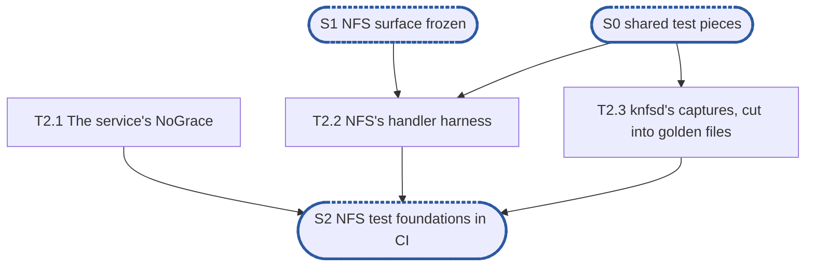

# Epic 2: NFS adapter v2 test foundations

**Sources:** [RFC 20](../docs/internals/rfcs/rfc-20-adapters.md) §7.2 (handlers against a
verified service) for NFS, §4.3's one-call rule as §7.2 reads it, §4.7's compound reply
(`Members.EncodeResult` before a member's `Encode`), §5.4's vectors from captures of the reference
server, and Appendix C's reference profile for NFS;
[RFC 14](../docs/internals/rfcs/rfc-14-open-state.md) §4.2's `ErrNoGrace`, with §2.1's, §4.3's and
§5.3's sentences that name it, §11.3's declaration and §12's rows L3 and L50 for it;
[RFC 17](../docs/internals/rfcs/rfc-17-vfs.md) §4.3's `NoGrace` kind;
[RFC 21](../docs/internals/rfcs/rfc-21-nfs.md) §2.1's programs, for the capture areas, and §11.5's
`NoGrace` row, for the service's half. Every citation is `origin/feat/storage-v2`'s text. Cited,
not owned: [RFC 29](../docs/internals/rfcs/rfc-29-test-harness.md) §4.11 (test doubles); the
`test/pcap-corpus` README's layout.
**Track:** the team.
**Epic 2 estimate: 3 subtasks, 8 man-days.**
**Depends on:** **S1**, E1's request state and members' table, which the harness hands a member;
**S0**, the three pieces the RFC 22 implementation plan's epic 2 builds for both adapters:
`vfstest.Mutations` keeping each call's reference and answer, which the harness reads the one-call
rule from, `adaptertest/golden`, which cuts the captures into golden files, and the import test's
call-site and file-size rules. T2.1 needs neither.
**Blocks:** every middle epic through S2: E3, E4, E5, E7, E11 and E12 directly, and through them the
rest. Every handler epic tests on the harness; E3, E4 and E5 take vectors from the captures; E8, E9,
E11 and E16 answer and test reclaims on `NoGrace`.

---

## 1. Goal

Epic 2 gives NFS's tests what they stand on beyond S0's shared pieces: a harness that runs one
procedure, or one member of a `COMPOUND`, against the real service in memory; the Linux server's
captures of every program area, cut into golden files; and the one service answer every NFSv4
reclaim row needs, `NoGrace`. No red suite is registered: `unit` and `e2e` keep no known failures,
and the `pynfs`, `cthon04` and `nfstest` suites stay off until the cutover.

**At the end of the epic:**

- `memory.New` answers a reclaim from a client with nothing left to reclaim
  `&vfs.StateError{Kind: vfs.StateNoGrace}`, and one from a client still owing reclaims elsewhere
  `NoReclaim`, as RFC 14 §4.2 divides them;
- `adaptertest/nfsharness` runs request bytes through one row of an NFS table, or one member of the
  NFSv4 members' table with a request state the test builds, against `memory.New`, errors injected
  through `vfstest.Faults`, and fails a test on a second mutating call or on a reply byte that
  differs, for an NFSv3 row and for an NFSv4 member;
- `test/pcap-corpus` holds knfsd's captures of NFSv3 with MOUNT, NLM with NSM, NFSv4.0, NFSv4.1 and
  NFSv4.2, each reproducible from its `CAPTURE.md`, and their messages cut into golden files that a
  test loads.

### 1.1 In scope

`pkg/openstate`'s `ErrNoGrace` and its check, `pkg/vfs`'s `StateNoGrace`, `internal/vfs`'s mapping,
and the tests of each; the package `internal/adapter/adaptertest/nfsharness` with its test; the
recording script, the five capture directories and the golden files cut from them, with the test
that loads them.

### 1.2 Out of scope

- S0's three shared pieces: the RFC 22 implementation plan's epic 2. If this epic starts before
  they land, T2.2 and T2.3 wait, or build the piece they need at that epic's figure (§9).
- Any protocol's mapping of `NoGrace` to a status: `NFS4ERR_NO_GRACE` in E8 and E9, `NLM4_DENIED`
  in E11, as RFC 21 §11.5 has it.
- Handler tests themselves, and the vectors of each procedure: each handler epic, on this harness.
- Captures of `RPCSEC_GSS` exchanges, which need a KDC: E13. The diff scripts that compare DittoFS
  with these captures: E14.
- The scripted client and loopback rows: E3.

### 1.3 Names used here

- **E1**, epic 1, the NFS surface: the request state `protocol.State` and the NFSv4 members' table.
- **E2**, this epic: test foundations.
- **E3**, the RPC layer. **E4**, NFSv3 and MOUNT. **E5**, the NFSv4 namespace, attributes and data
  path. **E7**, identity's NFS side.
- **E8**, clients and sessions, with `RECLAIM_COMPLETE`. **E9**, opens, stateids and locks, the
  first NFSv4 reclaims.
- **E11**, NLM, NSM and the datagram path. **E12**, the NFSv4.2 operations. **E13**, RPCSEC_GSS.
- **E14**, the capture diffs against knfsd. **E16**, E2E green, with the restart rows.
- **S0**, the shared test pieces, built by the RFC 22 implementation plan's epic 2 for both
  adapters.
- **S1**, the NFS surface frozen, after E1.
- **S2**, NFS's test foundations in CI, after this epic and S0: what every middle epic starts from.

## 2. How the general rules apply

The rules are those of [the RFC 21 implementation plan's §1.5](rfc-21-nfs-plan.md#15-general-rules-for-each-epic),
cited by number and title and not copied.

| Rule | Subtasks | How |
| --- | --- | --- |
| rule 1, independent unit tests, under `-race` ([`CLAUDE.md`, "Writing tests"](../CLAUDE.md#writing-tests)) | all | `NoGrace` is tested in `pkg/openstate` over its own durable-record tests and on `memory.New`; the harness is itself built from the allowed kinds: `memory.New` (kind 2, held to RFC 17 §8's suite), `vfstest.Faults` (kind 3) and S0's recording wrapper, which records and passes through |
| rule 2, fuzz tests where relevant | none | nothing here decodes a peer's bytes: the captures feed E1's `FuzzRows` and later epics' targets as seeds |
| rule 3, observability follows RFC 25 and RFC 20 §10 | none | no series, span or log line is added; `NoGrace` is a value of the service's closed error set, counted by `core` where an adapter answers it |
| rule 4, profiling: leaks, allocations and contention | T2.2 | the harness ends each run with `adaptertest.CheckLeaks`, so every handler test checks leaks; nothing here takes a lock on a hot path |
| rule 5, public interface and internals, at the layer that consumes a value ([`CLAUDE.md`, "Verifying a change"](../CLAUDE.md#verifying-a-change)) | T2.1, T2.2 | `NoGrace` asserted on the error `memory.New` returns, which an adapter maps; the harness asserts the bytes a client would read |
| rule 6, known failures shrink | none | no suite with a `known.yaml` is run or registered |
| rule 7, v2 ignores v1 | T2.3 | the captures are of the Linux server, never of `develop`'s adapter |
| rule 8, real dependencies for properties of those dependencies | T2.2, T2.3 | the real filesystem in memory for the service's answers; knfsd's own bytes for golden files, never vectors the codec under test made |
| rule 9, code comment conventions ([`CLAUDE.md`, "Code comments"](../CLAUDE.md#code-comments)) | T2.1, T2.2 | `decision:` markers for D3 and D5 at their code sites; `openstate`'s comments on `admit` and `ErrNoReclaim` rewritten to name `ErrNoGrace` |
| rule 10, a test must be able to fail | all | the harness's own test fails it on purpose; `NoGrace`'s tests fail with the check removed; the capture test fails on a file of another program |
| rule 11, a symbol is exported only if an interface uses it | T2.1, T2.2 | `openstate.ErrNoGrace`, `vfs.StateNoGrace` and the harness's `New` and `Run` are exported, each for a named consumer |
| rule 12, each subtask creates only what it declares | all | the harness lands with its own test as first consumer and E3's and E4's handler tests next; the golden files with E3's, E4's and E5's vectors |
| rule 13, translate, never decide | T2.1, T2.2 | the service decides `NoGrace`, so no handler splits a reclaim's refusal by grace (RFC 21 §11.5); the harness enforces the one-call rule on every handler test |
| rule 14, nothing deferred is lost | T2.3 | the `RPCSEC_GSS` captures are E13's, and the diff scripts E14's, as §1.2 names |

## 3. Requirements and invariants

Every MUST and MUST NOT that RFC 14, RFC 17, RFC 20 and RFC 21 place on this epic, numbered so that
subtasks and tests can cite them.

**`NoGrace`**

| # | Requirement | Kind | Source | Subtasks |
| --- | --- | --- | --- | --- |
| R1 | A reclaim from a client with nothing left to reclaim, no shard its record lists being in a grace instance it has not finished, is `ErrNoGrace`; it is a test on the client, checked before anything else | MUST | RFC 14 §4.2, §11.3 (`ErrNoGrace`) | T2.1 |
| R2 | Finished is a `ReclaimComplete` naming the (shard, instance), never `Done` alone; refusal and notice never finish | MUST | RFC 14 §4.2 | T2.1 |
| R3 | A client the record lists in no shard, an administrator's revoke having emptied the list included, or one with no record at all, gets `ErrNoGrace`, in or out of grace | MUST | RFC 14 §4.2, §5.3 | T2.1 |
| R4 | Every other reclaim a shard refuses, from a client that still owes reclaims somewhere, is `ErrNoReclaim`: a shard the list does not name, a dropped shard, or state the shard does not hold | MUST | RFC 14 §2.1, §4.2, §4.3 | T2.1 |
| R5 | It refuses a reclaim, never a `Reconnect`: a reconnect whose open is gone is `ErrNoReclaim`, in or out of grace | MUST NOT | RFC 14 §4.2 | T2.1 |
| R6 | The service answers it as its own `ErrState` kind, `NoGrace`, apart from `NoReclaim`, so no adapter splits a reclaim's refusal by grace | MUST | RFC 17 §4.3; RFC 21 §11.5 (`NoGrace`); RFC 20 §4.5 (`StateNoGrace`) | T2.1 |
| R7 | RFC 14 L3's steps that answer `ErrNoGrace`: lose the client records, restart, reclaim; after its `ReclaimComplete` for a shard's instance, a client's next reclaim anywhere | test row | RFC 14 §12 (L3) | T2.1 |
| R8 | RFC 14 L50's step: revoke a client, let another take its lock, restart: its reclaim is `ErrNoGrace`, and its next ordinary open lists the shard again; an NLM host revoked and restarted gets it too | test row | RFC 14 §12 (L50) | T2.1 |

**The handler harness**

| # | Requirement | Kind | Source | Subtasks |
| --- | --- | --- | --- | --- |
| R9 | A handler is tested against the in-memory service, `memory.New`: the real filesystem over memory stores, held to RFC 17 §8's suite | MUST | RFC 20 §7.2 | T2.2 |
| R10 | Error answers and reply edges come through `vfstest`'s fault wrapper, which fails a named method on cue | MUST | RFC 20 §7.2 | T2.2 |
| R11 | A handler test asserts the encoded reply is the expected bytes, for a success and for each injected error | MUST | RFC 20 §7.2 | T2.2 |
| R12 | The one-call rule is read from `memory.New`'s record of the mutating calls it served, kept by a recording wrapper in `vfstest` that passes each call through; a request leaving more than one fails its test, and a call where the service should have been called shows as a missing entry | MUST | RFC 20 §7.2, §4.3 | T2.2 |
| R13 | A call outside the rule is exempted by the request it came in, never by its operation alone; read-only calls are not asserted | MUST | RFC 20 §7.2 | T2.2 |
| R14 | A `COMPOUND` member is run with the request state the members before it leave, and its result encoded as the compound's reply carries it: the members' table's `EncodeResult`, then the member's `Encode` | MUST | RFC 20 §4.7 (`Request.State`, the compound reply) | T2.2 |

**The captures**

| # | Requirement | Kind | Source | Subtasks |
| --- | --- | --- | --- | --- |
| R15 | Golden vectors come from the specifications' examples or from captures of the reference server, never only from the codec under test | MUST | RFC 20 §5.4 | T2.3 |
| R16 | NFS's reference server is the Linux kernel NFS server, captured with `tcpdump` and decoded with `tshark` | SHOULD | RFC 20 Appendix C | T2.3 |
| R17 | Every program and version served has captures to take vectors from: NFSv3, MOUNT v3, NLM v4, NSM v1, NFSv4.0, NFSv4.1 and the NFSv4.2 subset | MUST | RFC 21 §2.1; RFC 20 §5.4 | T2.3 |

Not obligations of this epic: RFC 14 §8's order of the shard list's write before the answer that
grants a client its first state there, which open state already keeps; RFC 20 §7.2's assertions on
the service's state after a request, which each handler test makes through `memory.New`'s
`Store` and `Content`.

## 4. Decisions this epic takes

- **D1. knfsd, recorded by hand, per program area.** The captures are of the Linux kernel server
  on a Linux host with root, driven by the Linux client from the client network namespaces
  `test/nfs-mount/netns.sh` already builds for cthon04 and nfstest (the server on the host, each
  client in a namespace of its own with its own rpcbind and statd, so NLM reaches the server and
  two clients are two NFSv4 clients), with knfsd exported as
  `test/nfs-mount/nfstest/baseline-knfsd.sh` exports it. Each area is recorded into `test/pcap-corpus/`, beside
  `nfsv4-acl/`, which already holds a knfsd capture, with `reference.pcap`, `reference.skel` from
  `normalize.py` and a `CAPTURE.md` recipe, as the corpus README lays out. The script runs by
  hand, not in CI: no suite registered for RFC 21 runs captures, and recording needs root and
  the kernel server. The files are committed, so every test reads them without either. Prior
  art: RFC 20 Appendix C; the corpus's `nfsv4-acl/` recipe; the `nfs-knfsd-baseline` workflow,
  which runs knfsd on a dispatched runner. No marker: the README records it.
- **D2. The harness runs a row's own closures, not `core`'s pipeline.** It decodes the arguments
  with the row's `Decode`, then runs `Bound`, `Resolve`, `Call` and `Encode`, and maps an error
  through the table's `Errors`, with no socket and no header. What `core` does around a row (the
  needs and version checks, the drain, the reservation) is `core`'s, tested over `testproto`, and
  each epic's loopback rows test the wiring. Prior art: RFC 20 §7.2's `runGolden` example; the
  RFC 22 implementation plan's SMB harness does the same over SMB's header. No marker.
- **D3. The exemption rule lives beside `vfstest.Mutations`.** Which calls a request may make
  beyond its one is a function of the record S0 keeps (each call's reference and answer), shared by
  both adapters' harnesses, so it lives in `vfstest` with the record. If S0 put it in SMB's
  harness, T2.2 moves it there unchanged, which SMB's harness then calls. A `decision:` marker at
  the function names its ceiling: it knows the calls RFC 20 §4.3 lists, and a new exemption is
  added there, never in a harness.
- **D4. A member runs with the state its test builds.** The harness hands a member the
  `protocol.State` the test sets up, a current filehandle say, rather than running the members
  before it, so a member's test needs no other operation's handler; the loopback rows of each epic
  run whole compounds. Prior art: none found. No marker.
- **D5. `NoGrace` is decided in open state's admission of a reclaim, first.** The check reads the
  client's shard marks as the table already knows them and each listed shard's grace instance,
  before the shard's own checks, so it answers the same for a reclaim of an open, a lock or a
  delegation, and for an NLM host. A `decision:` marker at the check says that a client the
  table has not adopted since a restart is judged from its durable record, read once. Prior art:
  RFC 8881 §8.4.3's `NFS4ERR_NO_GRACE`, which RFC 14 §4.2 narrows to the client.

## 5. Target tree

```text
pkg/openstate/
  errors.go                    T2.1  ErrNoGrace
  recovery.go                  T2.1  the reclaim's NoGrace check in admit
  grace_test.go                T2.1  L3's and L50's NoGrace steps; the refusals that stay NoReclaim
pkg/vfs/
  vfserr/vfserr.go             T2.1  StateNoGrace and its name
  errors.go                    T2.1  the alias
internal/vfs/
  errors.go                    T2.1  openstate.ErrNoGrace to the NoGrace kind
  clients_test.go              T2.1  the mapping's row
pkg/vfs/vfstest/
  memory/memory_test.go        T2.1  a reclaim answered NoGrace on memory.New
  mutations.go                 T2.2  the exemption rule, where S0 did not put it there (D3)
internal/adapter/adaptertest/nfsharness/
  harness.go                   T2.2  New, Run
  harness_types_test.go        T2.2  a test NFSv3 row's and a test NFSv4 member's structs
  harness_gen_test.go          T2.2  generated
  harness_test.go              T2.2
test/pcap-corpus/
  nfs-record.sh                T2.3  records one area against knfsd
  nfs3/ nlm/ nfs40/ nfs41/ nfs42/   T2.3  reference.pcap, reference.skel, CAPTURE.md
internal/adapter/nfs/wire/
  testdata/golden/knfsd-*.hex  T2.3  messages cut from the captures
  captures_test.go             T2.3  every area's golden files load
```

## 6. Subtasks

### T2.1 The service's `NoGrace`

**Subtask T2.1 estimate: 2.5 man-days.**

- **Track:** the team. **Depends on:** none.
- **Covers:** R1, R2, R3, R4, R5, R6, R7, R8.
- **Deliverables:** `openstate.ErrNoGrace` (RFC 14 §11.3's declaration) and the check in
  `admit` for a reclaim (D5); `vfserr.StateNoGrace`, named "no grace", aliased as
  `vfs.StateNoGrace`; `internal/vfs/errors.go`'s row mapping `openstate.ErrNoGrace` to
  `&vfs.StateError{Kind: vfs.StateNoGrace}`. Consumed by E8 and E9, which answer
  `NFS4ERR_NO_GRACE`, E11, which answers `NLM4_DENIED`, and E16's restart rows.
- **Acceptance criteria:**
  - A reclaim of an open, a lock or a delegation from a client whose record lists no shard is
    `ErrNoGrace`, in grace and after; from one with no record, the same.
  - A client that finished one shard's instance and still owes another reclaims there; after its
    `ReclaimComplete` for every listed shard's instance, its next reclaim anywhere is `ErrNoGrace`.
  - A client with `Done` set by a join or an NFSv4.0 confirm, and no `ReclaimComplete`, is not
    refused `ErrNoGrace`.
  - A reclaim in a shard its list does not name, or in a dropped shard, from a client still owing
    elsewhere, stays `ErrNoReclaim`; so does a `Reconnect` whose open is gone.
  - An NLM host revoked by an administrator and then restarted is refused its lock reclaim
    `ErrNoGrace`.
  - `openstate`'s existing assertions that answered `ErrNoReclaim` for a revoked client's reclaim
    or a client the records do not name are moved to `ErrNoGrace` where the client owes nothing.
- **Tests:** in `pkg/openstate`, over its durable records and restarts: L3's two `ErrNoGrace`
  steps and L50's revoke step, each failing with the check removed (catches a reclaim judged per
  shard, R1, R3, R7, R8); a client finished in one shard reclaiming in a second (catches
  `ErrNoGrace` from a client that still owes, R2, R4); `Done` without `ReclaimComplete` (catches
  `Done` read as finished, R2); a `Reconnect` of a gone open (catches the check on a reconnect,
  R5). In `internal/vfs`, the error mapping's table row (catches a missing row, answered the
  fault). On `memory.New`, the service an adapter calls: a connected client's reclaim with no
  state held answered `&vfs.StateError{Kind: vfs.StateNoGrace}` (catches the kind folded into
  `NoReclaim`, R6). No test double beyond open state's own injected clock (kind 1).
- **Rules:** rule 9: `admit`'s and `ErrNoReclaim`'s comments name the new split, and D5's
  `decision:` marker.

### T2.2 NFS's handler harness

**Subtask T2.2 estimate: 2.5 man-days.**

- **Track:** the team. **Depends on:** S1, S0.
- **Covers:** R9, R10, R11, R12, R13, R14.
- **Deliverables:** the package `internal/adapter/adaptertest/nfsharness`:
  ```go
  type Harness struct {
  	Mem    *memory.Service       // the service's state and its record of mutating calls
  	Faults *vfstest.FaultService // over Mem: what a Handlers' VFS is set to
  }
  func New(t *testing.T) *Harness
  // Run decodes args through tb's row for code at v and runs it as core would for one
  // request, or, where tb is a members' table, as one member of a COMPOUND, with r's
  // State; it returns the status tb's Errors mapped and the bytes the row encoded, a
  // member's result head first, and fails t on arguments left undecoded, a second
  // mutating call or a leak.
  func (h *Harness) Run(t testing.TB, tb *core.OpTable, code uint32, v core.Version, args []byte, r *core.Request) (core.Status, []byte)
  ```
  Each run resets `Mem`'s record first and reads the one-call rule from it with S0's exemption rule
  (D3), and ends with `adaptertest.CheckLeaks`. The reply is compared by the caller through S0's
  `adaptertest/golden`. Consumed by this subtask's own test, then by every handler epic's tests:
  E3's and E4's first.
- **Acceptance criteria:**
  - An NFSv3 test row and an NFSv4 test member that make one mutating call pass; the same with a
    second call fail the test, naming both calls.
  - A reply byte changed in the golden file fails the comparison, naming the offset.
  - A fault injected on the row's service method answers the status the table maps it to.
  - A member's result starts with its operation code and status, from the members' table.
  - A call S0's rule exempts for its request, a `FreeState` of the reference that request's call
    was answered `ErrState` (`Revoked`) for, does not fail the test; the same `FreeState` with no
    such answer before it does.
- **Tests:** `harness_test.go`, with a test NFSv3 row and a test NFSv4 member whose structs are
  generated from `harness_types_test.go`: each acceptance criterion above, the failing ones run
  against a `testing.TB` that keeps the failures the harness reports, a sink of its outputs,
  never a recording of its calls (catches a harness that counts nothing, R12, or exempts by
  operation, R13, or drops the member's head, R14, or never fails, R11); `vfstest.Faults` (kind 3)
  and `memory.New` (kind 2) are the only collaborators.
- **Rules:** rule 9's `decision:` marker for D3; rule 11's exports listed above.

### T2.3 knfsd's captures, cut into golden files

**Subtask T2.3 estimate: 3 man-days.**

- **Track:** the team. **Depends on:** S0.
- **Covers:** R15, R16, R17.
- **Deliverables:** `test/pcap-corpus/nfs-record.sh`, which sources `test/nfs-mount/netns.sh`
  for its client namespaces, exports a scratch directory from knfsd, mounts it from a client at the
  area's version and runs the area's operations under `tcpdump`, a second client where the area
  needs one; five directories, each with
  `reference.pcap`, `reference.skel` and `CAPTURE.md` (D1):
  - `nfs3/`: MOUNT's `NULL`, `MNT`, `EXPORT` and `UMNT`, and NFSv3's procedures a create, write,
    read, listing, rename, link, symlink, attribute change, commit and remove reach;
  - `nlm/`: NLM's lock, test, unlock and a blocked lock granted by callback, from a version 3 mount,
    and NSM's monitor calls and the `SM_NOTIFY` a server restart sends;
  - `nfs40/`: `SETCLIENTID` and its confirm, opens with `OPEN_CONFIRM`, I/O, locks, `RENEW`,
    `CLOSE`;
  - `nfs41/`: `EXCHANGE_ID`, `CREATE_SESSION`, `SEQUENCE`, `RECLAIM_COMPLETE`, the same file
    operations, a delegation recalled over the back channel by a second client, `DESTROY_SESSION`;
  - `nfs42/`: `SEEK`, `ALLOCATE`'s and `DEALLOCATE`'s requests, `COPY`, `CLONE` and the xattr
    operations, as the client sends them;
  and the golden files cut from them through S0's `adaptertest/golden` into
  `internal/adapter/nfs/wire/testdata/golden/knfsd-<area>-<procedure>-{call,reply}.hex`. Consumed
  by E3's, E4's and E5's vectors, E1's `FuzzRows` as seeds, and E14's diffs.
- **Acceptance criteria:**
  - `CAPTURE.md` names the kernel, the client's mount options and every command run, so the
    capture can be made again.
  - Every program and version of the area has at least one call and its reply cut, MOUNT and
    NFSv3 in `nfs3/`, NLM and NSM in `nlm/`; every cut call parses with `wire.ParseCall`, naming
    one of the area's programs and versions, and every reply carries its call's transaction ID.
  - No capture holds a credential other than `AUTH_SYS` or `AUTH_NONE`.
- **Tests:** `captures_test.go` in `nfs/wire`, at the golden files the epics after this read: each
  area's files load and parse as above, each call's credential `AUTH_SYS` or `AUTH_NONE` (catches a file cut from the wrong message or the wrong
  area, R17). R16 is held by the script itself, which starts knfsd alone in the server's
  namespace, so no other server can answer. No test double: knfsd's bytes are the reference
  (R15).
- **Rules:** rule 7 and rule 8: the Linux server's bytes, never `develop`'s adapter's.

## 7. Order of work



The three subtasks are independent, and each is a blocker of another epic: T2.1 of the reclaim
rows, T2.2 of every handler test, T2.3 of the vectors. T2.1 goes first, as the one that changes the
service's answers and needs neither S0 nor S1. Checkpoint at the end: S2.

## 8. Suggested pull requests

| PR | Subtasks | Man-days | After | Why together |
| --- | --- | --- | --- | --- |
| 1 | T2.1 | 2.5 | — | a service change, reviewed by open state's owners apart from the adapter's tests |
| 2 | T2.2 | 2.5 | S0, S1 | the harness, whole, with the test that proves it fails |
| 3 | T2.3 | 3 | S0 | the captures and their golden files, mostly binary and recipe |

A suggestion only: one pull request per subtask works as well. The three can be open at once.

## 9. Open points

1. **If S0 is late.** T2.2 and T2.3 wait for it, or build the piece they need, `vfstest.Mutations`'
   references and answers with the exemption rule (D3) or `adaptertest/golden`, at that piece's
   figure in the RFC 22 implementation plan, which then moves here; who builds it if both plans
   start at once is undecided on the programme's issue, #3119.
2. **The recording host.** T2.3 needs a Linux host with the kernel NFS server, root and `tshark`,
   or a dispatched runner as the `nfs-knfsd-baseline` workflow uses; NSM's `SM_NOTIFY` needs the
   server's statd restarted, which `CAPTURE.md` records. Where a step cannot be captured that way, its area records what it could and names
   the gap, and the epic that needs the missing message takes it from RFC 1813, RFC 7530 or
   RFC 8881 by hand.
3. **`ALLOCATE`'s reply.** A single node answers `ALLOCATE` `NFS4ERR_NOTSUPP` (RFC 21 §9.3), so
   only knfsd's request is a vector for it; its reply comes from E12's row, written by hand.
