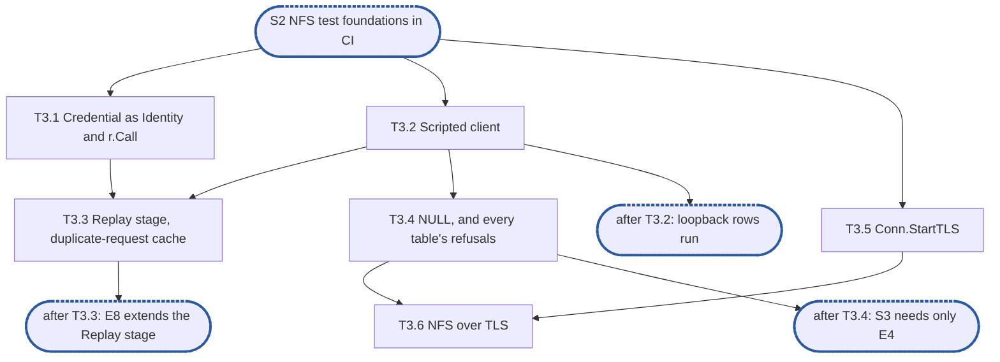

# Epic 3: NFS adapter v2 RPC layer

**Sources:** [RFC 21](../docs/internals/rfcs/rfc-21-nfs.md) §2.1's `PROG_MISMATCH` row, §2.2 (TCP
only, and its paragraph on NFS over TLS), §11's paragraph on decoding (the credential with the RPC
header), §11.1, §11.2's retry identity for NFSv3 and NFSv4.0 and its duplicate-request cache, §11.5's
paragraphs on `core`'s own refusals, status layers, a reply carrying a status alone, malformed calls
and the fault status, and its `ErrWrongSecurity` and `ErrLogonFailure` rows, §11.6's golden vectors
and total mapping for §11.1, §11.2 and those §11.5 rows, §11.7's replay-hit row, §12's N1 for TCP and
N26's decode clause, §13's "§11.1 refused credentials *(1 node)*" row, and Appendix D's `NULL`;
[RFC 20](../docs/internals/rfcs/rfc-20-adapters.md) §3.6's TLS bullet, §4.4 (`Identity` and `Call`
per request), §4.5 (one table per protocol) for the rows above, §4.7's `ReplayCache`, `Conn` and
its stage table's Replay row, §5.4 for the `AUTH_SYS` fuzz target, §5.5's TLS paragraphs, §7.5's TLS
row as an in-process check, §8.2's scripted client, and §10.1's replay-hit counter;
[RFC 18](../docs/internals/rfcs/rfc-18-identity.md) §3.2 for the credential's wire side;
[RFC 13](../docs/internals/rfcs/rfc-13-configuration.md) Appendix B's `adapters.nfs.tls` row.
Every citation is `develop`'s text, which holds the RFC 21 implementation plan's amendments A1 to
A4 and RFC 21 §11.2's cache, which closed RFC 21's former open question 5, and reaches
`feat/storage-v2` with the cherry-pick of RFC changes.
Cited, not owned: RFC 5531 for the RPC message, RFC 9289 for the `AUTH_TLS` probe, RFC 17 §3.0's
`Call` and §4.9's admission, RFC 20 §2.5's layout of `ops/`.
**Track:** A.
**Epic 3 estimate: 6 subtasks, 18.5 man-days.**
**Depends on:** **S2**, NFS's test foundations in CI: E1's request state, NFSv4 table and golden-file
vector check, E2's knfsd captures cut into golden files, and S0's `vfstest.Mutations`. It builds on
what RFC 20's epics already landed on `feat/storage-v2`: `core`'s pipeline and `ReplayCache` stage,
and NFS's scaffold, whose header stage and router already judge the RPC version, the credential's
flavour and `AUTH_SYS` body, the verifier, the program, its version and a `COMPOUND`'s minor
version, each refusal answered through the stages' table with its golden vector.
**Blocks:** E8, which extends T3.3's `Replay` stage with a session's slots; E13, which adds
`RPCSEC_GSS` beside T3.1's credentials; E14, whose scripts run on T3.2's client; S3 and S4, whose
mounts start with T3.4's `NULL` over T3.2's client. The middle epics that start from S2 alone build
their handlers on `nfsharness` and need this epic only for their loopback rows: E4 (T4.3, T4.6) and
E11 fill T3.4's `ops` packages, E5 (T5.9) and E10 rely on T3.4's `NFS4ERR_NOFILEHANDLE` and drain
rows, E4's T4.7, E5's T5.9 and E6's T6.5 drive T3.2's client, E4's T4.10 retransmits through T3.3's
cache, and E7 resolves the `Claimed` `Identity` T3.1 builds (T7.1) and drives T3.2's client from
three source addresses (T7.6).

---

## 1. Goal

Epic 3 builds what every NFS call meets before a handler and around it: the caller its credential
proves, built once per request as `r.Call`; `NULL` in every program; NFS over TLS; the answer each of
`core`'s own refusals gets in each program; the per-node duplicate-request cache that answers an
NFSv3 or NFSv4.0 retransmission its first reply; and the scripted client every loopback row of the
NFS epics is written against.

**At the end of the epic:**

- every routed call carries an `r.Call` whose `Identity` is RFC 21 §11.1's for its credential,
  `AUTH_NONE` or `AUTH_SYS`, with the connection's source address, and whose `Protocol` is its
  program's; `Route` still allocates once per call;
- over loopback through `core`, `adaptertest/nfsclient` sends exactly the bytes a script gives it and
  reads each reply: `NULL` is answered in NFS v3 and v4, MOUNT v3, NLM v4 and NSM v1, and §13's
  refused credentials are each `AUTH_BADCRED` with no mutating call reaching `memory.New`;
- a retransmission of a cacheable NFSv3 call, or of an NFSv4.0 `COMPOUND`, from the same address,
  on another connection, is answered its first reply byte for byte, and the service is called once;
- with `adapters.nfs.tls.mode` `opportunistic` or `require`, a client's `AUTH_TLS` probe upgrades its
  connection to TLS 1.3, nothing after the probe is readable as RPC, a certificate replaced on disk
  is presented to the next handshake, and under `require` a plaintext call closes the connection;
- every table holds a row for each of `core`'s refusals RFC 21 §11.5 maps, for `ErrLogonFailure`, and,
  in each NFSv3-family table, `ErrWrongSecurity` rejected `AUTH_TOOWEAK`, each with a golden vector.

### 1.1 In scope

`internal/adapter/core`'s `Conn.Remote` and `Conn.StartTLS`, with `testproto`'s cases for the second;
`pkg/vfs`'s three protocol constants; `internal/adapter/nfs/protocol`'s credentials, its `Replay`
stage and its `AUTH_TLS` probe; the packages `ops/v3`, `ops/mount`, `ops/nlm` and `ops/nsm` with
their `NULL` rows, and `ops/v4`'s `NULL`; the error rows of §3; the TLS configuration in `nfs.go`;
`settings.NFS`'s TLS validation; `adaptertest/nfsclient`; the golden files and fuzz target of each.

### 1.2 Out of scope

- An `RPCSEC_GSS` credential, its `Security` stage and context table, and the withdrawal of the
  scaffold's interim `AUTH_BADCRED` for it (`protocol/stages.go`'s `checkAuth`): E13.
- What a claim resolves to (uid and gid mapping, root, squash, `ManageGIDs`, the credential's gid as
  a new file's group): E7's T7.1, and E4 for the group a create passes. Until T7.1 lands,
  `memory.New`'s identity server refuses a `Claimed` caller `ErrAccess` at admission, so this
  epic's rows that need a call admitted send `AUTH_NONE` to a share granting everyone, and the
  `AUTH_SYS` `Identity` is asserted at the handler, before admission (T3.1).
- `r.Call.Client`, set by a row's `Resolve` for NFSv4.0 and NLM: E9 and E11. `r.Call.Session`, a
  session's `Level` and `SEQUENCE` read before dispatch: E8.
- The slots and reply caches of NFSv4.1 sessions in the `Replay` stage: E8. Each NFSv3 row's
  `Cacheable` column, and the `REMOVE` retransmission row over loopback: E4, with each row.
- `ErrWrongSecurity`'s NFSv4 row and `SECINFO`: E5. `ErrUnknownPrincipal`'s rows: E4 for NFSv3's
  cell, E5 and E6 for NFSv4. `ErrNotNegotiated`, `ErrNoSession`, `ErrNoTree` and `ErrExpired`: E8 and
  E13, with the session and GSS tables, as RFC 21 §11.5 says.
- Each operation's drain `Role` and the drain test against Linux's compounds (RFC 21 §11.6): each
  operation's epic and E10.
- MOUNT, NLM and NSM procedures past `NULL`: E4 and E11. NLM and NSM over UDP: E11. The call encoder
  and reply decoder in `wire` for the server's own outbound calls: E10 and E11 move them out of
  `nfsclient` when they first send one (D11).
- The totality test of every table, the TLS row with a kernel client (`xprtsec=tls`), and §13's
  refused-credentials row on the composed node, against a share with an everyone grant and a real
  `CREATE`: E16.
- The port mapper and rpcbind registration: the RFC 21 implementation plan's deferral ledger, its row
  for the port mapper, owned by the cutover.
- `adapter_translation_refused_total{reason="identity"}`, whose producer is T3.1's refusal: nothing
  here records it, as rule 3 has it while who records the series only NFS code can count is open
  with the RFC's author. If that settles before T3.1 lands, T3.1 adds it, about 0.5 man-days inside
  its figure; after, the epic the decision names.

### 1.3 Names used here

- **E1**, epic 1, the NFS surface: `protocol.State`, `ops/v4`'s `Table` with its `COMPOUND` and
  `ILLEGAL` rows, and the check that fails a row no golden file reaches.
- **E2**, epic 2, test foundations: `adaptertest/nfsharness` and knfsd's captures cut into golden
  files.
- **E3**, this epic: the RPC layer.
- **E4**, NFSv3 and MOUNT. **E5**, the NFSv4 namespace, attributes and data path. **E6**, the NFSv4
  ACL attributes. **E7**, identity's NFS side. **E8**, clients and sessions. **E9**, opens, stateids
  and locks. **E10**, delegations and the back channel, with the drain test. **E11**, NLM, NSM and
  the datagram path. **E13**, RPCSEC_GSS. **E14**, the capture diffs against knfsd. **E16**, E2E
  green: the suites, the totality test and the end-to-end rows.
- **S0**, the shared test pieces the RFC 22 implementation plan's epic 2 builds, `vfstest.Mutations`
  among them.
- **S2**, NFS's test foundations in CI, after E1, E2 and S0: what this epic starts from.
- **S6c**, the RFC 22 implementation plan's epic 4, which builds `gss`.
- **S3**, an NFSv3 mount over loopback, after this epic and E4. **S4**, an NFSv4.1 session over
  loopback, after this epic, E5 and E8.
- **A3**, an amendment to RFC 17 §4.9, agreed in #5166: admission tells NLM, `MNT` and `EXPORT` apart
  by `Call.Protocol` and the method called.

## 2. How the general rules apply

The rules are those of [the RFC 21 implementation plan's §1.5](rfc-21-nfs-plan.md#15-general-rules-for-each-epic),
cited by number and title and not copied.

| Rule | Subtasks | How |
| --- | --- | --- |
| rule 1, independent unit tests, under `-race` ([`CLAUDE.md`, "Writing tests"](../CLAUDE.md#writing-tests)) | all | stages tested without a socket on RFC 5531 and capture vectors; loopback rows through `core` on `memory.New` (kind 2) with S0's `vfstest.Mutations`, a recording wrapper that passes each call through; `StartTLS` on `core`'s `testproto`; the cache's bound and eviction on its own; no other double |
| rule 2, fuzz tests where relevant | T3.1 | `FuzzAuthSys`, beside `wire`'s `FuzzRecord`, which already checks `DecodeAuthSys`'s limits and that it takes the whole body, adds what RFC 20 §5.4 asks of a credential's own target: every decoded field equal to a second decoder written by hand from RFC 5531 Appendix A (R10). The scripted client reads only the server's replies in tests and has no target |
| rule 3, observability follows RFC 25 and RFC 20 §10 | T3.1, T3.3 | no recorder in NFS code; a cache hit is counted by `core` as `adapter_replay_hits_total{protocol="nfs3"}`, asserted over loopback (R27); no log line or attribute added here carries the source address or a claim (RFC 25 §5.4) |
| rule 4, profiling: leaks, allocations and contention | T3.1, T3.3, T3.5 | every loopback test starts with `adaptertest.CheckLeaks`; `Route` still allocates once per call, the claims' groups included (`TestHeaderStageAllocs`, D4); the cache is shared by every connection of the adapter, so T3.3 reports its mutex and block profiles under 64 connections; `StartTLS`'s handoff is checked for leaked goroutines |
| rule 5, public interface and internals, at the layer that consumes a value ([`CLAUDE.md`, "Verifying a change"](../CLAUDE.md#verifying-a-change)) | T3.1, T3.3, T3.4, T3.6 | the `Identity` asserted on the `r.Call` a handler receives over loopback, not only at the function that builds it; the cache on the reply a client reads and the one call `memory.New` records; each row on the reply bytes and on `core`'s unmapped-error counter; TLS on the bytes a client sees on the socket |
| rule 6, known failures shrink | none | no `pynfs`, `cthon04` or `nfstest` test runs before the cutover |
| rule 7, v2 ignores v1 | all | nothing from `develop`'s `rpc` package; the TLS upgrade follows RFC 9289 and RFC 20 §5.5, through `Conn.StartTLS` and the shared `tlsconfig`, which RFC 20 Appendix B keeps |
| rule 8, real dependencies for properties of those dependencies | T3.2, T3.4, T3.6 | golden files written by hand from RFC 5531, RFC 1813 and RFC 9289, or cut from knfsd's captures, never vectors the encoder under test made; real TCP over loopback; real TLS 1.3 with certificates generated per test under `t.TempDir()` |
| rule 9, code comment conventions ([`CLAUDE.md`, "Code comments"](../CLAUDE.md#code-comments)) | T3.1, T3.3, T3.4, T3.5, T3.6 | `decision:` and `ponytail:` markers named in §4 at their code sites; `stages.go`'s marker on `RPCSEC_GSS` kept as it is, for E13 to withdraw; `settings.go`'s comment on `StartTLS` rewritten; `nfs.go`'s marker on its empty tables removed with the last of them |
| rule 10, a test must be able to fail | all | each test names the break it catches; none asserts a stub's answer; a row whose status is the fault is asserted as a matched row, which the fault alone would not show |
| rule 11, a symbol is exported only if an interface uses it | T3.1, T3.2, T3.3, T3.4, T3.5 | `core.Conn.Remote` and `StartTLS` for `nfs/protocol`, through an RFC 20 pull request first (Q2); `vfs.ProtocolNFSv3`, `ProtocolNFSv4`, `ProtocolNLM` for `nfs/protocol`; `nfsclient`'s surface for every NFS epic's tests; each `ops` package's `Table` for `nfs.go`; `protocol.ErrorTable` for the `ops` packages; `protocol.New`'s new argument for `nfs.go`. Nothing in `wire` is exported for a later epic (D11) |
| rule 12, each subtask creates only what it declares | all | each `ops` package arrives with its `NULL` row and test; `nfsclient` with its first loopback rows; no `Security` stage, since nothing here verifies a message (D1) |
| rule 13, translate, never decide | T3.1, T3.3 | the credential becomes a neutral `Identity` by a pure, total function (R4); the adapter maps no id, squashes nothing and decides no privilege (R7); the cache answers only what was already decided for that call |
| rule 14, nothing deferred is lost | all | §1.2 names the owner of each part of an obligation this epic leaves out; §9 the gaps |

## 3. Requirements and invariants

Every MUST and MUST NOT that RFC 21, RFC 20, RFC 18 and RFC 13 place on this epic, numbered so that
subtasks and tests can cite them.

**The caller**

| # | Requirement | Kind | Source | Subtasks |
| --- | --- | --- | --- | --- |
| R1 | `AUTH_NONE` becomes an `Identity` of `Proof` `None`, `Protection` `None`, no `Evidence` and no `Claims`; `AUTH_SYS` one of `Proof` `Claimed`, `Protection` `None`, no `Evidence`, and the uid, gid and groups it carried as `Claims` | MUST | RFC 21 §11.1 (the table); RFC 18 §3.2 | T3.1 |
| R2 | The `Identity` carries the connection's source address, which client rules are checked against | MUST | RFC 21 §11.1; RFC 20 §4.4 | T3.1 |
| R3 | An `AUTH_SYS` credential's machine name and stamp are ignored: two credentials that differ only there give the same `Identity` | MUST | RFC 18 §3.2 | T3.1, T3.3 |
| R4 | The credential's translation is a pure function of the decoded credential and the address, and total: every credential maps to an `Identity` or to a named refusal, never to a default | invariant | RFC 21 §11, §12 (N26) | T3.1 |
| R5 | The `Identity` and `r.Call` are built afresh for each request by the router, never by a handler; a `COMPOUND`'s members read the `r.Call` its route built | MUST | RFC 20 §4.4 | T3.1 |
| R6 | `r.Call` holds the `Identity` and the request's `Protocol`; `Client` and `Session` are left zero for the rows and the session that set them | MUST | RFC 20 §4.4 (the `Call`) | T3.1 |
| R7 | The adapter maps no principal to ids, applies no squash and decides no privilege: a claimed uid 0 reaches the service as the claim it is, for RFC 18's root principal to be resolved there | MUST NOT | RFC 20 §4.4; RFC 21 §11.1 (root, what a claim reaches) | T3.1 |
| R8 | A credential whose body does not decode inside its opaque, an `AUTH_SYS` credential past RFC 5531's limits (more than 16 gids, a machine name over 255 bytes, bytes left after the group list), and every flavour but `AUTH_NONE`, `AUTH_SYS` and `RPCSEC_GSS` is rejected `AUTH_BADCRED` and runs nothing; none is ever treated as anonymous. Already enforced at the stage and the decoder by the scaffold's tests T3.2 names; this epic adds §13's row over loopback (R9) | MUST | RFC 21 §11.1 (refused credentials); RFC 18 §3.2 | T3.2 |
| R9 | §13's row: a truncated `AUTH_SYS` credential, one with 17 gids, one with a 256-byte machine name, an `AUTH_DH` and an unknown flavour, each rejected `AUTH_BADCRED`, nothing created | test row | RFC 21 §13 (§11.1 refused credentials *(1 node)*) | T3.2 |
| R10 | The `AUTH_SYS` body's decoder has its own fuzz target: no panic, every read inside the buffer, and a decoded value that matches a second decoder written by hand | MUST | RFC 20 §5.4 | T3.1 |
| R11 | Where a credential is judged: decoding the header only bounds the credential and verifier, one past the record or past 400 bytes answered `GARBAGE_ARGS`; a call whose RPC version is not 2 is answered `RPC_MISMATCH` with neither read; the flavour and an `AUTH_SYS` body are judged at route; a verifier other than an empty `AUTH_NONE` beside `AUTH_NONE` or `AUTH_SYS` is `AUTH_BADVERF`. Already enforced at the stage by the scaffold's tests T3.2 names; this epic adds each over loopback | MUST | RFC 21 §11.1 (where they are judged), §11.5 (malformed calls) | T3.2 |
| R12 | A client certificate authenticates the connection, never the caller: the `Identity` of a call over mutual TLS is the one its credential gives. Enforced by the compiler: T3.1's translation takes no argument a certificate could reach | invariant | RFC 20 §5.5 (decision) | T3.1 |

**Malformed calls, layers and `core`'s refusals**

| # | Requirement | Kind | Source | Subtasks |
| --- | --- | --- | --- | --- |
| R13 | A record too short to hold its transaction ID and message type closes the connection. Already enforced at the stage by the scaffold's `TestTheNonCalls`; this epic adds it over loopback | MUST | RFC 21 §11.5 (malformed calls) | T3.2 |
| R14 | A status alone is written whole by the header codec: `PROG_MISMATCH` with the lowest and highest version the connection serves of that program (for NFS v2, 3 and 4 under the default range), `RPC_MISMATCH` with 2 and 2, a `COMPOUND`'s status with its tag and no results. Already enforced at the stage by the scaffold's tests T3.2 names; this epic adds each over loopback | MUST | RFC 21 §2.1 (the NFS v2 row), §11.5 (a reply carrying a status alone, malformed calls) | T3.2 |
| R15 | A status names its layer: 0 a program's status, 1 an accept state, 2 `RPC_MISMATCH`, 3 `AUTH_ERROR` with its `auth_stat`; no program's status reaches bit 30. This epic adds the first row of a program's table in layer 3 (R21) | invariant | RFC 21 §11.5 (a status names its layer) | T3.4 |
| R16 | The fault is `NFS3ERR_SERVERFAULT` in NFSv3's table, `NFS4ERR_SERVERFAULT` in NFSv4's, and `SYSTEM_ERR` in the stages' table and in MOUNT's, NLM's and NSM's, wherever each table lives | MUST | RFC 21 §11.5 (the fault status) | T3.4 |
| R17 | `ErrNotSupported` is `PROC_UNAVAIL` and `ErrDecode` `GARBAGE_ARGS` in every program's table, wherever each table lives | MUST | RFC 21 §11.5 (`core`'s own refusals) | T3.4 |
| R18 | `ErrNoFH` is `NFS4ERR_NOFILEHANDLE` in the NFSv4 members' table | MUST | RFC 21 §11.5 (`core`'s own refusals) | T3.4 |
| R19 | `ErrMoved` is `NFS4ERR_MOVED` for the NFSv4 operations that use the current filehandle, in a row naming them in `Ops`; `ErrDraining`, and `ErrMoved` for any other NFSv4 operation and in NFSv3's, MOUNT's and NLM's tables, send no reply. This epic writes the rows; E10 runs the drain against Linux's compounds | MUST | RFC 21 §11.5 (`core`'s own refusals), §7.4 | T3.4 |
| R20 | `ErrNotLast`, `ErrTooManyPending` and `ErrCancelled`, which never reach NFS, map to each table's fault | MUST | RFC 21 §11.5 (what runs while draining) | T3.4 |
| R21 | `ErrWrongSecurity` over NFSv3 and its auxiliary programs rejects the RPC with the `auth_stat` `AUTH_TOOWEAK` | MUST | RFC 21 §10, §11.1 (export flavour policy), §11.5 (`ErrWrongSecurity`) | T3.4 |
| R22 | `ErrLogonFailure`, never met by an operation, is the fault in each table: `NFS4ERR_SERVERFAULT`, `NFS3ERR_SERVERFAULT`, and NLM's `SYSTEM_ERR` | MUST | RFC 21 §11.5 (`ErrLogonFailure`); RFC 20 §4.5 | T3.4 |

**The duplicate-request cache**

| # | Requirement | Kind | Source | Subtasks |
| --- | --- | --- | --- | --- |
| R23 | A gateway node keeps a duplicate-request cache for NFSv3 and NFSv4.0 in NFS's `Replay` stage, a bounded set of replies in the node's memory keyed by (client address, XID, procedure, checksum of the arguments), and answers a retransmission the reply its first send was given instead of running it again | MUST | RFC 21 §11.2; RFC 20 §4.7 (the Replay row) | T3.3 |
| R24 | The key never names the connection: a retransmission on another connection from the same address is answered from the cache | MUST | RFC 21 §11.2 | T3.3 |
| R25 | The cache is not durable and the service's dedup is not widened: a retransmission after its entry was evicted, or after a restart, runs again | invariant | RFC 21 §11.2 | T3.3 |
| R26 | `Lookup` returns a fresh copy of the cached reply charged to a reply reservation of its size that waits under the request's context; `Store` keeps its own clear copy, taken before `Wrap`, of a cacheable row's reply only. MOUNT, NLM and NSM have no cache, and an NFSv4.1 or later `COMPOUND` is not this cache's | MUST | RFC 20 §4.7 (`ReplayCache`, the Replay row) | T3.3 |
| R27 | A hit is counted by `core` as `adapter_replay_hits_total{protocol="nfs3"}`, as `core` counts every replay hit; RFC 21 §11.7's row names a session's slot, and this cache's hits are counted the same way | MUST | RFC 21 §11.7; RFC 20 §10.1 | T3.3 |
| R42 | A call `Route` would refuse is never answered from the cache: its RPC version, flavour, `AUTH_SYS` body and verifier are judged as `Route` judges them before the cache is read, and a refusal is a miss, answered as its first send would be; a refused call is never stored | invariant | RFC 21 §11.1 (where they are judged), §11.2, §12 (N26) | T3.3 |

**`NULL` and NFS over TLS**

| # | Requirement | Kind | Source | Subtasks |
| --- | --- | --- | --- | --- |
| R28 | `NULL` is answered with no service call in every program served: NFS v3 and v4, MOUNT v3, NLM v4, NSM v1 | MUST | RFC 21 Appendix D (`NULL`), §2.1 | T3.4 |
| R29 | A row added to a table without a golden vector fails its suite | MUST | RFC 20 §5.4 | T3.4 |
| R30 | NFS over TLS (RFC 9289) is served: a `NULL` with the `AUTH_TLS` flavour is answered, and the same TCP connection is upgraded to TLS before any other request | MUST | RFC 21 §2.2 (NFS over TLS); RFC 20 §5.5 | T3.5, T3.6 |
| R31 | With `mode: opportunistic` a client that does not probe is served in plaintext; with `mode: require` any call before the upgrade but the probe is refused and the connection closed; with `mode: off` nothing is upgraded | MUST | RFC 21 §2.2; RFC 20 §5.5 (the settings table) | T3.6 |
| R32 | `Conn` offers the upgrade once, to the stage that asked; after it the reader and writer read and write through TLS, and the framer and every stage above are unchanged; `StartTLS` changes no existing signature | MUST | RFC 20 §5.5 | T3.5 |
| R33 | TLS 1.3 is the floor, fixed | bound | RFC 20 §5.5; RFC 13 Appendix B | T3.6 |
| R34 | `cert_file` and `key_file` are re-read when they change, and handshakes begun afterwards use the new pair while an upgraded connection keeps its session; `client_ca` applies to handshakes begun afterwards; `mode` to connections accepted afterwards | MUST | RFC 20 §5.5 (the settings table); RFC 13 Appendix B | T3.6 |
| R35 | Certificates are loaded and reloaded by the shared `tlsconfig` code; the adapter adds none | MUST | RFC 20 §5.5 | T3.6 |
| R36 | `Validate` reads no file, and once `StartTLS` exists accepts `opportunistic` and `require` with a certificate and key; an unloadable certificate fails at configured or is refused by `Reconfigure`, never at the first handshake | MUST | RFC 20 §3.6; RFC 13 Appendix B | T3.6 |
| R37 | RFC 20 §7.5's TLS row, in process: after the probe no RPC is readable on the connection; under `require` a plaintext client fails; a replaced certificate is presented to a new connection while the first stays up | test row | RFC 20 §7.5 (§5.5 TLS) | T3.6 |
| R43 | A reply given over TLS is never sent in the clear: under `require` a call before the upgrade other than the probe is closed before the duplicate-request cache is read or filled, and a reply stored from an upgraded connection answers a retransmission only on an upgraded connection | MUST | RFC 21 §2.2 (NFS over TLS), §11.2; RFC 20 §5.5 | T3.3, T3.6 |
| R44 | The connection is upgraded only after a probe `Route` admitted and its row answered with success; a probe refused, answered from an error table or answered with no reply starts no handshake, and the connection reads on in plaintext | MUST | RFC 21 §2.2 (NFS over TLS); RFC 20 §5.5; RFC 9289 §4.1 | T3.5, T3.6 |
| R45 | A `client_ca` file replaced at its path applies to handshakes begun afterwards, as the certificate pair does | MUST | RFC 20 §5.5 (the settings table); RFC 13 Appendix B | T3.6 |

**Transport, decoding and vectors**

| # | Requirement | Kind | Source | Subtasks |
| --- | --- | --- | --- | --- |
| R38 | Every NFS program is served over TCP; no listener this epic adds reads UDP. Already enforced by the scaffold's test that Start binds one TCP port for every program, which T3.6 runs with TLS on | MUST | RFC 21 §2.2, §12 (N1) | T3.6 |
| R39 | Nothing the adapter cannot decode is acted on: a call refused at decode or route reaches no service call | invariant | RFC 21 §12 (N26) | T3.2 |
| R40 | Golden vectors per table: credentials (§11.1) and retry identities (§11.2) to their neutral values, and each §11.5 row this epic adds | test row | RFC 21 §11.6 (§11.1–§11.5 golden vectors *(1 node)*) | T3.1, T3.3, T3.4 |
| R41 | Scripts drive the protocol through a scripted client that sends exactly what it is told | MUST | RFC 20 §8.2 | T3.2 |

Not obligations of this epic: RFC 21 §11.1's rows for `RPCSEC_GSS` and §10 (E13), the credential's
group and root's resolution (E7), §11.2's request ID from the retry identity, `vfs.WithRequestID`,
which the RFC 21 implementation plan's deferral ledger gives the cluster stage, and §11.2's NFSv4.1
row (E8); RFC 20 §4.4's `gss` package, but for D1's reading of it (Q1).

## 4. Decisions this epic takes

- **D1. The router builds the caller, in `nfs/protocol`.** RFC 20 §4.4 has the `Router` build
  `r.Call`, and its §11 question 7 notes that `Security` is nil for `AUTH_SYS`: nothing here verifies
  a message, so this epic adds no `Security` stage, and `Route` builds the `Identity` from the
  credential `checkAuth` already decodes, which `checkAuth` now returns rather than drops, through one
  pure, unexported function in `protocol/auth.go`. RFC 20 §4.4 names `gss.Identity` as the one place
  either protocol builds one, `AUTH_SYS` included, but `gss` is S6c, which this epic does not wait
  for, and only NFS has an `AUTH_SYS` arm. This document writes the `nfs/protocol` function,
  **pending the user's answer** (Q1). Prior art: knfsd's `svcauth_unix` sets the request's credential
  in the RPC layer before dispatch (from memory). A `decision:` marker at the function, overturned if
  `gss` lands first with an `AUTH_SYS` arm.
- **D2. `Call.Protocol` by program.** NFS v3 and MOUNT carry `ProtocolNFSv3`, NFS v4
  `ProtocolNFSv4`, NLM and NSM `ProtocolNLM`. A3's admission tells `MNT` and `EXPORT` apart by an
  NFSv3 `Root` or `ListShares`, and NSM's one served call, `SM_NOTIFY`, is `HostRestarted` on NLM
  hosts' records (RFC 21 Appendix D). `pkg/vfs` gets the three constants as aliases of `entity`'s,
  as it already aliases identity's enumerations, since an adapter imports `pkg/vfs` alone. Prior art:
  none found. A `decision:` marker at the mapping, naming the ceiling: an NSM call meets NLM's lowered
  minimums at admission, harmless while NSM reaches no file; **pending the user's answer** (Q4),
  overturned if an NSM call ever names a share.
- **D3. The source address comes from `core.Conn.Remote`.** `Conn` keeps the client's address,
  already without its port and unmapped, but exports none, and the router has no other way to it.
  `Remote() netip.Addr` returns it, added first to RFC 20 §4.7 by a pull request to the RFC (rule
  11), **pending the user's answer** (Q2). Prior art: knfsd's `rq_addr` (from memory). No marker: it is
  the RFC's text once amended.
- **D4. One allocation per call, the groups included.** `Claims.GIDs` is a slice, so `Route` points
  it into a `[16]uint32` held in the request's own allocation, beside E1's state, rather than
  allocating it. A `decision:` marker at the struct, overturned if `core` ever releases a request
  while a service call still reads its `Identity`.
- **D5. The duplicate-request cache's shape.** One cache per adapter, built by `protocol.New` and
  shared by every connection, so a retransmission on a new connection finds its entry (R24): one
  mutex over a map and a `container/list` least-recently-used list of at most 4096 entries, each
  reply at most 8 KiB, the size RFC 21 §3.1 caches per slot; a reply over it is not stored and its
  retransmission runs again. The key is the client address, the XID and a 64-bit `hash/maphash` of the
  program, version, procedure and arguments, with the credential's flavour and, for `AUTH_SYS`, its
  uid, gid and groups, so one caller's reply never answers another's call that shares an XID, while
  a retransmission whose `AUTH_SYS` stamp or machine name changed still hits, since RFC 18 §3.2
  ignores both; the key also holds whether the connection has upgraded to TLS, so a reply given over
  TLS never answers a plaintext retransmission (R43). `core` reads the cache before `Route`, so
  `Lookup` first judges the header with the function `Route` judges it with, the RPC version, the
  flavour, the `AUTH_SYS` body against RFC 5531's limits and the verifier, and a refusal is a miss:
  `Route` then refuses the retransmission as it refused, or would have refused, the first send
  (R42). Keying on those fields instead would still answer a call whose credential `Route` refuses
  once its first send had been admitted under another. Only NFS v3 calls and NFSv4 `COMPOUND`s of minor version 0 are looked up or stored;
  the `COMPOUND` row is marked `Cacheable`, and `Store` skips a later minor version, which E8's slots
  take. `Lookup` charges its copy to the reply pool of `Deps.Budgets`, which `nfs.New` hands
  `protocol.New`. Prior art: knfsd's DRC keys on address, XID, procedure, program, version and a
  checksum of the arguments' first bytes, and drops a retransmission still in progress (from
  memory). Two `ponytail:` markers: on the one lock, shard by key when T3.3's mutex profile or a
  later one shows contention; and on retransmissions in progress, which this cache does not track,
  so one arriving before its first send's reply is stored runs again, upgrade to an in-progress
  entry that drops it when a client is seen retransmitting a non-idempotent call before its first
  reply. The bounds stay uncharged under `core`'s own `ponytail:` on `ReplayCache.Store`.
- **D6. `NULL` moves each table into its `ops` package.** `nfs.go`'s `decision:` keeps each table
  there until its first row: `NULL` is that row for NFSv3, MOUNT, NLM and NSM, so `ops/v3`,
  `ops/mount`, `ops/nlm` and `ops/nsm` each arrive with `table.go` and `null.go`, one procedure per
  file as RFC 21 §11 lays them out, and `ops/v4` gets `null.go`. Their `Table()` takes no `Handlers`
  until a row calls the service (E4, E11), a change to one caller, `nfs.go`. The rows every
  NFSv3-family table shares, the fault, the two refusals and T3.4's, come from one exported helper,
  `protocol.ErrorTable`, which `nfs.go`'s `errorTable` becomes. Prior art: RFC 20 §2.5's layout.
- **D7. Where the upgrade is asked for.** RFC 20 §5.5 has the header stage call `StartTLS` "after
  the reply is sent", but by then `core`'s reader may already be reading the client's TLS
  `ClientHello` as a record mark. So the header stage asks in `Decode`, on the reader, for a `NULL`
  under `AUTH_TLS` on a connection whose mode is not off and which has not upgraded, and `core`'s
  reader reads no further record until that call has ended. `core` performs the upgrade after the
  call's reply is sent, on the same socket under the handshake deadline, only when `Route` admitted
  the call and its row answered with success; a probe `Route` refuses, one answered from an error
  table, and one that ends with no reply (a drain row) withdraw the request, the reader reads on in
  plaintext, and no handshake starts (R44). The request is a request until then: `Decode` has judged
  nothing but the header's shape. This changes when
  `StartTLS` is called, so RFC 20 §5.5's sentence is amended with `Remote` (Q2). The reply's verifier
  is `AUTH_NONE` with the body `STARTTLS` (RFC 9289 §4.1, from memory), which the probe's `Encode`
  writes itself after `wire.AppendAccepted`'s header, leaving that function's callers as they are.
  `AUTH_TLS` on any other procedure, under `mode: off`, or after the upgrade stays `AUTH_BADCRED`, as
  every flavour not served is, except under `require` before the upgrade, where D8's close comes
  first. Prior art: RFC 9289; knfsd hands the socket to a user-space handshake
  daemon before reading on (from memory). A `decision:` marker at `StartTLS`, overturned if `core`
  ever reads ahead of a record's reply on another path.
- **D8. `require` refuses with a close, before any other check.** RFC 21 §2.2 refuses a plaintext
  call under `require` and closes the connection; this epic closes it with no reply, through
  `Conn.Close`, since a reply would be dropped by the close and the client is told nothing a denied
  reply would add. The check runs in the header stage's `Decode`, the first stage a call meets, so
  such a call reaches neither the duplicate-request cache's `Lookup` nor its `Store`, nor `Route`
  (R43). The mode is judged before the flavour: under `require` before the upgrade, `AUTH_TLS` on
  any procedure but `NULL` is closed like any other plaintext call, not answered `AUTH_BADCRED`. Prior art:
  none checked. A `decision:` marker at the check, overturned if a supported client is shown to
  need a denied reply before the close to report the cause.
- **D9. How the certificates reach `New` and `Reconfigure`.** RFC 20 §3.6 leaves to RFC 21, with
  its `NULL` handler, how `Reconfigure`, which reads only `Common`, reaches the certificate files.
  `nfs.go` holds one `tls.Config` per distinct `settings.TLS` value, each from
  `tlsconfig.ServerConfig` with `MinVersion` 1.3, which already re-reads a rotated pair through its
  `CertReloader` and requires and verifies a client certificate where `client_ca` is set, plus
  `NextProtos` `sunrpc`, as RFC 9289 asks (from memory); each connection takes the one its settings
  snapshot names. `ServerConfig` reads `client_ca` once, so `tlsconfig` gains a CA reloader beside
  `CertReloader`, reached through `GetConfigForClient`, that re-reads the file when its mtime
  advances, as the pair is re-read: a CA replaced at its path applies to handshakes begun afterwards
  (R45). A replacement that does not load keeps the last good pool and is logged at `Error`, as the
  pair's reloader does, under a `decision:` marker naming the ceiling: a CA withdrawn by a file that
  does not parse is still trusted until a loadable one lands, overturned if an operator needs a
  withdrawal to refuse every handshake at once. `New` loads its settings' before it returns, and the adapter `New` returns wraps
  `core.Server`'s `Reconfigure`: it loads the next settings' first, refuses the call if they do not
  load, then calls `core`'s, and drops the configurations no setting names after it. **Pending the
  user's answer** (Q3), with RFC 21 §2.2's sentence that states it. Prior art: the control plane's
  listener over `tlsconfig`. A `decision:` marker at the wrapper, overturned if `core` gains a hook
  `Reconfigure` calls before it applies a snapshot.
- **D10. Which operations `ErrMoved` answers `NFS4ERR_MOVED`.** RFC 21 §11.5 names "the NFSv4
  operations that use the current filehandle"; the row's `Ops` is every operation code RFC 8881 and
  RFC 7530 have read the current filehandle, written as a list in `ops/v4`'s `errors.go`, whether or
  not its row has landed, so no later epic edits the drain row. Prior art: knfsd answers
  `NFS4ERR_MOVED` from the filehandle check of each such operation (from memory). A `decision:`
  marker at the list.
- **D11. The call encoder and reply decoder start in the scripted client.** Their only consumer in
  this epic is `nfsclient`; the server's own outbound calls, the back channel's `CB_COMPOUND` (E10)
  and NLM's callbacks (E11), move them into `wire` when they first send one, with the fuzz target a
  decoder of a peer's bytes then needs. Exporting them from `wire` now would export for a later
  epic (rule 11). Prior art: `testproto`'s client, which keeps its codec to itself. No marker.

## 5. Target tree

```text
internal/adapter/core/
  conn.go                        T3.1  Remote; T3.5  StartTLS
  reader.go, writer.go           T3.5  the reader's wait for the probe's reply, the handoff to TLS
  conn_tls_test.go               T3.5  StartTLS on testproto over loopback
  testdata/surface/core.golden   T3.1, T3.5
internal/adapter/adaptertest/testproto/
  stages.go, client.go           T3.5  a message that asks for the upgrade; the client's TLS handshake
pkg/vfs/types.go                 T3.1  ProtocolNFSv3, ProtocolNFSv4, ProtocolNLM
pkg/adapter/settings/settings.go T3.6  Validate accepts opportunistic and require
pkg/adapter/nfs/nfs.go           T3.6  New's comment
internal/adapter/nfs/
  nfs.go                         T3.3  the reply pool to protocol.New; T3.4  tables from ops/; T3.6  TLS configurations, Reconfigure
  nfs_test.go                    T3.2, T3.3, T3.4, T3.6  loopback cases
  protocol/
    auth.go                      T3.1  the credential's Identity, Protocol by program
    stages.go                    T3.1  checkAuth returns the credential, Route builds r.Call; T3.6  the probe in Decode, Route and Encode
    errors.go                    T3.4  ErrorTable and its shared rows
    replay.go                    T3.3  the Replay stage and its duplicate-request cache
  wire/
    const.go                     T3.4  AuthTooWeak, NFS4ErrNoFileHandle, NFS4ErrMoved; T3.6  AuthTLS
    fuzz_test.go                 T3.1  FuzzAuthSys
    testdata/golden/             T3.1, T3.3, T3.4, T3.6  rfc-*.hex: credentials, NULL calls and replies, the probe, each new row
  ops/
    v3/, mount/, nlm/, nsm/      T3.4  table.go, null.go, a test each
    v4/null.go                   T3.4
    v4/errors.go                 T3.4  ErrNoFH, ErrMoved's list, ErrDraining, ErrLogonFailure and the rest
internal/adapter/adaptertest/nfsclient/
  client.go, client_test.go      T3.2  the scripted client; T3.6  StartTLS
```

## 6. Subtasks

### T3.1 The credential as `Identity` and `r.Call`

**Subtask T3.1 estimate: 2.5 man-days.**

- **Track:** A. **Depends on:** S2.
- **Covers:** R1, R2, R3, R4, R5, R6, R7, R10, R12, R40 (credentials).
- **Deliverables:**
  - The `Identity`'s source address is `Identity.Client`, the field client rules already read.
  - `core`: `func (c *Conn) Remote() netip.Addr`, the client's address as it reached this node,
    without its port and unmapped (D3, Q2), with `core.golden` updated. Consumed by `Route` here and
    T3.3's key.
  - `pkg/vfs`: `ProtocolNFSv3`, `ProtocolNFSv4`, `ProtocolNLM`, aliases of `entity`'s (D2).
    Consumed by `Route`.
  - `protocol/auth.go`: the unexported `identity(flavour uint32, sys *wire.AuthSysParms, addr
    netip.Addr) (vfs.Identity, error)`, its error the named refusal `Route` answers `AUTH_BADCRED`,
    and `callProtocol(prog uint32) vfs.Protocol`; `checkAuth` returning the credential it decoded;
    `Route` building `r.Call` from them in the one allocation (D4). Consumed by every handler from E4
    on, by E7's T7.1, which resolves the `Claimed` `Identity` it builds, and by E13, which adds the
    `RPCSEC_GSS` arm.
  - `wire/fuzz_test.go`: `FuzzAuthSys` against a second decoder written in the test from RFC 5531
    Appendix A.
  - Golden files of credentials and the `Identity` each gives (§11.6's credentials table).
- **Acceptance criteria:**
  - Each credential of the golden table gives its golden `Identity`; machine name and stamp change
    nothing; uid 0 stays a claim of 0.
  - Every flavour and every body, generated, gives an `Identity` or the named refusal, never both
    and never neither.
  - `Route` still allocates once per call, with 16 groups.
- **Tests:** over loopback through `core`, with the scaffold's raw call helpers in `nfs_test.go`, on
  `memory.New` behind a test table whose one row records the `r.Call` its handler receives (the
  layer that consumes it): `AUTH_SYS` from uid 1000 with three groups gives `Claimed`, the claims and
  `127.0.0.1` (catches a claim dropped between `Route` and the handler, R1, R2, R5), and
  `ProtocolNFSv3` for NFS v3 and MOUNT, `ProtocolNLM` for NLM and NSM, `ProtocolNFSv4` for a
  `COMPOUND`'s member (catches a protocol by connection, R6); at `identity`, the golden table
  (catches a field mapped differently, R1, R3, R40) and a property test over flavours and bodies
  that each gives an `Identity` with no error or an error with a zero `Identity` (catches a default
  for an unknown flavour, R4); uid 0 kept as 0 (catches a root squash in the adapter, R7);
  `TestHeaderStageAllocs` with 16 groups (catches a second allocation, D4); `FuzzAuthSys` (R10). R12
  is held by `identity`'s signature. No test double: the recording row is the handler under test's
  own.
- **Rules:** rule 9's `decision:` markers for D1, D2 and D4; rule 11's exports above.

### T3.2 The scripted client

**Subtask T3.2 estimate: 2.5 man-days.**

- **Track:** A. **Depends on:** S2.
- **Covers:** R8, R9, R11, R13, R14, R39, R41.
- **Deliverables:** `adaptertest/nfsclient`, with its call encoder and reply decoder unexported in
  it (D11):
  ```go
  type Client struct{ /* one TCP connection, its next XID */ }
  type Auth struct {
  	Flavour uint32
  	Body    []byte
  }
  type Call struct {
  	XID              uint32 // 0: the client's next
  	Prog, Vers, Proc uint32
  	Cred, Verf       Auth
  	Args             []byte
  }
  type Reply struct {
  	XID       uint32
  	Denied    bool   // MSG_DENIED
  	Stat      uint32 // the accept state, or the reject state's auth_stat or RPC_MISMATCH
  	Verf      Auth   // an accepted reply's verifier
  	Low, High uint32 // PROG_MISMATCH's or RPC_MISMATCH's range
  	Body      []byte // an accepted success's results
  }
  func Dial(ctx context.Context, addr netip.AddrPort) (*Client, error)
  func DialFrom(ctx context.Context, from netip.Addr, addr netip.AddrPort) (*Client, error) // binds the source address
  func (c *Client) Do(ctx context.Context, call Call) (Reply, error) // send one call, read its reply
  func (c *Client) Send(rec []byte) error                           // one record, framed, as given
  func (c *Client) Read(ctx context.Context) ([]byte, error)        // the next record's body; io.EOF once closed
  func (c *Client) Close() error
  func AuthSys(uid, gid uint32, gids ...uint32) Auth
  ```
  T3.6 adds `StartTLS`. A call's `Args` and a reply's `Body` are bytes, which each epic's tests
  encode and decode with that epic's generated structs. Consumed by T3.3 (`DialFrom`'s second
  address), every loopback row of E3 to E13 (E4's T4.7 and T4.10, E5's T5.9, E6's T6.5 among them),
  E7's T7.6 (`DialFrom` from `127.0.0.1`, `127.0.0.2` and `127.0.0.3`), E14's scripts and E16's
  benchmarks.
- **Acceptance criteria:**
  - `Do` writes the bytes of the hand-written golden calls for the same fields, and reads every
    reply golden file to its fields.
  - Over loopback through `core` on `memory.New`, with a test table whose one row makes one mutating
    call: §13's five refused credentials, each sent to that row, answered `AUTH_BADCRED` (R9); a call
    of RPC version 3 `RPC_MISMATCH` 2..2, a credential of 401 bytes `GARBAGE_ARGS`, an `AUTH_SYS`
    verifier `AUTH_BADVERF`, NFS v2 `PROG_MISMATCH` 3..4, NFS v3 under a 4.x range `PROG_MISMATCH`
    4..4 and MOUNT there `PROG_UNAVAIL`; each leaves `vfstest.Mutations` empty, while the same call
    under `AUTH_NONE`, to a share granting everyone, leaves one entry.
  - A record of seven bytes closes the connection: `Read` returns `io.EOF`.
- **Tests:** the loopback cases above against their golden replies, at the bytes a client reads,
  beside the scaffold's stage tests that hold them without a socket, `TestTheCredentials`,
  `TestTheDecodeRefusals`, `TestTheNonCalls`, `TestTheServedRanges`, `TestTheMinorVersions` and
  `TestASuccessIsTheHeaderAlone`, and `wire`'s `TestDecodeAuthSys` (catch a refusal answered as
  anonymous, R8, a credential judged after the program, R11, a short record answered, R13, a range
  read from the settings and not the connection, R14); the accepted call's one `Mutations` entry
  beside the refused calls' none (catches a refused call acted on, R39, and a row that never called,
  which would make the empty record vacuous); the golden encoder and decoder cases (catch a field out
  of place, R41). No test double: the mutating row is the test's own handler on the real service.
- **Rules:** rule 8, the golden files by hand from RFC 5531 or cut from E2's captures; rule 11's
  exports above.

### T3.3 The `Replay` stage and its duplicate-request cache

**Subtask T3.3 estimate: 3 man-days.**

- **Track:** A. **Depends on:** T3.1, T3.2.
- **Covers:** R3, R23, R24, R25, R26, R27, R40 (retry identities), R42, R43 (the key's TLS state).
- **Deliverables:** `protocol/replay.go`: the cache of D5, implementing `core.ReplayCache`, set as
  every connection's `Stages.Replay` by `NewConn`; `protocol.New(t Tables, b *resources.Budgets)`,
  `nfs.go` passing `Deps.Budgets`; the `COMPOUND` row's `Cacheable` set in `ops/v4`. Consumed by
  `core`'s pipeline, by E4's cacheable rows and by E8, which adds a session's slots beside it.
  Golden files of calls and the key each gives (§11.6's retry-identity table).
- **Acceptance criteria:**
  - A cacheable NFS v3 call sent twice with one XID from one address, on two connections, is
    answered twice with the same bytes and calls the service once; so is an NFSv4.0 `COMPOUND`.
  - The same XID with other arguments, another uid, another procedure or from another address runs;
    the same call with another `AUTH_SYS` stamp hits; a MOUNT, NLM or NSM call and an NFSv4.1
    `COMPOUND` are never stored.
  - The 4097th entry evicts the least recently used, and a reply over 8 KiB is not stored; either
    retransmission runs again.
  - After a cacheable call is answered, its retransmission with RPC version 3, with an `AUTH_SYS`
    credential carrying 17 gids, or with an `AUTH_SYS` verifier is refused as its first send would
    be, not answered the cached reply.
- **Tests:** over loopback through `core` on `memory.New`, with a test table whose one cacheable row
  makes one mutating call, and a test `COMPOUND` row at minor version 0 whose one member makes one,
  each call under `AUTH_NONE` to a share granting everyone, so admission passes before E7's T7.1:
  the two sends on two connections give one entry in `vfstest.Mutations`, identical replies, and
  `adapter_replay_hits_total{protocol="nfs3"}` up by one, for each (catch a key on the connection,
  R24, a second run, R23, a hit not counted, R27, the `COMPOUND` row left uncacheable); the same at
  minor version 1 gives two entries (catches a session's compound cached here, R26); the second send
  from `127.0.0.2` through `DialFrom` gives two entries (catches the key's address dropped between
  `Conn.Remote` and the cache, R23); a cacheable call answered, then resent with the same XID and
  arguments but RPC version 3, 17 gids or an `AUTH_SYS` verifier, is answered `RPC_MISMATCH`,
  `AUTH_BADCRED` or `AUTH_BADVERF` and the hit counter stays put (catches the cache read before the
  header is judged, R42). Without a
  socket, on header vectors: a property test that any field of the key changed misses and a stamp or
  machine name changed hits (catch a field left out of the key, R23, or the stamp in it, R3), and the
  connection's TLS state changed misses (catches a TLS reply answered in plaintext, R43); the
  eviction and size cases (catch an unbounded cache, R25); a `Lookup` whose reply reservation cannot
  be had before an ended context returns `ErrDelay` of `DelayResources` (catches an uncharged copy,
  R26); the retry-identity golden table (R40). The mutex and block profiles under 64 connections are
  reported in the pull request (rule 4). No test double.
- **Rules:** rule 9's two `ponytail:` markers of D5.

### T3.4 `NULL`, and every table's refusals

**Subtask T3.4 estimate: 3.5 man-days.**

- **Track:** A. **Depends on:** T3.2.
- **Covers:** R15, R16, R17, R18, R19, R20, R21, R22, R28, R29, R40 (these rows).
- **Deliverables:**
  - The packages `ops/v3`, `ops/mount`, `ops/nlm` and `ops/nsm`, each with `func Table()
    *core.OpTable` labelled `nfs3` and its `NULL` row, procedure 0, `Needs` nothing, no service call;
    `ops/v4/null.go`, procedure 0 in E1's table; `nfs.go` building `Tables` from the five packages
    (D6).
  - `protocol.ErrorTable(fault core.Status, rows ...core.ErrorRow) *core.ErrorTable`, `nfs.go`'s
    helper moved, holding for every NFSv3-family table its two refusals and `ErrMoved` and
    `ErrDraining` with no reply, `ErrNotLast`, `ErrTooManyPending`, `ErrCancelled` and
    `ErrLogonFailure` at the fault, and `ErrWrongSecurity` as `AUTH_ERROR` `AUTH_TOOWEAK`.
  - In `ops/v4`'s two tables: `ErrNoFH` `NFS4ERR_NOFILEHANDLE`, `ErrMoved` `NFS4ERR_MOVED` over D10's
    list and no reply elsewhere, `ErrDraining` with no reply, the three at the fault,
    `ErrLogonFailure` at `NFS4ERR_SERVERFAULT`.
  - `wire`'s `AuthTooWeak`, `NFS4ErrNoFileHandle`, `NFS4ErrMoved`; hand-written golden calls and
    replies for each `NULL` E2's captures do not already hold, and for each answered row.
  - Consumed by `nfs.go`, T3.6's probe, E4 and E11, which fill the packages, E5 (a member before any
    `PUTFH`), E10 (the drain), S3's and S4's first call, and E16's totality test.
- **Acceptance criteria:**
  - Over loopback, `NULL` in each of the five programs under `AUTH_NONE` and under `AUTH_SYS` is
    answered an accepted success with an empty `AUTH_NONE` verifier and no results, and
    `vfstest.Mutations` stays empty.
  - Each table keeps its fault and its two refusals, and maps each row above to its status or to no
    reply; an error whose answer is the fault is mapped by its row, not by the fault's fallback.
  - `AUTH_TOOWEAK` from an NFSv3 table is written as a denied reply, `AUTH_ERROR` with `auth_stat` 5.
  - E1's vector check passes with the five new rows.
- **Tests:** the loopback `NULL` cases against their golden replies, which replace the
  empty-table cases of `TestEachRefusalIsAnswered` (MOUNT's, NLM's and NSM's `NULL`, and "a NULL
  after it") and the stage tests that use a v3 or MOUNT `NULL` as a call answered `PROC_UNAVAIL`,
  rewritten to name a procedure no table holds (catch a program left without `NULL`, R28); new cases
  of `TestEachTableMapsCoresRefusals` per table and row, each asserting the status and that
  `core`'s `adapter_unmapped_errors_total` stays 0, so a row at the fault cannot be missing unseen
  (catch a row missing or answering another status, R16 to R22, and `ErrMoved` answered
  `NFS4ERR_MOVED` outside D10's list); at the header stage's `Encode`, the `AUTH_TOOWEAK` and
  `NFS4ERR_NOFILEHANDLE` statuses against hand-written golden replies (catch a layer-3 status written
  as a program's, R15, R40); over loopback, a `COMPOUND` whose first member is a test row needing a
  filehandle answered `NFS4ERR_NOFILEHANDLE` (catches the row unreached through `core`, R18); E1's
  vector check, which fails for a row with no golden file (R29). No test double.
- **Rules:** rule 12: each package arrives with its first row and test; rule 9's `decision:` marker
  for D10, and `nfs.go`'s marker removed with its last empty table; rule 14: `ErrNotNegotiated`,
  `ErrNoSession`, `ErrNoTree` and `ErrExpired` named in §1.2 for E8 and E13.

### T3.5 `Conn.StartTLS`

**Subtask T3.5 estimate: 3.5 man-days.**

- **Track:** A. **Depends on:** S2.
- **Covers:** R30, R32, R44.
- **Deliverables:** `core`: `func (c *Conn) StartTLS(cfg *tls.Config) error`, asked from a header
  stage's `Decode` and performed after the reply to that call is sent, only when the router admitted
  the call and its row answered with success (D7): the reader reads no further record until the call
  has ended; a call refused, answered from an error table or ending with no reply withdraws the
  request and the reader reads on in plaintext; otherwise the writer sends that reply in plaintext, the socket is handed to
  `crypto/tls`'s server side, the handshake runs under the handshake deadline, and reader and writer
  then read and write through it; a second call, or one after the connection began closing, is
  refused; a failed handshake closes the connection. `core.golden` updated. `testproto`: a message
  kind whose `Decode` asks for the upgrade, and its client's TLS handshake. Consumed by T3.6.
- **Acceptance criteria:**
  - On `testproto` over loopback, a message that asks for the upgrade is answered in plaintext, the
    next message is read only after a TLS 1.3 handshake, and every later message and reply is TLS.
  - A client that sends plaintext after the reply has its connection closed by the handshake's
    failure; a second `StartTLS` is refused.
  - A message that asks for the upgrade and is then refused by the router, or answered with no
    reply, leaves the connection in plaintext: the next message is read and answered, and no
    handshake starts.
  - No goroutine outlives the connection.
- **Tests:** on `testproto` over loopback, with a client that writes the next request before
  reading the reply (catches a reader that reads past the probe, R32); a `-race` run of upgrades
  while replies are queued (catches a writer sending a reply in plaintext after the handoff, R30);
  a message asking for the upgrade with a route that refuses it, and one whose row sends no reply,
  each followed by a plaintext message that is answered (catch an upgrade begun before the route's
  judgement, or a reader left waiting on a call with no reply, R44);
  `adaptertest.CheckLeaks` (rule 4). No test double.
- **Rules:** rule 9's `decision:` marker for D7.

### T3.6 NFS over TLS

**Subtask T3.6 estimate: 3.5 man-days.**

- **Track:** A. **Depends on:** T3.4, T3.5.
- **Covers:** R30, R31, R33, R34, R35, R36, R37, R38, R43, R44, R45.
- **Deliverables:** `stages.go`: `Decode` asking `StartTLS` for the probe (a `NULL` under `AUTH_TLS`,
  mode not off, not yet upgraded), `Route` admitting it, the probe's `Encode` writing the
  `STARTTLS` verifier and so confirming the upgrade (D7); `Decode` closing under `require`, before the cache is read, any call before the upgrade but the
  probe (D8); `wire.AuthTLS`; `nfs.go`: the TLS configurations of D9 loaded in `New`, the
  `Reconfigure` wrapper (Q3); `tlsconfig`'s CA reloader (D9), which the control plane's listener
  then shares; `settings.NFS.Validate` accepting `opportunistic` and `require`; `nfsclient`'s `func (c
  *Client) StartTLS(ctx context.Context, cfg *tls.Config) error`, which sends the probe, checks its
  verifier and handshakes. Consumed by E16's TLS row and by every later script that runs over TLS.
- **Acceptance criteria:**
  - Under `opportunistic`, a client that probes is upgraded and then served; one that does not is
    served in plaintext. Under `require`, a plaintext `NULL` closes the connection with no reply,
    and so does `AUTH_TLS` on a procedure other than `NULL`. Under `off`, the probe is `AUTH_BADCRED`.
  - Under `require`, a cacheable call answered over TLS and resent on a new plaintext connection
    from the same address closes the connection with no reply; the hit counter stays put.
  - A probe refused by `Route` (a malformed `AUTH_TLS` body) or under `off` leaves the connection in
    plaintext with no handshake.
  - A `client_ca` file replaced at its path refuses the next handshake by a client certificate the
    old CA signed and the new one did not, while a connection upgraded before keeps serving.
  - A `Reconfigure` from `off` to `require` leaves a connection accepted before it in plaintext and
    makes the next one require the upgrade; one that sets `client_ca` refuses the next handshake
    without a client certificate.
  - A client offering TLS 1.2 only fails the handshake.
  - Replacing the certificate files changes the certificate the next connection is presented, while
    the first connection keeps serving.
  - `New` with an unreadable `cert_file`, and `Reconfigure` naming one, are refused, and the adapter
    keeps serving with what it had; `Validate` reads no file.
- **Tests:** over loopback through `core` with certificates generated under `t.TempDir()`: after the
  probe the client's bytes on the socket begin with a TLS record, and a `NULL` on the upgraded
  connection is answered (catch an upgrade skipped, R30, R37); the three modes (catch a `require`
  serving plaintext or an `opportunistic` refusing it, R31); `AUTH_TLS` on `GETATTR` under `require`
  before the upgrade read as `io.EOF` (catches the flavour judged before the mode, D8); the call
  answered over TLS and resent in plaintext under `require` (catches the cache read before the mode's
  close, R43); the refused probe followed by a plaintext `NULL` that is answered (catches an upgrade
  begun before `Route`, R44); the CA replaced at its path, at the handshake a client sees (catches a
  CA read once, R45); the two `Reconfigure` cases (catch a
  mode or `client_ca` applied to a connection already accepted, or never applied, R34); TLS 1.2
  refused (catches `tlsconfig`'s 1.2 default left in place, R33); the certificate replaced (R34,
  R35); `New` and `Reconfigure` with an unloadable file (R36); settings tests for the modes (R36);
  `TestStartBindsOneTCPPortForEveryProgram` with TLS on (R38). No test double.
- **Rules:** rule 9's `decision:` markers for D8 and D9, and `settings.go`'s comment rewritten; rule
  7: the upgrade through `StartTLS` and `tlsconfig`, nothing from `develop`'s `rpc` package.

## 7. Order of work



T3.1 and T3.2 come first: every handler's loopback rows read T3.1's `r.Call` and run on T3.2's
client. T3.3 follows on the same path because it is what E8, on this track's critical path, extends.
T3.4 gives E4, E5, E10 and E11 their tables and rows. T3.5 waits for nothing but is needed only by
T3.6, which nothing else in the programme waits for, so it comes last although it is the epic's
riskiest subtask; it can run beside any of the others.

## 8. Suggested pull requests

| PR | Subtasks | Man-days | After | Why together |
| --- | --- | --- | --- | --- |
| 1 | T3.1, T3.2 | 5 | — | the caller every handler receives, and the client every loopback row is written on, tested together over loopback |
| 2 | T3.3 | 3 | PR 1 | the duplicate-request cache, the piece E8 extends |
| 3 | T3.4 | 3.5 | PR 1 | every program's table in its package, with `NULL` and every refusal of `core` and of the caller |
| 4 | T3.5, T3.6 | 7 | PR 3 | NFS over TLS, from `core`'s upgrade to the probe and the certificates; T3.5 can open beside PR 1 |

A suggestion only: one pull request per subtask works as well; PR 2 and PR 3 can be open at once.

## 9. Open points

Questions pending the user's answer. Each recommended option is written in place above.

- **Q1. Where an `AUTH_SYS` credential becomes an `Identity`** (D1). RFC 20 §4.4 names
  `gss.Identity(c *Context, sys *SysCred, …)` as the one place either protocol builds one, but `gss`
  is S6c, after this epic on another plan.
  - (a) **Recommended:** `nfs/protocol/auth.go`, a pure function `Route` calls; RFC 20 §4.4
    amended so `gss.Identity` builds from a context only and an `AUTH_SYS` or `AUTH_NONE` credential
    is NFS's own translation (RFC 18 §3.2 already says the NFS adapter decodes it). Only NFS has the
    arm, so nothing can drift. knfsd keeps `AUTH_UNIX` in its RPC layer apart from its GSS code
    (from memory).
  - (b) This epic creates `internal/adapter/gss` with `SysCred` and `Identity`'s `AUTH_SYS` arm,
    which RFC 22's epic 4 extends; the RFC unchanged, two plans touching one package.
  - (c) This epic waits for S6c; every loopback row that reads `r.Call` waits too.
- **Q2. `Conn.Remote`, and when `StartTLS` is asked for** (D3, D7). Rule 11 adds a symbol `core`
  lacks to RFC 20 §4.7 first, and `StartTLS`'s timing is RFC 20 §5.5's text.
  - (a) **Recommended:** one RFC 20 pull request adding `func (c *Conn) Remote() netip.Addr // the
    client's address as it reached this node, unmapped` to §4.7's `Conn` list, and changing §5.5's
    "called by NFS's `Header` stage after the reply is sent" to "asked by NFS's `Header` stage when it
    decodes the probe, and performed by `core` once the probe's reply is sent, if the router admitted
    it and its row answered with success".
  - (b) `core` fills `r.Call.Identity.Client` itself after `Route`, with no new method, and `StartTLS`
    is called after the reply with `core`'s reader told separately not to read on; each writes or
    splits what RFC 20 gives one stage.
- **Q3. How `Reconfigure` reaches the certificate files** (D9). RFC 20 §3.6 leaves it to RFC 21 with
  its `NULL` handler; RFC 21 §2.2 does not state it, so this epic's pull request proposes the
  sentence.
  - (a) **Recommended:** the adapter `nfs.New` returns wraps `Reconfigure`, loading the next
    settings' certificates before `core`'s, and each connection takes the configuration its snapshot
    names. Proposed for RFC 21 §2.2: "The adapter loads the certificate files `adapters.nfs.tls` names
    when it is built, and again before a `Reconfigure` that names others applies, refusing it when
    they do not load."
  - (b) A hook on `core.Listener` that `NewServer` and `Reconfigure` call with the snapshot before
    applying it, amended into RFC 20 §4.7; the same check for any protocol, one more `core` surface.
- **Q4. `Call.Protocol` of an NSM call** (D2). NSM is not named in RFC 17 §4.9.
  - (a) **Recommended:** `ProtocolNLM`, since its one served call acts on NLM hosts' records.
  - (b) `ProtocolNFSv3`, so NSM meets the share's full minimums; harmless today, since NSM names no
    share.

Gaps, not questions:

- RFC 21 §11 says the `Identity` and `r.Call` are built "once per member", and RFC 20 §4.4 that a
  `COMPOUND`'s route runs once and its members pass its `r.Call`. This epic follows RFC 20 (R5); the
  pull request carrying Q2's amendment rewords RFC 21 §11's clause to match.
- RFC 21 §11.5 maps `ErrReplyTooBig` for NFSv4 only, but `core` also returns it for a single reply
  charged past a quarter of the reply pool, which an NFSv3 `READ` could meet. E4's RFC 21 pull
  request proposes its NFSv3 row (E4's §9, point 3), and E4's T4.3 adds it once agreed; E16's
  totality test fails until it has one.
- Which pull request carries which RFC amendment: Q2's RFC 20 pull request carries `Conn.Remote`
  in §4.7, §5.5's `StartTLS` sentence and RFC 21 §11's "once per member" clause; Q3's sentence goes
  in this document's pull request against RFC 21 §2.2; Q1's option (a) rewords RFC 20 §4.4. No other
  epic's pull request touches these sections: E5's touches RFC 20 §4.10, E4's and E5's other rows of
  RFC 21 §11.5.
- E8 owns the NFSv4.1 reply cache, which shares T3.3's stage: if E8 finds `core`'s `ReplayCache`
  cannot hold both behind one `Stages.Replay`, the split is E8's to propose.
