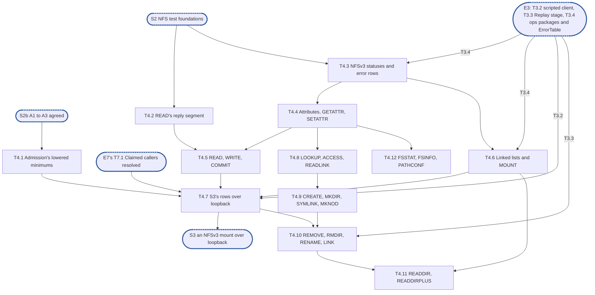

# Epic 4: NFS adapter v2 NFSv3 and MOUNT

**Sources:** [RFC 21](../docs/internals/rfcs/rfc-21-nfs.md) §2.3's NFSv3 sizes, §6.3 (MOUNT), §7.1
(handles), §7.2 (cookies), §7.3 for NFSv3, §9.1 (stability), §9.2's NFSv3 rules, §10's
`AUTH_TOOWEAK` for NFSv3, §11's decoding paragraph for NFSv3 and MOUNT, §11.2's retry identity as
NFSv3's rows meet it, §11.3's NFSv3 column and the rules that bind it, §11.5's NFSv3 column and
MOUNT's rows, §11.6's golden vectors and total mappings for those, §11.7's labels, §12's N7, N8,
N17's reply half, N19's NFSv3 half, N23 and N26 for these translations, the §13 rows named in §3
below, and Appendix D's NFSv3 and MOUNT rows;
[RFC 20](../docs/internals/rfcs/rfc-20-adapters.md) §4.3's one-call rule, §4.9's `translate`
functions, §4.10's MOUNT entry files, §5.1 to §5.4 as the NFSv3 and MOUNT codecs meet them, §6.10's
codec gates for NFSv3, and §7.1's entry-call-site rule for NFS's MOUNT files;
[RFC 17](../docs/internals/rfcs/rfc-17-vfs.md) §4.9's step 2 exemption (amendment A3) and §6's §4.9
row. Every citation is `develop`'s text, which holds amendment A3 and reaches `feat/storage-v2` with
the cherry-pick of RFC changes; the one place the two differ for this epic is §11.5's
`ErrUnknownPrincipal` NFSv3 cell, which `feat/storage-v2`'s copy already sets to `NFS3ERR_INVAL` (R28
below; the RFC 21 implementation plan's D4) and `develop`'s leaves "not set yet".
Cited, not owned: RFC 1813 for the bytes and status values; [RFC 7](../docs/internals/rfcs/rfc-7-namespace-metadata.md)
§3.4 (the synthesised `.` and `..`) and §3.5 (cookies); [RFC 18](../docs/internals/rfcs/rfc-18-identity.md)
§4.3 (uid and gid).
**Track:** B.
**Epic 4 estimate: 12 subtasks, 27.75 man-days.**
**Depends on:** **S2**, NFS's test foundations: E2's `adaptertest/nfsharness`, knfsd's `nfs3/`
captures cut into golden files, and S0's `vfstest.Mutations`; **E3**, the RPC layer: each call's
`Identity` and `vfs.Call`, built at route (T3.1), the scripted client `adaptertest/nfsclient`
(T3.2), the `Replay` stage with plan D10's duplicate-request cache (T3.3), and the packages
`ops/v3` and `ops/mount` with `NULL` and `protocol.ErrorTable`'s shared rows (T3.4), each named by
id in the subtask that takes it (§9, point 5); **E7**'s resolution of a `Claimed` caller (T7.1),
without which `memory.New` refuses every `AUTH_SYS` call T4.7 and T4.10 send over loopback;
**S2b**, amendment A3 agreed (met, #5166).
**Blocks:** **S3**, an NFSv3 mount over loopback, with E3 and E7's T7.1, after T4.7, which E7's
T7.6 and E11's loopback rows wait for; **E11**, whose NLM calls rely on T4.1's admission exemption;
**E5**, whose T5.8 reuses T4.2's `resources.Buf` reply segment, T5.5 T4.4's server-time choice and
T4.8's access-mask table, and T5.7 T4.6's linked lists, T4.4's `ShareID` fold and T4.11's `Fit` and
colliding-name fixture, unless E5 writes `Fit` and the fixture first (§9, point 2); **E6**, whose
T6.2 adds RFC 19's NFSv4 functions to the `translate` package T4.4 creates, with its import rule; **E16**, which runs these procedures' end-to-end rows, the
totality test and the NFS suites.

---

## 1. Goal

Epic 4 serves every NFSv3 procedure and MOUNT v3 on no state: an NFSv3 client mounts, lists, reads,
writes, creates, renames and removes, each procedure one row and at most one mutating service call, each translation
a pure function of the request, each error a row of §11.5's NFSv3 column. The service admits a
`MNT` and an `EXPORT` without a share's Kerberos minimums, and an NLM call at `Claimed`, by the
call's protocol and method alone.

**At the end of the epic:**

- `internal/adapter/nfs/ops/v3` holds the twenty-one NFSv3 procedures past `NULL`, and
  `ops/mount` MOUNT's five (`MNT`, `DUMP`, `UMNT`, `UMNTALL`, `EXPORT`), each with golden vectors of its call and reply;
- a `READ`'s data travels as its own segment of the reply, never copied, and the XDR generator
  writes linked lists;
- `translate` holds the neutral ↔ wire functions NFSv3 shares with NFSv4 and SMB: access masks,
  times, file types and modes, and `Fit`;
- NFSv3 `READ`, `WRITE` and `GETATTR` decode and encode at 0 allocations, gated per change;
- over loopback through `core`, the scripted client mounts a share of `memory.New` over
  `AUTH_SYS` and runs `GETATTR`, `READ` and `WRITE` on it (S3), and a `MNT` of a Kerberos-only
  share returns its flavours and root handle while a `GETATTR` with that handle is refused
  `AUTH_TOOWEAK`;
- a retransmitted `REMOVE` is answered its first reply, a failed stable write `NFS3ERR_JUKEBOX`, a
  `COMMIT` after a loss a new verifier, and a listing never ends inside a collision chain.

### 1.1 In scope

`ops/v3`'s and `ops/mount`'s rows, shared `attrs.go` and `types.go`, and their error rows;
`wire`'s NFSv3 and MOUNT constants; `(*resources.Buf).Attach` with the writer's segmented send and
the generator's reply segment; the generator's linked lists; the `translate` package's first
functions and the import test's rule for it; `internal/vfs`'s admission exemption (A3) and its row in the service's suite; the RFC 17
fields this epic's handlers need (D2); NFS's MOUNT entry files in the import test's call-site list;
the `unit/adapter-allocs` cell extended to `ops/v3`; the single-node rows of §3 on `memory.New`,
over loopback where they name the wire.

### 1.2 Out of scope

- `NULL` of NFSv3 and MOUNT, the `Security` stage, `AUTH_SYS` and `AUTH_NONE` decoding, `core`'s
  refusals in the two tables and the duplicate-request cache itself: E3. This epic sets the rows'
  `Cacheable` column the cache reads.
- Resolution of an `AUTH_SYS` uid and gid to a principal, the mints a claimed uid triggers and
  RFC 18 §10's NFS rows: E7. Until E7's T7.1, `memory.New`'s identity server, like the composed
  node's, refuses a `Claimed` caller `ErrAccess` (the RFC 21 implementation plan's risk 2): this
  epic's handler rows on `nfsharness` run under the call the harness builds and do not wait, while
  T4.7 and T4.10's loopback row, which send `AUTH_SYS` through E3's route, name T7.1 in their
  dependencies.
- `sec=krb5`'s step of §13's "§6.3 `MNT` on a Kerberos-only share" row: E13. NLM, NSM and their
  rows: E11, on T4.1's exemption.
- The NFSv4 procedures, `fattr4` and the NFSv4 `ACCESS`, which reuse this epic's `translate`
  functions and linked lists: E5. RFC 19's ACL translation in `translate`: E6's T6.2. The
  import test's rule for the package is T4.4's, since `ops/v3` imports it first.
- End-to-end, cross-protocol and composed-node rows, all E16's: the read-only marker over SMB and
  NFS and §8.1's ctime (T16.6), §9.1's stability and loss verifier and the failed stable write on
  the composed node (T16.2), §9.2's close-to-open steps with a kernel client (T16.7), §9.3's NFSv3
  hold step (T16.5, R41), the totality test of every error table across tables (T16.11) and the
  pipeline micro benchmark (T16.12). cthon04 and nfstest over NFSv3 go to E16's burn-down of known
  failures, which has no subtask yet. §9.2's two-node change-info step is the RFC 21
  implementation plan's deferral ledger row "RFC 21's (cluster) parts", not E16's.
- Snapshots over NFS, their `fsid` and `NFS3ERR_ROFS` there: the RFC 21 implementation plan's §6.6
  deferral ledger, "Snapshots over NFS".
- The port mapper and rpcbind registration: the same ledger, "The port mapper answering on UDP
  and TCP".
- rquota's `GETQUOTA`, answered `PROG_UNAVAIL`: the same ledger, "rquota".
- A batched `Spell` for `READDIRPLUS`: the same ledger, "A batched `Spell`".
- `MNT` of a path below a share's root, answered `MNT3ERR_NOENT` since `Root` matches a share's path
  exactly: the same ledger, "`MNT` below a share's root" (§9, point 6).
- MOUNT versions 1 and 2, for `showmount -e`: the same ledger, "MOUNT versions 1 and 2" (§9, point 7).

### 1.3 Names used here

- **E2**, epic 2, test foundations: NFS's handler harness `adaptertest/nfsharness`, knfsd's
  captures cut into golden files, and the service's `NoGrace`.
- **E3**, epic 3, the RPC layer: credentials to `Identity` and `vfs.Call`, `NULL`, NFS over TLS,
  the stages' and programs' tables, status layers, the scripted client, the `Replay` stage and its
  duplicate-request cache.
- **E4**, this epic.
- **E5**, epic 5, the NFSv4 namespace, attributes and data path.
- **E6**, epic 6, the NFSv4 ACL attributes and `who`, with RFC 19's `translate` functions.
- **E7**, epic 7, identity's NFS side: `AUTH_SYS` resolution, uid and gid mapping and mints.
- **E11**, epic 11, NLM, NSM and the datagram path.
- **E13**, epic 13, RPCSEC_GSS.
- **E15**, epic 15, integration with the node: `dfs` serves NFS and the NFS suites turn on.
- **E16**, epic 16, E2E green: the suites, end-to-end and cross-protocol rows, benchmarks and the
  totality test.
- **S0**, the shared test pieces the RFC 22 implementation plan's epic 2 builds for both adapters:
  `vfstest.Mutations`, `adaptertest/golden`, the import test's call-site and file-size rules.
- **S2**, NFS's test foundations in CI, after E2 and S0.
- **S2b**, amendments A1 to A3 agreed (met, #5166).
- **S3**, an NFSv3 mount over loopback, after E3 and this epic.
- **S6a**, `Spell`, `Find` and resolution in the service, from RFC 18's implementation plan.
- **A3**, the amendment to RFC 17 §4.9 agreed in #5166: NLM calls, and NFSv3's `Root` and
  `ListShares`, meet lowered minimums.
- **Plan D10**, the RFC 21 implementation plan's decision: a per-node NFSv3 and NFSv4.0
  duplicate-request cache in NFS's `Replay` stage, built by E3.
- **Plan D16**, the same plan's decision: the cookie verifier is the share's `ShareID`, folded to
  64 bits.

## 2. How the general rules apply

The rules are those of [the RFC 21 implementation plan's §1.5](rfc-21-nfs-plan.md#15-general-rules-for-each-epic),
cited by number and title and not copied.

| Rule | Subtasks | How |
| --- | --- | --- |
| rule 1, independent unit tests, under `-race` ([`CLAUDE.md`, "Writing tests"](../CLAUDE.md#writing-tests)) | all | handlers on `nfsharness` over `memory.New` (kind 2), errors injected through `vfstest.Faults` (kind 3), the one-call rule read from `vfstest.Mutations`; `translate` functions and tables as pure functions with no service; admission in the service's suite on `memory.New`; loopback through `core` with E3's scripted client; no other double |
| rule 2, fuzz tests where relevant | T4.6, and each subtask adding structs | every struct this epic tags is reached by its `ops` package's `FuzzCodec`, which the generator's list feeds, seeded with the golden files; the runtime's linked lists are held to the second decoder written by hand (R8) |
| rule 3, observability follows RFC 25 and RFC 20 §10 | T4.3, T4.6, T4.7 | no recorder in NFS code; the tables are labelled `nfs3` and each row named by its RFC 1813 procedure, which `core` turns into `adapter.nfs3.<PROCEDURE>` spans; no attribute or label carries a path, a name, an owner or a principal, and `MNT`'s path is passed to the service and never logged |
| rule 4, profiling: leaks, allocations and contention | T4.2, T4.4, T4.5, T4.7 | 0-allocation gates for NFSv3 `READ`, `WRITE` and `GETATTR` decode and encode, `ops/v3` added to the `unit/adapter-allocs` cell; `Attach` allocates no segment header past the buffer's own; every loopback test ends with `adaptertest.CheckLeaks`; no registry, timer or lock is added, so no mutex profile |
| rule 5, public interface and internals, at the layer that consumes a value ([`CLAUDE.md`, "Verifying a change"](../CLAUDE.md#verifying-a-change)) | all | each translation asserted on the reply bytes a client reads, through `nfsharness` or over loopback; A3 asserted on the service's answer to a call carrying the protocol, the layer every adapter reaches; `Attach` on the bytes the writer sends |
| rule 6, known failures shrink | none | no `pynfs`, `cthon04` or `nfstest` test runs before the cutover |
| rule 7, v2 ignores v1 | all | statuses, codes and sizes from RFC 1813 and RFC 21; vectors from knfsd's captures and RFC 1813, never from `develop`'s `v3` or `mount` packages |
| rule 8, real dependencies for properties of those dependencies | all | knfsd's bytes and RFC 1813 for vectors; `memory.New` for the service's answers, WCC and verifiers; real TCP over loopback through `core` for S3's rows and the retransmitted `REMOVE` |
| rule 9, code comment conventions ([`CLAUDE.md`, "Code comments"](../CLAUDE.md#code-comments)) | T4.1, T4.4, T4.5, T4.6, T4.8, T4.9, T4.11, T4.12 | `decision:` and `ponytail:` markers named in §4 at their code sites; RFC 21 §6.3's `decision:` note at `MNT`'s handler §2.3's notes at `FSINFO`'s, and RFC 21 §9.1's at `write.go` |
| rule 10, a test must be able to fail | all | each test names the break it catches; none asserts an injected fault's own answer, only its mapping |
| rule 11, a symbol is exported only if an interface uses it | T4.1, T4.2, T4.3, T4.4, T4.6, T4.8, T4.9, T4.11 | exported: `(*resources.Buf).Attach`, which RFC 20 §5.3 names; `wire`'s NFSv3 and MOUNT constants, for `ops/v3`, `ops/mount` and the scripted client; `translate`'s functions, for `ops/v3` now and E5 and SMB after; RFC 17's new fields and the failed guard's error (D2), `ShareInfo.Path` with T4.6, `CreateArgs.Unchecked` with T4.9. The procedures' structs and handlers stay unexported |
| rule 12, each subtask creates only what it declares | all | `Attach` lands with the generator field and the writer that use it; linked lists with `EXPORT`, their first struct; `translate` with its first function's caller; `attrs.go` with `GETATTR`; no `ops/` file before its procedure |
| rule 13, translate, never decide | all | one service call per mutating procedure, held by `nfsharness`; `UNCHECKED`, server time, `EXPORT`'s paths and `READDIR`'s file numbers raised against RFC 17 (D2) rather than written as call sequences or a clock read; no handler branches on a file's type, mode or ACL to allow anything |
| rule 14, nothing deferred is lost | all | §1.2 names the owner of each part left out; §9 names what is assumed of E3 and E5; the deferrals this epic found have their rows in the plan's §6.6, added with this document (point 11) |

## 3. Requirements and invariants

Every MUST and MUST NOT that RFC 21, RFC 20 and RFC 17 place on this epic, numbered so that
subtasks and tests can cite them.

**Admission (A3)**

| # | Requirement | Kind | Source | Subtasks |
| --- | --- | --- | --- | --- |
| R1 | A call whose `Protocol` is NLM meets `MinProof` lowered to at most `Claimed` and no `MinProtection`, so an NLM call below `Claimed` is still refused | MUST | RFC 17 §4.9 (step 2) | T4.1 |
| R2 | A `Root` or `ListShares` whose `Protocol` is NFSv3, which only `MNT` and `EXPORT` make, meets neither minimum but still meets the share's state and its client rules; every other call, a later call with the handle `MNT` returned among them, meets both minimums | MUST | RFC 17 §4.9 (step 2); RFC 21 §6.3 | T4.1, T4.7 |
| R3 | The filesystem tells these calls apart by the call's `Protocol` and the method called alone, never by a field an adapter sets to ask for it | MUST | RFC 17 §4.9 (step 2) | T4.1 |
| R4 | RFC 17's §4.9 row: on a share whose `MinProof` is `Ticket` and `MinProtection` `Integrity`, an NLM lock at `Claimed` admitted and at `None` refused `ErrWrongSecurity`; NFSv3 `Root` and `ListShares` at `Claimed` admitted, and a `GetAttr` from NFSv3 at `Claimed` with that handle refused; an NFSv4 `Root` and an SMB `ListShares` at `Claimed` refused or leaving the share out | test row | RFC 17 §6 (the §4.9 row) | T4.1 |

**Codecs and shared functions**

| # | Requirement | Kind | Source | Subtasks |
| --- | --- | --- | --- | --- |
| R5 | A procedure is one file, `ops/<table>/<proc>.go`, holding its `*args` and `*res` structs and its handler, and one `core.Row` line in its table; it has no codec of its own, and its translations read decoded fields, never bytes | MUST | RFC 21 §11 (decoding); RFC 20 §5.1 | all |
| R6 | The tags carry the bounds, NFSv3 file handles at 64 bytes and every other opaque, string and array at §2.3's sizes; the discriminated unions, every result by its status, `createhow3` and `stable_how`; and optional data, `post_op_attr`, `pre_op_attr` and `sattr3`'s `set_*` arms | MUST | RFC 21 §11 (decoding) | T4.4, T4.5, T4.6, T4.9 |
| R7 | A `WRITE`'s data is a slice of the receive buffer, and a `READ`'s reply is a header followed by the buffer the service filled, which the generated encoder hands to `(*Buf).Attach` on its `out`, sent as one `net.Buffers` write and never copied in | MUST | RFC 21 §11 (decoding); RFC 20 §5.3 | T4.2, T4.5 |
| R8 | The codec's runtime, optional data and chains included, is checked against a second decoder written by hand; each procedure's layout is anchored by golden vectors from RFC 1813 or knfsd's captures, never only from the codec under test; one fuzz target per codec fails on a panic, a read past the buffer and a value that does not re-encode to bytes decoding to the same value | MUST | RFC 20 §5.4; RFC 21 §11.6 (the XDR codec) | T4.6, each subtask adding a row |
| R9 | A decoder checks every length and count against the bytes left and the cap before it allocates or reads, and the generator refuses a variable-length field with no maximum | MUST | RFC 20 §5.2 | T4.6 |
| R10 | NFSv3 `READ`, `WRITE` and `GETATTR` decode and encode at 0 allocations, asserted with `testing.AllocsPerRun` | bound | RFC 20 §6.10 (codec micro) | T4.4, T4.5 |
| R11 | Neutral ↔ wire values shared between protocols, access masks, times, file types and modes, and fitting a listing to the client's buffer, are pure functions in `translate`, `Fit` among them; a handler is not shared between NFSv3 and NFSv4 | invariant | RFC 20 §4.9 | T4.4, T4.8, T4.11 |

**Sizes**

| # | Requirement | Kind | Source | Subtasks |
| --- | --- | --- | --- | --- |
| R12 | `FSINFO`'s `rtmax`, `wtmax`, `rtpref` and `wtpref` are 1 MiB, `dtpref` 64 KiB and the largest file 2^63 − 1, fixed and not a setting | MUST | RFC 21 §2.3 | T4.12 |
| R13 | A single procedure's reply is bounded by its class: a `READ` asking more than `rtmax` (1 MiB, R12) is answered a short read of at most `rtmax`, which the reply record's room holds with its header, as §2.3 answers a compound's `READ`, and a `READDIR` asking a reply past the record is clamped to it, not refused. §2.3's `decision:` that leaves a `READDIR`'s count unclamped is about a compound's room, which NFSv3 has none of | MUST | RFC 21 §2.3; RFC 20 §5.2 (the `READDIR` example) | T4.5, T4.11 |

**MOUNT**

| # | Requirement | Kind | Source | Subtasks |
| --- | --- | --- | --- | --- |
| R14 | `MNT` is `Root` with the path, returning the root handle and the share's flavours; `EXPORT` is `ListShares`, the shares the caller may see; `DUMP` is empty, and `UMNT` and `UMNTALL` change nothing | MUST | RFC 21 §6.3, Appendix D; RFC 17 §4.9 (no mount table) | T4.6 |
| R15 | `Root`, `SecInfo` and `ListShares` are called from the entry handlers' files and nowhere else in the adapter: over NFSv3, `nfs/ops/mount/mnt.go` and `export.go` | invariant | RFC 20 §4.10, §7.1 | T4.6 |
| R16 | A `MOUNT` of the path of a share being removed or retired is `MNT3ERR_NOENT`, and MOUNT's fault status is the accept state `SYSTEM_ERR` | MUST | RFC 21 §11.5 (`ErrStale`, the fault status) | T4.6 |
| R17 | The handle `MNT` returns is gated like any other on every later call | invariant | RFC 21 §6.3 | T4.7 |

**Handles, file ids and names**

| # | Requirement | Kind | Source | Subtasks |
| --- | --- | --- | --- | --- |
| R18 | A file handle is RFC 7's opaque handle, returned unchanged, at most 64 bytes, and never parsed by the adapter | MUST | RFC 21 §7.1; RFC 20 §4.10 | T4.4, T4.8, T4.9 |
| R19 | `fileid` is the file's `Number`, never the `FileID` the handle carries, which no other field carries either | MUST NOT | RFC 21 §7.1, §11.3 | T4.4, T4.11 |
| R20 | A name is passed through unvalidated and unconverted; RFC 7's refusals are answered `NFS3ERR_INVAL` or `NFS3ERR_NAMETOOLONG` | MUST | RFC 21 §7.3, §11.5 (`ErrInvalid`, `ErrNameTooLong`) | T4.8, T4.9, T4.10 |

**Cookies and listings**

| # | Requirement | Kind | Source | Subtasks |
| --- | --- | --- | --- | --- |
| R21 | The cookie is the digest RFC 7 orders the last entry returned by, unchanged, and a resume returns the entries after it | MUST | RFC 21 §7.2, §12 (N8) | T4.11 |
| R22 | Cookies 0, 1 and 2 are reserved for the start and the `.` and `..` NFSv3 synthesises; the top bit of every cookie is clear | MUST | RFC 21 §7.2; RFC 7 §3.5 | T4.11 |
| R23 | A reply never ends inside a collision chain: it ends before the chain or holds all of it, and a chain that does not fit the client's count at all is `NFS3ERR_TOOSMALL` | MUST NOT | RFC 21 §7.2, §12 (N8) | T4.11 |
| R24 | The cookie verifier is a constant of the share; a verifier other than the share's is `NFS3ERR_BAD_COOKIE`, and a zero verifier with a non-zero cookie is accepted | MUST | RFC 21 §7.2, §12 (N8) | T4.11 |
| R25 | `READDIR` is `Entries`, and `READDIRPLUS` `EntriesPlus` | MUST | RFC 21 §11.3 (Listings), Appendix D | T4.11 |
| R26 | §13's "§7.2 cookies *(1 node)*": with the share's hash key fixed so two names collide, a listing whose count ends a page between them ends before the pair, and the next page holds both | test row | RFC 21 §13 | T4.11 |

**Attributes**

| # | Requirement | Kind | Source | Subtasks |
| --- | --- | --- | --- | --- |
| R27 | `fattr3` is §11.3's NFSv3 column: `Type` as `ftype3`; `mode`; `uid` and `gid` as RFC 18 §4.3 shows a principal, a principal with no spelling as 65534; `nlink` a file's `Nlink`, a directory's 2 + `Subdirs` and never below 2; `size` and `used` from `Size` and `Charged`; `rdev`; `fileid` from `Number`; `fsid` derived from the `ShareID`; `atime`, `mtime`, `ctime` from `Access`, `Modify`, `Change` | MUST | RFC 21 §11.3, Appendix B (`nlink`); RFC 18 §4.3 | T4.4 |
| R28 | A `sattr3` naming a uid or gid no principal holds is `NFS3ERR_INVAL` | MUST | RFC 21 §11.5 (`ErrUnknownPrincipal`, `feat/storage-v2`'s text); RFC 18 §4.3 | T4.4 |
| R29 | `SET_TO_SERVER_TIME` sets a server-chosen time, clamped as RFC 7 §9.4 says; `SET_TO_CLIENT_TIME` is a client-given time, stored as given | MUST | RFC 21 §11.3 (Times) | T4.4 |
| R30 | `SETATTR`'s ctime guard is `AttrChange.Guard`, and its reply carries `wcc_data` | MUST | RFC 21 Appendix D | T4.4 |
| R31 | Every NFSv3 and MOUNT translation is total and pure: each wire value maps to one neutral value or a named refusal, never a default, every neutral error maps to a status in each table, and each translation table has a golden file asserting NFS → neutral → NFS | invariant | RFC 21 §11, §11.6, §12 (N26) | T4.3, T4.4, T4.5, T4.6, T4.8, T4.9 |
| R32 | §13's "App. B directory link count *(1 node)*", its NFSv3 half: `nlink` 2 in a new directory; 4 after two `MKDIR`s and a file's create; after a `RENAME` of one subdirectory into the other, the parent 3 and the other 3; after the moved one's `RMDIR`, its new parent 2 and the top unchanged at 3; a share's root 2 plus its subdirectories | test row | RFC 21 §13, Appendix B | T4.10 |

**Change and weak cache consistency**

| # | Requirement | Kind | Source | Subtasks |
| --- | --- | --- | --- | --- |
| R33 | In every `wcc_data`, `before` is absent for a directory, always, and for a file present only when it was captured in the hold of the file's accept lock that accepted the operation: the adapter writes `before` exactly when the service returned one | MUST | RFC 21 §9.2, §11.3 (Change info), §12 (N19) | T4.4, T4.5, T4.9, T4.10 |
| R34 | `change` has no NFSv3 field: an NFSv3 client validates by `ctime` and `mtime`, which are reported as the service answers them | invariant | RFC 21 §11.3 (`Version`), §12 (N7) | T4.4 |
| R35 | §13's "§9.2 change info", its NFSv3 step run on one node: 64 parallel creates in one directory over NFSv3, and no `wcc_data` for the directory carries `before`; the step across two nodes is the deferral ledger's row "RFC 21's (cluster) parts" | test row | RFC 21 §13 | T4.9 |
| R36 | §13's "§9.2 close-to-open and WCC *(1 node)*", its NFSv3 step: two NFSv3 clients write one file in parallel, 10^4 writes each, and every reply carrying `before` equals the previous write's `after` | test row | RFC 21 §13, §12 (N19) | T4.7 |

**Data**

| # | Requirement | Kind | Source | Subtasks |
| --- | --- | --- | --- | --- |
| R37 | An unstable `WRITE` is `Write` with unstable stability, and `COMMIT` is `Commit`; `DATA_SYNC` and `FILE_SYNC` are both a stable write, and the reply says `FILE_SYNC` | MUST | RFC 21 §9.1 | T4.5 |
| R38 | The verifier in every `WRITE` and `COMMIT` reply is RFC 17's, passed through; a `COMMIT` reply carries the verifier `Commit` answered and succeeds, so a loss of unstable writes reaches the client as a changed verifier, never as a success under the old one and never as an error | MUST | RFC 21 §9.1, §12 (N23) | T4.5 |
| R39 | A stable `WRITE` answered `ErrDelay` (`DelayCommit`) is `NFS3ERR_JUKEBOX`, never success, and the client resends it | MUST | RFC 21 §9.1 | T4.3, T4.5 |
| R40 | A refusal the service classes transient is `NFS3ERR_JUKEBOX` for as long as it lasts, never "no space" because a deadline passed; only a logical quota or a permanent cause is answered at once: `ErrNoSpace` `NFS3ERR_NOSPC`, and `ErrQuota` `NFS3ERR_NOSPC` for a share-wide or project quota and `NFS3ERR_DQUOT` for a user or group one | MUST NOT | RFC 21 §9.1, §11.5, §12 (N17) | T4.3 |
| R41 | §13's "§9.1 failed stable write *(1 node)*", the adapter's half: a `FILE_SYNC` `WRITE` whose sync failed is answered `NFS3ERR_JUKEBOX`, and the resent `WRITE` succeeds and reads back | test row | RFC 21 §13 | T4.5 |
| R42 | A `READ` meeting `ErrUnavailable`, `ErrCorrupt`, `ErrLost` or `ErrIO` answers a short read of the verified bytes, then `NFS3ERR_JUKEBOX` for `ErrUnavailable` and `NFS3ERR_IO` for the others | MUST | RFC 21 §11.5 | T4.5 |
| R43 | An `EXCLUSIVE` create's `createverf3` is `CreateArgs.Verifier`, RFC 7's create verifier, stored in `CreateVerifier`, never in `atime` or `mtime` | MUST | RFC 21 §11.3 (Exclusive create), Appendix D | T4.9 |

**Errors, retries and the drain**

| # | Requirement | Kind | Source | Subtasks |
| --- | --- | --- | --- | --- |
| R44 | NFSv3's table answers every row of §11.5's NFSv3 column: `NFS3ERR_NOENT`, `NFS3ERR_EXIST`, `NFS3ERR_NOTEMPTY`, `NFS3ERR_NOTDIR`, `NFS3ERR_ISDIR`, `NFS3ERR_ACCES` (the read-only marker's refusals, `ErrLocked`, `ErrShareViolation` and `ErrDeletePending` included), `NFS3ERR_STALE` (a released file's handle, a handle of another share, a share being removed), `NFS3ERR_XDEV` (`CrossShare`, `CrossProject`), `NFS3ERR_JUKEBOX` (`ErrDelay` of every cause, `ErrGrace`), `NFS3ERR_NOSPC`, `NFS3ERR_DQUOT`, `NFS3ERR_IO` (`ErrIncomplete`, `ErrInconsistent`, and `ErrIO` on a `COMMIT` or a stable `WRITE`), `NFS3ERR_INVAL`, `NFS3ERR_ROFS`, `NFS3ERR_NAMETOOLONG`, `NFS3ERR_PERM` | MUST | RFC 21 §11.5 | T4.3, T4.5 |
| R45 | `ErrWrongSecurity` rejects the RPC `AUTH_TOOWEAK`: the row is E3's (T3.4), and this epic shows it on the handle `MNT` returned | MUST | RFC 21 §11.5, §10 | T4.7 |
| R46 | NFSv3's fault status is `NFS3ERR_SERVERFAULT`; the rows "never met" (`ErrState`'s `AdapterVersion`, `NoRecall`, `CreateInUse`) and every error with no NFSv3 cell answer it. `ErrLogonFailure`'s row is E3's T3.4 | MUST | RFC 21 §11.5 (the fault status) | T4.3 |
| R47 | One golden file per table asserts every row of §11.5 for NFSv3, and MOUNT's, NFS → neutral → NFS | test row | RFC 21 §11.6 | T4.3, T4.6 |
| R48 | `COMMIT` is a flush and `GETATTR` context, which run while draining; every other NFSv3 and MOUNT procedure is refused with the drain's error. `ErrDraining`, and `ErrMoved` for NFSv3 and MOUNT, answered no reply, are E3's rows (T3.4) | MUST | RFC 21 §11.5 (`core`'s own refusals, what runs while draining) | T4.3, T4.4, T4.5 |
| R49 | A retransmitted non-idempotent request is answered its first reply, from the duplicate-request cache keyed by RFC 21 §11.2's retry identity | MUST | RFC 21 §11.2; plan D10 | T4.10 |
| R50 | A `CREATE`, `LINK` or `RENAME` into a delete-pending directory, `ErrDeletePending`, is answered as an access error, `NFS3ERR_ACCES` | MUST | RFC 21 §11.3 (Delete pending), §11.5 | T4.3 |

**One call, no decision**

| # | Requirement | Kind | Source | Subtasks |
| --- | --- | --- | --- | --- |
| R51 | A handler makes at most one mutating service call, and branches on no file attribute, mode or ACL to decide whether an operation is allowed | invariant | RFC 20 §4.3; RFC 21 §11 (the adapter translates) | all |
| R52 | Each request records under the `nfs3` label, its span `adapter.nfs3.<PROCEDURE>`, MOUNT's included; no label names a share, a client, an owner, a file or a principal | MUST | RFC 21 §11.7 | T4.3, T4.6, T4.7 |

R5 and R51 bind every subtask and are held by what already enforces them when each lands: R5 by
RFC 20 §7.1's import test, which fails an `ops` file that reads or writes a byte, and by epic 1's
vector check, which fails a row no golden file reaches; R51 by `nfsharness`'s one-call rule, which
fails every handler test whose request makes a second mutating call, and by review for the branch
on a file attribute, which no test can see.

Not obligations of this epic: RFC 21 §7.3's rule that an NFS `RENAME` or `REMOVE` of a directory is
not refused for a file open below it, which only the service can break (RFC 14 §9.5); §7.1's
snapshot `fsid` and `NFS3ERR_ROFS` (deferred, §1.2); §9.1's and N17's waits for the journal sync and
the existence commit, which are the service's (RFC 17 V19, V25), the adapter's half being R39 and
R40; §9.2's rules that `change` moves per staged write and never backward, the service's, as NFSv3
reports no `change` (R34); §11's rule that the pipeline builds the `Identity` and `vfs.Call` (E3);
§11.3's NFSv4 column, the ACL attributes and `who` (E5, E6); `LOOKUP`'s `..` at a share root, which
the service answers (RFC 17 §5.10).

## 4. Decisions this epic takes

- **D1. Linked lists in the generator, built with `EXPORT`.** NFSv3's `READDIR` and `READDIRPLUS`
  and MOUNT's `EXPORT` and `DUMP` reply with XDR linked lists. A list is a slice tagged with its
  maximum count, `xdr:"list,max=N"`, encoded as RFC 4506 §4.19's chain of optional data and
  bounded like an array, so `MaxWire` stays finite and the generator's `cycles` refusal of a
  self-referencing struct stays as it is. `createhow3`'s and `mknoddata3`'s cases that share a
  body are arms of their own of one type each, so `gen.go`'s "an arm names one value" stays.
  `createhow3` has no default arm, so a `createmode3` past `EXCLUSIVE` fails decoding; only
  `mknoddata3` takes the `xdr:"default"` arm the generator already has, for the `ftype3` values
  with a void body. The RFC 21
  implementation plan's layout gives linked lists to E5; this epic needs them first, and E5
  consumes them (§9, pending). Changing the tag after E5's rows use it costs both epics' structs.
  Prior art: rpcgen's linked lists as pointer chains (from memory). A `decision:` marker at the
  tag.
- **D2. Four fields and an error RFC 17 gains, so each procedure stays one call.** Each is raised
  against RFC 17 rather than written as a sequence in a handler (rule 13), proposed as RFC 17 §3.0
  text, and RFC 7 text for the two that live in `pkg/metadata/entity`, in the amendment pull
  request §9, point 10 names, and pending (§9, point 1):
  - `CreateArgs.Unchecked`: RFC 1813's `UNCHECKED` create of a name holding a regular file succeeds
    with that file. `Create` answers it as its result, applying only `Attrs`' size, and still
    `ErrExist` for any other type. Prior art: knfsd's `do_nfsd_create` (from memory).
  - A server-time choice for `Attrs`' access and modify times (`AttrAccessNow`, `AttrModifyNow`
    beside their builders), so `SET_TO_SERVER_TIME` is the service's clock and RFC 7 §9.4's clamp,
    never the handler's `time.Now`. `vfs.Attrs` is RFC 7's `entity.Attrs`, aliased in
    `pkg/vfs/types.go`, so the mask bits and builders are added in `pkg/metadata/entity` and
    `File.Apply` reads them with the time the store stamps. NFSv4's `SET_TO_SERVER_TIME4` needs the
    same (E5).
  - `ShareInfo.Path`, the share's NFS path, which `EXPORT`'s `ex_dir` lists; `ShareInfo` carries
    SMB's name alone. `ex_groups` is empty, since client rules are admission's.
  - A file number on a listed entry (`DirEntry.Number`), so `READDIR`'s `entry3.fileid` comes from
    `Entries`, as R25 has it, without asking `EntriesPlus` for every child's record. A listed
    entry has no number today: RFC 7's entry row (`entity.Entry`) holds `Parent`, `Name`, `Child`
    and `Type`, and `Number` is on `File` alone. So the number is copied into the entry row when
    the entry is written, as `Type` is (create, link and rename), and `kvstore`'s `Entries` returns
    it, tested in `kvstore`'s own tests. It is a change to RFC 7's entry row and the metadata store, not
    only to `pkg/vfs` and `internal/vfs`.
  - The failed ctime guard's error, exported (`vfs.ErrGuardFailed`, wrapping `ErrInvalid` so every
    other caller is unchanged), for D4.
  A `decision:` marker at each handler that uses one. E6's ACL amendment adds `Umask` and `ACL` to
  `CreateArgs` and `ACL` and `ModeMask` to `AttrChange` (E6's D1); the fields are independent of
  these, and whichever pull request lands second adds its own beside the other's. E5's
  `SET_TO_SERVER_TIME4` (T5.5) uses this server-time choice.
- **D3. MOUNT's error column.** RFC 21 §11.5 gives MOUNT `ErrStale`'s `MNT3ERR_NOENT` and its fault
  alone. `ops/mount`'s table maps the rest to RFC 1813 §5.1.5's `mountstat3` as the NFSv3 column
  maps them: `ErrNotFound` `MNT3ERR_NOENT`, `ErrAccess` `MNT3ERR_ACCES`, `ErrNotDir`
  `MNT3ERR_NOTDIR`, `ErrInvalid` `MNT3ERR_INVAL`, `ErrNameTooLong` `MNT3ERR_NAMETOOLONG`, `ErrIO`
  and `ErrInconsistent` `MNT3ERR_IO`; `ErrDelay`, which MOUNT has no retry status for, is answered
  no reply, so the client's RPC layer retransmits until the quiesce ends. The column is proposed as
  RFC 21 §11.5 text (§9, points 3 and 10). Prior art: none found for a mount daemon's retry; Linux's
  `mount.nfs` retransmits a MOUNT call that times out (from memory). A `decision:` marker at the
  table: a mount waits out its RPC timeout per retry during a quiesce; overturned if a client is
  seen giving up on the silence before the quiesce ends.
- **D4. `SETATTR`'s failed guard is `NFS3ERR_NOT_SYNC`, told apart by its own error.** The
  service answers a ctime guard that no longer holds with an unexported error wrapping `ErrInvalid`,
  and, after the guard passed, a size change on a file that is not regular or a negative size with
  plain `ErrInvalid` (`internal/vfs/attrs.go` on `feat/storage-v2`), the second cause its own
  `decision:` names as overturning it. Mapping every `ErrInvalid` on a guarded call to `NOT_SYNC`
  would send a client re-reading ctime to resend a request that can never succeed. So RFC 17
  exports the guard's error (D2), `vfs.ErrGuardFailed`, and NFSv3's table maps it to
  `NFS3ERR_NOT_SYNC` in a row ahead of `ErrInvalid`'s, which stays `NFS3ERR_INVAL`. The row is
  proposed as RFC 21 §11.5 text (§9, point 3). Prior art: RFC 1813 §3.3.2's `NFS3ERR_NOT_SYNC` for
  exactly this case. The service's `decision:` at `errGuard` is withdrawn with the export; no new
  marker, the row is the record.
- **D5. `post_op_attr` from what the call returned.** A reply's attributes are filled from the
  `File` or `WCC` its one call answered; a field that would cost another call is absent, as RFC 1813
  allows for every `post_op_attr`: `LOOKUP`'s directory attributes, `ACCESS`'s, `READ`'s, `COMMIT`'s
  `wcc_data` and `FSSTAT`'s, `FSINFO`'s and `PATHCONF`'s. A zero `After`, which the service leaves
  when it may not read the file after a committed change, is written absent. `READDIR`'s directory
  attributes are filled, from the `GetAttr` plan D16 already makes. Prior art: knfsd fills them
  (from memory); Linux revalidates on absent attributes. A `ponytail:` marker at `attrs.go`'s
  `postOpAttr`: the ceiling is a client revalidating more often; fill them with another call when a
  capture against knfsd shows a client's call count rising for want of them.
- **D6. One fold of a `ShareID` to 64 bits, for `fsid` and the cookie verifier.** Both are
  constants of the share (§11.3, §7.2, plan D16). The fold is the XOR of the ID's two 8-byte
  halves, big-endian, in `translate` beside the times, used by `GETATTR` and `READDIR` here and by
  E5's NFSv4 cookie verifier (E5's D9, T5.7). Prior art: knfsd folds an
  export's UUID into `fsid` by XOR for NFSv3 (from memory). A `decision:` marker at the fold,
  overturned with plan D16's own condition: two shares whose IDs fold to one value a client
  compares across them.
- **D7. `READDIR`'s byte count, fitted by `translate.Fit` at a chain's end.** `ReadDir` takes an
  entry count and never ends inside a chain; the reply's limit is bytes. `READDIR` asks for
  `count` over the smallest `entry3`'s encoded size, at least one. `READDIRPLUS` has two limits,
  `dircount` for the names, cookies and file ids and `maxcount` for the whole reply, and asks for
  the smaller of `dircount` over the smallest `entry3`'s size and `maxcount` over the size of an
  `entryplus3` with its `fattr3` and a 64-byte handle, so a 64 KiB `maxcount` asks about 390
  records rather than about 1,800. RFC 20 §4.9's `Fit(entries, budget, size)` answers how many fit
  under both limits, never ending inside a run of entries sharing a cursor; 0 for a first chain
  that does not fit is `NFS3ERR_TOOSMALL`. D14's `Spell`s run only on the entries `Fit` kept. The `.` and `..` entries
  come first on a listing from cookie 0, from the `GetAttr` of the directory and a `Lookup` of
  `..`, both read-only, and a resume from cookie 1 starts at `..`; Appendix D's `READDIR` cell
  naming them is proposed with point 3's texts (§9). Prior art: knfsd's `nfsd_readdir` encodes until the
  buffer fills and resumes from the last cookie sent (from memory). A `ponytail:` marker: a
  listing of short names may ask for more entries than it sends; size the ask from the names seen
  when a profile shows the extra reads.
- **D8. `ACCESS3` bits to rights, in `translate`, per object type.** Each bit names the rights it
  needs for the object's type, and is granted when the service grants what the table asks:
  - a directory: `READ` list directory, `LOOKUP` traverse, `MODIFY` add a file and delete child,
    `EXTEND` add a file and add a subdirectory, `DELETE` delete child, each needing *all* the rights
    it names, since a client reads `MODIFY`, `EXTEND` and `DELETE` together as the directory's write
    permission, so a right that grants one half never shows as the bit; `EXECUTE` is never granted,
    RFC 1813 giving it no meaning for a directory;
  - any other object: `READ` read data, `EXECUTE` execute, `MODIFY` write data, `EXTEND` write data
    *or* append data, since either lets a write grow the file and a Linux client refuses a write
    unless both `MODIFY` and `EXTEND` come back; `LOOKUP` and `DELETE` are never granted, having no
    meaning there.

  The rights are asked of `Access` and the granted answer mapped back bit by bit, so the read-only
  marker's missing `MODIFY` and `EXTEND` come from the service. `ACCESS` is advice to the client:
  each operation is still judged by the service when it runs. NFSv4's `ACCESS4` bits share these values, so E5 calls the same function. Prior
  art: RFC 8881 §18.1.3's bit meanings and knfsd's `nfsd_access` table (from memory). A
  `decision:` marker at the table.
- **D9. `FSINFO` and `PATHCONF` read the share's `Capabilities` through `StatFS`.** Appendix D
  lists them as making no call, but their `time_delta`, `properties`, `name_max`,
  `case_insensitive` and `case_preserving` are the share's, which only `StatFS` reports, as Appendix
  B's `Capabilities` row has it for NFSv4, and a stale handle is then answered `NFS3ERR_STALE` by
  admission. `rtmult` and `wtmult` are 4 KiB, `linkmax` 2^32 − 1, `no_trunc` and `chown_restricted`
  true. Appendix D's cells are proposed as text with point 3's (§9). Prior art: knfsd fills `FSINFO`
  from the exported filesystem's superblock (from memory).
- **D10. `FSSTAT` without a share-wide quota.** `FilesystemInfo` carries usage and quota, not the
  node's capacity. With a share-wide or project quota, `tbytes` and `tfiles` are its limits and
  `fbytes`, `abytes` and the file counts what is left of them, `max(0, limit − usage)`, since a
  limit lowered below usage would otherwise wrap and show a full share as nearly empty; without one, the totals are
  2^63 − 1 and the free counts the totals less usage, so `df` shows the share's usage against no
  limit. A `ponytail:` marker at `fsstat.go`: report the journal's and the store's room when RFC 17's
  `FilesystemInfo` carries it (§9). Prior art: none found for a share with no capacity of its own.
- **D11. Times outside `nfstime3`'s range are clamped, in `translate`.** `nfstime3`'s seconds are
  unsigned 32 bits: a time before 1970 is written as 0 and one past 2106 as 2^32 − 1, and a
  `SET_TO_CLIENT_TIME` is stored as given. Prior art: Linux's `nfs_time` encoders truncate to 32
  bits (from memory); this one clamps rather than wraps. A `ponytail:` marker at the function: a
  file dated outside the range reads back clamped over NFSv3; nothing to upgrade to while NFSv3 is
  the protocol.
- **D12. The drain's roles for NFSv3 follow the names §11.5 gives.** `COMMIT` takes the flush role
  and `GETATTR` the context role, as §11.5 names them without a version, and every other NFSv3 and
  MOUNT row keeps the zero role and is refused while draining. Prior art: none found for an NFSv3
  drain; knfsd has no drain. No marker: the row's role is the record, asserted by T4.3's column test.
- **D13. The duplicate-request cache holds the non-idempotent procedures.** `SETATTR`, `WRITE`,
  `CREATE`, `MKDIR`, `SYMLINK`, `MKNOD`, `REMOVE`, `RMDIR`, `RENAME` and `LINK` are `Cacheable`,
  and MOUNT's rows are not. Prior art: knfsd's cache types for NFSv3, the same set (from memory).
  `WRITE` costs the cache most: E3's D5 hashes a call's whole arguments, up to 1 MiB of a
  `WRITE`'s data, and a burst of writes turns over the 4096 entries that the `REMOVE` and `RENAME`
  replies R49 needs live in. knfsd checksums only a prefix of the arguments (from memory). Keying
  on a bounded prefix that leaves out `data` is E3's D5 to change, and pending (§9, point 14);
  until settled `WRITE` stays in the set. A `decision:` marker at the column naming the cost and
  that choice.
- **D14. One `Spell` per owner and group.** `fattr3`'s `uid` and `gid` are two `Spell` calls, with
  no adapter cache, since the adapter keeps nothing past a connection but the client record's
  bytes (RFC 21 §11), and the service's caches answer; a principal with no spelling is 65534, and
  any other refusal fails the call with its status, a `READDIRPLUS` page included, since RFC 18
  §4.1 has a lookup error other than "not found" reach the client as a server failure, which an
  entry written with absent attributes would hide. Prior art: knfsd reports the inode's numeric
  ids with no lookup (from memory), which a store of principals cannot. A `ponytail:` marker at
  `attrs.go`: a `READDIRPLUS` of `n` entries makes `2n` calls; upgrade with the batched `Spell` of
  the RFC 21 implementation plan's §6.6 deferral row when a benchmark shows it.
- **D15. The decoder's caps and the edges of a 64-bit offset.** RFC 21 §2.3 sizes transfers only,
  and R9 has the generator refuse a field with no maximum, so the caps are set here. A
  `filename3` and an `nfspath3` are capped at 4096 bytes and MOUNT's `dirpath` at RFC 1813's
  `MNTPATHLEN`, 1024: a name past the share's `MaxNameBytes` but under the cap reaches RFC 7 and is
  `NFS3ERR_NAMETOOLONG` (R20), and only a name past 4096 bytes fails decoding as `GARBAGE_ARGS`.
  A list's maximum is the transfer class's capacity over its element's smallest encoding, so no
  list is bounded below the record. An `offset3` or `size3` is 64 bits unsigned and the service's
  offsets are `int64`: a `WRITE` whose offset plus count, or a `SETATTR` whose size, passes
  `maxfilesize` (2^63 − 1) is `NFS3ERR_FBIG`, refused by the translation before any call, never
  converted to a negative `int64`; a `READ` at or past it answers no data and `eof`; a `COMMIT`
  whose offset plus count wraps is `NFS3ERR_INVAL`. RFC 1813 §3.3.7 gives `NFS3ERR_FBIG` for this
  case and RFC 21 §11.5 has no row for it, so the refusal is proposed as RFC 21 text with point
  3's (§9). Prior art: knfsd checks `offset + count` against `s_maxbytes` and answers `EFBIG` (from
  memory). A `decision:` marker at each cap and at the offset check.

## 5. Target tree

```text
pkg/resources/
  buf.go                       T4.2  (*Buf).Attach: a lent segment
internal/adapter/core/
  writer.go                    T4.2  a reply's segments in its net.Buffers write
internal/adapter/translate/
  access.go                    T4.8  ACCESS3 bits to rights and back (D8)
  times.go types.go            T4.4  times (D11), file types and modes, the ShareID fold (D6)
  fit.go                       T4.11 Fit (D7)
internal/vfs/
  admission.go                 T4.1  the minimums lowered by Call.Protocol and method (A3)
  attrs.go                     T4.4  the server-time choice and ErrGuardFailed (D2, D4)
  names.go                     T4.9  CreateArgs.Unchecked (D2); T4.11 DirEntry.Number
  shares.go                    T4.6  ShareInfo.Path (D2)
pkg/vfs/
  types.go                     T4.4, T4.6, T4.9, T4.11  the D2 fields
  errors.go                    T4.4  ErrGuardFailed (D2, D4)
  vfstest/suite/               T4.1  the §4.9 row; T4.4, T4.6, T4.9, T4.11 the D2 fields' rows
  vfstest/memory/collide.go    T4.11 a service whose share has a fixed digest key, and its
                                     colliding pair, for ops/v3's and ops/v4's tests
pkg/metadata/entity/
  file.go                      T4.4  the server-time mask bits and builders on Attrs (D2);
                                     T4.11 Entry.Number (D2)
pkg/metadata/kvstore/
  filecodecs.go                T4.11 the entry row's codec carries the number
  namespace.go rename.go remove.go  T4.11 each entry written with its child's number
  listing.go                   T4.11 Entries returns it
internal/adapter/nfs/wire/
  const.go                     T4.3  nfsstat3, ACCESS3 bits, ftype3, stable_how; T4.6 mountstat3
  codec.go                     T4.2  the reply segment; T4.6 the list runtime
  gen/gen.go, emit.go          T4.2  a *resources.Buf field; T4.6 list,max=N
  codec_fuzz_test.go           T4.6  the runtime against its second decoder, lists included
  testdata/golden/             each  rfc-nfs3-*, knfsd-nfs3-*, rfc-mount-* call and reply files
internal/adapter/nfs/ops/v3/
  errors.go                    T4.3  §11.5's NFSv3 column; T4.4 NOT_SYNC (D4)
  columns_test.go              T4.3  each row's Role and Cacheable (D12, D13), extended by each subtask
  attrs.go                     T4.4  fattr3, post_op_attr, wcc_data, sattr3, the fold (D6)
  types.go                     T4.4  nfs_fh3, diropargs3 and the bodies procedures share
  getattr.go setattr.go        T4.4
  read.go write.go commit.go   T4.5
  lookup.go access.go readlink.go          T4.8
  create.go mkdir.go symlink.go mknod.go   T4.9
  remove.go rmdir.go rename.go link.go     T4.10
  readdir.go readdirplus.go    T4.11
  fsstat.go fsinfo.go pathconf.go          T4.12
  codec_gen.go                 each  generated
internal/adapter/nfs/ops/mount/
  errors.go                    T4.6  D3's column
  mnt.go export.go             T4.6  the entry files
  umnt.go umntall.go dump.go   T4.6
internal/adapter/adaptertest/
  imports_test.go              T4.4  translate importable by every adapter, itself importing only
                                     the standard library and pkg/vfs; T4.6 mnt.go and export.go as
                                     NFS's entry files for Root and ListShares
internal/adapter/core/testdata/surface/
  resources.golden             T4.2  (*Buf).Attach in pkg/resources' frozen surface
internal/adapter/nfs/
  nfs_test.go                  T4.7, T4.10  S3's rows, §13's rows and the retransmitted REMOVE over loopback
test/suites.yaml               T4.5  ops/v3 in unit/adapter-allocs
```

## 6. Subtasks

### T4.1 Admission's lowered minimums (A3)

**Subtask T4.1 estimate: 1 man-days.**

- **Track:** B. **Depends on:** S2b.
- **Covers:** R1, R2, R3, R4.
- **Deliverables:** `internal/vfs/admission.go`'s `check` takes the minimum to apply rather than
  the `secure` flag: the share's, NLM's (`MinProof` at most `Claimed`, no `MinProtection`), or none,
  chosen from the call's `Protocol` and the method alone; `Root` and `ListShares` under NFSv3 pass
  none, `SecInfo` keeps none, every NLM call NLM's. Consumed by T4.7's row, where T4.6's `MNT` and
  `EXPORT` first meet a Kerberos-only share, and by E11's NLM calls; T4.6's own tests run on shares
  with no minimums and do not wait for it.
- **Acceptance criteria:**
  - RFC 17's §4.9 row passes on `memory.New`.
  - An NFSv3 `Root` from a client outside the share's rules is refused `ErrAccess`, and of a
    quiesced share answered `ErrDelay`.
  - No `vfs.Call` field, flag or option asks for the exemption.
- **Tests:** in the service's suite, on `memory.New`, the §4.9 row (R4) step by step, each step
  failing with the exemption removed or widened: an NLM lock at `None` still refused (catches a
  minimum dropped rather than lowered, R1), an NFSv3 `GetAttr` at `Claimed` with `Root`'s handle
  still refused (catches an exemption by protocol alone, R2), an NFSv4 `Root` at `Claimed` still
  refused (catches an exemption by method alone, R3); the client-rule and quiesce steps (catch an exemption widened past the
  minimums, R2): an NFSv3 `Root` from a client outside the rules refused, an NFSv3 `ListShares`
  leaving out a share whose rules exclude the client, and an NLM lock at `Claimed` from such a
  client refused. No test double.
- **Rules:** rule 9: a `decision:` marker at the check naming RFC 21 §6.3's reason and ceiling; rule
  13: the service decides, no adapter asks.

### T4.2 A `READ`'s data as its own reply segment

**Subtask T4.2 estimate: 2 man-days.**

- **Track:** B. **Depends on:** S2.
- **Covers:** R7.
- **Deliverables:** `(*resources.Buf).Attach(seg *Buf)` as RFC 20 §5.3 declares it, ending the
  current segment and lending `seg` as the next, retained until the reply is sent; `core`'s writer
  sending a reply's segments in its one `net.Buffers` write; the generator's `*resources.Buf`
  reply field, whose encoder calls `Attach` and appends the XDR padding after it, and whose decoder,
  for the scripted client and `FuzzCodec`, reads the opaque as a sub-slice; `Attach` added to
  `internal/adapter/core/testdata/surface/resources.golden`, the frozen surface `core`'s
  `exports_test.go` holds `pkg/resources` to. Consumed by T4.5's `READ` and E5's NFSv4 `READ`
  (T5.8).
- **Acceptance criteria:**
  - A reply holding a 1 MiB segment is sent whole, its bytes equal to the same reply encoded with
    the data appended, in one write call.
  - The segment's buffer goes back to its pool only after the writer sent it.
- **Tests:** in `pkg/resources`, `Attach`'s segments and their release order (catches a segment
  released before its send); in `core`, the writer over loopback with a reply of three segments,
  compared byte for byte with the flat encoding (catches a lost or reordered segment, R7), ending
  with `adaptertest.CheckLeaks`; the generator's golden test of a struct with a `*resources.Buf`
  field. No test double.
- **Rules:** rule 4: no allocation per segment; rule 11: `Attach` is RFC 20 §5.3's signature.

### T4.3 NFSv3's statuses and error rows

**Subtask T4.3 estimate: 1.5 man-days.**

- **Track:** B. **Depends on:** S2, T3.4.
- **Covers:** R31, R39, R40, R44, R46, R47, R48, R50, R52.
- **Deliverables:** `wire/const.go`'s `nfsstat3` values; `ops/v3/errors.go`'s rows for §11.5's
  NFSv3 column, added to the table E3's `protocol.ErrorTable` builds with `core`'s refusals,
  `ErrWrongSecurity`'s `AUTH_TOOWEAK`, `ErrDraining` and `ErrMoved` already in it (T3.4):
  `ErrQuota` by scope, and, once their RFC 21 text is agreed
  (§9, point 3), `ErrReplyTooBig`'s row, and `ErrUnavailable`'s only if point 3's alternative
  is chosen (recommended: none, so it stays the fault); the golden file of every row; `columns_test.go`, holding each row's `Role` and `Cacheable` against
  D12 and D13, which each later subtask extends with its rows. Consumed by every later subtask's
  handler and E16's totality test (T16.11).
- **Acceptance criteria:**
  - Every error of `vfs.Errors()` maps to one status or the fault in NFSv3's table.
  - `ErrDelay` of every cause, `DelayResources` and `DelayCommit` included, is `NFS3ERR_JUKEBOX`.
  - `ErrDeletePending` is `NFS3ERR_ACCES`.
- **Tests:** at the table `core` maps through: the §11.6 golden file, one line per row, error →
  status → the error back where the mapping inverts (catches a status mapped differently, R44, a
  quota scope swapped or a deadline answered `NOSPC`, R40, `DelayCommit` answered other than
  `JUKEBOX`, R39, a "never met" row answered other than the fault, R46, `ErrDeletePending` answered
  `NOENT`, R50, R47); a property test over `vfs.Errors()` that every error reaches a row or the fault
  and none a default (R31); the column test (catches a row that should be cached or run while
  draining and is not, R48). No test double.
- **Rules:** rule 3: the table's label `nfs3`; rule 7: statuses from RFC 1813 §2.6.

### T4.4 `fattr3`, `sattr3`, `wcc_data`; `GETATTR` and `SETATTR`

**Subtask T4.4 estimate: 3.5 man-days.**

- **Track:** B. **Depends on:** T4.3.
- **Covers:** R6, R10, R11, R18, R19, R27, R28, R29, R30, R31, R33, R34, R48.
- **Deliverables:** `translate`'s times (D11), file types and modes; `ops/v3/attrs.go`: `File` to
  `fattr3` (D6's fold, D14's `Spell`s, `File.LinkCount` for `nlink`), `post_op_attr` (D5),
  `wcc_data` from a `WCC`, `sattr3` to `AttrChange` with its uid and gid through `Find`, unknown as
  `NFS3ERR_INVAL` (R28), and `SET_TO_SERVER_TIME` through D2's server-time choice (pending);
  `types.go`'s shared bodies; `getattr.go` (context role) and `setattr.go`, the guard as
  `AttrChange.Guard`, and D4's `NOT_SYNC` row in `errors.go`; the server-time choice's mask bits
  and builders on RFC 7's `entity.Attrs` in `pkg/metadata/entity`, read by `File.Apply` with the
  store's time, and `vfs.ErrGuardFailed` in `pkg/vfs` and `internal/vfs`, each with its test row;
  a `SETATTR` whose size passes `maxfilesize` refused `NFS3ERR_FBIG` (D15); the import test's
  rule for `internal/adapter/translate` in `adaptertest/imports_test.go`, which otherwise refuses
  `ops/v3`'s import as "an adapter never imports another adapter": every adapter package may import
  it, and it imports only the standard library and `pkg/vfs`, as RFC 20 §2.5 places it below the
  adapters with neutral types only (RFC 20 §7.1's text for it is proposed with §9, point 10's); golden vectors from knfsd's `nfs3/` captures; the §11.6 attributes golden file.
  Consumed by every later procedure; `translate`'s package and functions by E5's T5.5 (the
  server-time choice) and T5.7 (the fold), and by E6's T6.2, which adds its files to the package and its own imports to the rule.
- **Acceptance criteria:**
  - A directory with three subdirectories reports `nlink` 5.
  - `fileid` is `Number`; no byte of the handle's `FileID` appears in any `fattr3`.
  - A principal with no uid shows 65534; a `sattr3` uid no principal holds is `NFS3ERR_INVAL` and
    changes nothing.
  - `SET_TO_SERVER_TIME` leaves a time the service drew; `SET_TO_CLIENT_TIME` the time sent.
  - `GETATTR` decode and encode allocate nothing.
- **Tests:** at `nfsharness` on `memory.New`: `GETATTR` of a file, a directory and the root against
  reply bytes, its handle returned unchanged (catches a field mapped from the wrong source, R27,
  R19, R34, a handle rewritten, R18); `SETATTR` of each `sattr3` arm, both time arms, a guard that
  holds and one that does not, against `wcc_data` with `before` exactly as the service returned it
  (catches a time set from the handler's clock or a client time altered, R29, `NOT_SYNC` lost, R30,
  a `before` invented, R33); a guarded size change of a symlink whose guard holds, answered
  `NFS3ERR_INVAL`, not `NOT_SYNC` (catches every `ErrInvalid` on a guarded call mapped to the
  guard, D4); the import test with `ops/v3` importing `translate` and `translate` importing
  `pkg/vfs` (catches the rule missing or widened past the standard library and `pkg/vfs`); an unknown uid (R28);
  the round trip `cp -p` makes: a file whose owner has no spelling shows 65534, and a `SETATTR`
  of uid 65534 by a caller allowed to change the owner sets it to anonymous, which RFC 18 §4.3 maps 65534 to, rather than
  `NFS3ERR_INVAL` (catches 65534 treated as unknown); a `SETATTR` size of 2^63 answered
  `NFS3ERR_FBIG` and changing nothing (catches a size wrapped to a negative `int64`, D15);
  `translate`'s time clamp at the range's edges and
  a pure `File` → `fattr3` case whose `Subdirs` is negative, reporting 2 (R27); a property test that
  every generated `sattr3` maps to an `AttrChange` or a named refusal (catches a default, R31);
  `testing.AllocsPerRun` for `GETATTR` (R10). `vfstest.Faults` (kind 3) for each mapped error.
- **Rules:** rule 4: the `GETATTR` gate; rule 9: D5's, D6's, D11's, D14's and D15's markers.

### T4.5 `READ`, `WRITE` and `COMMIT`

**Subtask T4.5 estimate: 3 man-days.**

- **Track:** B. **Depends on:** T4.2, T4.4.
- **Covers:** R6, R7, R10, R13, R31, R33, R37, R38, R39, R41, R42, R44, R48.
- **Deliverables:** `read.go` on `vfs.Anonymous`, its `Bound` hook clamping the count to the
  smaller of `rtmax`, 1 MiB, which the record's room holds with the reply's header (R13), and the
  room `core` hands the hook, so a reply pool too small for 1 MiB gives a short read rather than
  `ErrReplyTooBig` (§9, point 3), its data a `resources.Buf` attached as one segment (T4.2), and the short-read rule
  of R42 as a pure function of `Read`'s answer; `write.go` with stability mapped per R37 and `WCC`
  per R33, an offset plus count past `maxfilesize` refused `NFS3ERR_FBIG` (D15); `commit.go`
  passing `Commit`'s verifier, its row a flush; the `READ` and `WRITE` 0-allocation gates, decode
  and encode,
  and `ops/v3` added to `unit/adapter-allocs`; golden vectors from knfsd's `nfs3/` captures.
  Consumed by T4.7's S3 rows, and by E16's and the kernel client's reads and writes once E15 turns
  the suites on.
- **Acceptance criteria:**
  - A 2 MiB `READ` is answered 1 MiB of data and `eof` false.
  - `UNSTABLE` is answered `UNSTABLE`; `DATA_SYNC` and `FILE_SYNC` are answered `FILE_SYNC`.
  - A `WRITE` whose data is shorter than its count is `NFS3ERR_INVAL`.
  - `READ` and `WRITE` decode and encode allocate nothing.
- **Tests:** at `nfsharness` on `memory.New`: the clamp (catches a refusal or a reply past the
  cap, R13); each stability (catches `DATA_SYNC` echoed, R37); a `WRITE` failed
  `&vfs.Delay{Cause: vfs.DelayCommit}` by `vfstest.Faults` (kind 3) answered `NFS3ERR_JUKEBOX`, then
  resent and read back (the adapter's half of R41 and R39; the service's half, a failed sync
  answering `DelayCommit`, is RFC 17's V25 test, and the composed-node run E16's T16.2); an unstable
  `WRITE`, `memory.New`'s `Content.Lose` of the file, and a `COMMIT` answered success with a
  verifier other than the `WRITE`'s (catches a verifier cached or a loss answered as an error,
  R38); the short-read function over each error with and without bytes read (R42); a `COMMIT` and a
  `FILE_SYNC` `WRITE` failed `vfs.ErrIO` by `vfstest.Faults` answered `NFS3ERR_IO` (catches it
  mapped to the fault, R44); D15's edges, a `WRITE` at offset 2^63 − 1 with a count of 2 answered
  `NFS3ERR_FBIG`, a `READ` at 2^63 answered no data and `eof`, a `COMMIT` whose offset plus count
  wraps answered `NFS3ERR_INVAL` (catches an offset converted to a negative `int64`); the reply's
  segment count from the encoded `resources.Buf` (catches a copy, R7); `testing.AllocsPerRun` for
  both (R10).
- **Rules:** rule 4: the gates and the cell; rule 9: RFC 21 §9.1's notes and D15's marker at
  `write.go`.

### T4.6 Linked lists and MOUNT

**Subtask T4.6 estimate: 3.25 man-days.**

- **Track:** B. **Depends on:** T4.3, T3.4.
- **Covers:** R6, R8, R9, R14, R15, R16, R31, R47, R52.
- **Deliverables:** `wire/gen`'s `xdr:"list,max=N"` tag and the runtime's list functions, with
  the hand-written second decoder's list case (D1); `wire/const.go`'s `mountstat3` values;
  `ops/mount`'s `mnt.go` (`Root` with the path, the flavours to their RPC numbers, `AUTH_NONE` 0,
  `AUTH_SYS` 1 and the Kerberos pseudo-flavours 390003 to 390005), `export.go` (`ListShares`, D2's
  paths), `umnt.go`, `umntall.go`, `dump.go` and `errors.go` (D3) with its golden file; `ShareInfo.Path` in
  `pkg/vfs` and `internal/vfs` with its suite row (D2, pending); `mnt.go` and `export.go` added to
  the import test's entry files for `Root` and `ListShares`; golden vectors from knfsd's `nfs3/`
  MOUNT captures and RFC 1813 for `DUMP` and `UMNTALL`. Consumed by T4.7, T4.11's listings, E5's
  `READDIR` (T5.7), which builds no list kind of its own, and E13's `sec=krb5` step.
- **Acceptance criteria:**
  - A list's decoder refuses a count past its maximum and a chain running past the bytes before
    it allocates; the generator refuses a list with no maximum.
  - `MNT` of a share's path answers its root handle and flavours; of a removed share and of an
    unknown path `MNT3ERR_NOENT`.
  - `EXPORT` lists exactly the paths `ListShares` returned; `DUMP` the empty list.
- **Tests:** the runtime's fuzz target against the second decoder over generated list types
  (catches a chain bug both halves share, R8); the generator's test refusing a list with no
  maximum (R9); at `nfsharness` on `memory.New`, each procedure against its reply file, knfsd's
  `EXPORT` among them (catches a flavour number mapped wrong, R31, a path lost or a terminator
  misplaced, R14, R6); a table of `MNT` path spellings, `/export`, `/export/`, `//export` and
  `/export/.`, each answered as §9, point 13 settles (until then the exact path alone mounts and
  the others are `MNT3ERR_NOENT`, catching a spelling answered differently than decided); a
  1024-byte `dirpath` decoded and a 1025-byte one refused (D15); MOUNT's §11.6 golden file over D3's column, `ErrStale` and the fault, and a
  property test over `vfs.Errors()` (R16, R47, R31). R15 is held by S0's call-site rule once
  `mnt.go` and `export.go` are listed: a `Root` call anywhere else fails the import test.
- **Rules:** rule 9: D1's marker, RFC 21 §6.3's `decision:` note at `mnt.go`, with the path
  spelling §9, point 13 settles, and D3's at `errors.go`; rule 13: the paths from the service (D2).

### T4.7 S3's rows over loopback

**Subtask T4.7 estimate: 1.75 man-days.**

- **Track:** B. **Depends on:** T4.1, T4.5, T4.6, T3.2, T7.1.
- **Covers:** R2, R17, R36, R45, R52.
- **Deliverables:** loopback tests in `internal/adapter/nfs` through `core` with E3's scripted
  client (T3.2: `nfsclient.Dial`, then `Do` under `nfsclient.AuthSys`, each call's `Args` encoded
  and its `Reply.Body` decoded by this epic's generated structs) on `memory.New`, whose identity
  server resolves the `AUTH_SYS` caller once E7's T7.1 has landed: S3's `NULL`, `MNT`, `GETATTR`, `READ` and `WRITE` over `AUTH_SYS`; §13's
  "§6.3 `MNT` on a Kerberos-only share" `AUTH_SYS` steps; R36's two writers. Consumed by S3, which
  E7's T7.6 and E11's loopback rows start from, and by T4.10's loopback row, which mounts the same
  way.
- **Acceptance criteria:**
  - S3's calls answered, each reply matching its golden file's fields past the transaction ID, and
    each counted under `nfs3` by its procedure's name.
  - On a share whose `MinProof` is `Ticket`, `MNT` over `AUTH_SYS` returns the flavours and root
    handle, and every NFSv3 procedure past `NULL` sent with that handle is rejected
    `AUTH_TOOWEAK`, `FSINFO` and `PATHCONF` among them.
  - Two clients writing one file 10^4 times each: the replies carrying `before` form one chain in
    the file's write order, each `before` equal to the previous write's `after` and no `after`
    matched twice.
- **Tests:** the three rows above, each ending with `adaptertest.CheckLeaks`, the second a table of
  every NFSv3 procedure past `NULL` at `Claimed` with the handle `MNT` returned (catch a handle that
  skips the minimum on any procedure, a procedure making no service call among them, R17, a `MNT` refused, R2, the status at the wrong layer, R45, a stale or
  reordered `before`, which matches an `after` already matched, R36, and a row counted under
  another label or name, R52). No test double.
- **Rules:** rule 4: leak checks; rule 8: real TCP over loopback.

### T4.8 `LOOKUP`, `ACCESS` and `READLINK`

**Subtask T4.8 estimate: 1.75 man-days.**

- **Track:** B. **Depends on:** T4.4.
- **Covers:** R11, R18, R20, R31.
- **Deliverables:** `translate`'s access mask table (D8); `lookup.go`, `access.go`, `readlink.go`
  (`GetAttr`'s `File.Target`); golden vectors from knfsd's `nfs3/` captures, and RFC 1813 for
  `READLINK`. Consumed by T4.9 to T4.11, which name files through `LOOKUP`, by E5's `ACCESS`
  (T5.5), and by E16's suites.
- **Acceptance criteria:**
  - A name is passed to `Lookup` byte for byte; RFC 7's refusal is `NFS3ERR_INVAL`.
  - `LOOKUP` returns the handle `Lookup` answered, byte for byte.
  - `ACCESS` answers exactly the bits D8's table derives, for the object's type, from the rights
    the service granted.
- **Tests:** at `nfsharness` on `memory.New`: a non-UTF-8 name looked up as sent (catches a
  conversion, R20) and its handle compared with the service's (R18); `ACCESS` of each bit on a file
  and a directory the caller may and may not use, and `translate`'s table as a pure round trip
  (catches a bit mapped to the wrong right, R31, R11); a table over object type and granted rights:
  a file granting write data alone answers `MODIFY` and `EXTEND` (catches all-of on a file's
  `EXTEND`), a file granting append data alone answers `EXTEND` without `MODIFY`, a directory granting
  delete child alone answers `DELETE` without `MODIFY`, one granting add a file alone answers neither
  `MODIFY` nor `EXTEND` (catch any-of on a directory), and `LOOKUP` and `DELETE` on a file and
  `EXECUTE` on a directory never granted; `READLINK` of a symlink; `LOOKUP` of names at the
  share's `MaxNameBytes` (found), one byte past it (`NFS3ERR_NAMETOOLONG`), at the 4096-byte cap
  (`NFS3ERR_NAMETOOLONG`) and past it (`GARBAGE_ARGS`) (catches a cap below RFC 7's limit, R20,
  D15).
- **Rules:** rule 9: D8's marker and D15's at the name cap.

### T4.9 `CREATE`, `MKDIR`, `SYMLINK` and `MKNOD`

**Subtask T4.9 estimate: 2.75 man-days.**

- **Track:** B. **Depends on:** T4.8.
- **Covers:** R6, R18, R20, R31, R33, R35, R43.
- **Deliverables:** `create.go` (`UNCHECKED` through D2's field, `GUARDED`, `EXCLUSIVE` with
  `CreateArgs.Verifier`), `mkdir.go`, `symlink.go`, `mknod.go` (`NF3CHR` and `NF3BLK` with their
  device numbers, `NF3SOCK`, `NF3FIFO`, any other type through the default arm `NFS3ERR_BADTYPE`);
  the new file's group: `sattr3`'s `gid` through `Find` into `CreateArgs.Attrs` when set, and no
  group when unset, which the service fills from the caller (E7's T7.1), the part E3's §1.2 gives
  this epic; `CreateArgs.Unchecked` in `pkg/vfs` and `internal/vfs` with its suite row (D2,
  pending); golden
  vectors from knfsd's `nfs3/` captures and RFC 1813. Consumed by T4.10 and T4.11, which create the
  files they act on, and by E16's suites.
- **Acceptance criteria:**
  - An `EXCLUSIVE` retry with the same verifier answers the file it made; another verifier
    `NFS3ERR_EXIST`.
  - `UNCHECKED` over an existing regular file answers it; over a directory `NFS3ERR_EXIST`.
  - Each procedure makes one call; the directory's `wcc_data` carries no `before`.
- **Tests:** at `nfsharness` on `memory.New`: each create kind and each `createhow3` arm against
  its reply file (catches an arm decoded to the wrong mode, R6, a verifier stored in a time, R43,
  a returned handle rewritten, R18); `MKNOD` of a regular file (catches a default arm answered
  success, R31); a name RFC 7 refuses (R20); R35's 64 creates sent in parallel through
  `nfsharness`, each request's `vfs.Call` carrying `Protocol` NFSv3 as E3's route sets it (T3.1),
  since the service leaves a directory's `before` out only for that protocol (catches a directory
  `before`, R33, R35); a `CREATE` with `sattr3`'s gid set and one with it unset, against the new
  file's group (catches the group dropped or invented by the handler).
- **Rules:** rule 13: `UNCHECKED` is one call (D2).

### T4.10 `REMOVE`, `RMDIR`, `RENAME` and `LINK`

**Subtask T4.10 estimate: 2.25 man-days.**

- **Track:** B. **Depends on:** T4.7, T4.9, T3.3.
- **Covers:** R20, R32, R33, R49.
- **Deliverables:** `remove.go`, `rmdir.go`, `rename.go` (both directories' `wcc_data`), `link.go`
  (the file's attributes and the directory's `wcc_data`), each row `Cacheable` (D13) in the column
  test; golden vectors from knfsd's `nfs3/` captures and RFC 1813; the retransmitted `REMOVE` over
  loopback. Consumed by T4.11's listings of a changed tree, and by E16's suites.
- **Acceptance criteria:**
  - A `REMOVE` sent twice with one transaction ID over loopback is answered `NFS3_OK` both times
    and removes once.
  - R32's link counts hold over NFSv3.
- **Tests:** at `nfsharness` on `memory.New`, each procedure against its reply file and each error
  of §11.5 it names through `vfstest.Faults` (kind 3), a name RFC 7 refuses (R20), and R32's
  sequence (catches a count taken from the wrong field, R32, a directory `before`, R33). Over
  loopback, the retransmitted `REMOVE`, ending with `adaptertest.CheckLeaks` (catches a row left
  out of the cache, answered `NFS3ERR_NOENT`, R49).
- **Rules:** rule 8: the retransmission through `core`'s real `Replay` stage, E3's T3.3.

### T4.11 `READDIR` and `READDIRPLUS`

**Subtask T4.11 estimate: 4 man-days.**

- **Track:** B. **Depends on:** T4.6, T4.10.
- **Covers:** R11, R13, R19, R21, R22, R23, R24, R25, R26.
- **Deliverables:** `translate.Fit` with RFC 20 §4.9's signature (D7); `readdir.go` and
  `readdirplus.go`: the directory's `GetAttr` for its attributes and plan D16's verifier through
  D6's fold, `ReadDir` with `EntryHandle` and `EntryFile` for `READDIRPLUS`, `.` and `..` on a
  listing from cookie 0 or 1 (D7), `READDIRPLUS`'s ask sized by `dircount` and `maxcount` and its
  `Spell`s on the kept entries only, `entry3.fileid` from D2's entry number; `DirEntry.Number` in
  `pkg/vfs` and `internal/vfs` with its suite row, and the number on RFC 7's entry row in
  `pkg/metadata/entity` and `kvstore` (its codec, the three writes and `Entries`) with `kvstore`'s
  test (D2, pending); R26's fixture in
  `pkg/vfs/vfstest/memory/collide.go`, a constructor like `memory.New` whose share is created
  through the store with a fixed digest key, the only way a key is chosen (RFC 7 draws it at a
  share's creation so that no client can force collisions, and no production path takes one), and
  two names found once to collide under it, kept as
  test constants beside the search that found them; it lives there because `memory` already builds
  the store and an adapter's tests may not import `pkg/metadata/entity`, and E5's `READDIR` uses
  the same pair (§9, point 4); golden vectors
  from knfsd's `nfs3/` captures and RFC 1813. Consumed by E5's NFSv4 `READDIR` (T5.7), which calls
  `Fit` and uses the fixture, and by E16's suites.
- **Acceptance criteria:**
  - A 10^4-entry directory listed page by page returns each entry once, every cookie's top bit
    clear, each `fileid` its file's `Number`, and the same verifier on every page.
  - A verifier from another share is `NFS3ERR_BAD_COOKIE`; a zero verifier with a cookie resumes.
  - A count smaller than the first chain is `NFS3ERR_TOOSMALL`.
- **Tests:** `Fit` as a pure function over pages whose entries share a cursor, at every budget
  from one byte to the whole page (catches a cut inside a chain, R23, R11); at `nfsharness` on
  `memory.New`, the listing above (R19, R21, R22, R24, R25) and a count of 2^32 − 1 clamped (R13);
  a `READDIRPLUS` with a small `dircount` and a large `maxcount`, whose reply's names, cookies and
  file ids stay within `dircount` (catches `dircount` ignored, D7); an entry renamed and one
  hard-linked listed with their file's number (catches a write path that drops it, D2); R26
  on the fixed-key share (catches a page ending between the colliding pair).
- **Rules:** rule 9: D7's marker.

### T4.12 `FSSTAT`, `FSINFO` and `PATHCONF`

**Subtask T4.12 estimate: 1 man-days.**

- **Track:** B. **Depends on:** T4.4.
- **Covers:** R12.
- **Deliverables:** `fsstat.go` (D10), `fsinfo.go` and `pathconf.go` (§2.3's constants and the
  share's `Capabilities`, D9); golden vectors from knfsd's `nfs3/` captures and RFC 1813. Consumed by
  the kernel client's mount, which reads `FSINFO` and `PATHCONF` once E15 serves NFS, and by E16's
  suites.
- **Acceptance criteria:**
  - `FSINFO` answers 1 MiB for the four transfer sizes, 64 KiB for `dtpref`, 2^63 − 1 for
    `maxfilesize`, and the share's time granularity.
  - `PATHCONF` answers a case-insensitive share as such.
  - `FSSTAT` on a share with a share-wide quota answers its limits.
- **Tests:** at `nfsharness` on `memory.New`, each against its reply file (catches a size from the
  wrong constant, R12, the case rule inverted, or a quota's limit dropped); `FSSTAT` on a share
  whose usage is above its lowered limit, answering 0 free (catches the subtraction wrapping, D10).
  No test double.
- **Rules:** rule 9: RFC 21 §2.3's `ponytail:` notes at `fsinfo.go`, D10's at `fsstat.go`.

## 7. Order of work



T4.1 to T4.4 are the blockers: T4.1 of E11 and S3's Kerberos row, T4.2 of `READ` here and in E5,
T4.3 and T4.4 of every procedure, T4.4 also of E5's and E6's `translate` work. From other epics,
T4.3 and T4.6 take E3's T3.4, T4.7 E3's T3.2 and E7's T7.1, and T4.10 E3's T3.3. S3's path follows, then the namespace procedures in the order
each builds on the one before (`CREATE` on `LOOKUP`'s names, `RENAME` on a created file, `READDIR`
on a populated tree). Checkpoints: after T4.7, S3; after T4.11, every procedure an NFSv3 client
sends to list, create and remove.

## 8. Suggested pull requests

| PR | Subtasks | Man-days | After | Why together |
| --- | --- | --- | --- | --- |
| 1 | T4.1 | 1 | — | a service change, reviewed by the service's owners |
| 2 | T4.2 | 2 | — | `Attach` and the writer's segmented send, reviewed by `core`'s and `pkg/resources`' owners |
| 3 | T4.3, T4.4, T4.5 | 8 | PR 2, E3's T3.4 | NFSv3's error table, attributes and data path, with the allocation gates |
| 4 | T4.6, T4.7 | 5 | PR 1, PR 3, E3's T3.2, E7's T7.1 | linked lists, MOUNT and the first mount over loopback: S3 |
| 5 | T4.8, T4.9, T4.10 | 6.75 | PR 4, E3's T3.3 | the namespace procedures that change names, with their loopback row |
| 6 | T4.11, T4.12 | 5 | PR 5 | listings and the filesystem's limits |

A suggestion only: one pull request per subtask works as well. PRs 1 and 2 can be open at once, and
PR 3 beside PR 1.

## 9. Open points

1. **Pending the user's answer: RFC 17 gains four fields and an error (D2).** `CreateArgs.Unchecked`
   for NFSv3's `UNCHECKED` create, a server-time choice for `Attrs`' access and modify times,
   `ShareInfo.Path` for `EXPORT`'s paths, a file number on a listed entry for `READDIR`, and the
   failed guard's error `vfs.ErrGuardFailed` (D4); they are proposed as RFC 17 §3.0 text, and RFC 7
   text for the server-time bits on `entity.Attrs` and the number on the entry row, in the pull
   request point 10 names, and T4.4, T4.6, T4.9 and T4.11 build them. The entry number is a metadata
   store change (the entry row's codec and its three writes), priced in T4.11. The alternatives are a `Lookup` after a refused `Create` and a clock read in the handler,
   which rule 13 forbids, an `EXPORT` listing share names as paths, which a client cannot mount,
   and `READDIR` asking `EntriesPlus`, against R25, under a `ponytail:`, which saves T4.11's store
   change (about 0.75 man-days) at the cost of one record read per listed entry.
2. **Two departures from the RFC 21 implementation plan's layout, settled with E5 and E6.** The
   generator's linked lists are built here (T4.6, D1), where the layout gives them to E5: this
   epic's MOUNT needs them first, and E5's `READDIR` (T5.7) names T4.6 in its dependencies and
   builds no kind of its own. And this epic creates `internal/adapter/translate` (T4.4) with its
   time, type, mode and fold functions, the access-mask table (T4.8) and `Fit` (T4.11), as RFC 20
   §4.9 places them, where the layout has the package created by E6 or the RFC 22 implementation
   plan's descriptor epic; E6's T6.2 adds RFC 19's NFSv4 functions to it; T4.4 adds the import test's
   rule for the package, since `ops/v3` imports it first, and T6.2 only its own imports. The layout (§4.1) is edited only if the user asks. E5 reaches its uses of
   T4.8 and T4.11 earlier on its track than this track reaches them; if E5 gets there first, its
   subtask writes the function in `translate` as D8 or D7 specifies and T4.8 or T4.11 calls it
   rather than writing it, about 0.5 or 0.75 man-days out of this epic's figure (E5's §9, point 3);
   the same holds for R26's fixture, which E5's `READDIR` may write first in `vfstest/memory` as
   T4.11 specifies it.
3. **Pending the user's answer: the RFC 21 texts this epic proposes (D3, D4, D7, D9, D15, and two
   rows found with E3 and E7), in the pull request point 10 names.** §11.5's MOUNT column, its
   `NFS3ERR_NOT_SYNC` row for `vfs.ErrGuardFailed`, and Appendix D's cells for `FSINFO` and `PATHCONF` naming `StatFS` and for
   `READDIR` naming the `GetAttr` and the `Lookup` of `..`; until agreed the epic follows D3, D4,
   D7, D9 and D15 as written here. Three more §11.5 cases:
   - `ErrReplyTooBig` has an NFSv4 row only, but `core` also returns it for a single NFSv3 reply
     charged past a quarter of the reply pool, which a large `READ` or `READDIRPLUS` could meet
     where the pool is small (E3's §9 gap). Recommended: `NFS3ERR_IO`, since a retry of the same
     call meets the same bound; the alternative is the fault, `NFS3ERR_SERVERFAULT`.
     If `core` hands a single NFSv3 call's `Bound` hook a room that includes the pool's per-reply
     limit (E3), T4.5's clamp turns a large `READ` into R13's short read and only a
     `READDIRPLUS` past the room meets this row.
   - `ErrUnavailable` has a row on a read only, but E7's lookup and mint caps and its store
     errors answer it on any operation (E7's D6, R15, R25), and with no row it is the fault,
     `NFS3ERR_SERVERFAULT`. Recommended: keep the fault, no row, since RFC 18 §4.1 requires a
     lookup error other than "not found" to reach the client as a server failure; `NFS3ERR_JUKEBOX`
     and E5's `NFS4ERR_DELAY` would let a client retry, but need an RFC 18 §4.1 amendment too.
   - D15's `NFS3ERR_FBIG` for an offset or size past `maxfilesize`, which §11.5 has no row for.
   T4.3 adds the `ErrReplyTooBig` row once agreed, inside its figure.
4. **Pending the user's answer: the fixture for R26 (T4.11).** RFC 21 §13's row, which the RFC 21
   implementation plan names in this epic's "done when", needs two names that collide under a
   share's digest key. Recommended, and priced in T4.11: a share created through `memory.New`'s
   control plane with a chosen digest key, and one colliding pair found once by a low-memory
   collision search (about 2^32 digests) and kept as test constants with the program that found it.
   The alternative moves the wire row to E16, which leaves that "done when" item unmet here, and
   holds R23 by `Fit`'s pure test alone.
5. **What this epic takes from E3 and E7, settled with their documents.** E3's T3.4 creates
   `ops/v3` and `ops/mount`, each with `Table()` and its `NULL` row, and `protocol.ErrorTable`,
   holding `core`'s refusals, `ErrWrongSecurity` as `AUTH_TOOWEAK`, `ErrLogonFailure` and the
   drain's no-reply rows, which T4.3 and T4.6 add their rows to; `Table()` takes no `Handlers` until
   this epic's first row calls the service, which adds them, a change to `nfs.go` alone (E3's D6).
   E3's T3.1 sets `Call.Protocol` to NFSv3 for NFS version 3 and MOUNT at route (E3's D2; E3 has no
   `Security` stage for `AUTH_SYS`), which A3's exemption reads and T4.7 checks at the service.
   E3's T3.3 reads a row's `Cacheable` column and keys NFSv3 by RFC 21 §11.2's retry identity.
   E3's T3.2 client takes a call's `Args` as bytes and returns `Reply.Body`, which T4.7 and T4.10
   encode and decode with this epic's generated structs. E7's T7.1 resolves the `Claimed` caller
   those loopback rows send; until it lands they fail at admission, which E7's §9, point 1 asks to
   avoid by landing T7.1 at S2.
6. **`MNT` of a path below a share's root.** `Root` matches a share's path exactly, so `MNT` of
   `/export/sub` is `MNT3ERR_NOENT`, where knfsd mounts a subdirectory of an export (from memory).
   Its row is in the RFC 21 implementation plan's §6.6 deferral ledger, "`MNT` below a share's
   root", added with this document (point 11).
7. **MOUNT versions 1 and 2.** RFC 21 §2.1 serves MOUNT v3 alone; `showmount -e` sends `EXPORT`
   over MOUNT version 1 by default (from memory, not checked), whose `exports` encoding is v3's.
   If E16's rows show `showmount -e` failing, serving `EXPORT` on versions 1 and 2 is an RFC 21
   §2.1 amendment, not a change here. Its ledger row, "MOUNT versions 1 and 2", is added with this
   document (point 11).
8. **`FSSTAT`'s capacity.** RFC 17's `FilesystemInfo` carries usage and quotas, not the node's
   room, so D10 reports a share with no quota as unlimited; an RFC 17 field for the journal's and
   the store's room is the upgrade, raised when a deployment needs `df` to show it.
9. **`Spell` on the composed node.** D14's `uid` and `gid` need `Spell` to answer, which it does
   for `SchemeUID` and `SchemeGID` now that S6a holds on `feat/storage-v2` (E7's §1.1); what an
   `AUTH_SYS` `GETATTR` on the composed node waits for is E7's T7.1, the caller's admission (§1.2).
10. **Pending the user's answer: which pull request carries this epic's RFC amendments.** This
    document's pull request changes only this file and the plan's ledger, so D2's RFC 17 §3.0
    additions (`CreateArgs.Unchecked`, `ShareInfo.Path`, `DirEntry.Number`,
    `vfs.ErrGuardFailed`), D2's RFC 7 additions (the server-time bits on `entity.Attrs`, the number
    on the entry row), point 3's RFC 21 §11.5 and Appendix D texts and RFC 20 §7.1's line for
    `translate` (T4.4) are not yet written, and are written once points 1 and 3 are answered. Recommended: one RFC pull request
    against `develop`, cherry-picked onto `feat/storage-v2` with the other RFC changes, merged
    before T4.4 starts, since T4.4, T4.6, T4.9 and T4.11 build against those texts; the
    alternative adds them to this pull request. The other epics' amendments touch other lines: E5's T5.2 adds `FilesystemInfo.MountedOn` and
    `Capabilities.UTF8Only` to RFC 17 §3.0 and rewords RFC 17 §4.9 and RFC 20 §4.10, and E5's
    document adds the `ErrInvalid` row of §11.5; E6's ACL amendment adds fields to `CreateArgs`
    and `AttrChange` beside D2's (D2); E3's touches RFC 20 §4.4, §4.7 and §5.5 and RFC 21 §2.2;
    E7's touches RFC 18 and RFC 16. D10's upgrade and E5's D17 name one future field, a capacity on
    `FilesystemInfo`, which neither proposes now.
11. **The deferral ledger rows this epic needs, added to the plan with this document.** Point 6's
    `MNT` below a share's root and point 7's MOUNT versions 1 and 2 are rows of the RFC 21
    implementation plan's §6.6 ledger, and E16's "done when" in the plan names the composed-node run
    of §13's "§9.1 failed stable write" that §1.2 sends it.
12. **Pending the user's answer: `SETATTR`'s `Find` runs before admission.** T4.4 resolves a
    `sattr3` uid or gid with `Find`, which RFC 17 does not admit (§3.1, `Principals`), before
    `SetAttr` admits the call. An `AUTH_SYS` caller holding a Kerberos-only share's handle then gets
    `NFS3ERR_INVAL` for a uid no principal holds and `AUTH_TOOWEAK` for one that exists, so it learns
    which uids exist, where RFC 17 §4.9 says a client refused admission learns nothing. Recommended:
    `AttrChange` (and `CreateArgs.Attrs`) carry the spelling, a uid or gid, and the service resolves
    it after admitting the call, an RFC 17 change raised with point 10's; E5's `SETATTR` owner
    strings and E6's `who` meet the same. The alternative accepts the leak with a `decision:`
    marker, since an `AUTH_SYS` uid is no secret.
13. **Pending the user's answer: how `MNT` matches a path.** `Root` matches a share's path exactly,
    and RFC 17 §3.0 takes the path "as the client sent it", so `/export/`, `//export` and
    `/export/.` are `MNT3ERR_NOENT` where rpc.mountd canonicalises them, and users do type a
    trailing slash. Recommended: the service cleans an NFS path lexically (repeated and trailing
    slashes, `.` components) before matching, an RFC 17 §3.0 sentence raised with point 10's, so
    every adapter sees one rule; the adapter passes the path unchanged. T4.6's spelling table
    asserts whichever is chosen, and the `decision:` note at `mnt.go` states it.
14. **Pending the user's answer: the duplicate-request cache's key for `WRITE` (D13).** E3's D5
    hashes a call's whole arguments, so each `WRITE` hashes up to 1 MiB, and a write burst turns
    over the 4096 entries. Recommended, as knfsd does: E3's D5 hashes a bounded prefix of the
    arguments that leaves out `WRITE`'s `data` (the handle, offset, count and stability still in it),
    and `WRITE` stays `Cacheable`. The alternative takes `UNSTABLE` writes out of the set, whose
    replay rewrites the same bytes, at the risk of a replayed write landing over a later one. E3's
    document changes for the first; this one's D13 column for the second.
