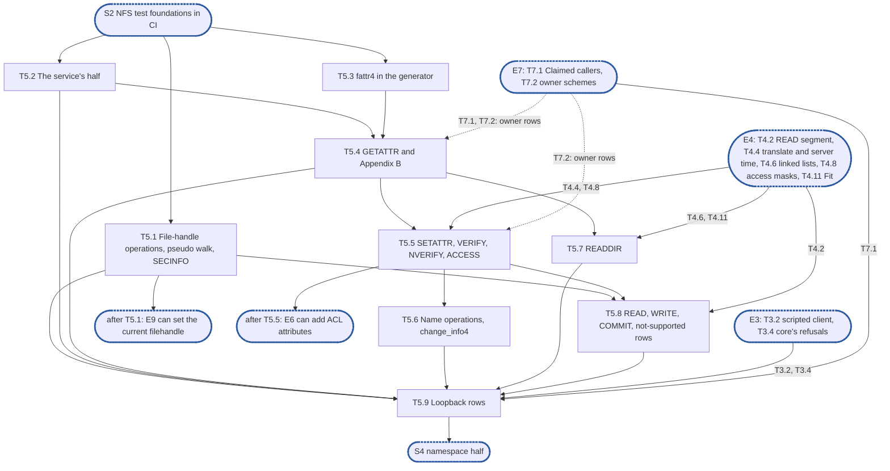

# Epic 5: NFS adapter v2 NFSv4 namespace, attributes and data

**Sources:** [RFC 21](../docs/internals/rfcs/rfc-21-nfs.md) §2.3's NFSv4 sizes and the `READ`
hook, §5.1's `lease_time`, §5.2's two special stateids that name no open (all zeros, all ones),
§7.1, §7.2 and §7.3 for NFSv4, §7.4's single-node part, §8 other than the ACL attributes, §9.1 and
§9.2's NFSv4 rules, §11's decoding paragraph for `fattr4` and the `READ` and `WRITE` data,
§11.3's NFSv4 column and rules other than exclusive create, the ACL paragraphs and `mode_umask`,
§11.5's rows for the service errors this epic's operations meet and the drain roles of its
operations, §11.6's golden vectors for the NFSv4 attribute table and for those rows, §12's N7, N8,
N9, N16's ctime half, N17's and N23's adapter halves, N19's NFSv4 half, N20's not-supported rows and
N26 for its translations, §13's rows named in §3 below, Appendix B other than its ACL rows and
`mode_umask`, Appendix C's layout row, and Appendix D's NFSv4 file-handle, name, attribute, listing
and I/O rows;
[RFC 20](../docs/internals/rfcs/rfc-20-adapters.md) §4.3's one mutating call, its exemption of
`Find` and its clamp of a `READ`, §4.5's error table, §4.7's `Invocation.Bound` and `Role`, §4.10's
NFSv4 entry points and their files, §5.3's data path, §5.4's vectors and fuzzing for this epic's
codecs, §6.10's 0-allocation gates for NFSv4 `READ`, `WRITE` and `GETATTR`, and §7.1's call-site
rule for `Root` and `SecInfo`;
[RFC 17](../docs/internals/rfcs/rfc-17-vfs.md) §4.9's sentence that the service returns the
pseudo-filesystem's `fsid`, change attribute and mount crossings, and §5.10's `LOOKUPP` at a
share's root, for the service's half (T5.2);
[RFC 18](../docs/internals/rfcs/rfc-18-identity.md) §4.5, for the owner strings this epic puts on
the wire. Every citation is `develop`'s text, which reaches `feat/storage-v2` with the cherry-pick
of RFC changes.
Cited, not owned: RFC 8881, RFC 7530 and RFC 7862 for the bytes, attribute numbers and status
values; RFC 20 §2.5's layout of `ops/`.
**Track:** C.
**Epic 5 estimate: 9 subtasks, 23.25 man-days.**
**Depends on:** **S2**, NFS's test foundations in CI: E1's request state (`protocol.State`,
`SetFH`) and NFSv4 table with its members' table, E2's `nfsharness` and knfsd's captures cut into
golden files, S0's `vfstest.Mutations` and golden helper. Beyond S2, pieces of three epics broken
down beside this one, each named by id in the subtask that takes it (§9, point 3): **E4**'s
`translate` package and server-time choice (T4.4), its `READ` reply segment with `Attach` (T4.2), its
linked-list kind (T4.6), its access-mask table (T4.8) and `translate.Fit` with the colliding-name
fixture (T4.11); **E3**'s scripted client (T3.2) and `core`'s own refusals in NFSv4's tables,
`ErrNoFH` among them (T3.4); **E7**'s resolution of a `Claimed` caller (T7.1), without which an
`AUTH_SYS` call is refused at admission, and its owner schemes (T7.2), without which `owner` and
`owner_group` spelled `name@domain` answer `ErrInvalid`.
**Blocks:** E6, whose ACL attributes ride T5.3's `fattr4` and T5.4's and T5.5's `GETATTR` and
`SETATTR`; E9, whose `OPEN` takes the current filehandle T5.1's operations set and whose stateids
extend T5.5's stateid function; E12, whose `READ_PLUS` reuses T5.8's hook and whose attributes join
T5.4's encoder; S4, whose namespace half is T5.9's; E16, which runs these rows end to end.

---

## 1. Goal

Epic 5 gives NFSv4 every operation that needs no client state: an NFSv4 client walks the
pseudo-filesystem into a share, reads and sets attributes, creates, links, renames and removes,
lists directories, and reads and writes under the anonymous stateids, each operation one row of
E1's members' table and at most one mutating service call.

**At the end of the epic:**

- `PUTROOTFH`, `LOOKUP` and `GETATTR` walk from the pseudo-root into a share over loopback, the
  share's root reporting the share's `fsid` and the pseudo directory's number as its
  `mounted_on_fileid`, with no pseudo-filesystem code in the adapter;
- `GETATTR` answers every REQUIRED attribute and every Appendix B attribute but the ACL ones and
  `mode_umask`, per minor version, from the `File`, the share's `StatFS` or a fixed value, leaving
  out what it does not serve, its decode and encode at 0 allocations; `fattr4` decodes into one
  optional field per attribute;
- `SETATTR`, `VERIFY`, `NVERIFY`, `ACCESS`, `CREATE`, `LINK`, `REMOVE`, `RENAME`, `READLINK` and
  `READDIR` answer from one mutating call at most, `change_info4` never atomic, cookies the
  service's digests and the verifier the share's;
- `READ` and `WRITE` serve the all-zeros stateid as an anonymous open and `COMMIT` commits on one,
  a `READ` clamped by its row's `Bound` hook to the room the compound leaves it and never below one
  byte, its data a segment of the reply, never copied;
- `OPENATTR`, `DELEGPURGE`, `SET_SSV` and the five layout and device operations answer
  `NFS4ERR_NOTSUPP` from one handler, and each NFSv4.1 code added here sent under NFSv4.0 is
  answered `NFS4ERR_OP_ILLEGAL`.

### 1.1 In scope

The generator's bitmap-selected attributes, with a second decoder (its linked lists are E4's);
`ops/v4`'s rows for `PUTFH`, `PUTROOTFH`, `PUTPUBFH`, `GETFH`, `SAVEFH`, `RESTOREFH`, `LOOKUP`,
`LOOKUPP`, `SECINFO`, `SECINFO_NO_NAME`, `GETATTR`, `SETATTR`, `VERIFY`, `NVERIFY`, `ACCESS`,
`CREATE`, `LINK`, `REMOVE`, `RENAME`, `READLINK`, `READDIR`, `READ`, `WRITE`, `COMMIT`, and the
not-supported rows of `OPENATTR`, `DELEGPURGE`, `SET_SSV` and the layout and device operations,
each with its drain role; the NFSv4 error rows of every service error these operations meet, with
their golden file; the import test's NFS entry files for `Root` and `SecInfo`; the service's half
of the pseudo-filesystem's mount crossing, capabilities and `SECINFO` styles, and `LOOKUPP` at a
share's root (T5.2); a tearing fault in `vfstest.Faults`; golden files for every row; the loopback
rows named in §3.

### 1.2 Out of scope

- `acl`, `dacl`, `sacl`, `aclsupport`, `mode_umask`, `mode_set_masked`, a `mode` set with an ACL,
  `who` in an ACE, and `mode_umask` and `acl` in `suppattr_exclcreat`: E6, which adds them to
  T5.3's attribute struct and T5.4's `supported_attrs`.
- Every stateid but the two special ones that name no open: the current stateid, open, lock and
  delegation stateids, their principal check and their per-request drain roles (E9, E10). Until
  E9, a `READ`, `WRITE` or `SETATTR` quoting one is `NFS4ERR_BAD_STATEID` (D3).
- `OPEN`, its exclusive create's `CreateVerifier`, an `OPEN` of a delete-pending file, and the
  "§11.3 read-only marker" row, which needs an `OPEN` for write: E9. This epic answers the
  delete-pending and read-only refusals its own operations meet (R36, R42).
- The session's reply budget: E8 sets `protocol.State`'s `MaxReply` in `SEQUENCE` and makes A1's
  runner change; T5.8's hook reads it. The NFSv4.1 session steps of the §2.3 row: E8.
- `core`'s own refusals in NFSv4's tables, `ErrNoFH`, `ErrMoved` and `ErrDraining` among them: E3.
  The drain test: E10. `fs_locations` naming another gateway on a drain is a (cluster) part, in the
  plan's deferral ledger, row "RFC 21's (cluster) parts".
- `WANT_DELEGATION` and `GET_DIR_DELEGATION`: E10. `ALLOCATE`, `IO_ADVISE`, `WRITE_SAME`,
  `COPY_NOTIFY`, `LAYOUTERROR`, `LAYOUTSTATS` and the xattr operations: E12. Advertising no pNFS
  role in `EXCHANGE_ID` (N20's other half): E8.
- NFSv3's halves of the rows this epic shares with E4 ("App. B directory link count", "§9.2 change
  info", N7, N8, N19): E4. RFC 21 §13's "§8.1 ctime" as written, an SMB client and an NFSv3
  `GETATTR` (§9, point 5), pynfs's attribute tests, and "§9.1 loss verifier", which needs a loss
  below the service: E16.
- Snapshots over NFS (a snapshot's `fsid`, its root's `mounted_on_fileid`, `NFS4ERR_ROFS`): the
  plan's deferral ledger, row "Snapshots over NFS". The namespace move over NFS: row "The
  namespace move over NFS". A batched `Spell`: row "A batched `Spell`".
- Who records `adapter_translation_refused_total{reason="attribute"}`, whose producer is T5.5's
  translation: open with the RFC's author (rule 3); no recorder is added here.

### 1.3 Names used here

- **E1**, epic 1, the NFS surface: `protocol.State` and `SetFH`, the NFSv4 table and its members'
  table, the vector check and `FuzzCodec`.
- **E2**, epic 2, test foundations: `nfsharness`, whose runner exempts a call by the request it
  came in, and knfsd's captures cut into golden files.
- **E3**, the RPC layer: each call's `Identity` built at route, `core`'s refusals in every table
  (T3.4) and the scripted client, `adaptertest/nfsclient` (T3.2).
- **E4**, NFSv3 and MOUNT, which builds the encoder's `resources.Buf` segment for a `READ` (T4.2),
  the `translate` package with its times and server-time choice (T4.4), the generator's linked
  lists (T4.6), the access-mask table (T4.8), `translate.Fit` and the colliding-name fixture
  (T4.11), and NFSv3's halves of the shared rows.
- **E5**, this epic. **E6**, the NFSv4 ACL attributes. **E7**, identity's NFS side: a `Claimed`
  caller resolved (T7.1) and the owner schemes behind `Spell` and `Find` (T7.2).
- **E8**, clients and sessions, which owns `SEQUENCE` and the session's reply budget.
- **E9**, opens, stateids and locks. **E10**, delegations and the back channel.
- **E12**, the NFSv4.2 operations. **E13**, RPCSEC_GSS, with the privilege of a Kerberos caller.
- **E16**, E2E green: the suites, the cross-protocol rows, the composed node's rows and the
  totality test.
- **A1**, an amendment to RFC 20 §4.3 and §4.7, agreed in #5166: the compound runner asks a
  member's `Bound` hook again just before the member runs.
- **S0**, the shared test pieces of the RFC 22 implementation plan's epic 2: `vfstest.Mutations`,
  `adaptertest/golden`, the import test's call-site rules.
- **S2**, NFS's test foundations in CI, after E2 and S0: what this epic starts from.
- **S4**, an NFSv4.1 session over loopback, after E3, E5 and E8.
- **S6a**, `Spell`, `Find` and resolution in the service (RFC 18's implementation plan's S2),
  which already holds on `feat/storage-v2`: `SchemeUID` and `SchemeGID` answer on `memory.New`,
  while `SchemeOwner` answers `ErrInvalid` until E7's T7.2.

## 2. How the general rules apply

The rules are those of [the RFC 21 implementation plan's §1.5](rfc-21-nfs-plan.md#15-general-rules-for-each-epic),
cited by number and title and not copied.

| Rule | Subtasks | How |
| --- | --- | --- |
| rule 1, independent unit tests, under `-race` ([`CLAUDE.md`, "Writing tests"](../CLAUDE.md#writing-tests)) | all | each handler on `nfsharness` against `memory.New` (kind 2), errors through `vfstest.Faults` (kind 3), with T5.8's tearing fault, also kind 3, the one-call rule from S0's `vfstest.Mutations`; the generated codecs against second decoders written by hand; the pure translations (attributes, `ACCESS` bits, flavours, the listing's fit, stateids) as functions of their inputs; T5.2's service half in `internal/vfs`'s own tests; no other double |
| rule 2, fuzz tests where relevant | T5.3, T5.5 | a bitmap type in `wire`'s generated test codec, which `wire`'s fuzz target checks against its second decoder (the list type's is E4's T4.6); `fattr4`'s `attrlist4`, which rule 2 names, gets `FuzzAttrs` in `ops/v4`: decode in T5.3, then the attribute translation in T5.5, no panic, a value or a named refusal (R4, R33); every generated struct is already in E1's `FuzzCodec` |
| rule 3, observability follows RFC 25 and RFC 20 §10 | T5.5 | no recorder in NFS code; each row named after its operation, so `core` names its span and `op` label; `adapter_translation_refused_total{reason="attribute"}` waits for the decision on who records it (§1.2), and T5.5's refusal is a named value it can count then; no label, attribute or log line carries a name, a path or an owner string |
| rule 4, profiling: leaks, allocations and contention | T5.4, T5.8 | `GETATTR`'s, `READ`'s and `WRITE`'s decode and encode at 0 allocations, registered in `unit/adapter-allocs` (R60); every loopback test ends with `adaptertest.CheckLeaks`; no registry, table or timer here, so no mutex profile |
| rule 5, public interface and internals, at the layer that consumes a value ([`CLAUDE.md`, "Verifying a change"](../CLAUDE.md#verifying-a-change)) | all | each translation is asserted on the reply bytes a client decodes: `nfsharness`'s for a member, the scripted client's over loopback for §3's last table; T5.2's service fields on the `GETATTR`, `SECINFO_NO_NAME` and `LOOKUPP` replies that read them, in T5.4 and T5.9 |
| rule 6, known failures shrink | none | no `pynfs`, `cthon04` or `nfstest` test runs before the cutover, and nothing here is listed in a `known.yaml` |
| rule 7, v2 ignores v1 | all | nothing from `develop`'s `v4` package, its `pseudofs` and attribute encoder included; attribute numbers and statuses from RFC 8881, RFC 7530 and RFC 7862 |
| rule 8, real dependencies for properties of those dependencies | T5.1, T5.3 to T5.9 | golden files cut from knfsd's captures where E2's areas hold the operation, written by hand from RFC 8881 and RFC 7530 under epic 1's naming where they do not; real TCP over loopback through `core` |
| rule 9, code comment conventions ([`CLAUDE.md`, "Code comments"](../CLAUDE.md#code-comments)) | T5.1 to T5.8 | each decision of §4 leaves the marker it names; RFC 21 §2.3's `ponytail:` on one transfer size at `maxread`'s and `maxwrite`'s constant, and its `decision:` on an unclamped `READDIR` at `READDIR`'s hook; the `ponytail:` notes on a `GetAttr` of the directory for the cookie verifier (T5.7, D9) and on one `Spell` per owner and group (T5.4, D4) |
| rule 10, a test must be able to fail | all | each test names the break it catches; none asserts a stub's answer; a golden vector is cut from a capture or written from the RFC, never from the encoder under test |
| rule 11, a symbol is exported only if an interface uses it | T5.2, T5.8 | no export in `nfs/wire`: the generated code uses the runtime's existing `Bool` and arrays; exported: T5.2's two `pkg/vfs` fields, for every adapter, and T5.8's `Tear` on `vfstest.Faults`, for every adapter's tests. Every handler, the attribute struct and the translations stay unexported in `ops/v4` |
| rule 12, each subtask creates only what it declares | all | each row lands with its handler, error rows, golden files and tests; the generator's bitmap kind with its first consumer named by id (T5.3's struct); `stateid.go` with its first consumer, `SETATTR` (T5.5); nothing for an operation another epic owns |
| rule 13, translate, never decide | all | each handler makes the calls Appendix D names, at most one mutating, and maps their errors; no handler branches on a file's mode, owner or ACL, or on whether a handle is a pseudo directory's; what the service lacked (the mount crossing, a pseudo directory's capabilities, `SECINFO`'s two styles, `LOOKUPP` at a share's root) is added to the service by T5.2, not composed in a handler; `READLINK`'s refusal of a non-symlink and `VERIFY`'s comparison are the protocol's encodings, each with its `decision:` (D7, D10) |
| rule 14, nothing deferred is lost | all | §1.2 names the owner of each part of an obligation this epic leaves out; D3's interim answer names E9 |

## 3. Requirements and invariants

Every MUST and MUST NOT that RFC 21, RFC 20 and RFC 17 place on this epic, numbered so that
subtasks and tests can cite them.

**Decoding and the generator**

| # | Requirement | Kind | Source | Subtasks |
| --- | --- | --- | --- | --- |
| R1 | Every field the tags carry is bounded: NFSv4 file handles at 128 bytes, every other opaque, string and array at §2.3's transfer sizes | MUST | RFC 21 §11 (decoding), §7.1 | T5.1, T5.3 |
| R2 | `fattr4`'s `attrlist4` is decoded into one optional field per attribute the `attrmask` bitmap selects, so the attribute translation reads fields, never bytes | MUST | RFC 21 §11 (decoding) | T5.3 |
| R3 | A procedure has no codec of its own: its request and reply structs are decoded and encoded by the one generated codec | MUST | RFC 21 §11 (decoding) | T5.3, T5.7 |
| R4 | Every decoder of a peer's bytes is fuzzed, `fattr4`'s `attrlist4` among them: no panic, every read inside the buffer, and a value that matches a second decoder or re-encodes to bytes that decode to the same value; the codec's runtime is checked against a second decoder written by hand | MUST | RFC 20 §5.4; RFC 21 §11 (decoding), §11.6 | T5.3 |
| R5 | Every row added has a golden vector from the specifications or the reference captures, never only from the codec under test, and §11.6's golden files for the NFSv4 attribute table and for each §11.5 row added here, for NFSv4.0 and NFSv4.1, map each value to its neutral one and back | MUST | RFC 20 §5.4; RFC 21 §11.6 (golden vectors) | T5.1, T5.4, T5.5, T5.6, T5.7, T5.8 |

**File handles and the pseudo-filesystem**

| # | Requirement | Kind | Source | Subtasks |
| --- | --- | --- | --- | --- |
| R6 | A file handle is the service's opaque handle, returned unchanged; no handler parses one or branches on whether it is a pseudo directory's, and the adapter holds no pseudo-filesystem code | MUST NOT | RFC 21 §7.1; RFC 20 §4.10 | T5.1 |
| R7 | `PUTFH`, `GETFH`, `SAVEFH` and `RESTOREFH` make no service call; the next operation's call admits the handle, and a stale or refused one is reported there | MUST | RFC 20 §4.10; RFC 21 App. D | T5.1 |
| R8 | `PUTROOTFH` and `PUTPUBFH` are each one `Root` with the zero `ShareRef`; `SECINFO` and `SECINFO_NO_NAME` are `SecInfo`; `Root` and `SecInfo` are called from `putrootfh.go`, `putpubfh.go` and `secinfo.go` and from no other file of the adapter's NFSv4 code | MUST | RFC 20 §4.10, §7.1; RFC 21 App. D | T5.1 |
| R9 | `LOOKUP` is `Lookup`, and `LOOKUPP` is `Lookup` of `..` | MUST | RFC 21 App. D | T5.1 |
| R10 | `LOOKUPP` at a share's root answers the pseudo directory the share sits in, as the service computes it, while NFSv3's `..` at a share's root stays the root | MUST | RFC 17 §5.10; RFC 21 App. D | T5.2, T5.9 |
| R11 | `SECINFO` answers the flavours `SecInfo` returns, encoded and none added: on a pseudo directory every flavour admitted by a share at or below it whose state and client rules admit the caller, whatever its `MinProof` and `MinProtection`, and on a share's path the share's `Flavors` | MUST | RFC 21 §7.4, App. D | T5.1, T5.2 |
| R12 | A pseudo handle whose path no longer leads to a share is `ErrStale`, answered `NFS4ERR_STALE`; a pseudo-filesystem `LOOKUP` of a removed share's path is `NFS4ERR_NOENT` | MUST | RFC 21 §7.4, §11.5 (`ErrStale`) | T5.1 |
| R13 | A share's root reports the share's own `fsid`, and `mounted_on_fileid` the numeric id of the pseudo directory it sits in; the service computes both, and the attribute encoder formats them. RFC 17 §4.9 and RFC 20 §4.10 say the crossing comes back in the `File`; D12 has it come back from `StatFS` and amends both sentences (§9, point 1) | MUST | RFC 21 §7.4; RFC 17 §4.9; RFC 20 §4.10 | T5.2, T5.4, T5.7 |
| R14 | A pseudo directory's `fsid` is one reserved value, never a share's, and its change attribute is `ShareList.Version`, as its `File` reports | MUST | RFC 21 §7.4 | T5.4 |
| R15 | `fs_locations` lists no location on a single node and never names a server outside the installation; `fs_locations_info` is not supported | MUST NOT | RFC 21 §7.4, §12 (N9) | T5.4 |

**Attributes**

| # | Requirement | Kind | Source | Subtasks |
| --- | --- | --- | --- | --- |
| R16 | Every REQUIRED attribute of RFC 8881 is supported and in `supported_attrs`, `named_attr` among them, reading false on every object | MUST | RFC 21 §8.1, §8.2, App. B | T5.4 |
| R17 | `supported_attrs` lists, per minor version, the Appendix B attributes encoded, and never `sec_label`, the layout attributes on a single node, or Appendix B's not-supported list | MUST NOT | RFC 21 §8.2, App. B | T5.4 |
| R18 | `change` is the file's `Version` with the engine's overlay, writes not yet committed included, reported as the service answers it: it moves on every write the primary accepts and never on an operation that changed nothing, and never moves backward | invariant | RFC 21 §8.1, §9.2, §12 (N7), App. B | T5.4 |
| R19 | `change_attr_type` is `NFS4_CHANGE_TYPE_IS_UNDEFINED` | MUST | RFC 21 §8.1, App. B | T5.4 |
| R20 | `maxread` and `maxwrite` are 1 MiB and `maxfilesize` 2^63 − 1, fixed and not a setting | MUST | RFC 21 §2.3, §8.1 | T5.4 |
| R21 | The fields map as §11.3's NFSv4 column: `type`, `mode`, `owner`, `owner_group`, `numlinks` (a file's `Nlink`, a directory's 2 + `Subdirs`, never below 2, a share's root the same), `size`, `space_used` (`Charged`), `rawdev`, `fileid`, `fsid` derived from the `ShareID`, `time_access`, `time_modify`, `time_metadata`, `time_create`, `change`, and `hidden`, `system` and `archive` from `Flags`; the read-only and sparse markers have no NFSv4 attribute | MUST | RFC 21 §11.3, App. B | T5.2, T5.4 |
| R22 | `fileid` is the stored `Number`, never the `FileID` the handle carries, which no field of any reply carries; a named stream is never reached | MUST NOT | RFC 21 §7.1, §11.3 | T5.4 |
| R23 | `fh_expire_type` is `FH4_PERSISTENT`; `unique_handles` and `homogeneous` are true; a released file's handle is `NFS4ERR_STALE` | MUST | RFC 21 §7.1, App. B | T5.1, T5.4 |
| R24 | `owner` and `owner_group` are RFC 18 §4.5's owner strings for the call's proof kind, `name@domain` with proof `Secret` or above and the decimal uid or gid with `Claimed` or `None`, and the decimal form on any proof for a principal minted without a name; a principal `Spell` cannot spell is never an error | MUST | RFC 21 §11.3, §11.5 (`ErrUnknownPrincipal`), App. B; RFC 18 §4.5 | T5.4 |
| R25 | The share's attributes come from where Appendix B says: `case_insensitive`, `case_preserving`, `maxname`, `maxlink`, `no_trunc`, `chown_restricted` and `cansettime` from `Capabilities` and the share's case rule; `time_delta` from `Capabilities.TimeGranularity`; `files_*`, `space_avail`, `space_free` and `space_total` from `StatFS`; `quota_avail_hard`, `quota_avail_soft` and `quota_used` from `Quota` for the caller's principal; `xattr_support` true where `Capabilities.Xattrs`; `clone_blksize` 0; `suppattr_exclcreat` the part of its list this epic serves | MUST | RFC 21 App. B | T5.4 |
| R26 | `fs_charset_cap` follows the share's name rule: on a case-sensitive `posix` share `FSCHARSET_CAP4_CONTAINS_NON_UTF8` set and `FSCHARSET_CAP4_ALLOWS_ONLY_UTF8` clear; under the `windows` rule or on any case-insensitive share the reverse | MUST | RFC 21 §7.3, App. B | T5.2, T5.4 |
| R27 | `lease_time` is 90 s | MUST | RFC 21 §5.1 | T5.4 |
| R28 | `time_metadata` reports the file's `Change`, which moves on every change whatever an SMB client suspended on its own open | invariant | RFC 21 §8.1, §11.3, §12 (N16) | T5.4, T5.9 |
| R29 | `GETATTR`, `VERIFY` and `NVERIFY` are `GetAttr`, and the comparison is the adapter's | MUST | RFC 21 App. D | T5.4, T5.5 |
| R30 | `SETATTR` is `SetAttr`, the one mutating call of its request; a `Find` that resolves an owner string the request carries is outside the rule | MUST | RFC 21 App. D; RFC 20 §4.3 | T5.5 |
| R31 | `SET_TO_SERVER_TIME4` sets a server-chosen time and `SET_TO_CLIENT_TIME4` a client-given one, stored as given | MUST | RFC 21 §11.3 (Times) | T5.5 |
| R32 | A set of `owner` or `owner_group` naming a string no principal holds is `ErrUnknownPrincipal`, answered `NFS4ERR_BADOWNER`; who may set either is the service's, refused `ErrPerm`, answered `NFS4ERR_PERM` | MUST | RFC 21 §8.1, §11.5 (`ErrUnknownPrincipal`, `ErrPerm`); RFC 18 §4.5 | T5.5 |
| R33 | Every wire value of the attribute translation maps to one neutral value or a named refusal, never to a default | invariant | RFC 21 §11, §12 (N26) | T5.5 |
| R34 | `ACCESS` is `Access`: the bits reported are those `Access` grants of the bits asked, each bit reporting the rights §8.1's table gives it on a file and on a directory | MUST | RFC 21 §8.1 | T5.5 |
| R35 | A bit with no right on the file's type is never reported; `XAREAD`, `XAWRITE` and `XALIST` are never reported on a minor version before 2 | MUST NOT | RFC 21 §8.1 | T5.5 |
| R36 | A `WRITE`, a `SETATTR` of `size`, and a `REMOVE` or a `RENAME` over a file an SMB client marked read-only are `NFS4ERR_ACCESS`, and `ACCESS` reports no `MODIFY` or `EXTEND` for it | MUST | RFC 21 §11.3 (read-only marker), §11.5 (`ErrAccess`) | T5.5, T5.6, T5.8 |
| R37 | A `GETATTR`, and a `READDIR`'s attribute request, naming an attribute not served answers without it, never refused | MUST | RFC 21 §8.2, App. B | T5.4, T5.7 |
| R38 | A pseudo directory reports a filesystem's attributes as a share does, from what the service answers for it: a name limit, case rules, a time granularity and its character-set capability | MUST | RFC 21 §7.4, App. B (`fileid`, `mounted_on_fileid`, `rawdev`: pseudo-filesystem per RFC 17 §4.9) | T5.2, T5.4 |

**Names and listings**

| # | Requirement | Kind | Source | Subtasks |
| --- | --- | --- | --- | --- |
| R39 | A name is passed through unvalidated and unconverted; RFC 7's refusal is `NFS4ERR_INVAL` or `NFS4ERR_BADNAME`, and a name past the share's limit `NFS4ERR_NAMETOOLONG` | MUST | RFC 21 §7.3, §11.5 (`ErrInvalid`, `ErrNameTooLong`) | T5.1, T5.6 |
| R40 | `CREATE`, `LINK`, `REMOVE`, `RENAME` and `READLINK` are `Create`, `Link`, `Unlink`, `Rename` and `GetAttr` (the stored target, `File.Target`), each one call | MUST | RFC 21 App. D; RFC 20 §4.3 | T5.6 |
| R41 | `change_info4`'s `before` and `after` are the directory's `Version` read just before and just after the operation, and `atomic` is always false | MUST | RFC 21 §9.2, §11.3 (change info), §12 (N19) | T5.6 |
| R42 | A `CREATE`, `LINK` or `RENAME` into a delete-pending directory is `ErrDeletePending`, answered `NFS4ERR_ACCESS` | MUST | RFC 21 §11.3 (delete pending), §11.5 | T5.6 |
| R43 | A `REMOVE` or `RENAME` of a file an SMB open denies delete to is `ErrShareViolation`, answered `NFS4ERR_FILE_OPEN` | MUST | RFC 21 §11.5 (`ErrShareViolation`) | T5.6 |
| R44 | An NFS `RENAME` of a directory, or `REMOVE` of an empty one, is not refused because a file below it is open: the adapter adds no check of its own | MUST NOT | RFC 21 §7.3 | T5.6 |
| R45 | `READDIR` is `ReadDir`, asking for each entry's `File` and handle when attributes are asked | MUST | RFC 21 §11.3 (listings), App. D | T5.7 |
| R46 | The cookie is the service's cursor, the digest RFC 7 orders the last entry returned by, unchanged, so a resume on any node returns the entries after it; its top bit is clear | MUST | RFC 21 §7.2, §12 (N8) | T5.7 |
| R47 | A reply never ends inside a collision chain: it ends before the chain or holds all of it, and a chain that does not fit the client's `maxcount` at all is `NFS4ERR_TOOSMALL` | MUST NOT | RFC 21 §7.2, §12 (N8) | T5.7 |
| R48 | The cookie verifier is a constant of the share; one other than the share's is `NFS4ERR_NOT_SAME`, and a zero verifier with a non-zero cookie is accepted | MUST | RFC 21 §7.2, §12 (N8) | T5.7 |
| R49 | A `READDIR`'s `maxcount` is not clamped to the room, as a `READ`'s count is: a compound whose `READDIR`, with the operations around it, would pass the cap is refused | MUST NOT | RFC 21 §2.3 (`READDIR` decision) | T5.7, T5.9 |
| R50 | An entry listed with no attributes the caller may read is answered through the per-entry attribute error RFC 8881 defines where the request asks for it, and fails the `READDIR` with that error where it does not; it is never encoded with empty attributes | invariant | RFC 21 §11, §12 (N26) | T5.7 |

**Data**

| # | Requirement | Kind | Source | Subtasks |
| --- | --- | --- | --- | --- |
| R51 | The all-zeros stateid is an anonymous open, `Read` and `Write` on `vfs.Anonymous(h)`, checked per operation against deny modes; the all-ones stateid is anonymous for `READ` only and refused for `WRITE` | MUST | RFC 21 §5.2 (special stateids), App. D | T5.5, T5.8 |
| R52 | A `READ` is clamped by its row's `Bound` hook to what is left of the record cap, answered as a short read, never below one byte; in a session the hook also lowers its room by what the session's `ca_maxresponsesize`, copied into `Request.State`, falls short of the cap | MUST | RFC 21 §2.3; RFC 20 §4.3, §4.7 (`Invocation.Bound`) | T5.8 |
| R53 | A `READ`'s data is its own segment of the reply, lent by `Attach`, never copied; a `WRITE`'s is a slice of the receive buffer | MUST | RFC 21 §11 (decoding); RFC 20 §5.3 | T5.8 |
| R54 | An `UNSTABLE4` write is `Write` with unstable stability; `DATA_SYNC` and `FILE_SYNC` are both a stable write, and the reply says `FILE_SYNC`; `COMMIT` is `Commit` | MUST | RFC 21 §9.1 | T5.8 |
| R55 | The verifier of every `WRITE` and `COMMIT` reply is the service's, passed through; a `COMMIT` after a loss carries the changed verifier and succeeds, never success under the old one | MUST | RFC 21 §9.1, §12 (N23) | T5.8 |
| R56 | A stable `WRITE` whose sync may have lost it (`DelayCommit`), and a stability reply waiting on a stalled store, are `ErrDelay`, answered `NFS4ERR_DELAY`, never success | MUST | RFC 21 §9.1, §11.5 (`ErrDelay`) | T5.8 |
| R57 | A transient refusal is `NFS4ERR_DELAY` for as long as it lasts, never "no space" because a deadline passed; `ErrNoSpace` is `NFS4ERR_NOSPC` at once, and `ErrQuota` `NFS4ERR_NOSPC` for a share-wide or project quota and `NFS4ERR_DQUOT` for a user or group one | MUST NOT | RFC 21 §9.1, §11.5, §12 (N17) | T5.6, T5.8 |
| R58 | On a `READ`, `ErrIO`, `ErrUnavailable`, `ErrCorrupt` and `ErrLost` are a short read of the verified bytes, then `NFS4ERR_DELAY` for `ErrUnavailable` and `NFS4ERR_IO` for the others | MUST | RFC 21 §11.5 | T5.8 |
| R59 | `ErrLocked` and `ErrShareViolation` on I/O are `NFS4ERR_LOCKED` | MUST | RFC 21 §11.5 | T5.8 |
| R60 | `READ`, `WRITE` and `GETATTR` decode and encode at 0 allocations | bound | RFC 20 §6.10 | T5.4, T5.8 |
| R61 | `OPENATTR` is `NFS4ERR_NOTSUPP`; so are `DELEGPURGE`, `SET_SSV`, and on a single node `LAYOUTGET`, `LAYOUTCOMMIT`, `LAYOUTRETURN`, `GETDEVICEINFO` and `GETDEVICELIST` | MUST | RFC 21 §8.2, §12 (N20), App. B, App. C, App. D | T5.8 |

**Errors and the drain**

| # | Requirement | Kind | Source | Subtasks |
| --- | --- | --- | --- | --- |
| R62 | Each service error this epic's operations meet has its NFSv4 row: `ErrNotFound`, `ErrExist`, `ErrNotEmpty`, `ErrNotDir`, `ErrIsDir`, `ErrAccess`, `ErrStale` (`ErrWrongShare` included), `ErrCross` (`CrossShare`, `CrossProject`) as `NFS4ERR_XDEV`, `ErrDelay` of every cause, `ErrNoSpace`, `ErrIncomplete`, `ErrQuota`, `ErrInvalid`, `ErrReadOnly`, `ErrNameTooLong`, `ErrInconsistent`, `ErrPerm`, `ErrIO`, `ErrGrace`, `ErrDeletePending`, `ErrUnknownPrincipal` and `ErrWrongSecurity` (`NFS4ERR_WRONGSEC`), each as §11.5 answers it | MUST | RFC 21 §11.5; RFC 20 §4.5 | T5.1, T5.4, T5.5, T5.6, T5.8 |
| R63 | Each NFSv4.1 operation code this epic adds a row for, sent under NFSv4.0, is answered `NFS4ERR_OP_ILLEGAL` | MUST | RFC 21 §11.5 (`core`'s own refusals) | T5.9 |
| R64 | Each row declares its drain role: `PUTFH` and `GETATTR` context, `COMMIT` a flush, `LAYOUTRETURN` a release, and every other row of this epic none, so the drain refuses it | MUST | RFC 21 §11.5 (what runs while draining); RFC 20 §4.7 (`Role`) | T5.1, T5.4, T5.8 |

**The RFC's test rows**

| # | Requirement | Kind | Source | Subtasks |
| --- | --- | --- | --- | --- |
| R65 | "§2.3 a compound's reply under the record cap"'s NFSv4.0 steps: a `READ` answered short beside `GETATTR`s, two `READ`s, and the compounds refused `NFS4ERR_RESOURCE` before any operation runs | test row | RFC 21 §13 | T5.9 |
| R66 | "§8 attributes"'s single-node steps: every REQUIRED attribute in `supported_attrs`, `named_attr` among them and false, `sec_label` absent, `fs_charset_cap` set by the share's name rule | test row | RFC 21 §13 | T5.9 |
| R67 | "App. B directory link count *(1 node)*"'s NFSv4 half | test row | RFC 21 §13 | T5.9 |
| R68 | "§9.2 change info"'s NFSv4 step on one node: 64 parallel creates in one directory, each `change_info4` with `atomic` false | test row | RFC 21 §13 | T5.9 |

Not obligations of this epic: §7.3's name spellings under the `windows` rule and §7.4's pseudo
handles minted from a digest, which the service computes; §9.1's waits of a stability reply and
§9.2's rules that `change` moves per staged write and that `GETATTR` is answered at the primary,
which the service keeps and this epic reports unchanged (R18); §8.1's privilege rules (E7, E13) and
ACL attributes (E6); §11.3's exclusive create (E9) and umask (E6); §11.5's state, session and lock
rows and the per-request drain roles of `WRITE` and `LOCK` (E3, E8, E9, E10); the namespace move and
snapshots (§1.2).

## 4. Decisions this epic takes

- **D1. Linked lists are E4's generated kind.** `READDIR`'s `dirlist4`, like NFSv3's `entry3` and
  MOUNT's `exportnode`, is an XDR linked list (RFC 4506 §4.19). E4's T4.6 builds the generator's
  `xdr:"list,max=N"` kind (E4's D1) for MOUNT's `EXPORT` before this epic's `READDIR` needs it, so
  T5.7 tags its entries with it and builds no kind of its own; `READDIR`'s own `Bound` clamps the
  reply to its `maxcount`. No marker here: E4's D1 leaves it at the tag.
- **D2. `fattr4` is a struct of optional fields tagged by attribute number.** A struct tagged
  `xdr:"bitmap"` holds its `attrmask` as a `[]uint32` tagged `max=N`, as `wire`'s test codec's
  `FAttr` already does, and one pointer field per attribute tagged `attr=N`, with the existing
  `since=` tag for the minor version it is served from. The generator writes its decode as the mask,
  then `attrlist4`'s length, then each field whose bit is set, in bit order, the bit test inline in
  the generated code, and its encode the reverse, setting a bit for each field present. In a value
  the client sent (`SETATTR`, `CREATE`, `VERIFY`), a bit with no field, or one not served at the
  request's minor version, is a named refusal, `errAttrNotSupp`, never skipped, and bytes left in
  `attrlist4` after the last field are `ErrDecode`; an attribute request (`GETATTR`, `READDIR`'s)
  is a plain `bitmap4`, never this struct, and drops what it does not serve (R37). Prior art:
  knfsd's `nfsd4_decode_fattr` decodes by hand, bit by bit (from memory). A `decision:` marker at
  the generated decode names why an unknown bit is refused rather than skipped: skipping it would
  read the next attribute from the wrong bytes.
- **D3. Until E9, a stateid other than the two special ones is `NFS4ERR_BAD_STATEID`.** `READ`,
  `WRITE` and `SETATTR` turn the stateid into an `OpenRef` through one function in `stateid.go`,
  which maps all zeros to `vfs.Anonymous(h)`, all ones to the same for `READ` and to
  `NFS4ERR_BAD_STATEID` for `WRITE` and `SETATTR` (RFC 8881 §8.2.3, from memory), and every other
  value to `NFS4ERR_BAD_STATEID`, which is rule 1's answer to a stateid never issued, and no stateid
  can be issued before E9's `OPEN`. E9 extends that one function with the rest. A `decision:`
  marker at the function names E9 as its owner.
- **D4. The owner scheme is picked by the call's proof kind.** `Spell` takes no `Call`, so
  `GETATTR` asks for `SchemeOwner` when the call's proof is `Secret` or above and for `SchemeUID`
  or `SchemeGID` when it is `Claimed` or `None`, as RFC 18 §4.5 divides them; a `SETATTR` of
  `owner` asks `Find` for the string under `SchemeOwner` and of `owner_group` under
  `SchemeOwnerGroup`, E7's T7.2 schemes (E7's D2), which map a decimal string by number whatever the
  proof; a proven `GETATTR` of `owner_group` spells under `SchemeOwnerGroup` likewise. `Spell`'s `ErrUnknownPrincipal`, a principal with no
  spelling, is written `65534`, which RFC 18 §4.5 allows on any proof, so it is never an error;
  any other error of `Spell` is answered by its §11.5 row, so until E7's T7.2 a `GETATTR` of
  `owner` on a `Secret` caller is `NFS4ERR_INVAL`, which only a Kerberos caller (E13) meets. One `Spell` per
  owner and group, with no adapter cache, which RFC 21 §11.1 forbids: a `ponytail:` marker names the
  ceiling, a `READDIR` of 10^4 entries asking for both is 2·10^4 calls, and the upgrade, a batched
  `Spell` in RFC 17 when a benchmark shows it. A `decision:` marker at the spelling. Prior art:
  knfsd's idmapper falls back to the numeric form when no name maps (from memory).
- **D5. `fsid` is the `ShareID`, split in two.** `fsid4` is two 64-bit words and a `ShareID` 16
  bytes, so `major` is its first 8 bytes and `minor` its last 8, with no fold to collide; a pseudo
  directory's `File` carries the zero `ShareID`, which gives the one reserved value `{0, 0}`, the
  value no minted share's random ID takes. The adapter does not branch on the pseudo-filesystem to
  report it (R6). Prior art: knfsd reports `fsid=0` for its NFSv4 pseudo-root export (from memory).
  A `decision:` marker names its ceiling: a `ShareID` minted zero would report the
  pseudo-filesystem's `fsid`.
- **D6. `change` is `Version`'s counter.** `entity.File`'s comment has the NFSv4 change attribute
  report `Version`'s counter half, which only rises; `changeid4` is that 64-bit counter. A
  `decision:` marker at the encoder, overturned if the journal's counter can ever fall when its
  epoch rises.
- **D7. `VERIFY` and `NVERIFY` compare encoded bytes.** The adapter encodes the attributes the
  client sent from the file's `GetAttr` answer, with the same encoder `GETATTR` uses, and compares
  them with the client's `attrlist4` byte for byte, answering `NFS4ERR_NOT_SAME` or `NFS4ERR_SAME`;
  an attribute it does not serve is `NFS4ERR_ATTRNOTSUPP`, as RFC 8881 §18.31 has it (from
  memory). Prior art: knfsd's `nfsd4_verify` compares the encoded buffers (from memory). A
  `decision:` marker: an attribute with two encodings of one value, such as an owner string, can
  compare unequal; overturned if a client is seen relying on `VERIFY` of `owner`. The two
  operations share that comparison in `verify.go`, each in its own file otherwise.
- **D8. One `ReadDir` per `READDIR`, sized from `maxcount`.** `ReadDir`'s `max` counts entries,
  `maxcount` bytes, so the listing asks for as many entries as `maxcount` holds at the encoded size
  of the attributes asked plus a 16-byte name, encodes entries until the next would pass
  `maxcount`, and ends the page at the end of the last whole collision chain that fits (the entries
  sharing a cursor), as E4's `translate.Fit` (E4's D7, T4.11) answers it; a first chain that does
  not fit is `NFS4ERR_TOOSMALL`. A page the service fills
  short is answered short, never with a second `ReadDir`. A `ponytail:` marker names the ceiling:
  longer names leave entries read and not sent; upgrade to a byte-bounded `ReadDir` in RFC 17 when a
  benchmark of large directories shows the waste. Prior art: knfsd's `nfsd4_encode_readdir` stops
  at the byte budget and resumes from the last cookie sent (from memory).
- **D9. The cookie verifier is the share's `ShareID`, folded to 64 bits by E4's fold in
  `translate` (E4's D6, T4.4), read from a `GetAttr` of the listed directory on every page**,
  before listing, so a client's verifier is checked before
  anything is read. An entry's `File` cannot stand in for the directory's: in a pseudo directory
  each entry is another share's root, whose `Share` is not the directory's, and the adapter does not
  branch on the pseudo-filesystem (R6). A `ponytail:` marker at that call names its ceiling, one
  extra read per page, and the upgrade, a directory `File` on `vfs.Page`, an RFC 17 change, when a
  benchmark shows the extra call. A `decision:` marker names when the fold is overturned: a share's
  ID changing while its listings persist, or two shares' IDs folding to one verifier a client
  compares across them.
- **D10. `READLINK` of a non-symlink is `NFS4ERR_INVAL`.** Appendix D maps `READLINK` to `GetAttr`
  and the stored target, so the adapter reads `File.Target`; a file of another type has no target
  to encode, and RFC 8881 §18.24.3 answers it `NFS4ERR_INVAL` (from memory). This reads the
  file's type to encode a reply, not to authorise it (rule 13). A `decision:` marker, overturned
  if the service gains a `Readlink` that refuses it itself.
- **D11. `SECINFO`'s flavours, and `SECINFO_NO_NAME`'s two styles.** `FlavorNone` and `FlavorSys`
  are `AUTH_NONE` and `AUTH_SYS`; `FlavorKrb5`, `FlavorKrb5i` and `FlavorKrb5p` are
  `RPCSEC_GSS` with the Kerberos v5 OID and `rpc_gss_svc_none`, `_integrity` and `_privacy`, in the
  order the service answers. `FlavorNTLM`, an SMB flavour with no NFS spelling, is left out: the
  mapping is total, its refusal named. `SECINFO_STYLE4_CURRENT_FH` is `SecInfo` of the current
  filehandle with an empty name, and `SECINFO_STYLE4_PARENT` `SecInfo` of it with `..`, which T5.2
  makes the service answer; over NFSv4.1 and NFSv4.2 both, and `SECINFO`, leave no current
  filehandle, as RFC 8881 §2.6.3.1.1.8 has it (from memory), and over NFSv4.0 `SECINFO` does what
  RFC 7530 §16.31 says, read when T5.1 is written (§9, point 6). Prior art: knfsd lists `AUTH_SYS`
  and the `krb5` pseudo-flavours by OID the same way (from memory). A `decision:` marker at the
  mapping on `FlavorNTLM`.
- **D12. The pseudo-filesystem's missing answers are the service's, added by T5.2.** RFC 17 §4.9
  has the service return a share root's mount crossing and §5.10 has NFSv4's `LOOKUPP` at a share's
  root leave to the pseudo-filesystem, but `feat/storage-v2`'s service does neither; its `StatFS` of
  a pseudo handle answers the zero `FilesystemInfo`; `SecInfo` of a pseudo directory with an empty
  name is `ErrNotFound`, and of a share's root with `..` the share's own flavours; a pseudo
  directory's `File` has its `Nlink` but no `Subdirs`; and `Capabilities` carries no name rule for
  `fs_charset_cap`. Rule 13 makes each a service change, never a sequence in a handler. Pending the
  user's answer (§9, point 1), the recommended shape: `vfs.FilesystemInfo` gains `MountedOn uint64`,
  the number of the pseudo directory the share sits in, which `StatFS` answers and the adapter
  writes as a share root's `mounted_on_fileid` (a `File` whose `Parent` is itself), and as `fileid`
  everywhere else and wherever it is zero; `vfs.File` is the store's record (`entity.File`), so no
  field that is never stored is added there, and RFC 17 §4.9's and RFC 20 §4.10's sentences that
  the crossing comes back "in the `File`" are amended to name `StatFS`. `Capabilities` gains
  `UTF8Only bool`, which the service computes from the name rule and the case rule, so the adapter
  reads one bit and decides nothing. `StatFS` of a pseudo directory answers the installation's
  fixed capabilities: case-sensitive and case-preserving, 255-byte names, `UTF8Only`, and a time
  granularity of 1 ns. `Lookup` of `..` at a share's root, from a call whose `Protocol` is NFSv4,
  answers the pseudo directory above it, and at the pseudo-root `ErrNotFound`. `SecInfo` with an
  empty name answers the directory's own flavours, and with `..` at a share's root the pseudo
  directory's. A pseudo directory's `File` reports `Subdirs` as its children, so `numlinks` is 2 +
  `Subdirs` there with no branch. Changing `MountedOn`'s shape once E5 and RFC 22's adapter read it
  costs both adapters' encoders; no marker, since the amended RFCs state the rule.
- **D13. One not-supported handler.** `OPENATTR`, `DELEGPURGE`, `SET_SSV` and the layout and
  device operations are rows pointing at one function in `handlers.go`, each with the minor versions
  RFC 8881 defines it in, so an NFSv4.1 code sent under NFSv4.0 is `NFS4ERR_OP_ILLEGAL` through
  E1's mapping; their shared argument type takes the rest of the compound, as `ILLEGAL`'s does.
  Prior art: knfsd's operation table points unsupported operations at one stub (from memory). No
  marker.
- **D14. `ErrInvalid` is answered by operation, since it names no cause.** RFC 21 §11.5 answers
  `ErrInvalid` `NFS4ERR_BADNAME` "for the name" and `NFS4ERR_INVAL` otherwise, but the service's
  `ErrInvalid` does not say which: a `CREATE`'s may come from its `createattrs`, and a `RENAME`'s
  from a rename into its own descendant. The row answers `NFS4ERR_BADNAME` for `LOOKUP`, `LINK`,
  `REMOVE` and `SECINFO`, whose only argument it can refuse is a name, and `NFS4ERR_INVAL` for every
  other operation, `CREATE` and `RENAME` included, which RFC 21 §7.3 allows for a name RFC 7
  refuses. This departs from §11.5's split for `CREATE` and `RENAME`, pending the user's answer
  (§9, point 2). Prior art: none found. A `decision:` marker at the row, overturned when RFC 17
  splits `ErrInvalid` by cause.
- **D15. A `change_info4` whose `before` the service did not capture.** `WCC.Before` is nil where
  the service cannot capture the directory atomically or the caller may not read it; the adapter
  then writes `before` as 0, with `atomic` false as always, so the client revalidates the
  directory. A `decision:` marker at the encoder, overturned if a client is seen trusting a 0
  `before`.
- **D16. `fs_locations` is always empty, with no call.** On a single node `MoveTarget` answers
  the zero `Addr` always, and the drain towards another gateway is a (cluster) part (§1.2), so the
  attribute is encoded as an empty list and `MoveTarget` is not called. A `decision:` marker names
  the trigger: the cluster stage's drain, when `MoveTarget` can answer an address.
- **D17. The share's fixed attributes.** `vfs.Capabilities` holds no `maxlink`, `no_trunc`,
  `chown_restricted` or `cansettime`, and `FilesystemInfo` no capacity but `Usage` and `Quota`, so:
  `maxlink` is 2^32 − 1, `Nlink`'s range; `no_trunc`, `chown_restricted` and `cansettime` are true,
  as RFC 7 refuses a long name, keeps ownership changes to the privileged and stores a client time;
  `space_total` is the share's or project's hard limit where one is set, and with none 2^63 − 1,
  `space_avail` and `space_free` that less `Usage`, and `files_*` likewise from the file quota, the
  figures E4's `FSSTAT` reports (E4's D10), so `df` reads the same over both versions. A
  `decision:` marker at the encoder, overturned when the service reports a capacity, the one RFC 17
  `FilesystemInfo` field E4's D10 names as its upgrade too.
  Prior art: knfsd answers `space_*` from the exported filesystem's `statfs` (from memory).
  `suppattr_exclcreat` lists `mode`, `owner`, `owner_group` and the `time_*_set` attributes; E6 adds
  `mode_umask` and `acl`.
- **D18. A listing's filesystem attributes per share.** In a pseudo directory every entry is
  another share's root, so `READDIR` asking for `mounted_on_fileid` or a filesystem attribute calls
  `StatFS` once per share its entries name, kept for the request, and once for a share's own
  directory. A `ponytail:` marker names the ceiling, one `StatFS` per share listed in a pseudo
  directory, and the upgrade, the pseudo-filesystem's answers carried on its `DirEntry`, when a
  pseudo directory of many shares shows in a profile.

## 5. Target tree

```text
internal/adapter/nfs/
  wire/
    gen/gen.go, emit.go        T5.3  the bitmap kind (D2)
    gen/gen_test.go            T5.3
    codec_types_test.go        T5.3  a bitmap type for the generated test codec
    codec_fuzz_test.go         T5.3  its second decoder, written by hand
  ops/v4/
    putfh.go, putrootfh.go, putpubfh.go, getfh.go, savefh.go, restorefh.go   T5.1
    lookup.go, lookupp.go, secinfo.go                                        T5.1
    attrs.go                   T5.3  the fattr4 struct; T5.4  its encoder; T5.5  its translation to Attrs
    getattr.go                 T5.4
    setattr.go, stateid.go     T5.5  stateid.go: D3's one function
    verify.go, nverify.go, access.go   T5.5
    create.go, link.go, remove.go, rename.go, readlink.go   T5.6
    readdir.go                 T5.7
    read.go, write.go, commit.go   T5.8
    handlers.go                T5.8  the not-supported handler (D13)
    errors.go                  T5.1, T5.4, T5.5, T5.6, T5.8  the service errors' rows
    fuzz_test.go               T5.3, T5.5  FuzzAttrs
    loopback_test.go           T5.9
  wire/testdata/golden/
    rfc-nfs4-*.hex             T5.1, T5.4 to T5.8  where no capture holds the operation or the row
internal/adapter/adaptertest/
  imports_test.go              T5.1  NFS's entry files for Root and SecInfo
pkg/vfs/
  types.go                     T5.2  FilesystemInfo.MountedOn, Capabilities.UTF8Only (D12, §9 point 1)
  vfstest/faults.go            T5.8  Tear: the call reaches the service, its answer cut short, then an error
internal/vfs/
  pseudo.go, names.go, shares.go   T5.2  StatFS's MountedOn, UTF8Only and a pseudo directory's capabilities; LOOKUPP; SecInfo's two styles; Subdirs
```

## 6. Subtasks

### T5.1 File-handle operations, the pseudo-filesystem walk and `SECINFO`

**Subtask T5.1 estimate: 2.5 man-days.**

- **Track:** C. **Depends on:** S2.
- **Covers:** R1, R5, R6, R7, R8, R9, R11, R12, R23, R39, R62, R64.
- **Deliverables:** rows and handlers in `ops/v4`: `PUTFH`, `GETFH`, `SAVEFH` and `RESTOREFH`
  over `protocol.State` with no service call; `PUTROOTFH` and `PUTPUBFH`, one `Root` with the zero
  `ShareRef` each, setting the current filehandle through `SetFH`; `LOOKUP` (`Lookup`) and
  `LOOKUPP` (`Lookup` of `..`); `SECINFO` and `SECINFO_NO_NAME` (`SecInfo`, D11), both in
  `secinfo.go`; each row with the minor versions RFC 8881 defines it in and its drain role, `PUTFH`
  context. The error rows these meet: `ErrNotFound`, `ErrNotDir`, `ErrAccess`, `ErrStale`,
  `ErrInvalid` (D14), `ErrNameTooLong`, `ErrDelay`, `ErrWrongSecurity`. The import test's NFS entry
  files for `Root` and `SecInfo` (`putrootfh.go`, `putpubfh.go`, `secinfo.go`), added to S0's
  call-site list. Golden files: knfsd's captures where they hold an operation, by hand from RFC 8881
  for `PUTPUBFH`, `LOOKUPP` and `SECINFO` where they do not. Consumed by T5.8 (the current
  filehandle), T5.9, E9's `OPEN`, and S4.
- **Acceptance criteria:**
  - `PUTFH` of any handle of up to 128 bytes succeeds; the operation after it reports a stale
    handle `NFS4ERR_STALE`, and a 129-byte handle is `NFS4ERR_BADXDR`.
  - `SAVEFH` then `RESTOREFH` gives back the saved filehandle; `PUTROOTFH` sets the pseudo-root's
    handle as `Root` answers it.
  - `SECINFO` encodes the service's flavours in order, `FlavorNTLM` left out.
  - `Root` or `SecInfo` called from a file of `ops/v4` other than the three entry files fails the
    import test, naming the file.
- **Tests:** on `nfsharness` against `memory.New`, each member with the state its case builds:
  `PUTFH` of a released file's handle followed by `GETATTR`, the `GETATTR` answering
  `NFS4ERR_STALE` and `PUTFH` succeeding (catches a handle checked at entry, R7); `LOOKUP` of a
  share's mount from the pseudo-root answering the share's root handle, and of a removed share's
  path `NFS4ERR_NOENT` (catches an adapter-side pseudo table, R6, R12); `SECINFO` on a pseudo
  directory above a Kerberos-only share and one admitting `AUTH_SYS`, the reply listing both
  flavours (catches a flavour dropped or added, R11); each error row through `vfstest.Faults` on
  `Lookup` and `SecInfo`, the reply's status checked (catches an unmapped error, R62); each row's
  `Role` read from the table (catches `PUTFH` refused while draining, R64). The import test's new
  case with a deliberate `Root` call in another file of its test data (catches an entry outside
  its files, R8). No test double beyond those.
- **Rules:** rule 9: D11's and D14's `decision:` markers.

### T5.2 The service's half: the mount crossing, a pseudo directory's answers and `LOOKUPP`

**Subtask T5.2 estimate: 2 man-days.**

- **Track:** C. **Depends on:** S2.
- **Covers:** R10, R11, R13, R21, R26, R38.
- **Deliverables:** as D12 recommends, pending the user's answer (§9, point 1), in the service:
  `vfs.FilesystemInfo.MountedOn uint64`, which `StatFS` fills with the number of the pseudo
  directory the share sits in; `vfs.Capabilities.UTF8Only bool`, from the share's name rule and
  case rule; `StatFS` of a pseudo directory answering D12's fixed capabilities; a pseudo
  directory's `File` with `Subdirs` as its children; `Lookup` of `..` at a share's root from an
  NFSv4 call answering that pseudo directory, and at the pseudo-root `ErrNotFound`; `SecInfo` with
  an empty name answering the directory's own flavours, and with `..` at a share's root the pseudo
  directory's. RFC 17 §3.0's value-type table names the two fields, and RFC 17 §4.9's and RFC 20
  §4.10's sentences on the `File` name `StatFS`, in this subtask's pull request. Consumed by T5.4's
  encoder (`mounted_on_fileid`, `numlinks`, `fs_charset_cap`, a pseudo directory's attributes),
  T5.1's `LOOKUPP` and `SECINFO_NO_NAME`, and RFC 22's adapter, which reads the same `StatFS`.
- **Acceptance criteria:**
  - `StatFS` of a share mounted at `/a/b` reports `MountedOn` equal to `/a`'s `Number`, and
    `UTF8Only` false on a case-sensitive `posix` share and true otherwise; `StatFS` of `/a` reports
    D12's fixed capabilities.
  - `Lookup` of `..` at the share's root answers `/a`'s handle for NFSv4 and the root itself for
    NFSv3; at the pseudo-root, `ErrNotFound`.
  - `SecInfo` of `/a` with an empty name answers what it answers for `a` from the pseudo-root; of
    the share's root with `..`, `/a`'s flavours.
  - `/a`'s `File` with two shares below it reports `Subdirs` 2.
- **Tests:** in `internal/vfs`, beside the pseudo-filesystem's tests: each criterion above, each
  failing with its change reverted (catch a crossing not reported, R13, a name rule ignored, R26, a
  pseudo directory's zero capabilities, R38, `SECINFO_NO_NAME` failing at the pseudo-root, R11,
  `Subdirs` not counted, R21, and `LOOKUPP` answering the root, R10). The adapter's reading of each
  is tested where it is encoded, in T5.4 and T5.9. No test double.
- **Rules:** rule 13: the service decides the crossing, so no handler composes it.

### T5.3 `fattr4` in the generator

**Subtask T5.3 estimate: 2 man-days.**

- **Track:** C. **Depends on:** S2.
- **Covers:** R1, R2, R4.
- **Deliverables:** the generator's `xdr:"bitmap"` kind with its fields tagged `attr=N` and
  `since=` (D2), the bit tests inline in the generated code, no new runtime; a bitmap type in
  `wire`'s `codec_types_test.go`; `ops/v4`'s `attrs.go` declaring the `fattr4` struct with a field
  for every attribute T5.4 encodes and T5.5 decodes, with `errAttrNotSupp`; `FuzzAttrs` in `ops/v4`
  over the decode. Consumed by T5.4, T5.5 (the translation, and `FuzzAttrs`' second leg), T5.6
  (`createattrs`), T5.7 (an entry's attributes), and E6 and E12, which add their fields.
- **Acceptance criteria:**
  - Decoding a mask with bits 1, 4 and 33 set reads three fields in that order, and encoding them
    writes the same mask and `attrlist4`.
  - A bit with no field, or one not served at the request's minor version, is `errAttrNotSupp`; an
    `attrlist4` longer or shorter than its fields is `ErrDecode`.
- **Tests:** in `gen_test.go`, a bitmap struct generated and one whose `attr` numbers repeat
  refused (catches two fields on one bit). In `wire`'s `codec_fuzz_test.go`, the bitmap type's
  generated codec against a second decoder written by hand from RFC 8881 §3.3.15 and §7, seeded with
  the `GETATTR` and `SETATTR` arguments and replies of knfsd's captures and `wire`'s
  `codec-setattr-args.hex` (catches a field read out of bit order, R2, R4). `FuzzAttrs`' decode leg:
  no panic, every read inside the bytes (R4). No test double.
- **Rules:** rule 2: the two targets; rule 9: D2's `decision:` marker.

### T5.4 `GETATTR` and every Appendix B attribute

**Subtask T5.4 estimate: 3.5 man-days.**

- **Track:** C. **Depends on:** T5.2, T5.3, T7.1, T7.2. T7.1 and T7.2 only for the `owner` rows:
  an `AUTH_SYS` call admitted, and `name@domain` spelled; the rest does not wait.
- **Covers:** R5, R13, R14, R15, R16, R17, R18, R19, R20, R21, R22, R23, R24, R25, R26, R27, R28,
  R29, R37, R38, R60, R62, R64.
- **Deliverables:** `getattr.go`: `GetAttr` of the current filehandle, then `StatFS` only when a
  filesystem attribute or `mounted_on_fileid` is asked, `Quota` only for a quota attribute, and
  `Spell` for `owner` and `owner_group` (D4); its drain role, context. `attrs.go`'s encoder from a
  `File`, its share's `FilesystemInfo` and the request's minor version: the request's `bitmap4`
  masked by what is served (R37), `supported_attrs` per minor version, every REQUIRED attribute,
  every Appendix B attribute but the ACL rows and `mode_umask`, `fsid` (D5), `change` (D6),
  `numlinks` (R21), `mounted_on_fileid` (D12), `fs_locations` (D16), the fixed values (D17),
  `maxread` and `maxwrite` with RFC 21 §2.3's `ponytail:`, `lease_time`. `ErrIO`'s row. `GETATTR`'s
  decode and encode registered in `unit/adapter-allocs`. §11.6's golden file for the attribute
  table. Consumed by T5.5 (`VERIFY`'s encoder), T5.7 (each entry's attributes), T5.9, E6 and E12.
- **Acceptance criteria:**
  - `supported_attrs` holds every REQUIRED attribute at minor versions 0, 1 and 2,
    `fs_charset_cap` and `suppattr_exclcreat` only from 1, `change_attr_type`, `xattr_support` and
    `clone_blksize` only at 2, and never `sec_label`, a layout attribute or Appendix B's
    not-supported list.
  - A `GETATTR` asking for `sec_label`, a layout attribute and an undefined bit beside `size` is
    answered `NFS4_OK` with `size` alone.
  - Every field of §11.3's NFSv4 column encodes from its `File` field; `fileid` is `Number`, and
    no encoded byte equals the handle's `FileID`.
  - A directory with `Subdirs` −1 reports `numlinks` 2, one with 3 reports 5.
  - `owner` on an `AUTH_SYS` call is a decimal uid; `Spell`'s `ErrUnknownPrincipal` is `65534`.
  - Decode and encode of `GETATTR` allocate nothing.
- **Tests:** on `nfsharness` against `memory.New`: a file with every field set, its `GETATTR`
  reply compared with the hand-written attribute table's golden file, each field from the RFC's
  XDR (catches a field mapped from the wrong source, R21, R22, R5); `supported_attrs` per minor
  version (catches an attribute advertised before its version, R17, R16); the unserved-attribute
  request above (catches a `GETATTR` refused, R37); the pseudo directory `/a` with a share mounted
  at `/a/b`: `/a` reporting the `{0, 0}` `fsid`, the share's root its own `fsid` and `/a`'s number
  as `mounted_on_fileid`, `/a` reporting `numlinks` 4 with two shares below it and a non-zero
  `maxname` (catch the crossing dropped by the encoder, R13, the pseudo `fsid` taken from a share,
  R14, and a pseudo directory reported as a zero filesystem, R38); a `posix` and a `windows`
  share's `fs_charset_cap` (catches the flags swapped, R26); a write then `GETATTR` showing `change`
  moved, and a `SETATTR` changing nothing then `GETATTR` showing it unmoved (catches a `change`
  built from anything but `Version`, R18); `fs_locations` empty (R15); `owner` over `AUTH_SYS` as
  `SchemeUID` answers on `memory.New`, and `Spell` refused `ErrUnknownPrincipal` through
  `vfstest.Faults` written `65534` (catches the refusal answered as an error, R24); `name@domain`
  for a proven call, and `owner_group` under `SchemeOwnerGroup` (catches a group spelled from the
  user scheme, R24). `AllocsPerRun` at 0 for decode and encode (catches an allocation, R60). No test
  double.
- **Rules:** rule 4: the allocation gate; rule 9: D4's, D5's, D6's, D16's and D17's markers.

### T5.5 `SETATTR`, `VERIFY`, `NVERIFY` and `ACCESS`

**Subtask T5.5 estimate: 2.5 man-days.**

- **Track:** C. **Depends on:** T5.4, T4.4, T4.8, T7.2. T7.2 only for the `owner` and `owner_group`
  rows.
- **Covers:** R5, R29, R30, R31, R32, R33, R34, R35, R36, R51, R62.
- **Deliverables:** `attrs.go`'s translation from the decoded `fattr4` to `vfs.Attrs`, total, a
  read-only attribute's set refused `NFS4ERR_INVAL` and an unserved one `NFS4ERR_ATTRNOTSUPP`,
  `SET_TO_SERVER_TIME4` through E4's server-time choice (T4.4), owner strings through `Find` (D4), which RFC 20 §4.3 leaves outside the one-call rule and E2's runner
  exempts by request; `FuzzAttrs`' second leg through the translation; `stateid.go` (D3);
  `setattr.go`: one `SetAttr` on `vfs.Target{H: current}`, its stateid through `stateid.go`, and its
  `attrsset`; `verify.go` and `nverify.go` (D7); `access.go`: one `Access` call, the bits NFSv3 and NFSv4
  share mapped through E4's `translate` access-mask table (T4.8, E4's D8), and in `ops/v4` only what
  NFSv4 adds: the xattr bits by minor version and no bit reported without a right on the file's
  type. The
  error rows of `ErrPerm` and `ErrUnknownPrincipal`. Golden files from knfsd's captures, by hand
  from RFC 8881 for `VERIFY` and `NVERIFY` where they hold none. Consumed by T5.6
  (`createattrs`), T5.8 (the
  stateid function), T5.9, E6, which adds the ACL attributes to the translation, and E9, which
  extends `stateid.go`.
- **Acceptance criteria:**
  - A `SETATTR` of `size`, `mode`, `owner`, `owner_group`, `time_access_set` and `time_modify_set`
    reaches `SetAttr` as one change, the server-time arm as a server-chosen time and the client
    arm as given.
  - An `owner` naming no principal is `NFS4ERR_BADOWNER` and `SetAttr` is not called.
  - A `SETATTR` of `size` under the all-ones stateid, or under any stateid but all zeros, is
    `NFS4ERR_BAD_STATEID` with no call.
  - `ACCESS` asking every bit of a directory reports `LOOKUP` and `DELETE` where granted and never
    `EXECUTE`; of a file, never `LOOKUP` or `DELETE`; `XAREAD` only at minor version 2.
  - `VERIFY` of the file's own `size` succeeds, of another `NFS4ERR_NOT_SAME`; `NVERIFY` the
    reverse.
- **Tests:** on `nfsharness` against `memory.New`: each case above, the one-call rule checked by
  the harness, `Find` exempted by the request's owner string (catches a second mutating call, R30);
  the stateid cases (catches `SETATTR` under a stateid read as anonymous, R51); a property test of
  the `ACCESS` mapping, `translate`'s table included, over every bit, file type and minor version
  against §8.1's table written out in the test (catches a bit reported with no right, R35, and a
  shared bit `translate` maps unlike §8.1's table, whose fix then goes in `translate`); `ACCESS` on a file the read-only marker
  holds, answered without `MODIFY` and `EXTEND` (catches a mask computed in the adapter, R36, R34);
  `SETATTR` of `size` on that file `NFS4ERR_ACCESS` (R36); `ErrPerm` injected on `SetAttr` through
  `vfstest.Faults` answering `NFS4ERR_PERM` (R32); `FuzzAttrs` from bytes through the translation,
  a value or a named refusal (catches a default for an unknown value, R33). No test double.
- **Rules:** rule 9: D3's and D7's markers; rule 13: `ACCESS` reports the service's answer, never
  a mode check of its own.

### T5.6 Name operations and `change_info4`

**Subtask T5.6 estimate: 2.5 man-days.**

- **Track:** C. **Depends on:** T5.5.
- **Covers:** R5, R36, R39, R40, R41, R42, R43, R44, R57, R62.
- **Deliverables:** `create.go` (`Create` for `NF4DIR`, `NF4LNK`, `NF4BLK`, `NF4CHR`, `NF4SOCK`
  and `NF4FIFO`, `NF4REG` refused `NFS4ERR_BADTYPE` as RFC 8881 §18.4 has it, from memory; its
  `createattrs` through T5.5's translation; the new object made current through `SetFH`),
  `link.go` (`Link` from the saved filehandle into the current directory), `remove.go`
  (`Unlink`), `rename.go` (`Rename` from the saved directory to the current one), `readlink.go`
  (`GetAttr`, D10); `change_info4` from each result's directory `WCC`, `atomic` false, `before` 0
  where the `WCC` has none (D15). The error rows of `ErrExist`, `ErrNotEmpty`, `ErrIsDir`,
  `ErrCross`, `ErrReadOnly`, `ErrNoSpace`, `ErrQuota`, `ErrInconsistent`, `ErrDeletePending` and
  `ErrShareViolation`'s `NFS4ERR_FILE_OPEN` for `REMOVE` and `RENAME`. Golden files from knfsd's
  captures. Consumed by T5.9 and E16.
- **Acceptance criteria:**
  - Each operation makes its one call; `RENAME` answers both directories' `change_info4`, each
    `before` and `after` the `WCC`'s `Version`s and `atomic` false.
  - A name of bytes that are not UTF-8 reaches the service unchanged.
  - A `RENAME` of a directory with an open file below it succeeds.
- **Tests:** on `nfsharness` against `memory.New`: each operation's success reply against its
  golden file and the one-call rule (catches a second call, R40); `change_info4` read against the
  directory's `Version` before and after from `memory.New` (catches a pair taken from one read, or
  `atomic` true, R41); a non-UTF-8 name created and found by `Lookup` with the same bytes
  (catches a conversion, R39); `CREATE` into a directory made delete-pending through the service,
  `NFS4ERR_ACCESS` (R42); `REMOVE` and `RENAME` of a file an SMB open made through the service
  denies delete to, `NFS4ERR_FILE_OPEN`, and of a file marked read-only, `NFS4ERR_ACCESS` (catch the
  two rows swapped by operation, R43, R36); `RENAME` of a directory holding an open file, served
  (catches a check added in the adapter, R44); `ErrDelay` of `DelayCapacity` and `ErrQuota` of each
  scope injected through `vfstest.Faults`, answered `NFS4ERR_DELAY`, `NFS4ERR_NOSPC` and
  `NFS4ERR_DQUOT` (catches a transient answered as no space, R57). No test double.
- **Rules:** rule 9: D10's and D15's markers.

### T5.7 `READDIR`

**Subtask T5.7 estimate: 2.5 man-days.**

- **Track:** C. **Depends on:** T5.4, T4.6, T4.11.
- **Covers:** R3, R5, R13, R37, R45, R46, R47, R48, R49, R50.
- **Deliverables:** `readdir.go`: the row with its own `Bound`, `maxcount` unclamped with RFC 21
  §2.3's `decision:`; its reply's `dirlist4` tagged with E4's list kind (T4.6, D1); one `ReadDir`
  sized as D8 says, with `EntryHandle | EntryFile` when attributes are asked; the page cut by
  `translate.Fit` (E4's T4.11, D8); the cookie verifier from the directory's `GetAttr` (D9), checked before listing; `StatFS` per share listed (D18); each entry's
  attributes through T5.4's encoder, its request masked as `GETATTR`'s; an entry with no `File`
  answered through `rdattr_error` or failing the `READDIR` with `NFS4ERR_ACCESS` (R50). Golden files
  from knfsd's captures. Consumed by T5.9 and E16.
- **Acceptance criteria:**
  - Each entry's cookie is its `DirEntry.Cursor`; resuming from the last one returns the entries
    after it.
  - With two names sharing a digest, a `maxcount` that ends between them ends the page before the
    pair, and a `maxcount` that holds neither is `NFS4ERR_TOOSMALL`.
  - A verifier other than the share's with a non-zero cookie is `NFS4ERR_NOT_SAME`; a zero one is
    accepted.
  - Listing a pseudo directory asking for `mounted_on_fileid` reports each share's root with the
    directory's number.
- **Tests:** `Fit`'s own property test is E4's T4.11; here, on `nfsharness` against `memory.New`, a directory listed in pages
  whose cookies resume it with every entry once (catches a positional cookie, R46), the two verifier
  cases (R48), the pseudo directory's listing above (catches a share root's crossing missing from a
  listing, R13), and a listing by a caller who may list but not traverse, with and without
  `rdattr_error` asked (catches an entry encoded with empty attributes, R50); E4's T4.11 fixture,
  the share with its hash key fixed and its colliding pair, as RFC 21 §13's "§7.2 cookies *(1
  node)*" row has it (catches the chain cut on real data, or `maxcount` sized unlike `Fit`'s budget,
  R47). No test double.
- **Rules:** rule 9: D8's `ponytail:`, D9's two markers and D18's `ponytail:`.

### T5.8 `READ`, `WRITE`, `COMMIT` and the not-supported rows

**Subtask T5.8 estimate: 3.25 man-days.**

- **Track:** C. **Depends on:** T5.1, T5.5, T4.2.
- **Covers:** R5, R36, R51, R52, R53, R54, R55, R56, R57, R58, R59, R60, R61, R62, R64.
- **Deliverables:** `read.go` with its `Bound` hook (R52: the room, lowered by `protocol.State`'s
  `MaxReply` when set; `ok` false where the room cannot hold one byte, as RFC 20 §4.7's `Bound`
  says) and its data a `resources.Buf` segment through `Attach` (E4's T4.2); `write.go` with
  the stability mapping and the verifier passed through; `commit.go`, `Commit` on
  `vfs.Anonymous(h)`, drain role flush; both through T5.5's `stateid.go`; the error rows of
  `ErrLocked` and `ErrShareViolation` on I/O, `ErrIncomplete`, `ErrGrace` and a `READ`'s short read
  before `ErrUnavailable`, `ErrCorrupt`, `ErrLost` and `ErrIO`; `READ`'s and `WRITE`'s decode and
  encode in `unit/adapter-allocs`; the not-supported rows (D13), `LAYOUTRETURN`'s role a release;
  `vfstest.Faults`' `Tear(op, n, err)`, a fault injection of kind 3 that lets the call reach the
  service, keeps the first n bytes of its answer and returns err, with its own test in
  `faults_test.go`; §11.6's golden file of every §11.5 row this epic adds, for NFSv4.0 and NFSv4.1.
  Consumed by T5.9, E9, E12's `READ_PLUS`, which reuses the hook, E8, whose `SEQUENCE` sets
  `MaxReply`, and every adapter's tests, through `Tear`.
- **Acceptance criteria:**
  - `READ` and `WRITE` under all zeros reach `Read` and `Write` on `vfs.Anonymous(h)`; under all
    ones `READ` does and `WRITE` is `NFS4ERR_BAD_STATEID`; under any other stateid both are
    `NFS4ERR_BAD_STATEID` with no call.
  - The hook handed 1 MiB of room returns the count asked up to it; with `MaxReply` 512 KiB set,
    at most what fits in 512 KiB; with no room for one byte, `ok` false.
  - `DATA_SYNC` and `FILE_SYNC` are answered `FILE_SYNC`; `UNSTABLE4` `UNSTABLE4`.
  - A `COMMIT`'s reply carries the verifier `Commit` answered, byte for byte, and succeeds.
  - A `READ` torn after 100 bytes with `ErrUnavailable` answers those 100 bytes with `eof` false;
    torn after 0, `NFS4ERR_DELAY`.
  - `OPENATTR` under minor version 0 is `NFS4ERR_NOTSUPP`, `SET_SSV` under minor version 1
    `NFS4ERR_NOTSUPP`.
- **Tests:** on `nfsharness` against `memory.New`: each criterion above, the reply bytes compared
  (catch a stateid read as anonymous, R51, a stable write answered `DATA_SYNC`, R54, a `COMMIT`
  answered from anything but `Commit`, R55); the hook as a function of its room and state (catches
  a count past the room or a zero count, R52); `Write` answering `ErrDelay` of `DelayCommit` and of
  `DelayCapacity` through `vfstest.Faults`, `NFS4ERR_DELAY` (catches a success or a no-space,
  R56, R57); `Read` torn through `Tear` (R58); `ErrLocked` and `ErrShareViolation` on `Write`
  through `vfstest.Faults`, both `NFS4ERR_LOCKED` (catches `NFS4ERR_FILE_OPEN` or
  `NFS4ERR_SHARE_DENIED` leaking to I/O, R59); `WRITE` to a file the read-only marker holds,
  `NFS4ERR_ACCESS` (R36); the `READ` reply's data segment the very buffer `Read` filled (catches a
  copy, R53); each row's `Role` (R64); the error-row golden file read as a pure table (catches a row
  answered differently at one minor version, R5, R62); `AllocsPerRun` at 0 (R60). The case of a
  `COMMIT` after a real loss needs a loss below the service, and is E16's "§9.1 loss verifier" row.
  No test double beyond `vfstest.Faults` and its `Tear`.
- **Rules:** rule 4: the allocation gates; rule 11: `Tear` exported for every adapter's tests.

### T5.9 Loopback rows: the namespace half of S4 and the RFC's rows

**Subtask T5.9 estimate: 2.5 man-days.**

- **Track:** C. **Depends on:** T5.1, T5.2, T5.4, T5.6, T5.7, T5.8, T3.2, T3.4, T7.1.
- **Covers:** R10, R28, R49, R63, R65, R66, R67, R68.
- **Deliverables:** `ops/v4/loopback_test.go`, through `core` over loopback on `memory.New`, sent
  by E3's scripted client (T3.2: `nfsclient.Dial`, then `Do` under `nfsclient.AuthSys`, each
  `COMPOUND`'s arguments encoded and its `Reply.Body` decoded by `ops/v4`'s generated structs), with
  `core`'s refusals in NFSv4's tables from E3's T3.4, and an `AUTH_SYS` caller admitted by E7's
  T7.1: S4's namespace half over NFSv4.0, `PUTROOTFH`, `LOOKUP` of
  a share's path, `GETATTR`, and `LOOKUPP` back to the pseudo directory; RFC 21 §13's rows of §3's
  last table; R28's own check; each NFSv4.1 code this epic adds a row for, sent under NFSv4.0,
  answered `NFS4ERR_OP_ILLEGAL`. Consumed by S4 and by E16, which reruns them on the composed node.
- **Acceptance criteria:**
  - "§2.3 a compound's reply under the record cap"'s NFSv4.0 steps pass on a file of 2 MiB and 4
    KiB written by `WRITE` under the all-zeros stateid, `adapter_reads_shortened_total` rising by
    one per short `READ`.
  - "§8 attributes"' single-node steps pass on a `posix` and a `windows` share.
  - "App. B directory link count *(1 node)*"'s NFSv4 steps pass, the file in it made by `CREATE`
    of a symlink, since a regular file needs E9's `OPEN`, the share's root reporting 2 plus its
    subdirectories.
  - R28: a write through an open made through the service as SMB, with its four times suspended,
    moves `time_metadata` in an NFSv4 `GETATTR`.
  - "§9.2 change info": 64 parallel `CREATE`s in one directory each answer `atomic` false.
- **Tests:** the loopback cases above, in a test that starts with `adaptertest.CheckLeaks`, each
  failing on its assertion when the rule it guards is broken: a `READDIR` clamped like a `READ`
  (R49), a REQUIRED attribute dropped (R66), a count that moves on a symlink's create (R67), a
  ctime from `Modify` (R28), `atomic` true (R68), an NFSv4.1 code served under NFSv4.0 (R63),
  `LOOKUPP` from a share's root answering the root (R10). No test double: the scripted client
  speaks the wire and `memory.New` is the service.
- **Rules:** rule 5: every assertion on the bytes the scripted client decodes.

## 7. Order of work



T5.1 goes first, the blocker of E9 and S4. T5.2, a service change with no dependency in this epic,
can run beside it. T5.3's generator work then opens the attribute path, T5.4 to T5.6, which E6
waits on; T5.7 and T5.8 close the operations, and T5.9 runs them over loopback. The pieces taken
from E4 land on track B before this track reaches them, by the plan's order: T4.2 and T4.4 early,
T4.6 before `READDIR`; T4.8 and T4.11 come later on track B than T5.5 and T5.7 here, so §9, point 3
says who writes them if this track gets there first. Checkpoints: after T5.1, E9's `OPEN` can be
written against the current filehandle; after T5.5, E6 can add its attributes to the struct and
the translation, and E9 can extend `stateid.go`; after T5.9, S4's namespace half holds.

## 8. Suggested pull requests

| PR | Subtasks | Man-days | After | Why together |
| --- | --- | --- | --- | --- |
| 1 | T5.1 | 2.5 | — | the walk into a share, the blocker of E9 and S4 |
| 2 | T5.2 | 2 | the user's answer on D12 | a service change, reviewed by the service's owners apart from the adapter |
| 3 | T5.3, T5.4 | 5.5 | PR 2 | `fattr4` and its first consumer, `GETATTR`, with the allocation gate and the attribute table's golden file |
| 4 | T5.5, T5.6 | 5 | PR 3, E4's T4.4 and T4.8 | the attribute translation, the stateid function, and the operations that set attributes and names |
| 5 | T5.7, T5.8, T5.9 | 8.25 | PR 4, E4's T4.2, T4.6 and T4.11, E3's T3.2 and T3.4, E7's T7.1 | listings and I/O, then every row over loopback |

A suggestion only: one pull request per subtask works as well. PRs 1 and 2 can be open at once.

## 9. Open points

1. **The service's half (D12, T5.2), pending the user's answer.** RFC 17 §4.9 and §5.10 have the
   service report a share root's mount crossing and answer NFSv4's `LOOKUPP` there, and RFC 21
   §7.3 has `fs_charset_cap` follow the name rule, but `feat/storage-v2`'s service does neither
   and has no field for them. Options: (a) as D12 recommends, `FilesystemInfo.MountedOn` answered
   by `StatFS`, `Capabilities.UTF8Only`, a pseudo directory's capabilities, `LOOKUPP` and
   `SecInfo`'s two styles, built in T5.2, 2 man-days, with RFC 17 §3.0 naming the fields and RFC
   17 §4.9 and RFC 20 §4.10 amended from "in the `File`" to `StatFS`, since `vfs.File` is the stored
   record; (b) the pseudo-filesystem's own accessor, such as `MountedOn(ctx, c, h) (uint64, error)`
   on `Shares`, one more method every implementation of `vfs.Service` and its conformance suite
   would carry; (c) an RFC 21 §7.4 amendment reporting `mounted_on_fileid` equal to `fileid`
   everywhere, as RFC 8881 allows for an object that is no mount point (from memory), and `LOOKUPP`
   at a share's root answering the root as NFSv3's `..` does, so T5.2 keeps only `UTF8Only`, a
   pseudo directory's capabilities, `SecInfo`'s styles and `Subdirs`, about 1.25 man-days, and R10's
   and R13's rows change through the amendment. (a) is recommended: it is closest to what RFC 17
   §4.9 already says, costs a call only when the attribute is asked, and Linux's `ls -i` in a pseudo
   directory then shows the junction's number (from memory, knfsd reports `mounted_on_fileid` at its
   export roots). The document is written for (a).
2. **`ErrInvalid` for `CREATE` and `RENAME` (D14), pending the user's answer.** RFC 21 §11.5 answers
   a name `NFS4ERR_BADNAME`, but the service's one `ErrInvalid` cannot say whether a `CREATE`'s or a
   `RENAME`'s refusal was its name. Options: (a) as D14, `NFS4ERR_INVAL` for both, which §7.3
   allows, with §11.5's row amended to say so; (b) RFC 17 splits `ErrInvalid` by cause, an
   `*InvalidError` naming the name, which T5.6 then maps, about 0.5 man-days more and a change to
   the service's error set. (a) is recommended: Linux turns both statuses into `EINVAL` (from
   memory), and no client is known to treat them apart.
3. **What this epic takes from E3, E4 and E7, settled with their documents.**
   - E4: `Attach` and the `READ` reply segment (T4.2, consumed by T5.8); the `translate` package,
     its server-time choice and the `ShareID` fold (T4.4, consumed by T5.5 and T5.7); the
     `xdr:"list,max=N"` kind (T4.6, E4's D1, consumed by T5.7), which this epic no longer builds,
     its 1 man-day gone from the figure; the access-mask table (T4.8, E4's D8, consumed by T5.5);
     `translate.Fit` and the colliding-name fixture (T4.11, E4's D7, consumed by T5.7), which
     T5.5 and T5.7 no longer write, 0.25 man-days each gone. T4.8 and T4.11 come late on track B:
     if T5.5 or T5.7 starts before its piece has landed, that subtask writes the piece in
     `translate` as E4's D8 or D7 specifies, about 0.5 or 0.75 man-days back here, and E4's
     subtask then calls it rather than writing it.
   - E3: `nfsclient.Dial`, `Do`, `AuthSys` and the reply's `Body` (T3.2), and `core`'s refusals in
     NFSv4's tables (T3.4), for T5.9.
   - E7: a `Claimed` caller resolved (T7.1), without which `memory.New` refuses an `AUTH_SYS` call
     `ErrAccess`, for T5.4's `owner` on an `AUTH_SYS` call and all of T5.9; and `SchemeOwner` and
     `SchemeOwnerGroup` (T7.2), for T5.4's and T5.5's `name@domain` rows. Track B reaches E7 after
     E4, later than this track needs them; E7's §9, point 1 asks to land T7.1 and T7.2 at S2. Until
     they land, the rows that need them wait and the rest of each subtask does not.
   - `Spell` answers `ErrUnknownPrincipal` for a principal with no owner spelling (E7's R32), which
     D4 writes `65534`.
4. **`ErrUnavailable` off a read, pending the user's answer.** RFC 21 §11.5 maps `ErrUnavailable`
   only on a read, but E7's lookup and mint caps and its store errors answer it on any operation, and
   with no row it is `NFS4ERR_SERVERFAULT`, which a client does not retry. E4's RFC 21 pull request
   proposes `NFS4ERR_DELAY` for it in NFSv4's column beside NFSv3's `NFS3ERR_JUKEBOX`; once agreed,
   the row lands in this epic's `errors.go` with T5.1's error rows, at no extra figure.
5. **Where the plan and the RFC's rows disagree, proposed as a plan edit in this document's pull
   request.** The plan names RFC 21 §13's "§8.1 ctime" in this epic's done-when, but the row asserts
   an NFSv3 `GETATTR` after an SMB client's write, so it is E16's, as E4's §1.2 also has it; this
   epic keeps the NFSv4 check as R28's. The plan gives delete pending and the read-only marker to
   E9, and §9.1 to E4, but this epic's operations meet `ErrDeletePending` and the read-only marker's
   `ErrAccess`, and serve NFSv4's `WRITE` and `COMMIT`, so their rows and stability mapping are here
   (R36, R42, R54 to R58) and E9 keeps the `OPEN` halves and the "§11.3 read-only marker" row. The
   plan's cookie-verifier decision reads the directory's `GetAttr` only when no entry carries a
   `File`; D9 reads it on every page, since a pseudo directory's entries carry other shares'. The
   plan's layout (§4.1) gives the linked lists to this epic; they are E4's T4.6 (point 3).
6. **`SECINFO`'s current filehandle over NFSv4.0, to check.** D11 takes RFC 8881's rule that
   `SECINFO` consumes the current filehandle for NFSv4.1 and NFSv4.2; whether RFC 7530 §16.31 says
   the same for NFSv4.0 is read when T5.1 is written, and T5.1's test follows it.
7. **Which pull request carries which RFC amendment.** T5.2's pull request carries D12's RFC 17
   §3.0 fields (`FilesystemInfo.MountedOn`, `Capabilities.UTF8Only`) and the RFC 17 §4.9 and RFC 20
   §4.10 sentences; this document's pull request carries D14's RFC 21 §11.5 `ErrInvalid` row. The
   other epics' amendments touch other fields and rows: E4's RFC 17 §3.1 fields (`CreateArgs`,
   `Attrs`' server time, `ShareInfo`, `DirEntry`) and RFC 21 §11.5 and Appendix D texts, E6's ACL
   amendment (`GetACL`, `AttrChange`, `CreateArgs`), E7's RFC 18 schemes; none edits the
   `FilesystemInfo` or `Capabilities` lines this epic's does. E4's D10 and D17 here share one future
   field, a capacity on `FilesystemInfo`, which neither proposes now.
