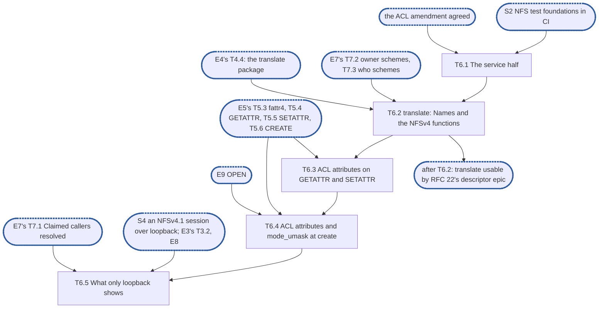

# Epic 6: NFS adapter v2 NFSv4 ACL attributes

**Sources:** [RFC 21](../docs/internals/rfcs/rfc-21-nfs.md) §8.1's ACL attributes paragraph,
§11.3's umask and exclusive-create bullets and its "ACLs", "`who`" and "Refusals" paragraphs with
their decision, Appendix B's `mode_umask`, `acl`, `dacl`, `sacl`, `aclsupport` and
`suppattr_exclcreat` rows, §11.6's translation tests for these, §12's N16 (its audit half) and
§13's rows "§11.3 audit entries", "§11.3 ACL attributes" and "App. B `mode_umask` *(1 node)*";
[RFC 19](../docs/internals/rfcs/rfc-19-authorization.md) §5.1 (the shared translation and its
`Names`), §5.2, and the rules of §2.2 to §2.8, §3.5, §4.3 and §4.4 that the spelling and the sets
carry, §7's Z8, Z9 and Z11, §8's set and spelling counters, and §9's NFS rows on spelling, round
trips and the owner fold; [RFC 22](../docs/internals/rfcs/rfc-22-smb.md) §11's owner and group
fold, for the pair NFS folds the same way; [RFC 18](../docs/internals/rfcs/rfc-18-identity.md)
§4.5's owner strings, as a `who` uses them; [RFC 20](../docs/internals/rfcs/rfc-20-adapters.md)
§2.3's import rule for `translate` and §4.3's one-call rule. Every citation is `develop`'s text,
which reaches `feat/storage-v2` with the cherry-pick of RFC changes.
Cited, not owned: [RFC 17](../docs/internals/rfcs/rfc-17-vfs.md) §3.0 and §3.1 and
[RFC 7](../docs/internals/rfcs/rfc-7-namespace-metadata.md) §2.6 and §11.1, which lag RFC 19 and
which the ACL amendment (D1) changes; RFC 7530, RFC 8881 §6 and RFC 8275 for the bytes.
**Track:** C.
**Epic 6 estimate: 5 subtasks, 18.25 man-days.**
**Depends on:** **S2**, NFS's handler harness on `memory.New`; the **ACL amendment** (D1), not yet
proposed, for T6.1 and everything built on it; **E4**'s T4.4, which creates the `translate`
package T6.2 adds to; **E7**'s owner schemes (T7.2) and `who` schemes (T7.3, D4), which every `who`
spelled by name or by SID needs; **E5**, the `fattr4` struct the ACL attributes and `mode_umask`
join (T5.3), with `GETATTR` (T5.4), `SETATTR`, `VERIFY` and `NVERIFY` (T5.5) and `CREATE` (T5.6);
**E9**, `OPEN`'s create attributes; **S4**, E3's scripted client (T3.2), E7's T7.1 for an `AUTH_SYS`
caller admitted, and **E8**, for T6.5's loopback rows.
**Blocks:** E16, which runs these rows on the composed node and through both adapters. RFC 22's
descriptor epic takes the service half (T6.1) from whichever of the two epics lands first, and
`translate`'s `Names` (T6.2) to add its SID methods to.

---

## 1. Goal

Epic 6 spells RFC 19's one ACL as NFSv4's `acl`, `dacl` and `sacl`, through the translation both
adapters share, and gates each attribute as RFC 21 §11.3 says. The gates are the service's: the
adapter translates, and the service decides who reads or writes which list. Several of RFC 21
§11.3's rules cannot be met in one service call on today's surface, so the epic first builds the
service half of an amendment (D1), then the translation, then the attributes.

**At the end of the epic:**

- `translate` holds the `Names` interface with the `who` spellings that need no lookup, and the
  NFSv4 functions `NFSv4FromACL` and `ACLFromNFSv4`, which change spellings, flag positions and
  list framing and nothing else; `ops/v4` implements `Names` over `vfs.Service`'s `Spell` and
  `Find` bound to one call, so every principal an entry can name has a `who`;
- a `GETATTR` of `acl`, `dacl`, `sacl` or `aclsupport` answers what RFC 21 §11.3's table holds, and
  a `SETATTR` of them, alone or with `mode`, `mode_set_masked`, `owner` or `owner_group`, is one
  service call that stores what was sent or nothing;
- a create carrying `acl`, `dacl`, `sacl` or `mode_umask` sets them in the create's own
  transaction;
- the audit list is read or changed only by an administrator, on every minor version (N16);
- RFC 21 §13's three rows pass on `memory.New`, and their non-administrator steps over loopback.

### 1.1 In scope

The service half (D1): each list's flags with defaulted, the parts a read names, an ACL set and a
mode mask in an attribute change, a umask and an ACL set in a create. `translate`'s `Names`
interface and NFSv4 functions, `ops/v4`'s `Names` over `Spell` and `Find`, their property tests
and fuzz target. The `acl`, `dacl`, `sacl`, `aclsupport` and
`mode_umask` rows of E5's attribute table, `mode` with an ACL and `mode_set_masked`, the ACL
attributes at create, and the `ErrUnknownPrincipal` row for a `who` (RFC 20 §4.5, NFSv4).

### 1.2 Out of scope

- `owner` and `owner_group`, every other Appendix B attribute and the `fattr4` codec itself: E5.
  Who may set `mode`, `dacl` or the owner (RFC 21 §8.1's first bullet) is the service's walk (RFC
  19 §3.1, RFC 7 §7.4), already built.
- The owner schemes (E7's T7.2), D4's `who` schemes (E7's T7.3), `identity.nfs4_domain` and
  `FuzzOwnerString`, the owner-string parsing §11.6 fuzzes: E7. Which NFS callers are privileged (RFC 21 §8.1): E7 and
  E13. The administrator's steps over the wire, which only a proven caller reaches: E13 and E16.
- RFC 19 §9's halves that read or write over SMB, and every row on the composed node: E16, jointly
  with RFC 22's plan. `translate`'s descriptor functions, `SID`, `PrincipalBySID` and `vfs.SetACL`
  by parts: RFC 22's descriptor epic.
- Recording `acl_set_refused_total`, `acl_set_normalised_total`, `acl_who_sid_fallback_total` and
  `adapter_translation_refused_total{reason="attribute"}`: whoever §6.1 point 4 of the plan names,
  pending Marco (§9, point 4). This epic returns the counts and reasons they need.
- The import test's rule for `translate` (RFC 20 §2.3): E4's T4.4, which creates the package and
  adds the rule with it; this epic's functions are held to it.
- A batched `Spell`: the plan's deferral ledger row "A batched `Spell`", owned by RFC 17.
- The compound's reply budget that answers `NFS4ERR_REP_TOO_BIG`, and NFSv4.0's answer to a reply
  over the record cap: E1, E3 and E8. This epic only runs its row for `acl` (T6.5).

### 1.3 Names used here

- **E1**, the NFS surface: `protocol.State` and the NFSv4 members' table.
- **E3**, the RPC layer, with the scripted client every loopback row uses (T3.2).
- **E4**, NFSv3 and MOUNT, which builds the service half of an RFC 17 amendment its plan agreed,
  the precedent D2 follows, and creates `internal/adapter/translate` with the import test's rule
  for it (T4.4).
- **E5**, the NFSv4 namespace, attributes and data path: the `fattr4` struct (T5.3), `GETATTR`
  (T5.4), `SETATTR`, `VERIFY` and `NVERIFY` (T5.5), `CREATE` (T5.6), `owner` and `owner_group`.
- **E7**, identity's NFS side: a `Claimed` caller resolved (T7.1), the owner schemes (T7.2), D4's
  `who` schemes (T7.3) and `identity.nfs4_domain`.
- **E8**, clients and sessions: the session's reply budget, `ca_maxresponsesize`.
- **E9**, opens, stateids and locks: `OPEN` and its create attributes.
- **E13**, RPCSEC_GSS: the proven callers an administrator step and a `name@domain` spelling need
  over the wire.
- **E15**, the integration with the node, which turns the `pynfs`, `cthon04` and `nfstest` suites on.
- **E16**, E2E green: the composed node, the cross-protocol rows and the totality test.
- **S2**, NFS's test foundations in CI: `nfsharness` on `memory.New`.
- **S4**, an NFSv4.1 session over loopback.
- **S6a**, `Spell`, `Find` and resolution in the service (RFC 18's plan's S2). On `feat/storage-v2`
  they already answer for uids, gids and SIDs; the owner and `who` schemes are E7's T7.2 and T7.3.
- **The ACL amendment**, not a synchronisation point of the plan: the RFC 17 and RFC 7 text D1
  proposes, agreed before T6.1 starts.
- **RFC 22's descriptor epic**, the RFC 22 implementation plan's epic building `translate`'s
  descriptor functions.

## 2. How the general rules apply

The rules are those of [the RFC 21 implementation plan's §1.5](rfc-21-nfs-plan.md#15-general-rules-for-each-epic),
cited by number and title and not copied.

| Rule | Subtasks | How |
| --- | --- | --- |
| rule 1, **Independent unit tests, under `-race`** ([`CLAUDE.md`, "Writing tests"](../CLAUDE.md#writing-tests)) | all | the service half on `kvstoretest` and RFC 17 §8's suite; the translation on `memory.New`'s real `Spell` and `Find` (kind 2), never a fake `Names`; handlers on `nfsharness` with `vfstest.Faults` (kind 3) for lookup failures |
| rule 2, **Fuzz tests where relevant** | T6.2 | `FuzzACLFromNFSv4` over generated entries and `who` strings, seeded from `test/pcap-corpus/nfsv4-acl`'s knfsd capture (D7); the `nfsace4` bytes are the one XDR target's (RFC 21 §11.6), and owner-string parsing E7's `FuzzOwnerString` |
| rule 3, **Observability follows RFC 25 and RFC 20 §10** | T6.2 | no recorder is added: `ACLFromNFSv4` returns `Normalised` and a refusal reason, and `NFSv4FromACL` the count of `who`s spelled by SID, which the recorder §6.1 point 4 settles reads (§9, point 4). No log line carries a `who` |
| rule 4, **Profiling: leaks, allocations and contention** | T6.3, T6.4, T6.5 | every handler and loopback test ends with `adaptertest.CheckLeaks`; no 0-allocation gate applies (`GETATTR`'s is E5's, for its non-ACL attributes); no lock is added |
| rule 5, **Public interface and internals, at the layer that consumes a value** ([`CLAUDE.md`, "Verifying a change"](../CLAUDE.md#verifying-a-change)) | T6.2, T6.3, T6.4 | every round trip goes through the store, set with `SETATTR` and read with `GETATTR` on `memory.New`, never translation alone (RFC 19 §9's "What must not stand in"); the service's part rules are asserted again on the attribute a client reads |
| rule 6, **Known failures shrink** | none | no `pynfs`, `cthon04` or `nfstest` suite runs before E15 |
| rule 7, **v2 ignores v1** | all | the spelling comes from RFC 21 §11.3 and RFC 8881 §6, never from `develop`'s `v4/attrs` ACL code |
| rule 8, **Real dependencies for properties of those dependencies** | T6.2, T6.3 | knfsd's `nfsv4-acl` capture for the `fattr4_acl` bytes; `memory.New` for the service's gates |
| rule 9, **Code comment conventions** ([`CLAUDE.md`, "Code comments"](../CLAUDE.md#code-comments)) | T6.1, T6.2 | RFC 21 §11.3's `decision:` on the SID `who` at `newNames`'s `Who`; D5's and D6's `decision:` markers; the audit guard's `decision:` rewritten in `SetAttr`'s ACL path (T6.1) |
| rule 10, **A test must be able to fail** | all | each test names the change it catches; RFC 21 §11.3's gates fail with the service's part checks removed |
| rule 11, **A symbol is exported only if an interface uses it** | T6.1, T6.2 | `ACLParts`, `ACLSet` and the new fields, for both adapters through `pkg/vfs`; `translate`'s NFSv4 functions and `Names`; nothing in `ops/v4` |
| rule 12, **Each subtask creates only what it declares** | all | T6.1's fields and T6.2's functions each name their consumer, T6.3 and T6.4, by id; `SID`, `PrincipalBySID` and the SMB parts wait for RFC 22's descriptor epic |
| rule 13, **Translate, never decide** | T6.3, T6.4 | a `SETATTR` or create is one call; no handler reads the ACL, the mode or the caller's flags to decide a gate: the service answers `ErrAccess` (D1) |
| rule 14, **Nothing deferred is lost** | T6.2, T6.5 | the counters' recording, the administrator's steps over the wire and the SMB halves are named with their owners (§1.2, §9) |

## 3. Requirements and invariants

Every MUST and MUST NOT that RFC 21, RFC 19, RFC 20 and RFC 22 place on this epic, numbered so that
subtasks and tests can cite them.

**The translation**

| # | Requirement | Kind | Source | Subtasks |
| --- | --- | --- | --- | --- |
| R1 | The translation changes principals' spellings, flag bit positions and list framing, and nothing else: kinds, rights, order and the flags' meanings cross unchanged | MUST | RFC 19 §5.1; RFC 21 §11.3 ("ACLs") | T6.2 |
| R2 | `ACE4_ACCESS_ALLOWED_ACE_TYPE`, `ACE4_ACCESS_DENIED_ACE_TYPE`, `ACE4_SYSTEM_AUDIT_ACE_TYPE` and `ACE4_SYSTEM_ALARM_ACE_TYPE` are RFC 19's four kinds; any other type refuses the set, `NFS4ERR_INVAL` | MUST | RFC 21 §11.3 ("Entries", "Refusals"); RFC 19 §2.2, §2.8 | T6.2 |
| R3 | Each right is the NFSv4 right of the same bit; on a set, a mask bit outside the fourteen entry rights is cleared and counted, never stored | MUST | RFC 21 §11.3 ("Entries"); RFC 19 §2.4, §7 (Z1) | T6.2 |
| R4 | A set whose mask holds a generic bit is refused `ErrInvalid` | MUST | RFC 19 §2.4, §2.8 | T6.2 |
| R5 | Each entry flag maps by name to RFC 21 §11.3's bits (file inherit `0x01`, directory inherit `0x02`, no propagate `0x04`, inherit only `0x08`, successful access `0x10`, failed access `0x20`, inherited `0x80`), never byte for byte; any other entry flag is cleared and counted | MUST | RFC 21 §11.3 ("Entry flags"); RFC 19 §2.5, §5.1 | T6.2 |
| R6 | `ACE4_IDENTIFIER_GROUP` (`0x40`) is set on a read exactly when the principal is a group or `GROUP@`, selects on a set the namespace a `who` is resolved in, and is never stored | MUST | RFC 21 §11.3 ("The group flag") | T6.2 |
| R7 | The order is kept as sent: the translation never reorders, merges or deduplicates entries, but for the owner fold | MUST NOT | RFC 19 §2.7; RFC 21 §11.3 ("Entries") | T6.2 |
| R8 | An effective `OWNER@` or `GROUP@` entry with no inherit flags, directly followed by the CREATOR OWNER or CREATOR GROUP inherit-only entry RFC 22 §11 would fold with it, is stored as the one entry RFC 22 folds it to | MUST | RFC 21 §11.3 ("Owner pairs"); RFC 22 §11; RFC 19 §2.7 | T6.2 |
| R9 | Reading an ACL through NFSv4 and writing back what was read stores the same ACL, entries naming deleted principals aside, for a caller allowed to see both lists; shown with the store between the write and the read | MUST | RFC 19 §5.1, §7 (Z8), §9 ("What must not stand in") | T6.2, T6.3 |
| R10 | A set RFC 19 refuses is refused whole and nothing is stored: a `who` no principal holds is `NFS4ERR_BADOWNER`, so the translation returns the lookup's `ErrUnknownPrincipal` for it rather than `ErrInvalid`; another entry type, a list over the limit, a deny naming a well-known principal that matches no caller, and `acl` with `dacl` or `sacl` are `NFS4ERR_INVAL` | MUST | RFC 21 §11.3 ("Refusals"); RFC 19 §2.8 | T6.2, T6.3 |
| R11 | A lookup failing with an error other than "no principal holds this spelling" fails the set with that error, never `ErrInvalid` | MUST | RFC 19 §2.8; §5.1 (`Names` passes every error through) | T6.2 |
| R12 | A set is never accepted with an entry left out, but for an entry naming a deleted principal (the null SID), which is left out and counted | MUST NOT | RFC 19 §2.8, §5.2 | T6.2 |
| R13 | `ACLFromNFSv4` returns what a set cleared or replaced to fit the model (`Normalised`) and a refusal's reason among `kind`, `principal`, `limit`, `deny_unmatched` and `generic`, `principal` carried by a `who` no principal holds, which still unwraps to `ErrUnknownPrincipal`, and `NFSv4FromACL` how many entries it spelled by SID, for the adapter to count as `acl_set_refused_total`, `acl_set_normalised_total` and `acl_who_sid_fallback_total` | MUST | RFC 19 §5.1, §8 | T6.2 |
| R14 | `translate` imports only neutral types, and both adapters import it; enforced by the import test's rule E4's T4.4 adds | MUST | RFC 20 §2.3; RFC 19 §5.1 | T6.2 |

**`who`**

| # | Requirement | Kind | Source | Subtasks |
| --- | --- | --- | --- | --- |
| R15 | Every principal an entry can name has a `who`; no entry is left out of a read for want of one, and a principal with a SID and no owner string is spelled by its SID | MUST | RFC 19 §5.2, §7 (Z9); RFC 21 §11.3 (`who`, its decision) | T6.2 |
| R16 | Owner, group and everyone are `OWNER@`, `GROUP@`, `EVERYONE@`; authenticated users, network and anonymous are `AUTHENTICATED@`, `NETWORK@`, `ANONYMOUS@` | MUST | RFC 21 §11.3 (`who`) | T6.2 |
| R17 | Root is `0` on every call | MUST | RFC 21 §11.3 (`who`) | T6.2 |
| R48 | The group flag decides what `0` names: without it, root; with it, gid 0, spelled and resolved as any other group, never as root | MUST | RFC 21 §11.3 (`who`); RFC 18 §4.5 | T6.2 |
| R18 | Owner rights, built-in users, administrators, system, creator owner and creator group are the SID's string form at RFC 18 §4.5's domain, such as `S-1-3-4@example.com` | MUST | RFC 21 §11.3 (`who`); RFC 18 §4.5 | T6.2 |
| R19 | A user or group is RFC 18 §4.5's owner string for the call's proof kind, `name@domain` on a proven caller and the decimal uid or gid on a claimed one, with the group flag for a group | MUST | RFC 21 §11.3 (`who`); RFC 18 §4.5 | T6.2 |
| R20 | A deleted principal is the null SID, `S-1-0-0@domain` | MUST | RFC 21 §11.3 (`who`); RFC 19 §5.2 | T6.2 |
| R21 | On a set, a `who` of the form `S-…@domain` with a well-formed SID resolves by that SID; any other through RFC 18 §4.5's rules, in the user or group namespace the group flag says | MUST | RFC 21 §11.3 (`who`); RFC 18 §4.5 | T6.2 |
| R22 | A deny naming `INTERACTIVE@`, `BATCH@`, `DIALUP@` or `SERVICE@`, well-known principals with no row in RFC 18 §2.1, is `NFS4ERR_INVAL` | MUST | RFC 21 §11.3 (`who`, "Refusals"); RFC 19 §2.8 | T6.2 |

**The attributes and their gates**

| # | Requirement | Kind | Source | Subtasks |
| --- | --- | --- | --- | --- |
| R23 | `acl` (NFSv4.0, 4.1, 4.2) holds the access list, then the audit list, and no flags; `dacl` (4.1, 4.2) the access list and its flags; `sacl` (4.1, 4.2) the audit list and its flags | MUST | RFC 21 §11.3 ("ACLs" table); Appendix B | T6.3 |
| R24 | `aclsupport`, on every minor version, reports allow, deny, audit and alarm | MUST | RFC 21 §11.3 ("ACLs" table); Appendix B | T6.3 |
| R25 | A `GETATTR` or `SETATTR` of `sacl` without the system-security right is `NFS4ERR_ACCESS` | MUST | RFC 21 §11.3 ("Audit entries"); RFC 19 §3.5 | T6.1, T6.3 |
| R26 | A `GETATTR` of `acl` without the system-security right returns the access list alone; a `SETATTR` of `acl` without it holding an audit or alarm entry is `NFS4ERR_ACCESS`, and one holding none leaves the stored audit list as it was | MUST | RFC 21 §11.3 ("Audit entries") | T6.1, T6.3 |
| R27 | Writing the audit list needs the system-security right and write the ACL in the call's ceiling: under an admission narrowed to read-only an administrator reads `sacl` and is refused setting it | MUST | RFC 21 §11.3 ("ACLs" table, `sacl`); RFC 19 §3.5, §9 ("§3.5 system security") | T6.1, T6.3 |
| R45 | Reading `acl` or `dacl` asks the read-the-ACL right, and a set carrying an ACL asks write the ACL, whichever service call carries it, beside the rights of any other attribute it sets | MUST | RFC 21 §11.3 ("ACLs" table, "To read", "To write") | T6.1 |
| R28 | `dacl` and `sacl` carry each list's flags in `aclflag4`: protected `ACL4_PROTECTED`, auto-inherited `ACL4_AUTO_INHERIT`, defaulted `ACL4_DEFAULTED`; a `SETATTR` of `acl` leaves both lists' flags as stored | MUST | RFC 21 §11.3 ("Flags"); RFC 19 §2.6 | T6.1, T6.2, T6.3 |
| R29 | A `SETATTR` naming `acl` with `dacl` or `sacl` is refused: two values for one list | MUST | RFC 21 §11.3 ("Flags", "Refusals") | T6.3 |
| R47 | A `dacl` carrying an audit or alarm entry, or a `sacl` carrying an allow or deny entry, is refused `NFS4ERR_INVAL` with the reason `kind` before any call: no entry is dropped and the set is not answered `NFS4_OK` | MUST | RFC 21 §11.3 ("ACLs" table, "Refusals"); RFC 19 §2.8 | T6.2, T6.3 |
| R30 | A set leaves as stored every part it does not name: a `SETATTR` of `dacl` the audit list, of `sacl` the access list | MUST | RFC 19 §5.1 (`ACLParts`, `ACLSet`); RFC 21 §11.3 ("ACLs" table) | T6.1, T6.3 |
| R31 | A `SETATTR` naming `mode` and `acl` or `dacl` stores the ACL as sent and takes only setuid, setgid and sticky from the mode | MUST | RFC 21 §11.3 ("With `mode`"); RFC 19 §4.3 | T6.1, T6.3 |
| R32 | `mode_set_masked` changes only the bits its mask names, as a `chmod` of those bits | MUST | RFC 21 §11.3 ("With `mode`") | T6.1, T6.3 |
| R33 | An `acl` or `dacl` in an `OPEN` or `CREATE`'s attributes sets the new file's access list only; its audit list is the inherited one unless the caller holds the system-security right and sends `sacl` or audit entries | MUST | RFC 21 §11.3 ("At create"); RFC 19 §4.4 | T6.1, T6.4 |
| R34 | `mode_umask` (NFSv4.2) is settable at create only: the mode is masked by the umask when the parent holds no inheritable entry, and the umask ignored when it does, so the create never adds an entry the inherited ACL lacked | MUST | RFC 21 §11.3 ("umask"), Appendix B; RFC 19 §4.4 | T6.1, T6.4 |
| R49 | A create carrying `acl` or `dacl` takes the new file's permission bits from that access list, as `Mode` reads it, and only setuid, setgid and sticky from the sent `mode`; `mode_umask` is ignored, so the mode and the ACL never disagree | MUST | RFC 21 §11.3 ("With `mode`", "umask", "At create"); RFC 19 §4.3, §4.4 | T6.1, T6.4 |
| R46 | `suppattr_exclcreat` names `mode`, `mode_umask`, `owner`, `owner_group`, `acl` and the `time_*_set` attributes, `mode_umask` on NFSv4.2 only, the one minor version it exists on; those an `EXCLUSIVE4_1` open carries are applied by the create's own transaction and leave the verifier in place | MUST | RFC 21 Appendix B, §11.3 ("Exclusive create") | T6.4 |
| R35 | A handler makes at most one mutating service call: a `SETATTR` or a create carrying ACL attributes, with `mode`, `owner` or `owner_group` or without, is one call | MUST | RFC 20 §4.3; RFC 21 §11.3 ("With `mode`", "At create") | T6.1, T6.3, T6.4 |
| R36 | Over NFSv4.1 and 4.2, a reply that cannot carry the list whole fails `NFS4ERR_REP_TOO_BIG`; a read never returns a shorter `acl` | MUST | RFC 19 §2.8, §9 ("§2.8 server-built lists") | T6.5 |
| R37 | Audit entries are read or changed only by an administrator, on every minor version | invariant | RFC 21 §12 (N16, its audit half) | T6.3, T6.5 |

**Test rows**

| # | Requirement | Kind | Source | Subtasks |
| --- | --- | --- | --- | --- |
| R38 | "§11.3 audit entries": as a non-administrator owner over NFSv4.0 and NFSv4.1, `sacl` refused both ways, `acl` read without audit entries, set with one refused and without one keeping them; as an administrator all succeed | test row | RFC 21 §13 | T6.3, T6.5 |
| R39 | "§11.3 ACL attributes": `acl` with `dacl` refused, nothing stored; `mode` 04750 with an `acl` storing the ACL as sent, setuid set, `Mode` the ACL's own; a group `who` with the group flag clear resolved as a user, `NFS4ERR_BADOWNER` when no user holds it | test row | RFC 21 §13 | T6.3, T6.5 |
| R40 | "App. B `mode_umask` *(1 node)*": umask 022 and mode 0666 give 0644 with no inheritable entry; with an inheritable group entry, that entry intact, the umask ignored, no entry added | test row | RFC 21 §13 | T6.4, T6.5 |
| R41 | `ACLFromNFSv4` is fuzzed over generated entries: no panic, and a refused input returns `ErrInvalid` or the lookup's error and nothing else | test row | RFC 19 §9; RFC 21 §11.6 ("§11.4 decoders fuzzed") | T6.2 |
| R42 | Every NFS ACL input maps to a neutral value or a named refusal, never a default, and the attribute table's ACL rows have golden vectors NFS → neutral → NFS | test row | RFC 21 §11.6 ("§11.1–§11.5 golden vectors", "§11.1–§11.5 total mapping") | T6.2, T6.3 |
| R43 | RFC 19 §9's rows, their NFS halves: "§5.2, Z8 round trip" from `nfs4_setfacl`'s side; "RFC 22 §11 fold" written and read over NFSv4; "§2.8 count" (64 effective, inheritable `OWNER@` entries stored, 65 refused); "§5.2 deleted principal"; "Z1, §2.4 masks"; "Z9"; "Z11"; "§2.7 stored order"; "§4.1 shown is evaluated"; "§3.5 system security" | test row | RFC 19 §9 | T6.3 |
| R44 | RFC 19 §9's "§4.4 create-time ACL" and "§4.4 inheritance" umask step, their NFS halves | test row | RFC 19 §9 | T6.4 |

Not obligations of this epic: RFC 21 §8.1's rules on who may set `mode`, `dacl`, `owner` and
`owner_group`, which the walk and RFC 7 §7.4 decide; RFC 19 §5.2's first sentence, which binds RFC
18 (E7 and RFC 18's plan); the limit's count (`ACL.Fits`), the `chmod` merge and inheritance, which
the service already computes (RFC 19 §2.8, §4.3, §4.4); "the translation decides nothing about
access" (RFC 19 §5.1), a review rule under rule 13, since no test tells a gate the adapter skipped
from one it never had; RFC 19 §9's rows on the walk, maximal access, ceilings and audit selection,
which are the service's and E16's.

## 4. Decisions this epic takes

- **D1. The service half: one service call for each set RFC 21 §11.3 describes.** On
  `feat/storage-v2`, `GetACL` and `SetACL` take a whole `vfs.ACL` with one `Flags` field
  (protected and auto-inherited, no defaulted, none for the audit list), `AttrChange` has no ACL and
  no mode mask, and `CreateArgs` has neither a umask nor an ACL, though the store's `NewFile` takes
  a `Umask` and applies it as RFC 19 §4.4 says. So a `dacl` set by an administrator would erase the
  audit list, a `sacl` set the access list, and `mode` with `acl`, `owner` with `acl`,
  `mode_set_masked`, an ACL at create and `mode_umask` each need a second call or a read written
  back, which RFC 20 §4.3 and RFC 19 §5.1 ("an adapter never reads a part to write it back")
  forbid. Two parts of the remedy are already RFC text that the code and RFC 7 §2.6 lag: each
  list's own flags with defaulted (RFC 19 §2.6), and `ACLParts` and `ACLSet` with a set applied by
  its parts in one transaction (RFC 19 §5.1). What is new, proposed as RFC 17 §3.0 and §3.1 and RFC
  7 §2.6 and §11.1 text:
  - the parts NFS names: the access list; the audit list, `ErrAccess` without the system-security
    right; the audit list where the caller holds the right, left out of a read and kept by a set
    otherwise; and the named lists' flags, without which a set keeps them. The third is needed
    because the three attributes ask three things of the audit list: `dacl` never touches it,
    `acl` replaces it for an administrator and keeps it for anyone else, `sacl` is refused
    without the right. The owner, group and inheritance parts are SMB's, added with their first
    caller;
  - `GetACL(ctx, c, h, parts)` reads the parts named, asking the read-the-ACL right;
  - `AttrChange` carries `ACL *ACLSet` and `ModeMask *uint32`: an attribute change and an ACL set
    in one transaction, asking write the ACL beside the other attributes' rights, the ACL stored as
    sent with only the special bits taken from `Mode`, and a present mask, zero included, applying
    only the bits it names;
  - `CreateArgs` carries `Umask uint32` and `ACL *ACLSet`, applied in the create's transaction.
  `vfs.SetACL` is left as it is: NFS no longer calls it, and RFC 22's descriptor epic, its one
  caller, moves it to parts. The alternatives: (b) a read and a write back in the handler, two
  calls and a race the RFCs forbid; (c) refusing the sets the surface cannot make, which breaks
  `nfs4_setfacl` on NFSv4.1, `chmod` through `mode_set_masked`, and Linux's `mode_umask` on
  NFSv4.2. Changing these signatures after E5, E9 and RFC 22's descriptor epic call them costs a
  rewrite of each caller and its tests, so the surface is settled before T6.1. Prior art: Samba's
  `set_nt_acl` takes the security-information bits naming the parts set (from memory); knfsd sets
  an `acl` and the other attributes of one `SETATTR` in one `nfsd_setattr` call (from memory).
  Pending Marco (§9, point 1); written here as recommended. The audit guard's `decision:` in
  `internal/vfs/attrs.go` is rewritten for the parts in `SetAttr`'s ACL path.
- **D2. The service half is this epic's, unless RFC 22's descriptor epic lands it first.** As E4
  builds the service half of the amendment its plan agreed, T6.1 builds D1's once it is agreed, in
  `pkg/metadata`, `pkg/vfs` and `internal/vfs`. `internal/adapter/translate` already exists by
  then: E4's T4.4 creates it with the functions NFSv3 and NFSv4 share, and T6.2 adds RFC 19's NFSv4
  functions and `Names` to it. T4.4 also adds the import test's rule for the package (both
  adapters may import it, and it imports only neutral types), since its first pull request would
  fail that test without it; this epic adds nothing to the test.
- **D3. `Names` split: fixed spellings in `translate`, lookups in `ops/v4`.** RFC 19 §5.1 makes
  `Names` RFC 18's mapping bound to one call's caller, through `vfs.Service`. `translate` declares
  the interface with only the methods NFS calls, `Who` and `PrincipalByWho`, each taking a
  `context.Context` since `Spell` and `Find` do; `SID` and `PrincipalBySID` come with RFC 22's
  descriptor epic, their first caller (rule 12). `translate` also holds the names that need no
  lookup: `OWNER@`, `GROUP@`, `EVERYONE@`, `AUTHENTICATED@`, `NETWORK@`, `ANONYMOUS@`, root's `0`
  without the group flag, the four unmodelled names, and on a set the null SID: a `who` of
  `S-1-0-0@` and any domain is recognised and its entry left out and counted (R12), since the SID
  names nobody in any domain and the entry is dropped either way. On a read the null SID is
  `Spell`'s, through `Who` (D4), which knows the domain; `translate` never spells it. With the group flag, `0` is
  gid 0 and goes to `Find` under `SchemeWhoGroup` like any other group (R48). `ops/v4/names.go` implements the rest over `Spell`
  and `Find` bound to the call: for a claimed or anonymous caller, `SchemeUID` or `SchemeGID`
  printed in decimal, falling back to E7's `SchemeWho` (D4) for a principal with no number; for a
  proven caller, `SchemeWho`; `PrincipalByWho` hands every other string to `Find` under
  `SchemeWho` or `SchemeWhoGroup`, as the group flag names, so RFC 18 §4.5's parsing has one copy, in
  identity. Prior art: knfsd and `nfsidmap` resolve a `who` through the same idmapper as `owner`
  (from memory). No marker.
- **D4. Where the domain of a SID `who` comes from.** A SID spelling and the null SID need
  `identity.nfs4_domain` (R18, R20), which the adapter cannot read (RFC 20 §2.3), and the adapter
  may not format SIDs itself (`pkg/vfs` exports no SID codec). Settled with E7: identity serves two
  `who` schemes beside its owner schemes, `SchemeWho` and `SchemeWhoGroup`, which E7's T7.3 builds
  (E7's D13): `Spell` answers what the owner scheme answers, else `S-…@domain`, and for a principal
  no record holds `S-1-0-0@domain`; `Find` takes a decimal, `name@domain` or `S-…@domain`, the last
  by its SID, in users or groups as the scheme says. They are schemes of their own because the
  owner schemes answer `ErrUnknownPrincipal` for a principal with no owner spelling, which `owner`
  shows as `65534` (E5's D4), while RFC 21 §11.3 spells such a `who` by its SID. The RFC 18 §2.2,
  §4.1 and §4.5 text is in E7's RFC pull request. The alternative hands the adapter the domain
  through `settings.NFS`, an RFC 13 and RFC 20 change with reconfiguration to carry, and a SID
  codec in `pkg/vfs`. The amendment is pending Marco (§9, point 2).
- **D5. Generic bits are refused over NFS too.** RFC 19 §2.4 says NFS carries no generic rights,
  and §2.8 refuses a mask holding one because clearing it would narrow a deny. NFSv4 leaves those
  bits (`0x10000000` to `0x80000000`) undefined, so `ACLFromNFSv4` refuses them as for SMB rather
  than clearing them as reserved bits. A `decision:` marker at the check says so, to be withdrawn if
  a supported client is shown to send them. Prior art: none found.
- **D6. An allow naming an unmodelled well-known principal.** RFC 19 §2.8 stores such an allow and
  has it grant nothing, but `INTERACTIVE@`, `BATCH@`, `DIALUP@` and `SERVICE@` have no ID (RFC 18
  §2.1's table, `entity.WellKnown`), so there is nothing to store. Recommended: refuse it
  `NFS4ERR_INVAL` like the deny, never drop it, with a `decision:` marker naming RFC 18 §2.1 giving
  them IDs as what overturns it. A departure from RFC 19 §2.8, so pending Marco (§9, point 3).
- **D7. Where the translation is tested.** RFC 21 §11.6 tests translations as pure functions with
  no service, and RFC 19 §9 forbids a round trip without the store as evidence for Z8; both hold
  here. The tables that need no lookup (types, rights, flags, the refusals and their reasons but
  `principal`, the fixed names) run in `translate` on its own. The owner fold and its near misses
  need one, since CREATOR OWNER and CREATOR GROUP are SIDs at the domain (R18) that `Find`
  resolves, so they run in `ops/v4` with the `principal` refusal, the round-trip property and
  `FuzzACLFromNFSv4`, beside `newNames`, with a `Names` over one `memory.New` the
  target builds once, since `translate` holds no `Names` of its own and a fake one is a double no
  suite holds (CLAUDE.md, "Writing tests"). The fuzz input is turned into entries and an
  `aclflag4` by a small generator, its `who`s drawn from special names, SIDs and owner strings. The
  invariant: no panic; the error is `ErrInvalid`, `ErrUnknownPrincipal` or the lookup's error;
  otherwise `NFSv4FromACL` of the set spells the input back, less cleared bits and deleted-principal
  entries, with the owner pair folded. The round-trip property draws only ACLs the model holds
  (no unfolded owner pair, which a set folds), and goes through the store: `ACLFromNFSv4`'s set
  written by `SetAttr` and read back by `GetACL`, so `acl`, which carries no list flags, is
  compared with the flags the store kept (R28). Seeds are the entries of `test/pcap-corpus/nfsv4-acl`'s
  knfsd `SETATTR`. Prior art: RFC 20 §5.4's second decoder. No marker.
- **D8. The ACL attributes are fields of E5's `fattr4` struct.** Each is a field of the struct E5's
  T5.3 declares, tagged with its attribute number (`attr=N`) and its first minor version (`since=`)
  (E5's D2), with its encoding and decoding in this epic's `acl.go`, so `supported_attrs`, `VERIFY`
  and `NVERIFY` take them with no other code of this epic. A `GETATTR` naming one makes, beside E5's
  `GetAttr`, the one `GetACL` read RFC 20 §4.3 allows "to fill fields the reply carries". No marker.

## 5. Target tree

```text
pkg/metadata/entity/
  acl.go                       T6.1  AuditFlags, ACLDefaulted, ACLParts, ACLSet
pkg/metadata/kvstore/
  filecodecs.go                T6.1  the ACL record with both lists' flags
  attrs.go                     T6.1  Files.ACL by parts; SetAttrs with an ACL set and a mode mask, one transaction
  namespace.go                 T6.1  NewFile.ACL, applied in the create's transaction
  kvstoretest/attrs.go         T6.1  the parts, flags, set and create cases
pkg/vfs/
  types.go, service.go         T6.1  the aliases; GetACL's parts; AttrChange.ACL, ModeMask; CreateArgs.Umask, ACL
  vfstest/faults.go, mutations.go   T6.1  GetACL's new signature
  vfstest/suite/suite.go       T6.1  RFC 17 §8's cases for the parts and the one-transaction sets
internal/vfs/
  attrs.go                     T6.1  GetACL by parts; SetAttr with an ACL set, write the ACL asked, the audit guard by part
  names.go                     T6.1  CreateArgs' umask and ACL set passed to NewFile
internal/adapter/translate/       the package E4's T4.4 creates
  names.go                     T6.2  the Names interface, the who spellings that need no lookup
  nfsv4.go                     T6.2  NFSv4ACE, Attr, Normalised, RefusedError, NFSv4FromACL, ACLFromNFSv4
  nfsv4_test.go                T6.2  the tables that need no lookup
internal/adapter/nfs/ops/v4/
  names.go                     T6.2  Names over Spell and Find bound to a call, the scheme by proof kind
  names_test.go                T6.2  every principal kind's who and back, on memory.New
  nfsv4acl_test.go             T6.2  the round-trip property and FuzzACLFromNFSv4, on memory.New
  testdata/fuzz/FuzzACLFromNFSv4/  T6.2  seeds from nfsv4-acl
  acl.go                       T6.3  the acl, dacl, sacl, aclsupport rows; SETATTR's ACL set; T6.4 mode_umask's row, the create's ACL set
  acl_test.go                  T6.3, T6.4  the rows on nfsharness and memory.New
  acl_loopback_test.go         T6.5  the rows over loopback
  testdata/golden/             T6.3  acl GETATTR and SETATTR cut from nfsv4-acl
```

The exported surface, as T6.1 and T6.2 declare it (D1 pending):

```go
package entity // aliased in pkg/vfs
type ACL struct {
	Entries    []ACE
	Flags      ACLFlags // the access list's
	Audit      []ACE
	AuditFlags ACLFlags // the audit list's
}
const ACLDefaulted ACLFlags = … // beside ACLProtected and ACLAutoInherited
type ACLParts uint8
const (
	ACLAccess      ACLParts = 1 << iota // the access list
	ACLAudit                            // the audit list: ErrAccess without the system-security right
	ACLAuditIfHeld                      // the audit list where the caller holds the right: left out, or kept as stored
	ACLListFlags                        // the named lists' flags; without it a set keeps them as stored
)
type ACLSet struct {
	ACL   ACL
	Parts ACLParts
}

package vfs
GetACL(ctx context.Context, c Call, h Handle, parts ACLParts) (ACL, error)
type AttrChange struct { …; ModeMask *uint32; ACL *ACLSet }
type CreateArgs struct { …; Umask uint32; ACL *ACLSet }

package translate
type Names interface { // RFC 19 §5.1's NFS half; SID and PrincipalBySID come with RFC 22's descriptor epic
	Who(ctx context.Context, p vfs.Principal) (string, error)
	PrincipalByWho(ctx context.Context, who string, group bool) (vfs.Principal, error)
}
type Attr uint8 // AttrACL, AttrDACL, AttrSACL
type NFSv4ACE struct { Type, Flags, Mask uint32; Who string }
type Normalised struct{ MaskBits, EntryFlags, DeletedPrincipals int } // NullDACL comes with SMB
type RefusedError struct{ Reason string; Err error } // kind, limit, deny_unmatched, generic wrap ErrInvalid; principal wraps the lookup's ErrUnknownPrincipal
func NFSv4FromACL(ctx context.Context, a vfs.ACL, attr Attr, n Names) (v []NFSv4ACE, flags uint32, sidWhos int, err error)
func ACLFromNFSv4(ctx context.Context, v []NFSv4ACE, flags uint32, attr Attr, n Names) (vfs.ACLSet, Normalised, error)
```

Departures from RFC 19 §5.1's text, proposed as an edit to it with D1 (§9, point 1): a context on
each call that may look up a name; `ACLFromNFSv4` without `owner` and `group`, which the NFS fold
does not read, since NFS folds `OWNER@`, not the owner's SID; a `who` no principal holds returned
as `ErrUnknownPrincipal`, which RFC 21 answers `NFS4ERR_BADOWNER`, where §2.8 says `ErrInvalid`;
the refusal's reason, which §8 needs; and the methods and fields only SMB calls left to RFC 22's
descriptor epic. `ops/v4` keeps its `Names` unexported:

```go
package v4
func newNames(svc vfs.Service, c vfs.Call) translate.Names // unexported
```

## 6. Subtasks

### T6.1 The service half: ACL parts, each list's flags, one-transaction sets

**Subtask T6.1 estimate: 5.25 man-days.**

- **Track:** C. **Depends on:** S2, the ACL amendment agreed (D1).
- **Covers:** R25, R26, R27, R28, R30, R31, R32, R33, R34, R35, R45, R49.
- **Deliverables:**
  - In `pkg/metadata/entity`, `ACL.AuditFlags`, `ACLDefaulted`, `ACLParts` and `ACLSet`, aliased in
    `pkg/vfs`; the stored ACL record carrying both lists' flags (no record of it is released, so no
    older form is read).
  - `vfs.Service.GetACL` taking the parts, asking the read-the-ACL right, `ACLAudit` without the
    system-security right `ErrAccess`, `ACLAuditIfHeld` leaving the audit list out.
  - `AttrChange.ACL` and `AttrChange.ModeMask`, applied by `SetAttr` with the other attributes in
    one store transaction: write the ACL asked beside the other attributes' rights; the parts named
    applied and the rest kept; the ACL stored as sent with only the special bits taken from `Mode`,
    and `Mode(o)` read for the owner the change leaves; a present mask applying only its bits; the
    audit guard written for the parts, with its `decision:` rewritten.
  - `CreateArgs.Umask` and `CreateArgs.ACL`, passed to the store's `NewFile`, whose create applies
    the access list sent in place of the inherited one and keeps the inherited audit list unless
    the caller holds the system-security right and sends one; with an access list sent, the mode's
    permission bits are the list's, as `Mode` reads them, only setuid, setgid and sticky come from
    `CreateArgs.Mode`, and `Umask` is ignored (R49).
  - `memory.New`, `vfstest.Faults` and `vfstest.Mutations` following the signatures; RFC 17 §8's
    suite cases.

  Consumed by T6.2, which returns an `ACLSet`, T6.3's `GETATTR` and `SETATTR`, and T6.4's `CREATE`
  and `OPEN`.
- **Acceptance criteria:**
  - An administrator's read of the audit list returns it with its own flags; another caller's is
    `ErrAccess`, and its read with `ACLAccess|ACLAuditIfHeld` returns the access list alone.
  - A set of the access list alone leaves the audit list and its flags; a set of the audit list
    alone leaves the access list; both by an administrator. A set without `ACLListFlags` over a
    protected access list leaves it protected.
  - A set by a non-administrator naming `ACLAuditIfHeld` with no audit entries keeps the stored
    list; by an administrator, replaces it.
  - A caller granted write attributes and not write the ACL is refused an attribute change
    carrying an ACL, `ErrAccess`, and nothing changes.
  - Under an admission narrowed to read-only, an administrator reads the audit list and is refused
    setting it.
  - `mode` 04750 with an access list stores the list as sent, setuid set, and `Mode`'s permission
    bits the list's own.
  - A mask of 0070 with mode 0050 changes only the group bits, on a file with a stored ACL through
    the `chmod` merge and on one without; a mask of 0 changes nothing.
  - A create carrying audit entries from a non-administrator is `ErrAccess`, and nothing is created.
  - A create with mode 0644, umask 022 and an access list granting `GROUP@` write data stores a mode
    whose group bits read write, the list as sent and no bit masked by the umask.
  - A failed transaction leaves neither the attributes nor the ACL changed.
- **Tests:** in `kvstoretest`, the store's conformance suite: each list's flags, defaulted among
  them, set and read back apart (catches one `Flags` shared by both lists, R28); the set of one
  part leaving the other, and of the access list leaving its flags (catch a set by whole ACL, R30,
  R28); mode with ACL (catches a mode merged into the sent ACL, R31); the mask cases (catch the
  whole mode applied, or a zero mask read as none, R32); a fault injected on the transaction's
  commit through the store's fault-injection wrapper (kind 3), reading both fields back (catches
  the ACL written in a second transaction, R35). In RFC 17 §8's suite on `memory.New` (kind 2):
  the audit-part cases as an owner and as the administrator (catch the guard dropped or applied to
  the access list, R25, R26); write attributes without write the ACL (catches the ACL set under
  `SetAttr`'s rights alone, R45); the read-only admission (catches the audit list written outside
  the ceiling, R27); the create with audit entries (catches the inherited list replaced without the
  right, R33); the create with mode, umask and a group-writable list, reading `Mode` back against
  the list (catches the umask or the sent mode applied over the list, R49). The umask itself is
  already tested in `kvstoretest/auth.go`; R34's guard runs at T6.4's consumer.
- **Rules:** rule 9: the rewritten `decision:` marker; rule 13: the gates are the service's, so no
  handler needs to know who is an administrator.

### T6.2 `translate`: `Names` and the NFSv4 functions

**Subtask T6.2 estimate: 4.75 man-days.**

- **Track:** C. **Depends on:** T6.1, T4.4, T7.2, T7.3.
- **Covers:** R1, R2, R3, R4, R5, R6, R7, R8, R9, R10, R11, R12, R13, R14, R15, R16, R17, R18,
  R19, R20, R21, R22, R28, R41, R42, R47, R48.
- **Deliverables:**
  - In `internal/adapter/translate`, which E4's T4.4 created (D2), `Names` (D3) and the spellings that need no lookup:
    the special principals, root as `0` without the group flag (R48), `INTERACTIVE@`, `BATCH@`,
    `DIALUP@` and `SERVICE@` as
    `ErrInvalid` (D6), the null SID recognised on a set (D3).
  - `NFSv4ACE`, `Attr`, `Normalised`, `RefusedError`, `NFSv4FromACL` and `ACLFromNFSv4` (§5): the
    four types; rights with bits outside the entry rights cleared and counted and generic bits
    refused (D5); flags by name, unknown ones cleared and counted; the group flag; the owner pair
    folded; order kept; `aclflag4` to and from each list's flags, with `ACLListFlags` named for
    `dacl` and `sacl` and not for `acl`; `acl` naming `ACLAudit` when it carries audit entries and
    `ACLAuditIfHeld` when it carries none; a `dacl` holding an audit or alarm entry, or a `sacl` an
    allow or deny entry, refused with the reason `kind` (R47); the null SID's entry left out and
    counted; every refusal a
    `RefusedError` with its reason, wrapping `ErrInvalid`, or for a `who` no principal holds
    `ErrUnknownPrincipal` with the reason `principal`; any other lookup error passed through.
  - `ops/v4`'s unexported `newNames`, bound to one call (D3, D4), with RFC 21 §11.3's `decision:`
    on the SID `who` at its `Who`.
  - `FuzzACLFromNFSv4` (D7).

  Consumed by T6.3 and T6.4, and by RFC 22's descriptor epic, which adds its functions to the package.
- **Acceptance criteria:**
  - For every ACL of a generated corpus the model holds (both lists, every kind, flags, special
    and named principals, an owner pair already folded), `NFSv4FromACL`, then `ACLFromNFSv4`, then
    `SetAttr` and `GetACL` on `memory.New` give back the ACL: whole for `dacl` with `sacl`, and for
    `acl` both lists' entries with the list flags as stored before the set.
  - Every well-known principal, a user, a group, root, anonymous and a deleted principal spell and,
    where RFC 21 §11.3 gives a set a meaning, resolve back to the same principal; on a claimed call
    a user is its decimal uid, on a proven call `name@domain`.
  - The inherited flag reaches the model as inherited, never as failed access.
  - `OWNER@` without inherit flags followed by CREATOR OWNER inherit-only with file and directory
    inherit, same kind and mask, gives one `OWNER@` entry with both inherit flags; the same pair
    with different masks stays two entries.
  - A lookup failing with `ErrUnavailable` returns `ErrUnavailable`.
- **Tests:** in `translate`, the tables that need no lookup: one entry for each type, each right,
  each flag and each refused input, with the refusal's reason (catches a type mapped to a default,
  R2, a reserved bit stored, R3, a generic bit cleared, R4, a flag copied byte for byte, R5, a
  refusal with no reason, R13); the null SID at two domains on a set, left out and counted
  (catches it refused for its domain, R12); the fixed names both ways (catches a special name mapped to another
  principal, R16, R17, an unmodelled name resolved, R22); a `dacl` with an audit entry and a `sacl`
  with an allow entry, each refused with the reason `kind` (catches an entry of the other list
  dropped, R47). R14 is held by the import test's rule E4's
  T4.4 adds, which fails T6.2's pull request if `translate` imports beyond neutral types. In `ops/v4`, on `memory.New`'s
  `Spell` and `Find` (kind 2), with users and groups added: every principal kind of RFC 21 §11.3's
  `who` table spelled and resolved back (catches a principal with no `who`, R15, a row spelled
  wrong, R18 to R20); a group and a user holding the same number, with the group flag set and
  clear (catches the flag ignored, R6, R21); `0` with the group flag resolved to gid 0's group, and
  root spelled `0` without it (catches gid 0 read as root, R48); the owner pair and its near misses, with
  CREATOR OWNER and CREATOR GROUP resolved by `Find` (catches a fold RFC 22 would not make, or
  none, R8); a `who` no principal holds, refused `ErrUnknownPrincipal` with the reason `principal`
  (catches `acl_set_refused_total{reason="principal"}` never counted, R10, R13); a `Find` failing
  through `vfstest.Faults` (kind 3)
  (catches a lookup error turned into `ErrInvalid`, R11, R10); the round-trip property over the
  generated corpus, through `SetAttr` and `GetACL` (catches any change of kind, right, order or
  flag meaning, R1, R7, R9, and `acl`'s set naming its flags, R28); a null-SID entry (catches it refused or kept, R12);
  `FuzzACLFromNFSv4` with its seeds under `testdata/fuzz` (catches a panic or a refusal by another
  error, R41); the property that every input maps to an `ACLSet` or a named refusal (catches a
  default, R42).
- **Rules:** rule 2: the fuzz target; rule 3: the counts and reasons returned, no recorder; rule
  9: RFC 21 §11.3's, D5's and D6's `decision:` markers.

### T6.3 `acl`, `dacl`, `sacl` and `aclsupport` on `GETATTR` and `SETATTR`

**Subtask T6.3 estimate: 5 man-days.**

- **Track:** C. **Depends on:** T6.2, T5.3, T5.4, T5.5.
- **Covers:** R9, R10, R23, R24, R25, R26, R27, R28, R29, R30, R31, R32, R35, R37, R38, R39, R42,
  R43, R47.
- **Deliverables:** in `ops/v4/acl.go`, the fields of E5's `fattr4` struct (T5.3) for `acl` (minor versions
  0 to 2), `dacl` and `sacl` (1 and 2) and `aclsupport` (0 to 2), encoded through `NFSv4FromACL`
  from one `GetACL` naming the parts each asks (D8) and decoded through `ACLFromNFSv4` with
  `newNames`; `SETATTR` handing the set, with `mode`, `mode_set_masked`, `owner` and `owner_group`
  when named, to one `SetAttr` as `AttrChange.ACL` and `ModeMask`; `acl` with `dacl` or `sacl`
  refused `NFS4ERR_INVAL` before any call; the members' table rows `ErrUnknownPrincipal` to
  `NFS4ERR_BADOWNER` and `ErrInvalid` to `NFS4ERR_INVAL` for these attributes (RFC 20 §4.5); golden
  vectors of `acl`'s `GETATTR` and `SETATTR` cut from `test/pcap-corpus/nfsv4-acl`. The `Find`
  calls a set makes are outside the one-call rule (RFC 20 §4.3), which the harness exempts by the
  request. Consumed by T6.5 and E16.
- **Acceptance criteria:**
  - RFC 21 §13's "§11.3 audit entries" and "§11.3 ACL attributes" pass on `nfsharness`, over
    NFSv4.0 and NFSv4.1 where the row names both, as an owner and as `memory.New`'s administrator.
  - Each RFC 19 §9 row of R43 passes in its NFS half on `memory.New`, written with `SETATTR` and
    read with `GETATTR`.
  - Every `SETATTR` naming an ACL attribute leaves one mutating call in `vfstest.Mutations`.
  - A `GETATTR` under NFSv4.0 asking `dacl` omits it, and its `supported_attrs` lacks it.
- **Tests:** on `nfsharness` against `memory.New`, the service an adapter calls:
  - the two RFC 21 §13 rows (catch the `sacl` gate on one minor version only, R25, R37, an `acl`
    read showing audit entries, R26, a `SETATTR` of `acl` erasing them, R26, `acl` and `dacl`
    accepted together, R29, a mode merged into the sent ACL, R31, R38, R39);
  - a `SETATTR` of `dacl` holding an audit entry, by the owner and by the administrator, answered
    `NFS4ERR_INVAL` with no mutating call in `vfstest.Mutations`, and the stored audit list read back
    unchanged (catches the entry dropped and the set answered `NFS4_OK`, R47);
  - `aclsupport` read on 4.0, 4.1 and 4.2, and an `acl` read of a file with both lists (catch a
    wrong value or version, R24, and the lists framed in another order or with flags, R23);
  - a `dacl` set protected, then an `acl` set, then `dacl` read (catches `acl` resetting the flags,
    R28); a `dacl` set by the administrator, then `sacl` read (catches a set by whole ACL, R30);
  - a `sacl` `GETATTR` and `SETATTR` by the administrator under a read-only admission (catches the
    audit list written outside the ceiling, R27);
  - a `mode_set_masked` of the group bits (catches the whole mode applied, R32);
  - R43's rows: a round trip from `nfs4_setfacl`'s entries through the store (R9); the owner fold
    written and read; 64 effective, inheritable `OWNER@` entries stored and 65 refused with nothing
    stored (R10); a deleted principal's entry read as `S-1-0-0@domain` and dropped on write; Z1's
    masks; every principal kind of Z9; a directory's `acl` set leaving every child's `Version`
    (Z11); §2.7's stored order; a 0640 file's `acl` being `ACLFromMode(0640)`; `sacl` refused to
    an owner and to an `admin` over `AUTH_SYS`;
  - the knfsd golden vectors decoded and re-encoded (catch a field laid out unlike the Linux
    server's, R42);
  - one mutating call per `SETATTR`, from `vfstest.Mutations` (catches a second call, R35).

  Lookup failures through `vfstest.Faults` (kind 3).
- **Rules:** rule 5: each value checked as the client reads it, after the store; rule 13: one
  call, no branch on the ACL.

### T6.4 The ACL attributes and `mode_umask` at create

**Subtask T6.4 estimate: 2.25 man-days.**

- **Track:** C. **Depends on:** T6.3, T5.6, E9.
- **Covers:** R33, R34, R35, R40, R44, R46, R49.
- **Deliverables:** `mode_umask`'s row (NFSv4.2 only, settable at create only, refused
  `NFS4ERR_INVAL` in a `SETATTR`, as RFC 8275 has it from memory); `acl`, `dacl` and `sacl` in
  `CREATE`'s and `OPEN`'s create attributes, decoded through T6.3's rows into `CreateArgs.ACL`, and
  `mode_umask` into `CreateArgs.Umask`, by one function E5's `CREATE` and E9's `OPEN` call; `acl`
  added to `suppattr_exclcreat` on NFSv4.1 and 4.2, and `mode_umask` on 4.2 only, since 4.1
  refuses it. Consumed by T6.5 and E16.
- **Acceptance criteria:**
  - RFC 21 §13's "App. B `mode_umask` *(1 node)*" passes on `nfsharness`, for `CREATE` of a
    directory and `OPEN` of a file.
  - RFC 19 §9's "§4.4 create-time ACL" NFS half: an `OPEN(CREATE)` with an `acl` by a
    non-administrator keeps the parent's inherited audit entry.
  - An `EXCLUSIVE4_1` open carrying an `acl` creates the file with that ACL and its verifier in
    place, so its retransmission is answered as the same create.
  - Each create leaves one mutating call.
- **Tests:** on `nfsharness` against `memory.New`: the `mode_umask` row with and without an
  inheritable parent entry (catches the umask applied over an inherited ACL or dropped, R34, R40);
  `mode_umask` under NFSv4.1 and in a `SETATTR` (catch it accepted outside 4.2 or outside a create,
  R34); an `OPEN(CREATE)` with `mode` 0644, `mode_umask` 022 and a `dacl` granting `GROUP@` write
  data, its `mode` read back group-writable and its `dacl` as sent (catches the mode and the ACL
  left disagreeing, R49); the create-time ACL row (catches the inherited audit list replaced, R33, R44); the
  `EXCLUSIVE4_1` open and its retransmission, and `suppattr_exclcreat` read on 4.1 and 4.2 (catch the ACL
  applied by a later `SetAttrs` that clears the verifier, missing from the list, or `mode_umask`
  advertised to 4.1, R46); one mutating call
  each, from `vfstest.Mutations` (R35).
- **Rules:** rule 12: the shared function lands with its two callers, E5's `CREATE` and E9's
  `OPEN`.

### T6.5 What only loopback shows

**Subtask T6.5 estimate: 1 man-days.**

- **Track:** C. **Depends on:** T6.4, S4, T3.2, T7.1, E8.
- **Covers:** R36, R37, R38, R39, R40.
- **Deliverables:** `acl_loopback_test.go`, through `core` with E3's scripted client (T3.2:
  `nfsclient.Dial`, then `Do` under `nfsclient.AuthSys`, each `COMPOUND` coded by `ops/v4`'s
  generated structs) against `memory.New`, whose identity server admits the `AUTH_SYS` caller once
  E7's T7.1 has landed: one pass per minor version of RFC 21 §13's three rows'
  non-administrator steps; a `GETATTR` of a large `acl` in an NFSv4.1 session whose
  `ca_maxresponsesize` cannot carry it. The administrator's steps need a proven caller, which only
  `RPCSEC_GSS` brings: they run on `nfsharness` in T6.3 and over the wire in E16, after E13.
  Consumed by E16, which runs the same rows on the composed node.
- **Acceptance criteria:**
  - The non-administrator steps of the three rows pass over loopback on the versions each names.
  - The large `acl` is answered `NFS4ERR_REP_TOO_BIG`, never with fewer entries.
- **Tests:** the large `acl` (catches a list truncated to fit, R36); the per-version pass (catches
  an attribute row registered for the wrong minor versions in the table the wire dispatches, R37 to
  R40). Each ends with `adaptertest.CheckLeaks`. No test double: the scripted client and
  `memory.New`.
- **Rules:** rule 4: the leak check.

## 7. Order of work



The subtasks form one path. T6.1 goes first: it blocks everything after it and RFC 22's
descriptor epic, and it is the riskiest, since it changes a persisted record and two store
transactions, and waits on the amendment. Checkpoints: after T6.1, the service makes every set of
RFC 21 §11.3 in one call; after T6.2, `translate` is usable by both adapters; after T6.4, every row
passes on `memory.New`.

## 8. Suggested pull requests

| PR | Subtasks | Man-days | After | Why together |
| --- | --- | --- | --- | --- |
| 1 | T6.1 | 5.25 | the ACL amendment | the service half, reviewed by the store's and the service's owners apart from the adapter |
| 2 | T6.2 | 4.75 | PR 1, E4's T4.4, E7's T7.2 and T7.3 | `translate`'s `Names` and NFSv4 functions with their property tests and fuzz target |
| 3 | T6.3, T6.4, T6.5 | 8.25 | PR 2, E5's T5.3 to T5.6, E9, S4, E7's T7.1 | the attributes end to end, on `memory.New` and over loopback |

A suggestion only: one pull request per subtask works as well.

## 9. Open points

1. **The ACL amendment, pending Marco** (D1). Recommended as D1 writes it: `GetACL` by parts,
   `ACLAuditIfHeld` and `ACLListFlags` beside RFC 19 §5.1's parts, `AttrChange.ACL` and `ModeMask`,
   `CreateArgs.Umask` and `ACL`, with RFC 7 §2.6 brought level with RFC 19 §2.6's per-list flags;
   and §5's edits to RFC 19 §5.1's signatures and to §2.8's error for an unknown `who`. The
   alternatives are a read and a write back in the handler, which RFC 20 §4.3 and RFC 19 §5.1
   forbid, or refusing the sets the surface cannot make. Until it is agreed, T6.1 waits, and
   everything after it; the amendment is proposed as RFC text in its own pull request, as this
   plan's earlier amendments were. Its cost if changed after E5, E9 and RFC 22's descriptor epic
   call the surface: a rewrite of each caller.
2. **The domain of a SID `who`, pending Marco** (D4). Recommended, and settled with E7 as to who
   builds it: identity serves `SchemeWho` and `SchemeWhoGroup` beside the owner schemes, spelling
   `name@domain`, `S-…@domain` and `S-1-0-0@domain` and finding all three and decimals, built by
   E7's T7.3 and proposed as RFC 18 §2.2, §4.1 and §4.5 text in E7's RFC pull request, so no pull
   request of this epic touches RFC 18. Alternative: `settings.NFS` carries the domain and `pkg/vfs`
   a SID codec. Whether one scheme or two follows E7's answer on `SchemeOwnerGroup` (E7's §9,
   point 3). T6.2 depends on T7.2 and T7.3.
3. **An allow naming `INTERACTIVE@`, `BATCH@`, `DIALUP@` or `SERVICE@`, pending Marco** (D6).
   Recommended: refused `NFS4ERR_INVAL` like the deny, until RFC 18 §2.1 gives those principals
   IDs; RFC 19 §2.8 says to store it, which no ID allows. The same question holds for SMB's SIDs of
   those principals, so it goes to RFC 19 and RFC 18 together.
4. **RFC 19 §8's three `acl_*` series, pending Marco.** RFC 19 §8 has the adapter count them, but
   the plan's §6.1 point 4 asks only about RFC 21's `nfs_*` series and RFC 20's three `adapter_*`
   ones. Recommended: add `acl_set_refused_total`, `acl_set_normalised_total` and
   `acl_who_sid_fallback_total` to that question, with this epic and RFC 22's descriptor epic as
   their producers. T6.2 returns the counts and reasons either way.
5. **Interfaces taken from other epics.** Settled with their documents: E4's T4.4 creates
   `translate` and adds the import test's rule for it, so T6.2 only adds functions; E5's T5.3
   declares the `fattr4` struct whose tagged fields give `supported_attrs`, `VERIFY` and `NVERIFY`
   (E5's D2), T5.5's `SETATTR` and T5.6's `CREATE` make one service call from the decoded
   attributes, and E5's D17 leaves `mode_umask` and `acl` for this epic to add to
   `suppattr_exclcreat`; E7's T7.2 and T7.3 serve the owner and `who` schemes under `Spell` and
   `Find`, and T7.1 admits an `AUTH_SYS` caller on `memory.New`, which T6.5's loopback rows need;
   E3's T3.2 gives `nfsclient.Dial`, `Do` and `AuthSys`. Still assumed of epics not yet broken
   down: E9's `OPEN` building `OpenRequest.Create` from its create attributes through a function
   this epic extends, with `EXCLUSIVE4_1`'s attributes applied by the create; E8's session with a
   settable `ca_maxresponsesize`, for T6.5. If either settles another shape, this document follows
   it by a revision.
6. **Which pull request carries which RFC amendment.** The ACL amendment's own pull request (point
   1) carries the RFC 17 §3.0 and §3.1 text (`GetACL`'s parts, `AttrChange.ACL` and `ModeMask`,
   `CreateArgs.Umask` and `ACL`), RFC 7 §2.6 and §11.1, RFC 19 §5.1's signatures and §2.8's
   error for an unknown `who`, and RFC 21 Appendix D's rows that name the calls: `SETATTR` as one
   `SetAttr` carrying `AttrChange.ACL` and `ModeMask` in place of "`SetAttr` (and `SetACL` for
   `acl`)", `GETATTR`, `VERIFY` and `NVERIFY` reading `GetACL` by parts for `acl`, `dacl` and
   `sacl`, and `CREATE` and `OPEN` carrying `CreateArgs.ACL` and `Umask`. E4's document pull
   request adds `CreateArgs.Unchecked` to RFC 17 §3.1 beside this one's `CreateArgs` fields, and a server-time choice on `Attrs`, not on
   `AttrChange`'s new fields; whichever lands second adds its fields beside the other's. RFC 18's
   `who` schemes are in E7's pull request (point 2); RFC 19 §8's counters wait on point 4.
7. **`mode_umask` outside a create.** RFC 21 says only "settable at create only"; the
   `NFS4ERR_INVAL` for a `SETATTR` carrying it is RFC 8275's, cited from memory, to be checked
   against RFC 8275 §3 when T6.4 starts.
8. **The figure against the plan's.** The plan prices this epic at 5 subtasks and 12 man-days
   without the service half. The 18.25 here are those 12, T6.1's 5.25, 0.5 for the RFC 19 §9
   halves T6.3 carries, and 0.5 for the misplaced-entry refusal (R47) and the create's mode taken
   from its ACL (R49) in T6.2 and T6.4. If RFC 22's descriptor epic builds the service half first
   (D2), this epic is 13 man-days.
