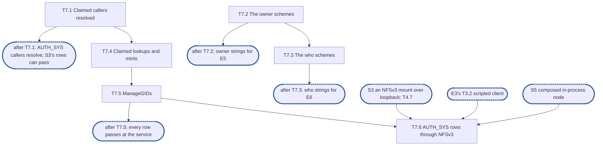

# Epic 7: NFS adapter v2 identity's NFS side

**Sources:** [RFC 18](../docs/internals/rfcs/rfc-18-identity.md) §3.2 (`AUTH_SYS` and `AUTH_NONE`),
§4.3 (uid and gid), §4.5 (NFSv4 owner strings), §5.5's claimed-uid mint and its three guards, §6.3's
`Claimed` row and `ManageGIDs`. With them come the sections they cite for a claimed caller:
- §4.1's rule that a lookup error is never "unknown principal";
- §5.3's stale bound and §5.4's rule that errors never become answers;
- §6.1's map, squash and group steps, and its errors;
- §6.2's squash order and `Anonymous`;
- §6.4's grant to authenticated users;
- §6.5's `Claimed` row;
- §7.1's key and freshness;
- §7.3's two rows for a `Claimed` caller;
- §9.2's counters;
- §10's rows "one uid, two proofs", "client in the key", "root", "error is not "unknown"", "squash
  order follows the proof", "admin needs proof", "owner strings", "lookup cap", "`AUTH_SYS` from the
  directory", "mint from a claim, guarded" and "`ManageGIDs`", with its Fuzz and Unit paragraphs.

Also [RFC 16](../docs/internals/rfcs/rfc-16-metadata-store.md) §2.3's `ExportPolicy.ManageGIDs`,
with §3's `SharePolicy` and §6.3's golden vectors; [RFC 13](../docs/internals/rfcs/rfc-13-configuration.md)
Appendix B's `identity.nfs4_domain` row; and [RFC 21](../docs/internals/rfcs/rfc-21-nfs.md) §11.1's
"Root", "The credential's group" and "What a claim reaches" bullets, with §13's "§8.1 privilege *(1
node)*" row for its `AUTH_SYS` steps. Every clause cited reads the same on `develop` and on
`feat/storage-v2`.
Cited, not owned: [RFC 17](../docs/internals/rfcs/rfc-17-vfs.md) §3.0's `Call` row (`Spell` acts for
no caller) and §4.9's admission steps; RFC 8881 §5.9 for numeric owner strings.
**Track:** B.
**Epic 7 estimate: 6 subtasks, 19 man-days.**
**Depends on:** nothing in this programme for T7.1 to T7.5. They are service code that no NFS
package reaches except through `vfs.Service`, and they build on what RFC 18's plan landed on
`feat/storage-v2`, listed in §1.1, so **S6a** and **S6b** already hold. T7.6 waits for **S3** (E3's
scripted client, T3.2, and E4's NFSv3 and MOUNT over loopback, T4.7) and for **S5**, the composed
in-process node.
**Blocks:**
- S3, and every NFS test whose `AUTH_SYS` call reaches admission on `memory.New`: E4's T4.7 and
  T4.10's loopback row, E5's T5.4 and T5.9, and E8's, E9's and E11's. Until T7.1 lands, each is
  refused `ErrAccess` (§9, point 1). It resolves the `Claimed` `Identity` E3's T3.1 builds.
- E5, whose T5.4 and T5.5 spell and parse `owner` and `owner_group` through T7.2's schemes, and
  E6, whose T6.2 spells and parses `who` through T7.3's.
- E16, which runs the Kerberos and NFSv4 halves of the rows this epic runs over `AUTH_SYS`.

---

## 1. Goal

Epic 7 makes identity resolve an `AUTH_SYS` or `AUTH_NONE` caller and spell an NFSv4 owner string,
the NFS half of RFC 18 that RFC 18's plan left out. It is service code in `internal/identity`,
`pkg/identity`, `pkg/vfs` and `pkg/metadata`, which the adapter reaches only through `vfs.Service`'s
admission, `Spell` and `Find`.

**At the end of the epic:**

- an `AUTH_SYS` call resolves on every share:
  - its uid and gids map through the `uid` and `gid` indexes: uid 0 to root, an unmapped uid to
    anonymous (counted), and a gid no principal holds is dropped;
  - it is squashed before its grant is read;
  - it is never `authenticated` or `admin`, and privileged only as unsquashed root;
  - a directory principal it maps to follows the directory's enabled state and TTL;
- with a directory configured, a claimed uid or gid the store lacks is asked of the directory by
  `uidNumber` or `gidNumber`, and its entry is minted:
  - at most 100 lookups a minute per client address, and 100 mints a minute per node;
  - past either cap, the call is refused retryably and never mapped to anonymous;
- a share whose export policy sets `ManageGIDs` replaces the claimed gids with the mapped
  principal's closure, and the setting is reachable through the API;
- `Spell` and `Find` serve owner strings and `who` strings under `identity.nfs4_domain`, and
  `FuzzOwnerString` runs;
- RFC 18 §10's `AUTH_SYS` rows pass against the filesystem with the real identity server, and the
  rows that exercise the adapter pass again through NFSv3 on the composed node.

### 1.1 In scope

The claimed path through resolution's five steps; the directory's questions by `uidNumber` and
`gidNumber`; the two caps and their refusals; `ManageGIDs`, from the export policy record to the
API; the owner schemes, the `who` schemes, their setting and the fuzz target; RFC 18 §10's rows listed above, at the
filesystem layer and, through NFSv3, on the composed node; and the RFC text that calls these pieces
deferred, in one RFC pull request on `develop`.

**Already built on `feat/storage-v2`.** This epic reuses these and does not rebuild them:

- `identity.Identity`, with `ProofClaimed` and `Claims`. `Identity.Key()` keys every claimed uid
  and gid, with the primary gid kept apart (`pkg/identity/key.go`).
- Admission's caller cache, keyed on the whole `SharePolicy`, the read-only cause, `Caller.Built`,
  and the client address where a client rule decided (`internal/vfs/admission.go`, `callers.go`).
  It does not store a caller whose `Fresh` is zero.
- Resolution through `Deps.Identity`. This came with #5373, which deleted
  `internal/vfs/admit/resolve.go` and its `mapID`; the `decision:` markers that file held on a
  claimed caller's gids and on claimed uid 0 went with it.
- In `internal/identity/resolve.go`: the squash, grant and flag steps for `None` and proven
  callers, `Caller.Group`, `closure`, the group cap and `identity_resolution_refusals_total`.
- In `internal/identity/names.go`: `Find` and `Spell` for uid and gid, with 0 and 65534 reserved,
  and `identity_unmapped_total` for uid, gid and SID.
- The directory client and its cache. `dirPrincipal` mints an entry with its `uidNumber`, or an
  allocated one in place of 0, 65534 or a held number, together with its closure's groups in one
  batch. `dirStep` refreshes a proven directory principal on the TTL.
- `throttleUnit` and the throttle's bounded table, in `internal/identity/throttle.go`.
- `SchemeOwner`, for which `Spell` and `Find` answer `ErrInvalid` until T7.2.
- Kerberos sign-in, with tickets made under `identitytest`'s test realm keys, as a KDC makes them.

### 1.2 Out of scope

- **Decoding the credential.** Turning an `AUTH_SYS` or `AUTH_NONE` credential into an `Identity`,
  refusing one that does not decode, and ignoring its machine name and stamp are E3's (RFC 21
  §11.1). `Claims` has no field for the machine name or the stamp.
- **Owner strings on the wire.**
  - `fattr4`'s `owner` and `owner_group` are E5's, and `who` is E6's.
  - Each of them chooses the scheme by the call's proof kind (D1), and shows a principal `Spell`
    cannot spell by its decimal uid or gid where it has one, else as `65534`, never as
    `nobody@domain` (D5).
  - Encoding every principal through `Spell` and `Find`, and deriving none from another (RFC 18
    §4.1), is E4's, E5's and E6's, and RFC 20's import test checks it.
  - Answering a lookup error as a server failure is E4's and E5's error tables (RFC 18 §4.1).
  - A `sattr3` uid or gid goes through `Find` in E4, with its `NFS3ERR_INVAL`.
- **`ErrLogonFailure`'s NFS rows.** Only `SignIn` answers it, and that is built (S6b). Over NFS,
  only an RPCSEC_GSS context's creation signs in, so the rows are E13's. The service half of
  `ErrUnknownPrincipal`'s rows is this epic's: R32 and R33.
- **The Kerberos halves over NFS.** These need RPCSEC_GSS (E13) and run end to end in E16:
  - "one uid, two proofs"' `sec=krb5` read;
  - the `sec=krb5` steps of "admin needs proof" and "owner strings";
  - RFC 21 §13's "§8.1 privilege *(1 node)*", whole, over NFSv4.

  This epic runs their Kerberos side against the filesystem, with a ticket `SignIn` accepts.
- **Tier 2 rows over NFSv4, and "error is not "unknown"" on the composed node.** The latter needs a
  store fault below a running node. Both are E16's.
- **Other rows' NFS steps.** "no file spelling"'s `SP4_MACH_CRED` step is E8's. "expiry" and "disable
  takes effect"'s GSS half are E13's.
- **Clauses of this epic's rows that other code already holds:**
  - "one uid, two proofs"' operator write giving bob alice's uid is RFC 16's conformance suite's;
  - "root"'s directory clause, an entry with `uidNumber` 0 minted with an allocated uid, is RFC 18's
    plan's, run by `TestDirectoryMintRemapsReservedIDs`;
  - the "forwarded identity" unit row, a `Claimed` identity with evidence refused `ErrInvalid`, stays
    green under `TestResolveRefusesAnInconsistentIdentity`, which T7.1 keeps.

### 1.3 Names used here

- **E3**, the RPC layer. Its `AUTH_SYS` and `AUTH_NONE` `Security` stage builds the `Identity` this
  epic resolves, and its scripted client is what T7.6 drives.
- **E4**, NFSv3 and MOUNT: the procedures T7.6's rows call, and `sattr3`'s owner fields.
- **E5**, the NFSv4 namespace, attributes and data path: `owner` and `owner_group` through `Spell`
  and `Find`.
- **E6**, the NFSv4 ACL attributes: `who` through `Spell` and `Find`, under T7.3's schemes.
- **E8**, clients and sessions. **E9**, opens, stateids and locks. **E11**, NLM, NSM and the datagram
  path. **E13**, RPCSEC_GSS: Kerberos over NFS.
- **E16**, E2E green: the in-process, end-to-end and restart rows the middle epics leave.
- **S2**, NFS's test foundations in CI, which every middle epic starts from.
- **S3**, an NFSv3 mount over loopback: E3's scripted client sends `NULL`, `MNT`, `GETATTR`, `READ`
  and `WRITE` over `AUTH_SYS` to `memory.New`, through `core`.
- **S5**, the composed in-process node, `internal/node/nodetest`, serving NFS.
- **S6a**, `Spell`, `Find` and resolution reachable through `vfs.Service`: RFC 18's plan's S2.
- **S6b**, Kerberos sign-in behind `SignIn`: RFC 18's plan's epic 5.

## 2. How the general rules apply

The rules are those of [the RFC 21 implementation plan's §1.5](rfc-21-nfs-plan.md#15-general-rules-for-each-epic),
cited by number and title and not copied.

| Rule | Subtasks | How |
| --- | --- | --- |
| rule 1, independent unit tests, under `-race` ([`CLAUDE.md`, "Writing tests"](../CLAUDE.md#writing-tests)) | all | Tier 1 rows run in `internal/identity`, over the real store, `identitytest`'s directory (kind 2, held to `directorysuite`), the test realm's tickets and the injected clock (kind 1). The filesystem's rows run in `internal/vfs`, over the real identity server. A store fault comes from `kvtest.FaultKV` and a directory fault from `identitytest`'s fault wrapper (kind 3). T7.6 runs on `nodetest`, with E3's scripted client. No other double is used |
| rule 2, fuzz tests where relevant | T7.2, T7.3 | `FuzzOwnerString` covers the owner-string parser, seeded with names, decimals, other domains and malformed strings (R35), and T7.3 adds `S-…@domain` seeds. Nothing else here decodes a peer's bytes |
| rule 3, observability follows RFC 25 and RFC 20 §10 | T7.1, T7.2, T7.3, T7.4 | Only identity's own series, RFC 18 §9.2's: `identity_unmapped_total` gains `owner`, which T7.3's `who` misses share with `sid` (R55), `identity_resolution_refusals_total` gains `lookup_cap`, and `identity_directory_lookups_total` gains the questions `uid` and `gid`. No NFS code records anything. No label carries a uid, a name, an owner string or an address |
| rule 4, profiling: leaks, allocations and contention | T7.6 | T7.6 ends with RFC 20's leak check. The two cap tables are touched on a caller-cache miss only, on no hot path. T7.4's concurrent `-race` test is their check |
| rule 5, public interface and internals, at the layer that consumes a value ([`CLAUDE.md`, "Verifying a change"](../CLAUDE.md#verifying-a-change)) | all | A claimed caller is asserted where the filesystem's permission check reads it: a write refused, a `chown` not permitted, a file's group. It is never asserted on the `Caller` alone. Owner strings are asserted where `Spell` and `Find` answer the adapter, and T7.6 at the NFSv3 reply |
| rule 6, known failures shrink | none | no row of `pynfs`, `cthon04` or `nfstest` is run |
| rule 7, v2 ignores v1 | all | nothing of `develop`'s identity mapping is copied; behaviour comes from RFC 18 |
| rule 8, real dependencies for properties of those dependencies | T7.4, T7.6 | T7.4's new suite rows also run against a real LDAP directory, in `integration/ad-dc`; T7.6 runs through real TCP on loopback |
| rule 9, code comment conventions ([`CLAUDE.md`, "Code comments"](../CLAUDE.md#code-comments)) | all | RFC 18's own `decision:` notes go at their sites: §3.2's default for `ManageGIDs`, §4.3's unmapped uid, §4.5's numeric owners and §5.5's mint from a claim, plus §7.3's `ponytail:` on the two caps. This epic's markers are listed in §4. `resolve.go`'s `ponytail:` refusing a claimed identity is withdrawn, and `names.go`'s `decision:` deferring two schemes is narrowed to `oidc` |
| rule 10, a test must be able to fail | all | each test names the change that fails it; the table test of the five steps fails on any cell of the claimed branch |
| rule 11, a symbol is exported only if an interface uses it | T7.2, T7.3, T7.4, T7.5 | Exported, each with what uses it: `identity.SchemeOwnerGroup` and its `vfs` alias, for E5; `identity.SchemeWho` and `SchemeWhoGroup` and their `vfs` aliases, for E6; `directory.ByUID` and `directory.ByGID`, for `internal/identity`; `ExportPolicy.ManageGIDs` and `SharePolicy.ManageGIDs`, for the store, the API and resolution; the API spec's `manage_gids`, for operators; `identity.Settings.NFS4Domain` (`nfs4_domain`), for the settings table that `Section` declares, and so for the settings API and operators. Nothing else is exported |
| rule 12, each subtask creates only what it declares | all | the directory's two questions land in T7.4 with the mints that consume them, and the caps with the lookups they bound |
| rule 13, translate, never decide | T7.2 | identity decides every mapping; the adapter only picks the scheme from the proof it reports (D1) |
| rule 14, nothing deferred is lost | all | every half left out is named, with its owner, in §1.2 |

## 3. Requirements and invariants

Every MUST and MUST NOT that RFC 18, RFC 16, RFC 13 and RFC 21 place on this epic, numbered so that
subtasks and tests can cite them. A section cited with no RFC named is RFC 18's.

**The claimed caller's mapping**

| # | Requirement | Kind | Source | Subtasks |
| --- | --- | --- | --- | --- |
| R1 | An `AUTH_SYS` caller's uid and gids are taken as sent and mapped through the `uid` and `gid` indexes; nothing about them is verified, and a `Claimed` caller never signs in | MUST | §3.2, §4.3 | T7.1 |
| R2 | uid and gid 0 map to root, and 65534 to anonymous; a claimed uid 0 maps to RFC 18's root principal | MUST | §4.3; RFC 21 §11.1 ("Root") | T7.1 |
| R3 | An `AUTH_SYS` uid with no principal behind it, after the directory lookup where one is configured, maps to anonymous at mapping time, before any squash: `Mapped` is the anonymous principal, the caller acts as the share's `Anonymous` as a `None` caller does, and the call is counted `identity_unmapped_total{scheme="uid"}` | MUST | §4.3, §6.1 | T7.1, T7.4 |
| R4 | A claimed uid held by a disabled principal is refused `ErrAccess`, and never acted on as anonymous | MUST NOT | §6.1, §3.7 | T7.1 |
| R5 | A call that names no share is mapped under the installation's defaults, never under a share's mapping, and runs the map step alone | MUST | §4.3, §6.1 | T7.1 |
| R6 | A credential gid with no principal is no group at all: it is dropped from the caller's groups, and a create falls back to the principal's primary group | MUST | §4.3, §6.1; RFC 21 §11.1 ("The credential's group") | T7.1 |
| R7 | An unsquashed claimed caller's `Group` is the principal holding its claimed gid; every other caller's is zero | MUST | §6.1 | T7.1 |
| R8 | Without `ManageGIDs`, a claimed caller's groups are its claimed gid and its supplementary gids, each mapped | MUST | §3.2, §6.3 | T7.1 |
| R9 | A `None` caller acts as the share's anonymous principal | MUST | §3.2 | T7.1 |

**Squash, grant and flags of a claim**

| # | Requirement | Kind | Source | Subtasks |
| --- | --- | --- | --- | --- |
| R10 | A claimed identity is squashed first, and its grant is read for the squashed principal: on an `all` share its access is the `Anonymous` principal's own grant if it has one, else the everyone grant, and per-user grants decide nothing | MUST | §6.2 | T7.1 |
| R11 | A `root` squash replaces a caller mapped to root by a claimed uid 0; a squashed claimed caller carries no group of the principal it replaced, and all its flags are false | MUST | §6.2 | T7.1 |
| R12 | A deleted `Anonymous` fails closed: a claimed call the policy would squash, or one acting as anonymous, is refused | MUST | §6.2 | T7.1 |
| R13 | A `Claimed` caller is never `authenticated`, an `admin` grant confers nothing on it, and the grant naming authenticated users never matches it | MUST NOT | §3.2, §6.4, §6.5; RFC 21 §11.1 ("What a claim reaches") | T7.1 |
| R14 | A claimed caller mapped to root and unsquashed is `Privileged`; no other claimed caller is | MUST | §6.5 | T7.1 |
| R15 | A store error while mapping or collecting a claimed caller is `ErrUnavailable`: it is never read as "no such principal", and never yields anonymous | MUST NOT | §5.4, §6.1 (errors) | T7.1 |

**The directory and the mints a claim triggers**

| # | Requirement | Kind | Source | Subtasks |
| --- | --- | --- | --- | --- |
| R16 | With a directory configured, a claimed uid or gid with no row is asked of the directory by `uidNumber` or `gidNumber` | MUST | §4.3 | T7.4 |
| R17 | An entry that answers is minted as a directory principal, and the caller acts as it, not `authenticated` | MUST | §4.3, §5.5 | T7.4 |
| R18 | A record is minted only on the directory's word: a uid the directory does not know acts as anonymous and writes nothing | MUST NOT | §5.5 (guard 1) | T7.4 |
| R19 | The directory lookups a `Claimed` caller triggers are at most 100 in any 60 seconds per client address; past that, a call needing a lookup for its uid or primary gid is refused with a retryable error and never mapped to anonymous (a supplementary gid is R53's) | bound | §4.3, §7.3 | T7.4 |
| R20 | The records a `Claimed` caller's lookup mints are at most 100 in any 60 seconds per node, whatever the client, each user and each group counted; past that, the call is refused with a retryable error, never mapped to anonymous, and nothing is written | bound | §5.5 (guard 2), §7.3 | T7.4 |
| R53 | Past the lookup cap, a claimed supplementary gid that no principal holds is left out of the caller's groups, uncharged, rather than refusing the call; a gid a principal holds is never left out, and a caller built with a gid left out is not cached | MUST | §4.3, §7.1, §7.3 | T7.4 |
| R54 | A user whose closure's unminted groups do not all fit the mint cap's room is minted with those that fit, and the rest on its later calls as the cap admits them; a user is refused only when the cap has no room for its own record | MUST | §5.5 (guard 2), §7.3 | T7.4 |
| R21 | A record a claimed caller reaches is bound to the entry's permanent ID, never to its name; it is refreshed on the directory cache's TTL, and disabled when the directory says the entry is disabled or answers that it is gone | MUST | §5.5 (guard 3) | T7.1, T7.4 |
| R22 | A directory principal's uid and gid are the entry's `uidNumber` and `gidNumber` when it has them, else allocated; they are written once, with the principal, and never recomputed | MUST | §4.3 | T7.4 |
| R23 | A caller that used a directory answer is served from the cache at most the directory's TTL after it was built (`Fresh`); a caller with a zero `Fresh` is not stored | MUST | §7.1 | T7.1, T7.4 |
| R24 | A call refused at the per-address cap is counted `identity_resolution_refusals_total{reason="lookup_cap"}`; a claimed uid or gid asked of the directory is counted under `identity_directory_lookups_total`'s questions `uid` and `gid` | MUST | §9.2 | T7.4 |
| R25 | A directory error during a claimed lookup, or an answer neither fresh nor within the stale grace, is `ErrUnavailable`: it is never "no such entry", never anonymous, and nothing is written | MUST NOT | §5.3, §5.4 | T7.4 |

**`ManageGIDs`**

| # | Requirement | Kind | Source | Subtasks |
| --- | --- | --- | --- | --- |
| R26 | A share's export policy carries `ManageGIDs`, off by default | MUST | RFC 16 §2.3 (`ExportPolicy`); §3.2 | T7.5 |
| R27 | With `ManageGIDs`, a claimed caller's groups are the closure of the mapped principal's memberships (for a directory principal, including the directory's groups), in place of the credential's gids | MUST | §3.2, §6.3 | T7.5 |
| R28 | That closure is computed whole, or the call fails | MUST | §6.3 | T7.5 |
| R29 | The caller cache's key carries `ManageGIDs`, as a field of the share's policy, and the share's `ExportPolicy.Version` | MUST | §7.1 | T7.5 |

**Owner strings**

| # | Requirement | Kind | Source | Subtasks |
| --- | --- | --- | --- | --- |
| R30 | The domain is `identity.nfs4_domain`, an installation setting applied live; by default it is the keytab's first realm in lower case, or `localdomain` with none | MUST | §4.5; RFC 13 Appendix B | T7.2 |
| R31 | The owner scheme spells a principal with a name as `name@domain`, and a principal minted without a name as its decimal uid or gid. Which scheme a call reads, and so the decimal form for a `Claimed` or `None` call, is E5's and E6's (D1) | MUST | §4.5, §4.1 | T7.2 |
| R32 | A principal with no owner spelling is `ErrUnknownPrincipal` from `Spell`, which the adapter shows by its decimal uid or gid where it has one, else as `65534`; never as `nobody@domain`, which `Find` resolves through a local user named `nobody` (D5) | MUST | §4.5 | T7.2 |
| R33 | A string `name@domain` whose domain equals `identity.nfs4_domain`, compared case-insensitively, maps by name (§4.6); a decimal string maps by uid or gid, whatever the proof; any other string, including a name in another domain, is `ErrUnknownPrincipal` | MUST | §4.5 | T7.2 |
| R34 | A lookup error other than "not found" reaches the adapter as itself, never as `ErrUnknownPrincipal`, so the adapter answers a server failure | MUST NOT | §4.1 | T7.2 |
| R35 | `FuzzOwnerString` never panics, never allocates more than the input's size times a constant, and decode∘encode is the identity on whatever decodes | test row | §10 (Fuzz) | T7.2 |
| R36 | An owner string no principal holds is counted `identity_unmapped_total{scheme="owner"}`, in either owner scheme | MUST | §9.2 | T7.2 |
| R51 | The `who` schemes spell a principal as the owner schemes do, `name@domain` or the decimal number of one minted without a name; a principal that has a SID and no owner string by the SID's string form at the domain, `S-…@domain`; and a deleted principal as the null SID, `S-1-0-0@domain` | MUST | RFC 21 §11.3 (`who`); RFC 19 §5.2; §4.5 | T7.3 |
| R52 | On a find, a `who` of the form `S-…@domain` with a well-formed SID resolves by that SID; any other through §4.5's rules, in the user or group namespace the scheme names | MUST | RFC 21 §11.3 (`who`); §4.5 | T7.3 |
| R55 | A `who` no principal holds is counted as RFC 18 §9.2's labels allow: `identity_unmapped_total{scheme="sid"}` for a well-formed `S-…@domain`, `scheme="owner"` for any other | MUST | §9.2; RFC 21 §11.3 (`who`) | T7.3 |

**Conformance rows**

| # | Requirement | Kind | Source | Subtasks |
| --- | --- | --- | --- | --- |
| R37 | "one uid, two proofs": two directory users with no uid get different allocated uids. alice reads over Kerberos a file whose ACL grants `Finance` only: granted. From another host, over `AUTH_SYS`, alice's uid with no gids: refused, not `authenticated`, and the caller cache missed | test row | §10 | T7.4, T7.6 |
| R38 | "client in the key": hosts A, B and C, which a share admits read-write, read-only and not at all, send identical `AUTH_SYS` claims. A writes, B's writes are refused `ErrReadOnly`, C is refused admission, and no call hit an entry another host built | test row | §10 | T7.4, T7.6 |
| R39 | "root"'s `AUTH_SYS` clauses: with `Squash = none`, uid 0 with no user record can `chown`, and a file root creates is owned by root; with `Squash = root`, refused | test row | §10 | T7.1, T7.6 |
| R40 | "error is not "unknown"": a store error on the `uid` index during an `AUTH_SYS` call to a share whose everyone grant is `read-write` is a retryable error, and nothing is created | test row | §10 | T7.1 |
| R41 | "squash order follows the proof"'s `AUTH_SYS` half: `Squash = all`, alice granted `read-write`, everyone `read`. A write claiming alice's uid is refused | test row | §10 | T7.1 |
| R42 | "admin needs proof"'s `AUTH_SYS` half: a grant names uid 1500 `admin`. Over `AUTH_SYS` as uid 1500, a read of another user's mode-0600 file is refused | test row | §10 | T7.1 |
| R43 | "owner strings" at the service: a proven `chown` to `alice@corp.example` succeeds, and to `alice@other.example` is refused as unknown; a file owned by a deleted user has no owner spelling | test row | §10 | T7.2 |
| R44 | "lookup cap": one address sends 101 distinct unknown uids in a minute. At most 100 directory queries go out; the rest are refused retryably, and none is mapped to anonymous | test row | §10 | T7.4 |
| R45 | "`AUTH_SYS` from the directory": the `uidNumber` of a directory entry with no record makes the caller that entry's minted principal, not `authenticated` | test row | §10 | T7.4, T7.6 |
| R46 | "mint from a claim, guarded": each of 10^4 uids the directory lacks acts as anonymous and writes nothing. 500 uids it holds, sent from 50 addresses at once, mint no more than the node cap a minute; the rest are refused retryably, never as anonymous. A renamed entry keeps its `PrincipalID`, with the new name, after the TTL. A disabled entry and a deleted entry are refused after the TTL | test row | §10 | T7.4, T7.6 |
| R47 | "`ManageGIDs`": a user in 20 store groups calls over `AUTH_SYS`, and a file whose ACL grants only the 20th group is granted | test row | §10 | T7.5, T7.6 |
| R48 | RFC 21 "§8.1 privilege *(1 node)*"'s `AUTH_SYS` steps at the service: `Squash=root`, and a grant naming uid 1500 `admin`. As uid 1500, a `chown` of another user's file is not permitted, and a read of their mode-0600 file is refused; as root, the caller is squashed | test row | RFC 21 §13 | T7.1 |
| R49 | Resolution's five steps run as one table-driven test over proof kind × squash × grant × no file spelling, with the `Claimed` kind included | test row | §10 (Unit) | T7.1 |
| R50 | Of the Tier 2 rows above, "one uid, two proofs"' `AUTH_SYS` step, "client in the key", "root", "`AUTH_SYS` from the directory", "mint from a claim, guarded" and "`ManageGIDs`" run through the NFS adapter on the composed single-node harness | test row | §10 (tiers) | T7.6 |

**Not obligations of this epic:**
- §3.2's machine name and stamp, which `Claims` cannot carry, and its refused credentials: E3's.
- §4.3's display of a principal with no uid or gid spelling as 65534. Its service half is built:
  `Spell` answers `ErrUnknownPrincipal` (`TestWellKnownSpellings`). Its wire half is E4's and E5's.
- A deleted user's claimed uid. Its index rows go with the user (§3.7), so the uid is unmapped and
  falls under R3.
- Built by RFC 18's plan: §6.3's `Secret` and `Ticket` rows and its deny-only rules; §6.5's PAC
  half; §7.1's proof key and its shared misses.
- §7.3's other tables.
- §5.5's Kerberos and NTLM rows of its table: RFC 18's plan's and E13's.
- §1.2 names the rest.

## 4. Decisions this epic takes

- **D1. The adapter picks the owner scheme by the proof it reports, and `Spell` stays callerless.**
  RFC 18 §4.5 spells an owner by the call's proof kind, but RFC 17 §3.0 has `Spell` act for no
  caller, so `Spell` cannot see the proof.
  - So the owner schemes spell the proven form: `name@domain`, or the decimal number of a principal
    with no name. E5 and E6 ask the uid or gid scheme for a `Claimed` or `None` call: the flavour is
    translated into a scheme, and nothing is decided.
  - Making `Spell` take a `Call` would change RFC 17's surface, `vfstest`'s three services and every
    caller, for no gain.
  - The RFC pull request (§9, point 2) adds a sentence to RFC 18 §4.5 saying the adapter picks the
    scheme by the proof it reported. A `decision:` marker at the owner spelling says the same, and
    is overturned if a scheme ever depends on more than the proof kind.
  - Prior art: Linux's `nfs4_disable_idmapping`, on by default, sends numeric owners to `AUTH_SYS`
    clients and names to Kerberos ones (from memory). The independent architect pass proposed the
    same.
- **D2. Owner groups get their own scheme, pending the user's answer.** RFC 18 §4.6 makes every name
  lookup say which kind it wants, and §2.2 already splits uid from gid and user names from group
  names. `SchemeOwner`, though, is one scheme, so a `Find` of `alice@corp.example` for an
  `owner_group` cannot tell the user alice from her private group alice.
  - T7.2 adds `SchemeOwnerGroup` after `SchemeQualified`, so every existing value is unchanged.
    `SchemeOwner` then spells and finds users only.
  - Later epics pin it: E5 for `owner_group`, and E6 for a `who` with the group flag. Changing it
    after they land rewrites both.
  - Prior art: libnfsidmap's separate `nfs4_name_to_uid` and `nfs4_name_to_gid` (from memory). The
    architect pass proposed the same.
  - Options are in §9, point 3.
- **D3. An owner name is found in the store only.** RFC 18 §4.5 maps `name@domain` by name and
  says nothing of the directory.
  - T7.2 reads the name index and never queries or mints, so a `chown` to a directory user never
    seen before is `ErrUnknownPrincipal`.
  - A `ponytail:` marker names the ceiling and the upgrade: ask the directory under
    `FindOpts.Mint`, through `findDirectoryName`, as `findQualified` does, once an NFSv4 client is
    shown setting owners of unminted directory users. Adding that later changes no contract.
  - Prior art: `rpc.idmapd` asks its configured name service, LDAP included (from memory).
- **D4. The domain's default and its check.**
  - An empty `identity.nfs4_domain` means the default, derived at each `Apply` from the first realm
    of the imported keytab's current version, else `localdomain`, in lower case: exactly RFC 18
    §4.5's rule.
  - A value that is set must be ASCII letters, digits, `-` and `.`, at most 253 bytes. It is stored
    as given and compared with ASCII letters folded, RFC 18 §4.6's rule for realms.
  - No marker: the RFC states the default.
  - Prior art: `rpc.idmapd`'s `Domain`, which defaults to the host's DNS domain (from memory).
- **D5. Root and anonymous spell as their reserved numbers in the owner scheme.** They have no name,
  so they are spelled as a principal minted without a name is: `0` and `65534`, which matches RFC 21
  §11.3's `0` for root. `Find` maps both back through the reserved IDs. A `decision:` marker says
  that anonymous is not spelled `nobody@domain` because a local user named `nobody` would capture
  that name; it is overturned if a client is shown to need the name.
- **D6. The lookup cap.**
  - It is keyed on `throttleUnit` of the client address, as the logon throttle is (an IPv4
    address, or an IPv6 /64), in a table bounded like the throttle's.
  - It is charged once for each claimed uid or gid that reaches the directory. A fresh answer in the
    directory cache costs nothing, so a client that repeats one unknown uid is not refused.
  - Past the cap, a supplementary gid no principal holds is not asked and not charged: it is left out
    of the caller's groups and counted `identity_unmapped_total{scheme="gid"}`, as T7.1 counts a gid
    no principal holds, and the caller is built with a zero `Fresh`, so it is not cached and the next
    call asks again (R53). Only the uid and the primary gid refuse the call. So a host whose users
    carry local gids the directory lacks does not use up its window on them and then refuse every
    user, mapped or not. A `decision:` marker states the rule and why it holds: a gid no principal
    holds names nothing any ACL holds, so leaving it out loses no grant and escapes no deny entry; it
    is overturned if an ACL can ever name a group the node has not minted.
  - The closure queries of the mint that follows are not charged. They are bounded by the group cap,
    and each follows a lookup that was charged.
  - Each unit keeps the times of its last 100 charged lookups in a ring, on the injected clock, and
    admits a lookup only when the oldest of them is at least 60 seconds old, so no 60 seconds ever
    hold more than 100 lookups (R19). A fixed window would admit 200 across its boundary, and a token
    bucket of 100 refilling at 100 a minute up to 199 in a minute.
  - A refusal is `ErrUnavailable`, which NFS answers as `NFS3ERR_JUKEBOX` or `NFS4ERR_DELAY`, and is
    counted under `lookup_cap`.
  - A `ponytail:` marker says that the ring costs 100 timestamps per tracked unit, bounded by the
    table; move to a counter per second, summed over the last 60, if the table's memory shows in a
    profile.
  - Prior art: the logon throttle, `internal/identity/throttle.go`.
- **D7. The mint cap.**
  - It is one node-wide ring of the same shape, charged once for each record minted, user or group,
    so no 60 seconds mint more than 100 records (R20). `dirPrincipal` mints a user together with its
    closure's not-yet-minted groups in one batch, and a batch is charged for every record in it.
  - A user whose batch does not fit the room left is minted with as many of its closure's unminted
    groups as fit, in the directory's order; the rest are minted on the user's later calls, each
    charged, as the ring admits them (R54). Its record marks the closure incomplete, so the next
    resolution asks for it again rather than serving the cached caller, and the user is refused only
    when the ring has no room for its own record. So a user in more than 100 groups stays mintable,
    over several minutes.
  - A `decision:` marker states this and why it holds: until its closure is complete the caller
    lacks only the grants of groups no principal holds yet, which no ACL can name, so it escapes no
    deny entry; it is overturned if an ACL can ever name a group the node has not minted.
  - The mint cap's refusal is counted under `lookup_cap` too, since RFC 18 §9.2 names no other
    reason. A `decision:` marker names this, and the reason to add one: a dashboard that must tell
    the two caps apart.
  - Prior art: none found.
- **D8. A claimed directory principal goes through the directory step.**
  - `dirStep` runs today for proven callers only. T7.1 runs it for a claimed caller whose uid maps to
    a directory principal already minted (one Kerberos signed in, say), so that its enabled state
    follows the directory (R21) and its `Fresh` is bounded by the answers it used (R23). Without this
    step, a user disabled in the directory would still be admitted over `AUTH_SYS`.
  - `dirStep` reads the directory groups only under `ManageGIDs` (T7.5), since without it a claim's
    groups are the claimed gids. A mint's own batch is `dirPrincipal`'s.
  - Prior art: none, beyond RFC 18 §5.5's guard 3.
- **D9. `Find` of a uid or gid never asks the directory.** RFC 18 §4.3's directory lookup is for a
  credential's ids. A `sattr3` uid (E4) or a decimal owner string (T7.2) reads the index alone, so
  no attribute a client sets can make the server query the directory or mint. A `decision:` marker
  at `Find` says so; it is overturned if a client is shown setting the uid of a directory user it
  has never presented.
- **D10. An answer two entries give for one number is refused.** A `uidNumber` or `gidNumber` that
  two directory entries hold (`ErrAmbiguous`) is refused `ErrAccess`, counted `ambiguous` as the
  directory cache counts it today. It is never anonymous and never minted, because guard 1 mints on
  one entry's word. A `decision:` marker names the ceiling: a directory with duplicate numbers locks
  those users out until it is fixed.
- **D11. `ManageGIDs` is one more field of the export policy's version 1 encoding, pending the
  user's answer.** RFC 16 §4.6 makes a new codec version a format bump, and §6.3 fails a golden
  vector that changes without one.
  - No release has created a store yet. The krb spelling's linked SID was added to version 1 in the
    same way (#4807), with a `decision:` marker at `putLinked`.
  - T7.5 appends a bool after `Version`, updates the export policy's golden vector in
    `codecs_test.go`, and leaves the same kind of `decision:` marker at `encodePolicy`: a policy
    written before the change fails to decode, closed. The marker is withdrawn once a release creates
    stores, after which the next field is a version 2 codec and a format bump.
  - Options are in §9, point 4.
- **D12. Where each row runs.**
  - Tier 1 rows, and each row's identity half, run in `internal/identity`.
  - A row's file-operation half runs in `internal/vfs`, with the filesystem built over the real
    identity server, as its tests already do. A new claimed helper sits beside the proven `as`,
    which keeps its behaviour; only its comment saying claims are refused is corrected (T7.1).
  - T7.6 covers only the Tier 2 rows where the adapter's address, status or credential plumbing can
    fail on its own (R50).
  - The Kerberos-over-NFS and NFSv4 halves are E13's and E16's (§1.2).
  - Prior art: RFC 18 §10's "Who stands in for what".
- **D13. The `who` strings are identity's, in two schemes of their own.** RFC 21 §11.3 spells a
  principal with no owner string by its SID at RFC 18 §4.5's domain, which the adapter can neither
  read (RFC 20 §2.3) nor format, since `pkg/vfs` exports no SID codec.
  - T7.3 adds `SchemeWho` and `SchemeWhoGroup` after `SchemeOwnerGroup`: `Spell` answers what the
    owner scheme answers, else `S-…@domain`, else, for a principal no record holds, `S-1-0-0@domain`;
    `Find` takes what the owner schemes take, plus `S-…@domain` by its SID, in users or in groups as
    the scheme says, so RFC 18 §4.5's parsing keeps one copy.
  - They are schemes of their own because RFC 18 §4.5 has `Spell` answer `ErrUnknownPrincipal` for
    a principal with no owner spelling, which `owner` shows as `65534`, while `who` must spell it.
  - E6 asked for them (its D4); this epic builds them, beside the owner schemes and their domain.
    Changing them after E6's T6.2 lands rewrites its `Names`.
  - Prior art: `nfsidmap` resolves an ACE's `who` through the same idmapper as `owner` (from
    memory); no server found that spells a SID there.
  - The RFC 18 §4.5 text goes in this epic's RFC pull request (§9, point 2), pending the user's
    answer (§9, point 3).

## 5. Target tree

```text
internal/identity/
  claimed.go               T7.1  a claim mapped: uid, gid, root, anonymous, groups; T7.4 asks the directory and mints
  resolve.go               T7.1  the claimed branch of the five steps, its ponytail withdrawn, dirStep for a claimed
                                 directory principal; T7.5 ManageGIDs' closure in place of the claimed gids
  claimed_test.go          T7.1  the five-step table with Claimed; the rows' identity halves
  owner.go                 T7.2  the two owner schemes: parse, spell, find; T7.3 the two who schemes
  names.go                 T7.2  deferred() serves them; identity_unmapped_total's owner label
  settings.go, server.go   T7.2  identity.nfs4_domain, its check, its default derived at Apply
  owner_test.go            T7.2  spellings, finds, the domain's default; FuzzOwnerString
  names_test.go            T7.2  TestDeferredSchemes's unknown scheme moved past SchemeOwnerGroup; T7.3 past SchemeWhoGroup
  claimcap.go              T7.4  the per-address lookup cap over the throttle's table, the per-node mint cap
  dircache.go              T7.4  the uid and gid question labels
  claimed_dir_test.go      T7.4  lookup cap, AUTH_SYS from the directory, mint from a claim, directory faults
internal/identity/directory/
  client.go, filter.go     T7.4  the ByUID and ByGID keys, filtering on uidNumber and gidNumber
pkg/identity/
  names.go                 T7.2  SchemeOwnerGroup (D2); T7.3 SchemeWho, SchemeWhoGroup (D13)
  identity_test.go         T7.2  the Stored table gains SchemeOwnerGroup; T7.3 SchemeWho, SchemeWhoGroup
  identitytest/directorysuite.go, filter.go  T7.4  exact numeric queries, held to the real directory
pkg/vfs/types.go           T7.2  the SchemeOwnerGroup alias; T7.3 the SchemeWho and SchemeWhoGroup aliases
pkg/metadata/entity/
  control.go               T7.5  ExportPolicy.ManageGIDs, SharePolicy.ManageGIDs
pkg/metadata/kvstore/
  codecs.go, codecs_test.go     T7.5  the field and the golden vector (D11)
  kvstoretest/controlplane.go   T7.5  the field round-trips, raises Version and reaches SharePolicy
pkg/node/apiv1/exportpolicy.go, internal/node/api/res_export_policies.go  T7.5  manage_gids
internal/vfs/
  claimed_test.go          T7.1  the rows' file-operation halves; T7.4 and T7.5 add theirs
  shares_test.go           T7.1  the claimed helper beside as; as's comment on claims corrected
internal/node/
  nfs_identity_test.go     T7.6  the AUTH_SYS rows through NFSv3 on nodetest
docs/guide/identity.md     T7.2  identity.nfs4_domain
docs/internals/rfcs/
  rfc-18-identity.md       T7.2  §2.2 and §4.1 gain SchemeOwnerGroup, §4.5 the scheme chosen by the adapter;
                                 T7.3 §2.2, §4.1 and §4.5 gain the who schemes;
                                 T7.5 the "deferred" notes of §3.2, §5.5, §6.3, §7.1 and §10 rewritten
  rfc-16-metadata-store.md T7.5  ManageGIDs in §2.3's ExportPolicy and §3's SharePolicy
```

## 6. Subtasks

### T7.1 Claimed callers resolved

**Subtask T7.1 estimate: 4.5 man-days.**

- **Track:** B. **Depends on:** none.
- **Covers:** R1–R15, R21, R23, R39–R42, R48, R49.
- **Deliverables:**
  - `claimed.go`: the map step for a claim, as a function of the `Identity`, the `State` and the
    store. It maps:
    - the uid through the `uid` index, with 0 and 65534 going to their reserved holders;
    - a uid no principal holds to the well-known anonymous, counted
      `identity_unmapped_total{scheme="uid"}`;
    - the primary gid, and each supplementary gid, to its holder, skipping any no principal holds,
      counted under `gid`.

    It is unexported, and is consumed by `resolve.go`, T7.4 and T7.5.
  - `resolve.go`: the claimed branch through every step.
    - Squash comes first (R10), then collect (R8), then the grant, read for the squashed principal
      and unauthenticated; the flags make the caller privileged only as unsquashed root.
    - `dirStep` runs, without groups, for a claimed caller mapped to a directory principal (D8).
    - A call naming no share maps alone (R5).
    - The `ponytail:` refusing a claimed identity is withdrawn, and RFC 18 §3.2's, §4.3's and §6.2's
      `decision:` notes are placed at their sites.
  - `TestNoAnonymousPrincipalFailsClosed`'s claimed cases are rewritten: a claim of an unmapped uid
    now carries the fail-closed case. A claimed helper is added beside `internal/vfs/shares_test.go`'s
    proven `as`, whose comment about claims being refused is corrected.

  Consumed by:
  - S3's loopback rows (E4's T4.7), E4's T4.10 and E5's T5.4 and T5.9, which resolve the
    `Identity` E3's T3.1 builds;
  - every other NFS epic's `AUTH_SYS` calls that reach admission on `memory.New`;
  - T7.4, T7.5 and T7.6.
- **Acceptance criteria:**
  - A claim of a stored user's uid resolves to that user. Its `Group` is the holder of its gid, and
    its groups are the mapped gids. A gid that no principal holds is in neither, and a file the
    caller creates takes the user's primary group.
  - uid 0 resolves to root: privileged on a `none` share, squashed on a `root` share.
  - An unmapped uid acts as the share's `Anonymous`, and is counted.
  - A disabled user's uid is refused `ErrAccess`.
  - On an `all` share whose grants to alice, to `Anonymous` and to everyone all differ, a claim of
    alice's uid gets `Anonymous`'s grant; with the `Anonymous` grant removed, everyone's; never
    alice's. No claimed caller is `authenticated` or `admin`, whatever its grant.
  - A store error on the `uid` or `gid` index is `ErrUnavailable`, and nothing is written.
  - A claimed uid of a minted directory principal disabled in the directory is refused once the TTL
    has passed.
- **Tests:**
  - In `internal/identity`, at `Resolve`, which admission calls:
    - the five-step table over proof kind × squash × grant × no file spelling, with every `Claimed`
      cell added (R49). Each cell fails if the claimed branch reads the grant before the squash,
      keeps the mapped principal's groups after a squash, or sets a flag (catches R10, R11, R13, R14);
    - on an `all` share granting alice read-write, `Anonymous` read-only and everyone nothing, a
      claim of alice's uid reads and is refused a write; with `Anonymous`'s grant removed and
      everyone granted read-write, the same claim writes (catches `Anonymous`'s own grant skipped for
      everyone's, or alice's grant read after the squash, R10);
    - root by uid 0 and by gid 0 (R2);
    - an unmapped uid and gid, with the counter read (catches a uid defaulted to a user, R3, R6);
    - a disabled user (R4);
    - a call naming no share (R5);
    - `kvtest.FaultKV` failing the `uid` index read (catches an error mapped to anonymous, R15);
    - a minted directory principal disabled in `identitytest`'s directory, the clock advanced past
      the TTL (catches a claimed caller that skips `dirStep`, R21, R23);
    - `TestResolveRefusesAnInconsistentIdentity`, kept green.
  - In `internal/vfs`, at the operations whose permission check reads the caller, over the real
    identity server and an in-memory store:
    - one table over one fixture for "root"'s `AUTH_SYS` clauses, "admin needs proof"'s `AUTH_SYS`
      half and RFC 21 §8.1's `AUTH_SYS` steps: a `chown` refused `ErrPerm`, a mode-0600 read refused
      `ErrAccess`, root squashed (R39, R42, R48);
    - "squash order follows the proof"'s `AUTH_SYS` half (R41);
    - "error is not "unknown"", the fault on the `uid` index, with the directory listed after it
      unchanged (R40);
    - a create's group with a mapped and an unmapped gid (catches a gid no principal holds kept as a
      group, R6).
  - Doubles: `kvtest.FaultKV` (kind 3); `identitytest`'s directory (kind 2, held to
    `directorysuite`); the injected clock (kind 1).

### T7.2 The owner schemes

**Subtask T7.2 estimate: 3 man-days.**

- **Track:** B. **Depends on:** none.
- **Covers:** R30–R36, R43.
- **Deliverables:**
  - `Settings.NFS4Domain` (`json:"nfs4_domain" class:"live"`) with its check; the `State`'s domain,
    derived at `Apply` (D4); `docs/guide/identity.md`'s entry for it.
  - `owner.go`:
    - a pure parser that reads an owner string as a name in the domain, a decimal number, or neither;
    - `Spell` and `Find` of `SchemeOwner`, for users, and `SchemeOwnerGroup`, for groups (D2). A
      principal spells as its name in the domain, or as its decimal number (D1, D5).
    - `Find` goes through the name index under RFC 18 §4.6's comparison, refusing an API-only
      account as `fileUser` does. A decimal goes through the `uid` or `gid` index (D9), and nothing
      goes to the directory (D3).
  - `names.go`: `deferred` serves both schemes, and its `decision:` is narrowed to `oidc`.
    `identity_unmapped_total` gets its `owner` label, for misses in either scheme.
  - `pkg/identity`'s `SchemeOwnerGroup`, appended after `SchemeQualified`, and its alias in
    `pkg/vfs/types.go`.
  - `names_test.go`'s unknown scheme in `TestDeferredSchemes` moved past it, and the `Stored` table
    in `pkg/identity/identity_test.go` gains it.
  - The RFC 18 §2.2, §4.1 and §4.5 text for it and for D1, in the RFC pull request (§9, point 2).
  - `FuzzOwnerString` in `internal/identity`, with its seeds.

  Consumed by T7.3, which spells and parses `who` on top of it, and E5's T5.4 and T5.5 (`owner`
  and `owner_group` on `GETATTR` and `SETATTR`).
- **Acceptance criteria:**
  - Where the domain is `corp.example`, `alice@corp.example` and `ALICE@CORP.EXAMPLE` both find
    alice. `alice@other.example` and `alice` are `ErrUnknownPrincipal`, counted under `owner`.
  - Where a user alice also exists, `Find` of `alice@corp.example` in the group scheme finds the
    group alice, and in the user scheme finds the user.
  - `1500` finds the user holding uid 1500 in the user scheme, and the group holding gid 1500 in the
    group scheme.
  - A principal minted without a name spells as its number, as does one held under a name another
    principal holds ("name held at mint"). Root spells as `0` and anonymous as `65534`. A deleted
    principal, and a well-known one with no number, are `ErrUnknownPrincipal`.
  - With no setting, the domain follows the imported keytab's first realm in lower case, else
    `localdomain`, and changes at the `Apply` that changes the keytab. A set value overrides it.
  - A store error on a name or number lookup passes through as itself.
- **Tests:**
  - In `internal/identity`, at `Spell` and `Find`, which `vfs.Service` passes to the adapter
    unchanged:
    - the criteria above, as one table for spelling and one for finding (catches a domain compared
      case-sensitively, a name found in another domain, a decimal read as a name, or a group found
      as a user; R31–R33);
    - the domain's default and a set value, across two `Apply`s (catches a domain read once at
      start, R30);
    - `kvtest.FaultKV` failing the name index (catches an outage answered `ErrUnknownPrincipal`,
      R34);
    - the counter read on a miss in each scheme (R36).
  - In `internal/vfs`, "owner strings"' service steps: a proven `SetAttr` of the owner found from
    `alice@corp.example` succeeds; `Find` of `alice@other.example` is refused; and `Spell` of a
    deleted owner is `ErrUnknownPrincipal` (R32, R43).
  - `FuzzOwnerString` (R35): it never panics; its allocation stays within the input's length times a
    constant; and a parsed name or number spells back to a string that parses to the same value.
  - No double but `kvtest.FaultKV` (kind 3).

### T7.3 The `who` schemes

**Subtask T7.3 estimate: 1.5 man-days.**

- **Track:** B. **Depends on:** T7.2.
- **Covers:** R34, R35, R51, R52, R55.
- **Deliverables:**
  - `pkg/identity`'s `SchemeWho` and `SchemeWhoGroup`, appended after `SchemeOwnerGroup`, and their
    aliases in `pkg/vfs/types.go`; the `Stored` table and `TestDeferredSchemes` follow.
  - `owner.go`: `Spell` of either `who` scheme, first as the owner scheme, then by the principal's
    SID at the domain, then the null SID for a principal no record holds; `Find` of either, the owner
    schemes' rules for a name or a decimal, and a well-formed `S-…@domain` through the SID index, in
    users or groups as the scheme says (D13). A miss is counted under `sid` for an `S-…@domain` and
    under `owner` otherwise (R55).
  - `FuzzOwnerString`'s parser and seeds extended to `S-…@domain`.
  - The RFC 18 §2.2, §4.1 and §4.5 text for the two schemes, in the RFC pull request (§9, point 2).

  Consumed by E6's T6.2 (`ops/v4`'s `Names`, for every `who` spelled by name or by SID).
- **Acceptance criteria:**
  - A user alice spells `alice@corp.example`; a principal minted without a name its number; a
    well-known principal with no number `S-1-3-4@corp.example`; a deleted one `S-1-0-0@corp.example`.
  - `S-1-5-21-…-1104@corp.example` finds the principal holding that SID, in the scheme of its kind,
    and a SID no principal holds is `ErrUnknownPrincipal`; a malformed SID is read as a name.
  - A store error on the SID index passes through as itself.
- **Tests:**
  - In `internal/identity`, at `Spell` and `Find`, one table for each, beside T7.2's (catches a
    principal with a SID left unspelled, a deleted principal answered an error, a SID resolved in
    the wrong namespace; R51, R52).
  - The counter read after a miss of an unknown name and of an unknown SID in each `who` scheme
    (catches a `who` miss not counted, or counted under the wrong label, R55).
  - `kvtest.FaultKV` failing the SID index (catches an outage answered `ErrUnknownPrincipal`, R34).
  - `FuzzOwnerString` with the new seeds (R35).
  - No double but `kvtest.FaultKV` (kind 3).
- **Rules:** rule 9: D13 needs no marker, since the amended RFC states the rule; rule 12: the
  schemes land with E6's T6.2 named as their consumer.

### T7.4 Claimed lookups and mints, under the guards

**Subtask T7.4 estimate: 5.5 man-days.**

- **Track:** B. **Depends on:** T7.1.
- **Covers:** R3, R16–R24, R37, R38, R44–R46, R25, R53, R54.
- **Deliverables:**
  - `directory.ByUID` and `directory.ByGID`: `Key` constants whose `filter.go` cases are an exact
    equality on `uidNumber` or `gidNumber`, under the record's user or group object class, in both
    schemas. They come with the directory cache's question labels `uid` and `gid`.
  - `directorysuite` rows holding `identitytest`'s directory to the real one on those queries:
    a number one entry holds, none holds, or two hold; and a user's `uidNumber` never answering a
    group question.
  - `claimed.go`: a claimed uid or gid with no row is asked of the directory, and its entry minted
    through `dirPrincipal`, which keeps the entry's numbers or allocates (R22). A directory error,
    or an answer beyond the grace, is `ErrUnavailable` (R25). An ambiguous answer is refused (D10).
  - `claimcap.go`: the per-address lookup cap (D6), over the throttle's table and unit, and the
    per-node mint cap (D7), each a ring of the last 100 charge times. Both run on the injected clock.
    `claimed.go` leaving out, past the lookup cap, a supplementary gid no principal holds (D6), and
    minting a closure in part when the mint cap's room is short (D7). Each refusal is `ErrUnavailable`,
    counted under `lookup_cap`, with RFC 18 §7.3's `ponytail:` on the constants and this epic's
    markers.

  Consumed by T7.5 and T7.6.
- **Acceptance criteria:**
  - A `uidNumber` the directory holds and the store does not makes the caller that entry's minted
    principal, unauthenticated. A `uidNumber` the directory does not hold acts as anonymous and
    writes nothing.
  - Within 60 seconds, the 101st distinct unknown uid from one address is refused `ErrUnavailable`,
    and no query is sent for it. A repeated unknown uid that the directory cache answers is not
    charged. One lookup at 0 s and 99 at 59 s leave room for exactly one at 60 s, and the next 99
    only from 119 s.
  - Past the lookup cap, a claim of a stored user's uid with ten supplementary gids no principal
    holds is admitted as that user without those groups, no query sent for them; the next call,
    once the ring has room, asks for them.
  - Within 60 seconds, the node's 101st minted record is refused and writes nothing; room freed 60
    seconds later mints again. A user in 300 directory groups, in a ring with room for 100, is
    minted with 99 of them; its later calls mint the rest as room frees, and no 60 seconds mint more
    than 100 records.
  - With the directory failing, a claimed unknown uid is `ErrUnavailable` and writes nothing.
  - A minted entry that is renamed, disabled or deleted in the directory is followed, refused, or
    refused, respectively, once the TTL has passed on the injected clock.
- **Tests:**
  - The suite rows, run on the in-memory directory in `unit` and against a real LDAP directory in
    `integration/ad-dc` (catches a filter matching a substring, or the wrong object class, R16).
  - In `internal/identity`, at `Resolve`, over `identitytest`'s directory and the injected clock:
    - "lookup cap", counting queries through `identity_directory_lookups_total{question="uid"}`
      (R44, R24);
    - "`AUTH_SYS` from the directory" (R45);
    - "mint from a claim, guarded": the 10^4 uids the directory lacks sent from 100 addresses in
      distinct throttle units, 100 each within the minute, so no unit passes its lookup cap and each
      call acts as anonymous rather than being refused (a single address would be refused from the
      101st, R19); then the 500 uids sent from 50 addresses by concurrent goroutines
      under `-race`, the mint count read from `identity_mints_total{kind="user"}`; then rename,
      disable and delete, each past the TTL (R46);
    - a gid the directory holds (catches a gid never asked, R16);
    - the lookup ring's boundary case above (catches a fixed window or a token bucket, which admit
      more than 100 in some 60 seconds, R19);
    - the stored user's claim with ten unknown gids past the cap, admitted without them, and read
      back from `vfs_caller_cache_misses_total` as not cached (catches the call refused for a
      supplementary gid, or the short caller cached, R53);
    - a user in 300 groups, with `identity_mints_total` read after each call (catches the cap charged
      per lookup rather than per record, R20, and a user refused for a closure larger than the
      room, R54);
    - `identitytest`'s directory fault wrapper failing the query, within and past the grace
      (catches a directory error mapped to "no such entry", R25).

    Each fails with its cap removed, or with a mint made for an unknown uid without an entry
    (R18–R20).
  - In `internal/vfs`, with a claimed uid of a directory principal, whose caller has a non-zero
    `Fresh` and so is cached:
    - "client in the key", reading `vfs_caller_cache_hits_total` for no hit across hosts (R38);
    - "one uid, two proofs": alice signed in with a test realm ticket, in `Finance` through the
      directory, then alice's uid claimed with no gids from another host, refused, with a miss in
      `vfs_caller_cache_misses_total` (R37);
    - the cached caller served until its `Fresh`, then rebuilt (R23).
  - Doubles: `identitytest`'s directory (kind 2, held to `directorysuite`) and its fault wrapper
    (kind 3); the injected clock (kind 1).

### T7.5 `ManageGIDs`

**Subtask T7.5 estimate: 2.5 man-days.**

- **Track:** B. **Depends on:** T7.4.
- **Covers:** R26–R29, R47.
- **Deliverables:**
  - `entity.ExportPolicy.ManageGIDs` and `SharePolicy.ManageGIDs`, copied by
    `ExportPolicy.SharePolicy`, which puts the flag in the caller cache's key.
  - The policy codec's field, its golden vector and its marker (D11). `kvstoretest`'s control-plane
    suite asserts that the field round-trips, raises `Version`, and reaches `SharePolicy`.
  - The API's `ExportPolicySpec.ManageGIDs` (`manage_gids`), in `policyOf` and `policyFrom`.
  - `dfsctl share export-policy`'s flag and the regenerated `docs/guide/cli.md`, if that command
    exists when this lands. Otherwise the RFC 23 implementation plan's epic 6, which rebuilds the
    command over this spec, carries the flag (§9, point 5).
  - Resolution's collect step: with `ManageGIDs`, the mapped principal's closure through `closure`,
    plus, for a directory principal, the directory's groups through `dirStep`, with the group cap
    applying (R28). RFC 18 §3.2's `decision:` note on the default goes at the field.
  - The RFC 16 §2.3 and §3 fields, and the RFC 18 §3.2, §5.5, §6.3, §7.1 and §10 sentences that call
    `ManageGIDs` deferred, rewritten in the RFC pull request (§9, point 2).

  Consumed by T7.6, and by operators through the API.
- **Acceptance criteria:**
  - A new policy has `ManageGIDs` off, and a claim's groups are its gids. Turned on, the same call's
    groups are the user's closure, and the claimed gids are ignored.
  - Turning it on raises `ExportPolicy.Version`, and the next call of a cached claimed directory
    caller misses.
  - A closure with a failed read refuses the call.
- **Tests:**
  - In `internal/vfs`, at the read the ACL decides:
    - "`ManageGIDs`": 20 store groups, only the 20th granted. Refused with the field off, granted
      with it on (catches the credential's gids still being read, R27, R47);
    - a directory principal's directory group granting the read (R27);
    - the field turned on between two calls of a cached claimed directory caller, read through
      `vfs_caller_cache_misses_total` (catches a cache that serves the old groups, R29);
    - a fault on a membership read (R28).
  - In `kvstore`, the suite's round trip and the golden vector (catches a field the codec drops,
    R26).
  - In `internal/node/api`, a `PUT` then a `GET` of `manage_gids` (catches an API that drops it).

### T7.6 The `AUTH_SYS` rows through NFSv3 on the composed node

**Subtask T7.6 estimate: 2 man-days.**

- **Track:** B. **Depends on:** T7.5, S3, S5, T3.2.
- **Covers:** R37–R39, R45–R47, R50.
- **Deliverables:** `internal/node/nfs_identity_test.go`, on `nodetest`, with `identitytest`'s
  directory as the installation's directory (§9, point 6). It drives E3's scripted client (T3.2:
  `nfsclient.DialFrom` from `127.0.0.1`, `127.0.0.2` and `127.0.0.3`, then `Do` with
  `nfsclient.AuthSys`, the arguments and replies coded by E4's generated structs): `MNT`, then E4's `GETATTR`, `SETATTR`,
  `CREATE`, `READ` and `WRITE`. No later subtask consumes it: it ends the epic.
- **Acceptance criteria:** each row's `AUTH_SYS` steps get the NFSv3 status that E4's table gives
  the service's answer:
  - `NFS3ERR_ACCES` for a refused read;
  - `NFS3ERR_PERM` for a refused `chown`;
  - `NFS3ERR_ROFS` for host B's write;
  - `NFS3ERR_JUKEBOX` past the mint cap;
  - `MNT`'s refusal for host C.
- **Tests:**
  - Through the adapter: R37's `AUTH_SYS` step, R38, R39, R45, R46 and R47. R46's cap step sends 60
    directory users with no group from `127.0.0.1` and 60 from `127.0.0.2`, so neither address
    reaches its lookup cap and only the node's mint cap can refuse: at most 100 are minted, and the
    rest are answered `NFS3ERR_JUKEBOX`.
  - Each fails as its service-level counterpart does when the resolution rule it checks is broken.
  - The run ends with the leak check, `adaptertest.CheckLeaks`.
  - No double: the node is real, and the directory is the in-memory one its suite holds (kind 2).
- **Rules:** rule 14: the rows' Kerberos and NFSv4 halves, and "error is not "unknown"" on the node,
  are E16's (§1.2).

## 7. Order of work



T7.1, T7.2 and T7.3 block other epics, so they go first: T7.1 blocks S3 and every `AUTH_SYS` test
that reaches admission on `memory.New`, T7.2 blocks E5's owner strings, and T7.3 E6's `who`. T7.1
goes before T7.2 because S3 is on the first mount's critical path. T7.4 and T7.5 follow T7.1's path,
and T7.6 waits for S3 and S5. Checkpoints fall after T7.1, after T7.2, after T7.3, and after T7.5.

## 8. Suggested pull requests

| PR | Subtasks | Man-days | After | Why together |
| --- | --- | --- | --- | --- |
| 1 | T7.1 | 4.5 | — | `AUTH_SYS` resolution with its rows at the service: what S3 needs |
| 2 | T7.2, T7.3 | 4.5 | — | the owner and `who` schemes E5 and E6 pin, with one parser |
| 3 | T7.4 | 5.5 | PR 1 | the directory's two questions and the mints they lead to, under both caps |
| 4 | T7.5 | 2.5 | PR 3 | `ManageGIDs`, from the record through the API to resolution |
| 5 | T7.6 | 2 | PR 4, S3, S5 | the rows through NFSv3, once a node serves it |

A suggestion only: one pull request per subtask works as well. PRs 1 and 2 can be open at once. The
RFC text of T7.2, T7.3 and T7.5 goes in one RFC pull request on `develop` (§9, point 2).

## 9. Open points

1. **S3 and E5 need T7.1 and T7.2 before track B reaches this epic.**
   - Until T7.1 lands, `memory.New`'s identity server refuses a `Claimed` caller `ErrAccess`. So
     S3's `AUTH_SYS` rows fail before then (E4's T4.7 and T4.10's loopback row, which name T7.1 in
     their dependencies), as does E5's T5.9 over loopback, T5.4's `owner` on an `AUTH_SYS` call, and
     every test of E8, E9 and E11 whose `AUTH_SYS` call reaches admission. E3's rows that need a call
     admitted send `AUTH_NONE` until then.
   - E5's `fattr4` owners need T7.2's schemes (E5's T5.4 and T5.5). E5 runs on track C from S2,
     while track B starts this epic after E4. E6's T6.2 needs T7.3, which track B reaches well before
     track C reaches E6.
   - Neither T7.1 nor T7.2 needs anything from S2 or E4. The recommendation is that the team lands
     both at S2, or that track B takes T7.1 before E4's loopback rows and track C takes T7.2 before
     E5's attributes, rather than running E4 first in full as the RFC 21 implementation plan's D12
     orders.
   - Pending the user's answer. The epic's figure, 6 subtasks and 19 man-days with T7.3, also
     differs from the plan's 5 and 16; the plan is changed only if the user asks.
2. **One RFC pull request on `develop`.** It carries:
   - D2's `SchemeOwnerGroup`, in RFC 18 §2.2 and §4.1;
   - D13's `SchemeWho` and `SchemeWhoGroup`, in RFC 18 §2.2, §4.1 and §4.5, which E6's D4 asked
     for; no other epic's pull request touches RFC 18;
   - D1's sentence in RFC 18 §4.5;
   - `ManageGIDs` in RFC 16 §2.3's `ExportPolicy` and §3's `SharePolicy`;
   - the rewriting of RFC 18 §3.2, §5.5, §6.3, §7.1 and §10's notes that call `ManageGIDs` deferred.

   It is cherry-picked onto `feat/storage-v2` with the other RFC changes.
3. **`SchemeOwnerGroup`** (D2), pending the user's answer.
   - (a), recommended: a second scheme for owner groups, since RFC 18 §2.2 splits uid from gid and
     names by kind.
   - (b) `Find` of the one owner scheme tries the user, then the group, as `findQualified` does. On
     every installation with private groups, this finds the user alice for an `owner_group` of
     `alice@domain`.
   - (c) `Spelling` gains a kind field: a change to RFC 18 §4.1's type that every scheme would carry.
   - The same choice holds for D13's `who` schemes: under (b) or (c) they become one scheme as well.
4. **The export policy's encoding** (D11), pending the user's answer.
   - (a), recommended: the field appended to version 1 in place, with the golden vector updated and
     a `decision:` marker, as #4807 did. Every store written before the change refuses its policies,
     and no release has created one.
   - (b) a version 2 codec, decoding version 1 as `ManageGIDs` off, with a store format bump through
     RFC 16 §4.6's gate. About half a man-day more, and the first format bump on the branch.
5. **`dfsctl`'s flag.** Whichever lands second of T7.5 and the RFC 23 implementation plan's epic 6
   adds it. If epic 6 lands second, its `share export-policy` command is built over the API spec,
   which by then carries `manage_gids`.
6. **What the other epics give this one, as their documents state it:**
   - E3's T3.1 builds, at route (E3 has no `Security` stage for `AUTH_SYS`, its D1), a `Claimed`
     `Identity` carrying the credential's uid, gid and gids as `Claims`, with the source address in
     `Identity.Client`, and an `AUTH_NONE` one as `None` (RFC 21 §11.1). E3's T3.2 gives the
     scripted client `nfsclient.DialFrom`, which binds a loopback source address: the whole of 127/8
     routes on Linux, the host the e2e and nodetest runs use.
   - E4 maps `ErrUnknownPrincipal` from a `sattr3` to `NFS3ERR_INVAL` (its R28). `ErrUnavailable`
     off a read, which this epic's caps and store errors answer, has no row in RFC 21 §11.5; E4's
     RFC 21 pull request proposes `NFS3ERR_JUKEBOX` and `NFS4ERR_DELAY` for it (E4 §9), and until
     it is agreed T7.6's cap step expects the row's status, not a fault.
   - E5's D4 and E6's D3 ask `SchemeOwner` or `SchemeOwnerGroup`, or `SchemeWho` or
     `SchemeWhoGroup`, on a proven call, and the uid or gid scheme on a claimed one (D1). E5 shows
     `ErrUnknownPrincipal` as `65534`.
   - T7.6 assumes `nodetest` can take `identitytest`'s directory as the installation's directory
     record. If it cannot when S5 holds, T7.6's directory rows run in `integration/ad-dc` against
     the real directory instead, and the rest stay on `nodetest`.
