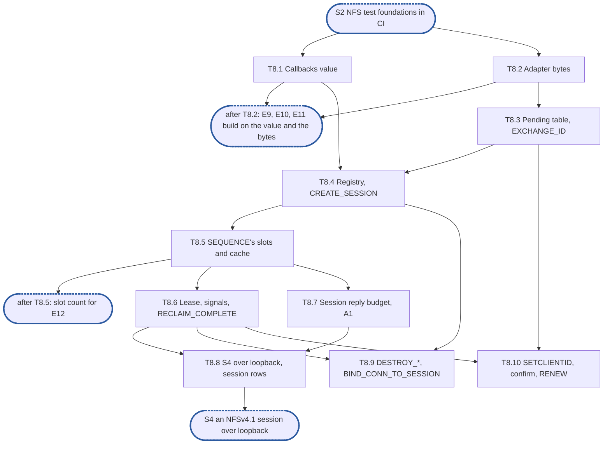

# Epic 8: NFS adapter v2 clients and sessions

**Sources:** [RFC 21](../docs/internals/rfcs/rfc-21-nfs.md) §2.3's sentence on a session's
largest request and reply and its paragraph on the session's reply budget, §3.1, §3.2, §3.3, §3.4's
registration and back-channel security, §3.5, §4.1, §5.1's lease, `DESTROY_SESSION`,
`DESTROY_CLIENTID`, no-courtesy answers and revocation flags, §5.2's `RECLAIM_COMPLETE`, §5.4's
signals, §6.2's NLM host fields in the record, §11.4's client table, its `Adapter` bytes and the client rows of its second table, §11.5's
rows for the errors this epic's operations meet, its drain roles for them, and its sentence that
`ErrNotNegotiated`, `ErrNoSession` and `ErrNoTree` are settled with the session table, §11.6's
golden vectors for the client fields and the `Adapter`-bytes fuzz target, §11.7's two record series
and replay-hit row, §12's N2's single-node half, N3, N5, N6's single-node half, N11, N13's signal,
N18, N20's `EXCHANGE_ID` half and N27, §13's rows named in §3 below, §14's session series, and
Appendix D's client, session and lease rows;
[RFC 20](../docs/internals/rfcs/rfc-20-adapters.md) §3.3's callbacks value, §3.4's `ConnInfo.Session`
and `Deps.Retry`, §4.3's session reply budget and the runner's ask of each member's `Bound` hook
just before it runs (amendment A1), §4.4's `r.Call.Session`, §4.7's `FlowControl` and
`ReplayCache` for NFSv4.1 and its stage table's NFSv4.1 rows, §6.3's flow control for NFS;
[RFC 24](../docs/internals/rfcs/rfc-24-resources.md) §4.5, sessions and reply caches;
[RFC 14](../docs/internals/rfcs/rfc-14-open-state.md) §2.9's confirm rules and §4.1's renewal
interval, as the adapter drives them;
[RFC 16](../docs/internals/rfcs/rfc-16-metadata-store.md) §2.3's `Installation`, for the server scope;
[RFC 18](../docs/internals/rfcs/rfc-18-identity.md) §10's "no file spelling" row, its
`SP4_MACH_CRED` step. Every citation is `develop`'s text, which holds amendments A1 to A4 and
reaches `feat/storage-v2` with the cherry-pick of RFC changes.
Cited, not owned: RFC 8881 and RFC 7530 for the bytes and status values; RFC 17 §3.1 and §3.2 for
the `Clients` calls and `Callbacks`; RFC 14 §2.1's client record, which the service keeps.
**Track:** A.
**Epic 8 estimate: 10 subtasks, 28 man-days.**
**Depends on:** **S2**, NFS's test foundations in CI: E1's `protocol.State` and NFSv4 table with
its members' table, E2's `nfsharness`, knfsd's NFSv4.1 captures and the service's `NoGrace`. E3's
caller (T3.1), scripted client (T3.2) and `Replay` stage with its duplicate-request cache (T3.3),
which T8.5 extends. E7's T7.1, for every row whose `AUTH_SYS` caller reaches a `Clients` call:
until it lands, `memory.New` refuses a `Claimed` caller `ErrAccess`. E5's T5.4, T5.8 and T5.9 for
S4's namespace half, `supported_attrs`, the not-supported layout rows and the `READ` hook T8.7's
row drives. **S2b**, met, for A1.
**Blocks:**
- E9, which builds on T8.1's callbacks value (its `Revoked` for opens and locks) and on T8.3's and
  T8.10's client IDs, and whose loopback rows need S4;
- E10, whose T10.2 adds the slot table, `Send` and `Reply` to T8.4's `BackChannel`, whose
  `RecallGrant` and `RecallAny` (T10.3) fill T8.1's value, and whose `SEQ4_STATUS_CB_PATH_DOWN`
  (T10.6) joins T8.6's flags;
- E11, whose T11.3 writes T8.2's NLM arm of the `Adapter` bytes, adds `nlm.Handlers`' callbacks
  field and fills T8.1's `LockWaitOver` and NLM `Revoked`;
- E12, whose hold budget (T12.4) reads T8.4's granted slot count, `Session.Fore.Slots`;
- **S4**, an NFSv4.1 session over loopback, which T8.8 opens with E3 and E5, and through it the
  loopback rows of E6, E9, E10 and E12.

---

## 1. Goal

Epic 8 builds who an NFSv4 client is and how its requests are run once: the callbacks value the
service calls up through, the client record's `Adapter` bytes, client IDs and their confirms over
both minor versions, NFSv4.1 sessions with their slots and per-session reply caches, the session
registry, the lease and the signals a client reads on each `SEQUENCE`, and the session's reply
budget in each compound.

**At the end of the epic:**

- `nfs.New` registers one callbacks value per client at `Connect`, and an `Adapter`-bytes codec,
  versioned, reads and writes every field RFC 21 §11.4 lists, NLM's included;
- over loopback through `core`, the scripted client runs `EXCHANGE_ID`, `CREATE_SESSION`,
  `SEQUENCE`, `PUTROOTFH`, `LOOKUP` and `GETATTR` on `memory.New`: S4 holds;
- a retransmission on a session is answered its whole cached reply or `NFS4ERR_RETRY_UNCACHED_REP`,
  and never run twice; a session caches at most 64 × 8 KiB, charged to the connection-state pool;
- a `CREATE_SESSION` replayed after the adapter restarts over the same service is answered from the
  record's bytes, with one session;
- `SEQUENCE` renews at most once per renewal interval, sets the revocation and reclaim flags from
  the service's `ClientStatus`, and `RECLAIM_COMPLETE` names the grace instances its session's
  replies showed;
- an NFSv4.0 client confirms with `SETCLIENTID_CONFIRM`, renews with `RENEW`, and is told a lost
  shard by `NFS4ERR_STALE_CLIENTID`;
- a `READ` in an NFSv4.1 compound is answered within the session's `ca_maxresponsesize`.

### 1.1 In scope

`internal/adapter/nfs/callbacks.go` and `v4.Handlers`' field that reaches it;
`wire/clientrec.go`; the session registry and Pending table in `protocol/sessions.go`; NFS's `Flow`
stage; the NFSv4.1 half of the `Replay` stage; the header codec's reading of `SEQUENCE`; `Route`
setting `r.Call.Session`, `r.Call.Client` and the session level; the operations `EXCHANGE_ID`,
`CREATE_SESSION`, `SEQUENCE`, `RECLAIM_COMPLETE`, `DESTROY_SESSION`, `DESTROY_CLIENTID`,
`BIND_CONN_TO_SESSION`, `BACKCHANNEL_CTL`, `SETCLIENTID`, `SETCLIENTID_CONFIRM` and `RENEW`, with
their error rows and golden files; `core`'s third ask of a member's `Bound` hook (A1); the
`FlowControl` conformance check in `adaptertest`; `ConnInfo.Session` for NFS.

### 1.2 Out of scope

- `OPEN`, stateids, owner sequences, locks, `FREE_STATEID`, `TEST_STATEID`, and the callbacks
  value's `Revoked` for opens and locks: E9. So are the NFSv4.0 stateful operations' renewal and
  their `Record` read first (Appendix D's `OPEN`, `LOCKT`, `RELEASE_LOCKOWNER`), the rows of
  `NoGrace`, `NoReclaim`, `ReclaimConflict`, `BadState`, `StaleState`, `Revoked` and `NotYours`,
  whose operations are E9's (E2's document names E8 too for `NFS4ERR_NO_GRACE`; no operation of this
  epic meets it, §9), and RFC 21 §13's "§5.1 destroy *(1 node)*", "§5.1 no courtesy", "§3.3 reboot
  racing renew *(1 node)*" and "§3.5 confirm"'s step of a rebooted client holding a lock.
- `CB_COMPOUND` on the back channel, the callbacks value's `RecallGrant`, `RecallAny` and `Revoked`
  for grants, `SEQ4_STATUS_CB_PATH_DOWN`, A2's `ChannelDown` and its clearing at a re-bind, and the
  drain test against Linux's compounds: E10. This epic builds each session's `BackChannel` (T8.4):
  its callback program, credential, granted slot count and bound connections, with
  `NewBackChannel`, `Bind` and `Unbind`, which `CREATE_SESSION` (T8.4) and `BIND_CONN_TO_SESSION`
  and `BACKCHANNEL_CTL` (T8.9) call. E10's T10.2 adds its slot table, `Send` and `Reply` to the same
  type, makes `Bind` take the connection's `Keep`, and calls `Unbind` when a bound connection
  closes.
- NLM and NSM, the callbacks value's `LockWaitOver` and NLM `Revoked`, and `nlm.Handlers`' field
  for the callbacks value: E11's T11.3, which writes the NLM arm T8.2 defines.
- The hold budget per session, from T8.4's slot count: E12's T12.4.
- `RPCSEC_GSS`, a machine principal's Kerberos sign-in and `ErrExpired`'s row: E13. "no file
  spelling"'s step with a Kerberos machine principal: E16's T16.3, on the composed node.
- `lease_time`, `supported_attrs` without the layout attributes and the not-supported layout and
  device operations: E5 (T5.4, T5.8); this epic's "§3.3 no pNFS on one node" row runs them over
  loopback.
- pynfs's session, slot and replay steps of "§3.1, §3.2 sessions *(1 node)*" and "§3.2 reply
  cache", "§5.4 NFSv4.0 signal", "§5.4 single-node restart" and every row needing the composed
  node or a kernel client: E16, the restart rows in its T16.4 and pynfs's steps in its burn-down,
  planned after E15.
- The (cluster) steps: `Rebind` on another node, session trunking across nodes, a node epoch in
  each session reference and the re-listing of `Reach.Sessions` at a new node epoch, the lease
  owner on another node: the RFC 21 implementation plan's deferral ledger, row "RFC 21's (cluster)
  parts".
- The six `nfs_*` series and the three `adapter_*` series only NFS code can count: nothing here
  records a metric, as rule 3 has it while who records those series is open with the RFC's author.
  Their producers here are T8.4 (`nfs_sessions`, `adapter_record_replays_total`), T8.5
  (`nfs_slots_in_use`, `nfs_badsession_total`) and T8.2 (`adapter_record_decode_failures_total`);
  each adds its series once that settles, about 0.5 man-days each, inside its figure.

### 1.3 Names used here

- **E1**, epic 1, the NFS surface: `protocol.State`, `SetFH`, `ops/v4`'s `Handlers` and `Table`
  with the `COMPOUND` row, its members' table and the golden-file vector check.
- **E2**, epic 2, test foundations: `adaptertest/nfsharness`, knfsd's captures cut into golden
  files, and the service's `NoGrace`.
- **E3**, the RPC layer: the caller in `r.Call` (T3.1), the scripted client `nfsclient` (T3.2),
  the `Replay` stage and its NFSv3 and NFSv4.0 duplicate-request cache (T3.3), every table's
  refusals (T3.4).
- **E5**, the NFSv4 namespace, attributes and data path, with `READ`'s `Bound` hook (T5.8) and S4's
  namespace half (T5.9).
- **E6**, the NFSv4 ACL attributes. **E7**, identity's NFS side, whose T7.1 resolves an `AUTH_SYS`
  caller.
- **E8**, this epic. **E9**, opens, stateids and locks. **E10**, delegations and the back channel.
  **E11**, NLM, NSM and the datagram path. **E12**, the NFSv4.2 operations. **E13**, RPCSEC_GSS.
- **E16**, E2E green: the suites, the composed-node and kernel-client rows, the totality test.
- **S2**, NFS's test foundations in CI, after E1, E2 and the shared test pieces: what this epic
  starts from.
- **S2b**, amendments A1 to A3 agreed, met in #5166.
- **S4**, an NFSv4.1 session over loopback, after E3, E5 and this epic.
- **A1**, the amendment to RFC 20 §4.3 and §4.7: the compound runner asks each member's `Bound`
  hook once more just before it runs. **A2**, the amendment to RFC 17 §3.1: `ChannelDown`, and
  `Connect` clearing it; E10's.
- **E14**, the capture diffs against knfsd. **E15**, the integration with the node, which turns
  the NFS suites on.

## 2. How the general rules apply

The rules are those of [the RFC 21 implementation plan's §1.5](rfc-21-nfs-plan.md#15-general-rules-for-each-epic),
cited by number and title and not copied.

| Rule | Subtasks | How |
| --- | --- | --- |
| rule 1, independent unit tests, under `-race` ([`CLAUDE.md`, "Writing tests"](../CLAUDE.md#writing-tests)) | all | handlers on `nfsharness` over `memory.New` (kind 2), with the shared `vfstest.Mutations` record of mutating calls and `vfstest.Faults` for a service error (kind 3); the registry's lease and Pending expiry on an injected clock and its session IDs from a seeded source (kind 1); stages without a socket on header vectors; loopback rows through `core` on the scripted client. No other double |
| rule 2, fuzz tests where relevant | T8.2, T8.5 | `FuzzClientRec` over the `Adapter`-bytes decoder, seeded with truncated, corrupt, older- and newer-version bytes, against a second decoder written in the test (R5); the header codec's `SEQUENCE` read is held to the members' table's own `SEQUENCE` decoder by `FuzzCompound`'s seeds, extended with session compounds |
| rule 3, observability follows RFC 25 and RFC 20 §10 | T8.2, T8.4, T8.5 | no recorder in NFS code; a slot's replay hit is counted by `core` as `adapter_replay_hits_total{protocol="nfs3"}` (R37); §1.2 names the producers of the pending series; no log line or attribute carries an owner string, a principal, a session ID or a client address (RFC 25 §5.4) |
| rule 4, profiling: leaks, allocations and contention | T8.4, T8.5, T8.7, T8.8 | every loopback test starts with `adaptertest.CheckLeaks`; the session registry is a node-wide table, so a map under a read-write mutex never held across a service call (RFC 20 §6.9), and T8.4 and T8.5 report its mutex and block profiles under 64 sessions on 64 connections, `Sessions.Get` on every compound the hot path, `Create` once per mount; RFC 20 §6.9's pipeline gate applies to T8.5 (header codec, `Route`, `Flow`) and T8.7 (`core/compound.go`, every member's `Bound` wrapped): T8.7 runs `core`'s `BenchmarkPipeline`, whose checked-in allocation count may only fall, and T8.5 extends `nfs/protocol`'s header-stage allocation test to `SEQUENCE` headers, held at E3's count; NFS's own pipeline micro-benchmark is E16's, which then holds both. No codec gate: `SEQUENCE` is not among RFC 20 §6.10's 0-allocation messages |
| rule 5, public interface and internals, at the layer that consumes a value ([`CLAUDE.md`, "Verifying a change"](../CLAUDE.md#verifying-a-change)) | all | a slot granted on the `CREATE_SESSION` reply the client reads; a replay on the reply bytes and on `memory.New`'s record of one mutating call; the `Adapter` bytes on the `Record` a second adapter reads; the reply budget on the `READ` reply the client decodes |
| rule 6, known failures shrink | none | no `pynfs`, `cthon04` or `nfstest` test runs before the cutover; their session steps are E16's |
| rule 7, v2 ignores v1 | all | nothing from `develop`'s `v4/state` or session code; the limits are RFC 21's, the sequencing RFC 8881's |
| rule 8, real dependencies for properties of those dependencies | T8.2, T8.3, T8.4, T8.8, T8.10 | golden files written by hand from RFC 8881's and RFC 7530's XDR or cut from E2's knfsd NFSv4.1 captures, never from the encoder under test; real TCP over loopback; an adapter restart as a second `nfs.New` over the same `memory.New` |
| rule 9, code comment conventions ([`CLAUDE.md`, "Code comments"](../CLAUDE.md#code-comments)) | T8.1, T8.2, T8.3, T8.4, T8.5, T8.6, T8.7 | RFC 21 §3.1's two `ponytail:` notes, 8 KiB cached replies and 64 slots, at the grant; `decision:` markers for D1, D2, D3, D5, D6, D7, D10, D11 and D12 at their sites, D8's a `ponytail:`, none for D4, D9 and D13 (each says why); `core/compound.go`'s `ponytail:` on the one ask removed with A1 |
| rule 10, a test must be able to fail | all | each test names the break it catches; none asserts a stub's answer, so T8.1's not-yet-built methods have no test of their own |
| rule 11, a symbol is exported only if an interface uses it | T8.1, T8.2, T8.4, T8.5 | exported: `wire.ClientRec` and its codec for `ops/v4` and E11's `ops/nlm`; `protocol.Sessions`, `Session`, `SessionID`, `Pending`, `Channel` and `BackChannel` for `ops/v4`; `v4.Handlers`' new fields for `nfs.go`; `adaptertest.FlowConformance` for each protocol's `Flow`. `core` gains none but through RFC 20 first (Q2, Q3) |
| rule 12, each subtask creates only what it declares | all | the callbacks value lands with `CREATE_SESSION`'s `Connect`, its first caller, in the same pull request; `nlm.Handlers`' field waits for E11's first NLM row (§9); each operation's row lands with its handler and golden files |
| rule 13, translate, never decide | all | each handler makes at most one mutating service call; `CREATE_SESSION`'s sequence check is RFC 21 §3.5's own rule over the record's bytes, which open state never reads; the slot table is the adapter's by RFC 21 Appendix D; confirm, ownership and busy checks are the service's |
| rule 14, nothing deferred is lost | all | §1.2 names the owner of each part of an obligation this epic leaves out; §9 names the gaps |

## 3. Requirements and invariants

Every MUST and MUST NOT that RFC 21, RFC 20, RFC 24, RFC 14 and RFC 18 place on this epic,
numbered so that subtasks and tests can cite them.

**The callbacks value and the client record's bytes**

| # | Requirement | Kind | Source | Subtasks |
| --- | --- | --- | --- | --- |
| R1 | The adapter hands the service one callbacks value per client at `Connect`, a small per-client value that knows the client's connection and nothing about files, implemented once for NFS | MUST | RFC 20 §3.3 | T8.1, T8.4 |
| R2 | The `Adapter` bytes start with the adapter's own version byte; a node that cannot read a version refuses the request rather than misreading it | MUST | RFC 21 §11.4 | T8.2 |
| R3 | The `Adapter` bytes hold the minor version that confirmed the record, the one-slot `CREATE_SESSION` replay (the last `csa_sequence` applied and its reply), `SP4_MACH_CRED`'s `spo_must_enforce` and `spo_must_allow` as sent, for NFSv4.0 the callback address and program (`cb_client4`, `callback_ident`), and for an NLM host its `mon_name`, `priv` cookie and the address its restart notice goes to | MUST | RFC 21 §6.2, §11.4, §12 (N18, N27) | T8.2 |
| R4 | The adapter's durable state lives only in the record's `Adapter` bytes, written in the step of the change it belongs to and over the bytes the adapter read; it reads the record through the service on every decision that needs it and never answers from a copy it holds | invariant | RFC 21 §11.4, §12 (N10, N27) | T8.2, T8.4 |
| R5 | The `Adapter`-bytes decoder is fuzzed with truncated, corrupt, older- and newer-version bytes: no panic, and either a valid value or a refusal, never one that decodes to other state | MUST | RFC 21 §11.6 (every decoder is fuzzed), §13 (§11.4 decoders fuzzed *(1 node)*) | T8.2 |

**Client IDs and their confirms**

| # | Requirement | Kind | Source | Subtasks |
| --- | --- | --- | --- | --- |
| R6 | An `EXCHANGE_ID` or `SETCLIENTID` naming a new owner, or a known owner with a new verifier, changes no state: the answering node holds a `Pending` proposal in memory, and a rebooted client's old client ID keeps its state until the confirm | MUST | RFC 21 §3.5; RFC 14 §2.9 | T8.3, T8.10 |
| R7 | An `EXCHANGE_ID` naming a confirmed owner with that owner's verifier and principal returns the existing client ID at once | MUST | RFC 21 §3.5 | T8.3 |
| R8 | A `SETCLIENTID` naming a confirmed owner with its verifier still leaves a `Pending` proposal for the existing client ID under a new confirm verifier; its confirm keeps the client ID and its state and takes only the new callback, which until then changes nothing | MUST | RFC 21 §3.5, §4.1 | T8.10 |
| R9 | A proposal whose owner a confirmed record holds under another principal is `NFS4ERR_CLID_INUSE`, whatever its verifier, and leaves no `Pending` | MUST | RFC 21 §3.5, §11.4 (`Owner`), §11.5 (`ClientInUse`) | T8.3, T8.10 |
| R10 | A confirm is accepted only at the node that answered, naming the answered client ID and, for NFSv4.0, the confirm verifier, for NFSv4.1 the sequence ID, within one lease period; it writes the record, expires the old client ID of a rebooted client and drops the `Pending`. A confirm that finds no such proposal is `NFS4ERR_STALE_CLIENTID` | MUST | RFC 21 §3.5, §4.1; RFC 14 §2.9 | T8.3, T8.4, T8.10 |
| R11 | A confirm from another principal than the proposal's is `NFS4ERR_CLID_INUSE` and leaves the proposal for its own principal | MUST | RFC 21 §3.5 | T8.4, T8.10 |
| R12 | One record kind for both minor versions: a `SETCLIENTID` for a name `EXCHANGE_ID` confirmed, or the reverse, is a new `Boot`, a reboot confirmed as any is | MUST | RFC 21 §3.5 (one record kind) | T8.3, T8.10 |
| R13 | The client fields map as §11.4 says: `Name` from `co_ownerid` or the `nfs_client_id4` id, `Boot` from the verifier, `Pending.Confirm` sent as the NFSv4.0 confirm verifier or, its low 32 bits, as `eir_sequenceid`, `Protect` set for `SP4_MACH_CRED` | MUST | RFC 21 §4.1, §11.4 (client table) | T8.3, T8.10 |
| R14 | `SP4_NONE` and `SP4_MACH_CRED` are accepted (`SP4_MACH_CRED` over a flavor other than `RPCSEC_GSS` as Q5 settles); `SP4_SSV` is refused `NFS4ERR_ENCR_ALG_UNSUPP` | MUST | RFC 21 §3.3 | T8.3 |
| R15 | Under `SP4_MACH_CRED`, an operation in `spo_must_enforce` from any principal but `Owner` is `NFS4ERR_ACCESS`, `CREATE_SESSION` on its new and its replay path included; `DESTROY_SESSION` and `BIND_CONN_TO_SESSION` are refused so whatever the bitmap (where the check runs as Q4 settles) | MUST | RFC 21 §11.4 (`Adapter` bytes, `Protect`); RFC 8881 §18.34.3, §18.37.3 | T8.3, T8.4, T8.9 |
| R16 | Every gateway node returns the same `server_scope` and `so_major_id`, the installation's, and a `so_minor_id` of its own (single-node half) | MUST | RFC 21 §3.3, §12 (N2); RFC 16 §2.3 (`Installation`) | T8.3 |
| R17 | `EXCHANGE_ID` sets `EXCHGID4_FLAG_USE_NON_PNFS` and, on a single node, never `EXCHGID4_FLAG_USE_PNFS_MDS` or `EXCHGID4_FLAG_USE_PNFS_DS` | MUST NOT | RFC 21 §3.3, §12 (N20) | T8.3 |
| R18 | Everything `EXCHANGE_ID`, `SETCLIENTID` and `DESTROY_CLIENTID` decide is in the durable client record, never in one node's memory, a proposal before its confirm excepted | MUST | RFC 21 §3.3, §11.4, §12 (N18) | T8.3, T8.9 |
| R19 | §13's "§3.5 confirm *(1 node)*": a confirm from another principal `NFS4ERR_CLID_INUSE` over both minor versions, an `EXCHANGE_ID` for a confirmed owner from another principal `NFS4ERR_CLID_INUSE`, and a confirmed NFSv4.0 client's repeated `SETCLIENTID` with a new callback confirmed with its client ID unchanged and the callback taken; and the single-node steps of "§3.5 confirm", 10^4 confirm verifiers all distinct among them | test row | RFC 21 §13 | T8.3, T8.4, T8.10 |
| R20 | §13's "§3.3 one name, two principals *(1 node)*", over `EXCHANGE_ID` and over `SETCLIENTID`, as amended (§9): the first principal's proposal confirmed, then the second's `NFS4ERR_CLID_INUSE` with no `Pending`; before a confirm, a second principal's proposal for a new name replaces the first's (D3) | test row | RFC 21 §13; RFC 14 §2.9 (rule 2), L38 | T8.3, T8.10 |

**Sessions and `CREATE_SESSION`**

| # | Requirement | Kind | Source | Subtasks |
| --- | --- | --- | --- | --- |
| R21 | The fore channel offers at most 64 slots and the back channel 16; `CREATE_SESSION` grants the lesser of the ask and these, fewer where the pool cannot charge them, at least one, and where it cannot charge one answers `NFS4ERR_DELAY` | MUST | RFC 21 §3.1; RFC 24 §4.5 | T8.4 |
| R22 | A session is charged to the connection-state pool its fixed session cost, a fixed slot cost per slot of each channel and its fore channel's reply cache, slots times the cached size, decided on the sum; every slot the client retires releases its charge | MUST | RFC 24 §4.5 | T8.4, T8.5 |
| R23 | `ca_maxoperations` is the lesser of the ask and the compound cap of 128; a `COMPOUND` on the session longer than granted is refused `NFS4ERR_TOO_MANY_OPS` before any of its operations runs | MUST | RFC 21 §3.1, §11.5 (the compound cap) | T8.4, T8.7 |
| R24 | `ca_maxresponsesize_cached` is the lesser of the ask and 8 KiB, so a session's fore-channel cache never exceeds 64 × 8 KiB | bound | RFC 21 §3.1, §12 (N11) | T8.4 |
| R25 | `ca_maxrequestsize` and `ca_maxresponsesize` derive from the one transfer size: at most the record cap, 1 MiB and 4 KiB | MUST | RFC 21 §2.3 | T8.4 |
| R26 | `CREATE_SESSION` is sequenced by the record's one-slot replay: a `csa_sequence` equal to the stored one is answered the stored reply and writes nothing; one more builds the session and calls `AddSession` with the bytes read and the new sequence and reply in one step, the confirming case comparing the `Pending` proposal's sequence; `RecordChanged` drops the built session, rereads and decides again; any other is `NFS4ERR_SEQ_MISORDERED` | MUST | RFC 21 §3.5, §11.4 (`AddSession`), §11.5 (`RecordChanged`) | T8.4 |
| R27 | The reply cache is held in the memory of the node that holds the session and never written to the store or replicated; sessions are never stored | MUST NOT | RFC 21 §3.2, §12 (N3) | T8.4, T8.5 |
| R28 | A session is bound only to this node's connections: a `BIND_CONN_TO_SESSION` or `SEQUENCE` naming a session this node does not hold, one lost with a restart included, is `NFS4ERR_BADSESSION`; binding several connections to one session here is allowed | MUST | RFC 21 §3.2, §3.3, §12 (N3) | T8.5, T8.9 |
| R29 | The back channel's security is `AUTH_NONE` or `AUTH_SYS`, as the client asked in `csa_sec_parms`; `RPCSEC_GSS` is not offered on it | MUST | RFC 21 §3.4 | T8.4 |
| R30 | A back channel bound by `CREATE_SESSION` with `CREATE_SESSION4_FLAG_CONN_BACK_CHAN`, by `BIND_CONN_TO_SESSION` or by `BACKCHANNEL_CTL` re-registers through `Connect` before the reply, replacing the earlier registration (single-node half) | MUST | RFC 21 §3.4, §12 (N6), App. D (`BIND_CONN_TO_SESSION`, `BACKCHANNEL_CTL`); RFC 17 §3.2 | T8.4, T8.9 |
| R31 | On each `Connect` or `AddSession` that answers a `Gen`, the adapter decides again under its per-client step, and sends `Disconnect` with `Last` and that `Gen` if the node then holds no session of the client | MUST | RFC 21 §11.4 (`SessionEnd.Last`, `Gen`); RFC 17 §3.1 | T8.4, T8.9 |
| R32 | `ConnInfo`'s `Session` names the NFSv4.1 session a connection carries, as text, and is empty where none | MUST | RFC 20 §3.4 (`ConnInfo`) | T8.5 |
| R33 | The router builds an NFSv4.1 compound's `r.Call` with the `Session` its `SEQUENCE` names and that session's `Client` | MUST | RFC 20 §4.4 (the `Call`) | T8.5 |
| R34 | §13's "§3.5 `CREATE_SESSION` sequence"'s and "§3.5 replay through another node"'s single-node steps: a resent `CREATE_SESSION` answered its first reply with one session, `csa_sequence` two ahead `NFS4ERR_SEQ_MISORDERED`, a replay after a restart answered from the record, and two `CREATE_SESSION`s of one sequence raced over one service answered one session's reply | test row | RFC 21 §13 | T8.4 |

**`SEQUENCE`: slots and the reply cache**

| # | Requirement | Kind | Source | Subtasks |
| --- | --- | --- | --- | --- |
| R35 | A slot keeps a reply only when the request asked (`sa_cachethis`), and then the whole reply; a request asking to be cached whose reply exceeds the cached size is `NFS4ERR_REP_TOO_BIG_TO_CACHE` and not run | MUST | RFC 21 §3.1; RFC 20 §4.3 | T8.5, T8.7 |
| R36 | A retransmission of an uncached request, same slot and sequence ID, is `NFS4ERR_RETRY_UNCACHED_REP`, never run again and never answered from a partial reply | MUST | RFC 21 §3.1, §12 (N11) | T8.5 |
| R37 | A retransmission of a cached request is answered its whole cached reply and never run twice on one session; `core` counts it as `adapter_replay_hits_total{protocol="nfs3"}` | MUST | RFC 21 §3.2, §11.7, §12 (N11); RFC 20 §10.1 | T8.5 |
| R38 | A request a drain leaves unanswered runs none of its operations and leaves the slot as it was, its previous sequence ID and reply | MUST | RFC 21 §3.1; RFC 20 §4.7 | T8.5 |
| R39 | The server honours a client that retires slots and never shrinks `sr_highest_slotid` below a slot with a request in flight | MUST | RFC 21 §3.1 | T8.5 |
| R40 | NFS's flow control is the per-connection cap of 64 on every NFS connection, with an NFSv4.1 session's slots bounding it in addition; under an ended context `Admit` takes a free place or returns at once | MUST | RFC 20 §6.3, §4.7 (`FlowControl`) | T8.5 |
| R41 | `ErrNoSession`, `ErrNotNegotiated` and `ErrNoTree` are settled with the session table: each has a row in NFSv4's tables, without which the totality test fails; their statuses are D6's | MUST | RFC 21 §11.5 (what runs while draining, last sentence) | T8.5 |
| R42 | §13's "§3.1, §3.2 sessions *(1 node)*" and "§3.2 reply cache"'s replay steps by the scripted client: slot use and `SEQUENCE` replay on one node, no replay run twice | test row | RFC 21 §13 | T8.8 |
| R43 | §13's "§3.1 cached reply size": a 1 MiB cached reply asked, 8 KiB granted; an uncached `REMOVE` resent in its slot and sequence answered `NFS4ERR_RETRY_UNCACHED_REP`, the name removed once | test row | RFC 21 §13 | T8.8 |

**The lease and the signals**

| # | Requirement | Kind | Source | Subtasks |
| --- | --- | --- | --- | --- |
| R44 | The lease is renewed by every `SEQUENCE` and NFSv4.0 `RENEW`, never by a write; `SEQUENCE` calls `Renew` at most once per renewal interval | MUST | RFC 21 §5.1, §11.4 (lease expiry), App. D (`SEQUENCE`); RFC 14 §4.1 | T8.6, T8.10 |
| R45 | §13's "§3.3 renewal writes nothing": 10^4 `SEQUENCE`s with no other operation make no store write | test row | RFC 21 §13 | T8.6 |
| R46 | Every `SEQUENCE` reply carries `SEQ4_STATUS_ADMIN_STATE_REVOKED` while state an administrator revoked is in the client's revoked set, `SEQ4_STATUS_RECALLABLE_STATE_REVOKED` while a grant revoked at its recall deadline is, and `SEQ4_STATUS_RESTART_RECLAIM_NEEDED` while a shard the record names is in a grace instance the client has not completed, until the client sends `RECLAIM_COMPLETE` for it, each read from `Renew`'s `ClientStatus` | MUST | RFC 21 §5.1, §5.4, §11.4 (`ClientStatus`), §12 (N13) | T8.6 |
| R47 | `RECLAIM_COMPLETE` maps to `ReclaimComplete`, naming the (shard, instance) pairs the session's `SEQUENCE` replies have shown, which the adapter keeps per session | MUST | RFC 21 §5.2, §5.4; RFC 14 §4.4 | T8.6 |
| R48 | No courtesy: an expired client's next request naming its session is `NFS4ERR_BADSESSION`, and one naming its client ID `NFS4ERR_STALE_CLIENTID` | MUST | RFC 21 §5.1 (no courtesy clients), §12 (N5) | T8.6, T8.10 |
| R49 | NFSv4.0: while a loss awaits the client's recovery, `RENEW` and every operation naming its client ID is `NFS4ERR_STALE_CLIENTID`, which this epic answers for `RENEW` and the confirms | MUST | RFC 21 §5.4 (NFSv4.0 is told by its client ID), §11.5 (`StaleClient`), §12 (N13) | T8.10 |
| R50 | NFSv4.0's `RENEW` reads `Record` first: a client `EXCHANGE_ID` confirmed is `NFS4ERR_STALE_CLIENTID` | MUST | RFC 21 App. D (`RENEW`) | T8.10 |
| R51 | No callback connection is ever opened to an NFSv4.0 client's callback address, and `RENEW` is never `NFS4ERR_CB_PATH_DOWN` | MUST NOT | RFC 21 §4.1 | T8.10 |

**Ending sessions and clients**

| # | Requirement | Kind | Source | Subtasks |
| --- | --- | --- | --- | --- |
| R52 | `DESTROY_CLIENTID` maps to `Destroy`, never to `Disconnect`; `ClientBusy` is `NFS4ERR_CLIENTID_BUSY`, never met by releasing state; one from a principal `SP4_MACH_CRED` excludes is `NFS4ERR_WRONG_CRED` | MUST | RFC 21 §5.1, §11.5 (`ClientBusy`) | T8.9 |
| R53 | `DESTROY_SESSION` drops only this node's session; the node's last session of the client calls `Disconnect` with `Last` and the entry's latest `Gen`, so the `DESTROY_CLIENTID` of a clean unmount that follows is not refused for it | MUST | RFC 21 §5.1, §11.4 (`Reach.Sessions`, `SessionEnd`) | T8.9 |
| R54 | A `Disconnect` that fails leaves the node listed and is repeated, through the node's retrier, until it succeeds; `StaleClient` on a repeat counts as success | MUST | RFC 17 §3.1 (`Disconnect`); RFC 20 §3.2, §3.4 (`Deps.Retry`) | T8.9 |
| R55 | RFC 18 §10's "no file spelling", its `SP4_MACH_CRED` step: a second principal's state operation on the first's `SP4_MACH_CRED` client record is refused | test row | RFC 18 §10 | T8.9 |

**The session's reply budget**

| # | Requirement | Kind | Source | Subtasks |
| --- | --- | --- | --- | --- |
| R56 | The compound's own `SEQUENCE` copies the session's `ca_maxresponsesize` into `Request.State`, where a `READ`'s hook reads it | MUST | RFC 21 §2.3; RFC 20 §4.3 | T8.7 |
| R57 | Just before a member runs, the runner asks its row's `Bound` hook once more, with the room it was handed; a hook may only lower its count, or report no byte, which refuses that member there, after the members before it ran; the compound's reservation is not grown | MUST | RFC 20 §4.3, §4.7 (`Invocation.Bound`) | T8.7 |
| R58 | In an NFSv4.1 compound each operation's reply bound is compared with what is left of the session's `ca_maxresponsesize`, and an operation that would not fit is refused `NFS4ERR_REP_TOO_BIG` before it runs, except an operation after a `READ`, whose hook already capped its count at what is left; under `sa_cachethis` the same against `ca_maxresponsesize_cached` | MUST | RFC 20 §4.3 | T8.7 |
| R59 | §13's "§2.3 a compound's reply under the record cap"'s NFSv4.1 session step: on a session whose `ca_maxresponsesize` is 512 KiB, `SEQUENCE, PUTFH, READ(1 MiB)` is answered a short `READ` within 512 KiB | test row | RFC 21 §13 | T8.7 |

**Errors, codes and vectors**

| # | Requirement | Kind | Source | Subtasks |
| --- | --- | --- | --- | --- |
| R60 | The rows of the errors this epic's operations meet: `ClientInUse` `NFS4ERR_CLID_INUSE`, `StaleClient` `NFS4ERR_STALE_CLIENTID` for an operation naming a client ID, `ClientBusy` `NFS4ERR_CLIENTID_BUSY`, `ErrDelay` of `DelayResources` `NFS4ERR_DELAY` at once; `RecordChanged` is never sent | MUST | RFC 21 §11.5 | T8.3, T8.4, T8.9, T8.10 |
| R61 | Drain roles: `DESTROY_SESSION` and `DESTROY_CLIENTID` are releases, `SEQUENCE` and `RENEW` context, and every other operation of this epic is refused by a drain | MUST | RFC 21 §11.5 (what runs while draining) | T8.3, T8.4, T8.5, T8.6, T8.9, T8.10 |
| R62 | Each NFSv4.1 code this epic adds a row for, sent under NFSv4.0, is answered `NFS4ERR_OP_ILLEGAL`; each NFSv4.0 operation it adds (`SETCLIENTID`, `SETCLIENTID_CONFIRM`, `RENEW`), which NFSv4.1 defines and the adapter does not serve there, is `NFS4ERR_NOTSUPP` under NFSv4.1: their rows' `Versions` admit 0 and 1 and their handlers answer `ErrNotSupported` at 1, since E1's D6 maps a row's `ErrVersion` to `NFS4ERR_OP_ILLEGAL` | MUST | RFC 21 §11.5 (`core`'s own refusals), App. D; RFC 8881 §8.8 | T8.8, T8.10 |
| R63 | Golden vectors for the client fields table: NFS → neutral → NFS gives the golden `ClientInfo` and back the golden wire value | test row | RFC 21 §11.6 (§11.1–§11.5 golden vectors *(1 node)*); RFC 17 §3.0 (`ClientInfo`) | T8.3, T8.10 |
| R64 | §13's "§3.3 no pNFS on one node": the `EXCHANGE_ID` flags, no `fs_layout_type` in `supported_attrs`, and each layout and device operation `NFS4ERR_NOTSUPP`, over loopback | test row | RFC 21 §13 | T8.8 |
| R65 | §13's "§3.3 client record"'s single-node steps: the same owner with a new verifier treated as a reboot, from another principal `NFS4ERR_CLID_INUSE`; `DESTROY_CLIENTID` while a session is held `NFS4ERR_CLIENTID_BUSY`, and after `DESTROY_SESSION` accepted | test row | RFC 21 §13 | T8.3, T8.9 |

Not obligations of this epic: RFC 21 §3.4's routing of a callback and its path down (E10); §5.1's
administrator's revoke beyond its flags, `FREE_STATEID` and the NFSv4.0 `FreeState` (E9, E10); §5.4's
reclaims themselves and stale stateids (E9); the lease owner and `Reach.Sessions` across nodes
(cluster); RFC 24 §4.5's MAY of lowering `sr_target_highest_slotid`, not adopted (D8).

## 4. Decisions this epic takes

- **D1. The callbacks value, and how a handler reaches it.** `nfs/callbacks.go` holds one
  unexported type, a client's ID and the session registry, built by a constructor `nfs.go` sets on
  `v4.Handlers` (`Callbacks func(vfs.ClientID) vfs.Callbacks`), since `nfs.go` imports every
  `ops/` package and a handler cannot import the root package's type; one implementation, so no
  interface (RFC 20 §2.5's rule 4). Until its epic, each method answers as a client that cannot be
  reached: `RecallGrant` and `RecallAny` an error naming no back channel, which the service takes as
  the client not answering (no grant exists before E10); `LockWaitOver` the same (no NLM waiter
  exists before E11); `Notify` nil, since NFS registers no watch. `Revoked` drops the client's
  sessions on this node for `RevokedLeaseExpired`, this epic's; its other reasons find nothing
  pending until E9, E10 and E11. `nlm.Handlers`' field waits for E11's first row (rule 12; §9).
  Prior art: none found; the RFC 21 implementation plan's architect pass proposed the field. A
  `decision:` marker at the type names each method's interim answer and its epic.
- **D2. The `Adapter` bytes' layout.** Version 1 is one byte followed by an XDR union on the
  record's kind, an NFSv4 arm (the confirming minor version, the `CREATE_SESSION` replay, the two
  `SP4_MACH_CRED` bitmaps, an optional NFSv4.0 callback) and an NLM arm (`mon_name` up to NSM's 1024
  bytes, the 16-byte `priv`), written by `wire`'s generator from tagged structs, so E11's fields are
  settled before any record is written (a field added later is a new version every node must read).
  A decode fails as one of three named reasons, `truncated`, `corrupt` or `unknown_version`, §11.7's
  `reason` values; a request whose record does not decode answers the fault,
  `NFS4ERR_SERVERFAULT`, never a default, and the record is left as it is. Its ceiling: such a
  client is refused on every request until a node that reads the bytes answers it, and until §1.2's
  `adapter_record_decode_failures_total` lands nothing but the debug log shows it; treating the
  bytes as a reboot's would overwrite a newer node's state in a mixed-version cluster. The handler
  also bounds what it writes: `NetID` at most 16 bytes and `Addr` 64 (RFC 5665's universal
  addresses), each bitmap at most 3 words after its trailing zero words are dropped (the operations
  RFC 8881 and RFC 7862 define fit in 3), a longer one refused `NFS4ERR_INVAL`, and the decoder
  takes past these limits as `corrupt`. Prior art: none found for a per-adapter blob in a shared
  record. A `decision:` marker at the version constant: a new field is a new version, read by every
  node before any node writes it; an undecodable record is refused, never rewritten, overturned if
  the decode-failure series shows a client locked out in practice.
- **D3. The Pending table.** A confirm's proposal, its client ID and confirm as the service
  answered, the minor version, `eir_sequenceid` (`Confirm`'s low 32 bits), the `ClientInfo` and
  `Adapter` bytes the confirm registers, lives in the session registry of the node that answered,
  keyed by owner name, one per name, a later proposal replacing it (RFC 14 §2.9's rule 2), dropped
  one lease period after it was made by a sweep on the registry's injected clock, which releases
  its pool charge (never lazily at the next confirm), and charged a fixed cost to the
  connection-state pool, `NFS4ERR_DELAY` when it cannot be. It is bounded by RFC 14's own caps
  (§2.9's `ponytail:`, 4,096 per node and 16 per source), since every entry follows a `Propose`
  that answered, and `Propose` answers `ErrDelay` past them. A confirm reads the proposal and drops
  it only once its write succeeded, so a confirm answered `NFS4ERR_DELAY` finds it again on resend
  (RFC 21 §3.5's order). `Record` returns a `Pending` only for a
  name with a record, so the confirming `CREATE_SESSION` of a new client finds its proposal only
  here. Prior art: knfsd holds unconfirmed clients in memory (from memory). A `decision:` marker at
  the table, overturned with RFC 14 §2.9's own trigger.
- **D4. Server owner and scope.** `so_major_id` and `server_scope` are the installation's ID (RFC 16
  §2.3's `Installation`), and `so_minor_id` the node's own, both read once at `New`. Neither reaches
  the adapter today, so this document writes them as a field of RFC 20 §3.4's `Deps`, **pending the
  user's answer** (Q1). Prior art: knfsd uses the host name for both by default (from memory). No
  marker: the RFC's text once amended.
- **D5. Who reads `SEQUENCE`, and who answers its errors.** The header codec reads a compound's
  first operation and, for `SEQUENCE`, its session ID, slot, sequence, highest slot and
  `sa_cachethis` into the `Header`, beside the tag and minor version, because `ReplayCache.Lookup`
  and `FlowControl.Admit` take only the `Header`. `Route` finds the session and sets `r.Call`'s
  `Session` and `Client` from it; `Flow` marks the slot in flight; `Lookup` answers only a hit, the
  slot's cached reply for the same sequence; the `SEQUENCE` member then checks the slot and answers
  every sequence error itself, `NFS4ERR_BADSESSION`, `NFS4ERR_BADSLOT`, `NFS4ERR_SEQ_MISORDERED`,
  `NFS4ERR_RETRY_UNCACHED_REP`, `NFS4ERR_DELAY` for a slot in use, `NFS4ERR_SEQUENCE_POS`, as its
  own result, so the reply carries `SEQUENCE`'s result as RFC 8881 §2.10.6.1 has it (from memory),
  never a status alone. On success it marks the slot's next sequence, which `Store` commits with
  the reply; a compound answered without that mark, a drained one included, leaves the slot as it
  was (R38). Prior art: knfsd reads the slot in `nfsd4_sequence` (from memory). A `decision:` marker
  at the header codec.
- **D6. The session level.** `Route` raises the session bit in `r.Level` for an NFSv4.0 compound,
  which has no session, and the `SEQUENCE` member raises it for NFSv4.1; every NFSv4 row but those
  allowed outside a session (`EXCHANGE_ID`, `CREATE_SESSION`, `DESTROY_SESSION`,
  `BIND_CONN_TO_SESSION`, `DESTROY_CLIENTID`, `SEQUENCE`) needs it, so `core` refuses such an
  operation before `SEQUENCE` with `ErrNoSession`, answered `NFS4ERR_OP_NOT_IN_SESSION`.
  `ErrNotNegotiated` and `ErrNoTree`, which no NFS row needs, answer the fault. An operation
  allowed outside a session that is not alone in a compound without `SEQUENCE` is
  `NFS4ERR_NOT_ONLY_OP` (RFC 8881 §18.35.3, from memory). Prior art: knfsd's `nfsd4_ops` flags for
  operations allowed as the first in a compound (from memory). A `decision:` marker at `Route`.
- **D7. NFS's `Flow`.** RFC 20 §6.3 keeps the per-connection cap of 64 on every NFS connection, and
  a protocol's own `Flow` replaces `core`'s default, so NFS's `Flow` holds the cap itself and, for
  an NFSv4.1 compound, marks its slot in flight without waiting on it: a busy slot is `SEQUENCE`'s
  `NFS4ERR_DELAY`, so one client's slot never stops the connection's reader. The `FlowControl`
  conformance check RFC 20's plan's ledger gives the protocol plans, `adaptertest.FlowConformance`,
  lands here, run against NFS's `Flow` and `testproto`'s. Prior art: `core`'s default semaphore. A
  `decision:` marker at the stage.
- **D8. No slot shrinking.** `sr_target_highest_slotid` and `sr_highest_slotid` are always the
  highest slot granted, less the slots the client retired, never below the highest slot in flight;
  RFC 21 §3.1's MAY of asking for fewer under pressure is not adopted, as RFC 24 §4.5's `ponytail:`
  has it (a full pool grants fewer or refuses). So R39's second half holds because the server never
  shrinks the table and a retirement waits for the slots in flight above it. Prior art: knfsd's
  dynamic slot shrinking came late (from memory). A `ponytail:` marker at the target, naming RFC 24
  §4.5's trigger.
- **D9. Session IDs and references.** A `sessionid4` is 16 bytes from the registry's random source;
  the service's `SessionRef` is `{ID: a per-node counter starting at 1}` with `Node` and
  `NodeEpoch` zero, as `internal/vfs/clients.go`'s `decision:` records this node's sessions under
  node zero; the counter starts at 1 because `vfs` reads the zero `SessionRef` as no session. The
  node epoch the `decision:` names is the reach entry's, which open state stamps at `AddSession`
  from its own epoch, not the reference's. Their
  cluster form is the deferral ledger's. `ConnInfo.Session` is the session ID in hex, set through
  `core`, **pending the user's answer** (Q3). Prior art: knfsd builds a session ID from the boot
  time, client ID and a counter (from memory). No marker beyond `internal/vfs`'s.
- **D10. Renewal and the status a `SEQUENCE` reports.** The registry keeps, per client on this
  node, the clock reading of its last `Renew` and the `ClientStatus` it answered; a `SEQUENCE` calls
  `Renew` only when a renewal interval, 10 s, has passed, and otherwise sets its flags from the
  status kept, which RFC 14 §4.1 lets be one interval stale. A `RECLAIM_COMPLETE` the service
  accepts drops the status kept, so the next `SEQUENCE` calls `Renew` and stops carrying
  `SEQ4_STATUS_RESTART_RECLAIM_NEEDED` (R46): a stale flag after it would send a Linux client into
  a second reclaim answered `NFS4ERR_NO_GRACE`. E9's `FREE_STATEID` may drop it the same way; a
  revoked-state flag kept one interval after its cause is freed costs the client one `TEST_STATEID`.
  Each session accumulates the
  `GraceRef`s its replies showed, for `RECLAIM_COMPLETE`. Prior art: RFC 14 §4.1's renewal interval.
  A `decision:` marker at the limiter: a revoke or a loss reaches the flags at most one interval
  late.
- **D11. The back channel's attributes.** `csa_sec_parms`' first `AUTH_SYS` entry, else its first
  `AUTH_NONE`, is kept for E10; with neither, the connection is not bound as a back channel and the
  reply's `csr_flags` say so. `CREATE_SESSION4_FLAG_PERSIST` is never granted (RFC 21 §3.2), nor RDMA.
  Prior art: RFC 8881 §18.36.3 lets the server pick among the client's entries (from memory). A
  `decision:` marker at the pick.
- **D12. The session budget on every member.** `ops/v4`'s `Table` wraps every member row's `Bound`
  hook once, so that in a compound whose `SEQUENCE` set the budget a member whose bound passes what
  is left of `MaxReply` reports no room, refused there by A1's third ask (R58); a `READ`'s own hook
  has already lowered its count to fit and passes. The refusal's status for `sa_cachethis`,
  `NFS4ERR_REP_TOO_BIG_TO_CACHE`, has no way through `core` today, since a hook reports only a
  boolean: **pending the user's answer** (Q2). Prior art: knfsd checks each operation's reply size
  against the session in `nfsd4_check_resp_size` (from memory). A `decision:` marker at the wrapper.
- **D13. The registry's clock and random source.** `protocol.NewSessions` takes a clock reading
  elapsed time and a random source, kinds 1 of `CLAUDE.md` "Writing tests"; `nfs.go` passes the host
  clock and `crypto/rand`. Prior art: `internal/vfs`'s `Clock`. No marker.

## 5. Target tree

```text
internal/adapter/core/
  compound.go                    T8.7  the runner's third ask of each member's Bound hook (A1)
  conn.go                        T8.5  the session text ConnInfo reads (Q3)
  testdata/surface/core.golden   T8.5
internal/adapter/adaptertest/
  flow.go, flow_test.go          T8.5  FlowConformance, run on testproto's Flow
pkg/adapter/deps.go              T8.3  the server identity (Q1); T8.9  Retry, if RFC 22's plan has not added it
internal/adapter/nfs/
  nfs.go                         T8.1  Handlers.Callbacks; T8.3  the server identity; T8.4  the registry to protocol.New
  callbacks.go, callbacks_test.go T8.1
  wire/
    clientrec.go                 T8.2  ClientRec, its two arms, EncodeClientRec, DecodeClientRec
    rpc.go                       T8.5  SEQUENCE's fields in the COMPOUND header
    fuzz_test.go                 T8.2  FuzzClientRec
    testdata/golden/rfc-nfs4-*.hex, knfsd-nfs4-*.hex  T8.2 to T8.10
  protocol/
    sessions.go                  T8.3  Sessions, Pending; T8.4  Session, Channel, BackChannel, create and end; T8.6  renewal
    flow.go                      T8.5  NFS's Flow
    replay.go                    T8.5  a slot's lookup and store beside E3's cache
    stages.go                    T8.5  the header reads SEQUENCE; Route sets Session, Client, the session level
  ops/v4/
    exchange_id.go               T8.3
    create_session.go            T8.4
    sequence.go                  T8.5, T8.6
    reclaim_complete.go          T8.6
    table.go                     T8.7  the session budget over every member's Bound (D12)
    destroy_session.go, destroy_clientid.go, bind_conn_to_session.go, backchannel_ctl.go  T8.9
    setclientid.go, setclientid_confirm.go, renew.go  T8.10
    errors.go                    T8.3 to T8.10  each error row with its operations
    sessions_loopback_test.go    T8.8
```

## 6. Subtasks

### T8.1 The callbacks value

**Subtask T8.1 estimate: 1 man-days.**

- **Track:** A. **Depends on:** S2.
- **Covers:** R1.
- **Deliverables:** `nfs/callbacks.go`: an unexported type implementing `vfs.Callbacks` for one
  client (D1), asserted with `var _ vfs.Callbacks`; `v4.Handlers` gains
  ```go
  Callbacks func(cl vfs.ClientID) vfs.Callbacks // set by nfs.New; the value Connect registers
  ```
  set by `nfs.go`. `Revoked`'s `RevokedLeaseExpired` arm calls T8.4's registry, so it lands in T8.4's
  pull request. Consumed by T8.4's and T8.10's `Connect` calls, E9 (`Revoked` for opens and locks),
  E10 (`RecallGrant`, `RecallAny`, `Revoked` for grants) and E11 (`LockWaitOver`, NLM's `Revoked`).
- **Acceptance criteria:**
  - `nfs.New` sets `Callbacks` on the handlers it builds, and each call returns a value for that
    client.
- **Tests:** at `nfs.New`, which builds the handlers every `Connect` reads: the constructor set and
  returning a value naming the client asked (catches a handler left with a nil constructor, which
  `Connect` refuses `ErrInvalid`, R1). R1's "once" is held by the compiler's assertion. No test
  asserts an interim answer (rule 10). No test double.
- **Rules:** rule 9's `decision:` marker for D1; rule 12: the type with its first caller's pull
  request.

### T8.2 The `Adapter` bytes

**Subtask T8.2 estimate: 2 man-days.**

- **Track:** A. **Depends on:** S2.
- **Covers:** R2, R3, R4, R5.
- **Deliverables:** `wire/clientrec.go`:
  ```go
  const ClientRecVersion = 1
  type ClientRec struct { // xdr union on Kind
  	Kind uint32 // ClientRecNFS4 or ClientRecNLM
  	NFS4 *ClientRecNFS4
  	NLM  *ClientRecNLM
  }
  type ClientRecNFS4 struct {
  	Minor        uint32   // 0 or 1: the minor version that confirmed the record
  	SessionSeq   uint32   // the last csa_sequence applied
  	SessionReply []byte   // its CREATE_SESSION reply, the RPC header excluded
  	MustEnforce  []uint32 // spo_must_enforce, as sent
  	MustAllow    []uint32 // spo_must_allow, as sent
  	Callback     *CBClient4 // NFSv4.0: cb_client4 and callback_ident
  }
  type CBClient4 struct {
  	Program uint32
  	NetID, Addr string
  	Ident   uint32
  }
  type ClientRecNLM struct {
  	MonName string   // at most 1024 bytes
  	Priv    [16]byte
  	Host    []byte   // the host's address, 4 or 16 bytes: where SM_NOTIFY goes (RFC 21 §6.2)
  	Server  []byte   // the address its calls arrived on, 4 or 16 bytes: SM_NOTIFY leaves from it
  }
  var ErrRecTruncated, ErrRecCorrupt, ErrRecVersion error // §11.7's reasons
  func AppendClientRec(dst []byte, r *ClientRec) []byte
  func DecodeClientRec(b []byte) (ClientRec, error)
  ```
  with the generated codec, golden files written by hand from the layout, and `FuzzClientRec`
  against a second decoder written in the test. Consumed by T8.3, T8.4 and T8.10, which write and
  read the NFSv4 arm, E11's T11.3, which writes the NLM arm, and E10, which reads the callback.
- **Acceptance criteria:**
  - Each golden file decodes to its value and the value encodes to its bytes.
  - A first byte other than 1 is `ErrRecVersion`; a body cut anywhere `ErrRecTruncated`; bytes left
    over, a kind outside the two or a `mon_name` past 1024 bytes `ErrRecCorrupt`.
- **Tests:** at `DecodeClientRec`, which every reader of a record calls: the golden table (catches
  a field moved or dropped, R3); a version 2 byte before a valid body refused (catches a newer
  version read as this one, R2); `FuzzClientRec`, seeded with the golden files, each cut short, one
  byte flipped and with versions 0 and 2, holding the decoder to the second decoder (catches a
  read outside the buffer or a value another decoder disagrees with, R5). R4's writing over the
  bytes read is T8.4's test, at `AddSession`. No test double.
- **Rules:** rule 2's target; rule 8: golden files from the layout D2 states, never from the encoder;
  rule 9's `decision:` marker for D2.

### T8.3 The Pending table and `EXCHANGE_ID`

**Subtask T8.3 estimate: 3 man-days.**

- **Track:** A. **Depends on:** T8.2, T3.1, T7.1.
- **Covers:** R2, R6, R7, R9, R10, R12, R13, R14, R15, R16, R17, R18, R19, R20, R60, R61, R63, R65.
- **Deliverables:**
  - `protocol/sessions.go`, its first part (D3, D13):
    ```go
    type Clock interface{ Elapsed() time.Duration }
    type Pending struct {
    	Proposal vfs.Proposal   // the client ID and confirm Propose answered
    	Minor    uint32
    	Seq      uint32         // NFSv4.1: eir_sequenceid, Confirm's low 32 bits
    	Info     vfs.ClientInfo // what the confirm's Connect registers, its Adapter bytes included
    }
    type Sessions struct{ /* the Pending table; T8.4 adds the sessions */ }
    func NewSessions(b *resources.Budgets, clk Clock, rnd io.Reader) *Sessions
    func (s *Sessions) Propose(name []byte, p Pending) error           // replaces the name's earlier; ErrDelay of DelayResources
        func (s *Sessions) Confirm(name []byte, cl vfs.ClientID) (Pending, bool) // reads it, if unexpired
    func (s *Sessions) Drop(name []byte, cl vfs.ClientID)                     // once the confirm's write succeeded
    ```
  - `ops/v4/exchange_id.go`: `Record` first where the name is known, then `Propose` for a new owner
    or a new verifier, or the existing client ID for a confirmed owner, verifier and principal; the
    reply's flags (`USE_NON_PNFS` only, `CONFIRMED_R` when confirmed), server owner and scope (D4),
    `SP4_SSV` refused, the two bitmaps kept for the confirm's bytes; drain role none. `v4.Handlers`
    gains `Sessions *protocol.Sessions` and the server identity (Q1). The `ClientInUse` and
    `ErrDelay` rows.
  - Golden files of the client fields table (§11.6), hand-written from RFC 8881.
  - Consumed by T8.4, whose confirming `CREATE_SESSION` takes the proposal, T8.10, which shares the
    table, and E9, which reads the client ID.
- **Acceptance criteria:**
  - A new owner's `EXCHANGE_ID`, or a confirmed owner's with a new verifier, leaves `memory.New`'s
    record of mutating calls with one `Propose` and no `Connect`, the confirmed owner's record and
    client ID unchanged, and its reply names the proposal's client ID, `eir_sequenceid` the
    confirm's low 32 bits.
  - A confirmed owner's `EXCHANGE_ID` with its verifier and principal answers its client ID with
    `CONFIRMED_R` and calls nothing that writes.
  - From another principal, `NFS4ERR_CLID_INUSE`, and the table holds no proposal for the name.
  - `SP4_SSV` is `NFS4ERR_ENCR_ALG_UNSUPP`; `SP4_MACH_CRED` sets `Protect`.
    - A proposal is gone one lease period later on the injected clock, its pool charge released.
  - A record whose `Adapter` bytes start with version 2 is `NFS4ERR_SERVERFAULT`, the record unchanged.
- **Tests:** at the `EXCHANGE_ID` member on `nfsharness` over `memory.New`, as a client reads the
  reply: the three cases above against golden replies (catch a proposal that writes, R6, a
  confirmed owner re-proposed, R7, a `CLID_INUSE` leaving a proposal, R9, a field mapped from the
  wrong source, R13, R63); a client confirmed over NFSv4.0, its record made by `Propose` and `Connect`
  on `memory.New` with the NFSv4.0 bytes T8.2 encodes, sends `EXCHANGE_ID` with the same name and
  verifier: a proposal, not its ID (catches one record kind per minor version, R12); the flags and
  scope of the reply (catch a pNFS flag set, R17, a scope that is not the installation's, R16);
  `SP4_SSV` (R14); `SP4_MACH_CRED`'s two bitmaps kept in the proposal's bytes as sent and answered
  in the reply (catches a set dropped before the confirm, R3, R15's half here; its refusal is
  T8.9's, whose operations are the first of this epic a client puts in `spo_must_enforce`); the Pending
  table on the injected clock, the pool's charge read before and after the sweep (catches a
  proposal kept past its lease, or its charge kept, R10); a record seeded on `memory.New` with
  version 2 bytes (catches an unreadable record answered as a new client or rewritten, R2); the
  `ClientInUse` and `ErrDelay` rows' statuses in the golden replies (R60), and `EXCHANGE_ID`
  refused by a drain (R61); a restart of the
  adapter over the same service finds the confirmed client by `Record` and answers its ID (catches a
  decision kept only in the adapter, R18). Over loopback, the `EXCHANGE_ID` steps of "§3.5 confirm
  *(1 node)*", "§3.3 one name, two principals *(1 node)*" and "§3.3 client record"'s reboot and
  in-use steps (R19, R20, R65). No test double; the second
  principal is a second `AUTH_SYS` uid T7.1 resolves.
- **Rules:** rule 9's `decision:` marker for D3; rule 13: `Propose` is the one mutating call.

### T8.4 The session registry and `CREATE_SESSION`

**Subtask T8.4 estimate: 4.5 man-days.**

- **Track:** A. **Depends on:** T8.1, T8.3.
- **Covers:** R1, R4, R10, R11, R15, R19, R21, R22, R23, R24, R25, R26, R27, R29, R30, R31, R34, R60, R61.
- **Deliverables:**
  - `protocol/sessions.go`, the sessions:
    ```go
    type SessionID [16]byte
    type Channel struct{ Slots, MaxRequest, MaxResponse, MaxCached, MaxOps uint32 } // as granted
    // BackChannel is one session's back channel on this node. E10's T10.2 adds its slot
    // table, Send and Reply in protocol/backchannel.go.
    type BackChannel struct{ /* program, credential, granted slots, bound connections in order */ }
    func NewBackChannel(id SessionID, minor, prog, flavour uint32, cred []byte, slots uint32) *BackChannel // AUTH_NONE or AUTH_SYS (D11)
    func (b *BackChannel) Bind(c *core.Conn)               // the latest bound connection is the one called on
    func (b *BackChannel) Unbind(c *core.Conn) (last bool) // last: no connection left
    type Session struct {
    	ID     SessionID
    	Ref    vfs.SessionRef
    	Client vfs.ClientID
    	Fore   Channel
    	Back   *BackChannel // nil: none bound
    	// unexported: slots, bound connections, the GraceRefs shown, the charge
    }
    func (s *Sessions) Create(cl vfs.ClientID, fore Channel, back *BackChannel) (*Session, error) // grants what the pool can charge (R21, R22); ErrDelay of DelayResources
    func (s *Sessions) Get(id SessionID) (*Session, bool)
    func (s *Sessions) End(id SessionID) (last bool) // releases its charge; last: the node's last of its client
    func (s *Sessions) EndClient(cl vfs.ClientID)    // every session of the client, for an expiry
    ```
    and the per-client step R31's decisions run under.
    - `ops/v4/create_session.go`: `Record`, or the Pending table for a new client's confirm (D3),
    dropped with `Drop` only after `AddSession` succeeded; under `SP4_MACH_CRED` the owner check of
    Q4 on the new and the replay path (R15);
    R26's decision over the bytes' replay; the confirming case's `Connect` naming the proposal, with
    T8.1's value; `Create`; `AddSession` with the bytes read and the new sequence and reply;
    `RecordChanged` dropping the session and deciding again; the grants of R21 to R25 with RFC 21
    §3.1's two `ponytail:` notes; the back channel's security (D11) and, under
    `CONN_BACK_CHAN`, `Bind` and then `Connect` again before the reply; drain role none. `nfs.go` builds the registry
    and hands it to `protocol.New` and the handlers. T8.1's `Revoked` arm for `RevokedLeaseExpired`
    calling `EndClient`.
  - Consumed by T8.5 (`Get`, the slots), T8.6, T8.9 (`Bind`, `Unbind`), E10's T10.2, which extends
    `BackChannel`, and E12's T12.4 (`Fore.Slots`).
- **Acceptance criteria:**
  - A confirming `CREATE_SESSION` calls `Connect` with the proposal and T8.1's value, then
    `AddSession`, and its reply grants min(ask, 64) fore slots, min(ask, 16) back slots,
    min(ask, 8 KiB) cached, min(ask, 128) operations, min(ask, 1 MiB and 4 KiB) for each size.
  - With the connection-state pool holding room for three slots, a session asking 64 is granted
    three; with room for none, `NFS4ERR_DELAY` and nothing written.
  - A replay of the same `csa_sequence` answers the stored reply byte for byte and calls nothing
    that writes; two ahead is `NFS4ERR_SEQ_MISORDERED`; a confirm from another principal
    `NFS4ERR_CLID_INUSE` and the proposal kept.
    - An `AddSession` answered `RecordChanged` (a second adapter applied the same sequence first) is
    answered the winner's reply, with one session.
  - A confirming `CREATE_SESSION` whose `AddSession` is answered `ErrDelay` once is
    `NFS4ERR_DELAY`; its resend finds the proposal and leaves exactly one session.
  - On an `SP4_MACH_CRED` client with `CREATE_SESSION` in `spo_must_enforce`, a second principal's
    `CREATE_SESSION`, new or replayed, is `NFS4ERR_ACCESS`, nothing written and no stored reply
    returned.
  - A rebooted client's confirming `CREATE_SESSION` leaves its old client ID's session gone from
    the registry, ended through the old callbacks value's `Revoked` (R10).
- **Tests:** at the `CREATE_SESSION` member on `nfsharness` over `memory.New`, the reply as a client
  reads it: the grant table (catches an ask granted past a cap, R21, R23, R24, R25); the pool cases,
  the pool sized in the test's `resources.Budgets` (catch an uncharged slot or a refusal that still
  writes, R21, R22); the replay, read back by a second adapter built with `nfs.New` over the same
  `memory.New`, which answers it from `Record` (catches a sequence held in one adapter's memory, R4,
  R26, R34); the race, two adapters over one service with a `vfstest.Faults` gate holding the first
  `AddSession` until the second's returns (catches a second session built on `RecordChanged`, R26);
  `AddSession` faulted once with `ErrDelay` through `vfstest.Faults`, then the resend (catches a
  proposal dropped before the write, R10); the second principal's new and replayed `CREATE_SESSION`
  (catches a replay handing another principal the stored `csr_sessionid`, R15); the pool's
  `ErrDelay` row (R60), and `CREATE_SESSION` refused by a drain (R61);
  `vfstest.Mutations` showing the confirming `Connect` before `AddSession`, and no write by a replay
  (R10, R11); the record's bytes after `AddSession` equal to the bytes read plus the new replay
  (catches bytes rebuilt from a copy, R4); a back channel asked under `RPCSEC_GSS` alone left unbound,
  and under `AUTH_SYS` kept (R29), with a second `Connect` before the reply (R30); a `Disconnect`
  with `Last` sent when the session ends while `AddSession` ran (R31); the callbacks value
  `Connect` received is the one `Revoked(RevokedLeaseExpired)` then ends the session through (R1).
  No session or reply reaches a store write (`vfstest.Mutations` holds no call carrying a slot,
  R27). Mutex and block profiles of `Create` under 64 sessions reported (rule 4).
- **Rules:** rule 9's two `ponytail:` notes and D11's `decision:`; rule 13: `AddSession` is the
  one mutating call, `Connect` before it the confirm's, which RFC 21 Appendix D names.

### T8.5 `SEQUENCE`'s slots and reply cache

**Subtask T8.5 estimate: 4 man-days.**

- **Track:** A. **Depends on:** T8.4, T3.3.
- **Covers:** R22, R27, R28, R32, R33, R35, R36, R37, R38, R39, R40, R41, R61.
- **Deliverables:**
  - `wire/rpc.go`: the `COMPOUND` header's `SEQUENCE` fields (D5); `protocol/stages.go`: `Route`
    setting `r.Call.Session`, `r.Call.Client` and the session level (D6); `protocol/flow.go`: NFS's
    `Flow` (D7); `protocol/replay.go`: a hit from the slot, and `Store` committing the slot's
    marked sequence and, under `sa_cachethis`, a copy of the reply charged as T8.4 reserved it.
  - `ops/v4/sequence.go`: the slot check and every sequence error as `SEQUENCE`'s result (D5),
    `sr_highest_slotid` and `sr_target_highest_slotid` (D8), the slots a client retires released,
    the session level raised; drain role context. The rows of `ErrNoSession`, `ErrNotNegotiated` and
    `ErrNoTree` (D6).
  - `adaptertest/flow.go`: `func FlowConformance(t *testing.T, newFlow func() core.FlowControl, h
    core.Header)`, run on `testproto`'s `Flow` and NFS's.
  - `core`: the session text `ConnInfo` reads, set by NFS when a connection binds (Q3).
  - Consumed by T8.6 and T8.7, which extend the member, E5's, E9's and E12's members, which run
    after it, and E10, whose drain test reads R38.
- **Acceptance criteria:**
  - A `SEQUENCE` with `sa_cachethis` whose compound ran is answered on resend, on another
    connection of the session, with the same bytes, the service called once and
    `adapter_replay_hits_total{protocol="nfs3"}` up by one.
  - Without `sa_cachethis`, the resend is `NFS4ERR_RETRY_UNCACHED_REP` and runs nothing.
  - A sequence two ahead is `NFS4ERR_SEQ_MISORDERED`, a slot past the highest `NFS4ERR_BADSLOT`, an
    unknown session `NFS4ERR_BADSESSION`, a slot in use `NFS4ERR_DELAY`, each as `SEQUENCE`'s
    result with the slot unchanged.
  - A compound refused by a drain after `Flow` admitted it leaves its slot's sequence and reply as
    they were and its slot no longer in flight: its retransmission is refused by the drain again,
    never `NFS4ERR_DELAY` or `NFS4ERR_RETRY_UNCACHED_REP`; a compound whose connection closes
    before its reply frees its slot the same way.
  - A `PUTROOTFH` before any `SEQUENCE` at minor version 1 is `NFS4ERR_OP_NOT_IN_SESSION`; at 0 it
    runs.
    - `FlowConformance` passes for both flows.
  - The header-stage allocation test, extended to `SEQUENCE` headers, holds E3's count.
- **Tests:** at the stages and the `SEQUENCE` member, through `nfsharness` and on header vectors
  without a socket: the cached and uncached resends, with `vfstest.Mutations` counting one call
  (catch a replay run twice, R37, or answered from a partial reply, R36); the four sequence errors
  against golden replies (catch an error answered as a status alone, D5); a drain started between
  `Admit` and the member, by `core`'s drain on the test server, then its retransmission (catches a
  slot advanced by an unanswered request, or left in flight so its resend is `NFS4ERR_DELAY`
  forever, R38); the connection closed while a member blocks, then the slot reused on another
  connection (catches an in-flight mark only a reply clears, R38); a client lowering `sa_highest_slotid`, its released slots seen in the
  pool's charge, and, with a member blocked in a slot above the new highest, `sr_highest_slotid`
  not below that slot until it answers (catch R39's two halves, R22); a `SEQUENCE` naming a session after the adapter restarted
  over the same service, `NFS4ERR_BADSESSION` (R28); `r.Call.Session` and `Client` read by a test
  member after `SEQUENCE` (R33); `ConnInfo.Session` listing the session's ID (R32); the level cases
  (R41); `SEQUENCE` run under a drain's context (R61); `FlowConformance` (R40), which fails for a `Flow` that waits under an ended context; the
  copies' charge returned when the session ends (R22); no reply copy reaching a store
  (`vfstest.Mutations` empty across 1000 cached replies, R27). Mutex and block profiles of the slot
  table and of `Sessions.Get` under 64 connections on one session reported (rule 4). No test double.
- **Rules:** rule 4's allocation gate; rule 9's `decision:` markers for D5, D6 and D7 and D8's
  `ponytail:`; rule 11: `FlowConformance` exported
  for every protocol's `Flow`.

### T8.6 The lease, the signals and `RECLAIM_COMPLETE`

**Subtask T8.6 estimate: 3 man-days.**

- **Track:** A. **Depends on:** T8.5.
- **Covers:** R44, R45, R46, R47, R48, R61.
- **Deliverables:** `sequence.go`: `Renew` at most once per renewal interval (D10), the
  `SEQ4_STATUS` flags of R46 from the status, the `GraceRef`s shown kept on the session; a `Renew`
  answered `StaleClient` ending the client's sessions here and answering `NFS4ERR_BADSESSION`;
  `reclaim_complete.go`: `ReclaimComplete` with the session's `GraceRef`s, drain role none.
  Consumed by E10, which adds `SEQ4_STATUS_CB_PATH_DOWN`, and E9's and E16's reclaim rows.
- **Acceptance criteria:**
  - 10^4 `SEQUENCE`s inside one renewal interval call `Renew` once; one more after the interval on
    the injected clock calls it again.
  - With `vfstest.Faults` answering `Renew` a status with each flag, each `SEQUENCE` reply carries
    exactly that flag.
  - `RECLAIM_COMPLETE` names the instances the session's replies showed, and only those; the next
    `SEQUENCE`, inside the same renewal interval, calls `Renew` again and carries the flag no more.
  - A client whose `Renew` answers `StaleClient`, or whose callbacks value received
    `RevokedLeaseExpired`, has its next `SEQUENCE` answered `NFS4ERR_BADSESSION`.
- **Tests:** at the `SEQUENCE` member on `nfsharness` over `memory.New`: the renewal count read from
  `vfstest.Mutations`' record, which holds no call but those `Renew`s (catches a renewal per
  request, R44, or another call made per `SEQUENCE`, R45); that `Renew` itself writes no record is
  RFC 14's own conformance suite's, run by `pkg/openstate`'s tests; the flags, each status injected through `vfstest.Faults`, a fault
  of kind 3 (catch a flag read from the wrong field or one cleared early, R46); `RECLAIM_COMPLETE`
  after two `SEQUENCE`s that showed different instances, the call's argument read from
  `vfstest.Mutations` (catches a reclaim completed for an instance never shown, R47), then a
  `SEQUENCE` before the interval ends, `Renew` answering no reclaim owed (catches the flag served
  from the status kept, R46); the two expiry
  paths (catch an expired session served, R48); `RECLAIM_COMPLETE` refused by a drain (R61). No test
  double.
- **Rules:** rule 9's `decision:` marker for D10.

### T8.7 The session's reply budget

**Subtask T8.7 estimate: 2.5 man-days.**

- **Track:** A. **Depends on:** T8.5, T5.8.
- **Covers:** R23, R35, R56, R57, R58, R59.
- **Deliverables:** `core/compound.go`: the runner's third ask of each member's `Bound` hook just
  before it runs (A1), refusing that member alone on no room, with `core`'s `ponytail:` removed;
  `sequence.go`: the session's `ca_maxresponsesize` and, under `sa_cachethis`, its cached size into
  `protocol.State`'s `MaxReply` and `MaxCached`, and a compound longer than the session's
  `ca_maxoperations` refused `NFS4ERR_TOO_MANY_OPS` before any member runs; `ops/v4/table.go`'s wrapper
  of every member's hook (D12), its cached-size status as Q2 settles. Consumed by E5's `READ` hook,
  which reads `MaxReply`, and E12's `READ_PLUS`.
- **Acceptance criteria:**
  - On `testproto`, a compound whose first member lowers a budget in its state has the second
    member's hook asked again before it runs and refused there, the first member's effect kept.
  - Over loopback on a session granted 512 KiB, `SEQUENCE, PUTFH, READ(1 MiB)` is answered a short
    `READ` within 512 KiB, `eof` false.
    - A `GETATTR` whose bound passes what is left of the budget, no `READ` before it, is
    `NFS4ERR_REP_TOO_BIG` before it runs, the members before it answered.
  - `core`'s `BenchmarkPipeline` holds its checked-in allocation count.
  - A session granted 8 operations refuses a compound of 9 `NFS4ERR_TOO_MANY_OPS`, nothing run.
- **Tests:** at `core`'s runner on `testproto`, with the state change made by a test member
  (catches a hook asked only before the first member, R57, or a reservation grown, by `core`'s
  reply-pool charge read before and after); the loopback row against E5's `READ`, the reply decoded
  by the scripted client (catches the budget never copied into the state, R56, R59); the
  `GETATTR` case and its cached-size twin on `nfsharness` (catch a member over the budget run, R58,
  R35); the operation count (catches a session's grant not enforced, R23). No test double.
- **Rules:** rule 4's pipeline gate; rule 9: `core`'s `ponytail:` removed with the change it named;
  D12's `decision:`.

### T8.8 S4 over loopback, and the session rows

**Subtask T8.8 estimate: 2.5 man-days.**

- **Track:** A. **Depends on:** T8.6, T8.7, T3.2, T5.4, T5.8, T5.9.
- **Covers:** R42, R43, R62, R64.
- **Deliverables:** `ops/v4/sessions_loopback_test.go`, through `core` over loopback on `memory.New`,
  sent by the scripted client under `nfsclient.AuthSys`: S4, `EXCHANGE_ID`, `CREATE_SESSION`,
  `SEQUENCE`, `PUTROOTFH`, `LOOKUP` of a share's path, `GETATTR`; RFC 21 §13's rows of R42, R43 and
  R64; each NFSv4.1 code this epic adds a row for, sent under NFSv4.0. Consumed by S4, and by E16,
  which reruns them on the composed node and adds pynfs's steps.
- **Acceptance criteria:**
  - S4's compound sequence completes, each reply decoded by `ops/v4`'s generated structs.
  - "§3.1, §3.2 sessions *(1 node)*"'s replay steps and "§3.1 cached reply size" pass, the `REMOVE`
    E5's.
  - "§3.3 no pNFS on one node" passes, `supported_attrs` and the layout operations E5's.
  - `EXCHANGE_ID`, `CREATE_SESSION`, `SEQUENCE`, `RECLAIM_COMPLETE`, `DESTROY_SESSION`,
    `DESTROY_CLIENTID`, `BIND_CONN_TO_SESSION` and `BACKCHANNEL_CTL` under NFSv4.0 are each
    `NFS4ERR_OP_ILLEGAL`, and `SETCLIENTID`, `SETCLIENTID_CONFIRM` and `RENEW` after `SEQUENCE`
    under NFSv4.1 each `NFS4ERR_NOTSUPP`.
- **Tests:** the loopback cases above, in a test that starts with `adaptertest.CheckLeaks`, each
  failing on its assertion when its rule is broken: a replay run twice (R42), a partial reply or a
  second removal (R43), a pNFS flag or a layout operation answered (R64), an NFSv4.1 code served
  under NFSv4.0 or an NFSv4.0 operation served under NFSv4.1 (R62). No test double: the scripted client speaks the wire and `memory.New` is the
  service.
- **Rules:** rule 5: every assertion on the bytes the scripted client decodes.

### T8.9 Ending sessions and clients, and binding connections

**Subtask T8.9 estimate: 3 man-days.**

- **Track:** A. **Depends on:** T8.4, T8.6, T3.2.
- **Covers:** R15, R18, R28, R30, R31, R52, R53, R54, R55, R60, R61, R65.
- **Deliverables:** `destroy_session.go` (`End`, and at the node's last, `Disconnect` with `Last`
  and the entry's `Gen`, deciding again on a newer one; drain role release), `destroy_clientid.go`
  (`Destroy`; drain role release), `bind_conn_to_session.go` and `backchannel_ctl.go` (the connection bound through T8.4's `Bind` and `Unbind`, `Bind` before the `Connect` again when
  the back channel moves;
  `NFS4ERR_BADSESSION` for a
  session this node does not hold); a failing `Disconnect` handed to `Deps.Retry`, which this
  subtask adds to `pkg/adapter/deps.go` if RFC 22's plan has not (§9); the `ClientBusy` row, and
  `NotYours` for `DESTROY_CLIENTID` as `NFS4ERR_WRONG_CRED`. Consumed by E10 (the back channel's
  connection) and E16's unmount rows.
- **Acceptance criteria:**
  - With a session held, `DESTROY_CLIENTID` is `NFS4ERR_CLIENTID_BUSY`; after `DESTROY_SESSION` it
    succeeds, and `vfstest.Mutations` shows `Disconnect` with `Last` before `Destroy`.
  - Two sessions of one client: the first `DESTROY_SESSION` calls nothing, the second `Disconnect`.
  - A `Disconnect` failed twice by `vfstest.Faults` is repeated through `Retry` until it succeeds,
    a `StaleClient` repeat counted as success.
    - A second principal's `DESTROY_CLIENTID` on an `SP4_MACH_CRED` client is `NFS4ERR_WRONG_CRED`,
    and its `DESTROY_SESSION` or `BIND_CONN_TO_SESSION` `NFS4ERR_ACCESS` whether or not the client's
    `spo_must_enforce` names them (RFC 8881 §18.37.3, §18.34.3; where the check runs as Q4 settles).
  - `BIND_CONN_TO_SESSION` binds a second connection, whose `SEQUENCE` is then served.
- **Tests:** at the members on `nfsharness` over `memory.New`: the busy and clean-unmount
  sequence (catches `DESTROY_CLIENTID` answered from this node's sessions, R18, R52, R53, R65); the two
  sessions (catches `Last` sent early); the retried `Disconnect` with a recording retrier, its
  output (catches a failure dropped, R54); a `Connect` answering a newer `Gen` while the last
  session ends, the repeat read from `vfstest.Mutations` (R31); the second principal (catches an owner check left to no one, R15, R55, R52);
  the binding cases over loopback on two scripted-client connections (R28, R30); the `ClientBusy`
  row (R60), and `DESTROY_SESSION` and `DESTROY_CLIENTID` run through a drain (R61). No test double: the
  retrier records what it is handed, an output.
- **Rules:** rule 13: each handler's one mutating call; rule 14: the `Deps.Retry` field named in
  §9.

### T8.10 NFSv4.0: `SETCLIENTID`, its confirm and `RENEW`

**Subtask T8.10 estimate: 2.5 man-days.**

- **Track:** A. **Depends on:** T8.3, T8.6, T3.2.
- **Covers:** R6, R8, R9, R10, R11, R12, R13, R19, R20, R44, R48, R49, R50, R51, R60, R61, R62, R63.
- **Deliverables:** `setclientid.go` (`Record` first for a known name, `Propose` with the callback in
  the proposal's bytes; drain role none), `setclientid_confirm.go` (the Pending table's proposal,
  `Connect` naming it with T8.1's value, `Drop` once it succeeded; drain role none), `renew.go` (`Record` first, then `Renew`;
  drain role context); the three rows' `Versions` admit 0 and 1 and each handler answers
  `ErrNotSupported` at 1 (R62), with a `decision:` marker naming why; the `StaleClient` row for
  operations naming a client ID. Consumed by E9,
  whose NFSv4.0 operations name the client ID, and E16's "§5.4 NFSv4.0 signal".
- **Acceptance criteria:**
  - `SETCLIENTID` for a confirmed owner with its own verifier and a new callback leaves the
    record's bytes unchanged until `SETCLIENTID_CONFIRM`, which keeps the client ID and writes the
    new callback.
  - A confirm with a wrong verifier, from another node's proposal (a second adapter), or one lease
    period late is `NFS4ERR_STALE_CLIENTID`; from another principal `NFS4ERR_CLID_INUSE`.
  - `RENEW` of a client `EXCHANGE_ID` confirmed, or of one `Renew` answers `StaleClient`, is
    `NFS4ERR_STALE_CLIENTID`, and never `NFS4ERR_CB_PATH_DOWN`.
  - 10^4 `SETCLIENTID`s for one client ID and verifier give 10^4 distinct confirm verifiers.
- **Tests:** at the members on `nfsharness` over `memory.New`: the same-verifier `SETCLIENTID` and
  its confirm, the record's bytes read after each (catch a callback taken before the confirm, R8);
  the stale and in-use confirms (R10, R11); an `EXCHANGE_ID`-confirmed name proposed by
  `SETCLIENTID` (R12); the `RENEW` cases, `StaleClient` injected through `vfstest.Faults` (R48, R49,
  R50); no dial reaching a listener the test opens at the callback address (catches a callback
  connection, R51); the confirm verifiers (catch a confirm derived from the client ID, R19); the
  NFSv4.0 golden files of the client fields table (R13, R63); the `StaleClient` row (R60), `RENEW`
  run under a drain's context and `SETCLIENTID` refused by it (R61). Over loopback, the `SETCLIENTID` steps
  of "§3.5 confirm *(1 node)*" and "§3.3 one name, two principals *(1 node)*" (R19, R20, R6, R9). No
  test double.
- **Rules:** rule 13: `Propose` or `Connect` the one mutating call of each.

## 7. Order of work



T8.1 and T8.2 come first because three other epics build on them. The path then runs through
client IDs and sessions to `SEQUENCE` (T8.5), whose slot count E12 waits for, and to S4 (T8.8),
which four epics' loopback rows wait for; T8.9 and T8.10 need only T8.4 and T8.6 (and T8.3, E3's
scripted client), so they can run beside T8.7 and T8.8, as PR 5 beside PR 4; nothing outside this
epic waits on them before E9. T8.4 is the riskiest subtask and sits early on the path.
Checkpoints: after T8.2, after T8.5, and S4 after T8.8.

## 8. Suggested pull requests

| PR | Subtasks | Man-days | After | Why together |
| --- | --- | --- | --- | --- |
| 1 | T8.2 | 2 | — | the `Adapter` bytes E9, E10 and E11 read and write |
| 2 | T8.1, T8.3, T8.4 | 8.5 | PR 1 | a client ID proposed and confirmed into a session, with the record's replay; the callbacks value with `Connect`, its first caller (rule 12) |
| 3 | T8.5, T8.6 | 7 | PR 2 | `SEQUENCE` whole: slots, the reply cache, the lease and its flags |
| 4 | T8.7, T8.8 | 5 | PR 3 | the reply budget and S4 over loopback |
| 5 | T8.9, T8.10 | 5.5 | PR 3 | ending sessions and clients, and NFSv4.0's client ID; can be open beside PR 4 |

A suggestion only: one pull request per subtask works as well.

## 9. Open points

Questions pending the user's answer. Each recommended option is written in place above.

- **Q1. Where the server owner and scope come from** (D4, R16). The installation's ID is in the
  store (RFC 16 §2.3) and reaches no adapter.
  - (a) **Recommended:** RFC 20 §3.4's `Deps` gains `Server struct{ Installation [16]byte; Node
    uint64 }`, filled by the node at build, which knows both; constant for the adapter's life, so
    no service call per `EXCHANGE_ID`. One RFC 20 pull request, with Q3's.
  - (b) RFC 17 adds a read, `vfs.Service.Server(ctx) (installation [16]byte, node uint64, err
    error)`, called once by `nfs.New`: no `Deps` change, one more service method every
    implementation and `vfstest` wrapper carries.
- **Q2. How a member is refused `NFS4ERR_REP_TOO_BIG_TO_CACHE`** (D12, R35, R58). RFC 20 §4.3
  refuses a member over the cached size with that status, but a `Bound` hook reports only a boolean,
  which `core` answers `ErrReplyTooBig`.
  - (a) **Recommended:** RFC 20 §4.7's `Invocation.Bound` returns an error instead of `ok`: nil to
    run, `ErrReplyTooBig`, or a protocol's own error its table maps. A1's change to the runner
    already touches the call; E5's and E12's `READ` hooks return `ErrReplyTooBig` where they
    returned false.
  - (b) Answer `NFS4ERR_REP_TOO_BIG` for both, amending RFC 21 §3.1 and RFC 20 §4.3; RFC 8881
    §2.10.6.4 asks for the cached status (from memory), so a client may treat the two alike or not.
- **Q3. How `ConnInfo.Session` is filled** (D9, R32). `core` builds `ConnInfo` with an empty
  `Session`, and no stage can set it.
  - (a) **Recommended:** `func (c *Conn) SetSession(s string)`, added to RFC 20 §4.7's `Conn` first
    (rule 11), which RFC 22's SMB sessions use too; whichever plan lands first adds it.
  - (b) A `Stages` field `Sessions func() string` that `core` asks when listing; reads protocol state
    from `core`'s list under its lock.
- **Q4. Where `SP4_MACH_CRED`'s owner check runs** (R15, R55). RFC 21 §11.4 has the adapter refuse
  an `spo_must_enforce` operation from a principal other than `Owner` before calling the service,
  but the adapter holds no principal: `vfs` resolves the caller (`internal/vfs/clients.go`'s `who`,
  RFC 18 §6), and open state compares `Owner` only in `Rebind` and `Destroy`
  (`pkg/openstate/clients.go` on `feat/storage-v2`); `AddSession` makes no such check, and
  `CREATE_SESSION`'s replay, `DESTROY_SESSION` short of the node's last session and
  `BIND_CONN_TO_SESSION` that moves no back channel make no service call at all. RFC 8881 §18.37.3
  and §18.34.3 refuse `DESTROY_SESSION` and `BIND_CONN_TO_SESSION` to another principal whatever
  the bitmap.
    - (a) **Recommended:** RFC 17 adds `Clients.Owns(ctx, c, cl) (bool, error)`, the service
    comparing the caller's resolved principal with a protected record's `Owner`; the adapter calls
    it before each operation in the client's `spo_must_enforce`, `CREATE_SESSION`'s new and replay
    paths included, and before every `DESTROY_SESSION` and `BIND_CONN_TO_SESSION` of an
    `SP4_MACH_CRED` client, answering `NFS4ERR_ACCESS`; `Destroy` keeps its own check, mapped to
    `NFS4ERR_WRONG_CRED`. One read per such operation; Linux names only the session and client
    operations in the set (from memory), none on the I/O path. RFC 21 §11.4's sentence stands.
  - (b) Open state's checks only: `AddSession` takes the caller and refuses `ErrNotYours` for a
    protected record (RFC 14 and RFC 17 amended), which covers `CREATE_SESSION`'s new path; the
    three paths that make no service call still need (a)'s read, so (b) is (a) for those plus a
    signature change, and any operation of the set that reaches no checking call (an `OPEN` a
    client lists) goes unchecked. RFC 21 §11.4's sentence amended to say which.
- **Q5. `SP4_MACH_CRED` over `AUTH_SYS`** (R14, R15, R55). RFC 8881 §18.35.3 has the client send
  an `SP4_MACH_CRED` `EXCHANGE_ID` under `RPCSEC_GSS` with integrity or privacy; RFC 21 §3.3 is
  silent on the flavor, and until E13 the machine credential would be an `AUTH_SYS` uid any host
  can claim, so the client is promised a protection that does not exist.
  - (a) **Recommended:** refuse `SP4_MACH_CRED` on an `EXCHANGE_ID` not under `RPCSEC_GSS` with
    integrity or privacy, `NFS4ERR_INVAL` as knfsd answers it (from memory), so until E13 every
    such request is refused and the client falls back to `SP4_NONE`; R15's and R55's
    second-principal tests then run with E13's Kerberos principals (E13, E16's T16.3), and RFC 21
    §3.3 says so in batch two's pull request.
  - (b) Accept it over any flavor, with a `decision:` marker at `EXCHANGE_ID` naming that over
    `AUTH_SYS` the protection is only as good as the uid the client asserts; R15's and R55's tests
    stay here on two `AUTH_SYS` uids.
- **Q6. Sessions per client** (R21, R22). Nothing caps them: one `AUTH_SYS` client looping
  `CREATE_SESSION` can fill the connection-state pool and send every other client to
  `NFS4ERR_DELAY`; RFC 21 §3.1 and RFC 24 §4.5 bound the node, not the client.
  - (a) **Recommended:** no cap now, a `ponytail:` at `Create` naming the pool as the only bound
    and a cap per client (16 per node, answered `NFS4ERR_DELAY`) as the upgrade once the pool is
    seen exhausted by one client; RFC 24 §4.5 says so.
  - (b) The cap now, in T8.4 and RFC 24 §4.5, about 0.5 man-days inside T8.4's figure.

Gaps and assumptions, not questions:

- **The surface is put for approval**: §5's tree and the signatures in T8.1 to T8.5's Deliverables.
- **RFC 21 §13's "§3.3 one name, two principals" against RFC 14 §2.9.** The row has the second
  principal's `EXCHANGE_ID` answered `NFS4ERR_CLID_INUSE` with no confirm in between, while RFC 14's
  rule 2 and L38 ("Principal Q replaces P's pending proposal for a new name") let it replace the
  proposal, as D3 does and open state implements. This epic follows RFC 14; the row is amended to
  confirm the first principal's proposal first (R20), in batch two's RFC 21 pull request.
- **Two RFC 21 §3.5 gaps this epic inherits**, for the same pull request: a retransmitted
  `SETCLIENTID_CONFIRM` on a new connection, where E3's duplicate-request cache misses, finds no
  `Pending` and is answered `NFS4ERR_STALE_CLIENTID` where RFC 7530 §16.34.5 answers `NFS4_OK` for a
  confirmed record that matches (which would need the confirm verifier in the NFSv4.0 arm, a D2
  field to settle before any record is written); and `EXCHGID4_FLAG_UPD_CONFIRMED_REC_A`, with which
  RFC 8881 §18.35.4 answers `NFS4ERR_NOT_SAME`, `NFS4ERR_NOENT` or `NFS4ERR_PERM`, never a new
  proposal, and which neither RFC 21 nor R6 names. T8.3 and T8.10 take them as the RFC text
  settles.
- **Follow-ups outside this document:** the plan's §3.3 and graph lack E7→E8 (T7.1) and E5→E8 (T5.4,
  T5.8, T5.9), and its D13 still gives `nlm.Handlers` to E8; E2's document still names E8 for
  `NO_GRACE`. Each goes with the plan's next edit and E2's.
- **`nlm.Handlers`' callbacks field** moves to E11's T11.3, the first NLM row that calls `Connect`; the
  RFC 21 implementation plan's D13 names it beside `v4.Handlers`' as this epic's, but `ops/nlm` has
  no `Handlers` before E11 (E3's T3.4), and rule 12 forbids a field ahead of its caller.
- **`Deps.Retry`** is the RFC 22 implementation plan's, with the first session registry that calls
  it; if it has not landed, T8.9 adds the field and its stop after the adapters, about 0.5 man-days
  inside its figure.
- **E2's document names E8 for `NFS4ERR_NO_GRACE`.** `ReclaimComplete` does not answer `NoGrace`,
  and no other operation of this epic reclaims, so E9's T9.4 carries the row with `OPEN`'s reclaims.
  The NFSv4 rows of `ErrNoSession`, `ErrNotNegotiated` and `ErrNoTree` are T8.5's, as E13 expects;
  E13's T13.7 writes them in the NFSv3, MOUNT, NLM and NSM tables.
- **What the epics after this one take, settled with their documents:** E9's T9.7 adds `Revoked`
  for opens and locks, its T9.4 reads `ClientRecNFS4.Minor` and its NFSv4.0 operations use T8.10's
  `StaleClient` row; E10's T10.2 extends T8.4's `BackChannel` and sends on `Session.Back`, its
  T10.6 adds `SEQ4_STATUS_CB_PATH_DOWN` to T8.6's flags and its T10.5 rewrites
  `internal/vfs/clients.go`'s `decision:` with A2; E11's T11.3 writes T8.2's NLM arm, the host's
  and server's addresses included, and adds `nlm.Handlers`' field; E12's T12.4 reads
  `Session.Fore.Slots` and adds its count of held calls to `Session`; E13 never offers `RPCSEC_GSS`
  on the back channel (R29). `memory.New`'s clock, which no test here needs (the registry has its
  own, D13), is exported by E9's T9.7.
- **E11's Q5, `priv`.** E11 asks whether RFC 21 drops `priv` from §6.2 and §11.4. T8.2 keeps the
  field as RFC 21 has it; if the answer drops it, T8.2 drops it before any record is written.
- **Which pull request carries which RFC amendment.** Q1's `Deps.Server`, Q2's `Invocation.Bound`
  and Q3's `Conn.SetSession` go in the programme's one RFC 20 pull request, which E3's Q2 opens
  for `Conn.Remote` and E11's Q2 joins with `Conn.Local`; if that one has merged, this epic's
  document pull request opens the next and later epics join it. Q4's `Clients.Owns` goes in an
  RFC 17 pull request (with RFC 14's under (b)); Q5's RFC 21 §3.3 sentence, Q6's RFC 24 §4.5 one,
  and the §13 row and the §3.5 gaps above go in batch two's one RFC 21 pull request (RFC 24's
  beside it), opened with this document's pull request, which also carries E10's, E11's, E12's,
  E13's, E14's and E16's RFC 21 text (each document's §9 names its own).
- **The node epoch** in a `SessionRef`, and RFC 21 §11.4's re-listing at each new node epoch, are
  (cluster), the deferral ledger's row "RFC 21's (cluster) parts"; on one node both are zero.
- **The metric series** named in §1.2 wait for the RFC 21 implementation plan's §6.1, point 4.
- **RFC 8881's rules this epic follows that RFC 21 does not restate** (`NFS4ERR_SEQUENCE_POS`,
  `NFS4ERR_NOT_ONLY_OP`, `NFS4ERR_DELAY` for a slot in use, the sequence errors as `SEQUENCE`'s
  result) are cited from memory; E16's pynfs run checks them.
