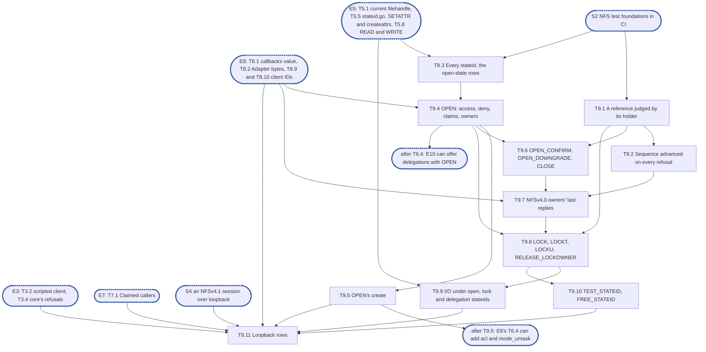

# Epic 9: NFS adapter v2 opens, stateids and locks

**Sources:** [RFC 21](../docs/internals/rfcs/rfc-21-nfs.md) §4.2, §5.1's "No courtesy clients"
paragraph and its NFSv4.0 answer to an administrator's revoke, §5.2 other than `RECLAIM_COMPLETE`
and the two special stateids that name no open, §5.4's reclaim rows for an open and a lock and its
stale-stateid rule, §5.5, §11.3's exclusive create, delete pending and read-only marker for
`OPEN`, §11.4's rows for stateids, opens, access and deny, claims, locks, lock owners and
sequences, §11.5's rows for the open-state errors these operations meet and their drain roles,
per request, §11.6's golden vectors and fuzz targets for the stateid codec, `share_access` and
`share_deny`, and a `LOCK` into a `LockReq`, §12's N4, N12, N24's stale-or-bad clause and N26
for its translations, §13's rows named in §3 below, and Appendix D's open, lock and stateid rows;
[RFC 14](../docs/internals/rfcs/rfc-14-open-state.md) §2.2, §2.3, §2.8, §2.10 and §2.11, as
constraints the service keeps and this epic's wire answers expose, with §2.2's and §2.8's rules
that the service does not yet keep (T9.1, T9.2);
[RFC 17](../docs/internals/rfcs/rfc-17-vfs.md) §3.0's `Call.Client` for NFSv4.0 and §3.1's
`Lock` and `Unlock` owner, for the service's half (T9.1, D1);
[RFC 19](../docs/internals/rfcs/rfc-19-authorization.md) §3.8, its §9 lock row through NFSv4;
[RFC 20](../docs/internals/rfcs/rfc-20-adapters.md) §4.3's one mutating call and its `FreeState`
exemption, §4.4's `Client` set by a row's `Resolve`, §4.5's error table, §4.7's `Role`, and §4.10's
per-call admission of `LOCK`, `LOCKT` and `LOCKU`. Every citation is `develop`'s text, which reaches
`feat/storage-v2` with the cherry-pick of RFC changes.
Cited, not owned: RFC 8881 and RFC 7530 for the bytes, operation numbers and status values.
**Track:** C.
**Epic 9 estimate: 11 subtasks, 30.5 man-days.**
**Depends on:** **S2**, NFS's test foundations in CI: E1's `protocol.State` with its current and
saved stateids (T1.1) and NFSv4 members' table (T1.2), E2's `nfsharness` (T2.2) and the service's
`NoGrace` (T2.1), S0's `vfstest.Mutations`. Beyond S2: **E5**'s `SetFH` users and the walk to a
file (T5.1), `stateid.go`, `SETATTR` and the `createattrs` translation (T5.5), and `READ` and `WRITE`
(T5.8); **E8**'s pieces landed first: the callbacks value in `nfs/callbacks.go` with its
`v4.Handlers` field (T8.1), and the `Adapter` bytes codec whose `ClientRecNFS4.Minor` names the
minor version a client was confirmed under (T8.2), then `SETCLIENTID`, its confirm, `RENEW` and the
`StaleClient` row (T8.10) for NFSv4.0 rows, and `EXCHANGE_ID` (T8.3), `CREATE_SESSION` (T8.4),
`SEQUENCE` (T8.5) and `DESTROY_CLIENTID` (T8.9) for NFSv4.1 rows (§9, point 4); **E3**'s scripted client (T3.2) and `core`'s refusals in NFSv4's tables (T3.4);
**E7**'s resolution of a `Claimed` caller (T7.1), without which an `AUTH_SYS` call is refused at
admission; **S4** for the NFSv4.1 loopback rows of T9.11.
**Blocks:** E10, whose delegations are offered with T9.4's `OPEN` (E10's T10.4) and whose
`DELEGRETURN` and revoked answers use T9.3's stateids and T9.10's operations (T10.4, T10.7), and
whose T10.7 advances the `memory.Service.Clock` T9.7 exports, and whose T10.8 tests `LOCK` and
`LOCKT` during a recall on T9.8's rows; E12, whose `COPY` and `CLONE` (T12.3)
take T9.3's and T9.9's stateids and whose hold budget (T12.4) adds its call to T9.6's `CLOSE`;
E6's T6.4, which adds `acl` and `mode_umask` to T9.5's create attributes; E16, which runs pynfs's
open, lock and stateid tests and the restart rows.

---

## 1. Goal

Epic 9 gives NFSv4 the state a client takes through an open: open stateids and their sequence,
NFSv4.0's owners and their replays, byte-range locks, and the rules every stateid is checked by.
Each operation is one row of E1's members' table and at most one mutating service call; the
service holds every record, and the adapter holds only each NFSv4.0 owner's last reply.

**At the end of the epic:**

- `OPEN` by name or by handle, with every create mode and claim RFC 21 §11.4 lists, answers an
  open stateid minted by the service, and `OPEN_CONFIRM`, `OPEN_DOWNGRADE` and `CLOSE` move it;
- `READ`, `WRITE` and `SETATTR` serve open, lock and delegation stateids, the current stateid
  inside a compound, and refuse a stateid of another client or principal as §5.2 says;
- `LOCK`, `LOCKT`, `LOCKU` and `RELEASE_LOCKOWNER` take, test and release one range each, a
  denial naming its holder only when that holder is an NFSv4 lock owner;
- `TEST_STATEID` and `FREE_STATEID` answer per stateid with no file handle;
- an NFSv4.0 owner's sequence advances on every in-sequence answer but the exempt ones, and a
  retransmission of its last request is answered from the reply this node kept;
- a stateid lost with its shard's state is `NFS4ERR_STALE_STATEID`, one never issued or released
  `NFS4ERR_BAD_STATEID`.

### 1.1 In scope

`ops/v4`'s rows for `OPEN`, `OPEN_CONFIRM`, `OPEN_DOWNGRADE`, `CLOSE`, `LOCK`, `LOCKT`, `LOCKU`,
`RELEASE_LOCKOWNER`, `TEST_STATEID` and `FREE_STATEID`, each with its `Resolve`, drain role,
golden files and error rows; E5's stateid function extended to every stateid; E5's `READ`,
`WRITE` and `SETATTR` under open, lock and delegation stateids; `protocol/owners.go`, NFSv4.0's
owners' last replies; the callbacks value's `Revoked` for opens and locks; the service's half:
a sessionless reference judged by its holder and a lock state's owner taken from it (T9.1, D1),
and an owner's sequence advanced on a refusal before the table's step (T9.2, D2); the fuzz
targets of the stateid translation, `share_access` and `share_deny`, and a `LOCK` into a
`LockReq`; the loopback rows named in §3.

### 1.2 Out of scope

- Delegations offered with `OPEN`, the client's `OPEN4_SHARE_ACCESS_WANT_*` wishes mapped to a
  grant, `DELEGRETURN`, `CB_RECALL`, an `OPEN` reclaiming a delegation, the delegation-stateid
  steps of RFC 21 §13's "§5.2 stateids *(1 node)*" (the recall timeout) and "§5.2 delegation
  stateid", an administrator's revoke and its `SEQUENCE` flags, and the drain test against Linux's
  compounds, and `LOCK` and `LOCKT` met during a recall: E10 (T10.4, T10.7, T10.8, T10.9). This epic decodes the want bits and refuses an invalid
  one (D8), maps `ErrState` (`Revoked`) in both its causes (T9.3) and serves `READ`, `WRITE` and
  `SETATTR` under a delegation stateid (T9.9); E10 makes a delegation and tests what it answers.
- `SETCLIENTID`, `SETCLIENTID_CONFIRM`, `EXCHANGE_ID`, `CREATE_SESSION`, `SEQUENCE`, `RENEW`,
  `DESTROY_CLIENTID` and `RECLAIM_COMPLETE`, the lease and its renewal by `SEQUENCE` and `RENEW`
  (this epic renews it on NFSv4.0's stateful operations, R60), the `SEQ4_STATUS` flags, the NFSv4.0
  stale-client-ID signal and the `StaleClient` and `ClientInUse` rows: E8 (T8.3 to T8.6, T8.9,
  T8.10). This epic runs the rows
  of §13 that need an open or a lock beside them (R52 to R55).
- NLM's locks and NSM, and the NLM steps of "§5.5, §6.1 conflict holder": E11.
- The restart rows ("§5.4 single-node restart", "§5.2, §5.4 lock across a restart *(1 node)*",
  "§5.4 NFSv4.0 signal", "§5.1 revoke across a restart *(1 node)*"'s NFSv4 steps), the lock recall
  with NLM and SMB ("§5.3 lock recall"), the handle-cached deny mode, pynfs's open, lock and
  stateid tests, and the totality test of every table: E16 (T16.4, T16.5, T16.6, T16.11; pynfs's
  tests in its burn-down, planned after E15).
- `READ`, `WRITE` and `SETATTR` under the all-zeros and all-ones stateids, and the I/O rows of
  `ErrLocked` and `ErrShareViolation`: E5. `REMOVE`, `RENAME` and `CREATE` meeting delete pending
  or the read-only marker: E5.
- `acl` and `mode_umask` among `OPEN`'s create attributes: E6's T6.4, through T9.5's call of E5's
  `createattrs`.
- RFC 21's (cluster) parts this epic's sections name: NFSv4.0 owner sequences across shards and
  the replay through the node that took an address over (§4.2), a stateid carried by a batch move
  (§5.2), the reclaim in a healthy shard of a client a failover asked to reclaim (§5.4): the RFC 21
  implementation plan's deferral ledger, row "RFC 21's (cluster) parts". The layout stateid's tag:
  its row "The layout stateid's type tag".
- `CB_NOTIFY_LOCK` for a waiting NFSv4.1 lock owner: the deferral ledger's row "`CB_NOTIFY_LOCK`".
- Who records `adapter_translation_refused_total{reason}` for `stateid`, `open` and `lock`, whose
  producers are T9.3's, T9.4's and T9.8's refusals: open with the RFC's author (rule 3); no recorder
  is added here, and each refusal is a named value it can count then.

### 1.3 Names used here

- **E1**, epic 1, the NFS surface: `protocol.State` with `Cur` and `Saved`, each a filehandle and a
  `Stateid` with `HasStateid`, `SetFH`, and NFSv4's table and members' table.
- **E2**, epic 2, test foundations: `nfsharness`, which runs one member inside a `COMPOUND` against
  `memory.New` and checks the one-call rule, and the service's `NoGrace` kind.
- **E3**, the RPC layer: `core`'s refusals in NFSv4's tables, the `ILLEGAL` and `NOTSUPP` rows
  among them (T3.4), and the scripted client, `adaptertest/nfsclient` (T3.2).
- **E4**, NFSv3 and MOUNT, which holds NFSv3's half of the "§11.3 read-only marker" row.
- **E5**, the NFSv4 namespace, attributes and data: the current filehandle's operations (T5.1),
  `stateid.go`, `SETATTR` and the `createattrs` translation `CREATE` uses (T5.5), `READ` and `WRITE` (T5.8).
- **E6**, the NFSv4 ACL attributes, which adds `acl` and `mode_umask` to `OPEN`'s create (T6.4).
- **E7**, identity's NFS side: a `Claimed` caller resolved (T7.1).
- **E8**, clients and sessions: the callbacks value and the `Adapter` bytes, landed first, client
  IDs and their confirms, sessions, the lease and the `SEQUENCE` flags.
- **E9**, this epic. **E10**, delegations and the back channel. **E11**, NLM, NSM and the
  datagram path. **E12**, the NFSv4.2 operations. **E16**, E2E green: the suites, restart rows,
  cross-protocol rows and totality test.
- **S0**, the shared test pieces of the RFC 22 implementation plan's epic 2: `vfstest.Mutations`,
  `adaptertest/golden`, the import test's call-site rules.
- **S2**, NFS's test foundations in CI, after E2 and S0: what this epic starts from.
- **S4**, an NFSv4.1 session over loopback, after E3, E5 and E8: what T9.11's NFSv4.1 rows need.
- **E15**, the integration with the node, which turns the NFS suites on.

## 2. How the general rules apply

The rules are those of [the RFC 21 implementation plan's §1.5](rfc-21-nfs-plan.md#15-general-rules-for-each-epic),
cited by number and title and not copied.

| Rule | Subtasks | How |
| --- | --- | --- |
| rule 1, independent unit tests, under `-race` ([`CLAUDE.md`, "Writing tests"](../CLAUDE.md#writing-tests)) | all | each member on `nfsharness` against `memory.New` (kind 2), errors through `vfstest.Faults` (kind 3), the one-call rule from S0's `vfstest.Mutations`; the translations (stateids, `share_access` and `share_deny`, claims, a `LOCK` into a `LockReq`, the holder in `LOCK4denied`) as functions of their inputs; T9.1's and T9.2's service halves in `pkg/openstate`'s and `internal/vfs`'s own tests on their real stores; the owners' table on its own, with an injected budget; no other double |
| rule 2, fuzz tests where relevant | T9.3, T9.4, T9.8 | the three targets RFC 21 §11.6 names for this epic: `FuzzStateid` (the wire stateid to an `OpenRef` and back), `FuzzShareAccess` and `FuzzLockReq`, each with a seed corpus and two invariants: the input becomes one neutral value or a named refusal, never other state, and a value it accepts re-encodes to wire bytes that decode to the same neutral value (CLAUDE.md's fuzz rule); every generated struct is already in E1's `FuzzCodec` |
| rule 3, observability follows RFC 25 and RFC 20 §10 | T9.3, T9.4, T9.8 | no recorder in NFS code; each row named after its operation, so `core` names its span and `op` label; the refusals behind `adapter_translation_refused_total`'s `stateid`, `open` and `lock` reasons are named values, recorded once who records them is settled (§1.2); no label, attribute or log line carries an owner's bytes, a client ID or a name |
| rule 4, profiling: leaks, allocations and contention | T9.7, T9.11 | the owners' table is a node-wide map under one mutex: its test reports the mutex and block profiles under 64 parallel owners (RFC 20 §6.9); every loopback test ends with `adaptertest.CheckLeaks`; no allocation gate, which RFC 20 §6.10 sets on `READ`, `WRITE` and `GETATTR` only, and T9.9 keeps E5's `READ` and `WRITE` gates green |
| rule 5, public interface and internals, at the layer that consumes a value ([`CLAUDE.md`, "Verifying a change"](../CLAUDE.md#verifying-a-change)) | all | a stateid is asserted on the `READ`, `WRITE`, `CLOSE` or `LOCK` that quotes it, never only on the `OPEN` that minted it; a sequence advance on the owner's next request; the holder on the `LOCK4denied` bytes a client decodes; T9.1's and T9.2's service rules again through the adapter in T9.6, T9.7, T9.8 and T9.9 |
| rule 6, known failures shrink | none | no `pynfs`, `cthon04` or `nfstest` test runs before the cutover, and nothing here is listed in a `known.yaml` |
| rule 7, v2 ignores v1 | all | nothing from `develop`'s `v4/state` or its handlers; statuses and behaviour from RFC 21, RFC 8881 and RFC 7530 |
| rule 8, real dependencies for properties of those dependencies | T9.3 to T9.11 | golden files cut from knfsd's captures where E2's areas hold the operation, by hand from RFC 8881 and RFC 7530 where they do not; real TCP over loopback through `core` (T9.11); the lease run out on `memory.New`'s own clock, never a sleep |
| rule 9, code comment conventions ([`CLAUDE.md`, "Code comments"](../CLAUDE.md#code-comments)) | T9.1 to T9.9 | each decision of §4 leaves the marker it names; RFC 21 §5.2's `decision:` that rule 5 trusts the credential, at T9.9's principal-check mapping; RFC 21 §4.2's `decision:` on best-effort replay past the dedup window, at the owners' table (T9.7) |
| rule 10, a test must be able to fail | all | each test names the break it catches; none asserts a stub's answer; a golden vector is cut from a capture or written from the RFC, never from the encoder under test |
| rule 11, a symbol is exported only if an interface uses it | T9.1, T9.2, T9.7 | exported: T9.1's two marks, fields of `vfs.Call` and `vfs.LockReq` that `ops/v4` sets; T9.2's `Refused` on `pkg/openstate`'s `Opens` view, which `internal/vfs` calls; T9.7's `protocol.Owners`, for `ops/v4` and `nfs.go`. Every handler and translation stays unexported in `ops/v4` |
| rule 12, each subtask creates only what it declares | all | each row lands with its handler, error rows, golden files and tests; the owners' table with its first consumers, the sequenced members of T9.6 and T9.4's `OPEN`, in T9.7; the want bits decoded with `OPEN` because they share `share_access`'s word, their grant mapping left to E10, which consumes them (D8) |
| rule 13, translate, never decide | all | each handler makes the calls Appendix D names, at most one mutating; the NFSv4.0 `Record` read is read-only, and the `FreeState` after a `Revoked` answer is outside the rule (RFC 20 §4.3); who holds a stateid, which owner a lock stateid names, and whether a refused request advances its owner are the service's, added there by T9.1 and T9.2 rather than worked out in a handler |
| rule 14, nothing deferred is lost | all | §1.2 names the owner of each part of an obligation this epic leaves out; D5's drain-role ceiling and D7's answer to a delegation reclaim after a client's restart name what would overturn them |

## 3. Requirements and invariants

Every MUST and MUST NOT that RFC 21, RFC 14, RFC 17, RFC 19 and RFC 20 place on this epic, numbered
so that subtasks and tests can cite them.

**Stateids**

| # | Requirement | Kind | Source | Subtasks |
| --- | --- | --- | --- | --- |
| R1 | A stateid's `other` names an RFC 14 record by type tag, shard, grace-instance bits and random token, and is spelled and read by `pkg/vfs`'s codec, shared by every adapter: the adapter keeps no table of stateids and decodes none by a codec of its own | MUST | RFC 21 §5.2 rule 1, §11.4 (`StateRef`), §12 (N4) | T9.3 |
| R2 | At least 64 bits of every `other` the adapter answers come from a random source, so no field of a stateid rises with the order its state was made | MUST | RFC 21 §5.2 rule 2, §12 (N12); RFC 14 §2.11 | T9.3, T9.11 |
| R3 | A stateid whose record is gone is `NFS4ERR_STALE_STATEID` when its grace-instance bits name an earlier instance than the shard's or the shard is in grace, and `NFS4ERR_BAD_STATEID` otherwise; the adapter passes the bits with the lookup and never answers a stateid the loss took as bad | MUST | RFC 21 §5.2 rule 1, §5.4, §11.5 (`StaleState`, `BadState`), §12 (N24) | T9.3 |
| R4 | `seqid` is the state's, held at the primary: an older one is `NFS4ERR_OLD_STATEID`, a newer one `NFS4ERR_BAD_STATEID`, and NFSv4.1's `seqid` 0 means current; every reply that changes an open or a lock state carries the `seqid` the service returned | MUST | RFC 21 §5.2 rule 3, §11.4 (`StateRef`), App. D (`OPEN_CONFIRM`, `OPEN_DOWNGRADE`, `LOCK`, `LOCKU`); RFC 14 §2.2 | T9.3, T9.4, T9.6, T9.8 |
| R5 | A stateid of another client is `NFS4ERR_BAD_STATEID` (`ErrState` (`NotYours`)), checked against the session's client, or over NFSv4.0 against the client of the owner a sequenced operation names | MUST | RFC 21 §5.2 rule 4 | T9.1, T9.3, T9.9 |
| R6 | Over NFSv4.0, the call's client is the one on the state its stateid resolves to; a delegation stateid, or any stateid of state created on a session, is `NFS4ERR_BAD_STATEID` whatever the principal and changes no state | MUST | RFC 21 §5.2 rule 5; RFC 14 §2.2; RFC 17 §3.0 (`Call`), §3.1 | T9.1, T9.6, T9.9 |
| R7 | A v4.0 `OPEN`, `LOCKT` or `RELEASE_LOCKOWNER` naming the client ID or owner of a client `EXCHANGE_ID` confirmed is `NFS4ERR_STALE_CLIENTID`, decided from the minor version the client's `Record` holds, read before the service call | MUST | RFC 21 §5.2 rule 5, App. D (`OPEN`, `LOCKT`, `RELEASE_LOCKOWNER`) | T9.4, T9.8 |
| R8 | The credential of a v4.0 `READ`, `WRITE` or `SETATTR` names the principal that made the open (`Open.Principal`), a lock stateid checked against the principal of its open; one naming any other is `ErrState` (`NotYours`), answered `NFS4ERR_ACCESS` there, and grants nothing; a `Sessioned` refusal is `NFS4ERR_BAD_STATEID` | MUST | RFC 21 §5.2 rule 5, §11.5 (`NotYours`), §12 (N12); RFC 14 §2.2 | T9.9 |
| R9 | I/O under a delegation stateid is refused `NFS4ERR_BAD_STATEID` unless the delegation is held, unrevoked, by the session's client, and is then authorised afresh as anonymous I/O is; the adapter passes the delegation as the reference and decides neither | MUST | RFC 21 §5.2 rule 6, §12 (N12) | T9.9 |
| R10 | The NFSv4.1 current stateid is resolved inside the compound, as the one the previous operation returned, and a member quoting it where none is set is `NFS4ERR_BAD_STATEID` | MUST | RFC 21 §5.2 (special stateids) | T9.3 |
| R11 | A stateid quoted with a file handle that names another file than its record's is `NFS4ERR_BAD_STATEID` | MUST | RFC 21 §5.2; RFC 14 §2.11 | T9.3, T9.9 |
| R12 | `TEST_STATEID` answers per stateid without changing state; `TEST_STATEID` and `FREE_STATEID` resolve each stateid by its shard and index, never through the current filehandle; a stateid of a removed or retired share is `NFS4ERR_BAD_STATEID` and never flagged revoked | MUST | RFC 21 §5.2, §11.5 (`ErrStale`), App. D (`TEST_STATEID`) | T9.10 |
| R13 | `FREE_STATEID` frees any stateid in the client's revoked set, answering `NFS4_OK`, and a lock state holding no locks, alone and never its owner's other lock state; a lock state holding locks or a live open is `NFS4ERR_LOCKS_HELD`; one that resolves to nothing is `NFS4ERR_STALE_STATEID` or `NFS4ERR_BAD_STATEID`, never success | MUST | RFC 21 §5.2, §11.5 (`LocksHeld`), App. D (`FREE_STATEID`) | T9.10 |
| R14 | An NFSv4.0 stateid an administrator revoked is answered `NFS4ERR_ADMIN_REVOKED` once by any operation presenting it (`CLOSE`, `OPEN_CONFIRM`, `OPEN_DOWNGRADE`, `LOCK`, `LOCKU`, `READ`, `WRITE`, `SETATTR`), then the adapter calls `FreeState` for it on the client's behalf, so its next use is `NFS4ERR_BAD_STATEID` | MUST | RFC 21 §5.1, §11.5 (`Revoked`); RFC 20 §4.3 | T9.6, T9.8, T9.9 |
| R59 | Over NFSv4.1 the opener's principal is checked beside rule 4 on every use of an open: a `READ`, `WRITE` or `SETATTR` under an open or lock stateid from another principal is `ErrState` (`NotYours`), answered `NFS4ERR_BAD_STATEID` as §11.5 answers every `NotYours` but NFSv4.0 I/O's, except from the machine principal of a client under `SP4_MACH_CRED`, which open state admits as the record's `Owner` | MUST | RFC 21 §5.2 rule 5, §11.5 (`NotYours`); RFC 14 §2.2 | T9.9 |
| R15 | `ErrState` (`Revoked`) is answered by its cause: `NFS4ERR_ADMIN_REVOKED` for state an administrator revoked, `NFS4ERR_DELEG_REVOKED` for a delegation revoked at its recall deadline; an expired client's stateid is `NFS4ERR_BAD_STATEID`, never `NFS4ERR_STALE_CLIENTID`, and `NFS4ERR_EXPIRED` is never answered | MUST | RFC 21 §11.5 (`Revoked`, `StaleClient`), §5.1 | T9.3 |

**Opens**

| # | Requirement | Kind | Source | Subtasks |
| --- | --- | --- | --- | --- |
| R16 | `OPEN4_SHARE_ACCESS_READ` and `_WRITE` are `OpenMode.Access` read and write data, with the attribute rights RFC 7 §7.7 implies; `OPEN4_SHARE_DENY_READ` and `_WRITE` are `Deny` of the same bits; an NFS open never denies delete | MUST | RFC 21 §11.4 (access and deny) | T9.4 |
| R17 | The `OPEN4_SHARE_ACCESS_WANT_*` flags are not access; an access or deny value outside the protocol's set is `NFS4ERR_INVAL`, never truncated to the bits that fit | MUST | RFC 21 §11.4 (access and deny) | T9.4 |
| R18 | `OPEN` is one `Open`, its create, claim type and reclaim `OpenRequest` fields: a claim by name opens through its directory, `CLAIM_FH`, `CLAIM_PREVIOUS`, `CLAIM_DELEG_CUR_FH` and `CLAIM_DELEG_PREV_FH` open by handle with `Via` zero, and `CLAIM_PREVIOUS` sets `Reclaim`; `OPEN4_RESULT_CONFIRM` is `OpenResult.Confirm`, never set on a `CLAIM_PREVIOUS` reclaim | MUST | RFC 21 §11.4 (claims), §5.4 (reclaim an open), §4.2, App. D (`OPEN`) | T9.4 |
| R19 | The verifier of an `EXCLUSIVE4` or `EXCLUSIVE4_1` open is RFC 7's create verifier, stored in `CreateVerifier` and never in `atime` or `mtime`; the attributes an `EXCLUSIVE4_1` open carries (`suppattr_exclcreat`) are applied by the create's own transaction and leave the verifier in place | MUST | RFC 21 §11.3 (exclusive create) | T9.5 |
| R20 | An `OPEN` of a delete-pending file is `ErrDeletePending`, and an `OPEN` for write of a file an SMB client marked read-only `ErrAccess`, each answered `NFS4ERR_ACCESS` | MUST | RFC 21 §11.3 (delete pending, read-only marker), §11.5 | T9.4 |
| R21 | `ErrShareViolation` on `OPEN` is `NFS4ERR_SHARE_DENIED`; an `OPEN` the service holds behind a break is `ErrDelay`, answered `NFS4ERR_DELAY`, never refused at once | MUST | RFC 21 §5.3 (handle-cached open), §11.5 | T9.4 |
| R22 | A reclaim (`OPEN` with `CLAIM_PREVIOUS`, `LOCK` with `reclaim` set) is answered as §5.4's table says: `ErrGrace` `NFS4ERR_GRACE`, `NoGrace` `NFS4ERR_NO_GRACE`, `NoReclaim` `NFS4ERR_RECLAIM_BAD`, `ReclaimConflict` `NFS4ERR_RECLAIM_CONFLICT` | MUST | RFC 21 §5.4, §11.5 | T9.4, T9.8 |
| R23 | `OPEN_CONFIRM` is `ConfirmOpen`, `OPEN_DOWNGRADE` `Downgrade`, `CLOSE` `Close`, each one call | MUST | RFC 21 App. D | T9.6 |
| R24 | Until `OPEN_CONFIRM`, an `OPEN` from a new owner replaces its unconfirmed open, releasing it, whatever seqid it carries; every other request naming its state, `READ` and `WRITE` included, is `NFS4ERR_BAD_STATEID` and advances nothing, and an `OPEN_CONFIRM` of an owner already confirmed is `NFS4ERR_BAD_STATEID` | MUST | RFC 21 §4.2; RFC 14 §2.8 | T9.4, T9.6 |

**Owner sequences**

| # | Requirement | Kind | Source | Subtasks |
| --- | --- | --- | --- | --- |
| R25 | The next expected sequence ID of each NFSv4.0 owner is held in RFC 14's `Sequence.Next` and advanced in the step that answers the operation: the adapter passes each owner seqid as `Seqs` and keeps no sequence of its own | MUST | RFC 21 §4.2, §11.4 (`Seqs`); RFC 14 §2.8 | T9.4, T9.6, T9.8 |
| R26 | Every in-sequence reply advances the owner's sequence, refusals included, except `NFS4ERR_STALE_CLIENTID`, `NFS4ERR_STALE_STATEID`, `NFS4ERR_BAD_STATEID`, `NFS4ERR_BAD_SEQID`, `NFS4ERR_BADXDR`, `NFS4ERR_RESOURCE`, `NFS4ERR_NOFILEHANDLE` and `NFS4ERR_MOVED`; a refusal the service makes before its table's step advances it too | MUST | RFC 21 §4.2; RFC 14 §2.8 | T9.2, T9.7 |
| R27 | An owner's seqid after `0xFFFFFFFF` is 0, a stateid's `seqid` wraps to 1; the adapter does no arithmetic on either beyond D6's | invariant | RFC 21 §4.2 | T9.6, T9.7 |
| R28 | A `LOCK` that introduces a lock owner carries the open owner's seqid beside the new lock owner's first one (`open_to_lock_owner4`), as `Seqs.Owner` and `Seqs.NewOwner`, and is sequenced against the open owner; every later `LOCK` and `LOCKU` of that lock owner is numbered per lock owner | MUST | RFC 21 §4.2; RFC 14 §2.8 | T9.8 |
| R29 | The last reply per NFSv4.0 owner is held only in the gateway node that sent it, and a retransmission of the owner's last sequenced request is answered with it, calling nothing; one the node no longer holds is answered as the service judges its seqid | MUST | RFC 21 §4.2 | T9.7 |

**Locks**

| # | Requirement | Kind | Source | Subtasks |
| --- | --- | --- | --- | --- |
| R30 | `LOCK` and `LOCKU` each name one range, passed as a one-element list; a length of all ones reaches 2⁶⁴−1 and is never computed as offset plus length | MUST | RFC 21 §5.5, §11.4 (`LockReq`); RFC 14 §2.3 | T9.8 |
| R31 | `LockOwner.Name` is the `lock_owner4`'s owner bytes and `LockOwner.Stack` false: NFS locks merge and split | MUST | RFC 21 §11.4 | T9.8 |
| R32 | A `LOCKU` of a range the owner holds only part of, or none of, releases what it holds there and succeeds; `NFS4ERR_LOCK_RANGE` is never answered | MUST | RFC 21 §5.5, §11.5 (`ErrRangeNotLocked`) | T9.8 |
| R33 | A refused `LOCK` or `LOCKT` is `NFS4ERR_DENIED` with a `LOCK4denied` naming the conflicting range and type, and as holder an NFSv4 lock owner's client ID and owner bytes; any other holder is client ID 0 and an empty owner | MUST | RFC 21 §5.5, §11.5 (`ErrLocked`) | T9.8 |
| R34 | An internal owner identity never reaches the wire: no `LOCK4denied` carries an owner past `NFS4_OPAQUE_LIMIT` or one the holder's protocol did not send | MUST NOT | RFC 21 §5.5 | T9.8 |
| R35 | A `READW_LT` or `WRITEW_LT` that conflicts is `NFS4ERR_DENIED` and leaves a waiter, polled, a repeat of the same range and type keeping its place; the adapter sets no timer on it | MUST | RFC 21 §5.5, §11.4 (`Wait` poll); RFC 14 §2.10 | T9.8 |
| R36 | A `LOCK` or `LOCKT` met while a delegation is recalled is `ErrDelay`, answered `NFS4ERR_DELAY`, leaving no waiter; never `NFS4ERR_DENIED` | MUST | RFC 21 §5.3, §12 (N14) | T9.8 |
| R37 | `LOCK` is `Lock`, answering the lock stateid it returns; `LOCKU` is `Unlock`, answering the seqid it returns; `LOCKT` is `TestLock`; `RELEASE_LOCKOWNER` is `ReleaseLockOwner`, `NFS4ERR_LOCKS_HELD` while the owner holds a lock | MUST | RFC 21 §4.2, §11.5 (`LocksHeld`), App. D | T9.8 |
| R38 | A `LOCKT` takes no open, so it is gated as a lock outside an open: it needs read data or ownership of the file, and a write lock asks no more than a read lock | MUST | RFC 19 §3.8; RFC 21 App. D (`LOCKT`) | T9.8 |
| R39 | `LOCK`, `LOCKT` and `LOCKU` are admitted per call like every operation naming a handle: under a flavour the share's policy does not admit, an unverified one on a Kerberos-only share, each is `ErrWrongSecurity`, `NFS4ERR_WRONGSEC` | MUST | RFC 20 §4.10; RFC 21 §11.5 (`ErrWrongSecurity`) | T9.8 |

**The service's half**

| # | Requirement | Kind | Source | Subtasks |
| --- | --- | --- | --- | --- |
| R40 | A call with no session that names no client, is marked to be judged by the holder (D1) and presents a reference is judged as the client the reference's state belongs to, a revoked reference's included, so a row's `Resolve` sets `Client` only from an owner the request names; every other check, the session mark and the principal among them, is unchanged. Pending the RFC 17 §3.0 amendment D1 proposes | MUST | RFC 14 §2.2; RFC 17 §3.0 (`Call`); RFC 20 §4.4 | T9.1 |
| R41 | A `Lock` or `Unlock` presenting a lock state's reference and marked to act for its owner (D1) acts for that lock state's owner, as `LOCK` with an existing lock owner and `LOCKU` name none. Pending the RFC 17 §3.1 amendment D1 proposes | MUST | RFC 14 §2.3; RFC 17 §3.1; RFC 21 §11.4 (`LockReq`) | T9.1 |
| R60 | Every NFSv4.0 stateful operation renews its client's lease, in the lease owner's memory and never by a write: the client the call names, or the holder a sessionless call is judged by (R40), so a busy client that sends no `RENEW` is not expired mid-I/O. E8 renews on `SEQUENCE` and `RENEW` only. Pending the user's answer on D1 | MUST | RFC 21 §5.1; RFC 14 §4.1 | T9.1 |

**Translation, errors and the drain**

| # | Requirement | Kind | Source | Subtasks |
| --- | --- | --- | --- | --- |
| R42 | Every wire value this epic translates — a stateid, `share_access` and `share_deny`, a claim, a create mode, a `LOCK` into a `LockReq` — maps to one neutral value or a named refusal, never a default | invariant | RFC 21 §11, §11.6 (total mapping), §12 (N26) | T9.3, T9.4, T9.5, T9.8 |
| R43 | The stateid ↔ `StateRef` codec, the `share_access` and `share_deny` translation and a `LOCK` into a `LockReq` are fuzzed, seeded with truncated, corrupt, older and newer bytes: no panic; a valid neutral request or a refusal, never a request that decodes to other state; and an accepted input round-trips (stateid → `StateRef` → stateid with the same `other` and `seqid`; `share_access` and `share_deny` → `Access`, `Deny` and want → the same wire words; `LOCK` → `LockReq` → the same type, range and owner) | MUST | RFC 21 §11.6 (fuzz) | T9.3, T9.4, T9.8 |
| R44 | Golden files for stateids, `share_access` and `share_deny` pairs, claim types, `LOCK` types and `lock_owner4`, and for every §11.5 row this epic adds, for NFSv4.0 and NFSv4.1, map each wire value to its neutral one and back | MUST | RFC 21 §11.6 (golden vectors) | T9.3, T9.4, T9.8 |
| R45 | Each open-state error these operations meet has its NFSv4 row as §11.5 answers it: `OldState`, `BadState`, `StaleState`, `NotYours` in both forms, `Revoked` in both causes, `BadSeqID`, `LocksHeld`, `ErrLocked` for `LOCK` and `LOCKT`, `ErrShareViolation` for `OPEN`, `NoGrace`, `NoReclaim`, `ReclaimConflict`, and `ErrRangeNotLocked`, which is never answered | MUST | RFC 21 §11.5; RFC 20 §4.5 | T9.3, T9.4, T9.8 |
| R46 | `OPEN_CONFIRM` and `RELEASE_LOCKOWNER` are served under minor version 0 only, answered `NFS4ERR_NOTSUPP` under the minor versions that define and do not serve them; `TEST_STATEID` and `FREE_STATEID`, NFSv4.1 codes, sent under NFSv4.0 are `NFS4ERR_OP_ILLEGAL` | MUST | RFC 21 §11.5 (`core`'s own refusals), App. D | T9.6, T9.8, T9.10 |
| R47 | Each row declares its drain role: `CLOSE`, `LOCKU` and `FREE_STATEID` release; per request, a `WRITE` or `LOCK` whose explicit stateid names state under a delegation or a recall flushes, one naming the current stateid is refused, and an `OPEN` with `CLAIM_DELEGATE_CUR` or `CLAIM_DELEG_CUR_FH` flushes; every other row of this epic none | MUST | RFC 21 §11.5 (what runs while draining); RFC 20 §4.7 (`Role`) | T9.4, T9.6, T9.8, T9.9, T9.10 |
| R48 | Each handler makes at most one mutating service call; the `FreeState` a v4.0 handler makes after `ErrState` (`Revoked`) is outside the rule | MUST | RFC 20 §4.3 | T9.4, T9.6, T9.8, T9.9, T9.10 |

**The RFC's test rows**

| # | Requirement | Kind | Source | Subtasks |
| --- | --- | --- | --- | --- |
| R49 | "§4.2 v4.0 owners *(1 node)*" by the scripted client: an owner's open and lock replays answered, a first `LOCK` of a new lock owner advancing its open owner's seqid, and the open owner's next `CLOSE` accepted | test row | RFC 21 §13 | T9.11 |
| R50 | "§5.2 stateids *(1 node)*" by the scripted client, but for its pynfs steps (E16) and the recall timeout (E10): a `READ` under an expired client's stateid `NFS4ERR_BAD_STATEID`; a stateid never issued `NFS4ERR_BAD_STATEID`; a removed share's stateids `NFS4ERR_BAD_STATEID` to `TEST_STATEID` and `FREE_STATEID`, with no revoked-state flag on `SEQUENCE` | test row | RFC 21 §13 | T9.10, T9.11 |
| R51 | "§5.2 v4.0 stateids"'s single-node steps: a `LOCK` with another client's open stateid; `READ`, `WRITE` and `SETATTR` under another principal's open stateid `NFS4ERR_ACCESS`, the file unchanged; an NFSv4.1 client's delegation stateid and open stateid quoted over NFSv4.0 `NFS4ERR_BAD_STATEID`, its state intact | test row | RFC 21 §13 | T9.9, T9.11 |
| R52 | "§5.2 unguessable `other`": 10^4 opens of one client, no two sharing their random bits, no field rising with open order | test row | RFC 21 §13 | T9.11 |
| R53 | "§5.1 no courtesy": a client's lease expires with no conflict, its lock is gone, and a new client takes it | test row | RFC 21 §13, §5.1 | T9.11 |
| R54 | "§5.1 destroy *(1 node)*": `DESTROY_SESSION` then `DESTROY_CLIENTID` of a client holding an open `NFS4ERR_CLIENTID_BUSY`, the open intact; after `CLOSE` the destroy succeeds | test row | RFC 21 §13, §5.1 | T9.11 |
| R55 | "§3.3 reboot racing renew *(1 node)*", and the "§3.5 confirm" step of a rebooted client holding a lock: the old client ID's lock held until the new one is confirmed, then released | test row | RFC 21 §13 | T9.11 |
| R56 | "§11.3 read-only marker" on one node, its `OPEN` for write step and the row whole, with E4's and E5's halves | test row | RFC 21 §13 | T9.11 |
| R57 | "§5.5, §6.1 conflict holder"'s NFSv4 steps: a range held by an NLM host and by an SMB open, then `LOCK` and `LOCKT` over it, each `NFS4ERR_DENIED`, client ID 0, owner length 0 | test row | RFC 21 §13 | T9.8 |
| R58 | RFC 19 §9's "§3.8 locks outside an open" through NFSv4's `LOCKT`: as bob on alice's 0600 file a read and a write test refused, on a 0644 file both answered, as alice on her own 0200 file a write test answered | test row | RFC 19 §9, §3.8; RFC 21 App. D (`LOCKT`) | T9.8 |

Not obligations of this epic: the lease, its renewal by `SEQUENCE` and `RENEW`, and
`DESTROY_CLIENTID`'s rule (E8; N5 is E8's, R53 runs its lock step), the renewal by NFSv4.0's
stateful operations being this epic's (R60), as E8's document hands it here; RFC 14 §2.2's rule that one owner holds one open of a file, its
`Abandon`, its access checks on I/O and its time suspension, and §2.10's waiter lifetime, which the
service keeps and this epic exposes unchanged (R35 forbids an adapter timer); §5.3's recall of a
delegation by a lock and the handle-cached deny break, which the service makes and E10 and E16 test
end to end, this epic mapping their `ErrDelay` (R21, R36); §5.4's `RECLAIM_COMPLETE`, its flags and
the NFSv4.0 stale-client signal (E8); a callback waiter's `CancelLock` ordering (RFC 14 §2.10), which
only NLM's callback waiters meet (E11), since an NFSv4 waiter polls; the decision notes RFC 21 §5.2
and §4.2 carry, which become markers (rule 9).

## 4. Decisions this epic takes

- **D1. The service reads a reference's holder, by amendment, pending the user's answer.** RFC 14
  §2.2 and RFC 17 §3.0 make an NFSv4.0 call's client "the one on the state its stateid resolves
  to", and RFC 20 §4.4 has a row's `Resolve` set `Call.Client` to it; but a v4.0 `READ`, `WRITE`,
  `SETATTR`, `CLOSE`, `OPEN_CONFIRM`, `OPEN_DOWNGRADE`, `LOCKU` and a `LOCK` with an existing lock
  owner carry only a stateid, and the service offers no call that names its holder, while
  `pkg/openstate`'s `mine` refuses every reference whose client is not `Caller.Client`. Likewise a
  `LOCK` with an existing lock owner and every `LOCKU`, on both minor versions, name no lock owner,
  and `Locks.Lock` and `Locks.Unlock` refuse one that is not the lock state's. Options: (a) the
  service judges a sessionless call naming no client by the reference's holder, a revoked
  reference's included, and a lock-state reference with no `LockOwner` as that lock state's owner
  (R40, R41), each asked for by an explicit mark rather than read from a zero value (`Call`'s
  "judge by the holder" mark, which only an NFSv4.0 row's `Resolve` sets, and `LockReq`'s "the lock
  state's owner" mark), so a `Resolve` that forgets to set `Client`, or a `lock_owner4` with empty
  owner bytes, is judged as today and refused `NotYours` or `BadState`; and the service renews the
  client it judges such a call by, or the one the call names, in the same step (R60), with RFC 17
  §3.0's `Call` row and §3.1's `Lock` and `Unlock` comments amended, built in T9.1, 3.5 man-days; (b) a read-only service call naming a reference's client and owner, which every
  such `Resolve` makes first, a second round trip to the primary per operation and one more method
  every implementation of `vfs.Service` carries, and the lease of a stateid-only call's client
  renewed by a further `Renew` per operation; (c) an adapter table from each stateid it answered
  to its client and owner, which a node loses on a restart and must never evict, and which another
  node lacks, against §5.2 rule 1's "without a table of its own". (a) is recommended: it keeps every
  check where the state is (the session mark and the principal), adds no call, and is what knfsd
  does by keeping the client in the stateid it finds (from memory). A `decision:` marker at
  `mine` names the ceiling: a sessionless protocol other than NFSv4.0 that names no client would be
  judged by the holder too; NFSv3 presents only anonymous references and NLM names its host, so none
  does today.
- **D2. A refusal before the table's step advances the owner, in the service.** RFC 14 §2.8 and RFC
  21 §4.2 have every in-sequence answer advance the owner's sequence, refusals included, but
  `internal/vfs`'s `Open` decides admission, the name's lookup and the open-time grant before it
  calls the table, so an `OPEN` of a missing file or one the caller may not open answers
  `NFS4ERR_NOENT` or `NFS4ERR_ACCESS` with `Next` unmoved, and Linux, which counts that reply, is
  answered `NFS4ERR_BAD_SEQID` on the owner's next request. T9.2 adds `Opens.Refused`, which judges
  the presented number at the owner's home primary and advances it for a refusal outside RFC 14
  §2.8's exempt kinds, and `internal/vfs` calls it on every refusal of a numbered request it makes
  before the step. The adapter cannot do it: the sequence is the table's (R25). Prior art: knfsd
  bumps the seqid after every operation whose status is outside the exempt list
  (`nfsd4_bump_seqid`, from memory). A `decision:` marker at `Refused` names the ceiling: a refusal
  that reaches no primary at all (the service stopping) advances nothing, which RFC 21 §4.2's
  exempt list does not name; withdraw it if a client is seen looping on `NFS4ERR_BAD_SEQID` after a
  drain.
- **D3. NFSv4.0 owners' last replies are keyed by the state the request names.** The table is per
  node and charged to RFC 24's connection-state budget (`Deps.Budgets`), beside the sessions, under a
  ceiling of its own, a fixed share of that budget, so a client churning opens evicts only kept
  replies and never crowds out a session. An
  `OPEN` names its open owner (client ID and owner bytes) and is kept under it; every other
  sequenced operation names only a stateid (`CLOSE`, `OPEN_CONFIRM`, `OPEN_DOWNGRADE`, `LOCKU`, a
  `LOCK` with an existing lock owner) or an open stateid and a new lock owner (a `LOCK` introducing
  one), and is kept under that stateid's `other`, since the adapter cannot name the owner behind a
  stateid. An entry holds the seqid, a hash of the operation's arguments, the principal that sent
  it and its reply, and answers only a request whose seqid, hash and principal all match; any other
  is a miss, judged by the service. A key holds one entry, which the owner's next sequenced request
  replaces, so an open's `CLOSE` leaves one entry under its stateid until eviction. Full, the table
  evicts the least recently used entry, an eviction being a named value a recorder can count once
  rule 3's question settles (§1.2), and a retransmission it no longer holds is judged by the
  service: `NFS4ERR_BAD_SEQID`, as RFC 21 §4.2's `decision:` accepts past the retry window. Prior art: knfsd's `so_replay` on the
  state owner, found through the stateid (from memory). The ceiling, in a `decision:` marker at the
  table: a request reusing the seqid of an owner's earlier request on an older state, after the
  owner moved on, is answered that state's kept reply rather than `NFS4ERR_BAD_SEQID`; it cannot be
  told from a late duplicate, which E3's duplicate-request cache answers the same way. This refines
  the per-(client, owner) key the RFC 21 implementation plan's D8 gave, which a stateid-only
  request cannot fill; this document's pull request amends the plan's D8 to match (§9, point 5).
- **D4. A holder is an NFSv4 lock owner when it merges and holds its lock under an open.**
  `LOCK4denied` names an NFSv4 holder and blanks any other (R33), but `LockOwner` carries no
  protocol. RFC 14 §2.3 makes an SMB owner the one that stacks, and an NLM lock the one that names no
  open, so a holder whose `Stack` is false and whose lock's `Open` is set is NFSv4's, and only then
  are its client ID and owner bytes encoded. The denied range's length is all ones when the held
  range runs to 2⁶⁴ − 1, a whole-file NLM or SMB lock among them, and never computed as last byte
  minus offset plus one there, which overflows to 0; otherwise that difference. A pure function of the `*LockedError`'s `Holder`, with
  its table test over every protocol's owner, a whole-file holder and an SMB zero-length one among
  them. Prior art: none found; knfsd tells its own owners from
  lockd's by their lock-manager operations (from memory). A `decision:` marker names the ceiling: a
  protocol whose locks merge and sit under an open, if one is ever served, would be read as NFSv4's;
  then `Lock` needs a protocol of its own, an RFC 14 change.
- **D5. The per-request drain role reads the stateid alone.** RFC 21 §11.5 makes a `WRITE` or `LOCK`
  a flush when its explicit stateid names state under a delegation or a recall, and RFC 20 §4.7's
  `Role` may read "the state an explicit stateid among them names", but the service answers no call
  that says whether an open is under a recall. So the role is a flush for a delegation stateid
  (the type tag says so) and none for an open or lock stateid, and such a `WRITE` is refused while
  draining. A `LOCK` carries only an open or a lock stateid, so under this rule it is never a
  flush, narrower than §11.5's `LOCK` row. Prior art: none checked. A `decision:` marker at the role names the ceiling: a client
  writing back through an open stateid while its delegation is recalled on a draining node is
  refused and retries elsewhere, the recall waiting on it until the lease ends, and so is a
  `LOCK` it sends to keep a delegated lock local; withdraw it with a
  service read of a reference's recall state if a client is seen held up that way, in E16's
  end-to-end drain rows or a capture; E10's drain test runs no `WRITE` or `LOCK` under an open
  stateid during a recall, so it cannot show it (§9, point 3).
- **D6. `CLOSE` answers the stateid RFC 8881 and RFC 7530 leave to the server.** The service's
  `Close` returns no sequence, since the open is gone. Over NFSv4.1 the reply carries the special
  invalid stateid, as RFC 8881 §18.2.4 suggests (from memory); over NFSv4.0 the presented `other`
  with its `seqid` plus one, wrapping to 1, as knfsd answers (from memory). No client reads either
  back. A `decision:` marker at `close.go`.
- **D7. A delegation reclaim after the client's own restart is an ordinary reclaim.**
  `CLAIM_DELEGATE_PREV` and `CLAIM_DELEG_PREV_FH` reclaim a delegation the client held before it
  restarted; RFC 21 §11.4 lists the second among the claims by handle, and grants are not durable
  (RFC 14 §8), so the restart's new client ID holds nothing to reclaim. Both map to an `OpenRequest`
  with `Reclaim` set, by name and by handle, and the service answers them as any reclaim (R22):
  `NFS4ERR_NO_GRACE` from a client that owes none. knfsd answers both `NFS4ERR_NOTSUPP` (from
  memory), which RFC 21 does not say; Linux sends neither (from memory). A `decision:` marker at the
  claim mapping, overturned if a supported client sends one and loops on the answer.
- **D8. The want bits are decoded with `share_access` and handed to E10.** `share_access` carries
  the access bits and, from NFSv4.1, the `OPEN4_SHARE_ACCESS_WANT_*` bits in one word (RFC 8881
  §18.16.3, from memory). T9.4's translation splits the word into the access (R16) and a want
  value, refusing a want bit under NFSv4.0 and any unknown bit `NFS4ERR_INVAL` (R17), and leaves
  `OpenRequest.Want` at no grant; E10 maps the want value to a grant kind and answers the
  delegation. No marker: E10 consumes the value.
- **D9. `Revoked` for opens and locks drops the client's kept replies.** The adapter holds nothing
  pending on an open or a lock (an NFSv4 waiter polls). Of the callbacks value's reasons, this epic
  handles `RevokedLeaseExpired`, whose `DropClient` drops the owners' table entries kept under the
  client's open owners, which a released client never quotes again, and `RevokedShardState` and
  `RevokedShare`, which end nothing here; `RevokedGrant` and `RevokedByAdmin` are E10's (T10.3,
  its D11). Entries kept under a stateid age out: a stateid-only request names no client, and the
  adapter keeps no table from a stateid to its client (§5.2 rule 1, D1 (c)), so `DropClient` cannot
  find them; a retransmission that meets one after the expiry is answered the reply it was given,
  as a late duplicate is (D3). No marker.
- **D10. `ErrRangeNotLocked`'s row is the fault status.** RFC 21 §11.5 says it is never answered,
  since an NFSv4 owner merges, and names no status; RFC 20 §4.5 needs a row, so it is
  `NFS4ERR_SERVERFAULT`, as the RFC's other never-met rows are. A `decision:` marker at the row.
- **D11. A `LOCK`, `LOCKT` or `LOCKU` of length 0, or whose range passes 2⁶⁴ − 1, is
  `NFS4ERR_INVAL`.** RFC 14 §2.3 holds a zero-length range for SMB, but RFC 8881 §18.10.3 and RFC
  7530 §16.10.4 refuse a zero length, and a length other than all ones whose sum with the offset
  exceeds 2⁶⁴ − 1, and give `LOCKT` and `LOCKU` the same ranges (§18.11, §18.12; §16.11, §16.12).
  So offset 2⁶⁴ − 2 with length 1 is served, offset 2⁶⁴ − 1 with length 1 or 2 is refused, its sum
  past the limit, and any offset with length all ones is served. One range translation, shared by
  the three, refuses before any call (R42). No marker: the protocol's rule.

## 5. Target tree

```text
internal/adapter/nfs/
  ops/v4/
    stateid.go                 T9.3  every stateid to an OpenRef and back, the current stateid
    open.go                    T9.4  OPEN: share_access and share_deny, claims, owners; T9.5 its create
    openconfirm.go, opendowngrade.go, close.go   T9.6
    lock.go, lockt.go, locku.go, releaselockowner.go   T9.8  the LockReq translation and LOCK4denied (D4)
    read.go, write.go, setattr.go   T9.9  (E5's) under open, lock and delegation stateids
    teststateid.go, freestateid.go   T9.10
    errors.go                  T9.3, T9.4, T9.8  the open-state errors' rows
    fuzz_test.go               T9.3, T9.4, T9.8  FuzzStateid, FuzzShareAccess, FuzzLockReq
    loopback_test.go           T9.11
  protocol/
    owners.go                  T9.7  NFSv4.0 owners' last replies (D3)
  callbacks.go                 T9.7  (E8's) Revoked for opens and locks (D9)
  wire/testdata/golden/
    rfc-nfs4-*.hex             T9.3, T9.4, T9.6, T9.8, T9.10  where no capture holds the operation or the row
pkg/vfs/vfstest/memory/
  memory.go                    T9.7  Service.Clock
pkg/vfs/
  types.go                     T9.1  the holder marks on Call and LockReq (D1)
pkg/openstate/
  stateref.go, locks.go        T9.1  a sessionless reference judged by its holder; a lock state's owner
  opens.go                     T9.2  Opens.Refused
internal/vfs/
  opens.go, locks.go, clients.go   T9.1, T9.2  the holder marks passed through, the lease renewed; Refused on every early refusal
```

## 6. Subtasks

### T9.1 The service judges a reference by its holder

**Subtask T9.1 estimate: 3.5 man-days.**

- **Track:** C. **Depends on:** S2.
- **Covers:** R5, R6, R40, R41, R60.
- **Deliverables:** in `pkg/openstate`, `mine` and the lock paths taking a sessionless `Caller`
  marked "judge by the holder" as the reference's holder's, the revoked set's for a revoked
  reference, and `Locks.Lock` and `Locks.Unlock` taking a lock-state reference marked "the lock
  state's owner" as that lock state's owner, neither mark read from a zero value (D1); the lease of
  the client such a call is judged by, or names, renewed in the same step in the lease owner's
  memory (R60); `internal/vfs`'s `Lock`, `Unlock`, `FreeState` and every other call taking a
  reference passing the marks through; the doc comments of `vfs.Call`, `LockReq.Owner` and
  `Unlock`'s owner saying so;
  RFC 17 §3.0's `Call` row and §3.1's `Lock` and `Unlock` comments in the same pull request (D1).
  Consumed by T9.6, T9.8 and T9.9, whose NFSv4.0 rows and `LOCKU` need it, and by E12's NFSv4.0
  `COPY`, if it is ever served there.
- **Acceptance criteria:**
  - A sessionless, marked `Write` with no client through an NFSv4.0 open is served for its opener and
    refused `NotYours` for any other principal; through an open created on a session, `NotYours`,
    `Sessioned`.
  - A marked `Unlock` on a lock-state reference releases that lock state's range; with an
    owner other than the lock state's, `BadState`, as today.
  - A call with a session or a client still checks the client it names, unchanged; a sessionless
    call with a zero client and no mark is `NotYours`, as today.
  - A sessionless `Write` judged by its holder, and an `Open` naming its client, each renew that
    client's lease and write nothing.
- **Tests:** in `pkg/openstate`'s and `internal/vfs`'s own tests, on their real stores: each
  criterion above (catch a mark read from a zero value, a holder taken when the call named a
  client, R5, and the session mark skipped for a marked call, R6); `memory.New`'s clock advanced
  most of a lease, one marked `Write`, then the rest of the lease, the client still live (catches a
  stateful operation that renews nothing, R60); a marked `FreeState` of a revoked reference freeing it, and
  of another client's held reference, `NotYours` under a principal not its opener (catches the
  holder rule widening `FreeState`, R40). No test double.
- **Rules:** rule 9: D1's `decision:` at `mine`; rule 13: the rule lives where the state is.

### T9.2 An owner's sequence advances on every refusal

**Subtask T9.2 estimate: 3 man-days.**

- **Track:** C. **Depends on:** T9.1.
- **Covers:** R26.
- **Deliverables:** `pkg/openstate`'s `Opens` view:
  ```go
  // Refused advances the sequence of the owner a numbered request names, at
  // its home primary, for a refusal the service made before the table's
  // step, as the step's own answer would: in sequence and outside the exempt
  // kinds, Next moves; otherwise nothing changes. An owner with no Sequence
  // stays new. ref names the open or lock state when o is zero.
  Refused(ctx context.Context, who Caller, ref OpenRef, o LockOwner, q Seqs, cause error) error
  ```
  `internal/vfs`'s `Open`, `ConfirmOpen`, `Downgrade`, `Close`, `Lock` and `Unlock` calling it on
  every refusal they make before their table call, admission's and the open-time grant's included.
  Consumed by T9.7's test and every sequenced row of T9.4, T9.6 and T9.8.
- **Acceptance criteria:**
  - A numbered `Open` refused `ErrNotFound` by the lookup, or `ErrAccess` by the grant, advances
    its owner's `Next`; one refused `ErrStaleClient` or `ErrBadState` does not.
  - A refused first `Open` of a new owner leaves no `Sequence`.
  - A `Lock` introducing a lock owner, refused before the step, advances the open owner's
    sequence and creates no lock owner's.
- **Tests:** in `internal/vfs`'s tests on `memory.New`'s stores: each criterion above, read back
  by the owner's next request at the next number, served (catches a refusal that advances nothing,
  R26) and at the same number, `BadSeqID` (catches a double advance); the exempt kinds, each by its
  cause (catches the list widened or narrowed); a `-race` test of two requests of one owner, one
  refused early and one served, in either order, each answered at its own number (catches the
  advance taken outside the owner's serial order). No test double.
- **Rules:** rule 9: D2's `decision:` at `Refused`; rule 11: `Refused` exported for
  `internal/vfs`.

### T9.3 Every stateid to an `OpenRef`, and the open-state error rows

**Subtask T9.3 estimate: 2.5 man-days.**

- **Track:** C. **Depends on:** S2, T5.5, T1.1.
- **Covers:** R1, R2, R3, R4, R5, R10, R11, R15, R42, R43, R44, R45.
- **Deliverables:** `stateid.go`, E5's function extended: an open, lock or delegation stateid
  decoded by `pkg/vfs`'s codec into an `OpenRef` carrying the current filehandle, the NFSv4.1
  current stateid taken from `protocol.State`'s `Cur` (none set, `NFS4ERR_BAD_STATEID`), and the
  encode of a returned `StateRef` with its `seqid`; a helper each sequenced member uses to set
  `Cur`'s stateid with `SetFH`; the rows of `OldState`, `BadState`, `StaleState`, `NotYours` (both
  forms, D-free: the `Sessioned` flag picks the status), `Revoked` (both causes), `BadSeqID` and
  `LocksHeld`; `FuzzStateid`; §11.6's golden file of stateids and of these rows, for NFSv4.0 and
  NFSv4.1. E5's D3 `decision:` withdrawn. Consumed by T9.4 to T9.10, E10's delegation stateids
  and E12's `COPY` and `CLONE`.
- **Acceptance criteria:**
  - An open, lock and delegation stateid each reach the service as the `OpenRef` its bytes name,
    the current filehandle in it.
  - Under NFSv4.1, the current stateid after a member that set one is that stateid; after `SetFH`
    alone, `NFS4ERR_BAD_STATEID`. Under NFSv4.0 its bytes are an ordinary stateid.
  - Each row answers §11.5's status, `NotYours` `NFS4ERR_ACCESS` for a v4.0 `READ`, `WRITE` or
    `SETATTR` unless `Sessioned`, and `NFS4ERR_BAD_STATEID` everywhere else, NFSv4.1's I/O
    included.
- **Tests:** on `nfsharness` against `memory.New`: a `READ` under an open stateid minted through
  the service, then under the same `other` with an older and a newer `seqid` (catch a `seqid`
  dropped, R4), and a mangled shard byte (catches a stateid resolved through a table of the
  adapter's, R1); a stateid with an earlier instance's bits after the shard's instance rose
  through `memory.New`, `NFS4ERR_STALE_STATEID`, and the same bits current, `NFS4ERR_BAD_STATEID`
  (catches the bits dropped before the lookup, R3); a stateid of another file's open with this
  file's handle, `NFS4ERR_BAD_STATEID` (catches the handle left out of the `OpenRef`, R11); the
  current stateid with and without a member before it (R10); each row through `vfstest.Faults`
  against its golden status (catches a row swapped, R15, R45); `FuzzStateid` (R43). No test double.
- **Rules:** rule 3: the refusal is a named value for the `stateid` reason; rule 12: lands with its
  first consumers, E5's `READ`, `WRITE` and `SETATTR`, whose open-stateid half is T9.9.

### T9.4 `OPEN`: access and deny, claims, owners

**Subtask T9.4 estimate: 3.5 man-days.**

- **Track:** C. **Depends on:** T9.3, T5.1, T8.2. T8.2 for the `Adapter` bytes codec only.
- **Covers:** R4, R7, R16, R17, R18, R20, R21, R22, R24, R25, R42, R43, R44, R45, R47, R48.
- **Deliverables:** `open.go`: the `share_access` and `share_deny` translation into `Access`,
  `Deny` and the want value (D8); the claims into an `OpenRequest` by name or by handle (`Via`),
  `Reclaim` for `CLAIM_PREVIOUS`, `CLAIM_DELEGATE_PREV` and `CLAIM_DELEG_PREV_FH` (D7), the
  delegation-current claims as opens of the same file; the open owner as `OpenRequest.Owner`, the
  v4.0 seqid as `Seqs`; over NFSv4.0, `Resolve` setting `Call.Client` from the open owner's client
  ID and the handler reading `Record`'s `ClientRecNFS4.Minor` through T8.2's `DecodeClientRec` first
  (R7); one `Open`; the reply's stateid, `OPEN4_RESULT_CONFIRM` from `Confirm`,
  `OPEN4_RESULT_LOCKTYPE_POSIX`, `change_info4` from the result's `Dir`, `OPEN_DELEGATE_NONE`;
  the new file made current with its stateid; the drain role, a flush for the delegation-current
  claims and none otherwise; the rows of `ErrShareViolation` (`NFS4ERR_SHARE_DENIED`), `NoGrace`,
  `NoReclaim` and `ReclaimConflict`; `FuzzShareAccess`; golden files of `share_access` and
  `share_deny` pairs and claim types. Opens with no create only: the create is T9.5. Consumed by
  T9.5 to T9.11, E10's T10.4, which offers delegations here, and E6's T6.4 through T9.5.
- **Acceptance criteria:**
  - Each access and deny pair, under NFSv4.0 and NFSv4.1, reaches `Open` as the golden neutral
    pair; a deny of `OPEN4_SHARE_DENY_BOTH` denies read and write, never delete; a want bit under
    NFSv4.0, or an unknown bit, `NFS4ERR_INVAL` with no call.
  - A claim by name opens through its directory; `CLAIM_FH` and `CLAIM_PREVIOUS` by the current
    filehandle with `Via` zero, `CLAIM_PREVIOUS` a reclaim.
  - A v4.0 `OPEN` naming a client `EXCHANGE_ID` confirmed is `NFS4ERR_STALE_CLIENTID` and calls no
    `Open`.
  - The open stateid answered is the one a later `READ` quoting it reaches.
- **Tests:** on `nfsharness` against `memory.New`: the access, deny and claim cases above against
  their golden files (catch a bit truncated, R17, delete denied, R16, a claim opened through the
  wrong file, R18); over NFSv4.1, so that it needs no T9.1, an `OPEN` then a `READ` quoting the
  answered stateid, served (catches a stateid
  minted but encoded wrong, R1, at the consumer); an `OPEN` for write of a file an SMB call marked
  read-only, and of a delete-pending file, `NFS4ERR_ACCESS` (R20); an SMB open denying write made
  through the service, then the `OPEN` for write, `NFS4ERR_SHARE_DENIED` (R21); `ErrDelay` of a
  break through `vfstest.Faults`, `NFS4ERR_DELAY` (R21); a `CLAIM_PREVIOUS` outside grace from a
  client owing nothing, `NFS4ERR_NO_GRACE`, the same for a `CLAIM_DELEGATE_PREV` and a
  `CLAIM_DELEG_PREV_FH` (catches D7's mapping dropped), and `NoReclaim` and `ReclaimConflict`
  injected (R22); a
  `CLAIM_PREVIOUS` reclaim granted in grace, after the shard's instance rose through `memory.New`,
  by a new open owner, answered without `OPEN4_RESULT_CONFIRM` (catches `Confirm` mapped for a
  reclaim, R18); a second `OPEN` of an unconfirmed owner at an out-of-order seqid, served and the
  first open released (catches a replacing `OPEN` judged by its seqid, R24); a
  v4.0 `OPEN` of a client confirmed on NFSv4.1, with no `Open` in the call record (R7); the one-call
  rule, with `Record` read-only (R48); the role of each claim, read by the harness's drain check
  (R47); `FuzzShareAccess` (R43). No test double.
- **Rules:** rule 3: the refusal is a named value for the `open` reason; rule 9: D7's marker.

### T9.5 `OPEN`'s create

**Subtask T9.5 estimate: 1.5 man-days.**

- **Track:** C. **Depends on:** T9.4, T5.5.
- **Covers:** R19, R42.
- **Deliverables:** `open.go`'s create: `UNCHECKED4`, `GUARDED4`, `EXCLUSIVE4` and
  `EXCLUSIVE4_1` into the `OpenRequest`'s disposition and `CreateArgs`, the verifier into
  `CreateArgs.Verifier`, `createattrs` through E5's translation (T5.5's, which T5.6's `CREATE` uses) for `UNCHECKED4`, `GUARDED4` and
  `EXCLUSIVE4_1`, none for `EXCLUSIVE4`; the reply's `attrset`. Consumed by T9.11 and E6's T6.4,
  which adds `acl` and `mode_umask` to the same call.
- **Acceptance criteria:**
  - An `EXCLUSIVE4` open's retransmission answers the same create, and the `SETATTR` the client
    then sends clears the verifier; an `EXCLUSIVE4_1` open with `mode` creates the file with that
    mode and its verifier still in place.
  - A `GUARDED4` open of an existing name is `NFS4ERR_EXIST`; an `EXCLUSIVE4_1` under NFSv4.0
    `NFS4ERR_INVAL`.
- **Tests:** on `nfsharness` against `memory.New`: each case above, the file's `CreateVerifier`,
  `atime` and `mtime` read back through the service (catch the verifier stored in a time, or the
  `EXCLUSIVE4_1` attributes applied by a later `SetAttrs` that clears it, R19); one mutating call
  per create (R48). No test double.
- **Rules:** rule 12: lands with its consumer, T9.4's handler; E5's `createattrs` reused, not
  copied.

### T9.6 `OPEN_CONFIRM`, `OPEN_DOWNGRADE` and `CLOSE`

**Subtask T9.6 estimate: 2.5 man-days.**

- **Track:** C. **Depends on:** T9.4, T9.1.
- **Covers:** R4, R6, R14, R23, R24, R25, R27, R46, R47, R48.
- **Deliverables:** `openconfirm.go` (`ConfirmOpen`, minor version 0 only), `opendowngrade.go`
  (`Downgrade`, the access and deny through T9.4's translation), `close.go` (`Close`, its reply's
  stateid by D6, its drain role a release); each with its seqid as `Seqs`, the stateid it answers
  set as the current one; the NFSv4.0 helper every handler presenting a stateid calls after
  `ErrState` (`Revoked`), answering `NFS4ERR_ADMIN_REVOKED` and then calling `FreeState` for that
  reference on the client's behalf (R14), used here and by T9.8 and T9.9. Consumed by T9.7, T9.11
  and E16.
- **Acceptance criteria:**
  - `OPEN_CONFIRM` and `OPEN_DOWNGRADE` answer the `seqid` the service returned; `CLOSE` answers
    D6's stateid by minor version.
  - A new owner's `READ` and `CLOSE` before `OPEN_CONFIRM` are `NFS4ERR_BAD_STATEID`, and the
    owner's `OPEN_CONFIRM` then succeeds at the same seqid; a second `OPEN_CONFIRM`,
    `NFS4ERR_BAD_STATEID`.
  - `OPEN_CONFIRM` under NFSv4.1 is `NFS4ERR_NOTSUPP`.
- **Tests:** on `nfsharness` against `memory.New`, NFSv4.0 then NFSv4.1: each criterion above,
  read at the consumer, the next request quoting the answered stateid (catches a `seqid` not passed
  back, R4, R23); the unconfirmed-owner sequence (catches a request advancing its owner while
  unconfirmed, R24); `CLOSE` of a v4.0 open through T9.1's holder rule, served (catches the client
  left unset, R6); `CLOSE` run while draining and on an expired credential (R47); a v4.0 `CLOSE`,
  `OPEN_CONFIRM` and `OPEN_DOWNGRADE` of state an administrator revoked through the service,
  `NFS4ERR_ADMIN_REVOKED` once, then `NFS4ERR_BAD_STATEID` (catches a revoked stateid flagged
  forever, R14); a v4.0 `CLOSE` presenting `seqid` 0xFFFFFFFF answering 1 (catches D6's wrap
  to 0, R27). No test double.
- **Rules:** rule 9: D6's marker.

### T9.7 NFSv4.0 owners' last replies

**Subtask T9.7 estimate: 3 man-days.**

- **Track:** C. **Depends on:** T9.6, T9.2, T8.1.
- **Covers:** R26, R27, R29.
- **Deliverables:** `protocol/owners.go`:
  ```go
  // Owners is this node's NFSv4.0 owners' last replies (RFC 21 §4.2), keyed
  // by the state a sequenced request names (D3), charged to the
  // connection-state budget under its own ceiling and evicted least recently
  // used when either is full.
  type Owners struct{ /* unexported */ }
  func NewOwners(b *resources.Budget, ceiling int64) *Owners
  // OwnerKey is an open owner (Client, Owner) or a stateid's Other.
  type OwnerKey struct {
  	Client vfs.ClientID
  	Owner  string
  	Other  [12]byte
  }
  // Last is the reply kept for k at seqid with the arguments' hash sum, sent
  // by principal p.
  func (o *Owners) Last(k OwnerKey, seqid uint32, sum uint64, p vfs.Principal) (reply any, ok bool)
  // Keep replaces k's entry; size is the reply's encoded size, charged.
  func (o *Owners) Keep(k OwnerKey, seqid uint32, sum uint64, p vfs.Principal, reply any, size int)
  // DropClient drops every entry kept under an open owner of c.
  func (o *Owners) DropClient(c vfs.ClientID)
  ```
  `New` building one table from `Deps.Budgets` and setting it on `v4.Handlers`; `OPEN`,
  `OPEN_CONFIRM`, `OPEN_DOWNGRADE`, `CLOSE` and, once T9.8 lands, `LOCK` and `LOCKU` asking `Last`
  first under NFSv4.0 and keeping their answer when it is outside RFC 21 §4.2's exempt list; the
  callbacks value's `Revoked` calling `DropClient` (D9). `pkg/vfs/vfstest/memory`'s
  `Service.Clock`, the test clock its open state already reads (kind 1), exported for the lease
  expiry below. Consumed by T9.8, T9.11, E10's T10.7, which advances the same clock, and E16.
- **Acceptance criteria:**
  - A `CLOSE` sent twice at one seqid is answered twice alike, with one `Close` in the call record.
  - An `OPEN` refused `NFS4ERR_ACCESS` and retransmitted is answered `NFS4ERR_ACCESS` from the
    table; the owner's next `OPEN` at the next seqid is served.
  - An owner's request at seqid `0xFFFFFFFF`, then at 0, both served.
  - With the budget or the table's own ceiling spent, the oldest entry goes first, its eviction a
    named value, and its retransmission is `NFS4ERR_BAD_SEQID`; a session charged to the same
    budget is still admitted.
  - A retransmission at the kept seqid and hash from another principal is not answered from the
    table.
- **Tests:** on `nfsharness` against `memory.New`: each criterion above (catch a replay that calls
  the service again, R29, an exempt status kept, a refusal not advancing, R26 at the consumer of
  T9.2, and a wrap computed in the adapter, R27); the same seqid with other arguments, served by
  the service and refused `NFS4ERR_BAD_SEQID` (catches a replay by seqid alone); a `CLOSE`
  retransmitted while the first is held in the service by `vfstest.Faults`, on `nfsharness`, which
  runs no E3 duplicate-request cache, answered once alike with one `Close` in the call record by
  the table (catches a duplicate run between the service's advance and `Keep`, R29); the table
  alone, under `-race` with 64 owners, its mutex and block profiles reported (rule 4); and a lease
  expiry through `memory.New`'s clock, after which the client's `OPEN` retransmitted is not answered
  from the table but by the service, `NFS4ERR_STALE_CLIENTID` (catches `Revoked` ignored, D9).
  No test double: the budget is a real `resources.Budget` sized small.
- **Rules:** rule 4: the profiles; rule 9: D3's `decision:` and RFC 21 §4.2's `decision:` at the
  table, and a `ponytail:` naming its one node-wide mutex and `DropClient`'s scan of the whole
  table, to be replaced by shards and a per-client index if the mutex profile or an expiry's
  scan shows up; rule 11: `Owners` exported for `ops/v4` and `nfs.go`.

### T9.8 `LOCK`, `LOCKT`, `LOCKU` and `RELEASE_LOCKOWNER`

**Subtask T9.8 estimate: 4 man-days.**

- **Track:** C. **Depends on:** T9.7, T9.4, T9.1.
- **Covers:** R4, R7, R14, R22, R25, R28, R30, R31, R32, R33, R34, R35, R36, R37, R38, R39, R42,
  R43, R44, R45, R46, R47, R48, R57, R58.
- **Deliverables:** `lock.go`: the `LOCK` translation into a `LockReq` (one range, D11's
  refusals, `READW_LT` and `WRITEW_LT` a poll, `reclaim`, `open_to_lock_owner4` as the open
  stateid, the lock owner and `Seqs{Owner, NewOwner}`, an existing lock owner as the lock
  stateid, marked for the lock state's owner (D1), and `Seqs{Owner}`), one `Lock`, its lock stateid answered and made
  current, the drain role by D5; `LOCK4denied` from a `*LockedError`'s holder by D4, its
  length by D4; `lockt.go` (`TestLock` on the current filehandle with no
  open, over NFSv4.0 `Record` read first); `locku.go` (`Unlock` of one range, D11's refusals,
  the lock state's owner marked (D1), the seqid answered, drain role a release); under NFSv4.0,
  T9.6's revoked-state helper on `LOCK` and `LOCKU` (R14); `releaselockowner.go` (`ReleaseLockOwner`, minor
  version 0 only, `Record` first); `LOCK` and `LOCKU` through T9.7's table under NFSv4.0; the rows
  of `ErrLocked` (`NFS4ERR_DENIED`), `ErrRangeNotLocked` (D10), and `ErrDelay` on a lock;
  `FuzzLockReq`; golden files of `LOCK` types and `lock_owner4`. Consumed by T9.10, T9.11, E10's
  lock-during-recall row and E16.
- **Acceptance criteria:**
  - A `LOCK` with a new lock owner after an `OPEN` answers a lock stateid; a second `LOCK` and a
    `LOCKU` with it, the lock owner's seqids, are served; the open owner's next `CLOSE` at its next
    seqid is served.
  - A conflicting `LOCK` and `LOCKT` against an NFSv4 owner name it; against an NLM host's lock
    and an SMB open's lock made through the service, client ID 0 and an empty owner.
  - A `LOCKU` over a range held in part releases that part and succeeds.
  - A `WRITEW_LT` that conflicts is `NFS4ERR_DENIED`, then served once the holder unlocks and the
    owner polls; another owner's lock of the freed range is refused meanwhile.
  - Over `AUTH_SYS` on a share requiring Kerberos, `LOCK`, `LOCKT` and `LOCKU` are each
    `NFS4ERR_WRONGSEC`.
- **Tests:** on `nfsharness` against `memory.New`: each criterion above, decoded from the reply
  bytes (catch a sequence against the lock owner only for a new lock owner, R28, an internal owner
  encoded, R33, R34, a `NFS4ERR_LOCK_RANGE`, R32, a waiter dropped or timed, R35, a gate only at
  `PUTFH`, R39); RFC 21 §13's "§5.5, §6.1 conflict holder" NFSv4 steps (R57); RFC 19 §9's lock row
  through `LOCKT` as bob and alice over `AUTH_SYS` (R38, R58); a length of all ones reaching 2⁶⁴−1
  from offset 0 and from an offset past 0, a zero length, offset 2⁶⁴−2 with length 1 served, and
  offset 2⁶⁴−1 with length 1 and with length 2 `NFS4ERR_INVAL`, each for `LOCK`, `LOCKT` and `LOCKU`
  (R30, D11); a `LOCKT` against a whole-file NLM lock, its `LOCK4denied` length all ones (catches
  the length overflowing to 0, D4); `LOCK`, `LOCKT` and `LOCKU` on a share disabled through the
  service after `PUTFH` and from a client outside the share's netgroup, each refused at the
  operation (catches the gate held only where the handle entered the compound, RFC 20 §4.10);
  a v4.0 `LOCK` and `LOCKU` of revoked lock state, `NFS4ERR_ADMIN_REVOKED` once then
  `NFS4ERR_BAD_STATEID` (R14); `ErrDelay` injected through `vfstest.Faults`,
  `NFS4ERR_DELAY` and no waiter (R36); `RELEASE_LOCKOWNER` while a lock is held, then after
  `LOCKU` (R37); a `LOCK` reclaim answered by grace (R22); D4's holder function over every
  protocol's owner (catches an NLM holder named); `FuzzLockReq` (R43). No test double.
- **Rules:** rule 3: the refusal is a named value for the `lock` reason; rule 9: D4's, D5's and
  D10's markers.

### T9.9 `READ`, `WRITE` and `SETATTR` under open, lock and delegation stateids

**Subtask T9.9 estimate: 2 man-days.**

- **Track:** C. **Depends on:** T9.8, T5.8.
- **Covers:** R5, R6, R8, R9, R11, R14, R47, R48, R51, R59.
- **Deliverables:** E5's `read.go`, `write.go` and `setattr.go` taking T9.3's references, a
  lock stateid as its open's, a delegation stateid as the delegation (`SETATTR` through
  `vfs.Target`'s open); `WRITE`'s per-request drain role by D5; under NFSv4.0, T9.6's
  revoked-state helper on each of them. Consumed by
  T9.11, E10's delegated writes and E12, whose `COPY` and `CLONE` take the same references.
- **Acceptance criteria:**
  - Under an open or lock stateid, each operation is served for its opener; for another principal,
    over NFSv4.0 `NFS4ERR_ACCESS` and over NFSv4.1 `NFS4ERR_BAD_STATEID`, the file unchanged; over
    NFSv4.1 from the `Owner` of an `SP4_MACH_CRED` client, served.
  - An NFSv4.1 client's open stateid and delegation stateid quoted over NFSv4.0 are
    `NFS4ERR_BAD_STATEID`, and its open and delegation still serve it after.
  - Under a delegation stateid an NFSv4.1 client holds, a `READ` by another of its principals who
    may read the file is served, and a `WRITE` by one who may not is `NFS4ERR_ACCESS`.
  - An NFSv4.0 stateid an administrator revoked is `NFS4ERR_ADMIN_REVOKED` once, then
    `NFS4ERR_BAD_STATEID`, through T9.6's helper.
- **Tests:** on `nfsharness` against `memory.New`, the delegation and the revoke made through the
  service: each criterion above, the file read back through the service (catch v4.0 I/O authorised
  by the stateid alone, R8, or an NFSv4.1 open used by any principal of its client, R59, a delegation bypassed or not authorised afresh, R6, R9, a revoked v4.0
  stateid flagged forever, R14); the `FreeState` outside the one-call rule and nothing else (R48);
  E5's allocation gates still green for `READ` and `WRITE` under an open stateid; `WRITE`'s role
  for each stateid kind (R47). No test double.
- **Rules:** rule 9: RFC 21 §5.2's `decision:` that rule 5 trusts the credential, at the
  `NotYours` mapping; D5's marker at `WRITE`'s role.

### T9.10 `TEST_STATEID` and `FREE_STATEID`

**Subtask T9.10 estimate: 1.5 man-days.**

- **Track:** C. **Depends on:** T9.8.
- **Covers:** R12, R13, R46, R47, R48, R50.
- **Deliverables:** `teststateid.go` (`TestState` over every stateid, the session's client, one
  status each, no filehandle read); `freestateid.go` (`FreeState`, the session's client, its drain
  role a release); both NFSv4.1 and NFSv4.2 only. Consumed by T9.11, E10's revoked-delegation rows
  and E16.
- **Acceptance criteria:**
  - `TEST_STATEID` of a live, an old, a never-issued and a revoked stateid answers each its own
    status, with no `PUTFH` before it, and changes nothing.
  - `FREE_STATEID` of a lock stateid holding no locks succeeds and leaves its owner's other lock
    state; holding locks, or of a live open, `NFS4ERR_LOCKS_HELD`; of one never issued,
    `NFS4ERR_BAD_STATEID`.
  - After a share is removed through the service, `TEST_STATEID` and `FREE_STATEID` of its stateids
    are `NFS4ERR_BAD_STATEID`.
  - Both under NFSv4.0 are `NFS4ERR_OP_ILLEGAL`.
- **Tests:** on `nfsharness` against `memory.New`: each criterion above (catch a resolution through
  the current filehandle, R12, a lock state freed with its owner's others, or a miss answered
  success, R13, a removed share's stateid flagged, R12); the one-call rule, `TestState` read-only
  (R48). No test double.
- **Rules:** none beyond §2.

### T9.11 Loopback rows and the RFC's rows

**Subtask T9.11 estimate: 3.5 man-days.**

- **Track:** C. **Depends on:** T9.5, T9.9, T9.10, T3.2, T7.1, T8.9, T8.10, S4.
- **Covers:** R2, R49, R50, R51, R52, R53, R54, R55, R56.
- **Deliverables:** `loopback_test.go`'s rows by the scripted client through `core` to
  `memory.New`: NFSv4.0 over E8's `SETCLIENTID` and its confirm (T8.10), NFSv4.1 after S4; the
  lease run out on T9.7's `memory.Service.Clock`. Consumed by E16, which runs pynfs's tests of the same
  rows.
- **Acceptance criteria:**
  - "§4.2 v4.0 owners *(1 node)*"'s scripted-client steps (R49).
  - "§5.2 stateids *(1 node)*"'s steps but pynfs's and the recall timeout (R50).
  - "§5.2 v4.0 stateids"'s single-node steps, over `AUTH_SYS` as two principals (R51).
  - "§5.2 unguessable `other`" over 10^4 opens (R2, R52).
  - "§5.1 no courtesy", "§5.1 destroy *(1 node)*", "§3.3 reboot racing renew *(1 node)*" and the
    "§3.5 confirm" step of a rebooted client holding a lock (R53, R54, R55).
  - "§11.3 read-only marker" whole on one node, the marker set through the service as an SMB call
    sets it (R56).
- **Tests:** each row above, asserted on the bytes the scripted client decodes (catch each row's
  "Fails without the rule" column), each ending with `adaptertest.CheckLeaks`. No test double: the
  clock is `memory.New`'s own, advanced past the lease (kind 1).
- **Rules:** rule 4: the leak check; rule 5: every assertion on the client's decoded reply.

## 7. Order of work



T9.1 and T9.2, the service's half, go first: every NFSv4.0 row after them and every `LOCKU` need
T9.1, and T9.2 is the riskiest change of the epic, in `pkg/openstate`'s ordering. T9.3 needs only
E5's `stateid.go` and can run beside them on the adapter's side. T9.4 and T9.5 follow, the path E10
and E6 wait on; then the NFSv4.0 owner operations and their replay table, the locks, the I/O under
open state, `TEST_STATEID` and `FREE_STATEID`, and the loopback rows last. Checkpoints: after T9.4,
E10 can build its delegations on `OPEN`; after T9.5, E6's T6.4 can extend the create; after T9.9,
E12's `COPY` and `CLONE` can take open stateids.

## 8. Suggested pull requests

| PR | Subtasks | Man-days | After | Why together |
| --- | --- | --- | --- | --- |
| 1 | T9.1, T9.2 | 6.5 | the user's answer on D1 | the service's half with its RFC 17 amendment, reviewed by the service's owners apart from the adapter |
| 2 | T9.3, T9.4, T9.5 | 7.5 | E5's T5.1 and T5.5, E8's T8.2 | stateids and `OPEN`, the path E10 and E6 wait on |
| 3 | T9.6, T9.7 | 5.5 | PRs 1 and 2, E8's T8.1 | NFSv4.0's owners: confirm, downgrade, close and their replay |
| 4 | T9.8, T9.9, T9.10 | 7.5 | PR 3, E5's T5.8 | locks and the I/O and stateid operations over them |
| 5 | T9.11 | 3.5 | PR 4, E3's T3.2, E7's T7.1, E8's T8.9 and T8.10, S4 | every row over loopback |

A suggestion only: one pull request per subtask works as well. PRs 1 and 2 can be open at once.

## 9. Open points

1. **D1, the holder rule, pending the user's answer.** Without it, no NFSv4.0 `READ`, `WRITE`,
   `SETATTR`, `CLOSE`, `OPEN_CONFIRM`, `OPEN_DOWNGRADE`, `LOCK` with an existing owner or `LOCKU`
   can be served, nor any `LOCKU` or such `LOCK` over NFSv4.1, since the service refuses a call whose
   client or owner differs from the state's and the wire names neither. The options and the
   recommendation are D1's. The document is written for (a): T9.1 in the service and RFC 17's
   §3.0 `Call` row ("for NFSv4.0 … the client on the state its stateid resolves to") and §3.1's
   `Lock` and `Unlock` comments amended to say the service reads them when the call's explicit mark
   asks, and that the service renews that client's lease (R60). The renewal belongs to this point:
   a stateid-only NFSv4.0 request names no client the adapter could renew, so under (a) the service
   renews the holder it judges, and under (b) every such operation adds a `Renew` after its read.
   Under (b), T9.1 becomes the new read-only method and its conformance check, about the same
   figure, and every `Resolve` of those rows makes the call; under (c), T9.7's table grows an
   index the adapter must never evict, and §5.2 rule 1 needs its own amendment.
2. **D2, the sequence advance in the service, pending the user's answer on who builds it.** RFC
   14 §2.8 already requires it, so it needs no amendment, but it is service code found missing
   while breaking this epic down. Options: (a) T9.2 here, 3 man-days, as written; (b) an issue
   against the service's owners, this epic's T9.7 test landing red with it as a known failure in a
   cell that holds one. (a) is recommended: the wire rule is this epic's to meet, and no NFSv4.0
   client works long without it.
3. **D5's ceiling.** E10's drain test runs Linux's compounds while a delegation is recalled, but
   no `WRITE` or `LOCK` under an open stateid, so it cannot show D5's ceiling; E16's end-to-end
   drain rows or a capture can. If either shows such a request held up by the drain, the fix is an
   RFC 17 read of whether a reference's open is under a recall, which `Role` then calls, a change
   outside this epic.
4. **What this epic takes from E8, settled with its document.** T8.1's callbacks value in
   `nfs/callbacks.go`, reached through `v4.Handlers.Callbacks`, whose `Revoked` this epic fills for
   opens and locks (T9.7, D9); T8.2's `wire.DecodeClientRec`, whose `ClientRecNFS4.Minor` T9.4 and
   T9.8 read; T8.10's `SETCLIENTID`, `SETCLIENTID_CONFIRM`, `RENEW` and `StaleClient` row, T8.3's
   `EXCHANGE_ID`, T8.4's `CREATE_SESSION`, T8.5's `SEQUENCE` and T8.9's `DESTROY_SESSION` and
   `DESTROY_CLIENTID`, which T9.11's rows drive; and `NoGrace`'s row, which E8 leaves to T9.4. E8's
   registry runs on its own clock, so nothing of E8 exports `memory.New`'s: T9.7 adds
   `memory.Service.Clock` (one field, 0.25 man-days inside its figure), and E10's T10.7 uses it.
5. **Where this document departs from the RFC 21 implementation plan.** D3 keys NFSv4.0 owners'
   last replies by the state a request names, since a stateid-only request carries no owner; this
   pull request amends the plan's D8, which said (client, owner), and adds the renewal by NFSv4.0's
   stateful operations (R60) to the plan's expected content for this epic, as E8's document hands it
   here. The epic's figure is 30.5 man-days over 11 subtasks against the plan's 25 over 8: T9.1 and
   T9.2, the service's half, 6.5 man-days, were not foreseen (points 1 and 2); the plan's content
   itself, re-estimated subtask by subtask, is the other 9 subtasks at 24 man-days, the plan having
   given one figure for the epic and none per subtask. The plan's figure is left as it is: the
   epic's issues carry this one once they are made.
6. **Interfaces taken from E1, E3, E5 and E7, settled with their documents.** E1's `State.Cur`
   with its `Stateid` and `HasStateid`, `SetFH` clearing the stateid, and `SAVEFH` copying it
   (E1's D2); E5's `stateid.go`, whose D3 names this epic as its owner, `createattrs` (T5.6) and
   `READ` and `WRITE` with their allocation gates (T5.8); E3's `nfsclient` (T3.2) and the
   `NOTSUPP` and `ILLEGAL` rows (T3.4); E7's T7.1, without which every `AUTH_SYS` call T9.8 and
   T9.11 make as bob and alice is refused at admission.
7. **E10's, E11's and E12's expectations, settled with their documents.** E10's T10.4 builds
   delegations on T9.4's `OPEN` (D8's want value) and T9.3's stateid codec, its T10.7 on T9.10's
   `TEST_STATEID` and `FREE_STATEID`, its T10.8 on T9.8's `LOCK`, `LOCKT` and `ErrDelay` row, and
   its T10.9 on T9.6's `CLOSE` and T9.9's `READ`; the delegation-stateid arm of `READ`, `WRITE` and
   `SETATTR` is T9.9's, and E10 runs "§5.2 delegation stateid" over it. E11 builds NLM on the same
   service locks, and T9.8's D4 names its holder blank. E12's T12.3 takes T9.3's and T9.9's
   references for `COPY` and `CLONE`, and its T12.4 adds its `held` call to T9.6's `close.go`, after
   T9.6 lands; nothing of the hold budget is this epic's.
8. **Which pull request carries which RFC amendment.** D1's RFC 17 §3.0 and §3.1 text goes in
   batch two's one RFC 17 pull request, with E10's Q1, E11's Q1 and E12's D1, each once agreed;
   it is opened before this epic's PR 1, the first of the four to change what `pkg/vfs` promises.
   No RFC 21 text changes here. D6, D7, D10 and D11 decide what RFC 21 leaves open and stay at their
   code sites as `decision:` markers.
