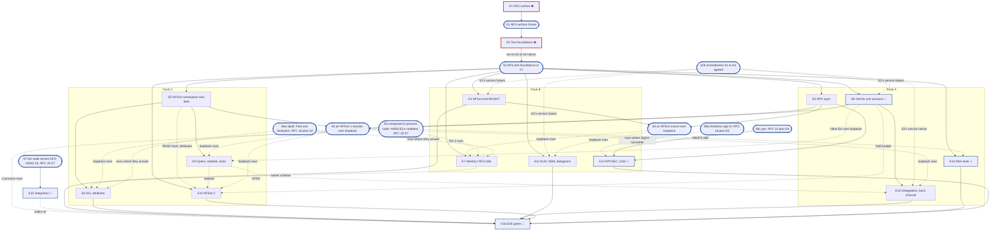

# RFC 21 — NFS adapter v2: implementation plan

**Scope:** [RFC 21, NFS](../docs/internals/rfcs/rfc-21-nfs.md), the whole RFC (`status: draft`, not
deferred) on one node: what the NFS adapter serves on RFC 20's `core`, NFSv3 with MOUNT, NLM and
NSM, NFSv4.0, NFSv4.1 and RFC 21 §9.3's NFSv4.2 subset, with RPCSEC_GSS, its translations, its
tests and its benchmarks. RFC 21's **(cluster)** parts are not built: rebinding a back channel on
another node, session trunking across nodes, `fs_locations` naming another gateway, pNFS layouts
and the cross-node steps of §13 wait for the cluster stage (§6.6). rquota is out (§6.6). It builds
on [RFC 20's plan](rfc-20-adapters-plan.md): that plan's epic 1 deleted v1 and its epic 6 built the
NFS scaffold (`nfs/wire`'s record framer, RPC header, `AUTH_SYS` decoder and XDR generator,
`nfs/protocol`'s router and tables, `nfs.New`), which this plan extends and does not plan again.
This plan deletes nothing. Related RFCs, with how far each is in scope:

- [RFC 20](../docs/internals/rfcs/rfc-20-adapters.md), the adapter core: **constraints**, except every row of
  RFC 20's plan's deferral ledger (its §6.2) owned by the RFC 21 plan, or by the RFC 21 and RFC 22
  plans jointly, for NFS: the error-table rows and the totality test, handler tests on `memory.New`
  and `vfstest.Faults`, operation codecs with golden vectors and 0-allocation gates, the import
  test's call sites and file sizes, the scripted client, the cross-protocol and end-to-end rows,
  the wire tests against knfsd, the benchmarks, the three `adapter_*` record and translation
  series, the `required-tests.json` pins, the `FlowControl` conformance check, `core`'s datagram
  listener, NFS over TLS, the NFS callbacks, `gss`'s `Wrap` and `Unwrap`. §6.4 maps each row.
- [RFC 18](../docs/internals/rfcs/rfc-18-identity.md), identity, and [RFC 19](../docs/internals/rfcs/rfc-19-authorization.md),
  authorization: **NFS's parts only**: an `AUTH_SYS` or `AUTH_NONE` credential as an `Identity`,
  and, which RFC 18's plan (#4058) defers to this plan by its O2, identity's NFS side: `AUTH_SYS`
  and `AUTH_NONE` resolution, uid and gid mapping with the mints a claimed uid triggers, NFSv4
  owner strings, `ManageGIDs` and RFC 18 §10's NFS rows (§6.5); the NFSv4 ACL attributes; the share
  and flavour gates as NFS drives them. The authenticator behind `SignIn` and the resolution behind
  `Spell` and `Find` are **constraints**, owned by RFC 18's plan.
- [RFC 14](../docs/internals/rfcs/rfc-14-open-state.md), open state: **NFS's wire side only**: client IDs,
  sessions' records, stateids, delegations, grace and NLM locks against the state the service
  holds. RFC 14 itself is constraints.
- [RFC 22](../docs/internals/rfcs/rfc-22-smb.md), SMB: **out**, but RPCSEC_GSS builds on [RFC 22's
  plan](rfc-22-smb-plan.md)'s epic 4, `gss`, for the Kerberos acceptor (S6c), and the pieces both
  adapters share are built by whichever plan lands first (§6.2).
- [RFC 17](../docs/internals/rfcs/rfc-17-vfs.md), [RFC 13](../docs/internals/rfcs/rfc-13-configuration.md),
  [RFC 24](../docs/internals/rfcs/rfc-24-resources.md), [RFC 25](../docs/internals/rfcs/rfc-25-observability.md) and
  [RFC 29](../docs/internals/rfcs/rfc-29-test-harness.md): constraints, or the rules every epic follows (§1.5).
  `pkg/vfs`, `vfstest.Null`, `vfstest.Faults` and `memory.New` (RFC 17 §8) exist on `feat/storage-v2`.
- [RFC 15](../docs/internals/rfcs/rfc-15-topology.md) and [RFC 27](../docs/internals/rfcs/rfc-27-namespace-migration.md): **out**.
- RFC 0, 1, 5, 6, 7, 8, 12 and 16: **constraints only**, reached through the service.

**The RFC text cited** is `origin/feat/storage-v2`'s: RFC 21 as backfilled by #5069 and RFC 20 by
#5060, with RFC 14, 17, 18 and 19 as that branch has them. `develop`'s copies are stale until the
sync (#5072); every section and row id here is the storage-v2 one.
**Tracks:** A, B and C (§3.4).
**Programme:** stage 5, "adapters", of [#3119](https://github.com/cubbit/dittofs/issues/3119).
Stage 2 built the service the adapters call; stage 7 is the cutover, which wires the adapters into
`dfs` and turns the protocol suites back on. Roadmap epic:
[#3628](https://github.com/cubbit/dittofs/issues/3628) (v1.1). Who works each track is the
programme's, not this plan's.
**Naming:** v1 is `develop`'s NFS adapter, `internal/adapter/nfs/{v3,v4,mount,nlm,nsm,portmap,rpc,xdr}`
and `pkg/adapter/nfs`'s connection loop, deleted on `feat/storage-v2` by RFC 20's plan's epic 1; v2
is RFC 21's, on RFC 20's `core`, at the same paths. v1 and v2 name adapter implementations, not
NFS versions, and no name a user sees carries a version.
**Transition:** a cutover that deletes nothing, as RFC 22's plan has it: v1 is already gone from
`feat/storage-v2` with no migration of NFS state (an adapter holds none durably, RFC 21 N10), and
stage 7 wires the adapters into `dfs` and turns the protocol suites back on.
**Estimates** are human man-days on the shared scale of `rfc-to-epic-plan`, kept as they are
although the code is written by an agent.
**Format:** this plan follows the skill as it stands: each epic carries an unnumbered outline and an
epic-level figure, and no subtask id. RFC 22's plan, which predates that, numbers its subtasks; this
plan cites them where it depends on them.
**Defaults used from Step 0:** dashboards none (#9); output path the default (#10). Where v2 lives
is proposed in §4.1. The target branch is `feat/storage-v2`; the plan document lands on `develop`
and is cherry-picked, as the other planning documents are. External dependencies: RFC 20's plan
(its scaffold, landed; its epic 7 for S5 and S7), RFC 22's plan's epic 4 (`gss`, S6c), RFC 18's
plan (#4058): its S2 for `Spell`, `Find` and resolution (S6a), its E5 for Kerberos (S6b); RFC 17's
service on `feat/storage-v2`, with its plan's piece 13, the held clone wait, reaching the branch
with the next sync (#4239); RFC 13's settings (#4059).

**Proposed RFC amendments, open until agreed** (§6.1; the plan follows the RFCs as written until
then): A1, RFC 20's compound runner asking a `READ`'s hook again before it runs (#5090 1.4); A2, an
RFC 17 call marking a back channel down (#5090 1.5); A3, RFC 17's admission skipping the minimums
for NLM, `MNT` and `EXPORT` (#5090 2.3); A4, RFC 17's listing carrying the share's cookie verifier.
**Pending Marco:** who records RFC 21 §14's six `nfs_*` series (§6.1, point 5; #5090 (a)).
**Pending the user's answer:** D10, D11 and D12 (§4.2, §6.1). **Decision needed on the layout**
(§4.1), which RFC 20 §2.5 does not fully place (§6.2, point 9).

## 1. Introduction

### 1.1 What we are building

The adapter RFC 21's "Start here" and "In short" describe: a translator from NFS's wire onto
`vfs.Service`, holding only connection state and the client record's opaque `Adapter` bytes.

| | v1 (deleted by RFC 20's epic 1) | v2 |
| --- | --- | --- |
| Reaches files through | `pkg/controlplane/runtime`, which handed out the stores; NFSv4 state in its own manager (`v4/state`) | `vfs.Service` only, one mutating call per handler (RFC 20 §4.3) |
| Packages | `internal/adapter/nfs/{v3,v4,mount,nlm,nsm,portmap,rpc,xdr}`, `pkg/adapter/nfs`'s connection loop and reply cache | `nfs/wire`, `nfs/protocol` (scaffold, extended), `nfs/ops/{v3,v4,mount,nlm,nsm}`, `translate`, `adaptertest/nfsclient` (§4.1) |
| Pseudo-filesystem, share entry gate | the adapter's own (`v4/pseudofs`, `shareEntryStatus`) | the service's (RFC 17 §4.9), admitted on every call |
| Identity mapping and squash | in the adapter | the service's resolution (RFC 18 §6); the adapter reports the credential (RFC 21 §11.1) |
| RPCSEC_GSS | `rpc/gss` with its own keytab verifier | a context table in `nfs/protocol` over `gss` and `SignIn` (RFC 21 §10, RFC 20 §4.4) |
| Settings | `NFSAdapterSettings` rows, delegation and callback timeouts, client cap, read and write sizes, slot limits, lock grace (RFC 20's epic 1, its §9) | `settings.NFS` (RFC 13 Appendix B); sizes, slots, recall deadline and grant budget fixed by RFC 21 and RFC 14 (D11) |
| On-disk state | client tracking in the control-plane database | none: RFC 14's client records, with the adapter's bytes in them (RFC 21 §11.4) |
| Tests | handlers on real stores; pynfs `known.yaml` of 58 entries | handlers on `memory.New`, errors injected through `vfstest.Faults`; stages on RFC 5531 and capture vectors; loopback through `core`; the composed node; pynfs, cthon04, nfstest, Linux kernel clients; wire diffs against knfsd |

**Dependency limits.** RFC 20 §2.3's list, which its §7.1 import test enforces. No NFS package
imports `pkg/identity` or `internal/identity`: identity reaches the adapter as `vfs.Service`'s
`SignIn`, `Spell` and `Find`. E7, identity's NFS side, is service code in `internal/identity` and
`pkg/metadata`, not adapter code, and imports no adapter package.

**What v2 serves at the end of the plan.** Everything RFC 21 specifies for one node, the first
release's profile (RFC 21 §13's *(1 node)* rows and every rule they bind). The (cluster) rows are
built where they are adapter code and parked in §6.6 where they need a second node.

### 1.2 How the plan is organised

Epic 1 fixes what several epics on different tracks share before any is built: the NFSv4 request
state, the `COMPOUND` row and its members' table, the callbacks value and the client record's
`Adapter` bytes. Epic 2 builds what the tests stand on and the service's halves of this plan's
amendments. Twelve middle epics follow on three tracks: track A the RPC layer, clients and
sessions, delegations and the wire tests; track B NFSv3 and MOUNT, identity's NFS side, NLM and NSM,
and RPCSEC_GSS; track C the NFSv4 namespace and data path, opens and locks, ACL attributes and
NFSv4.2. The integration with the node waits for S7. The last epic burns the NFS suites down and
runs the end-to-end, cross-protocol and benchmark rows.

### 1.3 What epic 1 must deliver

- **`nfs/protocol`'s request state** (RFC 20 §4.7's `Request.State`): what a `COMPOUND`'s members
  read and set, the current and saved file handles, the current stateid (RFC 21 §5.2), the session
  its `SEQUENCE` resolved and its reply budget (RFC 21 §2.3, §3.1), the minor version. Six epics on
  three tracks read it.
- **`nfs/ops/v4`'s handler set, `COMPOUND` row and members' table** (RFC 20 §4.3, §4.7's compound
  row with `Decode`, `EncodeHead` and `Members`, §4.8; RFC 21 §11's compound paragraph, §11.5's
  `ILLEGAL` row): the one NFSv4 table for every minor version, which E5, E6, E8, E9, E10 and E12 fill
  with members. `nfs.go`'s empty V4 table moves here with these first rows, as its `decision:` says.
- **`nfs/callbacks.go`'s per-client value** (RFC 20 §3.3, RFC 17 §3.2), implementing
  `vfs.Callbacks`, which E8 and E11 pass to `Connect` and E9, E10 and E11 fill. The handlers that
  call `Connect` live in `ops/`, which `nfs.go` imports, so they reach the value through a
  constructor field `New` sets on their `Handlers`, never by importing the root package (D13); the
  value learns its client after `Connect` returns.
- **The client record's `Adapter` bytes** (RFC 21 §11.4's list, N27): one versioned codec in
  `nfs/wire`, tagged for the XDR generator, its encoding the contract every node reads, with its
  fuzz target, which E8 and E11 write through.
- **A test with every new package**, as `lint-repo`'s `test/new-package-tests.sh` requires.

### 1.4 What epic 2 must deliver

RFC 21 §13's suites paragraph puts §11.6's translation tests, the fuzz seeds and the rows that
inject a fault below the server in `unit`; the rows naming pynfs, cthon04 or nfstest in `pynfs`,
`cthon04` and `nfstest`; the other single-node rows against a real server in `e2e`; the rows reaching
one file over NFS and SMB in `e2e/cross-protocol`; and the Kerberos rows in `e2e/kerberos`. Every one
is registered already. **Epic 2 registers no red suite**: `unit` and `e2e` keep no `known.yaml`, so
their tests land green with the epic that makes them pass, and `pynfs`, `cthon04` and `nfstest`
stay off on `feat/storage-v2` under `tests.yml`'s V2 filter until the cutover, when E15 rewrites
their `known.yaml` for v2: RFC 21 §13's "Tests expected to fail", then each v2 failure an entry
`status: fail`, `fix: planned`, `category: feature`, with a reason and `issue: "#…"` naming this
plan's epic issue, which exist before then (`epic-breakdown` Step 6.3, under #3628).

**The catalogue, by source.** Every row lands in the epic that creates what it imports, on
`memory.New` where the adapter's half can fail alone, and again on the composed node or a real
client in E16:

- RFC 21 §11.6's rows and §13's *(1 node)* rows and single-node steps, each mapped in §7 to its
  epic; the invariants N1 to N27 (§7).
- RFC 20 §7.4's and §7.5's NFS rows: drain under `tar`, slow client, reconnect after a restart,
  cancel, order, Kerberos, TLS.
- RFC 18 §10's NFS rows, which RFC 18's plan defers here (O2): "one uid, two proofs", "client in
  the key", "root", "error is not unknown", "squash order follows the proof", "admin needs proof",
  "owner strings", "lookup cap", "expiry" over `sec=krb5`, `ManageGIDs`, "disable takes effect"'s
  NFS GSS half.
- RFC 19 §9's NFS rows: the NFSv4 ACL attributes, the owner fold, lock permission outside an open.
- From `develop`'s history, written out because no RFC row names them: a `LOCK`, `LOCKT` and `LOCKU`
  over `AUTH_SYS` on a Kerberos-only share refused per operation (v1's `shareEntryStatus` let them
  through, RFC 20 Appendix B); two Kerberos principals sharing a uid never served each other's cached
  caller (v1's `authCacheKey` incident, `CLAUDE.md` "Verifying a change"), which RFC 18 §10's "one
  uid, two proofs" covers on the composed node; and `develop`'s pynfs `known.yaml`, 58 entries, as
  v1's baseline for parity.

**What the catalogue leaves out.** RFC 21's (cluster) steps (RFC 21 §13's opening paragraph), the
namespace-move rows of §7.4, the rows no suite runs yet (xfstests, pynfs's reboot tests; RFC 21
§13's suites paragraph) and a remote outage on the composed node, each parked in §6.6.

**Test components.** The NFS handler harness, golden files from knfsd captures and the import
test's NFS entry files (E2); the scripted client (E3); `gsstest`'s initiators come with RFC 22's
plan's `gss` (S6c).

### 1.5 General rules for each epic

> **Instruction for whoever expands an epic into its detailed description and subtasks,
> human or AI:**
>
> - **Creating an epic from this plan: use the `epic-breakdown` skill.** Whenever the user
>   asks to create an epic from this plan, or to expand, detail or break one down, run the
>   `epic-breakdown` skill (`.claude/skills/epic-breakdown/SKILL.md`) on this plan and that
>   epic, rather than writing the epic document freehand. It extracts the RFC's MUST and
>   MUST NOT into numbered requirements, estimates each subtask in man-days and suggests
>   the pull requests. A human doing it by hand follows the same skill.
> - **Epic and subtask, nothing else.** The units of work are the epic and its subtasks,
>   with subtask ids `<e>.<n>` (`subtask 4.3`, or `T4.3` for short), assigned by the epic
>   document. No other word names
>   them: not task, ticket, story, step or phase, in headings, tables, ids or prose.
> - **The epic stands alone for what to build.** Its requirements, subtasks and decisions
>   are in the epic document itself, which never refers to this plan for them or says "see
>   the plan": the RFC sections it implements, the interfaces it builds on, the
>   subtasks, and a short legend of the names it borrows from this plan (E1, E2, S1, the
>   integration epic, …). It cites the numbered rules below, without copying them, in a
>   table of how each applies: each row names its rule by number and bold title, which
>   says what the rule requires, and the table links this §1.5 with a full link (the
>   plan's path and the section's anchor) and the `CLAUDE.md` sections that hold a rule,
>   so the epic reads alone and its reader can still open each rule's text in one click.
> - **The epic document records decisions, not progress, like this plan.** It has no
>   status fields, no checkboxes to tick and no sections to keep up to date as the work
>   goes on. It is revised through a pull request only when a decision changes.
> - **Subtasks are not pull requests.** A subtask is ideally up to 5 man-days. The owner
>   ships subtasks as they see fit, one pull request each or several together; the epic
>   document only suggests a grouping, each suggested pull request ideally up to 15
>   man-days. Cut and group by logic, readability, dependencies and a deliverable that can
>   be named, not to hit a number.
> - **Every subtask states how it meets each rule that applies to it.** A rule that does
>   not apply is named, with the reason.
> - **In the issue tracker, once each document merges,** following `epic-breakdown`
>   Step 6, their one description. Issues point at the documents and copy nothing; once
>   created, their `Estimate` and blocked-by links are the current estimate and
>   dependencies, and the documents are not revised to follow them. The
>   epic issues exist before E2's pull request lands, because each red test's
>   `known.yaml` entry names one; subtask issues come once their epic document has
>   merged. The release an epic ships in is set by the RFC's roadmap epic that its epic
>   issue sits under, never in a document and never on the epic issue on its own: the epic
>   issue and its subtask issues copy that roadmap epic's milestone, and an epic changes
>   release only by moving under the roadmap epic of the other release.

1. **Independent unit tests, under `-race`.** Each epic carries its own unit tests, on another
   epic's implementation once that has landed, `memory.New`, `vfstest.Faults`, `vfstest.Null`, the
   NFS handler harness and its golden files, the scripted client, `gsstest`, and RFC 20's
   `testproto` and leak checks, and on no other double (`CLAUDE.md`, "Writing tests"). A handler is
   tested as RFC 20 §7.2 says: on `memory.New`, each error an injected one through `vfstest.Faults`,
   the one-call rule read from `memory.New`'s record of mutating calls. A stage is tested without a
   socket, on RFC 5531, RFC 2203 and capture vectors. E1 declares no internal interface for a test
   to stand in for.
2. **Fuzz tests where relevant** (`CLAUDE.md`, "Writing tests", "By kind"). Go native fuzzing on
   every decoder of bytes a peer sent or a node stored: the XDR codec's one target over every
   program (RFC 21 §11.6, RFC 20 §5.4), and RFC 21 §11.6's translation targets: the stateid ↔
   `StateRef` codec, `share_access` and `share_deny`, a `LOCK` or NLM lock request into a `LockReq`,
   owner-string parsing, the `Adapter`-bytes decoder fed truncated, corrupt, older and newer bytes;
   besides them the `AUTH_SYS` body, the RPCSEC_GSS credential and its tokens, `fattr4`'s
   `attrlist4`, and an NFSv4 ACL. The record framer and RPC header are RFC 20's plan's epic 6's.
3. **Observability follows RFC 25 and RFC 20 §10.** Every metric, span and log key lives in `core`;
   NFS code records none and supplies names through its tables, so spans are RFC 21 §11.7's. RFC 21
   §11.7's series are RFC 20 §10.1's `adapter_` series, recorded by `core` as their producers land.
   RFC 21 §14's six `nfs_*` series are recorded only as point 5 of §6.1 settles them; until then no
   subtask adds a recorder to NFS code, and the epic that owns each producer is named there. No
   label, attribute or log line carries a path, a name, an owner string, a principal or a client
   address (RFC 25 §5.4).
4. **Profiling: leaks, allocations and contention.** Every test that runs the pipeline ends with
   RFC 20's leak check, `adaptertest.CheckLeaks`. RFC 20 §6.10's codec gates hold at 0 allocations
   for `READ`, `WRITE` and `GETATTR` decode and encode in NFSv3 and NFSv4, each registered in the
   per-change `unit/adapter-allocs` cell by the epic that writes it. A change to the session
   registry, the GSS context table or the NLM grant timers reports its mutex and block profiles
   (RFC 20 §6.9).
5. **Public interface and internals, at the layer that consumes a value** (`CLAUDE.md`, "Verifying
   a change"). Tests cover the internal API and the wire behaviour it enables: a slot granted on the
   `CREATE_SESSION` reply the client reads, a stateid on the `READ` that quotes it, an owner string on
   the `GETATTR` a client decodes, a callback on the connection that receives it.
6. **Known failures shrink.** A test of `pynfs`, `cthon04` or `nfstest` that turns green leaves its
   suite's `known.yaml` in the same change (`CLAUDE.md`, "Writing tests", "By kind"); those suites
   stay off on `feat/storage-v2` until E15 turns them on.
7. **v2 ignores v1.** Nothing is copied from `develop`'s NFS adapter but what RFC 20 Appendix B
   keeps: the TLS upgrade through `Conn.StartTLS`, and the GSS per-message code, which RFC 22's plan
   moves to `gss`. Behaviour comes from RFC 21 and the NFS RFCs, never from what v1 did, and RFC 20's
   import test fails any import of a path v1 used, checking each package on its own.
8. **Real dependencies for properties of those dependencies** (`CLAUDE.md`, "Writing tests"). RFC
   5531's, RFC 1813's, RFC 8881's and RFC 2203's encodings and knfsd captures for bytes, never vectors
   the codec under test made (RFC 20 §5.4); real TCP and UDP over loopback for sockets; the composed
   node for a fault below the server and for durability across a restart (RFC 1 §1.3); pynfs,
   cthon04, nfstest and the Linux kernel client for what a client does; a real KDC for Kerberos at
   `e2e/kerberos`. RFC 21 §13's "What must not stand in" holds.
9. **Code comment conventions** (`CLAUDE.md`, "Code comments"). RFC 21's notes go at their code
   sites: its `decision:` notes from NFSv4.0 served (§2.1) to an NFSv3 flavour refused with
   `AUTH_TOOWEAK` (§10), and its `ponytail:` notes on 64 fragments and one transfer size (§2.3), 8
   KiB cached replies and 64 slots (§3.1), 24 shard bits (§5.2), the GSS constants (§10), each where
   the code that implements it is.
10. **A test must be able to fail** (`CLAUDE.md`, "Writing tests"), and nothing else would catch the
    change it guards: not the compiler, not the diff, not a later epic's tests. A golden vector from
    a specification or a capture can fail where a round trip cannot (RFC 20 §5.4). A review rule no
    test can check stays a review rule.
11. **A symbol is exported only if an interface uses it.** The public surface is RFC 20's:
    `pkg/adapter/nfs.New` and `settings.NFS`. Inside, a symbol is exported only for the package that
    calls it: `nfs/protocol`'s request state for `nfs/ops`, `nfs/wire`'s codecs and the record codec for
    `nfs/ops`, `rpcclient` and the scripted client, RFC 19 §5.1's `translate` functions. What E1 exports is frozen
    at S1. A symbol `core` lacks is added to RFC 20 §4.7 first, by a pull request to the RFC.
12. **Each subtask creates only what it declares.** No empty package and no stub without a caller:
    no `ops/` table before its first row, no `translate` function, callbacks method or outbound
    call before the subtask that calls it. A package, a stage or a test helper lands with its first
    consumer.
13. **Translate, never decide.** A handler makes at most one mutating service call, beside those
    RFC 20 §4.3 leaves outside that rule, and branches on no file attribute, mode or ACL to decide
    whether an operation is allowed (RFC 20 §4.3, its invariant A5). Every mapping of RFC 21 §11 is a
    pure function of the request and, where named, the record's `Adapter` bytes, total, with a named
    refusal and never a default (RFC 21 N26). What only the service can decide is a missing service
    operation, raised against RFC 17, never a sequence in a handler.
14. **Nothing deferred is lost.** A subtask that leaves out part of an RFC 21 obligation, or of a
    row of RFC 20's or RFC 18's ledger this plan took over, names it in its epic document with the
    owner that brings it back.

Rules 13 and 14 are added: the first because RFC 20 §2.1 makes translation the adapter's whole job,
the second because this plan takes over rows of two other plans' ledgers.

## 2. Epics at a glance

| # | Epic | Content | Subtasks | Man-days | Track | Blocks |
| --- | --- | --- | --- | --- | --- | --- |
| E1 ⛔ | NFS surface | request state; `ops/v4`'s handler set, `COMPOUND` row and members' table; the callbacks value; the `Adapter` bytes | 4 | 6 | team | all |
| E2 ⛔ | Test foundations | the NFS handler harness; knfsd captures and golden files; the import test's NFS entries; the service's halves of `NoGrace` and of A2 to A4 | 6 | 13 | team; its service halves in B | E3 to E14, but the service halves of A2 to A4, after S2b, only E4's, E5's, E10's and E11's rows that need them |
| E3 | The RPC layer | credentials to `Identity` and `Call`, `NULL`, NFS over TLS, every program's error table and the totality test, `core`'s refusals and drain roles, the scripted client, the duplicate-request cache (D10) | 8 | 21 | A | E13; S3 and S4 |
| E4 | NFSv3 and MOUNT | every NFSv3 procedure, `fattr3`, `sattr3` and WCC, cookies, stability, `FSINFO`, MOUNT | 9 | 23 | B | S3; E16 |
| E5 | NFSv4 namespace, attributes and data | file-handle operations, the pseudo-filesystem, `SECINFO`, `fattr4` and Appendix B, `ACCESS`, name operations, `READDIR`, stateless I/O | 8 | 24 | C | E6, E9; S4 |
| E6 | NFSv4 ACL attributes | `translate`'s NFSv4 functions, `acl`, `dacl`, `sacl`, `aclsupport`, `who`, `mode_umask` | 5 | 12 | C | E16 |
| E7 | Identity's NFS side | `AUTH_SYS` and `AUTH_NONE` resolution, uid and gid mapping and mints, owner strings, `ManageGIDs`, RFC 18 §10's NFS rows | 5 | 15 | B | E6 (partly); E16 |
| E8 🔀 | Clients and sessions | `EXCHANGE_ID`, `SETCLIENTID`, confirms, `CREATE_SESSION`, `SEQUENCE`'s slots and reply cache, the session registry, lease, revoke and reclaim signals | 9 | 26 | A | E10; E9 and E12 (partly); S4 |
| E9 | Opens, stateids and locks | `OPEN` and its claims, stateid rules, NFSv4.0 owner sequences, `LOCK`, `LOCKT`, `LOCKU`, `TEST_STATEID`, `FREE_STATEID` | 7 | 23 | C | E10 and E12 (partly); E16 |
| E10 | Delegations and the back channel | the back channel's calls, delegations offered, recalled, returned and revoked, path down | 6 | 17 | A | E16 |
| E11 | NLM, NSM and the datagram path | `core`'s datagram listener, NLM v4, NSM, grants resent, `SM_NOTIFY` | 7 | 21 | B | E16 |
| E12 | NFSv4.2 operations | `DEALLOCATE`, `SEEK`, `READ_PLUS`, `COPY`, `CLONE`, xattrs, the hold budget | 5 | 12 | C | E16 |
| E13 🔀 | RPCSEC_GSS | the context table as NFS's `Security` stage over `gss`, `krb5`, `krb5i`, `krb5p` | 6 | 16 | B | E16 |
| E14 🔀 | Wire tests against knfsd | the runner's NFS side, NFS scripts, the divergence list | 4 | 12 | A | E16 |
| E15 🔀 | Integration with the node | settings, the NFS suites turned on | none | planned after S7 | team | E16 (partly) |
| E16 🔀 | E2E green | in-process rows, e2e, cross-protocol, benchmarks, soak, pins; the burn-down after E15 | 6 | 20 | team | none |
| | **Total** | | **95** | **261** | | |

**Plan estimate: 95 subtasks, 261 man-days, not counting epic 15.**

Nor E16's burn-down of the three NFS suites, which waits for E15 as E15 waits for S7 (§6.2, point
7), nor the rows parked in §6.6's deferral ledger.

The estimate `N = round(3148 / 400) = 8` against twelve middle epics. RFC 21 serves five RPC
programs over four versions, with about sixty NFSv4 operations and thirty NFSv3 and auxiliary
procedures, in areas that share little state: the RPC layer, two namespace front ends, client and
session state, opens and locks, delegations, the NFSv3 lock protocols, NFSv4.2 and Kerberos.
Identity's NFS side, which RFC 18's plan hands to this one, is service code with no adapter state,
and the wire tests, which RFC 20's plan's ledger hands here, are a seam of their own.

Legend: ⛔ blocks every epic after it; 🔀 waits for or opens a synchronisation point.

## 3. Synchronisation points, blockers and the split

### 3.1 Dependency graph



### 3.2 Synchronisation points

RFC 20's plan's S1 to S3 already hold on `feat/storage-v2`: `core`'s surface is frozen, the import
test runs, and NFS's scaffold answers every procedure over loopback through `core`.

- **S1 NFS surface frozen** (after E1). The request state, `ops/v4`'s `COMPOUND` row and members'
  table, the callbacks value and the `Adapter` bytes codec compile, with tests. Unblocks E2.
- **S2 NFS test foundations in CI** (after E2 but its halves of A2 to A4, which wait for S2b). The
  handler harness runs a row on `memory.New`, golden files load from the capture corpus, the import
  test knows NFS's entry files, and `pkg/vfs` answers `NoGrace`. Unblocks every middle epic.
- **🔀 S2b amendments A1 to A4 agreed** (outside: the RFC pull requests §6.1 proposes). Unblocks
  E2's service halves of A2 to A4 and, through them, E4's `MNT` and `EXPORT` on a Kerberos-only share
  and its cookie verifier, E8's session budget in a `READ`'s hook (A1), E10's path down and E11's
  admission at `Claimed`.
- **🔀 S3 an NFSv3 mount over loopback** (after E3 and E4). The scripted client sends `NULL`, `MNT`
  and `GETATTR`, `READ` and `WRITE` over `AUTH_SYS` to `memory.New` through `core`. Unblocks the
  loopback rows of E7 and E11.
- **🔀 S4 an NFSv4.1 session over loopback** (after E3, E5 and E8). The scripted client runs
  `EXCHANGE_ID`, `CREATE_SESSION`, `SEQUENCE`, `PUTROOTFH`, `LOOKUP` and `GETATTR`. Unblocks the
  loopback rows of E6, E9, E10 and E12.
- **🔀 S5 composed in-process node** (outside: #4050's epic 3 builds `internal/node/nodetest`, which
  serves NFS with RFC 20's epic 7). Unblocks E14's DittoFS side, E7's Tier 2 rows and E16's
  in-process rows.
- **🔀 S6a `Spell`, `Find` and resolution in `vfs`** (outside: RFC 18's plan's S2). Until it holds,
  `Spell` and `Find` answer `ErrAccess`; E6's and E7's rows where they answer wait, the rest do not.
- **🔀 S6b Kerberos sign-in** (outside: RFC 18's plan's E5, Kerberos and the PAC, behind `SignIn`).
  Unblocks E13's rows where an `RPCSEC_GSS` `INIT` succeeds, and E16's `e2e/kerberos` rows.
- **🔀 S6c `gss`** (outside: RFC 22's plan's epic 4: `Exchanges`, the Kerberos mechanism, `Identity`,
  `gsstest`). E13 builds its context table on it; if RFC 22's plan has not started, E13 waits.
- **🔀 S7 the node serves NFS** (outside: #4050's S3 for NFS, RFC 20's epic 7 on #4050's S2).
  Reconcile builds the NFS adapter through `nfs.New` while its record enables it, and `dfs` serves
  it. Unblocks E15.

### 3.3 Blockers

| Epic | Blocks | Why |
| --- | --- | --- |
| ⛔ E1 | E2, and through it every epic | the request state, the `COMPOUND` row and the record codec every NFSv4 epic writes against |
| ⛔ E2 | E3, E4, E5, E7, E8, E11, E12 and E14 through S2, and through them the rest, but its halves of A2 to A4 | the harness every handler test runs on, golden files, the import test from the first NFS package |
| E3 | E13; S3 and S4 | the `Security` stage RPCSEC_GSS joins; the credential, `NULL` and the scripted client every loopback row needs |
| E4 | S3; E16 | an NFSv3 mount over loopback needs its procedures and MOUNT |
| E5 | E6, E9; E12, partly; S4 | ACL attributes ride `GETATTR` and `SETATTR`'s `fattr4`; `OPEN` resolves the current file handle; `READ_PLUS` uses the `READ` hook |
| E7 | E6, partly | the owner scheme behind `who` and `owner` strings |
| 🔀 E8 | E10; E9 and E12, partly; S4 | the back channel is a session's; client IDs over loopback; the hold budget counts a session's slots |
| E9 | E10 and E12, partly | a delegation is granted with an `OPEN`; `COPY` and `CLONE` take stateids |
| 🔀 S2b | E2's service halves; E4, E8, E10 and E11, partly | A2 to A4 change `pkg/vfs`; A1 changes `core`'s runner |
| 🔀 S3 | E7 and E11, partly | their loopback rows need an NFSv3 mount |
| 🔀 S4 | E6, E9, E10 and E12, partly | their loopback rows need a session |
| 🔀 S5 | E7, E14 and E16, partly | Tier 2 rows, the DittoFS side of a wire test and every in-process row need the composed node |
| 🔀 S6a | E6 and E7, partly | `Spell` and `Find` that answer |
| 🔀 S6b | E13, partly | a ticket `SignIn` accepts |
| 🔀 S6c | E13 | the Kerberos acceptor and `Exchanges` the context table drives |
| 🔀 S7 | E15 | no node to wire into, no `dfs` serving NFS |
| 🔀 E15 | E16, partly | the NFS suites run only once `dfs` serves NFS and the V2 filter lets them |
| E4, E6, E10, E11, E12, 🔀 E13, 🔀 E14 | E16 | the suites, end-to-end rows and benchmarks run every area |

### 3.4 Splitting the work

Figures are man-days from S2.

- **Track A: E3, E8, E10, E14.** The RPC layer, then clients and sessions, then the back channel and
  delegations, then the wire tests. E3 gives every other track its loopback rows (S3 with E4, S4 with
  E5 and E8). E10 starts at 47, when track C's E9 has its `OPEN`; E14's runner and scripts are built
  against knfsd alone, its DittoFS side waits for S5, and if S5 is late the track fills with E16's
  in-process rows as their epics allow. 76 man-days.
- **Track B: E4, E7, E11, E13, and E2's service halves as soon as S2b holds.** NFSv3 and MOUNT, then
  identity's NFS side, then NLM and NSM, then RPCSEC_GSS. E4 comes first so S3 holds at 23 (D12,
  pending); E7 follows, ending at 38, before track C reaches E6 at 47; E13 starts at 59 and needs
  S6c, RFC 22's plan's `gss`, and S6b for its signed-in rows, which, if late, leave E13's table
  and refusals done and its sign-in rows waiting. 75 man-days.
- **Track C: E5, E9, E6, E12.** The NFSv4 namespace and data path, then opens, stateids and locks on
  it, then ACL attributes, then NFSv4.2. E9 runs on `memory.New` from 24 and its loopback rows wait
  for S4 at 47; E6 starts at 47 with E7 done; E12 last, with E8's hold budget and E9's stateids in.
  71 man-days.
- **The team.** E1 and E2 but its service halves before the tracks; E15 at S7; E16 after the
  tracks. E1, E2 and E16, 39 man-days, are the difference between the tracks' 222 and the plan's 261.

**The first mount.** With D12 as written, an NFSv3 mount over `AUTH_SYS` comes first: E1 to E4 and
E7 for the composed node, then S5 and S7 and E15 for `dfs`, about 78 man-days of plan work, the
critical path E1 → E2 → E4 → E7, 57 man-days in series. An NFSv4.1 mount, Linux's default, needs E3,
E5, E8 and E9 too, about 136 man-days, its critical path through track A's E3 and E8 and track C's
E5 and E9, both at 47 from S2.

## 4. Implementation decisions

### 4.1 Directory layout

```text
pkg/adapter/
  settings/                   RFC 20's E1; E3 adds nothing; ManageGIDs is ExportPolicy's, not here
  nfs/                        RFC 20's E1 and E6: New
internal/adapter/
  translate/                  E6: RFC 19 §5.1's NFSv4 ACL functions; created by whichever of E6 and RFC 22's plan's E7 lands first
  adaptertest/
    golden/                   E2, or RFC 22's plan's T2.2, whichever lands first: golden files cut from captures
    nfsclient/                E3: the scripted client (RFC 20 §8.2)
    imports_test.go           RFC 20's E2; E2 here: NFS's entry files
  nfs/
    nfs.go                    RFC 20's E6: New; E11 adds the UDP listener
    callbacks.go              E1 type, reached by ops/ through a Handlers field New sets (D13); E9 (Revoked for state), E10 (RecallGrant, RecallAny, Revoked for grants), E11 (LockWaitOver, Revoked for NLM)
    wire/                     RFC 20's E6: record framer, RPC header, AUTH_SYS, XDR generator and runtime
      gen/                    E4 (unions whose cases share an arm), E5 (linked-list replies)
      const.go                E3: the program and version numbers, moved out of protocol/served.go
      call.go                 E3: a call's header and a reply's decoder, for the scripted client, rpcclient and the back channel
      clientrec.go            E1: the Adapter bytes codec (RFC 21 §11.4), XDR-tagged, versioned
    protocol/                 RFC 20's E6: Router, Tables, stages; E1: State; E10: the Router's demux of replies on a back channel
      auth.go                 E3: credentials to Identity, the AUTH_SYS and AUTH_NONE Security stage
      tls.go                  E3: the AUTH_TLS probe and StartTLS
      drc.go                  E3: the NFSv3 and NFSv4.0 duplicate-request cache (D10, pending)
      sessions.go             E8: the session registry, Pending proposals (D7)
      slots.go                E8: the Replay stage: SEQUENCE's slot read before dispatch, slot tables, reply caches
      owners.go               E9: NFSv4.0 owners' last replies (D8)
      gss.go                  E13: the RPCSEC_GSS context table
    ops/                      one package per table (RFC 20 §2.5, §4.8); <op>.go per operation, in its epic
      v4/                     E1: Handlers, COMPOUND row, members' table, ILLEGAL; members in E5, E6, E8, E9, E10, E12
      v3/                     E4
      mount/                  E4
      nlm/                    E11
      nsm/                    E11
      cb/                     E10: the callback program's structs (CB_COMPOUND and its operations), no Handlers, no table served
    rpcclient/                E11: outbound calls on a dialled connection or a datagram (D1)
  core/
    datagram.go               E11: the datagram listener (RFC 20 §3.1)
internal/identity/            RFC 18's plan; E7 adds the AUTH_SYS mapping, the owner scheme, ManageGIDs' closure
pkg/metadata/entity/          E7: ExportPolicy.ManageGIDs (RFC 16 §2.3)
pkg/vfs/, internal/vfs/       E2: StateNoGrace; after S2b, A2's ChannelDown, A3's admission floor, A4's cookie verifier
test/
  pcap-corpus/nfs/            E2: knfsd captures per program area (D6)
  wire/                       E14, beside RFC 22's plan's E14: NFS scripts, the NFS divergence list
```

`adaptertest/nfsclient/`, `rpcclient/`, `ops/cb/`, `protocol/drc.go` and `test/wire/` are not in
RFC 20 §2.5, nor are the shared files an `ops/` package may hold beside its operations (`attrs.go`
for `fattr3` and `fattr4`, `types.go` for body types two procedures share); §6.2, point 9 lists
them.

### 4.2 Decisions

- **D1. One outbound RPC client package, `nfs/rpcclient`, created by E11.** NLM's `GRANTED` and
  `*_RES`, the port mapper's `GETPORT` and `SM_NOTIFY` are calls the server makes on a connection it
  opens or by datagram (RFC 21 §6.1, §6.2); E10's back channel sends `CB_COMPOUND` on the session's
  own connection through `core`'s `Conn.Send` (RFC 20 §3.3) and shares only `wire`'s call header.
  Prior art: knfsd and NFS-Ganesha each use one sunrpc client for lockd callbacks and statd (from
  memory, not checked). Applied in E11, E10.
- **D2. The `COMPOUND` row and members' table are E1's.** Six epics on three tracks add members, so
  the compound's decode, head and members' table are settled once, at S1; a member is one row in it.
  Prior art: knfsd's one `nfsd4_ops` table for every minor version (from memory). Applied in E1.
- **D3. The `Adapter` bytes are built whole in E1.** RFC 21 §11.4 lists every field and N27 makes the
  bytes durable; a field added after a node has written records is a new version every node reads,
  so the encoding is settled before E8 or E11 writes one. Prior art: none found for a per-adapter
  blob in a shared client record. Applied in E1.
- **D4. The NFSv3 status of a `sattr3` naming a uid or gid no principal holds is `NFS3ERR_INVAL`.**
  RFC 21 §11.5's `ErrUnknownPrincipal` row leaves it to this plan (#5090 (b)): NFSv3 has no
  `BADOWNER`, and the argument names no principal. The RFC row is to read "proposed: `NFS3ERR_INVAL`"
  until this plan merges, an edit that cannot be placed on `develop`'s copy (§6.1, point 6). Prior
  art: from memory, knfsd's `decode_sattr3` drops an unmappable id silently, which this plan does not
  copy, since an attribute the client asked for is never dropped (RFC 18 §5.4's spirit). Applied in
  E4.
- **D5. The scripted client is `adaptertest/nfsclient`, built in E3.** Its first consumer is E3's
  loopback rows; E14's scripts and E16's benchmarks reuse it. Prior art: pynfs's own RPC client, a
  scripted client of the same kind (from memory). Applied in E3.
- **D6. Reference captures come from knfsd** in a network namespace on the test host, recorded per
  program area into `test/pcap-corpus/nfs`, cut into golden files by the shared `adaptertest/golden`.
  The same knfsd is E14's reference server. Prior art: RFC 20 Appendix C names a Linux server as the
  NFS reference. Applied in E2, E14.
- **D7. A confirm's `Pending` proposal lives in the session registry** of the node that answered,
  bounded by RFC 24's connection-state pool and dropped after one lease period (RFC 14 §2.9, RFC 21
  §3.5): `Record` returns a `Pending` only for a client ID that already has a record
  (`pkg/openstate/clients.go`), so the confirming `CREATE_SESSION` of a new client finds its
  proposal, its ID, confirm and `csa_sequence`, only in the adapter's memory (#5090's §3.5 note).
  Prior art: knfsd holds unconfirmed clients in memory (from memory). Applied in E8.
- **D8. NFSv4.0 owners' last replies** are a per-node table keyed by (client, owner), bounded by the
  connection-state pool, beside the sessions (RFC 21 §4.2's last reply in gateway memory). Prior art:
  knfsd's `so_replay` per state owner (from memory). Applied in E9.
- **D9. `CB_NOTIFY_LOCK` is not sent.** RFC 21 §5.5 makes it optional and the poll decides; a client
  that asked for it polls anyway. Prior art: knfsd sends it, Linux clients poll regardless (from
  memory). Applied in E10; its row is in §6.6.
- **D10. An NFSv3 and NFSv4.0 duplicate-request cache, pending the user's answer.** RFC 21 §15
  question 5 and RFC 20 §11 question 2 leave it open, and RFC 20's plan's ledger gives it here. As
  written: a bounded per-node cache in NFS's `Replay` stage (`core`'s `ReplayCache`), keyed by RFC 21
  §11.2's NFSv3 and NFSv4.0 retry identity, answering a retransmission its first reply. Prior art:
  knfsd's DRC and Ganesha's DRC, both per node in memory (from memory). Applied in E3, once
  answered; an RFC 21 §15 amendment records it (§6.1, point 7).
- **D11. The v1 NFS settings RFC 13 does not carry are dropped, pending the user's answer.**
  `DelegationRecallTimeout`, `CallbackTimeout`, `MaxDelegations`, `DirDelegBatchWindowMs`,
  `MaxClients`, the read and write sizes, the NFSv4.1 slot limits and the lock grace setting (RFC 20's
  plan's ledger): RFC 21 fixes each (§2.3 the sizes, §3.1 the slots, §5.3 the recall deadline and no
  directory delegations, RFC 14 §5.5 the grant budget, RFC 14 §4.2 the grace), and RFC 20 §3.6's
  `connection_limit` is the connection cap. Prior art: knfsd exposes most of these as module
  parameters (from memory). Applied as a recorded decision closing those ledger rows (§6.4).
- **D12. NFSv3 first on track B, pending the user's answer.** E4 before E7 makes S3, an NFSv3 mount
  over loopback, the plan's first mount, at S2 + 23. Applied in §3.4.
- **D13. The callbacks value reaches `ops/` through a `Handlers` field.** `nfs.go` imports every
  `ops/` package, so a handler calling `Connect` cannot import the root package's type; `New` sets a
  constructor field on `v4.Handlers` and `nlm.Handlers`, one implementation and so no interface (RFC
  20 §2.5's rule 4). Prior art: none found; the architect pass proposed it. Applied in E1.
- **D14. Operations answered `NFS4ERR_NOTSUPP` share one handler.** The layout, `ALLOCATE`,
  `IO_ADVISE`, `WRITE_SAME`, `COPY_NOTIFY`, `OPENATTR`, `SET_SSV` and `DELEGPURGE` rows point at one
  function in `ops/v4`'s `handlers.go`, rather than a file each. Prior art: knfsd's ops table points
  unsupported operations at one stub (from memory). Applied in E5, E12.

### 4.3 Knowingly simple implementations

- **NLM grants resent by one timer each** (E11): a `time.AfterFunc` per granted lock awaiting its
  acknowledgement (RFC 21 §6.1's resend). Ceiling: thousands of unacknowledged grants at once.
  Upgrade to one timing wheel per adapter when a profile shows timer churn.
- **The reply cache keeps whole reply copies** (E8): a slot's cached reply is copied out of the
  pooled reply buffer, at most 8 KiB (RFC 21 §3.1), rather than holding a reference. Ceiling: 512 KiB
  per session copied. Upgrade to a held `resources.Buf` when a profile shows the copy.
- **One `Spell` call per owner and group in a `GETATTR`** (E5, E6): no adapter cache, as RFC 21 §11.1
  forbids one; the service's caches answer. Ceiling: a `READDIRPLUS` of 10^4 entries is 2·10^4 calls.
  Upgrade by a batched `Spell` in RFC 17 when a benchmark shows it.

## 5. The epics in detail

### Epic 1 — NFS surface ⛔

**Epic 1 estimate: 4 subtasks, 6 man-days.**

What epics on three tracks read or fill before any is built (§1.3). At the end S1 holds.

**Owns:** RFC 20 §4.7's `Request.State` and compound row for NFS, §3.3's callbacks value; RFC 21
§11's compound paragraph, §11.4's `Adapter` bytes.

**Done when:** RFC 21 N27's encoding half: the `Adapter` bytes' golden vectors and fuzz target; a
`COMPOUND` naming an undefined operation answered `NFS4ERR_OP_ILLEGAL`, and one of a minor version
outside the range `NFS4ERR_MINOR_VERS_MISMATCH`, over loopback.

**Expected content:**
- `nfs/protocol`'s request state, as handlers read it through `r.State`.
- `ops/v4`: `Handlers`, the `COMPOUND` row's decode, head and members' table, the `ILLEGAL` row, the
  V4 table moved out of `nfs.go`.
- `nfs/callbacks.go`'s per-client value, every method answering not built until its epic.
- The `Adapter` bytes codec, versioned, with golden vectors and its fuzz target.

### Epic 2 — Test foundations ⛔

**Epic 2 estimate: 6 subtasks, 13 man-days.**

What every NFS test stands on (§1.4), and the service's halves of what this plan needs of
`pkg/vfs`: `NoGrace` now, A2 to A4 once S2b holds. No red suite is registered.

**Owns:** RFC 20 §5.4 (golden vectors from captures), §7.1 (NFS's entry files), §7.2 (handlers on
`memory.New` and `vfstest.Faults`); RFC 17 §4.3's `NoGrace` kind (#5090 2.2); A2 to A4's `pkg/vfs`
halves.

**Done when:** the harness's own test fails on a second mutating call and on a wrong reply byte; the
import test reports a seeded entry call outside NFS's entry files; `memory.New` answers a reclaim
from a client with nothing left to reclaim `ErrState` (`NoGrace`), per RFC 14 §4.2; after S2b, A2's,
A3's and A4's rows on `memory.New`.

**Expected content:**
- The NFS handler harness: request bytes through a row against `memory.New`, errors through
  `vfstest.Faults`, the one-call rule from `memory.New`'s record, reply bytes compared; it reuses
  `vfstest.Mutations` as RFC 22's plan's T2.1 changes it, or makes that change if this lands first.
- Reference captures from knfsd (D6) and golden files through `adaptertest/golden`.
- The import test's NFS entry files for `Root`, `SecInfo` and `ListShares` (RFC 20 §4.10).
- `vfs.StateNoGrace` and open state's answer for it, in place of `NoReclaim` where RFC 14 §4.2 says.
- After S2b, A3: `vfs.Call`'s admission floor and `internal/vfs` admission's step 2 reading it.
- After S2b, A2 and A4: `Clients.ChannelDown` over open state's `ChannelDown`; the share's cookie
  verifier on a listing; both in `memory.New`.

### Epic 3 — The RPC layer

**Epic 3 estimate: 8 subtasks, 21 man-days.**

Everything a call meets before a handler: its credential as an `Identity` and a `vfs.Call`, `NULL`
and the TLS upgrade, the status every error is answered with in each program, and what runs while
draining.

**Owns:** RFC 21 §2.2's TLS paragraph, §11's decoding paragraph (the credential with the RPC
header), §11.1, §11.5's tables, `core`'s refusals, status layers, malformed calls, fault statuses
and drain roles; §11.6's golden vectors and totality rows for §11.1 and §11.5 and its drain test;
§15 question 5 once D10 is answered; RFC 20 §4.4's `Identity` and `Call` per request, §4.5, §5.5,
§7.3.

**Done when:** RFC 21 §13's "§11.1 refused credentials *(1 node)*" row; §11.6's "§11.1–§11.5
golden vectors" and "total mapping" rows for §11.1 and §11.5; §11.6's drain-against-Linux's-compounds
test; RFC 21 N1's TCP half, N26's decode clause; RFC 20 §7.5's TLS row over loopback.

**Expected content:**
- The `AUTH_NONE` and `AUTH_SYS` `Security` stage: each call's `Identity` and `vfs.Call`, the
  source address, refused credentials and verifiers.
- `NULL` for every program; the `AUTH_TLS` probe, `StartTLS`, the `opportunistic` and `require`
  modes, certificates loaded by `New` and `Reconfigure` (RFC 20's plan's TLS row; develop's code, rule
  7).
- The error tables of NFSv3, NFSv4's members and compound, MOUNT, NLM, NSM and the stages, every row
  of §11.5 as a golden vector, through the one totality helper in `core`'s `errors.go` (RFC 22's
  plan's T3.8 builds it, or this epic if first); the `ErrNotNegotiated`, `ErrNoSession`, `ErrNoTree`
  and `ErrExpired` rows settled with E8 and E13, the totality test failing until they are.
- Status layers and malformed calls: `RPC_MISMATCH` before the credential, `GARBAGE_ARGS`,
  `PROG_MISMATCH` with the range, `NFS4ERR_MINOR_VERS_MISMATCH` with the tag.
- Each operation's drain `Role`, and the drain test against Linux's compounds.
- `wire`'s program constants and call header; the scripted client (D5), with loopback rows of all
  the above.
- D10's duplicate-request cache, once answered, in NFS's `Replay` stage.
- The import test's case for `translate` reached from NFS (RFC 20's plan's ledger), with the first
  NFS package that imports it.

### Epic 4 — NFSv3 and MOUNT

**Epic 4 estimate: 9 subtasks, 23 man-days.**

Every NFSv3 procedure and MOUNT v3, on no state: an NFSv3 client mounts, lists, reads, writes and
renames. Opens S3 with E3.

**Owns:** RFC 21 §2.3's NFSv3 sizes, §6.3, §7.1, §7.2, §7.3 for NFSv3, §9.1, §9.2's NFSv3 rules,
§11.3's NFSv3 column and rules, Appendix D's NFSv3 and MOUNT rows; D4.

**Done when:** RFC 21 §13's "§6.3 `MNT` on a Kerberos-only share *(1 node)*" (after S2b), "§7.2
cookies *(1 node)*", "§9.1 failed stable write *(1 node)*", "App. B directory link count *(1 node)*"
NFSv3 half; §11.6's golden vectors for §11.3's NFSv3 table; N7, N8, N17's reply half, N19's NFSv3
half, N23 on `memory.New`.

**Expected content:**
- The generator's unions whose cases share an arm (`createhow3`), as `wire/gen/gen.go` names it.
- `fattr3`, `sattr3`, `wcc_data` and the `before` rule, with D4's answer.
- `GETATTR`, `SETATTR`, `LOOKUP`, `ACCESS`, `READLINK`.
- `READ`, `WRITE`, `COMMIT`: stability, the verifier, `DelayCommit`; the `READ` reply's `resources.Buf`
  segment for XDR's generator; the 0-allocation gates.
- `CREATE`, `MKDIR`, `SYMLINK`, `MKNOD` with the exclusive verifier, `REMOVE`, `RMDIR`, `RENAME`,
  `LINK`.
- `READDIR` and `READDIRPLUS`: cookies, chains kept whole, `TOOSMALL`, the verifier (A4 after S2b;
  until then a placeholder test names the gap and fails).
- `FSSTAT`, `FSINFO`, `PATHCONF`.
- MOUNT: `MNT`, `EXPORT` with its linked-list reply, `DUMP`, `UMNT`, `UMNTALL`; A3's floor after S2b.
- S3's loopback rows.

### Epic 5 — NFSv4 namespace, attributes and data

**Epic 5 estimate: 8 subtasks, 24 man-days.**

The NFSv4 operations that need no client state: the file handle, the pseudo-filesystem, attributes,
names, listings and I/O under the anonymous stateids.

**Owns:** RFC 21 §2.3's NFSv4 sizes and the `READ` hook, §7.1, §7.2 and §7.3 for NFSv4, §7.4's
single-node part, §8 (but §11.3's ACL attributes), §9.2's NFSv4 rules, §11.3's NFSv4 column and
rules, Appendix B; Appendix D's file-handle, name, attribute, listing and I/O rows.

**Done when:** RFC 21 §13's "§2.3 a compound's reply under the record cap" over NFSv4.0 and NFSv4.2
(its NFSv4.1 session steps are E8's), "§8 attributes" single-node steps, "App. B directory link
count *(1 node)*" NFSv4 half, "§8.1 ctime", "§11.3 read-only marker"; §11.6's golden vectors for the
NFSv4 attribute table; N7, N9, N16's ctime half, N19's NFSv4 half.

**Expected content:**
- The generator's linked-list replies (`READDIR`), as `wire/gen/gen.go` names them.
- `PUTFH`, `PUTROOTFH`, `PUTPUBFH`, `GETFH`, `SAVEFH`, `RESTOREFH`, `LOOKUP`, `LOOKUPP`, the pseudo
  filesystem's attributes, `SECINFO`, `SECINFO_NO_NAME`.
- `fattr4`'s `attrlist4` decoded into one optional field per attribute (RFC 20's plan's ledger) and
  every Appendix B attribute encoded, owner strings through `Spell`, `fs_charset_cap`.
- `GETATTR`, `SETATTR`, `VERIFY`, `NVERIFY`, `ACCESS`, with the 0-allocation gate on `GETATTR`.
- `CREATE`, `LINK`, `REMOVE`, `RENAME`, `READLINK`, with `change_info4`.
- `READDIR`: cookies, `maxcount` unclamped.
- `READ`, `WRITE`, `COMMIT` under the all-zeros and all-ones stateids; the `READ` row's `Bound`
  hook.
- S4's namespace half over loopback.

### Epic 6 — NFSv4 ACL attributes

**Epic 6 estimate: 5 subtasks, 12 man-days.**

The NFSv4 spelling of RFC 19's one ACL, through `translate`, and the gates on each ACL attribute.

**Owns:** RFC 21 §8.1's ACL attributes, §11.3's "ACLs", `who` and "Refusals" paragraphs and
Appendix B's `mode_umask`; RFC 19 §5.1's NFSv4 functions, §5.2's NFSv4 spellings.

**Done when:** RFC 21 §13's "§11.3 audit entries", "§11.3 ACL attributes", "App. B `mode_umask` *(1
node)*"; RFC 19 §9's NFS rows; RFC 21 N16's audit half.

**Expected content:**
- `translate`'s NFSv4 functions: entry types, rights, flags by name, the group flag, owner pairs
  folded, order kept; their round-trip property tests and fuzz target.
- `acl`, `dacl`, `sacl`, `aclsupport`, read and written through `GetACL` and `SetACL`, the
  system-security gate.
- `mode` with `acl`, `mode_set_masked`, `mode_umask` at create.
- `who` spellings and their parse through `Spell` and `Find`; `NFS4ERR_BADOWNER` and `NFS4ERR_INVAL`.
- Loopback rows after S4; those where `Spell` and `Find` answer after S6a.

### Epic 7 — Identity's NFS side

**Epic 7 estimate: 5 subtasks, 15 man-days.**

The NFS half of RFC 18 that RFC 18's plan defers here (its O2): what identity does with an
`AUTH_SYS` or `AUTH_NONE` caller and with an NFSv4 owner string. Service code, in `internal/identity`
and `pkg/metadata`.

**Owns:** RFC 18 §3.2, §4.3, §4.5, §5.5's claimed-uid mint and its guards, §6.3's `Claimed` row and
`ManageGIDs`; RFC 16 §2.3's `ExportPolicy.ManageGIDs`.

**Done when:** RFC 18 §10's rows "one uid, two proofs", "client in the key", "root", "error is not
unknown", "squash order follows the proof", "admin needs proof", "owner strings", "lookup cap" and
"`ManageGIDs`", at Tier 1 where the row allows, Tier 2 on the composed harness after S5; RFC 21
§13's "§8.1 privilege *(1 node)*" `AUTH_SYS` steps.

**Expected content:**
- `AUTH_SYS` and `AUTH_NONE` resolution: the `uid` and `gid` indexes, unmapped as anonymous and
  counted, root, gids with no principal dropped; calls naming no share under the installation's
  defaults.
- A claimed uid asked of the directory by `uidNumber`, capped per address, minted per node under
  §5.5's three guards.
- The owner scheme: `identity.nfs4_domain`, its setting and default, `Spell` and `Find` for owner
  strings, `FuzzOwnerString`.
- `ManageGIDs`: the `ExportPolicy` field, resolution's closure in its place, the caller cache key.
- RFC 18 §10's NFS rows (above), and the `ErrUnknownPrincipal` and `ErrLogonFailure` NFS rows'
  service halves (RFC 18's plan's ledger).

### Epic 8 — Clients and sessions 🔀

**Epic 8 estimate: 9 subtasks, 26 man-days.**

Who a client is and how its requests are run once: client IDs and their confirms, NFSv4.1 sessions
with their slots and reply caches, the session registry, the lease and the signals a client reads
on each `SEQUENCE`. Opens S4 with E3 and E5.

**Owns:** RFC 21 §3.1 to §3.3, §3.4's registration and back-channel security, §3.5, §4.1, §5.1,
§5.2's `RECLAIM_COMPLETE`, §5.4's signals; §11.4's client table, `Adapter` bytes use and client
rows of the second table; §9.3's hold budget per session; Appendix D's client, session and lease
rows; RFC 20 §4.3's session reply budget, §6.3's `Flow` for NFS; RFC 24 §4.5.

**Done when:** RFC 21 §13's "§3.1, §3.2 sessions *(1 node)*", "§3.1 cached reply size", "§3.3 no
pNFS on one node", "§3.3 renewal writes nothing", "§3.3 one name, two principals *(1 node)*", "§3.3
reboot racing renew *(1 node)*", "§3.5 confirm *(1 node)*", "§3.5 `CREATE_SESSION` sequence"'s
single-node steps, "§5.1 destroy *(1 node)*", "§5.1 administrator's revoke *(1 node)*", "§2.3 a
compound's reply under the record cap"'s NFSv4.1 steps (A1 after S2b); RFC 21 N2's single-node
half, N3, N5, N11, N13's signal, N18, N20, N27's write half; the `FlowControl` conformance check;
RFC 20 §10.1's `adapter_record_decode_failures_total` and `adapter_record_replays_total` produced.

**Expected content:**
- `EXCHANGE_ID`, `SETCLIENTID`, `SETCLIENTID_CONFIRM`, the confirm flows over `Propose`, `Connect`
  and `Record`, the `Pending` table (D7), state protection.
- `CREATE_SESSION`: the one-slot replay in the `Adapter` bytes, `AddSession`, `RecordChanged`
  reread, the confirming case.
- The session registry: sessions per node, `ConnInfo.Session`, server owner and scope, `EXCHGID4`
  flags, session trunking on one node, `BADSESSION`.
- `SEQUENCE`: slot tables, the reply cache, its charge and `sr_target_highest_slotid`, uncached
  retries, the Replay stage reading the session and slot from the compound's first operation before
  dispatch, decoded by hand in `protocol`; NFS's `Flow` and the `FlowControl` conformance check.
- `DESTROY_SESSION`, `DESTROY_CLIENTID`, `Disconnect` with `Last` and `Gen`, `Deps.Retry`'s NFS
  half; `BIND_CONN_TO_SESSION` and `BACKCHANNEL_CTL` re-registering through `Connect`.
- `RENEW` and renewal once per interval; `SEQ4_STATUS` flags from `ClientStatus`; the NFSv4.0
  stale-client-ID signal; `RECLAIM_COMPLETE` with the session's reclaim list.
- The session's reply budget in the `READ` hook (A1, after S2b) and the hold budget per session.
- S4 over loopback, and the single-node rows above.

### Epic 9 — Opens, stateids and locks

**Epic 9 estimate: 7 subtasks, 23 man-days.**

The state a client takes through an open: open stateids and their sequence, NFSv4.0 owners,
byte-range locks, and the rules a stateid is checked by.

**Owns:** RFC 21 §4.2, §5.2 (but `RECLAIM_COMPLETE`), §5.5, §11.3's exclusive create and delete
pending, §11.4's opens, access and deny, locks and sequences rows; §11.5's drain roles per request;
Appendix D's open, lock and stateid rows.

**Done when:** RFC 21 §13's "§4.2 v4.0 owners *(1 node)*", "§5.2 stateids *(1 node)*", "§5.2 v4.0
stateids" single-node steps, "§5.2 delegation stateid"'s open steps, "§5.2 unguessable `other`",
"§5.1 no courtesy", "§5.2, §5.4 lock across a restart *(1 node)*" on `memory.New`, "§5.5, §6.1
conflict holder"'s NFSv4 steps; N4, N12, N24's stateid half; the develop-history row of §1.4 on
`LOCK` over `AUTH_SYS`.

**Expected content:**
- `OPEN`: claim types, create modes and exclusive verifiers, access and deny, `Confirm`; NFSv4.0's
  `Record` read first.
- `OPEN_CONFIRM`, `OPEN_DOWNGRADE`, `CLOSE`.
- Stateids: the six rules, the special stateids, the current stateid, `TEST_STATEID`,
  `FREE_STATEID`, `FreeState` on an NFSv4.0 client's behalf.
- NFSv4.0 owner sequences and owners' last replies (D8).
- `LOCK`, `LOCKT`, `LOCKU`, `RELEASE_LOCKOWNER`: one range, `LOCK4denied`, blocking polls.
- `READ`, `WRITE`, `SETATTR` under open and lock stateids, the principal check, the drain role per
  request; the callbacks value's `Revoked` for opens and locks.
- Loopback rows after S4.

### Epic 10 — Delegations and the back channel

**Epic 10 estimate: 6 subtasks, 17 man-days.**

The server calling the client: the back channel's calls, and the delegations they recall.

**Owns:** RFC 21 §3.4's callbacks and path down, §5.3; §11.4's grant, `AckRecall` and `Reach.Down`
rows; Appendix D's delegation rows.

**Done when:** RFC 21 §13's "§5.3 no v4.0 delegations", "§5.3 revoked delegation *(1 node)*", "§5.3
lock recall" and "§5.3 handle-cached deny mode" single-node steps (the SMB half with RFC 22's
adapter, E16), "§3.4 path down" (after S2b); N6's single-node half, N14.

**Expected content:**
- `ops/cb`'s structs; `CB_COMPOUND` on the session's back channel: `CB_SEQUENCE` and its slots,
  `AUTH_NONE` and `AUTH_SYS` security, sent through `Conn.Send`; the Router's demux of a reply on
  the fore connection, which it drops today as not a call.
- The callbacks value's `RecallGrant`, `RecallAny` and `Revoked` for grants, routed to the client's
  session.
- Delegations offered with `OPEN` and the client's wishes, none to NFSv4.0; `CB_RECALL`,
  `DELEGRETURN`, `CB_RECALL_ANY`; revoked answers and the fence.
- A lock or deny mode met during a recall or break answered retry, never refused.
- `GET_DIR_DELEGATION`, `WANT_DELEGATION`, `DELEGPURGE` answered as RFC 21 says; D9.
- `SEQ4_STATUS_CB_PATH_DOWN` from `Reach.Down`, and `ChannelDown` when the back channel's connection
  goes (A2, after S2b).

### Epic 11 — NLM, NSM and the datagram path

**Epic 11 estimate: 7 subtasks, 21 man-days.**

NFSv3's locking side protocols, over TCP and UDP, and the calls the server makes to an NLM host.

**Owns:** RFC 21 §2.2's UDP exception and `SM_NOTIFY`, §6.1, §6.2; §11.4's NLM rows; Appendix D's
NLM and NSM rows; RFC 20 §3.1's datagram listener and §4.8's UDP listener.

**Done when:** RFC 21 §13's "§2.2 TCP only" (NLM and NSM over UDP answering), "§6.1 host binding",
"§6.1 waiter lifetime", "§6.1 NLM on a Kerberos-only share *(1 node)*" (after S2b), "§5.5, §6.1
conflict holder"'s NLM steps, "§5.1 revoke across a restart *(1 node)*"'s NLM steps; N1's UDP half,
N15, N21.

**Expected content:**
- `core`'s datagram listener (a bounded queue, dropped when full) and `nfs.New`'s UDP listener.
- NLM v4's codecs and procedures: `TEST`, `LOCK`, `CANCEL`, `UNLOCK`, `SHARE`, `UNSHARE`, `FREE_ALL`,
  their `*_MSG` forms; the host bound to its address; `StaleClient` connected afresh; admission at
  `Claimed` (A3, after S2b).
- Blocking locks: `LockWaitOver`, `GRANTED` resent until answered, a cancel answered after
  `CancelLock`.
- `rpcclient` (D1): `GETPORT` at the host's port mapper, a connection from the floating address
  through `Deps.DialClient`, `*_RES` replies.
- NSM: `SM_NOTIFY` received as `HostRestarted`; sent by UDP on a `Revoked` report, from the
  `Adapter` bytes' `mon_name` and `priv`.
- Loopback rows after S3.

### Epic 12 — NFSv4.2 operations

**Epic 12 estimate: 5 subtasks, 12 man-days.**

RFC 21 §9.3's subset of NFSv4.2: holes, server-side copy and clone, extended attributes.

**Owns:** RFC 21 §9.3, §9.4, Appendix C.

**Done when:** RFC 21 §13's "§9.3 copy and clone" single-node steps, "§9.3 hold budget *(1 node)*",
"§9.4 copies are synchronous"; N22. The held clone wait's rows need RFC 17's plan's piece 13 on the
branch (§6.2, point 6).

**Expected content:**
- `DEALLOCATE`, `SEEK`, `READ_PLUS` with its `Bound` hook.
- `COPY`: chunks, a short count at the deadline, count 0, range checks; `CLONE`.
- The hold budget per session through `vfs.WithHold`, from E8's slot count.
- `GETXATTR`, `SETXATTR`, `LISTXATTRS`, `REMOVEXATTR`.
- The `NFS4ERR_NOTSUPP` set; `OFFLOAD_STATUS` and `OFFLOAD_CANCEL` answered `NFS4ERR_BAD_STATEID`.

### Epic 13 — RPCSEC_GSS 🔀

**Epic 13 estimate: 6 subtasks, 16 man-days.**

Kerberos on NFS: a context table as NFS's `Security` stage over RFC 22's plan's `gss`, which
withdraws E3's interim `AUTH_BADCRED` for `RPCSEC_GSS`.

**Owns:** RFC 21 §10, §11.1's `RPCSEC_GSS` rows, §8.1's privilege over Kerberos; RFC 20 §4.4's
`Wrap` and `Unwrap` (RFC 20's plan's ledger); RFC 18 §3.3's NFS wire half.

**Done when:** RFC 21 §13's "§10 context table *(1 node)*", "§8.1 privilege *(1 node)*"'s Kerberos
steps; RFC 18 §10's "expiry" over `sec=krb5` and "disable takes effect"'s GSS half after S6b; N3's
GSS half.

**Expected content:**
- The context table: keyed by handle, window 128, the cap and LRU by principal, the idle eviction,
  charged to the connection-state pool.
- `INIT` and `CONTINUE_INIT` through `gss`'s Kerberos acceptor and `SignIn`; `gsstest`'s initiator.
- `krb5i` and `krb5p` through RFC 4121's `Wrap` and `Unwrap`, added to `gss`.
- Header MIC verification, `DESTROY`, `CREDPROBLEM`, `CTXPROBLEM`, `MAXSEQ`, ticket expiry.
- `ErrWrongSecurity` as `NFS4ERR_WRONGSEC` and NFSv3's `AUTH_TOOWEAK`; the `require_kerberos` boot
  refusal (RFC 20's plan's ledger).
- Rows on `memory.New` with injected sign-in errors from S6c; rows where `SignIn` succeeds after S6b.

### Epic 14 — Wire tests against knfsd 🔀

**Epic 14 estimate: 4 subtasks, 12 man-days.**

RFC 20 §8's differential runs for NFS: one script to knfsd and to DittoFS, captured, normalised field
by field, every surviving difference a bug or a recorded divergence citing an RFC 21 rule. The
DittoFS side waits for S5.

**Owns:** RFC 20 §8 and Appendix C for NFS; RFC 21 §13's wire-test paragraph (the NFS divergence
list).

**Done when:** the NFS divergence list holds RFC 21 §13's three entries, each failing once it no
longer differs; the scripts run against knfsd from S2 and against DittoFS from S5.

**Expected content:**
- The runner's NFS side: XDR field decoding and normalisation, over RFC 22's plan's runner or built
  here if first.
- NFS scripts: mount and `NULL`, NFSv3 per procedure family, NFSv4.1 session setup, opens and locks,
  listings at `maxcount` edges, every status the tables produce.
- The divergence list; no suite registered while §6.1, point 8 is open.
- The knfsd fixture shared with E2's captures (D6).

### Epic 15 — Integration with the node 🔀

**Epic 15 estimate: planned after S7.**

Waits for S7. Then: `settings.NFS` reaching `New` and, through `Reconfigure`, while serving (RFC 20
§3.6), as the `adapters.nfs` section of the node's table (#4059's D2), with any key a later gap adds
under `adapters.nfs`, its default and its check (#4059's D2, D3); `pynfs`, `cthon04`, `nfstest` and
the NFS rows of `e2e`, `e2e/kerberos` and `e2e/cross-protocol` out of the V2 filter, their
`known.yaml` rewritten for v2 with each entry naming this plan's epic issue and RFC 21 §13's
expected failures listed by name; D11's settings closed as decided. The user guide's NFS pages are
the cutover's, as RFC 20's plan's ledger has them.

**Owns:** RFC 20 §3.4's node build, §3.6's live settings; RFC 13 Appendix B's NFS settings; RFC 21
§13's suites paragraph and "Tests expected to fail".

### Epic 16 — E2E green 🔀

**Epic 16 estimate: 6 subtasks, 20 man-days.**

The NFS suites burned down to RFC 21 §13's expected failures (after E15, counted in neither figure),
and every row no lower layer can show: on the composed node at S5, through Linux kernel clients once
E15 has turned the suites on, and the benchmarks and soak.

**Owns:** RFC 20 §6.10's pipeline micro-benchmark and end-to-end benchmark for NFS, §7.4, §7.5; RFC
21 §11.6's cross-protocol rows; RFC 21 §13's rows needing the composed node or a kernel client; RFC
19 §9's NFS rows end to end.

**Done when:** RFC 21 §13's single-node rows that need the composed node or a client: "§11.5 full
journal" (its remote-outage step parked, §6.6), "§9.1 stability", "§9.1 loss verifier", "§9.2
close-to-open and WCC *(1 node)*", "§5.4 single-node restart", "§5.4 reboot *(1 node)*" when a suite
runs it, "§5.2, §5.4 lock across a restart *(1 node)*", "§6 NLM"'s cthon04 steps, "§9.3 NFSv4.2"'s
non-xfstests steps; §11.6's "§6.1 NLM against SMB" and "§11.4 SMB deny-write against an NFS write
open" rows, jointly with RFC 22's plan's T16.6; `pynfs`, `cthon04` and `nfstest` at their expected
failures (after E15).

**Expected content:**
- In-process rows on the composed node: capacity, durability across a restart, grace, revoke.
- `e2e`: RFC 20 §7.5's NFS halves (drain under `tar`, slow client, reconnect after a restart, cancel,
  order, TLS) with the Linux kernel client; `e2e/kerberos` after S6b.
- `e2e/cross-protocol`: NFS's halves of RFC 20 §7.4 and RFC 21 §11.6's rows.
- Benchmarks: RFC 20 §6.10's pipeline micro-benchmark for NFSv3 and NFSv4.1 against `vfstest.Null`,
  its allocation ceiling checked in; end-to-end runs by the scripted client and a kernel mount
  (small operations, 1 MiB sequential, untar of 40 000 files), a step of `bench/ditto/night.sh`; a
  soak under real traffic (RFC 20's plan's ledger).
- Pins: NFS's authorization gates in `test/required-tests.json`; `unit/adapter-allocs` runs every
  NFS gate.
- After E15, the burn-down of `pynfs`, `cthon04` and `nfstest`.

## 6. Risks and open points

### 6.1 RFC amendments and gaps

Each is proposed to the user for a pull request to the RFC named; until it is agreed the plan
follows the RFC as written.

1. **A1. RFC 20 §4.3 and §4.7's `Invocation.Bound`: a `READ`'s hook asked again before it runs**
   (#5090 1.4). RFC 20 §4.3 has an NFSv4.1 `READ`'s clamp read the session budget its `SEQUENCE`
   resolved, but its runner asks every hook its room before any member runs, as `core/compound.go`
   does and its `ponytail:` notes. Proposed text, after §4.3's "reserves what the clamps leave":
   "Just before a member runs, the runner asks its row's `Bound` hook once more, with the room it was
   handed, so a hook may lower its count by a budget a member before it resolved into `r.State`, as
   an NFSv4.1 session's `SEQUENCE` does; the count is only ever lowered, and the reservation is not
   grown." §4.7's `Invocation.Bound` comment names the third call. E8 relies on it; E2 or E8 makes
   `core`'s change once agreed.
2. **A2. RFC 17 §3.1: a call that marks a back channel down** (#5090 1.5). RFC 21 §3.4 says the
   service has no call for it, and RFC 20's plan's ledger has no owner either; open state has
   `ChannelDown`. Proposed: `ChannelDown(ctx context.Context, c Call, cl ClientID) error` among
   `Clients`, made by the node holding a client's back channel when that connection goes, setting
   RFC 14 §4.1's `Reach.Down` when the record names that node; RFC 21 §3.4's sentence on the missing
   call and its interim are removed. E2 adds it after S2b; E10 calls it.
3. **A3. RFC 17 §3.0 and §4.9: the admission floor of NLM, `MNT` and `EXPORT`** (#5090 2.3). RFC 17
   §4.9 says NFSv3 `MNT` and the NLM calls meet step 2 "as RFC 21 §6.3 and §6.1 decide", but no
   neutral `Call` field tells admission which call is one. Proposed: `Call` carries `Floor
   ProofKind`; when set, step 2 compares the identity's proof with the lesser of the share's
   `MinProof` and `Floor` and skips `MinProtection`; the NFS adapter sets `Claimed` on NLM's lock
   calls and `None` on `MNT` and `EXPORT`, and no other adapter sets it; RFC 17 §4.9's step 2 and
   the sentence after the steps name the field. E2 adds it after S2b; E4 and E11 set it.
4. **A4. RFC 17 §3.0: the share's cookie verifier on a listing.** RFC 21 §7.2 makes the verifier a
   constant of the share, but `vfs.Page`, `ShareInfo` and `FilesystemInfo` carry none, and a handler
   may not parse the handle to find the share (RFC 17 §4.4). Proposed: `Page` carries
   `Verifier uint64`, the share's, which RFC 7 §3.5 fixes at the share's creation. E2 adds it after
   S2b; E4 and E5 answer `BAD_COOKIE` and `NOT_SAME` from it.
5. **Who records RFC 21 §14's six `nfs_*` series** (#5090 (a); RFC 20 §10, RFC 25 §2.1). RFC 20 §10
   has `core` record every metric and protocol code none, while only NFS's session registry, GSS
   table and NLM grants see what these count. Options: (a) `core` derives them, from a count each
   stage reports through a surface RFC 20 §4.7 adds; (b) RFC 20 §10 amended so a protocol records
   series `core` hands it a recorder for. Pending Marco. Their producers: `nfs_sessions`,
   `nfs_slots_in_use` and `nfs_badsession_total` E8, `nfs_cb_path_down_total` E10, `nfs_gss_contexts`
   E13, `nfs_nlm_waiters` E11; each adds its series once this settles, about 0.5 man-days each,
   inside its epic's figure.
6. **RFC 21 §11.5's `ErrUnknownPrincipal` NFSv3 cell and §5.2's byte-0 tag list on `develop`**
   (#5090 (b), (c)). The edits were to go in this pull request, but `develop`'s RFC 21 has no
   `ErrUnknownPrincipal` row and its byte-0 list already names a layout and a copy, so neither can be
   placed; both are owed to the sync (#5072): the cell reads "proposed: `NFS3ERR_INVAL`" until this
   plan merges and then D4's answer, and after the byte-0 list a sentence says a layout, which RFC 14
   §2.6 reserves, takes a tag when it is built (§6.6's layout row).
7. **A duplicate-request cache for NFSv3 and NFSv4.0** (RFC 21 §15 question 5; RFC 20 §11 question
   2). D10, pending the user's answer: an RFC 21 §15 pull request records the answer, and §15's
   question leaves.
8. **The wire tests' suite** (RFC 21 §13's suites paragraph). No suite runs them yet, and this plan
   registers none: until the paragraph names one, E14's runs are by hand and fail no pull request.
9. **`Deps.DialClient` names no network** (RFC 20 §3.3, §3.4; `pkg/adapter/deps.go`). RFC 21 §6.2
   sends `SM_NOTIFY` by UDP from the floating address, and `DialClient(ctx, from, to)` dials TCP
   only. Proposed for the RFC 20 pull request: `DialClient` takes the network, `"tcp"` or `"udp"`.
   E11's `SM_NOTIFY` waits for it; its TCP calls do not.
### 6.2 Programme and ownership

1. **Pieces both adapters share, built by whichever plan lands first.** The handler harness's
   change to `vfstest.Mutations` (RFC 22's plan's T2.1), `adaptertest/golden` (its T2.2), the import
   test's call-site and file-size rules (its T2.3), the totality helper in `core`'s `errors.go` (its
   T3.8), `translate`'s package shape (its E7), the wire-test runner (its T14.1). The other plan
   extends what landed. Pending a decision on #3119 if both start at once.
2. **`gss`'s owner** (RFC 22's plan, §6.2 point 2; RFC 20's plan's risk 5). E13 depends on RFC 22's
   plan's epic 4 (S6c) and adds RFC 4121's `Wrap` and `Unwrap` to `gss`, a row RFC 20's plan's ledger
   gives this plan. If `gss` gets an RFC of its own, `Wrap` and `Unwrap` move with it.
3. **The authenticator and resolution** (S6a, S6b; RFC 18's plan). `SignIn`, `Spell`, `Find` and
   resolution are RFC 18's plan's; E7 adds identity's NFS side on top of its E2, E3 and E6, whose
   remaining subtasks wait on RFC 13's secret provider (#3119, stage 6). If S6a slips, E6's and E7's
   answering rows wait.
4. **The composed node and the cutover** (S5, S7; RFC 20's plan's epic 7, #4050). Until S5, no
   in-process row runs; until S7, no client reaches NFS through `dfs`.
5. **Cross-protocol rows** (RFC 20 §7.4; RFC 21 §11.6). Jointly with RFC 22's plan's T16.6, when both
   adapters serve opens and locks.
6. **The held clone wait** (RFC 17's plan's piece 13, on `develop` as #4239). E12's hold rows need it
   on `feat/storage-v2`, which the next sync brings.
7. **The burn-down's size.** v2's failures in `pynfs`, `cthon04` and `nfstest` are known only once
   E15 turns them on, so E16's burn-down is planned after E15 and counted in no figure; `develop`'s 58
   pynfs entries are a floor.
8. **RFC 21's (cluster) parts** (§6.6). Built where they are adapter code; tested and finished with
   the cluster stage.
9. **Layout beyond RFC 20 §2.5** (RFC 20 §2.5; RFC 20's plan, §4). `adaptertest/nfsclient/`,
   `nfs/rpcclient/`, `protocol/drc.go` and `test/wire/` are proposed here.

### 6.3 Risks

1. **Track A carries the NFSv4.1 critical path.** E3 and E8 in series, then S4 for every NFSv4
   loopback row; E8 is the plan's largest epic and least certain.
2. **The first `MNT` on the real service waits for E7 and S6a.** Until then a `Claimed` caller
   answers `ErrAccess` on the composed node (RFC 18's plan's ledger), whatever E3 and E4 do.
3. **Four amendments gate rows in four epics.** S2b is outside the plan; if late, E4's Kerberos-only
   `MNT`, the cookie verifier, E8's session budget, E10's path down and E11's admission at `Claimed`
   wait, each with its handler built and its row parked.
4. **Shared pieces built twice.** If this plan and RFC 22's start their test foundations together,
   §6.2 point 1's pieces can be built twice; the first to land decides.

### 6.4 RFC 20's ledger rows for NFS

Each row is one of [RFC 20's plan](rfc-20-adapters-plan.md)'s deferral ledger (its §6.2).

| Row of RFC 20's plan's deferral ledger | Here |
| --- | --- |
| NFSv3 procedures; NFSv4.0, 4.1 and 4.2 operations; the `ops/` tables | E1 (`ops/v4`), E4, E5, E6, E8, E9, E10, E12 |
| MOUNT, NLM, NSM, `SM_NOTIFY`; NLM and NSM over UDP | E4 (MOUNT), E11 |
| `core`'s datagram listener and the UDP listener of RFC 20 §4.8's example | E11 |
| RPCSEC_GSS context table and window | E13 |
| NFSv4.1 slots and reply cache, the session's reply budget, the bound by a quarter of the slots under `vfs.WithHold` | E8; the budget's `READ` hook by A1 (§6.1); the hold in E12 |
| the NFSv3 and NFSv4.0 duplicate-request cache (RFC 20 §11 q2) | E3, pending D10 (§6.1, point 7) |
| NFS over TLS: `Conn.StartTLS`, `tlsconfig` reload, the modes, certificate loading | E3 |
| NFS callbacks: `CB_RECALL`, `CB_NOTIFY`, `CB_RECALL_ANY`, NLM `GRANTED` through `Deps.DialClient` | E10; NLM in E11; `CB_NOTIFY` never sent (RFC 21 §5.3) |
| `ConnInfo.Session` | E8 |
| `gss`: RFC 4121 `Wrap`, `Unwrap` | E13 |
| `translate`, for what NFS calls, RFC 19 §5.1's NFSv4 functions | E6 |
| each protocol's error-table rows and its totality test | E3; the helper as §6.2 point 1 says |
| handler tests on `memory.New` and `vfstest.Faults`, the one-call rule | E2 (harness), every handler epic |
| each operation's tagged structs, handler and row; the `READ`, `WRITE`, `GETATTR` gates | each operation's epic; gates in E4 and E5 |
| a command added without a vector fails its suite, checked in `internal/adapter/nfs` | E1, with the first rows |
| each request's `vfs.Call` and `Identity` from NFS's credential | E3 |
| `fattr4`'s `attrlist4` decoded into one optional field per attribute | E5 |
| the encoder's `resources.Buf` segment for XDR's generator | E4 (NFSv3 `READ`), used by E5 |
| the import test's entry call sites and 800-line allowlist | E2, beside RFC 22's plan's T2.3 (§6.2, point 1) |
| the import test's cases for shared packages (`translate`, `gss` reached from NFS) | E3 (`translate`), E13 (`gss`) |
| scripted client and a shared golden helper | E3 (client), E2 (helper, §6.2 point 1) |
| cross-protocol rows | E16, jointly with RFC 22's plan |
| end-to-end rows: drain, slow client, reconnect, cancel, order, Kerberos, TLS | E16 |
| wire tests against knfsd | E14 |
| end-to-end benchmark, nightly tracking, a `core` soak | E16 |
| a `FlowControl` conformance check each protocol's `Flow` passes | E8 |
| `Deps.Retry`: RFC 21's `DESTROY_SESSION` the NFS half | E8 |
| `adapter_translation_refused_total`, `adapter_record_decode_failures_total`, `adapter_record_replays_total` | produced by E3, E5, E6, E9 (translation) and E8 (record) |
| `grace` and `nfs_clients` API endpoints | not here: §6.6, unowned (RFC 23 defines no endpoint) |
| `DelegationRecallTimeout`, `CallbackTimeout`, `MaxDelegations`, `DirDelegBatchWindowMs`, `MaxClients`, the read and write sizes and slot limits, the lock grace setting | D11, pending: dropped as RFC 21 and RFC 14 fix each |
| the share-policy gates (D23): the flavour and Kerberos-level policy and the netgroup allowlist | built on `feat/storage-v2` in `internal/vfs/admission.go`; E3, E4, E9 and E13's rows drive it; the row leaves on this plan's merge |
| the `require_kerberos` boot refusal (D25) | E13 |
| uid and gid mapping (identity-mapping config) | E7 |
| `test/required-tests.json` pins for NFS's gates | E16 |
| suites skipped by the V2 filter (NFS's) | E15 (on), E16 (green) |

### 6.5 RFC 18's ledger rows for NFS

Each row is one of [RFC 18's plan](rfc-18-identity-plan.md)'s deferral ledger or its O2.

| Row | Here |
| --- | --- |
| `AUTH_SYS` and `AUTH_NONE` (RFC 18 §3.2) | E3 (the credential), E7 (resolution) |
| uid and gid mapping and the mints a claimed uid triggers (RFC 18 §4.3, §5.5) | E7 |
| NFSv4 owner strings (RFC 18 §4.5) and `FuzzOwnerString` | E7 (scheme), E5 and E6 (wire) |
| `ManageGIDs` | E7 |
| RFC 18 §10's NFS rows and NFS halves | E7, E13 (GSS rows) |
| RFC 20 §4.5's adapter rows for `ErrLogonFailure` and `ErrUnknownPrincipal` | E3 (table, D4's NFSv3 cell) |

### 6.6 Deferral ledger

What this plan knowingly does not build. Each row cites the section that defers it.

| Deferred | Why | Owner | Trigger |
| --- | --- | --- | --- |
| RFC 21's (cluster) parts: `Rebind` on another node (§3.4), session trunking and `BADSESSION` across nodes (§3.3), the pNFS flags and layouts (§3.3), NFSv4.0 owner sequences across shards (§4.2), a stateid carried by a batch move (§5.2), `fs_locations` naming another gateway on a drain (§7.4), `CLONE` across shards (§11.5), the cross-node steps of RFC 21 §13 (header; §1.4) | a single node has no second node; RFC 21 §13 defers a row's cross-node steps with the cluster | the cluster stage | a share served by more than one node |
| The layout stateid's type tag (§6.1, point 6; #5090 (c)) | `pkg/vfs`'s codec tags open, lock state and delegation only, and layouts are (cluster) | the cluster stage, with pNFS (RFC 15 §5.1) | pNFS layouts are built |
| rquota (RFC 21 Appendix D's `GETQUOTA`; header) | the user's decision: no supported use needs it; a call stays `PROG_UNAVAIL` | unowned | a deployment needs `quota` reporting on NFS clients |
| The namespace move over NFS: §7.4's address move, `SM_NOTIFY` from B, the NFS-only grace (§1.4) | needs RFC 27's move | RFC 27's plan, not written yet | RFC 27's move is built |
| Snapshots over NFS: a snapshot's `fsid`, its root's `mounted_on_fileid`, `NFS4ERR_ROFS` there (RFC 21 §7.1) | `Snapshots` answers an empty list until RFC 12's store view | the stage that builds RFC 12's store view | RFC 12's store view answers `Snapshots` |
| The port mapper answering on UDP and TCP, rpcbind registration (RFC 21 §2.2) | sidecars, which RFC 20's plan's ledger gives the cutover | cutover (stage 7) | stage 7 |
| RFC 21 §13's rows no suite runs: xfstests (§9.3), pynfs's reboot tests (§5.4) (§1.4) | RFC 21 §13's suites paragraph names no suite for them | unowned: the test infrastructure's | a suite registered for them |
| A remote outage on the composed node: §13's "§11.5 full journal" with the store unreachable (E16) | a journal-only node has no remote tier; `vfstest.Faults` covers the adapter's half | RFC 8's second part, the remote tier (stage 3 of #3119) | a composed node with a remote tier |
| The `grace` and `nfs_clients` API endpoints (RFC 20's plan's ledger, §6.4) | RFC 23 defines no such endpoint, and RFC 23's plan (#4050) builds none | unowned | RFC 23 adds an endpoint over RFC 14's grace and client records |
| `CB_NOTIFY_LOCK` (D9) | RFC 21 §5.5 makes it optional; the poll decides | unowned | a supported client shown to wait on it rather than poll |
| A request ID from NFS's retry identity, `vfs.WithRequestID` (RFC 21 §11.2) | its reader is the gateway, which RFC 20's plan's ledger gives the cluster stage | the cluster stage | the gateway is built |

## 7. RFC coverage

| RFC 21 section | Epic(s) |
| --- | --- |
| Start here, In short, §1, §1.1 | rule 13 in every epic |
| §2.1 (versions served) | E1 (`COMPOUND`, minor versions), E3 (`PROG_MISMATCH`), each table's epic |
| §2.2 (TCP only, TLS) | E3 (TLS), E11 (UDP for NLM and NSM, `SM_NOTIFY`); the port mapper: §6.6 |
| §2.3 (transfer sizes) | E4 (NFSv3), E5 (NFSv4, the `READ` hook), E8 (session sizes, A1), E12 (`READ_PLUS`) |
| §3.1, §3.2 (slots, reply cache) | E8 |
| §3.3 (trunking, owner and scope) | E8; the cluster parts: §6.6 |
| §3.4 (back channel) | E8 (registration, security), E10 (callbacks, path down); `Rebind`: §6.6 |
| §3.5 (confirming a client) | E8 |
| §4.1 (`SETCLIENTID`) | E8 |
| §4.2 (owner sequences) | E9; across shards: §6.6 |
| §5.1 (lease, expiry, revoke) | E8 (signals, `DESTROY_*`), E9 (stateid answers) |
| §5.2 (stateids) | E9; `RECLAIM_COMPLETE`: E8; the batch move and layout tag: §6.6 |
| §5.3 (delegations) | E10 |
| §5.4 (grace) | E8 (signals), E9 (reclaims, stale stateids), E11 (NLM grace) |
| §5.5 (lock conflicts) | E9 (NFSv4), E11 (NLM's holder) |
| §5.6, §5.7 | pointers to §11.4 and §11.5 |
| §6.1 (NLM), §6.2 (NSM) | E11 |
| §6.3 (MOUNT) | E4 |
| §7.1 (handles) | E4, E5; snapshots: §6.6 |
| §7.2 (cookies) | E4, E5 (A4) |
| §7.3 (names) | E4, E5 |
| §7.4 (pseudo-filesystem, `SECINFO`, locations) | E5; the drain's answers: E3; the move and another gateway: §6.6 |
| §8 (attributes) | E5; ACL attributes: E6; privilege: E7, E13 |
| §9.1, §9.2 (stability, close-to-open) | E4, E5; end to end: E16 |
| §9.3, §9.4, Appendix C | E12 |
| §10 (RPCSEC_GSS) | E13 |
| §11 (decoding) | E1 (compound row), E3 (credential), E4 and E5 (generator) |
| §11.1 (identity) | E3; `RPCSEC_GSS`: E13; resolution: E7 |
| §11.2 (request identity) | E3 (D10's key); the request ID: §6.6 |
| §11.3 (namespace) | E4 (NFSv3), E5 (NFSv4), E6 (ACLs), E9 (exclusive create, delete pending) |
| §11.4 (open state) | E1 (`Adapter` bytes), E8 (clients), E9 (opens, locks), E10 (grants), E11 (NLM) |
| §11.5 (errors) | E3; D4 in E4 |
| §11.6 (testing) | E3, E4, E5, E6, E9 (vectors and properties per table), each decoder's epic (fuzz), E16 (cross-protocol) |
| §11.7, §14 (monitoring, observability) | rule 3; §14's recorder: §6.1, point 5 |
| §12 (invariants) | N1: E3, E11; N2: E8 (one node); N3: E8, E13; N4: E9; N5: E8; N6: E10 (one node); N7: E4, E5; N8: E4, E5; N9: E5; N10: rule 13, E1; N11: E8; N12: E9; N13: E8; N14: E10; N15: E11; N16: E5, E6; N17: E4, E16; N18: E8; N19: E4, E5; N20: E8; N21: E11; N22: E12; N23: E4, E16; N24: E9, E16; N25: §6.6 (RFC 27); N26: E3, every translation; N27: E1, E8 |
| §13 (conformance) | each row in the epic whose **Done when** names it; cluster steps: §6.6 |
| §15 (open questions) | q5: D10 (§6.1, point 7); the others not planned |
| Appendix A | non-normative |
| Appendix B | E5; ACL rows: E6 |
| Appendix D | each request's epic |

| Related RFC section | Epic(s) |
| --- | --- |
| RFC 20 §3.1's datagram listener | E11 |
| RFC 20 §3.3 (NFS callbacks) | E1, E9, E10, E11 |
| RFC 20 §4.3, §4.7 (compound row, `Bound`) | E1, E5, E8 (A1) |
| RFC 20 §4.4 (`Identity`, `Call`; `Wrap`, `Unwrap`) | E3, E13 |
| RFC 20 §4.5, §7.3 (error tables, totality) | E3 |
| RFC 20 §5.3, §5.4, §6.10 (codecs, gates) | E4, E5; benchmarks E16 |
| RFC 20 §5.5 (TLS) | E3 |
| RFC 20 §6.3 (`Flow` for NFS) | E8 |
| RFC 20 §7.1, §7.2 | E2 |
| RFC 20 §7.4, §7.5 | E16 |
| RFC 20 §8, Appendix C | E14 |
| RFC 20 §10 | rule 3 |
| RFC 18 §3.2, §4.3, §4.5, §5.5, §6.3's `ManageGIDs` | E7 |
| RFC 18 §3.3's NFS wire half | E13 |
| RFC 18 §10's NFS rows | E7, E13 |
| RFC 19 §3.8 (locks outside an open) | E11 (through the service) |
| RFC 19 §5.1, §5.2 (NFSv4 spelling) | E6 |
| RFC 19 §9's NFS rows | E6, E16 |
| RFC 14 §2.1, §2.9, §4.1, §4.4 (clients, confirms, lease, grace) | E8 |
| RFC 14 §2.2, §2.3, §2.8, §2.10, §2.11 (opens, locks, sequences, waiters, references) | E9, E11 |
| RFC 14 §4.2's `NoGrace` | E2 |
| RFC 14 §4.5 (NLM and restart notification) | E11 |
| RFC 14 §5 (grants) | E10 |
| RFC 17 §3.0, §3.1, §4.9 (A2 to A4) | E2 |
| RFC 17 §3.2 (callbacks) | E1, E9, E10, E11 |
| RFC 17 §5.9 (`WithHold`) | E12 |
| RFC 13 Appendix B's NFS settings | E3 (TLS), E7 (`identity.nfs4_domain`), E15 |
| RFC 24 §4.5 (sessions and reply caches) | E8; the connection-state pool: E8, E9, E13 |
| RFC 25 §2.1, §5.4, §6.1 | rule 3 |
| RFC 29's suites paragraph (R11) | E2, E15, E16 |
