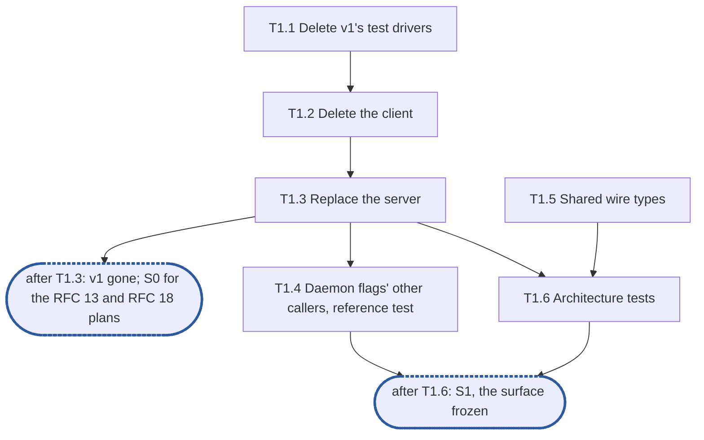

# Epic 1: control plane v2 — delete v1, declare the surface

**Sources:** [RFC 23](../docs/internals/rfcs/rfc-23-control-plane.md) §2 and §2.1 ("The node's surface"),
§4.1, §4.2, §4.6, §4.7, §7, §9, §10's CP14 and CP16, and §12's architecture check, as declarations
and architecture tests; RFC 23 Appendix B, whose code this epic removes.
**Track:** the team.
**Epic 1 estimate: 6 subtasks, 12.25 man-days.**
**Depends on:** nothing. The code it changes is `feat/storage-v2`'s.
**Blocks:** every other epic of RFC 23's plan, which builds on the surface frozen here (S1); and,
from the deletion's pull request on (D1), the RFC 13 plan, whose epic 1 renames what this epic
leaves of `pkg/config` (its S0), and the RFC 18 plan (#4058), which starts with v1's identity
deleted.

---

## 1. Goal

Epic 1 deletes v1's control plane and puts in its place the surface every later epic builds on,
with the tests that keep the layering honest. Nothing it declares runs yet: every new body is a
stub that returns `errors.ErrUnsupported`, behind a signature that is final.

**At the end of the epic:**

- v1's server, API, SQL control-plane store, wire DTOs, identity resolver, snapshot scheduler and
  client are gone, with the tests that drive them, and the module, `dt` and every cell
  still on build and pass without them;
- `dfsctl` keeps its command tree, every v1 command refusing until the CLI epic rebuilds it (D11);
- `internal/node` exports `New`, `Node`, `Config` and `Preflight`, and `*Node`'s `Start` and
  `Stop`, and nothing else;
- `pkg/node/apiv1` holds the wire types every later epic shares (the envelope, the page, the
  problem, the closed `OpKind` and code sets, the operation and the version body), and imports
  only the standard library;
- `dfs` has `init`, `start` and `reset-admin` beside the kept `config`, `version` and
  `completion`, runs in the foreground, and every invocation in the repository is of that tree;
- four architecture rules each catch a planted violation and pass on the repository.

### 1.1 In scope

The deletion of v1 and of the tests that drive it; the strip of `pkg/config`; the harness made to
build without v1; the node's surface and the shared wire types; the new
`cmd/dfs` and every invocation of a removed `dfs` command or flag; the generated CLI reference and
its drift test; the architecture tests that need no package this epic does not create.

### 1.2 Out of scope

- The behaviour behind the stubs: the node, and `dfs start` stopping on a termination signal (E3);
  the API server and its handlers (E4); accounts and sign-in (E5); the commands of `dfsctl` (E6).
- The `ControlPlane` view's signatures (`expect` on every write, `DeleteGrant`, `PutOperation`,
  `Write`), the records they name and `WriteMeta` and `ControlPlaneTx`, which go in
  `pkg/metadata/entity` (D3): E2 declares and fills them together, so no stub of
  them is frozen here. E2 adds `Alloc` to `PutUser` and `PutGroup` (its D2), refusing
  an allocation until the RFC 18 plan's counters land.
- `pkg/apiclient`: the package goes with its v1 body (D6), and E4 lands the client whole as
  `pkg/node/apiv1/client`, one generic `Resource[Spec, Status]` with its core.
- Each resource's spec and status types in `pkg/node/apiv1`: E4 for the resources its routes
  serve, E5 for API tokens, sessions and sign-in.
- The kvstore settings view's delete and the secrets view (`DeleteSetting`,
  `Secret`, `PutSecret`, `PruneSecret`), on the view and on `ControlPlaneTx` alike, since the RFC
  13 plan's A2 and RFC 18's password write commit a sealed secret through `ControlPlaneTx.PutSecret`
  inside a `Write`: the RFC 13 plan's epic 1 declares them.
- `pkg/bootstrap`, the refused v1 keys and the node identity: the RFC 13 plan's epic 2.
- The two architecture rules over `internal/node/api` (its imports, and its writes only through
  `Write`): E4 lands them with the package (D7).
- `node.Config`'s `Transport` and `Fault` (D2): two rows of
  [the deferral ledger](rfc-23-control-plane-plan.md#61-deferral-ledger).
- The harness's server fixture on `dfs init` and `dfs start` (the integration epic), and the e2e
  helpers on the new client (E8).
- The node view RFC 23 §2.1 sketches as `Records`, and the `Node` and `NodeStatus` records: E2's
  `Store.Nodes()` serves them, and the node holds kvstore's views directly (D2); an exported
  `Records` interface is a row of
  [the deferral ledger](rfc-23-control-plane-plan.md#61-deferral-ledger).
- The resource envelope's `managed` part: it waits with the provisioning file, a row of
  [the deferral ledger](rfc-23-control-plane-plan.md#61-deferral-ledger) (D9).

### 1.3 Names used here

- **E1**, this epic.
- **E2**, epic 2, store records: the view's signatures with `expect`, the records and fields RFC 16
  declares for RFC 23, `Write`'s transaction.
- **E3**, epic 3, the node: `node.New`, start and stop, reconcile, the runner, the harness
  `internal/node/nodetest`.
- **E4**, epic 4, the management API: the server, the route table, typed handlers, the write path,
  each resource's wire types and the client.
- **E5**, epic 5, accounts and sign-in: `dfs init`, `reset-admin`, tokens, sessions, roles.
- **E6**, epic 6, the CLI: `dfsctl`'s commands on the client.
- **E7**, epic 7, **the integration epic**: RFC 23 §12's single-node rows through the API, the
  harness's server fixture, and the guides.
- **E8**, epic 8, e2e green: the e2e helpers rebuilt, the filtered cells back on.
- **S0**, the RFC 13 plan's starting point: this epic's deletion has merged and stripped
  `pkg/config`.
- **S1**, v1 gone and the surface frozen: this epic has merged.
- **S2**, the node starts and reconciles (E3).
- **S3**, adapters serve through the node, outside RFC 23's plan. Not the storage service.
- **X1**, **X2**, **X3**: the RFC 13 plan's bootstrap and secrets, the RFC 18 plan's sign-in
  interface, and the RFC 13 plan's wiring of `Check`, `Diff` and `Get`; none is reached here.

## 2. How the general rules apply

The rules are those of
[RFC 23's plan, §1.5](rfc-23-control-plane-plan.md#15-general-rules-for-each-epic), cited by number
and title and not copied.

| Rule | Subtasks | How |
| --- | --- | --- |
| rule 1, independent unit tests ([`CLAUDE.md`, "Writing tests"](../CLAUDE.md#writing-tests)) | T1.4, T1.5, T1.6 | the wire types' tests encode real values; the reference test generates into `t.TempDir()`; the architecture rules run over the repository and over `testdata` trees. No test double of any kind |
| rule 2, fuzz every decoder of untrusted bytes | none | this epic adds no decoder: `pkg/node/apiv1` decodes through `encoding/json` in E4's handlers and the client, which fuzz request bodies and the cursor; the records' codecs are E2's |
| rule 3, observability follows RFC 25 | none | no series: the stubs serve nothing. Each series is its owning epic's |
| rule 4, profiling | none | no node or API test runs here; the leak check joins with the harness (E3) |
| rule 5, public interface and internals ([`CLAUDE.md`, "Verifying a change"](../CLAUDE.md#verifying-a-change)) | T1.5, T1.6 | the wire tests assert the JSON a client reads, not the Go fields; the architecture rules assert imports and exports, the layer CP14 and CP16 constrain |
| rule 6, known failures shrink | T1.4 | no test lands red and no `known.yaml` entry changes; T1.4 edits `test/posix/setup-posix.sh`, which the `pjdfstest` suite runs and whose `test/posix/known.yaml` it leaves as it is, since that cell is filtered on `feat/storage-v2` |
| rule 7, v2 ignores v1 | T1.1–T1.3, T1.6 | v1 is deleted before any v2 code lands; T1.6's rule fails on an import of a v1 path that never returns; the kept pieces are R2's list, kept in place |
| rule 8, real dependencies for properties of those dependencies | none | no property of a store, a listener or a kernel client is tested here |
| rule 9, code comment conventions ([`CLAUDE.md`, "Code comments"](../CLAUDE.md#code-comments)) | T1.2, T1.6 | D11's `decision:` marker at `dfsctl`'s refusal; the import rule's exemption of the harness says why at its site. RFC 23's own notes go with the code that implements them, in later epics |
| rule 10, a test must be able to fail | T1.4, T1.5, T1.6 | every architecture rule runs over a planted violation on every run; the closed-set test compares to RFC 23's literal lists; the reference test fails on a stale `cli.md`. The stubs are not tested: "stub bodies are never called by production" stays a review rule |
| rule 11, a symbol is exported only if RFC 23's interface uses it | T1.3, T1.5, T1.6 | the surface frozen here is R9 and R11–R18; the view's methods freeze with E2, the client with E4, each resource's types with the epic that serves it; T1.6 pins `internal/node`'s exports; the closed lists stay unexported (D5) |
| rule 12, each subtask creates only what it declares | all | no `internal/node/api`, `auth` or `nodetest` package yet (D7), and no `pkg/apiclient` between its v1 body's deletion and E4 (D6); each new package lands with the subtask that fills its surface |

## 3. Requirements and invariants

Every obligation RFC 23 places on this epic, and the ones RFC 23's plan sets for it, numbered so
that subtasks and tests can cite them.

**The clean slate**

| # | Requirement | Kind | Source | Subtasks |
| --- | --- | --- | --- | --- |
| R1 | v1 is deleted with the tests that drive it: `pkg/controlplane/**`, `internal/controlplane/**`, `pkg/snapshot`, `pkg/identity/**`, `pkg/auth/sid/mapper.go` with its tests, `pkg/health`'s `share.go` and `cache.go`, v1's `cmd/dfs` commands but `config`, `version` and `completion`, `pkg/apiclient`, and the bodies of `cmd/dfsctl` | MUST | RFC 23 plan §1.1, §5 epic 1; Appendix B | T1.1, T1.2, T1.3 |
| R2 | Nothing of v1 is copied into v2. What stays was never v1's alone and stays in place: `internal/tlsconfig`, `internal/cli`'s output, prompt and credentials helpers, `cmd/dfsctl`'s root and context commands, `pkg/config`'s loader, `pkg/health`'s `Checker` and `Report` | invariant | RFC 23 plan §1.5 rule 7 | T1.2, T1.3 |
| R3 | No package imports a v1 path that never returns: `pkg/controlplane/...`, `internal/controlplane/...`, `pkg/snapshot` | invariant | RFC 23 plan §1.3 | T1.6 |
| R4 | The module builds, `go vet` with every tag `lint-go` names passes, `unit` and `lint-repo` are green, and `dt` builds with its registry test passing, after each of T1.1, T1.2 and T1.3 | MUST | RFC 23 plan §5 epic 1, "Done when" | T1.1, T1.2, T1.3 |

**The server binary**

| # | Requirement | Kind | Source | Subtasks |
| --- | --- | --- | --- | --- |
| R5 | `dfs start` has no `--foreground`, `--pid-file` or `--log-file`, and no invocation of it in the repository passes one | MUST | RFC 23 §2 (step 4); RFC 23 plan D13 | T1.3, T1.4 |
| R6 | `dfs` has `init`, `start` and `reset-admin`, the server's own commands, beside `config`, `version` and `completion`, and no other: `stop`, `status` and `logs` go with daemon mode, since a termination signal stops the node (RFC 23 §2 step 4), `migrate` with the fresh-install policy, `netlogon` to RFC 23's `test-directory` | MUST | RFC 23 §7 (last paragraph), §2; RFC 23 plan §1.1, D13 | T1.3 |
| R7 | Every `dfs` and `dfsctl` invocation in `docs/**` but `cli.md`, and in a Go string literal, names a command and flags of the live trees | test row | RFC 23 plan §5 epic 1 | T1.2, T1.3 |
| R8 | The CLI reference is generated from the command trees, and a change to a command regenerates it in the same change | MUST | RFC 23 §7 | T1.3, T1.4 |

**The node's surface**

| # | Requirement | Kind | Source | Subtasks |
| --- | --- | --- | --- | --- |
| R9 | `internal/node`'s exported package-level declarations are `New`, `Node`, `Config` and `Preflight`, the start check the host runs before it opens the store, and `*Node`'s exported methods `Start` and `Stop`, and nothing else | MUST | RFC 23 §2.1 ("The node's surface", and its decision); RFC 23 plan §1.5 rule 11 | T1.3 |
| R10 | `Config` carries what the host supplies and the node cannot build: the bootstrap, the KV the metadata store opens on, the clock, the metrics registry and the logger | MUST | RFC 23 §2 (step 2), §2.1 | T1.3 |

**The shared wire types**

| # | Requirement | Kind | Source | Subtasks |
| --- | --- | --- | --- | --- |
| R11 | `pkg/node/apiv1` imports only the standard library, and nothing of the server | MUST | RFC 23 §7; RFC 23 plan D1, §4.1 | T1.5, T1.6 |
| R12 | A resource body has the same parts in every resource: `id`, `generation`, `spec`, `status` | MUST | RFC 23 §4.1 | T1.5 |
| R13 | A listing page carries its items and, when more follow, `next`, an opaque cursor | MUST | RFC 23 §4.2 | T1.5 |
| R14 | An error body is `application/problem+json` with `status`, `code`, `title`, `detail`, `field`, `rule`, `names`, `retryable` and `request_id` | MUST | RFC 23 §4.7 | T1.5 |
| R15 | The API's own codes are one closed set, each once: `unauthenticated`, `forbidden`, `generation_mismatch`, `precondition_required`, `idempotency_mismatch`, `managed`, `operation_running`, `not_cancellable`, `last_admin`, `not_a_copy`, `password_change_required`, `throttled`, `starting`, `unavailable` | MUST | RFC 23 §4.7 | T1.5 |
| R16 | `OpKind` is a closed set, each value once: one per in-scope action that is an operation (`rotate-signing-key`, `resolve-principal`, `test-directory`, `join-domain`, `rotate-machine-password`), one per delete that is one (a share's, a user's, a group's), and `identity.nt-hash-delete` | MUST | RFC 23 §4.1, §4.6, §3.5 | T1.5 |
| R17 | An operation carries `ID`, `Kind`, `Target`, `Account`, `State`, `Progress`, `Started`, `Updated`, `Error` and `Result`; its `State` is one of pending, running, succeeded, failed, cancelling, cancelled; its `Progress` is `Phase`, `Done`, `Total` (−1 when unknown) and `Unit` | MUST | RFC 23 §4.6 | T1.5 |
| R18 | The version discovery body names the major versions served, and nothing else | MUST | RFC 23 §9 | T1.5 |

**The architecture**

| # | Requirement | Kind | Source | Subtasks |
| --- | --- | --- | --- | --- |
| R19 | Only the server's start command and the test harness import `internal/node`: a file imports it only in `cmd/dfs/commands/start.go` or under `internal/node/nodetest` | invariant | RFC 23 CP16, §2.1, §12; RFC 23 plan §1.3 | T1.6 |
| R20 | The CLI's dependency closure names no package of the metadata store, the block stores or the control-plane server, and nothing that reads the host's bootstrap | MUST NOT | RFC 23 §7, CP14, §12 ("§7 CLI") | T1.6 |
| R21 | Each architecture rule fails on a planted violation of it | test row | RFC 23 §12 (the architecture test); RFC 23 plan §5 epic 1, "Done when" | T1.6 |

## 4. Decisions this epic takes

- **D1, the deletion lands first, as its own pull request, leaves first.** RFC 23's plan once
  landed this epic as one pull request, on the ground that the deletion could not build alone. It
  can, if it goes leaves first, each subtask leaving R4 true: the test drivers, which nothing
  imports (T1.1); the client, whose only importers outside the CLI were those drivers and one v1
  API test, `pkg/controlplane/api/share_name_client_roundtrip_test.go`, deleted with it (T1.2);
  then the server, with the new `dfs` in the same subtask so `dfs start` never disappears (T1.3).
  That pull request is S0 for the RFC 13 plan and unblocks the RFC 18 plan, before the surface
  lands. The user's decision; RFC 23's plan §3.2, §3.3, §3.4 and §5 epic 1 say so. No marker.
  Prior art: the strangler pattern's last step, deleting the old path once nothing calls it (from
  memory).
- **D2, the node's surface is what RFC 23 §2.1 declares, less what has no consumer.** `New`,
  `Node`, `Config`, `Preflight` and `Start`/`Stop`. `Preflight` is the start check: it has to run
  before the host opens the KV store, because `Config.KV` arrives already open and Badger's own
  open writes the `MANIFEST` the check reads, so `New` and `Start` are both too late to tell an
  absent store from a present one. A package of its own for one function would add a boundary
  and gain nothing, since the probes read the storage the node's own configuration names. `Config.Clock` is `engine.Clock` (`Now`, `Elapsed`,
  `After`), which `sim.TestClock` already implements and the journal's and open state's clocks are
  subsets of, so the node declares no clock type of its own and exports exactly rule 11's list.
  `Config` leaves out `Transport` (cluster only) and `Fault` (no component's `Deps` takes a fault
  seam on `feat/storage-v2`; the store's faults come through the KV, which `kvtest` wraps). Adding
  either later is a new field, which costs no caller anything. `Records` is not declared: the node
  holds kvstore's view directly, and an interface with one implementation and one caller is rule
  12's stub. The two fields are deferrals, not a gate skipped, so each is a row of
  [the deferral ledger](rfc-23-control-plane-plan.md#61-deferral-ledger) with what brings it in: a
  second node, or a component whose `Deps` takes a fault seam. Prior art: Kubernetes' kubelet
  takes its dependencies as one struct the command builds (from memory).
- **D3, the store view is not declared here.** Its signatures (`expect` on every write,
  `DeleteGrant`, `PutOperation`, `Write`) and the records they name freeze when E2 declares and
  fills them together, with `WriteMeta` and `ControlPlaneTx` in `pkg/metadata/entity`, which kvstore
  and the API both already import. Not the root `pkg/metadata`: on `feat/storage-v2` it is still
  v1's metadata `Service`, and kvstore naming a type there would pull it into kvstore's closure and,
  through kvstore, into the engine's. `pkg/block/engine/imports_test.go` checks only direct
  imports, so no test would fail: the reason is closure hygiene. The two
  types can move beside RFC 16 §3's views once that `Service` leaves the root package. A stub view frozen a
  whole epic before its bodies would pin signatures no test exercises. The user's decision. No
  marker.
- **D4, `dfs init` and `dfs`'s `reset-admin` land as stub commands here, not in E5.** The planning
  documents under `docs/**` name both in backticks dozens of times (RFC 13's and RFC 23's plans
  among them), and `cmd/gendocs`' `TestDocsCommandReferences` fails on an invocation whose
  subcommand does not exist ("has no subcommand"). Leaving them to E5 would turn `unit` red or force
  a rewrite of other plans. Each is a command over a stub body, with no flag E5 has not yet decided,
  so E5 adds its flags without changing a name. No marker. Prior art: none needed.
- **D5, closed sets are string constants with an unexported list each.** `OpKind` values read
  `<resource>.<verb>` as RFC 23 §4.6's examples do (`share.delete`,
  `installation.rotate-signing-key`), and `identity.nt-hash-delete` as RFC 23 §4.1 names it. E4
  exports a list if its totality test or its metric labels need it, which is additive. No marker.
  Prior art: Kubernetes' string reason codes (from memory).
- **D6, `pkg/apiclient` goes with its v1 body and returns whole in E4.** After T1.2 nothing imports
  the client: `dfsctl`'s commands refuse (D11) and the test drivers are gone. So the package is
  deleted rather than left empty, and E4 lands it at the same path as one generic
  `Resource[Spec, Status]` (`List`, `Get`, `Create`, `Replace`, `Patch`, `Delete`) with its core, each
  resource's accessor added with its route. The CLI-closure rule names `pkg/apiclient` among the
  allowed packages, so it holds the client from the day E4 lands it. The user's decision. No
  marker. E4 landed the client as `pkg/node/apiv1/client` instead, which the CLI-closure rule
  names, so `pkg/apiclient` is now one of the v1 paths the no-v1-import rule refuses. Prior art: the Kubernetes dynamic client's generic resource interface (from memory).
- **D7, the API's package is not created here.** `internal/node/api` lands with E4, its first
  consumer, and `internal/node/api/auth` with E5; neither touches this epic's surface. The two
  architecture rules about that package land with it in E4 (RFC 23's plan, §1.3). No marker.
- **D8, the stripped loader's type is `Bootstrap`.** What `pkg/config` keeps is renamed from
  `Config` to `Bootstrap` here, so `node.Config.Bootstrap` names its final type and the RFC 13
  plan's rename to `pkg/bootstrap` moves only the package. No marker.
- **D9, the envelope has no `managed` part yet.** RFC 23 §4.1's example carries `"managed": null`,
  which only the provisioning file sets. A field added later is additive (§9), so the envelope
  gains it with provisioning. No marker: §1.2 cites the ledger row.
- **D10, an architecture rule is a function of a source tree.** Each rule takes a root directory
  and returns its violations; the test runs it over the repository, expecting none, and over a
  `testdata` tree holding one planted violation, expecting exactly that one. So every rule keeps
  failing on its assertion on every run. A rule reads every file under each build tag `lint-go`
  names (the `go vet -tags=` list in `test/suites.yaml`), not only the default context, since a
  tagged file is invisible to a gate that reads without its tag. They walk sources with
  `go/build` and `go/parser`, as `pkg/block/journal/imports_test.go` and
  `internal/adapter/adaptertest`'s import test do (checked). No marker.
- **D11, `dfsctl` keeps its command tree until the CLI epic.** Deleting the v1 commands would make
  411 lines of invocations across 28 pages, and 28 in Go strings, name commands that do not exist,
  so `cmd/gendocs`' reference tests would fail at once; removing them here and writing them again
  in E6 and E7 is the same text twice. So the tree and its flags stay, and every v1 command's body
  is replaced by a refusal that names the rebuild; E6 rebuilds each command and rewrites the
  invocations of any it drops or renames. A `decision:` marker at the refusal says so. The user's
  decision. Prior art: none found.

## 5. Target tree

```text
test/e2e/helpers, test/e2e/*.go,
  test/e2e/snapshot                        T1.1  deleted (test/e2e/framework stays)
test/integration/ad-dc/
  ad_dc_ldap_test.go,
  netlogon_smbclient_test.go               T1.1  deleted (the other three tests stay)
test/harness/fixture/
  spec.go                                  T1.1  Unsupported, Placeholders, Network, moved from fixture.go
  fixture.go, api.go, shares.go            T1.1  deleted, with their tests
test/harness/run/fixture.go                T1.1  a DittoFS-server fixture refused
pkg/apiclient/                             T1.2  deleted, with its v1 body (D6); E4 lands the client as pkg/node/apiv1/client
cmd/dfsctl/commands/**                     T1.2  bodies replaced by a refusal (D11); tree and flags kept
pkg/controlplane/  internal/controlplane/
pkg/snapshot/  pkg/identity/               T1.3  deleted (internal/auth/netlogon stays, with no production importer)
pkg/auth/sid/mapper.go                     T1.3  deleted, with sid_test.go's mapper tests
pkg/health/share.go, cache.go              T1.3  deleted
pkg/config/                                T1.3  stripped to the bootstrap loader; Config renamed Bootstrap (D8)
internal/node/node.go                      T1.3  New, Node, Config, Start, Stop
cmd/dfs/commands/
  root.go init.go start.go reset_admin.go  T1.3  new (D4); config/, version.go, completion.go kept
docs/guide/cli.md                          T1.3  regenerated
CLAUDE.md                                  T1.3  one line: the architecture invariants describe v1
cmd/gendocs/reference_test.go              T1.4  cli.md matches the command trees
pkg/node/apiv1/
  doc.go envelope.go page.go problem.go
  codes.go opkind.go operation.go version.go T1.5
  closedsets_test.go wire_test.go          T1.5
internal/node/
  arch_test.go                             T1.3  the export pin (R9); T1.6  the other three rules
  testdata/arch/                           T1.3, T1.6  one planted violation per rule
```

## 6. Subtasks

### T1.1 Delete v1's test drivers

**Subtask T1.1 estimate: 2 man-days.**

- **Track:** the team. **Depends on:** nothing.
- **Covers:** R1, R4.
- **Deliverables:**
  - `test/e2e`'s v1 driver deleted: the `helpers` package, the top-level `e2e` package (its
    `main_test.go` and every test that imports `helpers`), and the `snapshot` package.
    `test/e2e/framework` stays: it imports nothing of this module. E8 brings the tests back from
    history onto the new client.
  - `test/integration/ad-dc`'s `ad_dc_ldap_test.go` and `netlogon_smbclient_test.go` deleted, the
    two that import `pkg/identity/ldap` or `pkg/apiclient`. `netlogon_passthrough`,
    `netlogon_reload` and `online_join` import only `internal/auth/netlogon`, which stays, so they
    stay, and `test/harness/needs`' `TestADDCNeedsWhatItsTestsRun` still finds the cell's tests.
    `adBindDN`, `adAdminPassword` and `adBaseDN`, which `online_join_test.go` uses, move from the
    deleted `ad_dc_ldap_test.go` to `ad_dc_integration_test.go` first, so `go vet -tags=ad_dc`
    still compiles. The RFC 18 plan's epics 6 and 7 rebuild the two.
  - `test/harness/fixture`'s v1 server deleted: `fixture.go`'s `Server`, `Start`, `Command`,
    `Reset` and `Stop`, `api.go` and `shares.go`, with `api_test.go`, `mount_unix_test.go`,
    `s3_test.go` and `shares_test.go` (which calls `loadShares` and `addShare`), and the ten tests
    that start the server, with their helper: `TestRealServer`, `TestRealSMB`, `TestSetupEnds`,
    `TestSetupServerExits` and `TestStartOnSetPort` in `fixture_unix_test.go`, and
    `TestDfsEndsWithDT`, `TestRealClients`, `TestRealKerberos`, `TestRealMount` and
    `TestRealSMBMount` in `fixture_linux_test.go`. What the kept files still use stays: `knfsd.go`
    reads the `Share` constant, and `mount.go` and `smb.go` hang their mount helpers on `*Server`;
    those declarations move out of the deleted `fixture.go`, and any receiver that served only the
    deleted DittoFS start goes with it. `Unsupported`, `Placeholders` and `Network`,
    which `test/harness/run` calls, move to a new `spec.go`, unchanged except that `Unsupported`
    refuses a fixture whose server is DittoFS, naming the integration epic's rebuild; `run`'s
    `startFixture` keeps its `knfsd` branch and refuses the other the same way. The rest of the
    fixture (`knfsd`, Kerberos, SMB client, mounts, processes) stays.
  Consumed by T1.2, which then finds no importer of `pkg/apiclient` but the CLI and one v1 test.
- **Acceptance criteria:**
  - `go vet` with every `lint-go` tag, `e2e` and `ad_dc` among them, compiles only what stays.
  - `dt` builds and its registry test passes; `lint-repo`'s `go test ./test/harness/...` passes.
  - The cells that ran the deleted tests are already filtered on `feat/storage-v2`; no cell that
    is on loses a test.
- **Tests:** `Unsupported`'s test gains a case: a DittoFS-server fixture is refused with the
  reason (catches a cell that would try to start a server that no longer exists). The rest is
  checked by the build, `go vet` and the existing harness tests (R4).

### T1.2 Delete the client

**Subtask T1.2 estimate: 1.5 man-days.**

- **Track:** the team. **Depends on:** T1.1.
- **Covers:** R1, R2, R4, R7.
- **Deliverables:** `pkg/apiclient` deleted whole (D6), its adapter and netgroup methods among them,
  with `pkg/controlplane/api/share_name_client_roundtrip_test.go`, its one importer left in v1;
  `cmd/dfsctl`'s commands keep their names, arguments and flags, and each body is replaced by one
  refusal, "not available until the CLI is rebuilt on the v2 API", with D11's `decision:` marker;
  `cmd/dfsctl/cmdutil` keeps only what does not call the client. The root, `context` and
  `completion` commands and `internal/cli` stay working. Consumed by T1.3, which then finds no
  importer of v1's server outside the server's own commands, and by E6, which rebuilds the
  commands.
- **Acceptance criteria:**
  - `dfsctl`'s help lists the same tree as before; a v1 command exits non-zero with the refusal.
  - R4 holds; `cmd/gendocs`' three tests pass unchanged, since no command or flag went away.
- **Tests:** the kept context commands' existing tests pass unchanged; the docs- and
  source-reference tests hold R7.

### T1.3 Replace the server

**Subtask T1.3 estimate: 4.75 man-days.**

- **Track:** the team. **Depends on:** T1.2.
- **Covers:** R1, R2, R4, R5, R6, R7, R8, R9, R10.
- **Deliverables:**
  - deleted: `pkg/controlplane/**`, `internal/controlplane/**`, `pkg/snapshot`, `pkg/identity/**`
    (the LDAP provider imports the root files, so the tree goes whole), `pkg/auth/sid/mapper.go`
    and `sid_test.go`'s mapper tests, `pkg/health`'s `share.go` and `cache.go` and their tests;
    `internal/auth/netlogon` stays, with no production importer (the three ad-dc tests T1.1 keeps
    import it), for the RFC 18 plan to move;
  - `pkg/config` stripped of v1's server sections (`database`, `controlplane`, `admin`,
    `kerberos`, `ldap`, `identity`, `gc`, `integrity`, `snapshot`, `metadata`, `metrics`,
    `shutdown_timeout`, and `blockstore` but its journal path), leaving the loader, logging and the
    journal path; its `Config` renamed `Bootstrap` (D8); `dfs config` follows;
  - the node's surface, with stub bodies:
    ```go
    package node // internal/node

    func New(cfg Config) (*Node, error)
    func (n *Node) Start(ctx context.Context) error
    func (n *Node) Stop(ctx context.Context) error

    type Config struct {
    	Bootstrap config.Bootstrap // D8; pkg/bootstrap once the RFC 13 plan renames the package
    	KV        kv.KV
    	Clock     engine.Clock
    	Metrics   *metrics.Registry
    	Logger    *slog.Logger
    }
    ```
  - the new `cmd/dfs`: `init`, `start` and `reset-admin` over the stubs (D4), replacing v1's in the
    same change so `dfs start` never disappears, beside `config`, `version` and `completion`;
    `start` runs in the foreground with no daemon flags; v1's `stop`, `status`, `logs`, `migrate`,
    `netlogon` and daemon mode deleted;
  - every invocation of a removed `dfs` command or flag rewritten to the new tree or removed, in
    `docs/**` and in Go string literals, so `cmd/gendocs`' docs- and source-reference tests pass,
    and the checker's own cases in `TestCheckerAcceptsAndRejects` still name live commands: `dfs
    stop`, `status`, `logs`, `migrate` and `netlogon` (about 45 lines), `dfs init --force`, and
    `dfs start` with a daemon flag; v1's `dfs init`, which wrote a config file, rewritten to the
    new meaning or dropped where a page relied on it (`README.md`'s quick start, `CONTRIBUTING`,
    `docs/internals/contributing.md`, `docs/internals/testing.md`, `docs/guide/getting-started.md`,
    `configuration.md`, `metadata-store-migration.md`, the hints in `pkg/config` and
    `cmd/dfs/commands/config`); `CHANGELOG.md` is history and stays; the prose around them is the
    integration epic's;
  - `docs/guide/cli.md` regenerated by `go run ./cmd/gendocs`;
  - one line in `CLAUDE.md`'s architecture invariants saying they describe v1 until the integration
    epic rewrites them.
  Consumed by T1.4 and T1.6; by E3 (`New`, `Start`, `Stop`, `Preflight`, `dfs start`, run over the
  store and devices before anything opens), E5 (`dfs init`,
  `reset-admin`) and the RFC 13 plan's epic 1 (S0), which renames `pkg/config`.
- **Acceptance criteria:**
  - R4 holds; nothing imports a deleted path.
  - `dfs`'s help lists exactly R6's commands; the help of `dfs start` names none of R5's flags;
    `dfs start` exits non-zero, naming the step, since `Start` is a stub.
  - `dfs config show`, `validate` and `edit` work on the stripped file.
- **Tests:** `cmd/dfs/commands/config`'s existing tests, trimmed to the keys that stay; the three
  `cmd/gendocs` tests, which fail on any invocation this subtask leaves naming a removed command or
  flag (R5, R7); and `internal/node/arch_test.go`'s export pin (R9, D10): `internal/node`'s exported
  package-level declarations are exactly `New`, `Node`, `Config` and `Preflight` and `*Node`'s
  exported methods exactly `Start` and `Stop`, run over the package and over the planted
  trees under `testdata/arch/`, each holding one violation. It lands here because `internal/node` is new in this subtask and
  `lint-repo`'s `test/new-package-tests.sh` refuses a new package with no `_test.go`.

### T1.4 The daemon flags' other callers, and the reference test

**Subtask T1.4 estimate: 1.5 man-days.**

- **Track:** the team. **Depends on:** T1.3.
- **Covers:** R5, R8.
- **Deliverables:**
  - `--foreground`, `--pid-file` and `--log-file` dropped from every `dfs start` invocation the
    gendocs tests do not read, as `rg -- '--foreground|--pid-file|--log-file'` finds them outside
    `cmd/dfs`, `CHANGELOG.md`, `docs/guide/cli.md` and the files T1.3 rewrote (it also finds other
    programs' flags, which stay). On `feat/storage-v2`: `scripts/packaging/dfs.service`; the `CMD` of
    `Dockerfile`, `Dockerfile.goreleaser` and `Dockerfile.prebuilt`;
    `scripts/setup-dittofs-demo.sh`; the operator's pod `Args`
    (`k8s/dittofs-operator/internal/controller/dittoserver_controller.go`), so its pods still start;
    `bench/ditto/night.sh`; `test/e2e/testdata/nlm/nlm_axis_interop.sh`;
    `test/scenarios/lib/tools/dfs-server`; `test/posix/setup-posix.sh`; and v1's `dfs init` in
    `scripts/install.sh`;
  - `cmd/gendocs/reference_test.go`, which generates the reference into `t.TempDir()` and fails
    when it differs from `docs/guide/cli.md`.
  Consumed by E6, whose command changes the reference test then holds to R8.
- **Acceptance criteria:**
  - The `rg` above finds no `dfs start` invocation passing a removed flag.
- **Tests:** `reference_test.go`, run against a stale `cli.md` (catches a command change without
  regeneration, R8). The invocations in Dockerfiles, the unit file, scripts and the operator are
  covered by the `rg` alone: no test reads them (§9).

### T1.5 The shared wire types

**Subtask T1.5 estimate: 1.25 man-days.**

- **Track:** the team. **Depends on:** nothing.
- **Covers:** R11, R12, R13, R14, R15, R16, R17, R18.
- **Deliverables:** `pkg/node/apiv1`, standard library only, the types every later epic shares:
  - `envelope.go`: `Resource[Spec, Status any] struct { ID string; Generation uint64; Spec Spec;
    Status Status }`, JSON `id`, `generation`, `spec`, `status` (D9);
  - `page.go`: `Page[T any] struct { Items []T; Next string }`, `next` omitted when empty;
  - `problem.go`: `Problem` with R14's fields and `MediaTypeProblem`; `*Problem` implements
    `error`, so the client returns it as is;
  - `codes.go`: `type Code string` and R15's set; component codes reach the client by name and are
    added by E4's problem table as it maps each closed set, additively;
  - `opkind.go`: `type OpKind string` and R16's set (D5); `operation.go`: `Operation`, `OpState`,
    `Progress`, `Ref` (a target: kind and ID);
  - `version.go`: `Version struct { Majors []string }`, `/api/version`'s body.
  Each resource's spec and status types come with the epic that serves it (§1.2). Consumed by E4's
  handlers and client, E5's routes and E6's commands.
- **Acceptance criteria:**
  - `go list -deps ./pkg/node/apiv1` names only standard-library packages.
  - The JSON names of the envelope, the page, the problem, the operation and the version body are
    RFC 23's.
- **Tests:** at the JSON a client reads, which E4 writes and E6 parses: a round trip of each of
  the envelope, page, problem, operation and version body through `encoding/json`, asserting the
  object's keys by name (catches a renamed tag, R12–R14, R17, R18); a test that compares each
  closed list with RFC 23's literal list, written out in the test (catches a value missing, extra,
  repeated or misspelt, R15, R16). No test double.

### T1.6 The architecture tests

**Subtask T1.6 estimate: 1.25 man-days.**

- **Track:** the team. **Depends on:** T1.3, T1.5.
- **Covers:** R3, R11, R19, R20, R21.
- **Deliverables:** three rules added to `internal/node/arch_test.go`, each a function of a source root (D10), run
  over the module and over `internal/node/testdata/arch/<rule>/`:
  - **no v1 import** (R3): no `.go` file outside `testdata` imports a path under
    `pkg/controlplane`, `internal/controlplane` or `pkg/snapshot`. `pkg/identity` and
    `pkg/apiclient` return in v2 at the same paths, so the compiler guards their deletion and the
    rule names neither (E4's client landed as `pkg/node/apiv1/client`, so the rule now names
    `pkg/apiclient` too);
  - **who imports the node** (R19): only `cmd/dfs/commands/start.go` and files under
    `internal/node/nodetest` import `internal/node`; a `decision:` marker says the harness is the
    one exemption RFC 23 names. `nodetest` does not exist until E3, so the rule's `testdata` tree
    plants both branches: an allowed file under a `nodetest` path, and a forbidden one under a
    look-alike (`nodetest2`), so an over-broad prefix match fails now rather than in E3;
  - **the CLI's closure** (R11, R20), over the binary's dependencies, `go list -deps ./cmd/dfsctl`
    without `-test`, so a test's import of the harness is not counted: the transitive imports of
    `cmd/dfsctl/...` and
    `pkg/node/apiv1`, and of E4's client once it lands, stay, of this module, within
    `cmd/dfsctl/...`, the client (`pkg/node/apiv1/client`), `pkg/node/apiv1` and `internal/cli/...`, and
    `pkg/node/apiv1`'s within the standard library;
  Beside T1.3's export pin, in the file T1.3 created. Consumed by every later epic, whose changes these rules hold; E4 adds the two rules over
  `internal/node/api` to the same file.
- **Acceptance criteria:**
  - Each rule reports nothing over the module and exactly its planted violation over its
    `testdata` tree.
- **Tests:** at the module's sources, where CP14 and CP16 are stated: each rule's two runs (catch a
  forbidden import, R3, R11, R19, R20; and, through the planted violation, a rule
  that has stopped detecting anything, R21). No test double: `testdata` trees are inputs.

## 7. Order of work



Checkpoint after T1.3: the module, `dt` and every cell build and pass without v1, which is all
the RFC 13 and RFC 18 plans' S0 asks for. Checkpoint after T1.6: S1. T1.5 waits on nothing and can run beside
T1.1–T1.4.

## 8. Suggested pull requests

| PR | Subtasks | Man-days | After | Why together |
| --- | --- | --- | --- | --- |
| 1 | T1.1, T1.2, T1.3 | 8.25 | — | the deletion, leaves first, with the new `dfs` in place of v1's (D1); S0 for the RFC 13 plan, and unblocks the RFC 18 plan |
| 2 | T1.4, T1.5, T1.6 | 4 | PR 1 | the remaining callers and the reference test, the shared wire types, and the rules that hold the layering: S1 |

A suggestion only for PR 2, which can be one pull request per subtask as well; PR 1 lands first as
its own (D1).

## 9. Open points

- The RFC 13 plan's epic 1 declares the settings view's delete and the secrets
  view at its S0, which is now this epic's deletion; it builds on kvstore's view before E2 has put
  `expect` on it (D3), so the two plans' view changes meet in E2, whose D4 settles their order: whichever
  lands second adds the other's transaction forms.
- No check reads the `dfs start` invocations in Dockerfiles, the unit file, shell scripts or the
  operator's pod arguments; T1.4's `rg` is the only enforcer of R5 there.
