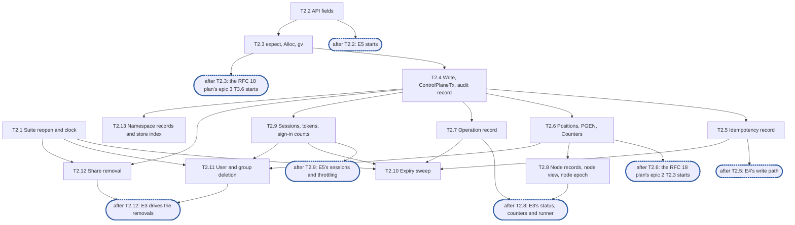

# Epic 2: control plane v2 — store records

**Sources:** [RFC 16](../docs/internals/rfcs/rfc-16-metadata-store.md) §2.3 (the records for RFC 23 and their
fields), §2.3.2 (a share's removal, the store's side), §3 (`ControlPlane` with `expect`, `Write`,
`WriteMeta` and `ControlPlaneTx`), §4.2 (their keys), §4.6 and §6.3 (format and codecs);
[RFC 23](../docs/internals/rfcs/rfc-23-control-plane.md) §2.4 (positions, node status), §3.1's last paragraph,
§4.4 (the entity tag), §4.5 (the idempotency record and its expiry), §4.6 (the operation record and
its retention), §5.2 (the last admin, the store's side), §5.3 (the sign-in counts' expiry), §6
(append-only, retention), and §10's CP5, CP6, CP11 and CP12 on the store's side.
**Track:** C.
**Epic 2 estimate: 13 subtasks, 35.75 man-days.**
**Depends on:** S1 (E1 merged): v1 deleted, so nothing but v2 calls kvstore's view. The RFC 13
plan's epic 1, if it lands first, gives the settings view's delete and the secrets view (D4).
**Blocks:** E5, which starts on T2.2's user fields and builds on T2.4 and T2.9; E4's write path
(T2.4, T2.5) and its reads of operations, audit and node status; E3's counters, node status,
runner, sweep and the removals it drives (T2.6–T2.8, T2.10–T2.12); the RFC 13 plan's epics 2 and
4, partly, which write the `Node` record, commit secrets with `tx.PutSecret` and count on a user's
deletion removing its secrets; the RFC 18 plan's epic 2, which raises the principals generation in its own transactions (T2.6's
helper), and its epic 3, whose T3.6 reads `ShareIndex.Share`'s `GrantVersion` (T2.3) and reads no
`PGEN`.

---

## 1. Goal

The metadata store gains every record and field RFC 16 declares for RFC 23, the one transaction an
API write commits in, the expiry of what expires, and a user's, a group's and a share's removal
past the mark, each resumable from its record.

**At the end of the epic:**

- every write of kvstore's `ControlPlane` view takes `expect` and checks it inside its transaction;
- `ControlPlane.Write(ctx, meta, fn)` commits a request's writes with its audit record and its
  idempotency record, or none of them, and replays a recorded answer;
- the operation, idempotency, session, API-token, sign-in-failure, audit, node and node-status
  records exist with their keys, codecs, golden vectors and fuzz target;
- settings, shares and principals carry their position, and the principals generation exists;
- one sweep deletes, in bounded batches, every record whose expiry has passed and every audit
  record past its retention;
- a user's, a group's and a share's removal runs past the mark in bounded batches, each resumed
  from its record after a restart;
- kvstore's conformance suite covers all of it, its restart and clock cases on a store reopened
  over the same data with an advanceable clock.

### 1.1 In scope

The suite's reopen and clock; the view's signatures with `expect`, `Alloc`, `DeleteGrant`, the
grant-list version, `Write`, `WriteMeta` and `ControlPlaneTx`; the fields RFC 16 adds to `User`,
`Group`, `Share` and `Quota`; positions and the principals generation; the management API's records
and their keys; the node and node-status records and the store's node view; the expiry sweep; the
store's side of a user's, a group's and a share's removal through step 6; the namespace record
and its remote-store index; the installation's signing-key reference.

### 1.2 Out of scope

- Driving the removals and the sweep: E3 runs their batches on its clock, resumes them at start and
  takes a share's binding through RFC 16 §2.3.2's step 3 (engine, filesystem, open state).
- What the API decides around a write: decoding, roles, `If-Match` to `expect`, the problem table,
  `audit_records_total` (D5), which audit records a refusal writes, that an operation's `Params`
  holds no credential (its writers: E4 and the RFC 18 plan's epic 7), and the `last_admin` refusal
  itself (E5, over T2.4's tracked read).
- Sign-in's counting rules, its settle and takeback against the `Nonce`, and the break-glass
  reset's clearing of every source's count in bounded batches (E5, their first consumer).
- The active-version refusal inside the node's registration (RFC 13 §5.5): the RFC 13 plan's
  epic 2 adds it to T2.8's call.
- `Alloc`'s allocation, `Minter` and the uid, gid and RID counters: the RFC 18 plan's epic 2 (D2
  declares the type and refuses an allocation until then).
- `User.Password` and `User.NTHash`, the rename of `User.Secret`: the RFC 18 plan's epic 2.
- The secrets view's bodies (`Secret`, `PutSecret`, `PruneSecret`) and the settings view's delete:
  the RFC 13 plan (D4); this epic puts their transaction forms on `ControlPlaneTx` if they land
  first.
- `AuditCursor` and `AdvanceCursor`: they wait with the event streams, a row of
  [the deferral ledger](rfc-23-control-plane-plan.md#61-deferral-ledger).
- RFC 16 §2.3.2's step 7, a namespace's drain: GC's, a row of
  [the deferral ledger](rfc-23-control-plane-plan.md#61-deferral-ledger) (D9).
- The claim generation (`CGEN`): it comes with RFC 27's `Claim`, a row of
  [the deferral ledger](rfc-23-control-plane-plan.md#61-deferral-ledger); T2.6's counters read it
  as zero while it is absent.

### 1.3 Names used here

- **E1**, epic 1, delete v1 and declare the surface: deleted v1 and froze the node's surface and
  the shared wire types.
- **E2**, this epic.
- **E3**, epic 3, the node: `node.New`, reconcile, the node-status writer, the operation runner,
  and the driving of removals and of the sweep.
- **E4**, epic 4, the management API: the write path over `Write`, the routes and their reads.
- **E5**, epic 5, accounts and sign-in: sessions, tokens, throttling, roles, `dfs init`.
- **S0**, the RFC 13 plan's starting point: E1's deletion has merged.
- **S1**, E1 merged: v1 gone and the surface frozen.

## 2. How the general rules apply

The rules are those of
[RFC 23's plan, §1.5](rfc-23-control-plane-plan.md#15-general-rules-for-each-epic), cited by number
and title and not copied.

| Rule | Subtasks | How |
| --- | --- | --- |
| rule 1, independent unit tests ([`CLAUDE.md`, "Writing tests"](../CLAUDE.md#writing-tests)) | all | every behaviour is a case of kvstore's conformance suite (`kvstoretest`), run over Badger in memory and on disk and over FoundationDB; faults come from `kv/kvtest`'s `FaultKV` (kind 3), store time from the backends' `Options.Clock` (kind 1). No other double |
| rule 2, fuzz every decoder of untrusted bytes ([`CLAUDE.md`, "Writing tests"](../CLAUDE.md#writing-tests)) | T2.2, T2.4, T2.5, T2.7–T2.9 | one target, `FuzzControlPlaneValues`, over a table of every new or changed decoder, as `FuzzLifecycleValues` covers three (D11): a value either decodes and re-encodes to bytes that decode to the same value, or fails with a named error |
| rule 3, observability follows RFC 25 | none | kvstore exports no series (D5): the API counts `audit_records_total` after `Write` returns, and the sweep returns its counts for the node to export |
| rule 4, profiling | none | no node or API test runs here; the leak check joins with E3's harness |
| rule 5, public interface and internals ([`CLAUDE.md`, "Verifying a change"](../CLAUDE.md#verifying-a-change)) | all | the suite reaches the store through the view only, never a key, as RFC 16 §6.1 says; layout is held by golden vectors (RFC 16 §6.3) |
| rule 6, known failures shrink ([`CLAUDE.md`, "Writing tests"](../CLAUDE.md#writing-tests)) | none | no test lands red and no suite here keeps a `known.yaml` |
| rule 7, v2 ignores v1 | none | v1 is gone at S1; nothing here reads it |
| rule 8, real dependencies for properties of those dependencies ([`CLAUDE.md`, "Writing tests"](../CLAUDE.md#writing-tests)) | T2.1, T2.4, T2.11, T2.12 | the all-or-nothing commit runs on Badger on disk with the commit faulted; a resumed removal reopens the store over the same data (T2.1) |
| rule 9, code comment conventions ([`CLAUDE.md`, "Code comments"](../CLAUDE.md#code-comments)) | T2.2, T2.10–T2.12 | D1's `decision:` at the store format, D8's at the secrets a deleted user names, D6's and D9's `ponytail:` at the sweep and at the removal's steps 2 and 7 |
| rule 10, a test must be able to fail | all | each test names the requirement it breaks on; where the code holds a requirement by construction, the row names that instead of a test that cannot fail |
| rule 11, a symbol is exported only if RFC 23's interface uses it | all | the exported additions are RFC 16 §3's view methods, `Write`, `WriteMeta`, `ControlPlaneTx`, the records' fields, the errors they return, and the node view's calls E3 and the RFC 13 plan make |
| rule 12, each subtask creates only what it declares | all | each method lands with its conformance case; a read whose consumer is E3, E4 or E5 is named with that consumer in its Deliverables |

## 3. Requirements and invariants

Every obligation RFC 16 and RFC 23 place on this epic, numbered so that subtasks and tests can cite
them.

**Records and fields**

| # | Requirement | Kind | Source | Subtasks |
| --- | --- | --- | --- | --- |
| R1 | A `User` carries `Role` (none, viewer, operator, admin), `NotBefore` (store time, whole seconds) and `MustChange`, the management API's fields, which grant nothing on files | MUST | RFC 16 §2.3; RFC 23 §5.1, §5.3 | T2.2 |
| R2 | A `User`, a `Group` and a `Share` carry `Generation`, raised by every write of the record, the RFC 18 plan's `Minter` `Rename`, `SetEmail` and `DropNTHashes` included; a share's is `S‖id‖info`'s, not its state's or its namespaces'; a user's and a group's is taken from store time, so a principal deleted and created again never repeats one (D21) | MUST | RFC 16 §2.3, §3 | T2.2, T2.3 |
| R3 | A grant, an export policy, a netgroup and a quota are versioned, and their version is what their write takes as `expect` | MUST | RFC 16 §3; RFC 23 §4.4; RFC 23 plan A4 | T2.2, T2.3 |
| R4 | An `Operation` holds `ID`, `Kind`, `Target`, `Account`, `State`, `Claim`, `Step`, `Params`, `Started`, `Updated`, `Error` and `Result`; `Progress` is not stored; `Account` may be zero, for an operation no call started, read as the schedule | MUST | RFC 16 §2.3; RFC 23 §4.6 | T2.7 |
| R5 | An `IdempotencyRecord` holds the `Account`, the `Key`, the `Digest` of method, path and body, the `Answer` first given and `Expires`, 24 h after the request | MUST | RFC 16 §2.3; RFC 23 §4.5 | T2.5 |
| R6 | A `Session` holds the hash of its current refresh token and an `APIToken` the hash of its token, never a token | MUST NOT | RFC 16 §2.3; RFC 23 §5.3, CP11 | T2.9 |
| R7 | A `SignInFailures` holds `Count`, `Last`, and, for a source, `Failed` and `Nonce`; a `SignInKey` names an account's count, a source's or the two together | MUST | RFC 16 §2.3 | T2.9 |
| R8 | An `AuditRecord` holds the commit's store `Time`, `Actor`, `Node`, `Source`, `Request`, `Target`, `Before` and `After`, `Change` and `Outcome`; the `Actor` may be the schedule, for the `Write` creating an operation no call started | MUST | RFC 16 §2.3; RFC 23 §4.6, §6 | T2.4 |
| R9 | A `Node` holds its `Address`, `Roles`, `Binary`, `Domain`, `Epoch`, raised at every start on a single node, `Formats` and `Lapsed` | MUST | RFC 16 §2.3; RFC 23 §3.1 | T2.8 |
| R10 | A `NodeStatus` holds the settings generation, share list version, principals generation and claim generation the node reconciled through, its refused records with their generation and error, its restart-pending set, the version of each secret it holds and its conditions, and is written only by its node | MUST | RFC 16 §2.3, §4.2 (`N‖node‖st`); RFC 23 §2.4 | T2.8 |

**Keys, codecs and format**

| # | Requirement | Kind | Source | Subtasks |
| --- | --- | --- | --- | --- |
| R11 | Each record has the key RFC 16 §4.2 gives it: `OP‖opID`, `OPR‖kind‖target`, `IK‖account‖key`, `XP‖expiry‖tagged`, `SS‖session`, `SSH‖hash`, `SS‖session‖h‖hash`, `SF‖tagged`, `AT‖tokenID`, `ATH‖hash`, `ATA‖principal‖tokenID`, `AU‖time‖auditID`, `AUX‖tagged‖time‖auditID`, `N‖node`, `N‖node‖st`, `PGEN`, `S‖id‖gv`, `NS‖ns‖info`, `NSR‖store‖ns`, `NS‖ns‖share‖ShareID`, `SSA‖principal‖session` | MUST | RFC 16 §4.2; RFC 23 §3.1 | T2.3–T2.9, T2.13 |
| R12 | Each codec version has golden bytes for fixed values, and each new key row a golden key; a change that alters either without a version or format bump fails | test row | RFC 16 §6.3 | T2.2, T2.4–T2.9 |
| R13 | Decoding a newer version, a truncated value or a trailing byte fails with a named error, never a zero value | MUST | RFC 16 §6.3 | T2.2, T2.4–T2.9 |
| R14 | A new record kind is a format bump: format *n* names the codec versions a binary may write, so no value is written that an older reader of format *n* cannot decode | MUST | RFC 16 §4.6 | T2.2 |

**The write path**

| # | Requirement | Kind | Source | Subtasks |
| --- | --- | --- | --- | --- |
| R15 | Every `Put*`, `Set*` and `Delete*` of the view but `SetShareState` takes `expect`, reads the record with conflict tracking, refuses `ErrGenerationMismatch` when the stored generation or version differs, and raises it; zero expects the record absent, so the write is create-only. `SetShareState` takes none: its `from` argument is its compare-and-set | MUST | RFC 16 §3; RFC 23 §4.4, CP5 | T2.3 |
| R16 | `SetGrant` and `DeleteGrant` each write the share's grant-list version, `S‖id‖gv`, as the writing commit's version in the same transaction; `DeleteGrant` deletes the grant and its `GR` key; a user's or a group's deletion moves `S‖id‖gv` of each share whose grant it drops | MUST | RFC 16 §3, §4.2 (`S‖id‖gv`) | T2.3 |
| R17 | Every control-plane write that names a share — `PutShare`, `SetShareState`, `SetGrant`, `DeleteGrant`, `PutExportPolicy`, a share-scoped `PutSetting` — reads `S‖id‖st` with tracking and refuses a share being removed or retired with `ErrStale` | MUST | RFC 16 §2.3.2 (step 1) | T2.3 |
| R18 | `Write` runs `fn` over a `ControlPlaneTx`, which carries the view's writes without their `ctx`, each checking its `expect`, and the tracked reads `Setting`, `User`, `Share`, `SignInFailures`, `RunningOperation` and `IDHighWater`; a deletion's transaction form is its mark | MUST | RFC 16 §3; RFC 18 §2.6 (`IDHighWater`, declared by the RFC 18 plan's epic 2's T2.9) | T2.4, T2.7, T2.9 |
| R19 | `Write` writes `meta`'s `AuditRecord` and, when `meta` names a key, its `IdempotencyRecord`, after `fn` returns, so `fn` may complete the audit record's `After` and `Outcome` and the idempotency record's `Answer`; the change and both records commit together or none of them | MUST | RFC 16 §3; RFC 23 §4.3, §6, CP12 | T2.4, T2.5 |
| R20 | A transaction conflict retries the whole transaction, the key's read included, bounded by the call's deadline with randomised backoff, so `fn` holds no state between calls and what commits is the attempt that committed | MUST | RFC 16 §3 | T2.4 |
| R21 | An `expect` that does not match returns `ErrGenerationMismatch` through `fn`, commits nothing and is not retried | MUST | RFC 16 §3 | T2.4 |
| R22 | The view's methods stay, each one `Write` with no audit | MUST | RFC 16 §3 | T2.4 |
| R23 | Before `fn`, `Write` reads the key's record with conflict tracking: one with the same digest returns `ErrIdempotentReplay` carrying the recorded answer and `fn` does not run; one with another digest returns `ErrIdempotencyMismatch`; two requests that both miss the record conflict on its key | MUST | RFC 16 §3; RFC 23 §4.5, CP6 | T2.5 |
| R24 | An idempotency record is scoped to its account and key and kept 24 h, then deleted | MUST | RFC 23 §4.5; RFC 16 §4.2 (`IK`) | T2.5, T2.10 |
| R25 | An audit record is append-only: never rewritten, deleted only past `audit.retention`, in bounded batches | MUST | RFC 23 §6, CP12; RFC 16 §4.2 (`AU`) | T2.4, T2.10 |
| R26 | Audit records sit in store-time order, with one index row per record for each of its actor, its target and its taking node, so the reads RFC 23 §6 filters by are ranges | MUST | RFC 16 §4.2 (`AU`, `AUX`); RFC 23 §6 | T2.4 |
| R47 | Two concurrent writes that each disable, delete or demote one of the last enabled accounts with role `admin` conflict, so the API's refusal of the last one can sit inside the write's transaction: `PutUser` and `DeleteUser` keep the `UA‖principal` index, and `ControlPlaneTx.EnabledAdmins` counts it tracked | MUST | RFC 23 §5.2; RFC 16 §3 (`ControlPlaneTx`), §4.2 (`UA‖principal`) | T2.4 |

**Positions and counters**

| # | Requirement | Kind | Source | Subtasks |
| --- | --- | --- | --- | --- |
| R27 | Every record of a reconciled kind — a setting, a share, a principal — carries its position, the value its last change raised its kind's counter to (`CFGGEN`, `SL`, `PGEN`), written in that change's transaction; a grant, an export policy, a netgroup and a quota carry none | MUST | RFC 23 §2.4; RFC 16 §3; RFC 23 plan A4 | T2.6 |
| R28 | `PGEN` is raised once in each transaction that writes a `User`, a `Group` or a `Membership` or writes or deletes a `PX‖` row, however many it writes, so every record that transaction writes carries one position | MUST | RFC 16 §4.2 (`PGEN`), §3 | T2.6, T2.11 |

**Operations**

| # | Requirement | Kind | Source | Subtasks |
| --- | --- | --- | --- | --- |
| R29 | One operation runs per target and kind: the running index is written when an operation starts and deleted when it ends, so a second request for the same work finds it in one read and is refused | MUST | RFC 23 §4.6; RFC 16 §4.2 (`OPR`) | T2.7 |
| R30 | A finished operation is kept 7 days after it ends, then deleted | MUST | RFC 23 §4.6; RFC 16 §4.2 (`OP`) | T2.7, T2.10 |
| R31 | Every operation's state change, a deletion's end included, goes through `Write` with its audit | MUST | RFC 16 §3; RFC 23 §6 | T2.7 |

**Sessions, tokens and sign-in counts**

| # | Requirement | Kind | Source | Subtasks |
| --- | --- | --- | --- | --- |
| R32 | A session's refresh-token index holds its current hash and every hash it replaced until the session expires, each with a reverse row under the session, so the expiry sweep deletes a session's index rows by one range of its own, never a scan of the index; a per-account index lists an account's sessions; `DeleteSession` deletes the session, its per-account key and every refresh hash it ever had in one transaction, so none is found afterwards | MUST | RFC 16 §3, §4.2 (`SS`, `SSH`, `SSA`) | T2.9, T2.10 |
| R33 | An API token's record, its hash index and its per-account index are written together and deleted together, by the expiry sweep or with the account | MUST | RFC 16 §4.2 (`AT`, `ATH`, `ATA`) | T2.9, T2.10, T2.11 |
| R34 | A sign-in's counts are read tracked and raised in the attempt's own transaction, through `ControlPlaneTx`'s `SignInFailures` and `PutSignInFailures`, which writes the count's row and, where the count expires, its `XP` row | MUST | RFC 16 §3, §4.2 (`SF`) | T2.9 |
| R35 | A pair's count is deleted 24 h after its `Last`, a source's 15 min after its `Failed`, each with its `XP` row, which moves when that time moves; an account's count does not expire | MUST | RFC 23 §5.3; RFC 16 §2.3, §4.2 (`SF`) | T2.9, T2.10 |

**Expiry**

| # | Requirement | Kind | Source | Subtasks |
| --- | --- | --- | --- | --- |
| R36 | Every record that expires has one empty `XP‖expiry‖tagged` key, written and deleted with it, so the sweep is one ordered scan | MUST | RFC 16 §4.2 (`XP`) | T2.5, T2.7, T2.9, T2.10 |
| R37 | One sweep deletes every expiring record in bounded batches; each record's expiry is written with it, so the sweep is handed only `audit.retention` | invariant | RFC 23 plan §4.3; RFC 23 §6 | T2.10 |

**Namespaces and the installation's signing key**

| # | Requirement | Kind | Source | Subtasks |
| --- | --- | --- | --- | --- |
| R48 | A namespace has its own record, `NS‖ns‖info`, naming the remote store it is created on and its bound fields, versioned by `Generation`; a namespace naming no remote store is refused | MUST | RFC 16 §2.3 (`Namespace`), §3, §4.2 (`NS‖ns‖info`); RFC 23 §3.3 | T2.13 |
| R49 | Every namespace record has one `NSR‖store‖ns` key, written and deleted in the record's transaction, so whether a remote store is named is one range read; a remote store's deletion reads it under a range guard, so a namespace created on the store concurrently conflicts with it | MUST | RFC 16 §4.2 (`NSR‖store‖ns`), §3; RFC 23 §3.3 | T2.13 |
| R50 | A share's create or rebind reads its namespace's record tracked and refuses a namespace that names no remote block store | MUST | RFC 8 §2.1; RFC 16 §3 (`ControlPlaneTx`); RFC 23 §3.2 | T2.13 |
| R52 | `ControlPlaneTx.Now` is the transaction's store time, fixed for its life, so a value derived from it (a token's not-before) and the tracked reads beside it commit together | MUST | RFC 16 §3 (`ControlPlaneTx`); RFC 23 §5.3 | T2.4 |
| R53 | Whether any share names a namespace is one range read of `NS‖ns‖share‖`, written and deleted in the share's own transaction and read under a range guard, so a share created into the namespace concurrently conflicts with its deletion | MUST | RFC 16 §4.2 (`NS‖ns‖share‖ShareID`), §3; RFC 23 §3.3 | T2.13 |
| R54 | The `Installation` record holds `NTLMOff`, `Off` (the settings generation of the last write turning `identity.ntlm` off) and `Deleted` (the `identity.nt-hash-delete` that completed since), read tracked inside a write so RFC 23 §4.1's rule for turning NTLM back on sits in the write's transaction | MUST | RFC 16 §2.3 (`Installation`), §4.2 (`IN`); RFC 23 §4.1 | T2.2, T2.4 |
| R51 | The `Installation` record names the management API's signing key as `SigningKey`, a `SecretRef` owned by the record under `signing_key` | MUST | RFC 16 §2.3 (`Installation`, `SecretOwner`) | T2.2 |
| R55 | The `Installation` record's `Join` holds `MachineJoin` with `Names`, the account's service names with `sPNMappings` applied, and `LastRotation.Version` and `LastRotation.Confirmed`, the secret version the last join or rotation confirmed and the store time of that confirm, written by `SetMachineJoin` and read back field for field | MUST | RFC 16 §2.3 (`MachineJoin`, as RFC 23 plan A9 amends it) | T2.4 |

**Nodes**

| # | Requirement | Kind | Source | Subtasks |
| --- | --- | --- | --- | --- |
| R38 | A node registers at each start, and its node-status record is written by that node through its own view, never through `ControlPlane` | MUST | RFC 23 §3.1, §2.4; RFC 16 §2.3, §3 | T2.8 |

**Deletions past the mark**

| # | Requirement | Kind | Source | Subtasks |
| --- | --- | --- | --- | --- |
| R39 | A user's or a group's deletion deletes its name and protocol-ID indexes and marks the record deleted in its first transaction; bounded batches a restart resumes from that mark drop its grants (through `GR`), setting `S‖id‖gv` on each share whose grant a batch drops, its memberships (`M`, `MR`) and quota records, and a user's API tokens (through `ATA`), its sessions (through `SSA`, each with its `SSH` rows) and its account's `SF` count; the last transaction deletes the record, a user's with every version of the secret it names, raising `CFGGEN` | MUST | RFC 16 §3, §4.2 (`S‖id‖gv`, `ATA`, `SSA`, `SF`, `CFGGEN`); RFC 23 §5.3 | T2.11 |
| R40 | A marked user is admitted nowhere; a membership of a marked group grants nothing, and a `User.Primary` naming one counts as zero | MUST | RFC 16 §3 | T2.11 |
| R41 | A share's removal runs its steps in order after the mark, each idempotent and recorded in `S‖id‖st`, and each shard's in its `SH‖shard‖rm` row, so a crash resumes it where its record says it stopped | MUST | RFC 16 §2.3.2 | T2.12 |
| R42 | `st` moves to the forget phase only in a batch that finds every shard's `rm` row at offloaded or later, and past step 4 only in the batch that finds the last shard done, each batch reading its shards and rows with tracking and recording its cursor in `st` | MUST | RFC 16 §2.3.2 | T2.12 |
| R43 | Step 4 drops every file of a shard in bounded batches through RFC 6 §6.2's batched removal, metadata transactions alone, taking no journal version, each file's removal at one above the share's version floor; it is not a range drop | MUST | RFC 16 §2.3.2 (step 4) | T2.12 |
| R44 | Step 5 deletes the server-wide rows that name the share: its grants and their `GR` keys, its share-scoped settings, raising `CFGGEN` in the same transaction, any secret only those settings referenced, each client's `CL‖client‖sh‖shard` for its shards and any `MV` record | MUST | RFC 16 §2.3.2 (step 5) | T2.12 |
| R45 | Step 6 deletes every `S‖id‖*` record but `st`, then the shards' records with their rows; the root's shard record goes last, in one transaction with `st` and `nsg`, which raises `SL` | MUST | RFC 16 §2.3.2 (step 6) | T2.12 |
| R46 | A share's `ShareID` and journal tag are never reused | invariant | RFC 16 §2.3.2 (step 6) | T2.12 |

## 4. Decisions this epic takes

- **D1, this epic's record kinds join store format 1, and the changed codecs change in place at
  version 1.** RFC 16 §4.6 makes a new record kind, and permission to write a new codec version, a
  format bump (R14), so that no value is written that an older reader cannot decode. Format 1 has
  no reader yet: no release has created a store, installs are fresh (RFC 23's plan, "Transition
  policy"), kvstore's `maxFormat` is still 1 although `MKP`, `JD` and `SEC` joined it the same way,
  and #3532 changed `encodePolicy` in place at version 1. So the new kinds join format 1, and the
  user, group, share-info and quota codecs change in place, each with one golden vector. A
  `decision:` marker at `maxFormat` says that R14 binds from the first release that creates a
  store, which freezes format 1, and that the golden vectors of R12 hold it from then on. The
  user's decision. Prior art: none needed.
- **D2, `ControlPlaneTx`, `WriteMeta`, `Alloc` and the new sentinels live in
  `pkg/metadata/entity`.** kvstore and the API both import `entity`, and RFC 16's own sentinels
  live there (`entity.ErrStale`). Not the root `pkg/metadata`: it is still v1's metadata `Service`,
  and kvstore naming a type there would put that service in kvstore's closure, and through kvstore
  in the engine's and the node's. The engine's import rule (`pkg/block/engine/imports_test.go`)
  checks only direct imports, so nothing would fail; the reason is closure hygiene, not a test. The
  types can move beside RFC 16 §3's views once that `Service` leaves the root package. Not
  `pkg/metadata/errors`, a leaf of `ErrorCode` values that cannot carry a recorded answer. So
  `entity` gains `ErrGenerationMismatch`, `ErrIdempotencyMismatch`, `ErrOperationRunning` and the
  error type `*IdempotentReplay`, which carries the recorded answer. `PutUser(ctx, u, expect, a
  Alloc)` and `PutGroup` take `Alloc` from this epic, so the RFC 18 plan's `Minter` changes no
  signature; until its uid, gid and RID counters land, an `Alloc` naming any ID is refused with
  `merrs.NewInvalidArgumentError`, RFC 16's `ErrInvalid` in this store's spelling. The user's
  decision on `Alloc`. Prior art: `pgx`'s `BeginFunc`, a transaction handed to a closure (from
  memory).
- **D3, every write is a function of a transaction, and the view's method wraps it.** Each write
  today opens its own `kv.Update`. This epic moves its body into an unexported function of a
  `kv.Txn` and its arguments; `ControlPlaneTx`'s method calls that function on `Write`'s
  transaction, and the view's method is one `Write` with an empty `WriteMeta` (R22). One body per
  write, so the checks of R15 and R17 cannot differ between the two forms. `Write` is one
  `kv.Update`: `kv.Retry` already retries only `ErrConflict`, with randomised backoff bounded by
  the context, so R20 and R21 hold by construction and add no retry code. No marker. Prior art:
  `database/sql`'s `Tx` beside `DB` (from memory).
- **D4, the RFC 13 plan's view changes and this epic's meet by "whoever lands second adds the
  transaction form".** The RFC 13 plan's epic 1 declares the settings view's delete and the secrets
  view at its S0, before S1, so it normally lands first, with `expect` on its own new writes as RFC
  16 §3 gives them. T2.3 then adds `expect` to every write that has none, `PutSetting` among them,
  and T2.4 puts `DeleteSetting`, `PutSecret` and `PruneSecret` on `ControlPlaneTx` as well. If this
  epic lands first, the RFC 13 plan adds its writes to `ControlPlaneTx` in the change that adds
  them to the view. Neither waits for the other. No marker. Prior art: none needed.
- **D20, this epic alone writes `S‖id‖gv`.** RFC 16 §4.2 has it written by `SetGrant`,
  `DeleteGrant` and the deletion batches, which are T2.3's and T2.11's; the RFC 18 plan's epic 3
  only reads it, through `ShareIndex.Share` in the same view as the share's policy. T2.3 removes
  the `ponytail:` above `SetGrant`. No marker. Prior art: none needed.
- **D5, kvstore exports no series.** The store has no metrics today, and the count that matters is
  of committed records, which the caller knows when `Write` returns. So the API counts
  `audit_records_total` (E4), and the sweep returns how many records of each kind it deleted, for
  the node to export as `api_idempotency_records_deleted_total` (E3). RFC 23's plan's rule 3 is
  amended in the same pull request. No marker. Prior art: none needed.
- **D6, expiry is written, not computed by the sweep.** Each expiring record's `XP` key carries its
  own expiry, computed when the record is written: 24 h for an idempotency record, 7 days after an
  operation ends, 15 min after a source's `Failed`, 24 h after a pair's `Last`, a session's and a
  token's `Expires`. These are RFC constants; only `audit.retention` is a setting. The sweep then
  deletes every `XP` entry at or before the store time and every audit record older than the
  retention it is handed (`AU` is time-ordered and has no `XP` row). One `Sweep(ctx,
  auditRetention)` call is one bounded batch; E3 calls it on its clock. A `ponytail:` at `Sweep`
  names its ceiling, one pass per kind per interval, and its upgrade, per-kind schedules once a
  profile shows the sweep. Prior art: Redis' sorted-set expiry index (from memory).
- **D7, the node's records and its background calls have their own view.** RFC 16 says
  `NodeStatus` is not `ControlPlane`'s: every node writes its own through the node view, and RFC
  23 §2.1 calls `ControlPlane` the API's write view. So `Store.Nodes()` gives `Nodes`, with
  `Counters`, `RegisterNode`, `Node`, `PutNodeStatus`, `NodeStatuses`, `List`, `AllSettings`, which
  pages every scope's settings from a `SettingKey` for the reconcile's settings read (RFC 23 §2.1), and the calls E3
  drives: `Sweep`, `ContinueDelete`, `ContinueRemoval`, `ContinueShardRemoval` and
  `RecordShardRemoval`. This departs from RFC 23 §2.1's `Records` sketch in three ways, each for a
  consumer: `RegisterNode` returns the record it wrote, since the node needs the epoch it raised;
  `Node` and `NodeStatuses` serve E4's node resource and the RFC 13 plan's `Prune`; the driving
  calls keep E3 off the API's view. The runner still records operation state through
  `ControlPlane.Write`, which R31 requires. No marker. Prior art: none needed.
- **D8, a deleted user's secrets are deleted by the reference its record holds, raising
  `CFGGEN`.** RFC 16 has the last batch delete every version of the secret the user names "through
  RFC 13 §7", whose `Delete` checks the kind and owner. Here the reference comes from the owner's
  own record, so the check holds by construction, and the last batch deletes `SEC‖ref‖*` in its own
  transaction without calling `pkg/secrets`, which kvstore must not import. Every secret change
  raises `CFGGEN` (RFC 16 §4.2), so that transaction raises it, and every node stops resolving the
  secret. A `decision:` marker says so, and that a reference read from anywhere but the owner's
  record goes through `pkg/secrets`. Prior art: none needed.
- **D9, the removal runs steps 1 to 6; step 2 has nothing to do and step 7 waits for GC.** No
  snapshot record exists until RFC 12 lands, so step 2 reads `S‖id‖snap‖` and finds nothing, and
  `detach` ends as `delete` does; a `ponytail:` at step 2 says so and names RFC 12. Step 7 runs
  RFC 9 §7.6's drain gate, in step 6's last transaction, and writes `NS‖ns‖drain`, which nothing
  reads until GC exists. The user's decision is to defer it to RFC 9's plan, through a row of the
  deferral ledger. The cost is stated there: once step 6 has deleted `nsg`, nothing names the
  namespace, so a namespace removed before GC lands is found by a one-time scan of the `NS‖`
  records against every share's `nsg` when GC first starts. A `ponytail:` at step 6 says so.
- **D10, step 4 is a shard drop of its own, built on the ref removal a file's release uses.**
  The release path cannot run it: its `holders` returns `ErrHeld` for a file with an entry or no
  pending release, its first phase rewrites fences under a binding's epoch, and its batches advance
  only through `Content.Resume`, which only the engine drives, for bound shares. Step 4 runs after
  step 3 has unbound the share, takes no journal version, and must drop live files. So T2.12 adds
  `ContinueShardRemoval(ctx, shard)`: one bounded batch that deletes the shard's entries and, for
  each of up to K files, drops its refs at the share's floor plus one through the same batched ref
  accounting `removal.go` and `release.go` use (counts, `CR` reverse refs), then the file's own
  rows, with no holder check and no fence. No marker. Prior art: none needed.
- **D11, the records' codecs live in kvstore, under one fuzz target.** Every codec today is
  kvstore's (`codecs.go`, `filecodecs.go`, `opencodecs.go`); `entity` holds the fields. The new
  codecs join `codecs.go`, their golden vectors `codecs_test.go`, and every new or changed decoder
  one table of `FuzzControlPlaneValues`, beside `FuzzLifecycleValues`. No marker.
- **D12, `User.Email` lands here with the other API fields.** RFC 23's plan's epic 2 and the RFC
  18 plan's epic 2 both listed it; the user codec changes here anyway, and E4's user resource
  serves it. The RFC 18 plan's epic 2 drops it in this document's pull request. The user's
  decision.
- **D13, `Write` restores `meta` before each attempt.** `fn` fills the caller's `*AuditRecord` and
  `*IdempotencyRecord`, and a conflict reruns `fn`; a field set only by a failed attempt would
  otherwise reach the committed record. So `Write` copies both on entry and restores them at the
  start of each attempt. No marker. Prior art: none needed.
- **D14, a continuation on an absent record answers done.** The runner records an operation's end
  in its own `Write` (R31), after the deletion's last batch, so a crash between them leaves an
  operation running against a principal or a share record already gone. `ContinueDelete`,
  `ContinueRemoval` and `ContinueShardRemoval` answer `done` with no error when their record is
  absent, so the resumed operation ends. No marker. Prior art: none needed.
- **D15, the node epoch moves into `N‖node`.** kvstore keeps it today in one installation-wide
  counter (`idNodeEpoch`, whose `ponytail:` says to move it when the node record lands), raised by
  open state's `RaiseNodeEpoch`. T2.8 makes `RaiseNodeEpoch` raise the node record's `Epoch`,
  `RegisterNode` read it rather than raise a second one, and deletes the counter and its
  `ponytail:`, so the verifier and the node status read one epoch. No marker.
- **D16, one `Counters` replaces `SettingsGeneration` and `ShareList`.** Neither has a caller
  outside `kvstoretest`. `Nodes.Counters` reads `CFGGEN`, `SL` and `PGEN` in one view, on the
  existing `counter` helper. No marker.
- **D17, the suite's restart and clock cases run where a backend can reopen and advance.**
  `kvstoretest.Opener` hands out a fresh store per case, so it cannot reopen one or move its
  clock. T2.1 adds `kvstoretest.Durable`, a function of a clock that opens the same data again,
  and `RunDurable`, which runs only the cases that need it. Badger on disk and FoundationDB run
  them, the clock passed through their `Options.Clock`; Badger in memory cannot reopen and the
  frozen-clock runs cannot advance, so they do not, and the suite says so where it skips. No
  marker. Prior art: none needed.
- **D19, a namespace is its own record, with a reverse index from its remote store.** RFC 16 had
  no namespace record: a share's `Namespaces` holds (generation, `NamespaceID`) pairs only, and on
  `feat/storage-v2` a share's create mints a fresh namespace. RFC 23 §3.3 deletes a remote store
  only when no namespace names it, and RFC 8 §2.1 refuses a share whose namespace names no remote
  store; both need a record to read, and the first a key read rather than a scan. So RFC 16 gains
  `Namespace`, keyed `NS‖ns‖info` (sub-kind 0x0A, after `backup` 0x09), and the reverse index
  `NSR‖store‖ns` (kind 0x4B, after `UA` 0x4A), amended in this document's pull request; the store
  is named by its configuration's scope ID (RFC 13 §3). RFC 13 Appendix B's namespace settings stay
  as they are: the record holds them as its bound fields. Both join format 1 (D1). The user's
  decision. Prior art: none needed.
- **D18, enabled admins have a tracked index.** RFC 23 §5.2 refuses
  disabling, deleting or demoting the last enabled admin. Read with no tracked range, two
  concurrent demotions each see the other admin and both commit. So `PutUser` and `DeleteUser`
  keep one empty `UA‖principal` key per enabled admin, and `ControlPlaneTx.EnabledAdmins() (int,
  error)` counts them under a range guard, so two such writes conflict and the retry is refused
  (R47). The key is new: RFC 16 §4.2 gains its row and the kind byte `UA` 0x4A, the next free one
  after `SF` 0x49, and RFC 16 §3's `ControlPlaneTx` the read, in this document's pull request. The
  user's decision, over E5 adding it later, which would change this epic's surface after its
  consumers build on it. Prior art: none needed.
- **D21, a user's and a group's generation comes from store time.** A principal deleted and
  created again with `expect` zero would otherwise restart at one, so an entity tag read before the
  delete would match the new record and a stale write would land on it. Each write sets the
  generation to the larger of the old one plus one and the transaction's store time in
  nanoseconds, so it still rises by write and no two lives of one principal share one. No marker.
  Prior art: none needed.

## 5. Target tree

```text
pkg/metadata/entity/
  control.go          T2.2  User: Role, NotBefore, MustChange, Email, Generation; Group, Share:
                            Generation; Quota: Version; APIRole; Position on Setting, Share, User,
                            Group (T2.6)
  api.go              T2.4  AuditRecord, IdempotencyRecord (T2.5), Operation, OpState, OpClaim
                            (T2.7), Session, APIToken, SignInFailures, SignInKey (T2.9)
  write.go            T2.3  Alloc, ErrGenerationMismatch; WriteMeta, ControlPlaneTx (T2.4);
                            IdempotentReplay, ErrIdempotencyMismatch (T2.5); ErrOperationRunning
                            (T2.7)
  node.go             T2.8  Node, NodeStatus, RefusedRecord, RecordRef, SecretVersion, Roles
  namespace.go        T2.13 Namespace; Installation.SigningKey in control.go (T2.2)
pkg/metadata/kv/keys/ T2.3  sub-kind S‖id‖gv; kinds OP, OPR, IK, XP, SS, SSH, SF, AT, ATH, ATA,
                            AU, AUX, PGEN, UA (T2.4–T2.9)
pkg/metadata/kvstore/
  users.go shares.go settings.go quota.go shareremove.go   T2.3  expect on every write, tx forms
  write.go            T2.4  Write, the ControlPlaneTx over kv.Txn; idempotency (T2.5)
  audit.go            T2.4  AU, AUX rows, AuditRecords read
  nodes.go            T2.6  the Nodes view, Counters; node records (T2.8)
  operations.go       T2.7  OP, OPR, PutOperation, Operation, Operations, RunningOperation
  numbers.go          T2.8  idNodeEpoch gone, RaiseNodeEpoch on N‖node
  sessions.go         T2.9  SS, SSH, AT, ATH, ATA, SF
  sweep.go            T2.10 Sweep
  principaldelete.go  T2.11 a user's and a group's deletion past the mark
  shareremove.go      T2.12 a share's removal, steps 2 to 6, and the shard drop
  namespaces.go       T2.13 NS‖ns‖info, NSR, PutNamespace, DeleteNamespace, StoreNamed
  codecs.go           T2.2, T2.4–T2.9  the new and changed codecs
  codecs_test.go      T2.2, T2.4–T2.9  golden vectors, refusal cases, FuzzControlPlaneValues
  store.go            T2.2  D1's decision marker at maxFormat
  suite_test.go       T2.1  the on-disk run of RunDurable
pkg/metadata/kvstore/kvstoretest/
  suite.go            T2.1  Durable, RunDurable
  controlplane.go     T2.2–T2.12  the conformance cases below
pkg/metadata/kv/fdbkv/fdbkvtest/  T2.1  a reopen over the same key prefix
```

## 6. Subtasks

### T2.1 The suite's reopen and clock

**Subtask T2.1 estimate: 2 man-days.**

- **Track:** C. **Depends on:** nothing.
- **Covers:** none of its own; consumed by T2.10, T2.11 and T2.12 for R24, R25, R30, R35, R37,
  R39 and R41.
- **Deliverables:**
  ```go
  // Durable opens a store's data again over the same directory or key prefix,
  // closing the store it returned before, with clock as its store time.
  type Durable func(tb testing.TB, clock func() time.Time) (open func() kv.KV)
  func RunDurable(t *testing.T, d Durable)
  ```
  The on-disk Badger run and the FoundationDB run call `RunDurable`; `fdbkvtest` gains a reopen
  over the same key prefix (D17). A test clock in `kvstoretest` that the cases advance, never
  sleep.
- **Acceptance criteria:**
  - A case writes, reopens, and reads back what it wrote, on both backends.
  - A case advances the clock by an hour, and the next transaction's store time is past it.
- **Tests:** the two cases above, in `RunDurable` (catches a reopen that hands out fresh data, or a
  clock the store does not read). No double: the clock is an input (kind 1).

### T2.2 The API's fields on users, groups, shares and quotas

**Subtask T2.2 estimate: 1.5 man-days.**

- **Track:** C. **Depends on:** nothing.
- **Covers:** R1, R2, R3, R12, R13, R14, R51, R54.
- **Deliverables:** in `entity`: `User.Role APIRole`, `User.NotBefore time.Time`,
  `User.MustChange bool`, `User.Email string` (D12), `User.Generation`, `Group.Generation`,
  `Share.Generation`, `Quota.Version`, `Installation.SigningKey SecretRef` (R51), shaped as
  `MachinePassword` and written by E5; `Installation.NTLMOff` with `Off` and `Deleted` (R54), which
  E4 writes `Off` of and the RFC 18 plan's epic 2 `Deleted`, read tracked through
  `ControlPlaneTx.Installation()`, added with the other tracked reads in T2.4; `type APIRole uint8` with none, viewer, operator, admin. The
  user, group, share-info, quota and installation codecs change in place at version 1 (D1), with D1's
  `decision:` marker at `maxFormat`. Consumed by T2.3, which raises the generations, and by E5,
  which starts on the user fields.
- **Acceptance criteria:**
  - A user written with every new field reads back with each, `NotBefore` at whole seconds; an
    installation's `SigningKey` and `NTLMOff` read back as written.
- **Tests:** one golden vector per changed codec (catches a changed byte, R12); a truncated value,
  a trailing byte and a newer version each refused by name (R13); the five decoders in
  `FuzzControlPlaneValues` (rule 2). The conformance case writes and reads every new field through
  the view (catches a field the codec drops, R1–R3). R14 is deferred by D1's `decision:`; from the
  first release that creates a store its golden vectors enforce it. No double.

### T2.3 `expect` on every write, `Alloc` and the grant-list version

**Subtask T2.3 estimate: 3 man-days.**

- **Track:** C. **Depends on:** T2.2.
- **Covers:** R2, R3, R11, R15, R16, R17.
- **Deliverables:** `expect uint64` on `PutUser`, `PutGroup`, `DeleteUser`, `DeleteGroup`,
  `PutShare`, `DeleteShare`, `SetGrant`, `PutExportPolicy`, `SetQuota`, `PutNetgroup`,
  `DeleteNetgroup` and `PutSetting`, and `entity.Alloc` on `PutUser` and `PutGroup` (D2);
  `RemoveGrant` renamed `DeleteGrant(ctx, share, p, expect)`; `entity.ErrGenerationMismatch`. The
  `S‖id‖gv` sub-kind, written by `SetGrant` and `DeleteGrant` as the writing commit's version,
  with the `ponytail:` above `SetGrant` removed (D20); `ShareIndex.Share` returning the
  `GrantVersion` read in the same view as the policy; `ControlPlane.ShareGrant(ctx, share, p)
  (entity.ShareGrant, bool, error)`, the stored grant with the version a write passes as `expect`,
  consumed by E4's grant routes; `DeleteUser` and `DeleteGroup` moving `gv` of each share whose
  grant they drop (R16), which T2.11's batches keep doing; a user's and a group's generation taken
  from store time (D21). `SetShareState` keeps `from` as its compare-and-set and takes no `expect`
  (R15). `liveShare`, which `PutShare`, `SetGrant`,
  `PutExportPolicy` and `SetQuota` already call, added to `DeleteGrant` and a share-scoped
  `PutSetting` (R17). Every body moved into an unexported function of a `kv.Txn` (D3). Every caller
  on `feat/storage-v2` updated, the tests of `internal/vfs` and `pkg/block/engine` among them (38
  files), each passing the generation it read or zero to create, and `entity.Alloc{}`. Consumed by
  T2.4, which runs the same functions inside `Write`, and by T2.11, which writes `gv`.
- **Acceptance criteria:**
  - A write with the stored generation commits and raises it; with another,
    `ErrGenerationMismatch` and nothing written; with zero on an existing record,
    `ErrGenerationMismatch`.
  - `SetGrant` and `DeleteGrant` each move the share's `gv`; `DeleteGrant` removes the grant and
    its reverse key.
  - A write naming a share being removed is `ErrStale`.
- **Tests:** at kvstore's conformance suite, over each write: a stale `expect` refused with nothing
  changed, a create-only write refused over an existing record, two writes from one read where the
  second is refused (catches a check outside the transaction, R15, CP5); `gv` read through the
  share index after a `SetGrant` and after a `DeleteGrant`, each later than before (catches a
  write that skips it, R16); `DeleteGrant` then `Grant` answering `ok == false` for the principal, and
  `Files.Authorize` of a group member admitting through the group's grant (R16); the policy and
  `GrantVersion` read from one commit through `ShareIndex.Share` (D20); `DeleteGrant` and a share-scoped `PutSetting` against a removed share (R17). An `Alloc`
  naming an ID refused (D2). `ShareGrant` returning the version a `SetGrant` with it as `expect`
  commits on, and a stale one refused (R3); a user holding a grant deleted, the share's `gv` read
  later than before (R16); a user deleted and created again under the same name, the entity tag
  read before the delete refused by the new record (catches a generation restarted at one, R2,
  D21); `SetShareState` with a `from` that no longer holds refused, nothing written (R15). No
  double.

### T2.4 `Write`, `ControlPlaneTx` and the audit record

**Subtask T2.4 estimate: 4.5 man-days.**

- **Track:** C. **Depends on:** T2.3.
- **Covers:** R8, R11, R12, R13, R18, R19, R20, R21, R22, R25, R26, R47, R52, R54, R55.
- **Deliverables:**
  ```go
  // in entity (D2)
  type WriteMeta struct {
  	Audit       *AuditRecord
  	Idempotency *IdempotencyRecord
  }
  type ControlPlaneTx interface {
  	Setting(scope SettingScope, key string) (Setting, bool, error)
  	User(p Principal) (User, bool, error)
  	Share(id ShareID) (Share, bool, error)
  	ExportPolicy(share ShareID) (ExportPolicy, error) // tracked: the default policy, version 0, when none is stored; E4's export-policy routes
  	EnabledAdmins() (int, error) // D18
	IDHighWater() (uid, gid uint32, err error) // tracked: the uid and gid counters' high-water marks, IDS‖0x04 and IDS‖0x05, zero while absent; declared and built by the RFC 18 plan's epic 2's T2.9, for its identity.id_range check
	Installation() (Installation, error) // tracked: NTLMOff for RFC 23 §4.1's rule
	SetNTLMOff(gen uint64) error          // NTLMOff.Off, and clears Deleted on a turn-off, by E4's settings route alone
	SetNTHashDeleted(op OperationID) error // sets NTLMOff.Deleted, by identity.nt-hash-delete's StepResult.End alone
	SetMachineJoin(j MachineJoin) error // Join, by the RFC 18 plan's epic 7's join-domain and rotate-machine-password steps alone, in their Writes and StepResult.End
	SetMachinePassword(ref SecretRef) error // MachinePassword, by the same steps, in the Write that seals the version
	Now() time.Time // kv.Txn's Now: on feat/storage-v2 taken when the transaction starts, fixed for its life; a retry gets a new one
  	DeleteUser(p Principal, expect uint64) error // the mark
  	DeleteGroup(p Principal, expect uint64) error
  	DeleteShare(share ShareID, snapshots SnapshotDisposition, expect uint64) error
  	PutUser(u User, expect uint64, a Alloc) error
  	PutGroup(g Group, expect uint64, a Alloc) error
  	PutShare(s Share, expect uint64) error
  	SetShareState(share ShareID, from, to ShareState) error
  	SetGrant(g ShareGrant, expect uint64) error
  	DeleteGrant(share ShareID, p Principal, expect uint64) error
  	PutExportPolicy(p ExportPolicy, expect uint64) error
  	SetQuota(share ShareID, q Quota, expect uint64) error
  	PutNetgroup(n Netgroup, expect uint64) error
  	DeleteNetgroup(name string, expect uint64) error
  	PutSetting(s Setting, expect uint64) error
  	AddMember(m Membership) error
  	RemoveMember(m Membership) error
  	// and the RFC 13 plan's DeleteSetting, PutSecret and PruneSecret once they exist (D4)
  }

  // in kvstore
  func (c ControlPlane) Write(ctx context.Context, meta entity.WriteMeta, fn func(tx entity.ControlPlaneTx) error) error
  func (c ControlPlane) AuditRecords(ctx context.Context, f AuditFilter, after []byte) iter.Seq2[entity.AuditRecord, error]
  ```
  `entity.AuditRecord` with R8's fields; the `AU`, `AUX` and `UA` kinds and the audit codec; the
  audit record's `Time` the transaction's store time. `AuditRecords` reads one time range,
  narrowed by actor, target or taking node through `AUX`, consumed by E4's audit route. `Write`
  restores `meta` before each attempt (D13). The view's methods become one `Write` with an empty
  `WriteMeta` each (R22). `MachineJoin` gains `Names []string`, `LastRotation.Version uint64` and
  `LastRotation.Confirmed time.Time` (R55), which identity leaves as they were on a failed rotation,
  and the installation codec carries them. Consumed by T2.5, which adds the idempotency record, by
  E4's write path, by E5's sign-in and `last_admin` rule, and by the RFC 18 plan's epic 7, which
  writes `Join` through `SetMachineJoin` and whose `Names` E4's keytab route reads.
- **Acceptance criteria:**
  - A `Write` whose `fn` writes and whose `meta` carries an audit record commits both, or, faulted,
    neither.
  - `fn` setting `meta.Audit.After` and `Outcome` is what the stored record holds.
- **Tests:**
  - all-or-nothing, on Badger on disk, the commit faulted through `FaultKV`: neither the change nor
    the audit record is there (catches a second transaction, R19, CP12; rule 8);
  - a conflict injected on the first attempt, in which `fn` sets a field of `meta.Audit` that the
    second attempt leaves unset: the stored record has the field unset (catches state kept between
    attempts, R20, D13);
  - a `Write` whose `fn` reads a setting tracked, while a concurrent `PutSetting` held open by a
    `FaultKV` delay commits first: the `Write` retries and sees the new value (catches an untracked
    read, R18);
  - an audit read by actor, by target, by taking node and by time range returns exactly the
    records written, in store-time order (R26), a record whose actor is the zero principal, the
    schedule's, among them, found by a read by that actor (R8);
  - the last two enabled admins demoted by two concurrent `Write`s, the first held open by a
    `FaultKV` delay after its `EnabledAdmins` read so both read two, each refusing when it would
    leave none: exactly one commits, on Badger in memory and on disk (catches an untracked count,
    R47);
  - a `Write` reading `Installation()` and a concurrent write of `NTLMOff`, held open by a
    `FaultKV` delay, conflicting so the first retries and sees the new value (R54);
  - `Now` read twice in one `Write` returns one value, at or after the store time before the
    `Write` began, and a conflict's retry returns a later one (R52);
  - golden vectors, refusal cases and `FuzzControlPlaneValues` entries for the audit codec and the
    `AU`, `AUX` keys (R12, R13);
  - an `ExportPolicy` read for a share with none stored answering the default policy at version 0,
    and a `Write` reading it while a concurrent `PutExportPolicy`, held open by a `FaultKV` delay,
    commits first: the `Write` retries and reads the new policy (catches an untracked read, R18);
  - a `Write` that reads `IDHighWater()` and puts an `identity.id_range` whose `Hi` is one above
    the uid mark, while a transaction raising the uid counter past that `Hi` (`IDS‖0x04`, raised
    over `kv.Txn` as the RFC 18 plan's epic 2's `Minter` does), held open by a `FaultKV` delay,
    commits first: the `Write` retries and reads the raised mark, so a range lowered below a
    just-allocated ID is never committed (catches an untracked read of the counters, R18);
  - `SetMachinePassword`'s reference and `SetMachineJoin`'s join, each written after the other,
    both read back through `Installation()` (catches one set clobbering the other);
  - beside `SetMachineJoin`'s case, a `Join` with two `Names`, a `LastRotation.Version` and a
    `LastRotation.Confirmed` written through it and read back through `Installation()` equal field
    for field, and the installation codec's golden vector updated (catches a field the codec drops,
    R55, R12).

  Held by construction, with no test: R21 (`kv.Retry` retries only `ErrConflict`, D3), R22 (the
  view's methods pass an empty `WriteMeta`), and R25's "never rewritten" (no method writes an
  existing `AU` key; the sweep, T2.10, is the only delete).

### T2.5 The idempotency record in `Write`

**Subtask T2.5 estimate: 1.5 man-days.**

- **Track:** C. **Depends on:** T2.4.
- **Covers:** R5, R11, R12, R13, R19, R23, R24, R36.
- **Deliverables:** `entity.IdempotencyRecord` with R5's fields; the `IK` kind and its `XP` row
  (tag 0x01), expiring 24 h after the request (D6); `Write` reads the key's record tracked before
  `fn`; `*entity.IdempotentReplay`, carrying the recorded answer, and
  `entity.ErrIdempotencyMismatch`. Consumed by E4's write path, which hands `Write` the key and
  digest and answers a replay.
- **Acceptance criteria:**
  - A second `Write` with the same key and digest returns the first answer and does not run `fn`;
    with another digest, `ErrIdempotencyMismatch`.
  - A `Write` whose `fn` fails records no idempotency record.
- **Tests:** at kvstore's conformance suite: the replay, the mismatch, and a refused `fn` leaving
  the key free (R23, CP6); one key used by two accounts, each its own record (R24); two `Write`s
  with one key, the first held open by a `FaultKV` delay after its read so both miss the record:
  exactly one commits and the other replays its answer (catches a record not re-read on the retry,
  R23); the key read tracked as RFC 16 asks, which no test can show, since the record's `Set` already conflicts with any concurrent write of the key: held by construction, with a `decision:` marker at the read (R23); the record and its `XP` row written together (R36); `fn` setting the answer after its writes, and the stored
  answer being that one (R19); golden vectors, refusal cases and a `FuzzControlPlaneValues` entry
  (R12, R13). No double.

### T2.6 Positions, the principals generation and the counters

**Subtask T2.6 estimate: 1.5 man-days.**

- **Track:** C. **Depends on:** T2.4.
- **Covers:** R11, R12, R13, R27, R28.
- **Deliverables:** `Position uint64` on `Setting`, `Share`, `User` and `Group`, each written with
  the value its transaction raised its counter to; the `PGEN` kind, raised once per transaction
  that writes a principal, a membership or a `PX‖` row, through one unexported helper over
  `kv.Txn` that every such transaction calls, `Write`'s and those that commit through their own
  `kv.Update` (the RFC 18 plan's `Minter.Create` and `DropNTHashes`, its epic 2, and its renames, its epic 6), so R28
  holds off the `Write` path too; `Store.Nodes() Nodes` and
  `Nodes.Counters(ctx) (Counters, error)`, reading `CFGGEN`, `SL`, `PGEN` and, while it is absent,
  a claim generation of zero; `SettingsGeneration` and `ShareList` deleted, their suite cases moved
  to `Counters` (D16). Consumed by T2.8, which adds the rest of `Nodes`, by E3's reconcile and by
  the RFC 18 plan's epics 2 and 3.
- **Acceptance criteria:**
  - After a share write, the share's position equals `SL`'s value; after a user write, `PGEN`'s.
  - A grant, an export-policy, a netgroup or a quota write moves no counter.
- **Tests:** at kvstore's conformance suite: each reconciled kind's write, its record's position
  read back against `Counters` (catches a position written outside the change's transaction, R27);
  one `Write` that puts a user, adds two memberships and changes a `PX‖` row raising `PGEN` by
  exactly one, and both principals it wrote carrying the same position (catches a raise per write,
  R28); the four versioned kinds raising none (R27); golden vectors for the four codecs
  `Position` changes and the `PGEN` key, and their `FuzzControlPlaneValues` entries (R12, R13). No
  double.

### T2.7 The operation record

**Subtask T2.7 estimate: 2 man-days.**

- **Track:** C. **Depends on:** T2.4.
- **Covers:** R4, R11, R12, R13, R18, R29, R30, R31, R36.
- **Deliverables:** `entity.Operation`, `OpState`, `OpClaim` with R4's fields; the `OP` and `OPR`
  kinds; `PutOperation(ctx, op, expect)` on the view and on `ControlPlaneTx`, which writes the
  running index at start, deletes it and writes the `XP` row (tag 0x02, 7 days after the end) at
  the end, and refuses a second operation of one kind on one target with
  `entity.ErrOperationRunning`; `Operation(ctx, id)`, `Operations(ctx, after)` and
  `RunningOperation(ctx, kind, target)` on the view, and `RunningOperation(kind, target)` on
  `ControlPlaneTx` as a tracked read of the running index, so a step that refuses while an
  operation of another kind runs (the RFC 18 plan's epic 7, its R63, T7.12, T7.14 and T7.15: a
  join and a machine-password rotation) conflicts with that operation's start. Consumed by E3's
  runner, E4's operation routes and the RFC 18 plan's epic 7.
- **Acceptance criteria:**
  - Starting a second operation of one kind on one target is refused while the first runs, and
    accepted once it has ended.
  - An ended operation has an `XP` row 7 days after its end; a running one has none.
- **Tests:** at kvstore's conformance suite: the refusal and its end (R29); a `Write` that reads
  `RunningOperation(kind, target)` in its transaction and finds none, while another `Write`'s
  `PutOperation` starting that kind on that target commits first: the first retries and finds it
  running (catches an untracked read, which lets a join and a rotation both start, R18); the `XP` row's presence
  by state (R30, R36); a state change through `Write` with its audit record committed in the same
  transaction (R31); golden vectors, refusal cases and a `FuzzControlPlaneValues` entry (R12, R13).
  No double.

### T2.8 The node records, the node view and the node epoch

**Subtask T2.8 estimate: 2.5 man-days.**

- **Track:** C. **Depends on:** T2.6.
- **Covers:** R9, R10, R11, R12, R13, R38.
- **Deliverables:** `entity.Node`, `NodeStatus`, `RefusedRecord`, `RecordRef`, `SecretVersion`,
  `Roles`; on `Nodes` (D7):
  ```go
  func (n Nodes) RegisterNode(ctx context.Context, node entity.Node) (entity.Node, error)
  func (n Nodes) Node(ctx context.Context, id entity.NodeID) (entity.Node, bool, error)
  func (n Nodes) PutNodeStatus(ctx context.Context, s entity.NodeStatus) error
  func (n Nodes) NodeStatuses(ctx context.Context, after entity.NodeID) iter.Seq2[entity.NodeStatus, error]
  func (n Nodes) List(ctx context.Context, kind RecordKind, after []byte) iter.Seq2[Record, error]
  func (n Nodes) AllSettings(ctx context.Context, after SettingKey) iter.Seq2[entity.Setting, error]
  ```
  `RaiseNodeEpoch` raises `N‖node`'s `Epoch` and `idNodeEpoch` goes, with its `ponytail:` (D15).
  Consumed by E3 (registration at start, the status writer, reconcile's listings), E4 (`applied`,
  the node resource) and the RFC 13 plan (its version gate writes the ranges, its `Prune` reads the
  secret versions).
- **Acceptance criteria:**
  - Two starts, each `RaiseNodeEpoch` then `RegisterNode`, leave the epoch raised once per start,
    and the node record and open state report the same one.
  - A node's status reads back whole, its slices in order.
- **Tests:** at kvstore's conformance suite: the epoch across two starts, read through
  `RaiseNodeEpoch`'s answer and the node record (catches a second epoch, R9, D15); a status round
  trip with every field set, and a listing of two nodes (R10); golden vectors, refusal cases and
  `FuzzControlPlaneValues` entries for both codecs (R12, R13); `AllSettings` over settings at two scopes in
  pages of one, every setting once in `CFG`'s key order, a walk resumed after a deleted key still
  finding the rest, and the zero `SettingKey` starting at the first (catches a cursor that skips or
  repeats). R38 is held by the compiler:
  `ControlPlane` has no write of a status. No double.

### T2.9 Sessions, API tokens and sign-in counts

**Subtask T2.9 estimate: 3.75 man-days.**

- **Track:** C. **Depends on:** T2.4.
- **Covers:** R6, R7, R11, R12, R13, R18, R32, R33, R34, R35, R36.
- **Deliverables:** `entity.Session`, `APIToken`, `SignInFailures`, `SignInKey`; the `SS`, `SSH`,
  `SSA`, `AT`, `ATH`, `ATA` and `SF` kinds; on the view and on `ControlPlaneTx`: `PutSession`,
  `Session(id)`, the per-call check, `Sessions(account)`, `DeleteSession(id)`, which deletes the
  session, its `SSA` key and every `SSH` row it had through `SS‖session‖h‖`, `SessionByRefresh(hash)`, `PutAPIToken`, `APITokenByHash(hash)`, `APITokens(ctx, account)`,
  `DeleteAPIToken`, `SignInFailures(key)` (tracked), `PutSignInFailures(key, f)` and
  `DeleteSignInFailures(key)`. `PutSignInFailures` writes the source's `XP` row (tag 0x04) at
  `Failed` + 15 min and the pair's (tag 0x06) at `Last` + 24 h, moving it when the time moves, and
  none for an account's (D6). Sessions (tag 0x03) and tokens (tag 0x05) expire at their `Expires`.
  Consumed by E5's sign-in, refresh, sign-out and token routes, and by T2.11, which deletes an
  account's sessions through `SSA`.
- **Acceptance criteria:**
  - A refresh token's hash, rotated twice, finds its session by any of the three hashes until the
    session expires.
  - Moving a source's `Failed` moves its `XP` row; moving only its `Last` does not.
- **Tests:** at kvstore's conformance suite: the refresh index and its reverse rows (R32); a
  session rotated twice, then deleted: none of its three hashes finds it, it is gone from
  `Sessions(account)`, and nothing is left under its `SS‖session‖h‖` (catches a deletion that
  leaves an old hash findable, R32); a token
  found by hash and listed by account, the three rows written together (R33); a count read tracked
  and raised in one `Write`, and two raises of one count, the first held open by a `FaultKV` delay
  after its read, where the first retries and both raises land (R34). That race cannot catch an
  untracked read: the kv contract makes a write conflict with any concurrent write of the same key,
  so the raise's own `Set` already retries it and the tracked read is redundant today; a
  `decision:` at the case says so, and that it decides only on a backend that stops conflicting
  blind writes;
  the `XP` row's place after each kind of move (R35, R36); golden vectors, refusal cases and
  `FuzzControlPlaneValues` entries for the three codecs (R12, R13). R6 is held by the types:
  neither record has a field that could hold a token. No double.

### T2.10 The expiry sweep

**Subtask T2.10 estimate: 1.5 man-days.**

- **Track:** C. **Depends on:** T2.1, T2.5, T2.7, T2.9.
- **Covers:** R24, R25, R30, R32, R33, R35, R36, R37.
- **Deliverables:**
  ```go
  // Sweep deletes, in one bounded batch, every record whose XP entry is at
  // or before the store time, with its index rows, and every audit record
  // older than auditRetention, with its AUX rows.
  func (n Nodes) Sweep(ctx context.Context, auditRetention time.Duration) (Swept, error)
  type Swept struct{ Idempotency, Operations, Sessions, Tokens, SignIns, Audit int; More bool }
  ```
  with D6's `ponytail:` marker. Consumed by E3, which calls it on its clock with `audit.retention`
  and exports the counts (D5).
- **Acceptance criteria:**
  - With the store's clock advanced past each kind's expiry, one `Sweep` loop leaves none of that
    kind and every index row of it gone; before it, nothing is deleted.
  - A batch never writes more than K keys, K the store's key budget for one transaction, each
    record charged its own keys with its index and expiry rows; `More` says whether another is due.
    No fixed record count bounds it.
- **Tests:** in `RunDurable`, the clock advanced, never slept: each kind just before and just after
  its expiry (R24, R30, R35), a session's `SSH` rows gone with it (R32), a token's three rows (R33),
  an audit record at and past the retention (R25); in kvstore's internal test, the budget set
  small, records filling it swept in one call and one key past it needing two, a session larger
  than the whole budget included (R37). No
  double.

### T2.11 A user's and a group's deletion past the mark

**Subtask T2.11 estimate: 3 man-days.**

- **Track:** C. **Depends on:** T2.1, T2.6, T2.9.
- **Covers:** R28, R33, R39, R40.
- **Deliverables:** the mark as `DeleteUser`'s and `DeleteGroup`'s first transaction (their
  `ControlPlaneTx` form, T2.4); on `Nodes`, `ContinueDelete(ctx, p entity.Principal) (done bool,
  err error)`, one bounded batch from the mark: grants through `GR`, setting each share's `gv` in
  the batch that drops its grant, on T2.3's write of `gv` for a deletion (R16), memberships, quota records, a user's API tokens through `ATA`,
  its sessions through `SSA`, each with its `SSH` rows, and its account's `SF` count; the last batch deleting the record and, for a user, the `SEC` rows of
  the references it holds, raising `CFGGEN` (D8, its `decision:` marker); an absent record answers
  `done` (D14). The mark deletes the user's name index, so identity's sign-in outcome for a marked
  user is `logon_failure`, an unknown name's, as RFC 18 §3.7 requires of a deleted principal. The `SEC` rows of the references a user holds are its `Password` and, once the RFC 18
  plan's T2.1 lands, its `NTHash`, every version of each. The principals view treats a marked user as absent, a marked group's memberships as
  none, and a `Primary` naming one as zero. Consumed by E3, which drives the batches and resumes
  them at start.
- **Acceptance criteria:**
  - After the mark, the user is found by no name or protocol ID and is admitted nowhere; after the
    batches, no grant, membership, quota record, API token, session, sign-in count or secret
    version of it remains, and every share it held a grant on has a later `gv`.
  - A group's members lose its grants from the mark on.
- **Tests:** in `RunDurable`: a user with grants on two shares, memberships, a quota, an API token,
  a session refreshed once, a sign-in count and two secrets at two versions each, deleted in batches of 1, the store reopened between two batches and
  the deletion resumed to the end (catches a cursor kept in memory, R39; rule 8), with each row
  checked gone and `CFGGEN` raised by the last batch (R33, R39); `ContinueDelete` on an already
  deleted principal answering `done` (D14); `DeleteUser`'s and `DeleteGroup`'s marks each raising
  `PGEN` by exactly one (R28); principal reads after the mark (R40). No double.

### T2.12 A share's removal past the mark

**Subtask T2.12 estimate: 5 man-days.**

- **Track:** C. **Depends on:** T2.1, T2.4.
- **Covers:** R41, R42, R43, R44, R45, R46.
- **Deliverables:** in `shareremove.go`, the steps after `stepMarked`, each recorded in `S‖id‖st`:
  step 2 with nothing to do (D9's `ponytail:`); for step 3, the store's side, `RecordShardRemoval(ctx,
  share, shard, reached entity.TagState)`, which records the `rm` rows (offloaded, forgotten) E3's
  driving reports, and `st`'s move to the forget phase; step 4 as `ContinueShardRemoval(ctx, share,
  shard) (done bool, err error)` (D10); steps 5 and 6, step 6 leaving `st` as a retired tombstone so
  the `ShareID` is never given again and a setting written to the removed share is refused (a
  `decision:` at the last transaction); step 7 not run (D9's `ponytail:`). On `Nodes`,
  `ContinueRemoval(ctx, share entity.ShareID) (step uint8, done bool, err error)` runs one bounded
  batch of the coordinator's step `st` names and answers the step it stands at, which the driver
  acts on; a shard's step recorded before it is due answers the exported `ErrRemovalOrder`; an
  absent record answers `done` (D14). Consumed by E3, which drives step 3 and
  the batches and resumes them at start.
- **Acceptance criteria:**
  - A share with files, grants, share-scoped settings and a client row, removed in batches of 1,
    leaves no row of it but what step 6 says, and its tag is not given to the next share.
  - `st` does not reach the forget phase while a shard's `rm` row is below offloaded.
- **Tests:** in `RunDurable`, `ShareRemovalAcrossReopens`: the removal run to the end in batches of
  one row, through a wrapper that shrinks the backend's reported transaction limits, with the store
  reopened before each batch (catches a step that is not idempotent or a cursor not in `st`, R41;
  rule 8), the removed `ShareID` refused by `PutShare` after it (R46). The rest stay in kvstore's
  internal tests, the full removal end to end among them, because they read keys the package does
  not export; a deviation from running them all in `RunDurable`: `st` held at
  offloaded until the last shard's row moves (R42); a shard whose files are linked and open, every
  file's refs gone and its chunks' counts down, with no journal version taken (catches the release
  path's holder check or a fence, R43); grants, settings with `CFGGEN` raised, a referenced secret
  and a client row gone (R44); the share's keys gone in the order R45 gives, `SL` raised once by
  the last transaction (R45); the next share's tag differs (R46); `ContinueRemoval` after the last
  transaction answering `done` (D14). No double.

### T2.13 Namespace records and the remote store's index

**Subtask T2.13 estimate: 4 man-days.**

- **Track:** C. **Depends on:** T2.4.
- **Covers:** R11, R12, R13, R48, R49, R50, R53.
- **Deliverables:** `entity.Namespace` (D19); the `NS‖ns‖info` sub-kind and the `NSR` kind; on
  the view, `Namespaces(ctx, after)`, `PutNamespace(ctx, n, expect)` and
  `DeleteNamespace(ctx, id, expect)`, each with its `ControlPlaneTx` form; on `ControlPlaneTx`,
  the tracked reads `Namespace(id)`, `StoreNamed(store)` and `NamespaceNamed(ns)`, the last two
  under a range guard over `NSR‖store‖` and `NS‖ns‖share‖`. The `NS‖ns‖share‖ShareID` key is
  written in a share's create and deleted with `nsg` in step 6 of its removal (T2.12); no
  existing share index answers by namespace, since `NX‖share` and `NP` key on name and path. `PutShare`'s create reads its namespace's record tracked and refuses one that
  names no remote store, in place of minting a fresh namespace; every share-creating caller on
  `feat/storage-v2` (the suite's fixtures, `internal/vfs` and `pkg/block/engine` tests) puts a
  namespace record first. `DeleteNamespace` refuses a namespace a share still names, by
  `NamespaceNamed`. Consumed by
  E3's `addShare` refusal, E4's store, namespace and share routes, whose store delete refuses
  while `StoreNamed` is true.
- **Acceptance criteria:**
  - A namespace's record and its `NSR` key are written together and deleted together.
  - A share created in a namespace that names no remote store is refused.
- **Tests:** at kvstore's conformance suite: `StoreNamed` true after a `PutNamespace` and false
  after its `DeleteNamespace`, with nothing else under `NSR‖store‖` (R49); a `Write` that refuses
  a store's deletion when `StoreNamed` is true, refused with a namespace on the store (R49); a
  namespace's create on a store and a `Write` deleting that store, the second held open by a
  `FaultKV` delay after its `StoreNamed` read: one commits and the other's retry sees the change
  (catches an untracked index read, R49), on Badger in memory and on disk; a share create naming
  a namespace with no store refused (R50); a namespace with no store refused, and a stale
  `expect` refused (R48); `NamespaceNamed` true after a share's create and false after its
  removal, and a namespace's deletion racing a share's create into it, interleaved by a `FaultKV`
  delay, one committing (R53); golden vectors, refusal cases and a `FuzzControlPlaneValues` entry for
  the namespace codec (R12, R13). No double.

## 7. Order of work



Checkpoints: after T2.2, E5 starts on the user fields; after T2.3, the RFC 18 plan's epic 3 T3.6
starts; after T2.6, the RFC 18 plan's epic 2 T2.3 starts; after T2.5, E4's write path commits through
`Write`; after T2.8, E3 reads the counters, writes its status and runs operations; after T2.9, E5's
sessions and throttling have their records; after T2.12, E3 drives every removal. T2.1 waits on
nothing and can run beside T2.2–T2.9.

## 8. Suggested pull requests

| PR | Subtasks | Man-days | After | Why together |
| --- | --- | --- | --- | --- |
| 1 | T2.1, T2.2, T2.3 | 6.5 | — | the suite's reopen and clock, the fields, and `expect` on every write with every caller |
| 2 | T2.4, T2.5 | 6 | PR 1 | `Write` with its audit and idempotency records: E4's write path |
| 3 | T2.6, T2.7, T2.8 | 6 | PR 2 | positions, operations and nodes: what E3's node reads and writes |
| 4 | T2.9, T2.10 | 5.25 | PR 3 | E5's records and the sweep that expires them |
| 5 | T2.11 | 3 | PR 4 | a user's and a group's deletion, which the RFC 18 plan's epic 2 T2.8 waits for |
| 6 | T2.12 | 5 | PR 4 | a share's removal past the mark, resumed from its record |
| 7 | T2.13 | 4 | PR 2 | the namespace record and its index, which E3's and E4's share refusal and store delete read |

PR 5 and PR 6 can be open at once; PR 7 beside PRs 3 to 6. A suggestion only: one pull request per subtask works as well.

## 9. Open points

- The least certain estimate is the shard drop in T2.12: how much of the batched ref accounting in
  `removal.go` and `release.go` can be called without a binding's fence decides between reuse and
  a second copy of it. T2.3's caller count (38 files on `feat/storage-v2`) depends on how many
  callers E1 deletes.
- In T2.12, step 3 records the `rm` rows E3's driving reports; how E3 joins the share (engine,
  filesystem, open state) is E3's breakdown's to settle.
- D9's deferral leaves a namespace removed before GC lands without a drain mark; the deferral
  ledger's row names the one-time scan that finds it.
