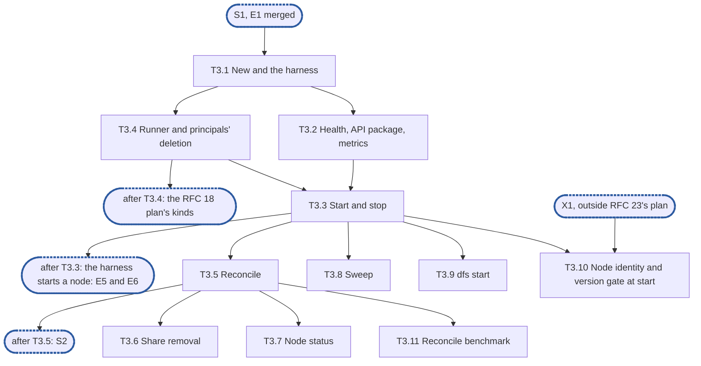

# Epic 3: control plane v2 — the node

**Sources:** [RFC 23](../docs/internals/rfcs/rfc-23-control-plane.md) §2 (the start command), §2.1 to §2.5 on one
node, §3.2's delete and §3.5's user and group deletion driven past the mark, §4.6's operation
runner on one node, §8.1's rows not marked cluster, §10's CP1, CP3, CP4, CP12, CP13 and CP16, and
§11's `node_` series; [RFC 16](../docs/internals/rfcs/rfc-16-metadata-store.md) §2.3.2 (a share's removal, its
coordinator) and §3 (the views the node reads); [RFC 8](../docs/internals/rfcs/rfc-8-engine.md) §2.1 and §2.6, the
root's duties; [RFC 25](../docs/internals/rfcs/rfc-25-observability.md) §3.5 and §3.6, the parts the node's
loops and readiness need; [RFC 13](../docs/internals/rfcs/rfc-13-configuration.md) §2.2 and
[RFC 28](../docs/internals/rfcs/rfc-28-journal-format.md) §2.1 as a consumer of the node identity.
**Track:** A.
**Epic 3 estimate: 11 subtasks, 30 man-days.**
**Depends on:** S1 (E1 merged): the node's surface (`New`, `Node`, `Config`, `Start`, `Stop`) and
its export pin, and `dfs start` over the stub. E2 provides what the node reads and writes: the
counters, the node and node-status records through its node view, the operation record, its
running index and `Write`, the expiry sweep, and the user's, group's and share's removal past the
mark. The RFC 13 plan's epic 1 provides `pkg/bootstrap` with RFC 13 §2.2's facts, which only
T3.9 reads; X1 (that plan's epic 2) provides `WriteMissingNodeIDs` and the version gate, which only T3.10 calls.
**Blocks:** E4, which adds its routes, TLS and the local socket to the `internal/node/api` this
epic creates; E5, partly, whose signed-in callers extend the harness; E6, partly, whose tests run
against the harness's node; E7, which runs every row on the node `New` builds; RFC 20's plan's epic
7 at S2, which writes the adapter rows into reconcile; the RFC 13 plan's S3, the `apply` slot X3
fills; the RFC 18 plan's epics 2, 5 and 7, whose operation kinds run on the runner, and its epic 8,
which composes identity into `New` and whose T8.3, a change applied at once on the node that wrote
it, relies on T3.5's `Deps.Applied` (D16).

---

## 1. Goal

`node.New` composes what the journal-only engine runs on, and the node starts, reconciles, reports
and stops as RFC 23 §2 says, on one node. `dfs start` becomes a working server that serves its
health and drives its records, with no adapter yet.

**At the end of the epic:**

- `New` opens the metadata store and builds open state, the engine and `*vfs.Filesystem`, each
  empty from its own `Deps`, and starts nothing;
- `Start` and `Stop` run RFC 23 §2.2's steps in order, undo a failed start in reverse, and bound
  every stop step on the node's clock;
- reconcile reads the counters once a second, binds and unbinds shares, refuses a share with no
  remote store, and calls an `apply` slot the RFC 13 plan fills;
- the node writes its status at most once a second and only on a change, and exports the `node_`
  series and the lag that feeds `config_generation_behind`;
- `internal/node/api` serves `/health/live` and `/health/ready`, and the metrics listener serves
  the registry, from start step 2;
- the operation runner resumes every running operation at start and runs a step function per kind,
  handed it by `New`;
- a share's, a user's and a group's deletion runs past the mark to the end, resumed at start;
- the expiry sweep runs on the node's clock;
- `internal/node/nodetest` builds the node in process, over Badger in memory or under
  `t.TempDir()`, on an injected clock.

### 1.1 In scope

`New`'s composition and the root's adapters; start and stop; health, readiness and the metrics
listener, with the health evaluator and watchdog the node's loops need; `internal/node/api`'s
listener and two health rows, with the two architecture rules over that package; reconcile with
`addShare`, `removeShare` and the `apply` slot; the node-status writer and its series; the
operation runner; the deletions driven past the mark; the sweep; `dfs start` and its v1 refusal;
the journal's knowledge of `node-id`; the harness; the reconcile benchmark.

### 1.2 Out of scope

- The bootstrap's facts and their loading: the RFC 13 plan's epic 1 (`pkg/bootstrap`, RFC 13
  §2.2's facts, the default API address `127.0.0.1:8080` the `HEALTHCHECK` names). Tests fill
  `node.Config` directly (D1).
- The syncer, the remote clients and GC, and their start and stop steps: rows of
  [the deferral ledger](rfc-23-control-plane-plan.md#61-deferral-ledger). No remote client is
  built here (D5).
- Identity: the RFC 18 plan's epic 8 composes it into `New` and hands `apply`'s principals
  generation to it.
- The adapters and sidecars, their factories, their rows in reconcile, start step 9 and stop step
  2: RFC 20's plan's epic 7, which writes them into the `apply` slot at S2 and returns its
  refusals through it (D10); their e2e check is E8's.
- What `apply` does with a settings generation (`settings.Diff`, `Get`, restart-pending): the RFC 13
  plan's epic 5 (X3). RFC 23's own settings section (`api.session_lifetime`,
  `api.token_max_lifetime`, `audit.retention`) and its leaf package: E5 and X3 (D9).
- The management API's routes, `/api/v1/health`, `/api/v1`'s `503 starting` before step 7, TLS on
  the API address and the local socket: E4.
- The provisioning file read at start step 4: a row of the deferral ledger.
- Every namespace's `Claim`, `namespace_unclaimed` and the claim generation's reruns: a row of the
  deferral ledger; every namespace answers held (RFC 23's plan's §4.3).
- The runner's claim and its takeover, and every **(cluster)** step of §2.2: rows of the deferral
  ledger.
- The records, their codecs and the removal steps' store side: E2.

### 1.3 Names used here

- **E1**, epic 1, delete v1 and declare the surface: froze `internal/node`'s surface.
- **E2**, epic 2, store records: the counters, node records, operation record, sweep and removals
  past the mark.
- **E3**, this epic.
- **E4**, epic 4, the management API: routes, TLS, the write path, the client.
- **E5**, epic 5, accounts and sign-in: `dfs init`, sessions, tokens, roles.
- **E6**, epic 6, the CLI.
- **E7**, epic 7, **the integration epic**: RFC 23 §12's rows through the API on this node.
- **E8**, epic 8, e2e green.
- **S1**, E1 merged: v1 gone, the node's surface frozen.
- **S2**, this epic's checkpoint: the node starts and reconciles; RFC 20's plan's epic 7 starts.
- **S3**, adapters serve through the node, outside RFC 23's plan.
- **X1**, the RFC 13 plan's bootstrap and secrets, its epics 2 and 4; here, its node identity and version gate.
- **X3**, the RFC 13 plan's epic 5: `apply` filled on `settings.Diff` and `Get`.

## 2. How the general rules apply

The rules are those of
[RFC 23's plan, §1.5](rfc-23-control-plane-plan.md#15-general-rules-for-each-epic), cited by number
and title and not copied.

| Rule | Subtasks | How |
| --- | --- | --- |
| rule 1, independent unit tests ([`CLAUDE.md`, "Writing tests"](../CLAUDE.md#writing-tests)) | all | node tests are package `node_test` and build the node through `internal/node/nodetest` over Badger, in memory or under `t.TempDir()` (the KV RFC 16's suite holds), with `sim.TestClock` (kind 1) and `kvtest.FaultKV` (kind 3); records are written and read back through kvstore's views. The runner is tested in package `node` through `newRunner` over real Badger and a real step. No recording or counting fake (D11) |
| rule 2, fuzz every decoder of untrusted bytes | none | the node decodes nothing: records come through kvstore's codecs (E2), the health endpoints read no body |
| rule 3, observability follows RFC 25 | T3.2, T3.7, T3.8 | the engine's `Stats` as series through a collector read at scrape; the `node_` series, `config_generation_lag_seconds` and `config_generation_behind` from the positions; the sweep's idempotency deletions as `api_idempotency_records_deleted_total` |
| rule 4, profiling | all | `nodetest.Watch()` registers `prof.Watch` for a top-level test, so every node test fails on a goroutine, descriptor or heap growth left behind; subtests are never watched on their own. No allocation budget |
| rule 5, public interface and internals ([`CLAUDE.md`, "Verifying a change"](../CLAUDE.md#verifying-a-change)) | all | tests drive the node through `New`, `Start`, `Stop` and records, and assert at the consumer: the engine's series in `Config.Metrics`, a record read back, an answer on the listener (D11) |
| rule 6, known failures shrink | none | no test lands red and no suite here keeps a `known.yaml` |
| rule 7, v2 ignores v1 | T3.9 | nothing of v1 is read; the one touch is refusing its database file before the store opens |
| rule 8, real dependencies for properties of those dependencies ([`CLAUDE.md`, "Writing tests"](../CLAUDE.md#writing-tests)) | T3.3, T3.4, T3.6, T3.9 | a resumed deletion and a resumed operation restart a node over the same Badger and journal directories; listeners are real, on `127.0.0.1:0`; `dfs start` runs as a child process |
| rule 9, code comment conventions ([`CLAUDE.md`, "Code comments"](../CLAUDE.md#code-comments)) | T3.1–T3.6 | RFC 23's notes at their sites: §2.1's two `decision:` notes at `New` and `Start`, and T3.1's two at `New` (another installation's KV, one build per metrics registry), §2.5's at the metrics listener, §2.1's and §2.4's `ponytail:` notes at `New` and the status writer; RFC 23's plan's §4.3 `ponytail:` notes (every namespace held, the runner's missing claim, the health registry's reach); D5's, D6's, D7's and D8's markers |
| rule 10, a test must be able to fail | all | each test names the requirement it catches; where the code holds a requirement by construction, or another epic's test holds it, the row names that |
| rule 11, a symbol is exported only if RFC 23's interface uses it | all | `internal/node` keeps E1's five exports, which its pin holds; `internal/node/api` exports `New`, `Deps`, whose fields E4 adds to, and `Server` with `Start` and `Stop`, pinned by an export test; `nodetest` is the harness RFC 23 names; `pkg/health` gains RFC 25 §8.2's `Source` and evaluator and the watchdog the node and the API share; `internal/node/step` exports the three step types outside steps need (D7); `pkg/openstate` gains the engine's `CloneHold` adapter (D12) and `pkg/block/engine` `JournalOf` (D17) |
| rule 12, each subtask creates only what it declares | all | each package lands with its first `_test.go`, which `lint-repo`'s new-package check requires; no remote client, factory or settings package is built for a consumer outside this epic (D5, D9) |

## 3. Requirements and invariants

Every obligation RFC 23, RFC 16, RFC 8, RFC 25 and RFC 23's plan place on this epic, numbered so
that subtasks and tests can cite them.

**The start command**

| # | Requirement | Kind | Source | Subtasks |
| --- | --- | --- | --- | --- |
| R1 | The start command reads the host's bootstrap, builds the `Config` from it, calls `New`, then `Start`; an error from either is printed naming the step that failed and exits non-zero; on a termination signal it calls `Stop` and exits zero when every stop step completed, non-zero naming the step that missed its bound | MUST | RFC 23 §2 | T3.9 |
| R2 | The start command reads no record and builds no component | invariant | RFC 23 §2 | T3.9 |
| R3 | A start that finds v1's control-plane database, `controlplane.db`, refuses before the store opens and names it | MUST | RFC 23 plan §1.1, §1.4; RFC 23 §2.2 (step 1) | T3.9 |

**Composition**

| # | Requirement | Kind | Source | Subtasks |
| --- | --- | --- | --- | --- |
| R4 | `New` is the one composition root: it builds every component of RFC 23 §2.1's table the journal-only engine runs on, each from its own `Deps`, in the table's order, opens only the metadata store, and starts nothing | MUST | RFC 23 §2.1; CP1 | T3.1 |
| R5 | No constructor takes settings: each component's first settings arrive through its `Apply`, which the node calls once it has read the records and before that component's `Start` | MUST | RFC 23 §2.1, §2.2 (step 4) | T3.3 |
| R6 | After start only the node starts, changes or stops a component, and only from records; the node closes what it built | invariant | RFC 23 §2.1; CP1 | T3.1, T3.3 |
| R7 | The node builds no journal: the engine opens each device's journal through the opener `New` passes | invariant | RFC 23 §2.1 | T3.1 |
| R8 | The engine reaches open state only through the root's adapter of `CloneHold` onto `CloneOpen`, `CloneClose` and `Served`, so the engine imports no open state | MUST | RFC 23 §2.1 (table row 5); RFC 8 §2.6 | T3.1 |
| R9 | The node exports `New`, `Start` and `Stop` only, and is not restartable: a second `Start` is an error | MUST | RFC 23 §2.1 (its decision) | T3.3 |
| R10 | The root refuses to add a share whose configuration names no remote block store, with an error naming the share, and reports it refused | MUST | RFC 8 §2.1; RFC 23 §2.4 | T3.5 |
| R48 | Start refuses a missing or foreign installation as `metadata.Open` reads the format record; a start creates no installation | MUST | RFC 23 §2.2 (step 1); RFC 13 §2.2 | T3.1 |
| R49 | No package under `internal/node` but `node` itself imports a component's implementation; the allow-list is D3's, which holds data and wire types and not `nodetest` | MUST NOT | RFC 23 CP16; RFC 23 plan §1.3; D3 | T3.2 |
| R50 | `internal/node/api` reaches the store's writes only through `Write`, so every change commits with its audit record | invariant | RFC 23 CP12; RFC 23 plan §1.3 | T3.2 |

**Start and stop**

| # | Requirement | Kind | Source | Subtasks |
| --- | --- | --- | --- | --- |
| R11 | `Start` runs its steps in order, each completing before the next: refuse, open the listeners, register the node, read the records and apply them, start open state and the engine, start the filesystem and join interrupted removals, start the runner, complete the first full reconcile, then reconcile until `Stop`; step 9, the adapters, is RFC 20's plan's epic 7 | MUST | RFC 23 §2.2 | T3.3 |
| R12 | Once the store is open, step 1 writes a missing `node-id` copy into each journal directory whose `format` names the journal the store records for this node and device, and into no other | MUST | RFC 23 §2.2 (step 1); RFC 13 §2.2 | T3.10 |
| R13 | From step 2 the health endpoints answer, live and not ready, and the metrics listener is open unless `metrics.listen` is `off` | MUST | RFC 23 §2.2 (step 2), §2.5 | T3.3 |
| R14 | Step 3 registers the node, with the binary's version ranges, before the engine's start transactions run; an active version outside them refuses the registration in its transaction, naming the format and both versions; a refused registration stops the node there, with no component started | MUST | RFC 23 §2.2 (step 3); RFC 13 §5.5 | T3.3, T3.10 |
| R15 | Step 5 starts open state with the built filesystem as its `Sink`, raising the node epoch, then the engine with the whole set of attached shares in one call | MUST | RFC 23 §2.2 (step 5); RFC 16 §3 | T3.3 |
| R16 | Step 6 starts `*vfs.Filesystem`, then runs step 3 of every removal a crash interrupted, `JoinShare` then `DropShare`, before any adapter serves | MUST | RFC 23 §2.2 (step 6); RFC 16 §2.3.2 | T3.6 |
| R17 | Step 7 starts the operation runner, which resumes the operations this node holds | MUST | RFC 23 §2.2 (step 7), §4.6 | T3.4 |
| R18 | No adapter starts before the first full reconcile completes | withdrawn | RFC 23 §2.2 (steps 8, 9): this epic builds no adapter; RFC 20's plan's epic 7 and E8 own it | — |
| R19 | Readiness turns true once every adapter the records enable is serving or was refused at configured; with none enabled, once the first full reconcile completes | MUST | RFC 23 §2.2 | T3.3 |
| R20 | A failure at any start step stops the start, closes what earlier steps opened in reverse but the health listener and the store, raises `start_failed` and leaves `/health/ready` answering `not_ready`; `Stop` then closes the health listener just before the store | MUST | RFC 23 §2.2; RFC 25 §3.6 | T3.3 |
| R21 | `Stop` turns readiness false and stops reconcile, then the runner (each operation left at its last durable step), the filesystem (`Drain`, then `Stop`), the API's calls, identity (a slot the RFC 18 plan's epic 8 fills), the engine, open state after the engine, the health listener, and the metadata store last | MUST | RFC 23 §2.2; CP4 | T3.3 |
| R22 | The store outlives everything; that the API outlives the adapters is RFC 20's plan's epic 7's, which inserts their stop before the API's | invariant | CP4 | T3.3 |
| R23 | A stop step that misses its bound leaves open every component a later step would close under it, goes on to the steps that do not depend on it, and the error names the step | MUST | RFC 23 §2.2, §8.1 | T3.3, T3.9 |

**Reconcile**

| # | Requirement | Kind | Source | Subtasks |
| --- | --- | --- | --- | --- |
| R24 | The node learns of changes only by reading the settings generation, the share list version, the principals generation and the claim generation once a second, or when its own write wakes it (R54), never from the API request that made them | MUST | RFC 23 §2.3 (as amended by A8), §8 | T3.5 |
| R25 | A reconcile step is idempotent: run twice on the same records it does nothing the second time | invariant | RFC 23 §2.3 | T3.5 |
| R26 | The node runs a full reconcile at start and after any read of the store that failed, listing records by kind in pages, and keeps its running set while the store is unreachable | MUST | RFC 23 §2.3, §8.1 | T3.5 |
| R27 | A share created is `addShare`, a storage binding in the engine; a share removed is `removeShare` at the step its removal names; a share's state changed moves its binding to quiescing and back | MUST | RFC 23 §2.3 | T3.5, T3.6 |
| R28 | Every row of RFC 23 §2.3's table is one of `addShare`, `removeShare` and `apply`; a grant or an export policy calls nothing | MUST | RFC 23 §2.3 | T3.5 |
| R29 | A record that does not validate when its component is built stops only what it configures, and the node reports it refused, keeping the old component where one was serving | MUST | RFC 23 §2.3, §8.1 | T3.5 |
| R54 | After a write on this node commits, `Deps.Applied` reads the counters, wakes reconcile, which runs a new pass after the one running if any, and returns only once the reconciled-through settings and principals positions cover what it read, never on a pass that read the counters first, or when its context ends | MUST, MUST NOT | RFC 23 §2.3 (as amended by A8), §2.4; RFC 18 §2.6 | T3.5 |

**What a node reports**

| # | Requirement | Kind | Source | Subtasks |
| --- | --- | --- | --- | --- |
| R30 | The node writes its node-status record at most once a second and only when a value changed | MUST | RFC 23 §2.4 | T3.7 |
| R31 | The status holds, per counter, the highest value through which the node has acted on every change (applied, refused or restart-pending), the refused records each with its generation and error, the restart-pending set and its health conditions; the secret versions are the RFC 13 plan's to fill | MUST | RFC 23 §2.4; CP3 | T3.7 |
| R32 | The node acts on changes in counter order and lists every change it did not apply, so a reconciled position is a high-water mark | invariant | RFC 23 §2.4; CP3 | T3.5, T3.7 |
| R33 | The node exports `node_reconciled_position{kind}`, `node_reconcile_errors_total{kind}` and `node_restart_pending`, and from its positions `config_generation_lag_seconds{kind}` and the `config_generation_behind` condition | MUST | RFC 23 §11; RFC 23 plan §1.5 rule 3 | T3.7 |

**Health**

| # | Requirement | Kind | Source | Subtasks |
| --- | --- | --- | --- | --- |
| R34 | `/health/live` answers `200` with `live` while the watchdog holds and `503` with `stalled` otherwise; `/health/ready` answers `200` when ready and `503` when not, with one of `ready`, `starting`, `draining`, `not_ready`; any other path answers `404` with `not_found`; neither asks for authentication | MUST | RFC 23 §2.5; D3 | T3.2 |
| R35 | The unauthenticated endpoints carry nothing but that one word | MUST NOT | RFC 23 §2.5; CP13 | T3.2 |
| R36 | The metrics listener has an address of its own, separate from the API's, asks for no token, and opens at start step 2, unless `metrics.listen` is `off` | MUST | RFC 23 §2.5 | T3.2, T3.3 |
| R37 | Liveness fails only when a watched loop has neither completed a turn nor reported idle within 60 s; a waiting loop reports at least every 30 s; liveness reads no condition, store, network or disk. Watched here: reconcile, the runner, the sweep and the status writer, each bounding its store calls under 30 s | MUST | RFC 25 §3.5 | T3.2, T3.5 |
| R38 | The engine's `Stats` reach the health evaluator as conditions and the metrics registry as series; T3.2 delivers the engine's adapter, tested, and the evaluator's wiring lands with its first reader | MUST | RFC 23 plan §5 epic 3; RFC 8 §2.6 | T3.2, T3.3, T3.7 |
| R51 | A stalled watchdog makes the node neither live nor ready | MUST | RFC 25 §3.6 | T3.2 |

**Operations and deletions**

| # | Requirement | Kind | Source | Subtasks |
| --- | --- | --- | --- | --- |
| R39 | Work no component drives on its own is driven by the operation runner; each kind records its steps durably and makes each idempotent | MUST | RFC 23 §4.6 | T3.4 |
| R40 | The operation record chooses no driver for work its owner drives, and its progress is read from the owner's durable cursor | MUST NOT | RFC 23 §4.6; CP7 | T3.4, T3.6 |
| R41 | Every state change and every phase change of an operation the runner records commits through `Write` with its audit record | MUST | RFC 23 §6; RFC 16 §3 | T3.4 |
| R42 | A share's deletion is driven past the mark to its end and resumed at start; its operation ends when the removal does | MUST | RFC 23 §3.2, §4.6; RFC 16 §2.3.2 | T3.6 |
| R52 | An operation's last step can write in the transaction that ends it, as `identity.nt-hash-delete`'s sets `Installation.NTLMOff`'s `Deleted`; a failed end commits neither the end nor its writes | MUST | RFC 23 §4.1 | T3.4 |
| R53 | A failed operation carries its owner's error, a succeeded one its result, and its progress is read from the owner's cursor | MUST | RFC 23 §4.6 | T3.4 |
| R43 | A user's or a group's deletion drops its grants, memberships and quotas in batches from the mark, resumed at start; its operation ends when the batches do | MUST | RFC 23 §3.5; RFC 16 §3 | T3.4 |

**The sweep, the journal and the bound**

| # | Requirement | Kind | Source | Subtasks |
| --- | --- | --- | --- | --- |
| R44 | RFC 23's own section as a typed struct with defaults and `Validate` | withdrawn | moved to E5 and X3 (D9) | — |
| R45 | The node runs the expiry sweep with the audit retention and exports its idempotency deletions as `api_idempotency_records_deleted_total` | MUST | RFC 23 §6, §11; RFC 23 plan §5 epic 3 | T3.8 |
| R46 | A journal's attach knows `node-id` and `node-id.tmp` as its own files, and neither logs nor refuses them as unrecognised | MUST | RFC 28 §2.1; RFC 23 plan §5 epic 3 | T3.10 |
| R47 | A live change reaches the node within 5 s, measured by a full reconcile at 10⁴ shares, cold and under steady share churn | bound | RFC 23 §8; RFC 23 plan O6 | T3.11 |

## 4. Decisions this epic takes

- **D1, the node reads no bootstrap file until the start command does.** The user's decision.
  `node.Config.Bootstrap` takes `pkg/bootstrap`'s type from the RFC 13 plan's epic 1, which holds
  RFC 13 §2.2's facts (the node's identity, the store, the devices, the listen addresses) and
  names the default API address `127.0.0.1:8080`. Until that loader reads them, E3 adds two host-set fields
  to the bootstrap type, `Node` and `Devices`, tagged so the file loader never reads them, with a
  `ponytail:` naming the RFC 13 plan's loader as their reader; the host sets both before it builds
  the node. Tests fill `node.Config` directly, so only T3.9 reads a file and waits for that epic;
  X1 gates only T3.10.
- **D2, one production clock, in the start command.** No production `engine.Clock` exists: tests
  use `sim.TestClock`. T3.9 adds `systemClock` in `cmd/dfs/commands`, `time.Now`, a monotonic
  origin and `time.After`, where RFC 23 §2's sketch builds one. No marker.
- **D3, `internal/node/api` lands here with its listener and the two health rows.** The user's
  decision. RFC 23 §2.5 serves health on the API's address from start step 2. T3.2 creates the
  package with `New(Deps)`, the plain listener, `/health/live`, `/health/ready` and `404`
  elsewhere; E4 adds `Deps` fields, TLS, the local socket and every route. The two architecture
  rules over the package (R49, R50) land with it; `internal/node/nodetest`, which imports Badger,
  kvstore and the journal to build an installation, is the harness RFC 23 names and is outside
  R49's tree, as `node` is. R49's allow-list is `pkg/health`, `pkg/metrics`, `pkg/metadata/entity`
  and `pkg/node/apiv1`, since data and wire types are not implementations, and the packages under
  `internal/node` but `nodetest`. A stalled watchdog answers `/health/live` `503` with `stalled`,
  and every other path `404` with `not_found`, one word as the probes' others are. No marker.
  Prior art: none needed.
- **D4, `pkg/health` takes RFC 25 §8.2's shape; readiness and liveness are functions.**
  `pkg/health` gains `Condition`, the `Source` interface (`Conditions(dst []Condition)
  []Condition`) and an `Evaluator` with `Add(Source)` and `Remove(Source)`, which reads every
  source when asked, so a component publishes its conditions without a goroutine pushing them; and
  a `Watchdog` on its own `Now`/`After` interface, handing out a `Loop` per watched loop. The
  engine's `Stats` become a `Source` through the root's adapter; the RFC 18 plan's epic 8 adds
  identity's `(*Server).Conditions` the same way. The API's `Deps` take `Ready() string` and
  `Live() bool`, which the node implements from its start and stop state and the watchdog. RFC
  23's plan's §4.3 `ponytail:` at the evaluator: only the sources this epic adds, and the engine's
  work scheduler and RFC 25's health evaluator loop are not watched. Prior art: Kubernetes'
  `healthz` checks (from memory).
- **D5, no remote client is built; the refusal reads the record.** The user's decision. RFC 8
  §2.1's refusal needs to know that a share's namespace names a remote store, not a client of it:
  nothing in the journal-only engine calls one. So `addShare` checks the record and builds
  nothing, and a `ponytail:` at `addShare` names RFC 8's second part as the trigger for the
  registry. Which record names a namespace's remote store is a dependency of T3.5.
- **D6, every namespace answers held.** RFC 23's plan's §4.3 note, at `addShare`: no `Claim`, no
  `Fenced` binding, no `namespace_unclaimed`. Its upgrade path is RFC 27's `Claim` at step 5.
- **D7, the runner's step table is handed to it by `New`.** `newRunner(store, clock, steps)`, keyed
  on `entity.Operation`'s kind type, each row a `Step` and its `Progress`. The three types live in
  a leaf package, `internal/node/step`, importing only `entity` and `pkg/node/apiv1`, because a
  step defined outside `internal/node` (the RFC 18 plan's `identity.nt-hash-delete`, its epics 5
  and 7, and E5) cannot import `internal/node`, which imports it; an adapter in `New` would lose
  `End`. `internal/node` keeps E1's five exports:
  ```go
  type StepResult struct {
  	Next   []byte                               // the step's durable cursor, recorded as Operation.Step
  	Done   bool                                 // the work has ended
  	Result json.RawMessage                      // set with Done: Operation.Result
  	End    func(tx entity.ControlPlaneTx) error // set with Done: writes in the transaction that ends the operation
  }
  type Step func(ctx context.Context, op entity.Operation) (StepResult, error)
  type Progress func(ctx context.Context, op entity.Operation) apiv1.Progress // E4's operation read calls it
  ```
  `Progress` takes the operation, not its cursor: a share's deletion keeps its progress in the
  removal's own records, not in `Step` (D8, R40), so its `Progress` reads them, and E4's T4.6
  calls the same function. A runner-driven kind reads `op.Step`. A turn commits only when `Next`,
  the state or the phase differs from the record's: an unchanged turn writes
  nothing, so a step that waits (E5's signing-key rotation keeps its switch time in `Next`) costs no
  commit per second. `Done` commits `succeeded`, `Result` and `End`'s writes in one `Write` with its
  audit record; an `End` that fails commits none of them, and the operation stays `running` for the
  next turn. An error wrapping `ErrStepFailed`, or a `*apiv1.Problem`, fails the operation with
  that error as `Operation.Error`; any other error is retried with the same `Next` on D10's
  backoff. `New` writes the rows this epic owns; the RFC 18 plan's epics 2, 5 and 7 and E5 provide
  step functions, which the RFC 18 plan's epic 8 and E5 register in `New`. An operation whose kind
  has no row stays `pending`, so a binary that gains the step later runs it; a `decision:` marker
  says so. The runner keeps the kinds it found with no row, and `refusedKinds()` hands them to
  T3.7, which reports them in node status. Each turn the runner pages through E2's
  running-operations index (`RunningOperations`) and drives every operation in it, so a restart
  resumes them and a new one is picked up at the next turn; a `ponytail:` names its ceiling, one
  page-through of the running index per turn, and its upgrade, a cursor or a wake-up per
  operation, once that shows in a profile. A state change is audited, and so is a phase change:
  when the phase the row's `Progress` reads before a step differs from the one it reads after, the
  turn's commit carries an audit record naming both (RFC 23 §6's "started, each phase, ended").
  RFC 23's plan's §4.3 `ponytail:`: no claim. Prior art: TrueNAS' job manager (from memory).
- **D8, one `removeShare`, two callers; the cursor is the owner's record.** RFC 23 §4.6 lets the
  operation record choose no driver and read progress from the owner's cursor. On one node the
  runner is the coordinator RFC 16 §2.3.2 names. Step 3 of a share's removal is one function,
  `removeShare`, called only by the share deletion's runner step while serving and by start step
  6 after a crash; reconcile never binds a share whose removal is marked and never calls it. Each
  deletion's step calls E2's continuation once per batch and keeps nothing in `Step`. A share
  deletion's turn calls `ContinueRemoval` first and runs step 3 only once it answers 3, so the
  driver acts on the step the record names rather than on its own count; a step asked before it is
  due (a shard's removal recorded, or its files dropped, before the record reaches that step)
  answers E2's exported `kvstore.ErrRemovalOrder`, which the runner retries. A
  `decision:` marker at `removeShare` names its two callers. Prior art: none needed.
- **D9, RFC 23's own section is not this epic's.** `internal/node/api/auth` may not import
  `internal/node/api` (RFC 23's plan's rule 11), so the section cannot live in the API package.
  It lands with its first reader in a leaf package both import, E5's and X3's to create. Until
  then the sweep takes RFC 23 §6's 90-day minimum as a constant. No marker.
- **D10, `apply` returns refusals; the loop owns the backoff.** `apply` returns each refused
  section with a retry flag. A read that failed, and a refusal flagged for retry (#4309's adapter
  refused while nothing serves), are retried on one backoff, 1 s doubling to 30 s, followed by a
  full pass; any other refusal waits for the next settings generation. RFC 20's plan's epic 7
  writes rows that return refusals and adds no loop of its own. No marker. Prior art: Kubernetes'
  controller requeue backoff (from memory).
- **D11, tests observe at the consumer through the surface E1 froze.** `Config` has five fields
  and `Node` two methods, and a package `node` test cannot import `nodetest`. So node tests are
  package `node_test` and observe through what the node publishes: the engine's `Stats`,
  registered as series in the injected `Config.Metrics` and read from its registry; records read
  back through kvstore's views; the API address the node bound on `127.0.0.1:0`, read from the
  `Node` record it registered. The runner, which needs no node, is tested in package `node` over
  real Badger with a real step. No marker.
- **D12, the engine's `CloneHold` adapter has one copy, in `pkg/openstate`.** `enginetest.Holds`
  adapts open state to `engine.CloneHold`, but `enginetest` is a test fixture whose package imports
  `testing`. Neither `engine` nor `openstate` imports the other, so the adapter moves unchanged to
  `openstate.EngineHolds`, which the node and `enginetest.Holds` both call. No marker.
- **D13, the node owns `cfg.KV`.** `Stop`, and a failed `Start`'s undo, close the KV after the
  store. `nodetest`'s `Restart` stops the node and opens a new KV over the same directory. No
  marker.
- **D14, stop bounds are fixed and on the node's clock.** Each stop step waits at most 30 s on
  `cfg.Clock.After`; RFC 23 sets the drain deadline but no per-step figure. Tests advance the
  injected clock. A `ponytail:` at the bound names a setting as its upgrade, once an operator needs
  one.
- **D15, the filesystem's own removal join goes with its owner.** `internal/vfs`'s `removeShare`
  and its `Start` drop carry a `ponytail:` naming the node's removal driver as their replacement.
  T3.6 is that driver, so both go in the same pull request, with the marker.
- **D16, the writer's wait is a wake and a wait on the positions, in `New`** (RFC 23 §2.3 as its
  plan's A8 amends it). `api.Deps` gains `Applied func(ctx context.Context) error`, which `New`
  fills with the node's: it reads `Nodes.Counters` after the commit, sends on reconcile's one-slot
  wake channel, which a running pass leaves set so the loop runs again as soon as it ends, and waits
  on the in-memory reconciled-through settings and principals positions, signalled each time a
  pass moves them, until they cover the two counters it read or its context ends, then returning
  `ctx.Err()`. It joins no running pass and runs none itself: a pass that read the counters before
  the commit cannot raise the positions that far. E4's write adapter calls it and bounds the
  context (its D22); the RFC 18 plan's epic 8's T8.3 relies on it. `export_test.go` gives
  `node_test` a per-node pause after a pass's counters read, the positions held in memory and
  `Applied` itself, answering with the positions it returned on, which E4's T4.4 and that T8.3 use
  too. No marker. Prior art: read-your-writes in session-consistent stores, such as MongoDB's
  causal sessions (from memory).

- **D17, `engine.JournalOf` has one copy, in `pkg/block/engine`.** The node's journal opener
  returns `journal.Open`'s journal as the engine's `Journal`, which `enginetest`'s adapter did; for
  D12's reason, a test fixture importing `testing`, it moves to `pkg/block/engine`'s `JournalOf`,
  which the node and `enginetest` both call. No marker.

- **D18, the node and `enginetest` build the engine through one `enginewire.Compose`.**
  `pkg/block/engine/enginewire.Compose(Params)` builds open state over the store and returns it
  with the engine's `Deps`: each device's journal opener over `journal.Open` and `JournalOf`
  (D17), the store's views, `openstate.EngineHolds` (D12) and a no-op `Tracer`. It opens and
  starts nothing. `node.New` and `enginetest` both call it, so the fixture the engine's tests run
  on is wired as the node ships it. That makes it the one composition code another package
  imports, a stated departure from RFC 8 §2.1 and RFC 23 §2.1's "nothing imports it". Only
  `internal/node` and `enginetest` may import it, and `node.go` calls it once and builds no
  `engine.Deps` literal; an architecture rule over the module pins both, each over a planted
  violation. Compose shares construction only: T3.3 shares the start and stop order of open
  state and the engine the same way, so the fixture runs the order the node ships. A `decision:`
  marker in the package says so. Prior art: none needed.

## 5. Target tree

```text
pkg/openstate/
  engineholds.go                           T3.1  EngineHolds, moved from enginetest (D12)
pkg/block/engine/
  journalof.go                             T3.1  JournalOf, moved from enginetest (D17)
pkg/block/engine/enginewire/
  enginewire.go                            T3.2  Compose, which the node and enginetest call (D18)
pkg/config/
  config.go                                T3.1  the bootstrap's host-set Node and Devices (D1)
internal/node/
  node.go                                  T3.1  New: opens the store, builds the services empty
  node_test.go                             T3.1  package node_test
  lifecycle.go                             T3.3  Start and Stop, undo, stop bounds (D14)
  runner.go, runner_test.go                T3.4  the runner and its step table (D7)
internal/node/step/
  step.go, step_test.go                    T3.4  StepResult, Step, Progress (D7)
  removal.go                               T3.4, T3.6  user, group and share deletions (D8)
  reconcile.go, shares.go                  T3.5  the loop, addShare, removeShare, apply (D10), Applied (D16)
  export_test.go                           T3.5  the pause after a counters read, the positions (D16)
  status.go                                T3.7  the status writer and the node_ series
  sweep.go                                 T3.8  the sweep loop
  arch_test.go                             T3.2  R49, R50; T3.9  R2
  reconcile_bench_test.go                  T3.11 the 10⁴-share benchmark
internal/node/api/
  server.go, health.go, server_test.go     T3.2  the listener and the two health rows (D3)
  export_test.go                           T3.2  the export pin (rule 11)
internal/node/nodetest/
  harness.go, harness_test.go              T3.1  New, WithNew, Watch, Restart, Node, Clock, Store
pkg/health/
  evaluator.go, watchdog.go                T3.2  sources, conditions and loops (D4)
internal/vfs/
  admission.go, filesystem.go              T3.6  the filesystem's own removal join deleted (D15)
cmd/dfs/commands/
  clock.go, start.go                       T3.9  systemClock, RFC 23 §2's run, the v1 refusal
pkg/block/journal/internal/format/
  names.go                                 T3.10 node-id and node-id.tmp known
Dockerfile                                 T3.9  HEALTHCHECK on http://localhost:8080/health/live
```

## 6. Subtasks

### T3.1 `New` and the harness

**Subtask T3.1 estimate: 3 man-days.**

- **Track:** A. **Depends on:** S1.
- **Covers:** R4, R6, R7, R8, R48.
- **Deliverables:**
  - `New` opens the metadata store with `kvstore.Open` over `cfg.KV`, then builds open state,
    the engine (`Node`, `Devices`, from the bootstrap's host-set fields (D1), the journal opener
    over `journal.Open` and `engine.JournalOf` (D17), the store's
    `Existence`, `Content` and `Lifecycle`, `openstate.EngineHolds`, `cfg.Clock`, a no-op
    `Tracer`, `cfg.Logger`) and `*vfs.Filesystem`, each from its own `Deps`, and starts nothing.
    A missing installation is refused by `kvstore.Open`. Another installation's KV is not
    refused by `New`, since nothing in `Config` names the installation to expect: `Start` refuses
    it when the engine opens a journal and `journal.Open` checks the journal's identity against the
    one the store records, a `decision:` at `New` naming the bootstrap's installation ID as the
    upgrade. A node is built once per metrics registry, since `Stop` does not unregister the
    filesystem's collectors, a `decision:` at `New` naming unregistering in `Stop` as the upgrade.
    RFC 23 §2.1's `ponytail:` at `New`;
  - `openstate.EngineHolds`, `enginetest.Holds`' adapter moved unchanged (D12), and
    `engine.JournalOf`, `enginetest`'s journal adapter moved (D17);
  - `internal/node/nodetest.New(t, opts...) *Harness`: an installation initialised with
    `kvstore.Init` and `journal.Init` under `t.TempDir()`, its journals recorded (E5's subtask
    that creates `internal/install` switches it to `install.Run`, which does what `dfs init` does,
    so the harness's installation is a real one), over Badger in
    memory or on disk, `sim.TestClock`, a `metrics.Registry`, a logger, the API and metrics
    addresses on `127.0.0.1:0`; `Watch()` for top-level tests; `Restart(t)`, which stops the node
    and builds a new one over a new KV on the same directories (D13); `WithNew(func(node.Config)
    (*node.Node, error))`, the constructor `New` and `Restart` build the node through, `node.New`
    when none is given, so a `node_test` test can hand it a constructor from `internal/node`'s
    `export_test.go` while `Config` stays at five fields; `Node()`, which returns the node built
    last, the new one after `Restart`; its own `harness_test.go`.
    Consumed by every later subtask, E5, E6 and E7.
- **Acceptance criteria:**
  - After `New`, the store is open and no journal, goroutine or listener exists.
  - `New` over a KV with no installation refuses and opens nothing; over another installation's,
    `Start` refuses when it opens a journal (the `decision:` at `New`).
  - A second `New` on one metrics registry is refused as a duplicate registration; the harness
    gives each build its own registry.
- **Tests:** in `node_test`, watched: `New` then `Stop` with no `Start`, the leak check passing
  (catches a component started by `New`, R4, R7); `New` over an empty KV refused (R48); in
  `openstate`, a clone's hold taken and released through `EngineHolds` against the real table
  (R8), the engine's own tests running unchanged through `enginetest.Holds`; in `nodetest`, a
  constructor handed to `WithNew` that calls `node.New` and keeps the nodes it returned, `Restart`
  building through it a second time and `Node()` returning that second node, not the first. R6's
  "closes what it built" is T3.3's.

### T3.4 The operation runner and the principals' deletion

**Subtask T3.4 estimate: 4 man-days.**

- **Track:** A. **Depends on:** T3.1.
- **Covers:** R39, R40, R41, R43, R52, R53.
- **Deliverables:** `newRunner(cp, clock, steps)` and its loop, D7's `StepResult`, `Step` and
  `Progress`: each turn it pages through E2's running-operations index and drives each operation
  in it (D7's `ponytail:`), so a new operation is picked up at the next turn; a turn commits
  through `ControlPlane.Write` only when `Next`, the state or the phase changed, with an audit
  record on a state change and on a phase change, the phase read through the row's `Progress`
  before and after the step (D7); `Done` commits `succeeded`, `Result` and `End` in one `Write`; a terminal error
  (`ErrStepFailed`, or a `*apiv1.Problem`) fails the operation with it as `Error`, any other is
  retried with the same `Next` on D10's backoff; `Stop` returning with each operation at its last
  durable step; a kind with no row left `pending` and kept for `refusedKinds()`, which T3.7 reads
  (D7's `decision:` marker, RFC 23's plan's §4.3 `ponytail:`). The user's and the group's deletion
  steps, each calling E2's `ContinueDelete` once per batch and ending when it answers done (D8),
  their rows in `New`, each with its `Progress`. Only a principal that is not marked, or a target
  that names no principal of the step's kind, fails a deletion; every other error, `kv.ErrTooLarge`
  included, is retried on D10's backoff, since a failed deletion is never resumed and a batch's
  size can change between turns; a `decision:` at the step says so. Consumed by T3.3 (start step 7 starts it, with its watchdog `Loop`), T3.6,
  E4 (its operation read calls each row's `Progress`; E2's record stores none), E5 and the RFC 18
  plan.
- **Acceptance criteria:**
  - A user deletion stopped between two batches resumes after a restart and ends `succeeded`,
    with no grant, membership, quota or secret of the user left.
  - A state change and its audit record commit together; an end and its `End` writes commit
    together or not at all.
- **Tests:** in package `node`, `newRunner` over Badger under `t.TempDir()` with the real user
  deletion step, asserting by durable state: the store closed and reopened between two batches,
  the operation resumed from the record and every row gone (catches a cursor kept in memory, R39,
  R40, R43; rule 8); a step returning the same `Next` twice committing once, the commits counted
  with `kv.Counting` around the KV (D7); a `FaultKV` error on a state change's commit, neither the
  state nor its audit record present (R41); the user deletion's step given an `End` that writes a
  setting, its commit faulted through `FaultKV`: the operation still `running` and the setting
  absent, then committed at the next turn (R52); a step's terminal error recorded as `Error` and
  the state `failed`, a plain error leaving the state `running` with the same `Step`, a `Result`
  read back (R53); a step whose phase moves while its `Next` stays committing once with an audit
  record naming both phases, and a turn whose phase stays writing none (R41); an operation of a
  kind with no row still `pending` after a turn and named by `refusedKinds()` (D7); an unmarked
  principal failing the deletion, and a `FaultKV` `kv.ErrTooLarge` leaving it `running` (D7). R17,
  start step 7 starting the runner, is T3.3's.

### T3.2 Health, the API package and the metrics listener

**Subtask T3.2 estimate: 3.5 man-days.**

- **Track:** A. **Depends on:** T3.1.
- **Covers:** R34, R35, R36, R37, R38, R49, R50, R51.
- **Deliverables:**
  - `pkg/health`: `Condition`, `Source`, `Evaluator` (`Add`, `Remove`, `Conditions`) and
    `Watchdog` on its own clock
    interface, `Loop(name)` with `Turn()` and `Idle()`, `Live()`, 60 s and 30 s, with RFC 23's
    plan's §4.3 `ponytail:` (D4);
  - `internal/node/api`: `New(Deps{Ready, Live, Addr, MetricsAddr, Metrics, Logger}) *Server`,
    `(*Server).Start` opening both listeners and reporting their bound addresses, `(*Server).Stop`,
    the three exports pinned by an export test (rule 11); `/health/live` and `/health/ready` writing
    one word, `stalled` for a stalled watchdog; every other path `404` `not_found` (D3); the metrics listener serving
    `(*metrics.Metrics).Handler()`; RFC 23 §2.5's `decision:` at it (D3);
  - the engine's adapter, its `Stats` as a collector read at scrape and its conditions as a
    `Source`, tested here; the adapter's registration in `Config.Metrics` and in the evaluator lands
    with the evaluator's first reader, T3.3's readiness or T3.7's status, whichever comes first;
  - in `internal/node/arch_test.go`, two rules beside E1's: no package under `internal/node` but
    `node` and `nodetest` imports a component's implementation, on D3's allow-list (R49), and no type `internal/node/api`
    uses has a method that writes the store but `Write` (R50), each over the module and a planted
    violation. Consumed by T3.3 and E4.
- **Acceptance criteria:**
  - Each readiness word answers its status; a watched loop silent for 61 s turns live to `503`
    and ready to `not_ready`; one reporting idle every 30 s keeps both.
  - The bodies hold one word, with no header but `Content-Type` and `Content-Length`.
- **Tests:** in `api`'s `server_test.go`, over listeners on `127.0.0.1:0`: each word and status,
  `stalled` and `not_found` included (R34); the export pin; the body and headers compared byte for byte, with a condition naming a share set in the
  registry (catches a name leaked, R35, CP13); the metrics listener on its own port with no token
  (R36); the engine's adapter answering the engine's series and conditions (R38); the watchdog on `sim.TestClock`, advanced, never slept
  (R37, R51); each architecture rule over its planted violation (R49, R50).

### T3.3 Start and stop

**Subtask T3.3 estimate: 4.5 man-days.**

- **Track:** A. **Depends on:** T3.2, T3.4.
- **Covers:** R5, R6, R9, R11, R13, R14, R15, R17, R19, R20, R21, R22, R23, R36, R38.
- **Deliverables:** `Start`: step 1 nothing more than `New` did (T3.10 adds the node identity);
  step 2 the API and metrics listeners; step 3 `Nodes.RegisterNode` with the bound addresses (T3.10 adds the version ranges and the gate); step
  4 the counters and records read, then `apply`, whose first call hands the engine RFC 13 Appendix
  B's defaults through `engine.Apply` (X3 later changes their source, not the call); step 5 open
  state started with the filesystem as `Sink` and its admission as `Order`, which raises the node
  epoch (`RegisterNode` reads it, as E2 has it), then the engine with every attached share in one
  call; a slot after step 4's `apply` and before step 6 where the RFC 18 plan's epic 8 starts identity,
  after its first `Apply` (RFC 18 §2.6), empty here; step 6 the filesystem; step 7 T3.4's runner started, with its watchdog `Loop` (R17); step 8 a full-reconcile slot T3.5
  fills; readiness `ready`. A failed step undoes the earlier ones in reverse but the health
  listener and the store, raises `start_failed`, and sets readiness `not_ready`. `Stop`: readiness
  `draining`, then the reverse, each step bounded on `cfg.Clock.After` (D14), a missed one leaving
  its dependents open and named in the error; the health listener closed just before the store,
  then the KV (D13). Open state's and the engine's start and stop order shared with `enginetest`
  the way D18 shares their construction, so the fixture runs the order the node ships. A second
  `Start` refused. RFC 23 §2.1's `decision:` at `Start`. T3.2's engine
  adapter registered in `Config.Metrics` and the evaluator if this subtask's readiness reads the
  evaluator; otherwise T3.7 registers it (R38). A follow-up pull request of this subtask, once
  E4's `Deps` fields exist (its T4.2–T4.8), fills the rest of `api.Deps` in `node.New`: `Store`
  and `Nodes` from the store's views, `Clock` from `cfg.Clock`, `Node` the node's ID, `Progress`
  from the runner's table (D7), `Health` the node's evaluator (`n.health`), `Applied` the node's
  (`n.applied`, D16), and `TLS` and `Socket` from the bootstrap, whose key names are the RFC 13
  plan's (RFC 23's plan's §6.1). Until it lands, the node's API answers as with those fields nil.
- **Acceptance criteria:**
  - The order of starts and stops is RFC 23 §2.2's for every component built.
  - A failure injected at each step a fault can reach leaves nothing open but the health listener
    and the store, readiness `not_ready`, and `start_failed` raised; `Stop` then closes both.
- **Tests:** in `node_test`, watched, each observed at its consumer (D11): the order read from
  the engine's series and records written by each step, with `/health/ready` answering
  `starting` until step 8 ends and the metrics listener answering from step 2, and a start with `metrics.listen: off` opening none and answering the rest (R11, R13, R15,
  R21, R22, R36); a clone after start succeeding, which the engine refuses with "no settings
  applied" unless step 4 applied its settings (R5); faults, each from what exists: step 2 a port
  the test holds, step 3 a `FaultKV` error on registration's commit (asserting no engine series,
  R14), step 4 a `FaultKV` read error, step 5 a `FaultKV` error on the epoch's commit, step 6 a
  `FaultKV` error on the filesystem's serve transaction, each with the undo's order and the health
  answer (R20); steps 1 and 8 have no fault of their own to reach and are held by T3.1's and T3.5's tests;
  an operation written through the store before start, driven after step 7 (R17); a stop step held past its bound by a `FaultKV` delay on a commit the runner's
  step makes, the clock advanced 30 s, the store still open and the error naming the step (R23);
  a second `Start` refused (R9); no adapter enabled, ready after step 8 (R19); every test watched
  (R6). R9's exports are E1's pin. The follow-up's test, in `node_test` over `nodetest` with a
  constructor from `export_test.go` that sets an `Authenticate` returning a fixed caller (an input,
  not a double): `GET /api/v1/health` through the node's own API answering the conditions the
  node's evaluator holds, and a share's `GET` answering from the store (catches a field left nil,
  which answers `503`).

### T3.5 Reconcile

**Subtask T3.5 estimate: 4.5 man-days.**

- **Track:** A. **Depends on:** T3.3, and on the record that names a namespace's remote store (E4's
  namespace resource and the RFC 13 plan's table settle which; E2 stores it).
- **Covers:** R10, R24, R25, R26, R27, R28, R29, R32, R37, R54.
- **Deliverables:** `reconcileLoop` on `cfg.Clock.After(time.Second)`, reading E2's `Counters` once
  per turn, with the full pass at start and after a failed read, listing shares page by page;
  `addShare` (the remote store's record checked, D5's `ponytail:`; the binding through
  `engine.Bind`; D6's `ponytail:`), never for a share whose removal is marked (D8), the state
  change through the binding; `apply`, the slot X3 fills, called only when the settings or
  principals generation moved, returning refusals with a retry flag, and D10's one backoff; the
  refused set with each record's generation and error; its watchdog `Loop`, each store call under
  a 20 s deadline on `cfg.Clock`; the wake channel, the positions' signal and `Applied`, which T3.3's follow-up hands to
  `api.Deps`, with D16's `export_test.go` pause and positions. Consumed by T3.6, T3.7,
  E4's write adapter, the RFC 18 plan's epic 8's T8.3 and, at S2, RFC 20's plan's epic 7.
- **Acceptance criteria:**
  - A share written through the store is bound within one turn; quiesced, its binding refuses new
    calls; resumed, it serves again.
  - A share whose namespace names no remote store is not bound, is in the refused set, and the
    error names it; one serving whose namespace loses its remote keeps serving and is refused.
  - A failed read leaves the running set as it was, and the next read that works runs a full pass.
- **Tests:** in `node_test`, watched, records written through kvstore's view and the clock
  advanced a second at a time, bindings read from the engine's series: create, quiesce and resume
  (R24, R27); two turns on the same records, the second changing no series or record (R25); more
  shares than one page of E2's listing, all bound (R26); a share with no remote, refused by name,
  beside a bound one (R10, R29, RFC 8's "§2.1 remote required" row); a serving share's namespace
  losing its remote, still bound and refused (R29); reads faulted through `FaultKV` for three turns
  while a share is created, the share bound at the first read that works and not before (R26); a
  refusal flagged for retry retried on the backoff, one not flagged waiting for the next generation
  (D10); a grant written, no series moved (R28); two changes applied in counter order (R32); a
  `FaultKV` delay on a store call, waited on the schedule's `sim.TestClock` and advanced past the
  20 s deadline, the call ended and liveness still `live`, never wall time (R37). In a test whose
  clock is never advanced, so only a wake starts a pass: a pass woken by a first `Applied` and held
  by D16's pause after its counters read; a user written through the view and a second `Applied`
  called; the held pass released; the next pass held at its own read, which shows the second wake
  started it after the running one; released, the second `Applied` returns, and the positions it
  returned on, which D16's `export_test.go` hands back with its answer, cover the counters read
  after the write (catches a waiter that joins the running pass, or a wake dropped while a pass
  runs, R54); with a pass held and not released, `Applied` under a context the test cancels
  returns `context.Canceled` (R54).

### T3.6 A share's removal driven

**Subtask T3.6 estimate: 3 man-days.**

- **Track:** A. **Depends on:** T3.3, T3.5.
- **Covers:** R16, R27, R40, R42.
- **Deliverables:** `removeShare`, step 3 for the share's shard (`engine.Unbind`, `JoinShare`,
  open state's `DropShare`, `engine.Drop`, recorded through E2's `RecordShardRemoval`), with D8's
  `decision:` marker naming its two callers; the share deletion's runner step, which calls E2's
  `ContinueRemoval` first each turn and acts on the step it answers: at 3 it calls `removeShare`
  while serving, at 4 E2's `ContinueShardRemoval`, once per batch to the end, never a step the
  record has not reached (D8); E2's `ErrRemovalOrder`, exported, retried; its `Progress` read from
  the removal's own records (D7); start
  step 6 calling it for every removal a crash left at step 3; `internal/vfs`'s own join and its
  `ponytail:` deleted in the same pull request (D15). An unbind clears the share from reconcile's
  bound set and from its refusals, so neither the running set nor the node status keeps a share
  that is gone. The filesystem's admission takes reconcile's running set, so a share reconcile
  refused is not served, where the filesystem would otherwise serve every listed share itself,
  refused or not; the `ponytail:` at `reconcileShares` saying so is removed here. Consumed by E4's share
  delete route.
- **Acceptance criteria:**
  - A share with files and an open file, deleted while serving, ends with no binding, no open
    state and no row but what RFC 16 §2.3.2's step 6 keeps; its operation `succeeded`.
  - A node killed after the mark and before step 3, then restarted, joins the share at step 6,
    before the runner starts.
- **Tests:** in `node_test`, watched, on disk: the deletion run through, the binding's series gone,
  the open's record gone and the share's rows read back gone (R27, R42); a restart between the
  mark and step 3, the shard's `rm` row recorded before `/health/ready` answers `ready` (R16); a
  restart during step 4's batches, the operation resumed and its progress read from the removal's
  record (R40); a shard's removal recorded before `ContinueRemoval` answers 3 refused with
  `ErrRemovalOrder`, the operation still `running` (D8); a refused share deleted, its refusal gone
  from the node status after the unbind, and a bound one deleted, gone from the running set (catches
  a set the unbind leaves stale); a share whose namespace names no remote store, refused by
  reconcile, its first call refused by admission (catches admission serving the share list in
  place of the running set).

### T3.7 Node status and its series

**Subtask T3.7 estimate: 2.5 man-days.**

- **Track:** A. **Depends on:** T3.5.
- **Covers:** R30, R31, R32, R33, R38.
- **Deliverables:** the status built from the reconciled positions, the refused and
  restart-pending sets, the operation kinds the runner has no step for (T3.4's `refusedKinds()`,
  each among the refused records naming its kind, the `ponytail:` at it removed) and the
  evaluator's conditions, each stored by name, scope, ID and subject without its cause or detail,
  whose text changes while the condition stands (`journal_full`'s figures) and would rewrite the
  status every turn; `GET /api/v1/health` serves them whole, live from the evaluator (E4's T4.6);
  the status compared by its canonical bytes and written
  through `Nodes.PutNodeStatus` at most once a second and only on a change, the last written moved
  only after a commit; RFC 23 §2.4's `ponytail:`; the `node_` series,
  `config_generation_lag_seconds{kind}` from the time a counter was first read above the reconciled
  position, and `config_generation_behind` raised when that lag passes 5 s; its watchdog `Loop`;
  T3.2's engine adapter registered in `Config.Metrics` and the evaluator, unless T3.3 did (R38),
  the engine's series read from the registry and its conditions in the status. Consumed by E4's
  `applied` and E7.
- **Acceptance criteria:**
  - Ten turns with nothing changed write the status once; a change writes it within the next turn.
  - A frozen apply raises `config_generation_behind` after 5 s on the clock and clears it once the
    position catches up.
- **Tests:** in `node_test`, watched, the status read back through `Nodes` (R30, R31); a write
  faulted through `FaultKV`, the next turn writing it again (catches the last written moved before
  the commit, R30); a section refused, the position still advancing past it and the refusal listed
  (R32); an operation of a kind with no step, its kind read back among the status's refused
  records (D7); the series read from `Config.Metrics`, the condition raised and cleared on the clock
  (R33).

### T3.8 The sweep

**Subtask T3.8 estimate: 1 man-days.**

- **Track:** A. **Depends on:** T3.3.
- **Covers:** R45.
- **Deliverables:** the sweep loop calling E2's `Nodes.Sweep` with a 90-day audit retention (D9),
  again at once while it answers `More`, else on the clock, with its watchdog `Loop`; the
  idempotency count exported. Consumed by E5, whose section replaces the constant.
- **Acceptance criteria:**
  - Expired records written through the store are gone after the clock passes their expiry and one
    sweep turn, and the series counts the idempotency ones.
- **Tests:** in `node_test`, watched: records past their expiry and the clock advanced, read back
  gone and the counter read from `Config.Metrics` (R45).

### T3.9 `dfs start`

**Subtask T3.9 estimate: 2 man-days.**

- **Track:** A. **Depends on:** T3.3, and on the RFC 13 plan's epic 1 (`pkg/bootstrap`).
- **Covers:** R1, R2, R3, R23.
- **Deliverables:** `runStart`: the bootstrap loaded; one `os.Stat` for `controlplane.db` in the
  bootstrap file's directory and at the operator's default `/data/controlplane/controlplane.db`,
  refusing naming the path, before the store opens (R3); `badgerkv.Open` at the bootstrap's store
  with the node's ID; `node.New` with `systemClock` (D2); `Start`; a wait for `SIGINT` or
  `SIGTERM`; `Stop`; each error printed naming its step, exit codes as R1 says; E1's `ponytail:`
  at the immediate `Stop` deleted; the bound addresses logged; an architecture rule that
  `cmd/dfs/commands/start.go` imports, of this module, only `internal/node`, `pkg/bootstrap`,
  `badgerkv` and `pkg/metrics` (R2); the `Dockerfile`'s `HEALTHCHECK` on
  `http://localhost:8080/health/live`, and `docker-compose.yml`'s on
  `http://localhost:8080/health/ready`; E4's T4.3 moves both to `https`. Consumed by E5's `dfs init` beside it
  and E7's server fixture.
- **Acceptance criteria:**
  - Over an initialised installation, `dfs start` answers `ready` and exits zero on `SIGTERM`.
  - Over a directory with no installation, or beside a `controlplane.db`, it exits non-zero naming
    the step or the path.
- **Tests:** the command run as a child process over an installation the test initialises under
  `t.TempDir()`, its bootstrap naming `127.0.0.1:0`, the bound address read from the child's log:
  ready, then `SIGTERM`, exit 0 (R1); no installation, exit non-zero and the step in its output
  (R1); a `controlplane.db` beside the bootstrap, refused naming it with no store directory created
  (R3); the exit code and message as a function of `Stop`'s error, in process, a step-bound error
  giving non-zero and the step's name (R23; the bound itself is T3.3's, on the injected clock); the
  architecture rule over a planted violation (R2).

### T3.10 The node identity and the version gate at start

**Subtask T3.10 estimate: 1 man-days.**

- **Track:** A. **Depends on:** T3.3, and on X1.
- **Covers:** R12, R14, R46.
- **Deliverables:** step 1 calling X1's `WriteMissingNodeIDs` with the store's `JournalID`, its one
  caller; step 3 registering through X1's version gate, its one caller, which writes the binary's
  ranges and refuses, in the registration's transaction, an active version outside them; `format.NameNodeID` and `NameNodeIDTmp` in the journal's name classification, so attach
  neither logs nor refuses them. Consumed by E5's `dfs init`, which writes the copies.
- **Acceptance criteria:**
  - A journal directory whose copy was removed gets it back at the next start; one whose journal
    the store does not record does not.
  - A journal directory holding `node-id` and `node-id.tmp` attaches with no unrecognised-file log
    line.
  - A start over an installation whose active journal format lies past the binary's range stops at
    step 3, naming the format and both versions, with no component started and the node record as
    it was.
- **Tests:** in `node_test`, on disk: a copy removed, a restart, the copy back (R12); a replaced
  device's empty directory left without one (R12); the journal's attach over a directory holding
  both files, its log captured through an injected `slog.Handler` (R46); the active journal format
  raised past the binary's range through kvstore, a start refused at step 3, no engine series and the
  node record unchanged (catches a start that skips the gate or commits the registration first, R14).

### T3.11 The reconcile benchmark

**Subtask T3.11 estimate: 1 man-days.**

- **Track:** A. **Depends on:** T3.5.
- **Covers:** R47.
- **Deliverables:** `BenchmarkReconcile` in the `manual` tier: a full pass at 10⁴ shares cold, and
  one change applied under steady share churn, timed from the counter's move to the binding, the
  setup before `b.ResetTimer()`, `b.ReportAllocs()`. Consumed by RFC 23's plan's O6.
- **Acceptance criteria:**
  - The report states both figures against RFC 23 §8's 5 s, from `-count=10` runs compared with
    `benchstat`.
- **Tests:** the benchmark is the measurement; a figure over the bound is a finding against R47,
  not a red test.

## 7. Order of work



Checkpoints: after T3.4 the RFC 18 plan's operation kinds have a runner; after T3.3 the harness builds, starts
and stops a node, and E5 and E6 start on it; after T3.5, S2: RFC 20's plan's epic 7
writes the adapter rows.

## 8. Suggested pull requests

| PR | Subtasks | Man-days | After | Why together |
| --- | --- | --- | --- | --- |
| 1 | T3.1, T3.4 | 7 | — | `New`, the harness and the runner with its first kinds: what the RFC 18 plan's and E5's steps wait on |
| 2 | T3.2, T3.3 | 8 | PR 1 | health, the API package, and start and stop in RFC 23 §2.2's order |
| 3 | T3.5, T3.6 | 7.5 | PR 2 | reconcile and the share's removal, with `vfs`'s own join deleted beside its owner (D15): S2 |
| 4 | T3.7, T3.8, T3.9, T3.10, T3.11 | 7.5 | PR 3 | status, sweep, `dfs start`, node identity, version gate and the benchmark: a working server |

A suggestion only: one pull request per subtask works as well.

## 9. Open points

- The container's probe is `/health/live` and docker-compose's `/health/ready` (T3.9, E4's T4.3).
  RFC 23's plan's D13 and the RFC 13 plan's epic 6 name `/health/ready` for the image's
  `HEALTHCHECK`; both should be brought in line through a pull request against each plan.

- What E3 reads from E2 is named by E2's final document (#4326): `Nodes.Counters`,
  `RegisterNode` and `PutNodeStatus`, `Operations`, `Sweep` with `More`, and the continuations
  `ContinueDelete`, `ContinueRemoval`, `ContinueShardRemoval` and `RecordShardRemoval`.
- The least certain estimates: T3.3, whose undo and stop bounds cross components whose `Stop`
  semantics differ, and T3.6, whose step 3 joins a share that is still serving.
- `nodetest.WithStep` is not built. A `node_test` test runs another package's step through the
  real runner in the harness by handing `WithNew` a constructor from `internal/node`'s
  `export_test.go` that adds the step to the unexported table, so `Config` stays at five fields.
  The step's own package cannot reach that file, so its owner tests the function over a real
  store, and through the runner once its registering epic (the RFC 18 plan's epic 8, E5) puts it
  in `New`.
