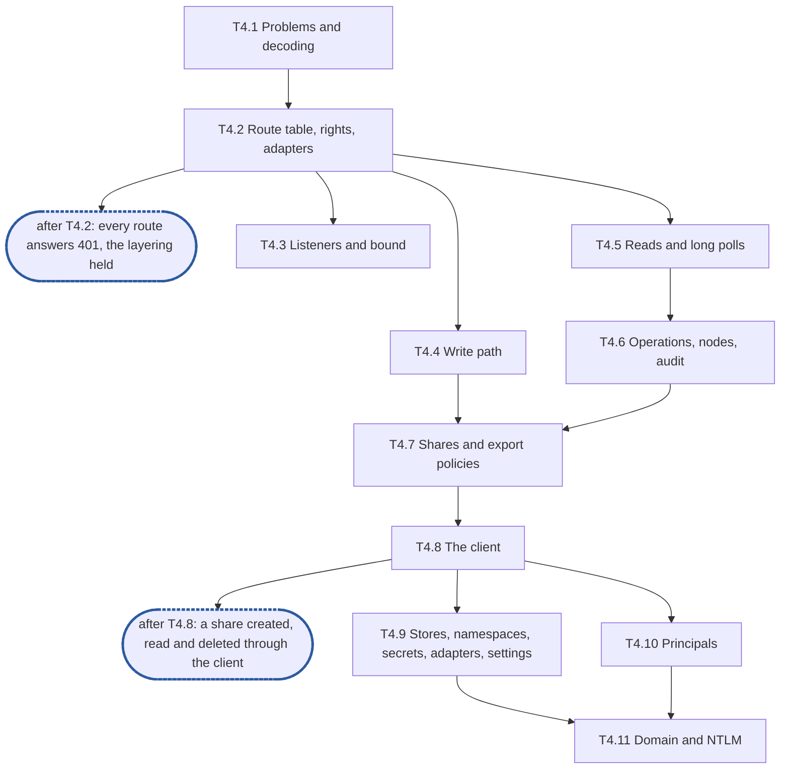

# Epic 4: control plane v2 — the management API

**Sources:** [RFC 23](../docs/internals/rfcs/rfc-23-control-plane.md) §3.1 (the resources, the write-only secret
among them), §3.2 (a share), §3.3 (stores and namespaces, without the deferred actions), §3.4
(adapters, with amendment A1), §3.5 (users, groups, grants, netgroups and the domain's actions),
§4.1–§4.4, §4.5 (the server side), §4.6 (reading and cancel), §4.7, §5.2 (the role table's shape),
§5.3 (Transport), §6 (the write and the read), §7 (the client's transport and core), §9 (discovery
and the client rules), §11 (the `api_` series), and §10's CP2, CP5, CP6, CP8, CP11, CP12 and CP16
on the API's side; [RFC 13](../docs/internals/rfcs/rfc-13-configuration.md) §6 and §7 as a caller;
[RFC 23's plan](rfc-23-control-plane-plan.md) D2, D5 and D14, and its amendment A8 to RFC 23 §2.3
(the writing node's wait).
**Track:** B.
**Epic 4 estimate: 11 subtasks, 37 man-days.**
**Depends on:** S1 (E1 merged): the shared wire types in `pkg/node/apiv1` and the node's surface. E2:
`ControlPlane.Write` with `entity.WriteMeta` and `entity.ControlPlaneTx`, `expect` on every write,
the idempotency, audit and operation records with their errors in `entity`, the operation record's
running index, the node view and its statuses, and the namespace record `NS‖ns‖info` with its index
`NSR‖store‖ns`: `Namespaces`, `PutNamespace` and `DeleteNamespace` on the view, and the tracked
reads `Namespace(id)` and `StoreNamed(store)` on `entity.ControlPlaneTx`. E3: `internal/node/api` with `New(Deps)`, its listener and health rows, `Deps.Ready`,
`Deps.Live` and the node's `Deps.Applied` (A8), the two architecture rules over the package, the operation runner, and
`internal/node/nodetest`. T4.11's success paths also wait on the RFC 18 plan's epics 6 and 7 for
identity's directory and join calls and their in-memory doubles, and on X1's `pkg/secrets`.
**Blocks:** E5, which fills `Deps.Authenticate` from `internal/node/api/auth`, adds its rights to the
role table and its routes to the route table on the call and write adapters; E6, which builds the
commands on `pkg/apiclient` and the wire types; E7, which runs RFC 23 §12's rows through these
routes; X3, which hands in the settings table this epic's routes call; the RFC 18 plan's epic 7,
which wires identity into `Deps` and drives the domain's operation kinds recorded here.

---

## 1. Goal

The management API answers every in-scope resource and action of RFC 23, changes nothing but
records, commits each change with its audit record in one transaction, and maps every error to a
status by one table. `pkg/apiclient` comes back as the one typed client of it.

**At the end of the epic:**

- one route table drives `net/http.ServeMux`; each row names a right, and every handler is a typed
  function behind one of five generic adapters (read, list, write, call, and write with an
  operation), none of which hands the handler an `http.ResponseWriter`;
- every request authenticates through `Deps.Authenticate`, nil until E5, so every route but the
  public ones answers `401`;
- every write runs inside `ControlPlane.Write` with its `If-Match`, `Idempotency-Key` and audit
  record; a step that needs a running component runs before `Write` and enters it as an input;
- shares, export policies, remote stores and their credentials, namespaces, adapters, settings,
  users, groups, grants, netgroups, quotas, operations, nodes, the audit and the domain's actions
  are served;
- the API is served over TLS on every address but loopback and on a local socket, bounded at 64
  calls and 256 parked polls;
- `pkg/apiclient` reaches the API over `https`, `http` on loopback or the local socket, with problem
  decoding, the `ETag` echoed, one idempotency key per command and the version check.

### 1.1 In scope

The route table, the role table's rights and the five adapters; `internal/node/api/auth` with
`Caller` and `CallerFrom` only; the problem table and its totality test; strict decoding, JSON merge
patch and the listing cursor; the API listeners, the call bound and the long polls; the write path
over `Write` and its pre-write step; each in-scope resource's routes and its spec and status wire
types; the write-only secret resource; the domain's routes and the `identity.ntlm` rule behind
interfaces the API declares; the client's core and its generic resource; the API's imports and calls
added to E3's two architecture rules; the `api_` series but the two authentication ones, and one
span per call; RFC 23 §4.3's amendment for the pre-write step.

### 1.2 Out of scope

- Authentication: sign-in, refresh, tokens, sessions, the per-call account check behind
  `Deps.Authenticate`, throttling, the role checks that read the target record (an account holding
  a role is `admin`'s, `last_admin`, a `viewer`'s view of another user's `email`), `:set-password`,
  `POST /auth/password`, `:rotate-signing-key`, `api_auth_failures_total`, `api_sign_ins_total`,
  and the token, session and sign-in wire types: E5, in `internal/node/api/auth`, on this epic's
  seam (D3).
- The settings table's checks, classes and per-node port rule: the RFC 13 plan's epic 5 (X3), which
  hands the table in; until then the empty table refuses (D4). The success paths of the routes it
  backs run in E7.
- The runner's steps for the domain's kinds and for `identity.nt-hash-delete`, and the wiring of
  identity into `Deps`: the RFC 18 plan's epics 2 and 7 for the steps, its epic 7 for
  `HoldJoinCredential`, and its epic 8, which composes identity into `node.New` and hands it to the
  API. The runner itself, the deletions it drives
  past the mark, the health rows and the two architecture rules: E3.
- `GET /nodes/{id}/connections`: its producer, each adapter's `Connections()`, is wired into the
  node by RFC 20's plan's epic 7, so the route lands with it; a row of
  [the deferral ledger](rfc-23-control-plane-plan.md#61-deferral-ledger) is proposed (§9).
- The bootstrap's key names for the API's certificate and key and its local socket's path, which
  T4.3 takes as `Deps.TLS` and `Deps.Socket`: the RFC 13 plan's `pkg/bootstrap`, a row of
  [the deferral ledger](rfc-23-control-plane-plan.md#61-deferral-ledger); E3's T3.3 follow-up
  fills both fields from the bootstrap.
- The CLI's commands, `login` and the generated reference: E6.
- RFC 23 §12's rows through a signed-in caller, the `identity.ntlm` rule's `202` and `409` through
  the settings route: E7.
- The deferred actions and resources (`rehome`, `accept-copy`, the index rebuilds,
  `acknowledge-unreadable`, `drain`, `decommission`, `raise-format`, snapshots, backups, moves), a
  remote store's credential rotation, a change of its endpoint, the provisioning file and the
  `managed` part, the event streams, client eviction, a watch and a new namespace's first claim:
  rows of the same ledger.

### 1.3 Names used here

- **E1**, epic 1, delete v1 and declare the surface: the shared wire types and the node's surface.
- **E2**, epic 2, store records: `Write`, `expect`, the idempotency, audit and operation records,
  the node view, the namespace record.
- **E3**, epic 3, the node: `node.New`, the operation runner, `internal/node/api`'s listener and
  health rows, the two architecture rules over it, the harness `internal/node/nodetest`.
- **E4**, this epic.
- **E5**, epic 5, accounts and sign-in: the rest of `internal/node/api/auth`.
- **E6**, epic 6, the CLI: `dfsctl`'s commands on `pkg/apiclient`.
- **E7**, epic 7, **the integration epic**: RFC 23 §12's single-node rows through the API.
- **S1**, E1 merged: v1 gone and the surface frozen.
- **X1**, the RFC 13 plan's bootstrap and secrets (`pkg/bootstrap`, `pkg/secrets`), outside RFC 23's
  plan.
- **X3**, the RFC 13 plan's epic 5, which hands in the settings table and wires `Check`, `Diff` and
  `Get`, outside RFC 23's plan.

## 2. How the general rules apply

The rules are those of
[RFC 23's plan, §1.5](rfc-23-control-plane-plan.md#15-general-rules-for-each-epic), cited by number
and title and not copied.

| Rule | Subtasks | How |
| --- | --- | --- |
| rule 1, independent unit tests ([`CLAUDE.md`, "Writing tests"](../CLAUDE.md#writing-tests)) | all | handler tests serve the production route table through `api.New` on a real listener on `127.0.0.1:0`, built by `internal/node/nodetest` over the in-memory KV, with `Deps.Authenticate` a function the test passes that returns a fixed caller, an input and not a double; the clock is `sim.TestClock`; the domain's success paths use the RFC 18 plan's in-memory directory and domain controller, held to their suites |
| rule 2, fuzz every decoder of untrusted bytes ([`CLAUDE.md`, "Writing tests"](../CLAUDE.md#writing-tests)) | T4.1 | one target each for the strict request decoder, JSON merge patch and the listing cursor, the cursor's asserting the key it yields lies within its listing's range |
| rule 3, observability follows RFC 25 | T4.2, T4.4, T4.6 | RFC 23 §11's `api_` series but the two authentication ones, `audit_records_total` counted after `Write` returns, one span per call |
| rule 4, profiling | all | `internal/node/api`'s `TestMain` runs the leak check over the package's tests, and every test that builds a node does so through the harness, which registers it too; no allocation budget |
| rule 5, public interface and internals ([`CLAUDE.md`, "Verifying a change"](../CLAUDE.md#verifying-a-change)) | all | tests assert the answer a client reads and the records the store holds after it, never a handler's return value |
| rule 6, known failures shrink | none | no test lands red and no suite here keeps a `known.yaml` |
| rule 7, v2 ignores v1 | none | v1's API was deleted at S1; nothing here reads it |
| rule 8, real dependencies for properties of those dependencies ([`CLAUDE.md`, "Writing tests"](../CLAUDE.md#writing-tests)) | T4.3, T4.4 | TLS on a real listener with a generated certificate; the all-or-nothing commit on Badger on disk with the commit faulted through `kvtest`'s `FaultKV` |
| rule 9, code comment conventions ([`CLAUDE.md`, "Code comments"](../CLAUDE.md#code-comments)) | T4.2–T4.4, T4.6, T4.7, T4.9 | RFC 23's notes at their sites: §4.3's `ponytail:` at the call bound and its pre-write `decision:` at the step, §4.1's and §4.4's `decision:` at the route table and the precondition check, §3.2's at share create; D6's `decision:` at the cursor, D7's `ponytail:` at the parked polls, D11's `decision:` at a remote store's location, D22's at the writer's wait |
| rule 10, a test must be able to fail | all | each test names the requirement it breaks on; a row held by construction or by an E2 or E3 test names it |
| rule 11, a symbol is exported only if RFC 23's interface uses it | all | `internal/node/api` exports `New` and `Deps` only; `internal/node/api/auth` gains `Caller` and `CallerFrom`, internal by rule 11; exported additions are `apiv1.Role`, each resource's wire types and `pkg/apiclient`'s client |
| rule 12, each subtask creates only what it declares | all | each wire type lands with the route that serves it; `auth` lands with its first consumer, the adapters; the client with its first consumer, T4.8's tests |

## 3. Requirements and invariants

Every obligation RFC 23 places on the API's server and client, and the ones RFC 23's plan sets for
this epic, numbered so that subtasks and tests can cite them.

**Shape and reads**

| # | Requirement | Kind | Source | Subtasks |
| --- | --- | --- | --- | --- |
| R1 | The API is under one prefix, `/api/v1`; every resource has one canonical path, paths take IDs and never names, and a name is found by a listing filter answering a list of zero or one | MUST | RFC 23 §4.1 | T4.2, T4.5 |
| R2 | A resource body has `id`, `generation`, `spec` and `status`; `spec` is the only part a write may change, and a write that sets a status field is refused | MUST | RFC 23 §4.1 | T4.4, T4.5 |
| R3 | An action that is not a field change is `POST` on `{resource}:{verb}`, and §4.1's table is all of them; the in-scope verbs here are `quiesce`, `resume`, `resolve-principal`, `test-directory`, `join-domain`, `rotate-machine-password` and `cancel` | MUST | RFC 23 §4.1 | T4.2, T4.6, T4.7, T4.11 |
| R4 | A read reads the metadata store, never a node's cache | invariant | RFC 23 §4.2, §8 | T4.5 |
| R5 | A listing pages by cursor: `?limit=` defaults to 100 and is at most 1,000, `?after=` is the opaque cursor the previous page returned, the page ends with `next` when more follow, and a cursor resumes from a key, never an offset | bound | RFC 23 §4.2 | T4.1, T4.5 |
| R6 | Filters are on indexed fields only (name, a share's namespace, an operation's state, a time range of audit records); a filter that would scan is not offered | MUST | RFC 23 §4.2 | T4.5 |
| R7 | A secret-bearing field reads as its reference and version, never its value; a secret is set, rotated and deleted, never read, each write authorized as its owning resource's | MUST, MUST NOT | RFC 23 §4.2, §3.1, §5.2 | T4.5, T4.9 |
| R8 | A listing page reads the node-status records once and computes every row's `applied` from them | MUST | RFC 23 §4.1 | T4.5 |

**Writes and preconditions**

| # | Requirement | Kind | Source | Subtasks |
| --- | --- | --- | --- | --- |
| R10 | Each method carries the precondition of §4.3's table: a create `POST` an `Idempotency-Key`, a `PUT` `If-Match` or `If-None-Match: *`, a `PATCH` `If-Match`, a `DELETE` both, an action `POST` an `Idempotency-Key` and `If-Match` when it changes the `spec` | MUST | RFC 23 §4.3 | T4.4 |
| R11 | One request is one transaction, `ControlPlane.Write`'s: its records, the generation they raise, its audit record and its idempotency record commit together or not at all; a write never answers success before it commits, and its transaction calls no running component | MUST, MUST NOT | RFC 23 §4.3 (as amended here), CP2 | T4.2, T4.4 |
| R12 | Validators are pure, handed in by the root as a table keyed by setting prefix, so the API imports no component; a prefix with no validator is refused `400` | MUST | RFC 23 §4.3 | T4.4, T4.9 |
| R13 | An unknown request field is refused `400`, naming the field | MUST | RFC 23 §4.3, §9 | T4.1 |
| R14 | `PATCH` is a JSON merge patch of `spec` (RFC 7396): a field present is set, `null` resets it to its default | MUST | RFC 23 §4.3 | T4.1, T4.4 |
| R15 | Every `PUT`, `PATCH` and `DELETE` carries `If-Match`: one without is refused `428`, one whose tag is not the current one `412` `generation_mismatch` with the current tag in the body; the `ETag` is the value the store's write takes as `expect`, compared only for equality | MUST | RFC 23 §4.4, CP5 | T4.4 |
| R16 | A `PUT` with `If-None-Match: *` creates a resource whose path the client names, and is refused `412` `generation_mismatch` with the record's tag if one exists; `If-Match` on an absent resource is `412` | MUST | RFC 23 §4.4 | T4.4 |
| R17 | The tag is checked inside the write's transaction, so two writes with one tag cannot both commit | invariant | RFC 23 §4.4, CP5 | T4.4 |
| R18 | A resource of several records takes its tag from the one its `spec` writes; a part a component changes is never in a `spec` | invariant | RFC 23 §4.4 | T4.7, T4.9 |
| R19 | Every `POST` and `DELETE` carries an `Idempotency-Key` of at most 255 bytes, except the credential calls: one without is refused `428`, a longer one `400` | MUST | RFC 23 §4.5 | T4.4 |
| R20 | A recorded key with the same digest (method, path, body) gets the recorded answer, its status, `Location`, `ETag` and body included, and changes nothing; another digest is refused `422` `idempotency_mismatch`, checked before validation and before preconditions; a refused request records nothing; a body that does not decode is refused before the key is read | MUST | RFC 23 §4.5, CP6 | T4.4 |
| R21 | A key is scoped to its account; a client reuses a key across its own retries of one action and never for a second action | MUST | RFC 23 §4.5 | T4.4, T4.8 |
| R22 | `join-domain`, online or offline, carries no `Idempotency-Key`, one being refused `400`, and keeps no idempotency record | MUST NOT | RFC 23 §4.5, §3.5 | T4.11 |
| R23 | A node runs at most 64 API calls at once and answers the next `503` with `Retry-After`; a long poll holds no call slot while parked, at most 256 are parked, and the next is `503`; API calls draw on none of the data path's pools | bound | RFC 23 §4.3 | T4.3, T4.5 |
| R64 | A step that needs a running component runs before the transaction and enters it as an input; one that fails refuses the write before anything is written, with the component's error | MUST | RFC 23 §4.3 (as amended here) | T4.4, T4.9, T4.11 |
| R68 | A write whose commit raised the principals or settings generation answers only once the node that served it has applied it, its reconciled-through positions covering the counters read after the commit, never on a pass already running; the wait ends with the call or after 1 s on the API's clock, and the answer is then the write's own, committed | MUST, MUST NOT | RFC 23 §2.3 (as amended by A8); RFC 18 §2.6, §7.2 | T4.4, T4.10 |

**Operations**

| # | Requirement | Kind | Source | Subtasks |
| --- | --- | --- | --- | --- |
| R24 | A call that starts long work commits its first durable step and answers `202 Accepted` with a `Location` of `/api/v1/operations/{id}` and the operation's body; the record chooses no driver for work a component owns | MUST, MUST NOT | RFC 23 §4.6 | T4.4, T4.6 |
| R25 | `GET /operations/{id}` answers from the store on any node; `?wait=` returns when the state or phase changes or after the wait, at most 60 s | MUST | RFC 23 §4.6 | T4.6 |
| R26 | `POST /operations/{id}:cancel` answers `409` `not_cancellable` for every kind in scope | MUST | RFC 23 §4.6 | T4.6 |
| R69 | An operation's reads render a zero `Account` as started by the schedule, never as a principal's, so the scheduled rotation is told from one a caller started | MUST | RFC 23 §4.6 | T4.6 |
| R27 | A second request for the same work on the same target while one runs is refused `409` `operation_running`, naming it | MUST | RFC 23 §4.6 | T4.4 |

**Errors**

| # | Requirement | Kind | Source | Subtasks |
| --- | --- | --- | --- | --- |
| R28 | An error is an `application/problem+json` body with `status`, `code`, `title`, `detail`, `field`, `rule`, `names`, `retryable` and `request_id` | MUST | RFC 23 §4.7 | T4.1 |
| R29 | The code is the component's closed error value by its name; the API adds only its own codes | MUST | RFC 23 §4.7, CP8 | T4.1 |
| R30 | One table maps every error to a status, a test proves it total, and an error it does not name is answered `500` and counted in `api_unmapped_errors_total` | MUST | RFC 23 §4.7, §11, CP8 | T4.1 |
| R31 | The metadata store unreachable, the node still starting, or the calls at their bound answer `503` with `Retry-After` | MUST | RFC 23 §4.7, §8.1, §2.2 | T4.3 |

**Shares**

| # | Requirement | Kind | Source | Subtasks |
| --- | --- | --- | --- | --- |
| R32 | `POST /shares` is one transaction naming the share's name, path, namespace and settings; it refuses a share whose namespace names no remote store, writes the export policy as the request states it with its flavours required and no default, raises `ShareList`, writes no grant, and answers `201` | MUST | RFC 23 §3.2 | T4.7 |
| R33 | `?wait=serving` on a share's `GET` returns when every node that serves it reports serving or a node refuses it | MUST | RFC 23 §3.2 | T4.7 |
| R34 | Quiesce and resume are each one `SetShareState(from, to)` with no `If-Match`; a quiesce of a `quiesced` share answers `200` and changes nothing, one of a share `being removed` `409` with `ErrStale` | MUST | RFC 23 §3.2 | T4.7 |
| R35 | `DELETE /shares/{id}` runs `DeleteShare` and answers `202` with an operation once the mark has committed; the snapshot disposition is required when the share has snapshots, and RFC 16 §2.3.2's refusals come back `409` with the component's error | MUST | RFC 23 §3.2 | T4.7 |
| R36 | A rename or re-path changes only index rows and raises `ShareList`; neither changes a binding, and a share's namespace changes only by `:rehome` | MUST | RFC 23 §3.2; RFC 13 §5.1 | T4.7 |
| R37 | A write naming a share `being removed` or `retired` is refused `409` `ErrStale` by the store's check; the API's one check of its own, a share's `PATCH` reading the share's state first, answers the same `ErrStale`, so a patch that would also be refused `400` answers stale first, and it refuses nothing the store would admit | invariant | RFC 23 §3.2 | T4.7 |
| R38 | A share's `ExportPolicy` is read, put and merge-patched, its version its `ETag` | MUST | RFC 23 §3.1, §4.4 | T4.7 |

**Stores, namespaces, adapters, settings and secrets**

| # | Requirement | Kind | Source | Subtasks |
| --- | --- | --- | --- | --- |
| R39 | A bound field is refused `409` `bound_setting` while content exists, naming the field; a new endpoint or credential is proven before it is written; a remote store is deleted only when no namespace names it, a namespace only when no share names it | MUST | RFC 23 §3.3 | T4.9 |
| R40 | An adapter is `/adapters/{protocol}`, with `enabled` and the protocol's settings, its port `adapters.<protocol>.port` with a node override written through the setting resource; its listen addresses are not records; its status shows, per node, its state and the generation it runs | MUST | RFC 23 §3.4 | T4.9 |
| R41 | A setting is put at a scope, and a default is the absence of a record | MUST | RFC 23 §3.1 | T4.9 |

**Principals**

| # | Requirement | Kind | Source | Subtasks |
| --- | --- | --- | --- | --- |
| R42 | A user or group is created by `POST` with an idempotency key and edited by `PUT` or `PATCH` with `If-Match`; a protocol spelling is checked unique in its scheme and never defaulted; an account created with a role and no spelling gets none | MUST | RFC 23 §3.5 | T4.10 |
| R43 | `email` is optional, never defaulted, refused with `ErrInvalid` unless a syntactically valid address, stored as given, refused on a directory principal, and offered no filter; who may read it is E5's | MUST | RFC 23 §3.5 | T4.10 |
| R44 | Writing a user's Kerberos name stores the directory user SID the link is made for, asked of the directory before the transaction and taken from a fresh answer only, never one served stale: one that cannot answer, or serves only a stale answer, refuses it `ErrUnavailable`, one with no such entry refuses it naming the name, and a name in another realm stores none; a machine's spelling moved to a user keeps its stored SID and the directory is not asked | MUST | RFC 23 §3.5, §4.3 (as amended here); RFC 18 §4.2 | T4.11 |
| R45 | Deleting a user or group is an operation, answered `202` after the mark | MUST | RFC 23 §3.5 | T4.10 |
| R46 | A grant is `PUT /shares/{id}/grants/{principal}` with `If-None-Match: *` or `If-Match`, `none` included and stored apart from no grant; `DELETE` removes it through `DeleteGrant`; a grant naming a machine principal is refused `ErrInvalid`; a grant takes the principal's ID only | MUST | RFC 23 §3.5 | T4.10 |
| R47 | Netgroups are put and deleted whole; a quota is set | MUST | RFC 23 §3.5, §3.1 | T4.10 |
| R48 | Disable is a field of the user | MUST | RFC 23 §3.5 | T4.10 |

**The domain**

| # | Requirement | Kind | Source | Subtasks |
| --- | --- | --- | --- | --- |
| R49 | An offline `join-domain` writes the password as a new version of the machine password's `Secret`, marked `HandedOver`, in its own write audited as a `set` of the reference and committed before the operation, refused `409` `operation_running` while a `join-domain` or `rotate-machine-password` runs; an online one never puts the administrator credential in the operation's record: the route picks the operation's ID and hands the credential to identity under it before the write that creates the operation, and the hold ends with the request when that write is refused, by the release the hold returned | MUST | RFC 23 §3.5, §4.5 | T4.11 |
| R50 | `resolve-principal`, `test-directory`, `join-domain` and `rotate-machine-password` are operations the runner drives through identity; the API writes their records only, except the scheduled `rotate-machine-password` identity's own loop creates with the zero `Account` and the schedule as its audit actor | MUST | RFC 23 §3.5, §4.1, §4.6 | T4.11 |
| R51 | A write turning `identity.ntlm` off from on sets `Installation.NTLMOff`'s `Off` to the settings generation and clears `Deleted`, and one setting it off while already off changes neither; the settings route is the only writer of `Off`. Turning it on (a put of on, or the delete of the installation's `identity.ntlm` record) is refused `409` `operation_running` while `Off` is set and `Deleted` is zero, naming the deletion running or the last one failed. Turning it off starts an `identity.nt-hash-delete` unless one runs, and while already off starts one only when `Deleted` is zero and none runs. The route reads `NTLMOff` and the running index tracked in the write's transaction, and a write starting one answers `202`, its target the installation | MUST | RFC 23 §4.1 | T4.11 |

**The audit**

| # | Requirement | Kind | Source | Subtasks |
| --- | --- | --- | --- | --- |
| R52 | An applied change and its audit record commit together; every request refused after authentication is audited in a transaction of its own; a record holds time, actor, node and source, request, target with the generation before and after, the `spec` fields changed with a secret field as "set", and the outcome | MUST | RFC 23 §6, CP12 | T4.4 |
| R53 | `GET /api/v1/audit` is `admin`'s, filtered by time range, actor and target, and paged as §4.2 says | MUST | RFC 23 §6 | T4.6 |
| R54 | No API call edits or deletes an audit record | MUST NOT | RFC 23 §6, CP12 | T4.4 |

**Transport, versioning and the client**

| # | Requirement | Kind | Source | Subtasks |
| --- | --- | --- | --- | --- |
| R55 | The API is served over TLS on every address but loopback (`127.0.0.0/8` and `::1`, an IPv4-mapped address read as its IPv4 address), its certificate and key bootstrap facts of the host; a listen address with an empty host (`:8080`) is refused as a form, not read as every interface (RFC 13 Appendix C) | MUST | RFC 23 §5.3 | T4.3 |
| R56 | It is also served without TLS on a local socket at the bootstrap's `api.socket` path, `dfs.sock` in the runtime directory by default, readable and writable by the server's user only, in a directory only that user owns (a start refuses one that group or others can write, and on a group-owned volume creates a `0700` subdirectory for it, RFC 13 Appendix C); a start probes a socket left over, refusing while one answers and replacing only one that does not | MUST | RFC 23 §5.3 | T4.3 |
| R57 | Until epic 5's authentication is in, every route but the public ones (the health rows and `/api/version`) answers `401` | MUST | RFC 23 plan §5 epic 4 | T4.2 |
| R58 | `GET /api/version` answers the major versions served, with no authentication and nothing else; `GET /api/v1/nodes` gives each node's binary version, for `viewer` | MUST | RFC 23 §9 | T4.2, T4.6 |
| R59 | The client reaches a server named by a URL or by the local socket's path; resolves names to IDs with the list filters; echoes the `ETag` it read, opaque, in `If-Match`; generates one idempotency key per command and reuses it across that command's retries; stops on `412`; follows an operation with `?wait=`; ignores a response field it does not know; and refuses a server that serves no major version it speaks, naming both | MUST | RFC 23 §7, §9 | T4.8 |
| R66 | `GET /api/v1/health` answers, for `viewer`, the node's readiness and its health conditions and those of the installation, each with its cause; it is the one `/api/v1` route that answers before the node is ready, and without a token it is `401`; `/health/live` and `/health/ready` stay one word and unauthenticated | MUST | RFC 23 §2.5, §12 ("§2.5 health") | T4.6 |
| R67 | A call that carries or issues a credential (sign-in, refresh, password change, API-token creation, `:set-password`, `join-domain`) is sent with no `Idempotency-Key`, and the client never retries it on a lost answer; sign-out, a `POST` outside RFC 23 §4.5's list, carries one like any other; any other request answered `401` is refreshed once and replayed with its body and the same key | MUST, MUST NOT | RFC 23 §4.5, §5.3, §7 | T4.8 |
| R65 | Authorization is checked by the API per action against the caller's right; a caller without the right to read a resource gets `404`, one without the right to change it `403` | MUST | RFC 23 §5.2 | T4.2 |

**Observability, layering and secrets**

| # | Requirement | Kind | Source | Subtasks |
| --- | --- | --- | --- | --- |
| R60 | The API exports `api_requests_total`, `api_request_seconds`, `api_calls_in_flight`, `api_calls_in_flight_limit`, `api_precondition_failures_total`, `api_idempotent_replays_total`, `api_idempotency_records_written_total`, `api_operations`, `api_operation_oldest_seconds`, `api_unmapped_errors_total` and `audit_records_total`, and opens one span per call named by its `op`, never carrying a body field | MUST | RFC 23 §11; RFC 23 plan §1.5 rule 3 | T4.2, T4.3, T4.4, T4.6 |
| R61 | No package under `internal/node` but `node` itself imports an adapter, a sidecar or a component's implementation | MUST NOT | RFC 23 CP16 | T4.2, T4.4, T4.9, T4.11 |
| R62 | `internal/node/api` reaches the control-plane store's writes only inside `Write`, called from the write adapter or from `internal/node/api/auth`, each call setting the audit record but auth's sign-in count (D20) | invariant | RFC 23 CP12 | T4.4 |
| R63 | No secret value appears in an API answer, an audit record, an idempotency record, a log line or a metric | MUST NOT | RFC 23 CP11 | T4.4, T4.9, T4.11 |

R9 is withdrawn: the connections route lands with its producer (§1.2).

## 4. Decisions this epic takes

- **D1, typed handlers behind five adapters** (RFC 23's plan, D14, the user's decision). A handler
  takes `context.Context`, from which `auth.CallerFrom` reads the caller, and its decoded request:
  - **read** and **list**: `func(ctx, req) (Resp, error)` and a page;
  - **write**: `func(ctx, req, in Input, tx entity.ControlPlaneTx) (Resp, error)`, where `Input` is
    the pre-write step's result (D17), which may pick the operation's ID, kept across a conflict
    retry and used by the adapter (`join-domain`'s does, D13); a row carrying an `OpKind` makes the
    same adapter write the
    operation record in the transaction and answer `202` with its `Location`;
  - **call**: `func(ctx, req) (Answer, error)` with `Answer{Status, Header, Body}` and no
    transaction of the adapter's, for E5's sign-in, refresh and password change, which keep no
    idempotency record and write through their own `Write`.

  The adapter decodes strictly, checks the row's right, turns `If-Match` and `Idempotency-Key` into
  `expect` and `WriteMeta`, runs `Write`, and answers through the problem table. No marker. Prior
  art: Huma's typed input and output functions over `net/http`; Connect's generated handlers (from
  memory).
- **D2, one route table drives the mux, each row naming a right** (RFC 23's plan, D2). A row is
  method, pattern, right, the `OpKind` it starts if any, whether it keeps an idempotency record,
  whether it is allowed while the caller must change its password, and its adapter. The role column
  is a right from one table in `auth`, `public` among them; the adapter asks `auth.Allowed` whether the
  caller holds it, answering `404` where the caller may not read the resource and `403` where it may
  read and not change (R65). `{id}:verb` is registered as `POST …/{id}` and split with
  `strings.Cut`; the route-list check of RFC 23 §12 reads the same table. RFC 23 §4.1's `decision:`
  on IDs in paths sits at the table. E5 adds rows and rights to the same tables. Prior art: Go 1.22's
  mux patterns (from memory).
- **D3, one authentication path, through `auth`.** This epic creates `internal/node/api/auth` with
  `Caller` (principal, name, credential, role, `MustChange`) and
  `CallerFrom(ctx) (Caller, bool)`; a request that arrived on the local socket is marked on the
  request's context (`auth.WithLocal`, read by `auth.Local(ctx)`), not on `Caller`, because
  `Authenticate` reads the mark before any `Caller` exists; the role is E2's `entity.APIRole`, and `apiv1.Role`, the role
  as a wire field, waits for the first wire type that carries one. Every request runs
  `Deps.Authenticate func(*http.Request) (auth.Caller, error)`; its wrapper is the only code that
  puts a caller in the context. Nil until E5, every non-public route answers `401`. A test passes an
  `Authenticate` that returns a fixed caller, through `api.New`, so the production table and
  adapters run unchanged. A row not allowed while the caller must change its password answers `403`
  `password_change_required`. E5 fills `Authenticate` and the rights, and adds its routes on the call
  and write adapters. No marker. Prior art: Kubernetes' authenticator chain putting a user in the
  request context (from memory).
- **D4, the settings table is the RFC 13 plan's, behind an interface the API declares.**
  `Deps.Settings` has the RFC 13 plan's `Check(tx, caller, write, holds) error`; until X3 the node
  hands the empty table, under which every prefix has no validator and RFC 23 §4.3 refuses it `400`.
  So a setting, adapter, remote-store or namespace write fails closed by the RFC's rule. One
  table-driven test covers that refusal; their success paths run in E7. No marker.
- **D5, JSON merge patch is written here, over the standard library.** RFC 7396 over
  `map[string]any`, applied to the `spec`'s current JSON and decoded strictly again, so a patch can
  set no field a `PUT` could not. No new dependency. Prior art: `evanphx/json-patch`'s merge (from
  memory).
- **D6, the cursor is the store's resume key, encoded, not signed, and checked on decode.** A version
  byte and the listing's `after` key, base64url; decoding refuses a key outside the listing's range.
  A `decision:` marker names the evidence that overturns it: a listing whose range crosses what the
  caller may read. Prior art: Kubernetes' continue tokens (from memory).
- **D7, a parked long poll re-reads its record once a second** on the API's clock (RFC 23's plan,
  §4.3's `ponytail:`), from a parking set of 256 apart from the 64 call slots. The park runs in
  the route's `handle`, outside the handler, so T4.3 releases the call slot there, and a parked call moves only its own write deadline past
  the server's write timeout. `?wait=` takes a duration, at most 60 s, or a word its row defines,
  so T4.7 adds `serving` without a second parameter. With no `Deps.Clock`, a read that would park
  answers `503`.
- **D8, the call bound is a semaphore of 64, fixed,** with RFC 23 §4.3's `ponytail:`. Every row
  of the route table takes a slot, the public ones included; only `/health/live` and
  `/health/ready`, served outside the table, stay outside the bound, so a full bound never answers a
  health probe `503`. `/api/version` and `GET /api/v1/health` are rows marked `beforeReady`, so they
  answer while the node is `starting` (D16).
- **D9, the idempotency digest is SHA-256 over the method, the path with its query, and the body
  bytes**, keyed by the caller's principal and the key. The answer, status, `Location`, `ETag` and
  body, is serialized inside `fn`, so the record holds exactly what is sent. A row keeping no record
  refuses a key `400` (R22).
- **D10, a secret is a reference type on the wire.** A secret-bearing `spec` field is
  `apiv1.SecretRef` (reference and version); the audit diff writes "set" for a changed field of that
  type. The value enters only through the pre-write `Seal` (D17). No marker.
- **D11, a remote store's location is refused after its first value** (the RFC 13 plan's D9), by
  `Check` once X3 is in. Its `decision:` marker is that plan's.
- **D12, a refusal's audit record is a second `Write` holding only it**, with no idempotency key. A
  failure to write it is logged at `Error` and does not change the answer. The write adapter audits
  its own refusals, as the request arrived; a refusal before the adapter, of a role or of a caller
  that must change its password, is audited in the route runner `run` against the row's kind. A
  path no row names is refused unaudited, since its record would name no resource kind and the
  store refuses one, a `decision:` at `run`. A refused `GET` or `HEAD` is not audited either, which
  narrows RFC 23 §6's "every request refused after authentication" and carries no marker yet.
- **D13, the domain's calls into identity are interfaces the API declares, failing closed.**
  `Deps.Directory` (`KerberosLinkSID(ctx, name string) (sid.SID, error)`, this epic's to declare:
  its `ErrUnavailable`, a stale answer included, refuses the write `503`; its `ErrUnknownPrincipal`
  refuses it naming the name; a zero SID, a name in another realm, stores none), `Deps.Joins`
  (`HoldJoinCredential(id entity.OperationID, cred identity.JoinCredential) (release func())`, the
  signature the RFC 18 plan's epic 7 shares; `identity.JoinCredential` is `pkg/identity`'s
  `{User string; Password []byte}`, declared there by that epic's D12, and the release zeroes
  `Password`) and `Deps.Sealer` (`Seal`) are filled in `node.New` by the RFC 18
  plan's epic 8, which composes identity and hands it to the API, and by X1; nil, the route
  refuses `503` `unavailable`, or the RFC's own refusal where it names one. No marker.
- **D14, the `identity.ntlm` rule is one function of the write's transaction**, called by the
  settings route, writing `Off` and clearing `Deleted` through E2's `ControlPlaneTx.SetNTLMOff(gen)`, its one writer
  (setting `Deleted` is RFC 18's step's, through `SetNTHashDeleted`); a provisioning apply calls the same function once the provisioning file exists (a
  ledger row). Beside it the route calls the `identity.netbios_name` validator RFC 18's epic 8 declares (its
  "NetBIOS name while joined" row; T8.8 in that epic's breakdown), also a function of
  the write's transaction: a put or delete of `identity.netbios_name` is refused while
  `Installation.Join`, a tracked read, says joined. No marker.
- **D15, `api_operations` and `api_operation_oldest_seconds` are read at scrape** from E2's running
  index, which holds only running operations, so a scrape reads O(running).
- **D16, every row answers `503` `starting`, with `Retry-After`, while `Deps.Ready()` says
  `starting`, but the two marked `beforeReady`:** `GET /api/v1/health`, so a stuck start is
  readable (R66), and `/api/version`. `Ready` is the function E3 hands in; the route table keeps no state of its own. No marker.
- **D17, the pre-write step is a field of the write row** (RFC 23 §4.3, as amended here). A row may
  name `prepare(ctx, req) (Input, error)`, run once before `Write` and never on a conflict retry;
  it runs after the idempotency key is looked up and before the tag is compared, so a write with a
  stale tag still runs it and is then refused `412`, a `decision:` at `write` naming its overturn,
  a step costly enough, or with an effect outside the write, to be worth a read first;
  its result is the handler's `in`, and the handler re-reads in the transaction the record the step
  depended on. Used by the Kerberos link (the directory), a remote store's endpoint and credential
  (the proof, refused until it exists, D11), and every secret write (the seal). RFC 23 §4.3's
  `decision:` sits at it. Prior art: two-phase "prepare, then commit" in Kubernetes' admission
  webhooks run before the storage write (from memory).
- **D18, the API's clock is its own `Now` and `After`**, which `engine.Clock` and `sim.TestClock`
  both satisfy, so `internal/node/api` imports no engine package. No marker.
- **D20, what the write rule and the import rule allow `auth`.** `internal/node/api/auth` may
  call `Write`, since its writes carry no request the write adapter decodes. Each of its calls sets
  `Audit` but one: the sign-in count, the transaction that raises the counts before the password is
  checked, writes no audit record, because RFC 23 §6 audits the attempt when it settles, in the
  settle's own `Write`, and an attempt that never settles was never checked, so it is counted and
  not recorded. A `decision:` marker at the count names that rule and its overturn: a count that
  must be recorded on its own. `pkg/secrets` passes the import allow-list, for `auth` and the API
  alike: it is the RFC 13 plan's library of sealing and resolving over records, holding no running
  component, and the key providers it seals under are built and handed in by the node, so
  `pkg/keyprovider`'s implementations stay off the list. The API's `Deps.Sealer` (D13) stays an
  interface so a nil one refuses. No marker beyond the count's.
- **D21, the credential calls are the client's, their routes E5's.** `SignIn`, `Refresh`,
  `SignOut` and `ChangePassword` sit in `pkg/apiclient` beside the core that sends them, since their
  rule (no transport retry, and no key but on `SignOut`, which RFC 23 §4.5 does not exempt) is the
  core's; E5's routes serve them and E5's tests drive them
  end to end. No marker.
- **D19, the problem writer reads `Retry-After` from the error.** An error implementing
  `RetryAfter() time.Duration` sets the header, rounded up to whole seconds: the call bound,
  `starting`, and E5's `429` `throttled`. Every other `503`, a store unreachable among them, asks
  for 1 s. No marker.
- **D22, the writer's wait is the write adapter's, after the commit, and never changes the answer**
  (RFC 23 §2.3 as A8 amends it). A write row says whether its commit raises the principals or
  settings generation (a setting, a user, a group, a membership or a spelling); after such a row's
  commit the adapter calls `Deps.Applied` under a context that ends with the request or after 1 s
  on `Deps.Clock`, the bound RFC 18 §7.2 sets, whichever comes first, and then answers what the
  commit recorded (D9), whatever `Applied` returned. RFC 23 gives a committed write no answer but
  its own, and §2.4's `status.applied` says where it is applied, so no new status code. A replay
  (R20) and a refused write do not wait. Nil, as `api.New` over a harness that hands none, answers
  at commit: unlike D13's interfaces, which run before the transaction and so refuse, this one
  runs after the write is durable and has nothing left to refuse. A `decision:` marker at the call
  names the 1 s and its overturn: a pass on a healthy node that regularly outlasts it. Prior art:
  read-your-writes in session-consistent stores, such as MongoDB's causal sessions (from memory).

## 5. Target tree

```text
internal/node/api/
  problems.go, decode.go, patch.go, cursor.go     T4.1  problem table, strict decode, merge patch, cursor
  routes.go, handler.go, version.go               T4.2  the route table, the five adapters
  auth/caller.go, auth/rights.go                  T4.2  Caller, CallerFrom, the role table's rights (Allowed)
  server.go (extended), bound.go                  T4.3  TLS, the local socket, the call bound, starting
  write.go, prepare.go, audit.go                  T4.4  preconditions, idempotency, the write, its audit
  read.go, longpoll.go                            T4.5  envelope, listings, applied, parked polls
  res_operations.go, res_nodes.go, res_audit.go   T4.6
  res_shares.go, res_export_policies.go           T4.7
  res_stores.go, res_namespaces.go, res_secrets.go,
  res_adapters.go, res_settings.go                T4.9
  res_users.go, res_groups.go, res_grants.go,
  res_netgroups.go, res_quotas.go                 T4.10
  res_domain.go, ntlm.go                          T4.11
internal/node/arch_test.go                        T4.2, T4.4, T4.9, T4.11  E3's two rules extended
pkg/node/apiv1/
  operation.go (extended), node.go, audit.go,
  health.go                                       T4.6
  share.go, exportpolicy.go                       T4.7
  remote.go, namespace.go, adapter.go, setting.go,
  secretref.go                                    T4.9
  user.go, group.go, grant.go, netgroup.go,
  quota.go                                        T4.10
  installation.go                                 T4.11
pkg/apiclient/
  client.go, problem.go, resource.go, wait.go,
  resources.go                                    T4.8  the core, the generic resource, the accessors
Dockerfile                                        T4.3  HEALTHCHECK on https, unverified
```

## 6. Subtasks

### T4.1 The problem table and strict decoding

**Subtask T4.1 estimate: 2.5 man-days.**

- **Track:** B. **Depends on:** nothing in this epic (S1, E2's errors in `entity`).
- **Covers:** R5, R13, R14, R28, R29, R30.
- **Deliverables:** `problems.go`: one table from every error the API returns (the API's own codes
  and `entity`'s errors, and identity's that D13's interfaces return: `ErrUnavailable` `503`,
  `ErrUnknownPrincipal` `400` naming the name; `ErrLogonFailure` is sign-in's, E5's row) to a status
  and a code, `problemOf(err) apiv1.Problem`; kvstore's `ErrMoving`, `ErrRehoming` and
  `ErrTagsExhausted` move to `entity`, kvstore keeping aliases, so the table names them from the
  package it reads errors from, and `ErrTagsExhausted` answers `409` `tags_exhausted`; an unnamed error
  `500` counted in `api_unmapped_errors_total`; `decode.go`: `json.Decoder` with
  `DisallowUnknownFields`, the field named in the `400`; `patch.go`: RFC 7396 merge (D5);
  `cursor.go`: the cursor (D6). Consumed by T4.2's adapters.
- **Acceptance criteria:**
  - Every error value the table's packages declare has a status and a code; a value not in it
    answers `500` and raises the counter.
  - An unknown field is refused naming it; a patch's `null` resets a field to its default.
- **Tests:** the totality test, collecting each covered package's `Err…` declarations with
  `go/ast`, so a new error fails it (R30, CP8); a problem body's keys by name (R28); an `entity`
  error reaching the body by its name (R29); `FuzzDecode`, `FuzzMergePatch` and `FuzzCursor`, the
  last asserting the decoded key lies within the listing's range (R13, R14, R5); RFC 7396's own
  example table as cases (R14). No double.

### T4.2 The route table, the role table and the adapters

**Subtask T4.2 estimate: 3.5 man-days.**

- **Track:** B. **Depends on:** T4.1.
- **Covers:** R1, R3, R11, R57, R58, R60, R61, R65.
- **Deliverables:** E4's additions to E3's `Deps`:
  ```go
  Authenticate func(*http.Request) (auth.Caller, error) // E5; nil answers 401 (D3)
  Store        controlPlane // reads and Write, declared here (E2)
  Nodes        nodeStatuses // declared here (E2)
  Settings     checker      // D4
  Clock        clock        // Now, After (D18)
  Health       conditions   // E3's health.Evaluator (RFC 25 §8.2's Source set), read whole by GET /api/v1/health (T4.6)
  Progress     func(context.Context, entity.Operation) apiv1.Progress // E3's runner table, by the operation's kind (T4.6)
  Applied      func(ctx context.Context) error // declared by E3's D16 (A8), filled by its T3.3 follow-up; nil answers at commit (D22)
  // Directory, Joins and Sealer land with T4.9 and T4.11
  ```
  `auth/caller.go` (`Caller`, `CallerFrom`); `auth/rights.go`, the role table's rights as
  `auth.Allowed`, over E2's `entity.APIRole` (`apiv1.Role` deferred, D3)
  (RFC 23 §5.2's rows, `public` among them) and the `404`/`403` choice; `routes.go`, the route table
  (D2) with `/api/version`; `handler.go`, the read, list, write and call adapters (D1), the
  must-change flag; `api_requests_total`, `api_request_seconds`, `api_unmapped_errors_total` and one
  span per call; E3's import rule extended with `pkg/node/apiv1`, `pkg/metadata/entity`,
  `pkg/vfs/vfserr` (the sign-in errors epic 5 maps) and `internal/node/api/auth`. Consumed by every later subtask and by E5.
- **Acceptance criteria:**
  - With `Authenticate` nil, every `/api/v1` route answers `401`; `/api/version` and the health
    rows answer.
  - A caller holding the right to read but not to change gets `403`; one without the right to read
    gets `404`.
- **Tests:** through `api.New` over the harness: every non-public row answering `401` with no
  `Authenticate` (R57); `/api/version`'s body exactly the majors (R58); a `{id}:verb` path routed to
  its verb, an unknown verb `404`, and a path with a name in place of an ID `404` (R3, R1); a
  `viewer` writing `403` and an account-only read `404` (R65); a must-change caller refused `403`
  `password_change_required` on a row not allowed, and admitted on one allowed (D3); the series and
  a span named by its `op` with no body field among its attributes (R60); the import rule over its
  planted case naming a component (R61). R11's "never before commit" is held by construction: no
  adapter hands a handler the `http.ResponseWriter`.

### T4.3 The listeners, the call bound and `starting`

**Subtask T4.3 estimate: 2.5 man-days.**

- **Track:** B. **Depends on:** T4.2.
- **Covers:** R23, R31, R55, R56, R60.
- **Deliverables:** E3's listener extended: TLS through `internal/tlsconfig` on every address but
  loopback, a start refusing a non-loopback address without the bootstrap's certificate and key; the
  metrics listener under the same TLS rule as the API's; a TLS configuration naming a client CA
  refused at start, for both listeners, a `decision:` at `Start` naming its overturn, the API
  reached by client certificate; the
  local socket, at the bootstrap's `api.socket` path, `dfs.sock` in the runtime directory by default,
  created `0600` in a directory only the server's user owns (a `0700` subdirectory of a group-owned volume), a socket left over probed before it, refused while one answers and replaced once
  dead, its requests marked local on the context
  for E5 (`auth.Local`, D3); the call
  bound (D8) with `api_calls_in_flight` and its limit; `503` `starting` until `Deps.Ready()` says
  ready (D16); a store read failing `503` `unavailable`; `Retry-After` from the error (D19); the
  `Dockerfile`'s `HEALTHCHECK` on `https://localhost:8080/health/live` and `docker-compose.yml`'s on
  `https://localhost:8080/health/ready`, neither verifying the certificate. Consumed by E5 and E6.
- **Acceptance criteria:**
  - A non-loopback address with no certificate refuses the start, naming the bootstrap keys.
  - The socket's mode is `0600`, and a call on it reaches `Authenticate` marked local.
  - A socket left over is refused while it answers, and replaced once it is dead.
- **Tests:** on real listeners (rule 8): TLS on `0.0.0.0:8080` and `[::]:8080`, plain on `127.0.0.1`,
  `::1` and `::ffff:127.0.0.1`, a non-loopback address with no certificate refused,
  `localhost:8080` refused as a host name, not an IP, and `:8080` refused for its empty host
  (R55, RFC 13 Appendix C); the metrics listener on a non-loopback address held to the same rule, and a start with a
  client CA refused; the socket's mode read back and a call through it marked local, a start with a `0770` runtime directory and one with a directory owned by root refused, and one on a group-writable volume the node does not own serving from a `0700` subdirectory (R56); 65 calls held by a
  handler blocked on a channel, the 65th `503` with `Retry-After`, and a health probe still answered
  (R23, D8); `Ready` returning `starting`, a call `503` `starting` with `Retry-After`, and
  `/api/version` and `/api/v1/health` still answered (R31, D16); an error's `RetryAfter` of 6.5 s
  answered `Retry-After: 7` (D19); a store read faulted through `FaultKV`, `503` `unavailable`
  with `Retry-After: 1` (R31).

### T4.4 The write path

**Subtask T4.4 estimate: 4.25 man-days.**

- **Track:** B. **Depends on:** T4.2.
- **Covers:** R2, R10, R11, R12, R14, R15, R16, R17, R19, R20, R21, R24, R27, R52, R54, R60, R61,
  R62, R63, R64, R68.
- **Deliverables:** `write.go`: the order of checks — the body decoded, then in `Write` the recorded
  key (`422` on another digest, a replay answered whole), then `428` and the preconditions, then
  `Check` and the handler; `If-Match` and `If-None-Match: *` to `expect`, an `If-Match` of `*` or of
  a list refused `400`, as is a request carrying both headers, with a `decision:` that `If-Match`
  names exactly one tag; a status field refused; `Deps.Node`, the node the audit records name,
  added to T4.2's `Deps`; the operation written when the row carries an `OpKind`, answering `202`
  (R24) and `409` `operation_running` (R27) once E2's operation records are in (#4527), in a pull
  request after the rest of this subtask's; the answer serialized inside `fn` (D9);
  after a commit raising the principals or settings generation, `Deps.Applied` under D22's bound
  and its `decision:`;
  `prepare.go`: the pre-write step (D17); `audit.go`: the audit record and a refusal's own `Write`
  (D12); `api_precondition_failures_total`, `api_idempotent_replays_total`,
  `api_idempotency_records_written_total` and `audit_records_total`; E3's write rule extended: an
  allow-list of the store methods the API may call, `entity.ControlPlaneTx`'s exempt by name, and,
  with `go/types`, `Write` called only from the write adapter and from functions of
  `internal/node/api/auth`, each passing a `WriteMeta` whose `Audit` is set, but auth's sign-in
  count, exempt by name (D20); `pkg/secrets` on the import allow-list (D20). Consumed by every
  resource subtask and E5, whose own writes (the sign-in count and settle, sessions, tokens,
  passwords) call `Write` from `auth` with their own `WriteMeta`.
- **Acceptance criteria:**
  - A write commits its records and its audit record or neither; a replay changes nothing and
    answers what was first sent.
  - A refused write records no idempotency record and one refusal audit record with no key.
- **Tests:** through the production table, its first write routes the shares of T4.7 once they
  land and, until then, the operation's `:cancel` (T4.6): the all-or-nothing commit on Badger on
  disk with the commit faulted (R11, R52; rule 8, one test, the store's own pinned by E2); `428`, a
  stale tag `412` with the current one, `If-None-Match: *` on an existing record `412`, an
  `If-Match` of `*` or of a list `400` (R15, R16); a role refused on a write audited once, by `run`
  (D12);
  two writes with one tag interleaved by a `FaultKV` delay, one commits (R17); a recorded key with
  another digest and no `If-Match` answering `422`, not `428` (R20); a replay's status, `Location`,
  `ETag` and body equal to the first answer's (R20, R24); a key too long, a corrected retry accepted
  (R19, R20); a status field refused (R2); a secret field changed, the audit and idempotency records
  read raw holding no value (R63); a second operation on one target `409` `operation_running`
  naming it (R27); a pre-write step failing, nothing written and the step's error answered, and a
  conflict retry not running the step again (R64); the write rule over planted cases, a store write
  outside `Write`, a type assertion on `Deps.Store` reaching `PutUser`, a `Write` from a resource
  handler, and one from `auth` with no `Audit` other than the count (R62, R54, R61); the writer's
  wait at the adapter, no production row raising `PGEN` or `CFGGEN` before T4.10, so a row is
  marked as raising one per instance from `export_test.go`, with E3's `Deps.Applied` behind a
  pass-through wrapper that records each call and whether the write's record already reads back
  (CLAUDE.md's recording wrapper): a marked row's write calls it once, after its commit, and a
  refused write and an idempotent replay never call it; a fault wrapper making `Applied` return an
  error, the answer still the commit's own (R68, D22; the node-level wait is T4.10's). Doubles: the
  recording wrapper and the fault wrapper (kind 3).

### T4.5 Reads, listings and long polls

**Subtask T4.5 estimate: 3 man-days.**

- **Track:** B. **Depends on:** T4.2.
- **Covers:** R1, R2, R4, R5, R6, R7, R8, R23.
- **Deliverables:** `read.go`: the envelope, the list adapter paging by cursor with `?limit=` (100,
  at most 1,000) and `next`, the indexed filters each row names, `applied` from one read of the node
  statuses per page; `longpoll.go`: the parking set of 256 (D7), `503` past it, the park run in
  the route's `handle`, where T4.3 releases the call slot, so R23's "a parked poll holds no call
  slot" is T4.3's, the park step T4.5's; `?wait=` as a duration or a word the row defines (D7).
  R8's `applied` lands once the stack sits on E2's node statuses (#4527): the list adapter
  already hands each row a per-page argument. Consumed by every resource subtask.
- **Acceptance criteria:**
  - A listing with inserts behind the cursor neither skips nor repeats a record there when it
    started.
  - A page of N rows reads the node statuses once.
- **Tests:** a paged listing with records inserted behind the cursor between pages (R5); `?limit=`
  of 0, 1,001 and absent (R5); a filter on an unindexed field refused (R6); a page's node-status
  reads counted by `kv.Counting` around the harness's KV (R8); a name filter answering zero or one
  (R1); a secret-bearing field read as reference and version (R7); a parked poll answered on the
  clock's advance, never slept, and the 257th `503` (R23); a parked poll past the server's write
  timeout still answered, its own write deadline moved (D7); a second node over one store reading a
  write the first made (R4).

### T4.6 Operations, nodes and the audit read

**Subtask T4.6 estimate: 2.5 man-days.**

- **Track:** B. **Depends on:** T4.5.
- **Covers:** R3, R24, R25, R26, R53, R58, R60, R66, R69.
- **Deliverables:** `GET /operations` (by state) and `/operations/{id}` with `?wait=` (at most 60 s),
  `:cancel` answering `409` `not_cancellable`, a zero `Account` rendered as the schedule's (R69),
  its `Progress` filled by
  `Deps.Progress(ctx, op)`, the per-kind `step.Progress` E3's runner registers with each step
  (E3's D7), which reads the operation's recorded `Step` or, for a share's deletion, the removal's
  own records; `GET /nodes` and `/nodes/{id}` with the binary
  version; `GET /api/v1/health` (`viewer`, answering before ready): the word from `Deps.Ready()`
  and every condition `Deps.Health` holds, node and installation, each with its cause, as
  `apiv1.Health`; `GET /api/v1/audit` (`admin`) by time range, actor and target; the operations collector
  (D15); the wire types each serves. Consumed by T4.7 onward and E6.
- **Acceptance criteria:**
  - A `?wait=` returns on a state change made by the runner, or at the wait's end on the clock.
  - `:cancel` answers `not_cancellable` for every kind of `OpKind`'s set.
- **Tests:** a wait answered on the runner's state change, another at 60 s on the clock (R25); an
  operation's body and `Location` as the starting write answered them (R24); cancel for every kind
  (R26); an operation record written with the zero `Account`, as identity's loop writes the
  scheduled rotation, read back through both routes as the schedule's (R69); an audit range read
  back in store-time order and filtered by actor (R53); a node's binary
  version (R58); the operations gauge before and after an operation ends (R60); `/api/v1/health`
  `401` with no `Authenticate` and answered for `viewer`, its word and conditions equal to
  `Deps.Ready()` and the registry's after a condition is set and cleared, answered while `Ready`
  says `starting` when every other `/api/v1` route answers `503`, and `/health/ready`'s body still
  one word with that condition set (R66).

### T4.7 Shares and export policies

**Subtask T4.7 estimate: 3.5 man-days.**

- **Track:** B. **Depends on:** T4.4, T4.6; E3's T3.7, since `?wait=serving` reads the node
  statuses it writes.
- **Covers:** R1, R3, R6, R18, R32, R33, R34, R35, R36, R37, R38.
- **Deliverables:** `res_shares.go`: `GET /shares` with the `name` and `namespace` filters (R1,
  R6); create (R32, RFC 23 §3.2's `decision:` at it), whose refusal
  of a namespace naming no remote store is `PutShare`'s tracked read of `Namespace(id)`, its
  `case_sensitivity` bound at create; `PATCH` of name
  and path, a share `being removed` or `retired` answered `ErrStale` before any other check (R37), a
  namespace or another `case_sensitivity` in a `PATCH` refused `400`, `:quiesce` and `:resume`,
  `DELETE` as an operation with
  the snapshot disposition, `?wait=serving`; `res_export_policies.go`: get, put and merge patch with the
  policy's version as `ETag`, client rules naming netgroups by ID; RFC 16's defaults for an empty
  field, `squash` `root` and `min_proof` and `min_protection` `none`; `clients` stated by every
  write, absent or `null` refused, an empty list admitting every client; their wire types; the
  write adapter refusing `400`, naming it, a query parameter its row does not take, each row
  listing the ones it takes (`DELETE /shares/{id}`'s `snapshots`). Consumed by T4.8's tests and E6.
- **Acceptance criteria:**
  - A share created in a namespace naming no remote store is refused, and nothing is committed.
  - A created share has its export policy, no grant, and `ShareList` raised.
- **Tests:** over the harness, namespaces and remote stores written through the store by the test
  (their routes fail closed until X3, D4): create refused with no remote and accepted with one,
  reading the records back (R32); quiesce twice and of a share being removed (R34); delete answered
  `202` with an operation, a second delete `409` `stale` (R35); a namespace in a `PATCH` refused
  (R36); a `PATCH` of a share being removed naming another namespace answered `409` `stale`, not
  `400`, and a grant on a share being removed `409` `stale` from the store (R37); a listing by
  `name` and by `namespace` (R1, R6); a `case_sensitivity` changed by a `PATCH` refused; a policy
  put with `clients` absent refused and one with empty `squash` and minimums read back as `root`
  and `none`; a write naming a query parameter its row does not take refused naming it; an export
  policy's
  `ETag` and a stale `PUT` `412` (R38, R18); `?wait=serving` returning on the node status's change
  (R33).

### T4.8 The client

**Subtask T4.8 estimate: 3.5 man-days.**

- **Track:** B. **Depends on:** T4.7.
- **Covers:** R21, R59, R67.
- **Deliverables:** `pkg/apiclient`:
  ```go
  func New(server string, opts ...Option) (*Client, error) // https URL, http on loopback, or the local socket's path
  func WithTLS(cfg *tls.Config) Option
  type Resource[S, T any] struct{ /* client, path */ }
  type Singleton[S any] struct{ /* client, the parent's path, its own */ } // a share's export policy: Get, Put and Patch only
  type Tagged[S, T any] struct {                                         // a resource with the ETag its answer carried
  	apiv1.Resource[S, T]
  	ETag string
  }
  type Result[S, T any] struct { // an action's answer: the operation it started or the resource it changed
  	Operation *apiv1.Operation
  	Resource  *Tagged[S, T]
  }
  func (r Resource[S, T]) List(ctx context.Context, filter url.Values) iter.Seq2[apiv1.Resource[S, T], error]
  func (r Resource[S, T]) Get(ctx context.Context, id string) (Tagged[S, T], error)
  func (r Resource[S, T]) Create(ctx context.Context, spec S, opts ...CallOption) (Tagged[S, T], error) // POST, with a key
  func (r Resource[S, T]) Put(ctx context.Context, id string, spec S, etag string) (Tagged[S, T], error) // etag "*" creates
  func (r Resource[S, T]) Patch(ctx context.Context, id string, patch any, etag string) (Tagged[S, T], error)
  func (r Resource[S, T]) Delete(ctx context.Context, id, etag string, opts ...CallOption) (*apiv1.Operation, error)
  func (r Resource[S, T]) Action(ctx context.Context, id, verb string, body any, etag string, opts ...CallOption) (Result[S, T], error)
  func (r Singleton[S]) Get(ctx context.Context, id string) (Tagged[S, struct{}], error)
  func (r Singleton[S]) Put(ctx context.Context, id string, spec S, etag string) (Tagged[S, struct{}], error)
  func (r Singleton[S]) Patch(ctx context.Context, id string, patch any, etag string) (Tagged[S, struct{}], error)
  func WithoutIdempotencyKey() CallOption // join-domain, API-token creation, :set-password
  func WithQuery(q url.Values) CallOption // a share deletion's ?snapshots=

  type TokenSource interface {
  	Token(ctx context.Context) (string, error)
  	Refresh(ctx context.Context, failed string) (string, error)
  }
  func WithTokenSource(ts TokenSource) Option // a 401 calls Refresh once and replays the request
  func (c *Client) SignIn(ctx context.Context, name string, password []byte) (apiv1.Tokens, error)
  func (c *Client) Refresh(ctx context.Context, refresh string) (apiv1.Tokens, error)
  func (c *Client) SignOut(ctx context.Context) error
  func (c *Client) ChangePassword(ctx context.Context, current, next []byte) (apiv1.Tokens, error)
  func (c *Client) Wait(ctx context.Context, op apiv1.Operation) (apiv1.Operation, error)
  ```
  The credential calls are this epic's client methods; E5's routes serve them and E5 adds
  `apiv1.Tokens` with its other sign-in types, so these four land with E5's first route (D21). Each
  is never retried by the transport, since a retried refresh revokes the session; `SignIn`,
  `Refresh` and `ChangePassword` are sent with no `Idempotency-Key`, which RFC 23 refuses `400`, and
  `SignOut` with one, like any other `POST` outside §4.5's list. A `401` on any other call, `Wait`'s polls included,
  calls `Refresh` once and replays the request with its body and the same key, which is safe
  because a `401` applied nothing. The credential calls are sent with refresh off: their `401` is a
  wrong credential, returned as it is. Redirects are never followed: a `3xx` is returned as the
  problem. Keep-alives are off, so each request has its own connection and `net/http` never resends
  one by itself: only the client resends, within its own bound, a `ponytail:` at the transport
  naming keep-alives as the upgrade once the handshakes show in a profile. The client comes
  with the version check at first contact, `*apiv1.Problem` returned as the error with its code a
  string (CP14), one idempotency key per call reused across its transport retries, and the accessors
  of the resources served so far, each later route adding its own. A method lands only with a test
  here; E6 builds `login` and its stored token source on `WithTokenSource`. E1's CLI-closure rule already names
  `pkg/apiclient`. Consumed by every later subtask's tests, E5, E6 and E7.
- **Acceptance criteria:**
  - A server serving no `v1` is refused at first contact, naming both versions.
  - A create retried after its answer was lost is one record.
- **Tests:** against the API on `127.0.0.1:0` and on the socket: a create whose answer is dropped by
  a fault wrapper around the listener that closes the connection once the response is written
  (kind 3), retried: one share and the same answer (R21, R59); `Put` with `*` creating and then `412`
  (R59); a `412` returned as the problem with no retry (R59); `Action` returning an operation and a
  resource, and one sent without a key (R59); a response with an unknown field decoded (R59); a
  server with no `v1` refused (R59); `Wait` following an operation to its end (R59); a redirect
  answered returned as the problem, with no request to its `Location` recorded (R59); with the
  harness's `Authenticate` refusing every token, a token source of the test's own whose `Refresh`
  fails (a fault, kind 3, since no `Refresh` route exists before E5): the `401`'s problem returned
  with no second replay (R67; refreshed once and replayed runs over the real `Refresh` route in
  E5's T5.5); `Create` and `Action` with `WithoutIdempotencyKey` sending no key, read from a
  pass-through wrapper on the listener that records each request's headers (a recording wrapper,
  CLAUDE.md "Writing tests"), and a credential call's answer dropped by the fault wrapper returning
  the error with no second request recorded (R67). The credential methods' answers through their
  routes are E5's tests.

### T4.9 Stores, namespaces, secrets, adapters and settings

**Subtask T4.9 estimate: 3 man-days.**

- **Track:** B. **Depends on:** T4.8.
- **Covers:** R7, R12, R18, R39, R40, R41, R61, R63, R64.
- **Deliverables:** `res_stores.go` and `res_namespaces.go` over E2's `NS‖ns‖info` and
  `NSR‖store‖ns`: a namespace written by `PutNamespace` and deleted by `DeleteNamespace`, which
  refuses one a share still names; a store's delete refused while `StoreNamed(store)` reads true in
  its transaction; their writes through `Check` (D4, D11);
  `res_secrets.go`, the write-only secret (set, delete) authorized as its owning resource's write,
  its value sealed by the pre-write step through `Deps.Sealer` (D17), refused `503` while
  `Sealer` is nil; `res_adapters.go`, `/adapters/{protocol}` with `enabled`, its settings and
  per-node status; `res_settings.go`, the generic setting resource (RFC 23's plan, D5) at each scope;
  the wire types, a credential a `SecretRef` (D10); the import rule extended with the settings
  table's package. Consumed by E6 and E7.
- **Acceptance criteria:**
  - Every settings-backed write is refused `400` naming the key until X3, and commits nothing.
  - A remote store a namespace names is refused deletion by one key read.
- **Tests:** one table-driven test over every settings-backed row (setting, adapter, remote store,
  namespace), as `operator` and `admin`, refused with the empty table and nothing committed (R41,
  R12, D4); a remote store's credential read back as reference and version (R7); a store's delete
  refused while a namespace written by `PutNamespace` names it, `StoreNamed` its one read, and a
  namespace's delete refused while a share names it (R39); a secret set with `Sealer` nil refused `503` and nothing written, and with the RFC 13
  plan's `pkg/secrets` over a test key provider, read raw holding no value (R64, R63); an adapter's
  per-node status from two node statuses (R40). The bound, location and node-override success paths
  are `Check`'s, run in E7.

### T4.10 Users, groups, grants, netgroups and quotas

**Subtask T4.10 estimate: 3.75 man-days.**

- **Track:** B. **Depends on:** T4.8; the allocating create on the RFC 18 plan's epic 2's T2.2 (the
  ID counters, until which E2's D2 refuses an `Alloc` naming an ID) and the machine-principal refusal
  on its T2.1 (`PrincipalMachine`).
- **Covers:** R42, R43, R45, R46, R47, R48, R68.
- **Deliverables:** `res_users.go` and `res_groups.go` (create passing `entity.Alloc{UID, GID, RID,
  Range}` for each ID the request leaves out, the range read from `identity.id_range` through the
  settings table; edit, `disabled`, `email` parsed with `net/mail`, delete as an operation,
  memberships), `res_grants.go` (`PUT` and `DELETE` by principal
  ID, `none` included, a machine principal refused, the grant and its version for the entity tag
  read through E2's `ControlPlane.ShareGrant`), `res_netgroups.go` (put and delete whole),
  `res_quotas.go`; their wire types; each user, group, membership and spelling row marked as
  raising `PGEN`, so T4.4's adapter waits on `Deps.Applied` after its commit (D22), the first
  production rows to do so. Consumed by E5 (the role field, `last_admin`, `email`'s
  visibility) and E6.
- **Acceptance criteria:**
  - A grant naming a machine principal is refused `ErrInvalid` and writes nothing.
  - An invalid `email`, or one on a directory principal, is refused and writes nothing.
- **Tests:** create with a key and a spelling another user holds, refused by the store (R42); an
  API-only account created with no spelling holding none (R42); a user created with no uid getting
  one in `identity.id_range`, and a second create a different one (R42); an invalid address and a directory
  principal's address refused (R43); a delete answered `202` after the mark (R45); a `none` grant
  read back apart from no grant, `DELETE` falling through to a group's grant, a machine principal
  refused (R46); a netgroup replaced whole, a quota set (R47); `disabled` read back (R48). In
  `internal/node`'s `node_test`, over `nodetest` with a real node, `Deps.Applied` E3's and the clock
  never advanced but where named: a user created through this route (it raises `PGEN`) answers only
  once the node's reconciled-through principals position, read through E3's `export_test.go`
  accessor as soon as the answer arrives, is at least the `PGEN` read back through
  `Nodes.Counters` (catches an answer at commit: with the clock still, no pass runs unless the
  write wakes one, R68; a pass already running is E3's T3.5's case); with reconcile held after its
  counters read by E3's per-node pause from `export_test.go`, the same create parked until
  `Pending` on the clock counts its wait, then the clock advanced 1 s: the answer is the create's
  own `201`, the user read back committed, and the position still below it (catches an unbounded
  wait, or a committed write answered as refused, R68); a grant written while reconcile is held
  answered with the clock untouched (catches a wait on a write that raised neither generation,
  R68). Doubles: the injected clock (kind 1).

### T4.11 The domain's routes and the `identity.ntlm` rule

**Subtask T4.11 estimate: 5 man-days.**

- **Track:** B. **Depends on:** T4.9, T4.10; its success paths on the RFC 18 plan's epics 6 and 7
  (identity's calls and `pkg/identity/identitytest`'s in-memory directory and domain controller),
  and the `krb` link's stored SID on its epic 5's T5.8a (`entity.ProtocolID.Linked`)
  and X1.
- **Covers:** R3, R22, R44, R49, R50, R51, R61, R63, R64.
- **Deliverables:** `res_domain.go`: a user's `krb` spelling, the SID asked of `Deps.Directory` before
  the transaction (D17); `resolve-principal`, `test-directory`, `join-domain` (online and offline,
  no idempotency record) and `rotate-machine-password` as operation kinds; the offline join's version
  sealed before the transaction and written in its own audited write, refused while a join or
  rotation runs; the online join's pre-write step picking the operation's ID and calling
  `Deps.Joins.HoldJoinCredential` under it, the write using that ID, and the returned release called
  when the write is refused; before that hold, an online join's organisational unit that is not a
  distinguished name under the directory record's base, or host name that is not a DNS name,
  refused `400` `ErrInvalid` with nothing written (RFC 18 §3.5, the RFC 18 plan's epic 7's R30; the
  defaults stay identity's first step's); `pkg/node/apiv1`'s `JoinDomainParams` (online or
  offline; the account name; the online join's `OU`, `DNSHostName` and `Takeover`; the offline
  join's secret version; no credential field) and `ResolvePrincipalParams` (a name or a SID), the
  `Operation.Params` these routes write and identity's steps decode (RFC 16's "encoded by that
  kind"), consumed by the RFC 18 plan's epic 7's T7.5 and T7.14; with
  `Installation.Join.Names`, which E2's T2.4 stores and that epic's D6 fills, T4.9's keytab pre-write step also refusing `400` `ErrInvalid` a key
  for a name in it, with no `Secret` version written (RFC 18 §3.3, that epic's R27); each refusing `503` `unavailable` while its
  interface is nil (D13); `ntlm.go`, the rule (D14), called by the settings route; the
  installation's wire type; the import rule extended with `pkg/identity`, for `JoinCredential`. Consumed by
  the RFC 18 plan's epic 7 and E7.
- **Acceptance criteria:**
  - A `krb` link whose directory cannot answer is refused `ErrUnavailable` and writes nothing.
  - An offline join's retry while the first runs writes no version.
  - An online join whose OU or host name is refused writes no operation and holds no credential.
- **Tests:** with each interface nil, every domain route refused and nothing written (R64, D13);
  over the in-memory directory and domain controller held to their suites: a `krb` link with the
  directory answering, unreachable, holding no entry, and in another realm; alice's entry cached
  and the directory failing inside its stale grace, the write refused `ErrUnavailable` with nothing
  written; a machine's spelling moved to a user keeping its SID with the directory unreachable
  (R44); a key on
  `join-domain` refused `400`, and no idempotency record for either join read raw (R22); the offline
  retry `409` with no new version, its password found raw in no audit record (the `set`, the 409's
  refusal record), log line, problem body or metric (R49, R63); the online join's credential found
  nowhere (R49, R63); that the hold ends after a refused creating write cannot be observed here
  without a recording double, so it is the RFC 18 plan's epic 8's test, which builds both sides: a
  join started, its creating write refused, and no credential held after; an online join with an
  OU outside the record's base, and one with a host name that is not a DNS name, each refused `400`
  with no operation written and no credential held, and one with neither given answered `202`
  (catches a check run after the write, or one refusing the defaults); `JoinDomainParams` and
  `ResolvePrincipalParams` read back raw from the operation record as each route wrote them, the
  online join's holding no credential (R49); a keytab holding a key for a name
  in `Join.Names` refused `400` with no `Secret` version written; each kind's operation
  record written with its target (R50); the `identity.ntlm` rule as a function of a transaction over
  the store: a turn-off from on setting `Off` to the generation and clearing `Deleted`; a second
  turn-off changing neither and starting no deletion while one runs; a turn-on refused while a fresh
  deletion runs after an older `Deleted` mark was cleared; and each other case of R51 (R51; its `202` and `409` through the route in E7, once X3 is in).

## 7. Order of work



Checkpoint after T4.2: E5 can build on the seam and the adapters. Checkpoint after T4.8: E6 can start
its commands on the client.

## 8. Suggested pull requests

| PR | Subtasks | Man-days | After | Why together |
| --- | --- | --- | --- | --- |
| 1 | T4.1, T4.2 | 6 | — | the server's core, the seam E5 builds on |
| 2 | T4.3, T4.4 | 6.75 | PR 1 | the transport and the write path |
| 3 | T4.5, T4.6 | 5.5 | PR 1 | reads, operations, nodes and the audit |
| 4 | T4.7, T4.8 | 7 | PR 2, PR 3 | shares and the client that first drives them |
| 5 | T4.9, T4.10 | 6.75 | PR 4 | the remaining resources |
| 6 | T4.11 | 5 | PR 5 | the domain |

PR 2 and PR 3 can be open at once. A suggestion only: one pull request per subtask works as well.

## 9. Open points

Settled by the user while this document was written: every domain route stays here behind
interfaces the API declares (D13); a namespace's remote store is E2's `NS‖ns‖info` with its index `NSR‖store‖ns`; RFC 23 §4.3 is amended in this pull request for the pre-write
step (D17).

Other open points:

- RFC 23's plan, proposals not made here: §5 epic 4's expected content still lists the connections
  route, `pkg/apiclient`'s core first and the architecture rules as this epic's; a ledger row for
  `GET /nodes/{id}/connections`, owner RFC 20's plan's epic 7, trigger its adapters wired; the line
  on `401` until E5 (plan §5 epic 4, first bullet) should name `/api/version` beside the health rows;
  §4.1's `pkg/apiclient` "one file per resource" against T4.8's one `resources.go`.
- The RFC 13 plan's write-path sketch calls `node.Settings.Check` from the API, which would import
  `node` (a cycle, and outside the export pin); it should read `deps.Settings.Check`, the table the
  node hands in (D4).
- **The keytab.** RFC 18 §3.3 refuses a keytab holding DES or RC4 keys whole. Once the RFC 18
  plan's epic 5 settles `pkg/identity.CheckKeytab(b []byte) error` (its D3), T4.9's keytab
  pre-write step calls it before `Seal`, a failure answered `400` `ErrInvalid`, `pkg/identity`
  joins D20's import allow-list, and T4.9 tests a keytab with one AES and one RC4 key refused with
  no `Secret` version written. Until then the secret route seals a keytab unchecked, and RFC 18
  §3.3's import refusal is held by no test. A keytab version's retention is RFC 23 §3.3's, inside
  the rotation operation, so no ledger row is needed; only if the RFC 18 plan's epic 5's D13 picks
  a `retire-keytab-version` action do its route row and `OpKind` join T4.11, with an RFC 23 §3.3
  amendment.
- What this epic reads from E3: `internal/node/api` and `New(Deps)`, `Deps.Ready` and `Deps.Live`,
  `Deps.Applied` (filled by E3's D16), its two architecture rules, the harness, and the runner's
  pickup of a new operation.
- The least certain estimates: T4.4, whose order of checks and audit diff cross every resource, and
  T4.11, whose success paths depend on two plans outside RFC 23's.
- Review passes still to run independently before the pull request: none; the four ran on the first
  draft and their findings are folded in above.
