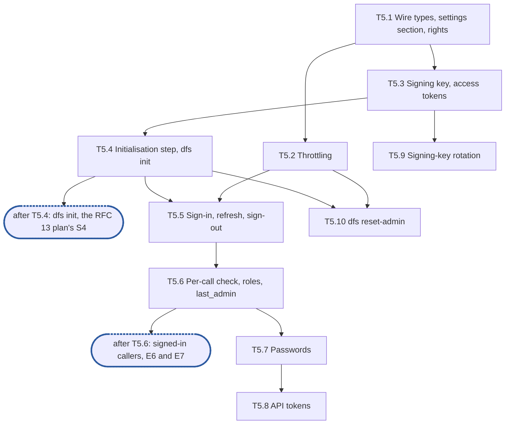

# Epic 5: control plane v2 — accounts and sign-in

**Sources:** [RFC 23](../docs/internals/rfcs/rfc-23-control-plane.md) §5.1 to §5.4, §4.5's credential calls, §6's
refusals and sign-ins, §10's CP9, CP10 and CP11, §11's `api_auth_failures_total` and
`api_sign_ins_total`, and §12's rows "§5.2 roles", "§5.3 revocation", "§5.3 throttling" and "§5.4
first password" at the API's authentication layer; [RFC 16](../docs/internals/rfcs/rfc-16-metadata-store.md) §3.2's
`Init` and `RecordJournal` as the initialisation step calls them, and §2.3's `Installation`,
`Secret`, `SecretOwner`, `Session`, `APIToken` and `SignInFailures`;
[RFC 18](../docs/internals/rfcs/rfc-18-identity.md) §8.1, as a consumer; [RFC 13](../docs/internals/rfcs/rfc-13-configuration.md)
§2.2's node-identity row and §7, as a consumer.
**Track:** C.
**Epic 5 estimate: 10 subtasks, 25.5 man-days.**
**Depends on:**
- E2: the user fields (`Role`, `NotBefore`, `MustChange`) and `Installation.SigningKey`; `Write`
  with its tracked reads, `EnabledAdmins` and `ControlPlaneTx.Now()`; the session, API-token and
  sign-in-count records, `Session(id)`, `DeleteSession(id)` and `Sessions(account)`; the sweep;
- E3: `internal/node/nodetest`, the runner's step table and its `Step` type, and the sweep loop
  whose audit retention this epic's section replaces;
- E4: `internal/node/api/auth` with `Caller` and `CallerFrom`, the role table in `auth`'s
  `rights.go`, the route table, the call and write adapters, `Deps.Authenticate`, the problem
  writer's `RetryAfter`, the local-socket mark, and the API's import rule (§9);
- X1: the RFC 13 plan's `pkg/bootstrap` (`InitNodeID`) and `pkg/secrets` (`Seal`, `Resolve`,
  `Versions`);
- X2: the RFC 18 plan's `APISignIn` (`Lookup`, `VerifyPassword`, `Account`) and `NewHashes`.
**Blocks:** E6, whose `login` signs in; E7, whose every row runs as a signed-in caller; the RFC 13
plan's S4, which `dfs init` is; X3 (partly), whose settings table names this epic's section.

---

## 1. Goal

Epic 5 gives the installation its first account and makes every API call answerable to the
account that makes it: who signs in, how a token proves it, what each role may do, and how many
guesses a source or an account gets.

**At the end of the epic:**

- `dfs init` initialises an installation, resumably, and `dfs`'s `reset-admin` resets an
  administrator offline; the harness's installations come from the same step;
- a password sign-in returns an access token and a refresh token; a refresh rotates the refresh
  token and a reused one revokes the session; sign-out ends it;
- every call is checked against the account's current record and RFC 23 §5.2's role table;
- sign-in is throttled per pair, per source and per account, with the counts in the store, and a
  throttled attempt writes nothing;
- passwords change through `POST /auth/password` and `:set-password`, a first password must be
  changed, and service accounts hold API tokens;
- the signing key is an installation secret, rotated by an operation;
- RFC 23's own settings section exists, with the RFC's defaults until X3.

### 1.1 In scope

The rights this epic's routes need, which `auth`'s role table already holds from E4; RFC 23's own settings section in
`internal/node/api/apisettings`; the wire types of sign-in, tokens and password changes;
throttling; sessions, access tokens, refresh and sign-out; `Deps.Authenticate`, the per-call
account check, `last_admin` and the role-raise rule; password changes and `:set-password`; API
tokens; the signing key and its rotation; the initialisation step, `dfs init` and `dfs`'s
`reset-admin`; the audit records and series sign-in writes; the sign-in benchmark.

### 1.2 Out of scope

- OpenID Connect sign-in, `TokenVerifier` and `dfsctl login`'s `--oidc`: a row of
  [the deferral ledger](rfc-23-control-plane-plan.md#61-deferral-ledger).
- `auth`'s package, `Caller`, the role table's mechanism and the `404`/`403` choice, the route
  table, the adapters, the problem table, TLS and the local socket: E4.
- The refusal of `admin`-only settings keys (A6): the RFC 13 plan's `Check`, handed the caller's
  role by E4's write adapter; it is tested in E7 once X3 wires `Check`, since the slot refuses
  every settings write until then.
- `APISignIn`, `NewHashes`, `VerifyPassword`'s equal work for every refusal, and the NT-hash rule
  on a password set: the RFC 18 plan's epic 2.
- `pkg/secrets` and `pkg/bootstrap`: the RFC 13 plan's epics 2 and 4.
- The records, their codecs and their expiry rows; deleting an account's sign-in count, its API
  tokens and its sessions with the account: E2 (T2.9, T2.10, T2.11).
- That no API role grants a file mount: RFC 23 §12's "§5.1 roles grant nothing", an e2e row, E8.
- Running the §12 rows through the node with every component: E7.

### 1.3 Names used here

- **E1**, epic 1, delete v1 and declare the surface: `pkg/node/apiv1`'s shared types and the `dfs
  init` and `reset-admin` stubs.
- **E2**, epic 2, store records: the records and `Write` this epic reads and writes.
- **E3**, epic 3, the node: `node.New`, the runner, the harness.
- **E4**, epic 4, the management API: `auth`'s seam, the route table, the typed adapters.
- **E5**, this epic.
- **E6**, epic 6, the CLI: `dfsctl`'s commands, `login` among them.
- **E7**, epic 7, **the integration epic**: RFC 23 §12's rows through the node.
- **E8**, epic 8, e2e green: the mount rows.
- **S4**, the RFC 13 plan's synchronisation point that `dfs init` exists; not RFC 23's plan's.
- **X1**, the RFC 13 plan's bootstrap and secrets: `pkg/bootstrap` (`InitNodeID`) and `pkg/secrets`.
- **X2**, the RFC 18 plan's sign-in interface: `APISignIn` and `NewHashes`.
- **X3**, the RFC 13 plan's wiring of `Check`, `Diff` and `Get` into the write path and reconcile.
- **A6**, RFC 23's plan's amendment making `audit.retention`, `api.session_lifetime`,
  `api.token_max_lifetime` and `api.password_sign_in` writable by `admin` only.
- **A7**, RFC 23's plan's amendment counting and checking the one principal `Lookup` resolves.
- **O12**, RFC 23's plan's open point fixing `dfs init`'s order: the store first, then the
  journals.

## 2. How the general rules apply

The rules are those of
[RFC 23's plan, §1.5](rfc-23-control-plane-plan.md#15-general-rules-for-each-epic), cited by number
and title and not copied.

| Rule | Subtasks | How |
| --- | --- | --- |
| rule 1, independent unit tests ([`CLAUDE.md`, "Writing tests"](../CLAUDE.md#writing-tests)) | all | the throttle's decision is a function of what it read, tested by table (D2); everything that writes runs over E2's store on Badger, in memory or under `t.TempDir()`, through E3's harness, whose installation `internal/install` makes (D6); identity is the RFC 18 plan's real one (D5). No test double but `kvtest`'s fault wrapper and `kv.Counting` |
| rule 2, fuzz every decoder of untrusted bytes ([`CLAUDE.md`, "Writing tests"](../CLAUDE.md#writing-tests)) | T5.1 | the sign-in, refresh, password-change and token-creation bodies go through E4's strict decoder; T5.1 adds them to its fuzz target's seeds. The access token is `golang-jwt`'s to parse (rule 2) |
| rule 3, observability follows RFC 25 | T5.5, T5.6 | `api_sign_ins_total{method, result}` and `api_auth_failures_total{reason}`, read back from the registry |
| rule 4, profiling | T5.2–T5.10 | every harness test runs under its leak check; no allocation budget |
| rule 5, public interface and internals ([`CLAUDE.md`, "Verifying a change"](../CLAUDE.md#verifying-a-change)) | T5.5–T5.8 | a `NotBefore` is proven by a refused call, a revoked session by a refused refresh, a right by the route's answer, never by a field read back |
| rule 6, known failures shrink ([`CLAUDE.md`, "Writing tests"](../CLAUDE.md#writing-tests)) | none | no suite this epic adds to keeps a `known.yaml`; no test lands red |
| rule 7, v2 ignores v1 | all | nothing of v1's accounts, JWT code or bootstrap password is read or copied |
| rule 8, real dependencies for properties of those dependencies ([`CLAUDE.md`, "Writing tests"](../CLAUDE.md#writing-tests)) | T5.2, T5.4, T5.10 | a count's commit faulted through `kvtest` on Badger; the initialisation step's resumption over journal directories under `t.TempDir()`; `reset-admin` refused by Badger's own directory lock under a running node |
| rule 9, code comment conventions ([`CLAUDE.md`, "Code comments"](../CLAUDE.md#code-comments)) | T5.2, T5.3, T5.4, T5.5, T5.9, T5.10 | RFC 23 §5.3's two `decision:` notes at the throttle, §4.5's at the credential routes, §5.4's at `reset-admin`; D3's, D8's and D9's `ponytail:` notes; D7's `decision:` at the finished check and D10's at `reset-admin`'s account |
| rule 10, a test must be able to fail ([`CLAUDE.md`, "Writing tests"](../CLAUDE.md#writing-tests)) | all | each test names the bug it catches; a concurrency test forces its interleaving with a fault that blocks on a channel the test closes, never a timed delay |
| rule 11, a symbol is exported only if RFC 23's interface uses it | T5.1 | `pkg/node/apiv1` gains the wire types this epic's routes speak; `auth` and `apisettings` export internally, not frozen (rule 11) |
| rule 12, each subtask creates only what it declares | all | `apisettings` lands in T5.1 with its test, `internal/install` in T5.4 with its; each later file with the subtask that fills it |

## 3. Requirements and invariants

Every obligation the owned sections place on this epic, numbered so subtasks and tests can cite
them.

**Accounts and roles**

| # | Requirement | Kind | Source | Subtasks |
| --- | --- | --- | --- | --- |
| R1 | The bootstrap administrator holds no uid, gid, SID, Kerberos name, group membership or share grant unless an operator gives it one; that no role grants a file mount is E8's row | MUST NOT | RFC 23 §5.1, §5.4, CP9 | T5.4 |
| R2 | A service account holds a role, no password and no protocol spelling, and signs in only with an API token | MUST | RFC 23 §5.1 | T5.8 |
| R3 | Authorization is checked per action against the account's current record, read through `APISignIn.Account` on every call, never against a role carried in a token | MUST | RFC 23 §5.2, §5.3, CP10; RFC 18 §8.1 | T5.6 |
| R4 | Each call is allowed or refused by RFC 23 §5.2's role table, this epic's rights among its rows | MUST | RFC 23 §5.2 | T5.1, T5.6 |
| R5 | Giving an account a role, or editing a user that holds one, is `admin`'s, so an operator cannot raise privilege | MUST NOT | RFC 23 §5.2 | T5.6 |
| R6 | Disabling, deleting or demoting the last enabled account with role `admin` is refused `409` `last_admin` | MUST | RFC 23 §5.2, §4.7 | T5.6 |
| R7 | A machine principal holds no role | MUST NOT | RFC 23 §5.1 | T5.6 |
| R8 | An account's password and every hash derived from it are written only through `:set-password` and `POST /auth/password`; the signing key by no route but `POST /installation:rotate-signing-key` | MUST | RFC 23 §5.2 | T5.7, T5.9 |

**Sign-in, sessions and tokens**

| # | Requirement | Kind | Source | Subtasks |
| --- | --- | --- | --- | --- |
| R9 | Sign-in is `POST /api/v1/auth/sign-in` with a name and a password, checked by `APISignIn.Lookup` then `VerifyPassword` on that principal, never through `vfs`, and returns an access token and a refresh token | MUST | RFC 23 §5.3; RFC 18 §8.1 | T5.5 |
| R10 | A disabled or deleted account cannot sign in, and the refusal does not say which | MUST | RFC 23 §5.3 | T5.5 |
| R47 | A store that cannot answer is not a failed credential: `VerifyPassword` or `Account` answering `ErrUnavailable` is `503` `unavailable`, with no settled failure, no refusal audit and the source's raise taken back; only `ErrLogonFailure` settles a failure | MUST | RFC 23 §5.3, §8.1; RFC 18 §8.1 | T5.5 |
| R48 | The problem table maps `vfserr.ErrLogonFailure` to `401` `unauthenticated` and `vfserr.ErrUnavailable` to `503` `unavailable`; both are in `vfs.Errors()`, so the table's totality test holds them | MUST | RFC 23 §4.7, §5.3; RFC 17 §4.3; RFC 18 §8.1 | T5.5 |
| R11 | The access token is a signed JWT naming the account's principal, the session and an expiry 15 min ahead, and carries no role | MUST | RFC 23 §5.3 | T5.3 |
| R12 | The access token is HS256, signed with `golang-jwt`, its `kid` naming the signing key's version, so a token signed before a rotation still verifies | MUST | RFC 23 plan §4.2 D3 | T5.3 |
| R13 | On every call the API refuses a disabled or deleted account, a revoked session, and a token issued before the account's not-before time: an access token by its issue time, a refresh or an API token by its session's or its own creation time | MUST | RFC 23 §5.3, CP10 | T5.5, T5.6, T5.8 |
| R14 | An issue or creation time is the store time of the write that issued the token or created the session, raised to the account's not-before when that is later; times compare in whole seconds; a raise sets not-before to the whole second after its commit | MUST | RFC 23 §5.3; RFC 16 §2.3 (`Session`, `APIToken`) | T5.5, T5.7 |
| R15 | Changing a role raises no not-before: the account's sessions and API tokens survive it, and its new role applies on the next call | MUST | RFC 23 §5.3 | T5.6 |
| R16 | The refresh token is opaque and random, kept only as its hash in a session that expires `api.session_lifetime` after sign-in; each use returns a new one and invalidates the old, and presenting an invalidated one revokes the whole session | MUST | RFC 23 §5.3; RFC 16 §2.3 (`Session`) | T5.5 |
| R17 | An API token is opaque and random, shown once at creation, kept only as its hash, with an expiry no later than `api.token_max_lifetime`, and checked as an access token is, with its record in place of the session | MUST | RFC 23 §5.3; RFC 16 §2.3 (`APIToken`) | T5.8 |
| R18 | The signing key is one installation `Secret` sealed under the storage wrapping key, owned by the installation record under `signing_key` | MUST | RFC 23 §5.3; RFC 16 §2.3 (`Secret`, `SecretOwner`) | T5.3 |
| R19 | The signing key rotates by `POST /installation:rotate-signing-key`, `admin`'s, an operation: the next key signs once every node holds it, and the old one verifies until the last token it signed has expired, then is pruned | MUST | RFC 23 §5.3, §5.2; RFC 13 §7 | T5.9 |
| R20 | RFC 23's own settings section holds `api.session_lifetime`, `api.token_max_lifetime` and `audit.retention` with the RFC's defaults (12 h, 365 days, 400 days), and refuses an `audit.retention` under 90 days | MUST | RFC 23 §5.3, §6 | T5.1 |

**Throttling**

| # | Requirement | Kind | Source | Subtasks |
| --- | --- | --- | --- | --- |
| R21 | Three counts are kept: per account and source together, per source, per account. Once 5 attempts are counted for a pair or 5 from a source, each further attempt there waits twice as long as the last, from 1 s up to 5 min, and one sooner is answered `429` with `Retry-After` and the code `throttled`; the account's own count applies the same wait from 100 failures | MUST | RFC 23 §5.3, §4.7 | T5.2 |
| R22 | An attempt is counted before its password is checked, in one transaction that reads the counts and raises them; the wait is decided on the counts as read, so the fifth is checked and the sixth waits; a write that fails refuses the attempt | MUST | RFC 23 §5.3 | T5.2 |
| R23 | An attempt answered `429` raises no count, commits nothing and checks no password | MUST NOT | RFC 23 §5.3, §6 | T5.2 |
| R24 | A success resets the account's count and its pair's, and takes back its own raise of the source's, lowering only the count and moving neither of the source's times back | MUST | RFC 23 §5.3 | T5.2 |
| R25 | An account is keyed by the principal `APISignIn.Lookup` resolves the name to, every spelling of one name sharing one count, and the password checked is that principal's; a name that resolves to no account counts against its source only | MUST | RFC 23 §5.3; RFC 18 §8.1 | T5.2, T5.5 |
| R26 | A source is the connection's peer address, an IPv4-mapped IPv6 address read as its IPv4 address and any other IPv6 address by its /64; no forwarding header is read; a loopback address is a source like any other; a caller on the local socket has no source count and no pair | MUST | RFC 23 §5.3 | T5.2 |
| R27 | A source's count keeps its last counted attempt, which every count moves and its wait counts from, and its last settled failure, which only a failure's settle, or the attempt that creates the count, moves, and which its 15 min expiry follows; a pair's count expires 24 h after its last counted attempt | MUST | RFC 23 §5.3; RFC 16 §2.3 (`SignInFailures`) | T5.2 |
| R28 | A settle or a takeback applies only to the source's count its attempt was counted on: on one swept or recreated since, it does nothing | MUST | RFC 23 §5.3; RFC 16 §2.3 (`SignInFailures`) | T5.2 |
| R29 | An account's count is reset by a success, by `:set-password` and by the break-glass reset; the reset with the account's deletion is E2's | MUST | RFC 23 §5.3 | T5.2, T5.7, T5.10 |
| R30 | The break-glass reset clears every source's count, in bounded batches | MUST | RFC 23 §5.3, §5.4 | T5.2, T5.10 |
| R31 | `POST /auth/password`'s check of the current password is an attempt, counted, waited on and settled as a sign-in's is | MUST | RFC 23 §5.3 | T5.7 |
| R32 | RFC 23 §12's "§5.3 throttling" row holds at the API's authentication layer | test row | RFC 23 §12 | T5.2, T5.5, T5.7 |
| R33 | A checked sign-in costs two commits, the count before the check and its settlement after; a benchmark of checked sign-ins from many sources beside concurrent metadata commits measures what they cost those commits | bound | RFC 23 plan §4.3, §6.1 | T5.5 |

**Passwords**

| # | Requirement | Kind | Source | Subtasks |
| --- | --- | --- | --- | --- |
| R34 | A password change presents the current password, must-change or not | MUST | RFC 23 §5.4 | T5.7 |
| R35 | Until a must-change password is changed, the session permits only `POST /auth/password` and sign-out; every other call is refused `403` `password_change_required` | MUST | RFC 23 §5.4, §4.7 | T5.6, T5.7 |
| R36 | A password change answers a new session created in its own write, whose creation time is the not-before that write sets; the session that made the change refreshes no more | MUST | RFC 23 §5.3 | T5.7 |
| R37 | A password set prunes the previous version of the password hash and of the NT hash at once | MUST | RFC 23 plan §5 epic 5; the RFC 18 plan's epic 2, D5 | T5.7 |

**Credential calls**

| # | Requirement | Kind | Source | Subtasks |
| --- | --- | --- | --- | --- |
| R38 | Sign-in, refresh, `POST /auth/password`, `:set-password` and API-token creation refuse an `Idempotency-Key` with `400`, and record neither their digest nor their answer | MUST NOT | RFC 23 §4.5 | T5.8 |
| R39 | No token, password or digest of one is kept anywhere but the session's and the token's hashes and the sealed password secret, and none appears in an answer (but the token itself, once), an audit record, a log line or a metric | MUST NOT | RFC 23 §4.5, CP11 | T5.5, T5.7, T5.8 |

**Audit and series**

| # | Requirement | Kind | Source | Subtasks |
| --- | --- | --- | --- | --- |
| R40 | Every sign-in whose password is checked, failed or not, and every request refused after authentication, is audited; a request refused before authentication, a `429` included, is counted, not recorded | MUST | RFC 23 §6 | T5.5, T5.6 |
| R41 | `api_sign_ins_total{method, result}` counts sign-ins, `result` `ok` or the problem code, and `api_auth_failures_total{reason}` counts refused authentication; no subject, address or name is a label | MUST | RFC 23 §11 | T5.5, T5.6 |

**Initialisation and recovery**

| # | Requirement | Kind | Source | Subtasks |
| --- | --- | --- | --- | --- |
| R42 | The initialisation step creates one account, `admin`, with role `admin`, and the node's identity; a start never creates one | MUST | RFC 23 §5.4; RFC 13 §2.2 | T5.4 |
| R43 | The initialisation step runs the store's `Init`, then each journal's `Init`, the node identity written beside it, then `RecordJournal`, then the administrator; run again after an interruption it reads the installation ID from the store, skips each step already done, adopts a node-identity copy only from a directory whose `format` carries that ID, takes nothing from a directory of another installation, and refuses only a finished installation | MUST | RFC 13 §2.2; RFC 16 §3.2; RFC 23 plan §5 epic 5, O12 | T5.4 |
| R44 | The first password comes from a reference, an environment variable or a file on the host, or, when none is given, is 24 random bytes, encoded, printed once to the step's standard output and never to a log; a generated password marks the account must-change; a file is read whole, one trailing LF or CRLF dropped; an empty or missing reference refuses the step, naming it, and never falls back to a generated password | MUST | RFC 23 §5.4; RFC 23 plan §5 epic 5 | T5.4 |
| R45 | The break-glass reset runs offline, with the host's bootstrap, on a node that is stopped, refused while a node holds the store; it sets a new generated password with must-change, raises the account's not-before, clears the account's sign-in count and every source's, writes an audit record naming the host and the command, and nothing else | MUST | RFC 23 §5.4, §6 | T5.10 |

**Wire types**

| # | Requirement | Kind | Source | Subtasks |
| --- | --- | --- | --- | --- |
| R46 | `pkg/node/apiv1` carries the bodies of sign-in, refresh, the password change, `:set-password` and an API token, and imports only the standard library; sign-out has no body, since it takes its session from the access token, and a session has none until a route answers with one | MUST | RFC 23 plan §5 epic 5, §4.2 D1 | T5.1 |

## 4. Decisions this epic takes

- **D1, `auth` holds the logic, the API's adapters hold HTTP.** E4 creates
  `internal/node/api/auth` with `Caller`, `CallerFrom` and the role table. This epic adds a
  `Service`, built in `node.New` from `auth.Deps` (small interfaces `auth` declares over E2's
  view, `APISignIn`, the sealer, `apisettings.Settings`, the clock and the registry), whose methods
  take decoded values and return results and errors; it never imports `internal/node/api`. Its
  sign-in, refresh and password change are rows on E4's call adapter; `:set-password`, token
  creation and revocation, and sign-out (which sends a key, E4's R67) on the write adapter. `node.New` sets
  `Deps.Authenticate` to `Service.Authenticate`, which reads the request's peer address and E4's
  local-socket mark. Its throttle error answers `RetryAfter()`, which E4's problem writer turns
  into the header. No marker. Prior art: Vault's `logical` backends behind its `http` layer (from
  memory).
- **D2, the throttle's decision is a function of what it read.** `decide(counts, now)` returns the
  wait or the raises; `settle` and `takeBack` return the counts to write, each a no-op on a count
  whose `Nonce` differs from the one the attempt read. RFC 23 §5.3's two `decision:` notes go on
  `decide`. The store side first decides in an untracked `View`, and answers `429` from it with
  nothing written; only an attempt `decide` lets through enters the tracked `Write`, which decides
  again on what it reads, so a race past the bound is caught there. Prior art: none needed.
- **D3, tokens.** HS256 through `golang-jwt/jwt/v5`, parsed with `WithValidMethods([]string{"HS256"})`
  and no leeway; the header `alg`, `kid` and `typ`, the `kid` the signing key's `Secret` version in
  decimal; the claims exactly `sub` (the principal), `sid` (the session), `iat` and `exp`, whole
  seconds. Refresh and API tokens are 32 random bytes, base64url, stored as their SHA-256. The
  verifier keeps the opened key versions in memory, refreshed by the rotation step and on an
  unknown `kid` at most once a second; a `ponytail:` names its ceiling, a rotation on another node
  seen a second late, and its upgrade, re-reading on the node's settings generation. Prior art:
  Kubernetes' service-account tokens carry a `kid` (from memory).
- **D4, RFC 23's own section is a leaf package.** `internal/node/api/apisettings` holds `Settings`
  with the three keys of R20, the RFC's defaults and `Validate`, declared with `pkg/settings`'
  section type if it exists by T5.1. `auth` and the node import it; it imports neither. Until X3
  the node hands the defaults, and E3's sweep takes `AuditRetention` from it in place of its
  constant. No marker.
- **D5, no stand-in for identity.** The RFC 18 plan declares no in-memory `APISignIn`, and its
  implementation is identity's own server over the same store. T5.1–T5.3 call no identity; from
  T5.4 every test runs the real one, so they wait for X2. No marker.
- **D6, the initialisation step is a package.** `internal/install.Run(ctx, Deps) error` holds `dfs
  init`'s logic; `cmd/dfs` and `nodetest` both call it, so every harness installation, and so
  every signed-in caller, comes from a real initialisation. It sits outside `internal/node` because
  it imports the store and the journal, which the API's import rule forbids under that tree; for
  identity it imports `pkg/identity` (`NewHashes`) only. A crash point per instance, set from
  `export_test.go`, stops it after any write. No marker.
- **D7, an installation is finished when its signing key is set.** The step's last `Write` commits
  the administrator, its password secret and `Installation.SigningKey` together; a rerun that finds
  `SigningKey` set refuses. A `decision:` at the check says that reading it as "an account named
  `admin` exists" would let a rerun mint a second `admin` after an operator renamed the first.
  Prior art: none needed.
- **D8, a sign-in commits twice.** The count, then one `Write` holding the settlement, the session
  on a success, and the audit record in its `WriteMeta`. A `ponytail:` at the sign-in names its
  ceiling, checked sign-ins per second through one source at one commit each way, and its upgrade,
  counts cached per node and settled in batches, which RFC 23 §5.3 would have to allow first.
  Prior art: none needed.
- **D9, rotation switches in one step on one node and waits without blocking.** The step seals the
  next version and switches signing, recording the switch's store time in its `next`; each later
  turn returns the same `next`, not done, and commits nothing until an access token's 15 min have
  passed, then prunes with `tx.PruneSecret` in a time-based retention, skipping the node-status
  check (RFC 13 §7's exception for the signing key). It depends on E3's runner committing nothing
  for a step that returns its `next` unchanged and calling it again at its next turn (§9). A
  `ponytail:` names its ceiling, a second node, and its upgrade, a wait on the versions node status
  reports. Prior art: Kubernetes' key rotation keeps old keys for verification only (from memory).
- **D10, `reset-admin` resets a named administrator.** `dfs`'s `reset-admin` takes `--name`,
  default `admin`, and resets that account only if it exists, is enabled and holds role `admin`;
  otherwise it refuses, naming why, and changes nothing. RFC 23 §5.2's `last_admin` keeps one
  enabled admin through the API, so an installation whose `admin` was deleted or renamed still has
  one to name. A `decision:` at the check says it creates and re-enables nothing, as RFC 23 §5.4's
  "nothing else" says. Prior art: none needed.

## 5. Target tree

```text
pkg/node/apiv1/
  auth.go                                  T5.1  SignIn, Tokens, Refresh, PasswordChange, SetPassword,
                                                 APITokenSpec, APITokenStatus
internal/node/api/apisettings/
  settings.go settings_test.go             T5.1  Settings, defaults, Validate (D4)
internal/node/api/auth/
  rights.go                                T5.1  E4's table, already holding this epic's rights; unchanged
  throttle.go throttle_test.go             T5.2  decide, settle, takeBack, sourceOf; the store side
  tokens.go tokens_test.go                 T5.3  the signing key's versions, issue, verify
  signin.go signin_test.go bench_test.go   T5.5  Service, Authenticate, sign-in, refresh, sign-out
  check.go check_test.go                   T5.6  the account check, last_admin, the role-raise rule
  password.go password_test.go             T5.7  POST /auth/password, :set-password
  apitokens.go apitokens_test.go           T5.8  API tokens; the credential routes' table test
  rotate.go rotate_test.go                 T5.9  the rotation's runner step
internal/install/
  install.go install_test.go export_test.go T5.4 Run, Deps, the crash point (D6)
internal/node/nodetest/                    T5.4  installation through install.Run; T5.6 a caller per role
pkg/metadata/kvstore/                      T5.2  ClearSourceSignIns, a bounded batch
cmd/dfs/commands/
  init.go                                  T5.4  dfs init over install.Run
  reset_admin.go reset_admin_test.go       T5.10 dfs reset-admin
docs/guide/cli.md                          T5.4, T5.10  regenerated
```

## 6. Subtasks

### T5.1 The wire types, the settings section and this epic's rights

**Subtask T5.1 estimate: 1.5 man-days.**

- **Track:** C. **Depends on:** nothing in this epic; E4 (`auth`'s role table).
- **Covers:** R4, R20, R46.
- **Deliverables:** in `pkg/node/apiv1`'s `auth.go`, the bodies R46 names, standard library only,
  their seeds in E4's strict-decoder fuzz target; `internal/node/api/apisettings` (D4) with its
  test; this epic's rights confirmed in `auth`'s table, where E4's `auth.Allowed` already holds
  them, so T5.1 adds none: `Self` (own password, own tokens and sign-out) for every role,
  `Accounts` (accounts with a role, roles, others' service tokens) and `Installation` (the signing
  key's rotation among it) for `admin`;
  E4's import rule's allow-list gaining `apisettings`, an explicit edit. No `SessionStatus`, since
  no route answers with one, and no sign-out body, since sign-out takes its session from the access
  token. `pkg/identity` joins the allow-list for `auth` in T5.5, the first subtask that imports it;
  `pkg/secrets` needs no edit, since E4's D20 allows it for the whole API. Consumed by T5.5–T5.9, E6 (the bodies) and E3's sweep (the retention).
- **Acceptance criteria:**
  - Each right of RFC 23 §5.2 this epic's routes need answers per role as the table says.
  - `go list -deps ./pkg/node/apiv1` names only standard-library packages.
- **Tests:** a table test of this epic's rights per role in E4's table, a role's right removed failing its row
  (R4); `Validate` at 89 and 90 days, and the defaults (R20); each body's JSON names by key (R46).

### T5.2 Throttling

**Subtask T5.2 estimate: 4.5 man-days.**

- **Track:** C. **Depends on:** T5.1; E2 (the sign-in counts, the sweep).
- **Covers:** R21, R22, R23, R24, R25, R26, R27, R28, R29, R30, R32.
- **Deliverables:** in `throttle.go` (D2): `sourceOf(addr, local bool)`; `decide`, `settle`,
  `takeBack`, RFC 23 §5.3's two `decision:` notes at `decide`; `reserve(ctx, keys, src)`, a `View`
  that decides and, when it waits, returns a throttle error with `RetryAfter()`, else a tracked
  `Write` that decides again and writes the raises; `settleFailure`, `takeBackSuccess` and
  `resetAccount`, each a function over a `ControlPlaneTx` so the caller's `Write` carries them;
  `kvstore.ClearSourceSignIns(ctx)`, a bounded batch deleting source counts with their expiry rows
  and returning whether more remain, with its conformance case in E2's suite. Consumed by T5.5,
  T5.7 and T5.10.
- **Acceptance criteria:**
  - Five attempts past a pair's bound, run concurrently, pass no more than the counts allow.
  - A `429` makes no `Update`: `kv.Counting`'s `Updates` and `GuardOnly` stay 0.
- **Tests:** table tests of the pure functions: the wait sequence and the account's 100 (R21); the
  address forms, loopback and the local socket (R26); `Failed` moved by a settled failure and the
  creating attempt only, `Last` by every count (R27); overlapping successes in either order leaving
  `Failed` at the last failure (R24); a settle on a recreated count doing nothing (R28). Over E2's
  store on Badger, in memory and under `t.TempDir()`: concurrent attempts held after their read by a
  fault that blocks on a channel, at most one checked past the bound (catches an untracked read,
  R22); 200 attempts from 200 addresses, at most 100 checked before the account's wait; 3 failures,
  the clock advanced 10 min, 50 attempts for 50 accounts from one source, two checked (R21); 50
  attempts within a wait read through `kv.Counting`, `Updates` and `GuardOnly` 0 (R23); a faulted
  commit refusing the attempt (R22); a name with no account raising only its source (R25); the
  clock advanced, E2's sweep run: a source forgotten 15 min after its last failure while successes
  keep coming, a count never settled expiring, a pair forgotten 24 h after its last attempt (R27);
  `resetAccount` (R29); `ClearSourceSignIns` over K + 1 counts in two batches (R30). These are the
  store's half of RFC 23 §12's "§5.3 throttling" (R32); the reset with an account's deletion is
  E2's T2.11.

### T5.3 The signing key and access tokens

**Subtask T5.3 estimate: 2 man-days.**

- **Track:** C. **Depends on:** T5.1; X1 (`pkg/secrets`), E2 (`Installation.SigningKey`).
- **Covers:** R11, R12, R18.
- **Deliverables:** in `tokens.go` (D3): the key sealed through `Seal` with the key kind and the
  installation's `signing_key` owner, its reference in `Installation.SigningKey`; the opened
  versions kept in memory, refreshed on rotation and on an unknown `kid`, with D3's `ponytail:`;
  `issue(principal, session, iat)` and `verify(raw)`. Consumed by T5.4, T5.5 and T5.9.
- **Acceptance criteria:**
  - A token signed with version 1 verifies once version 2 is added, and fails once 1 is pruned.
- **Tests:** over the real `pkg/secrets` and E2's store: a token's header and claims decoded and
  compared as exact key sets (R11); its expiry at `exp` on the injected clock (R11); `alg: none`,
  HS512 and an unknown `kid` refused (R12); the key's `Secret` read back with its kind and owner,
  and `Resolve` with another owner refused (R18).

### T5.4 The initialisation step and `dfs init`

**Subtask T5.4 estimate: 3.5 man-days.**

- **Track:** C. **Depends on:** T5.3; X1 (`InitNodeID`), X2 (`NewHashes`), E3 (`nodetest`).
- **Covers:** R1, R42, R43, R44.
- **Deliverables:** `internal/install.Run(ctx, Deps)` (D6): the store's `Init` with a minted
  installation ID, or the ID read from a store that holds one; per journal directory,
  `journal.Open` with a zero expect, which before recovery returns `ErrNoJournal` for an empty one
  (then `Init`) or an `*journal.IdentityError` naming the installation it carries (skipped when it
  is this one, refused naming the directory when it is another); the identity through `InitNodeID`;
  `RecordJournal`; then one `Write` with the administrator, role `admin`, no spelling, its password
  through `NewHashes` and `Seal`, must-change when generated, and the signing key, with D7's
  `decision:`. The generated password is printed only after that `Write` commits. `dfs init` over
  it, with `--admin-password-file` and `--admin-password-env`, and `docs/guide/cli.md`
  regenerated; `nodetest` initialising through `Run`. Consumed by T5.5, T5.10, E7's server fixture
  and the RFC 13 plan's S4.
- **Acceptance criteria:**
  - Stopped after each write, two journals' identity copies included, and run again, it finishes
    with one installation ID and one node identity, and a node then starts over it.
  - Run on a finished installation, it refuses and changes nothing.
- **Tests:** over Badger and journal directories under `t.TempDir()`: the crash point after each
  write, then a rerun, one ID in the store and in every `format` and `node-id` (R43); a leftover
  directory of another installation refused by name, nothing adopted (R43); a second run refused
  (R43); the password file with LF, with CRLF, empty and missing, the variable unset, each as R44
  says; a generated password decoding to 24 bytes, printed once to the command's writer, absent
  from the captured log, and not printed when the crash point stops the last `Write` (R44); the
  administrator with no uid, gid, SID, Kerberos name, membership or grant (R1, R42); a node started
  over an installation whose `admin` was deleted creating no account (R42).

### T5.5 Sign-in, refresh, sign-out and `Authenticate`

**Subtask T5.5 estimate: 3.5 man-days.**

- **Track:** C. **Depends on:** T5.2, T5.4; E4 (the call adapter, `Deps.Authenticate`, the
  client's `WithTokenSource`); the RFC 18 plan's epic 8's T8.1 (identity composed in `node.New`).
- **Covers:** R9, R10, R13, R14, R16, R25, R32, R33, R39, R40, R41, R47, R48.
- **Deliverables:** `auth.Service` and `Authenticate` (D1), `node.New` setting
  `Deps.Authenticate`; the problem table's row for `ErrLogonFailure`, `401` `unauthenticated`,
  beside E4's `ErrUnavailable` row, `503` `unavailable` (R48); in `signin.go`: sign-in (`Lookup`, `reserve`, `VerifyPassword` on that
  principal, then one `Write` with the settlement, the session on a success, its `Created` from
  `tx.Now()` raised to `NotBefore`, and the audit record in its `WriteMeta`, D8; then `issue`), a
  failure settled and audited only on `errors.Is(err, vfserr.ErrLogonFailure)`, and
  `ErrUnavailable` answered `503` with no settlement, no refusal audit and the source's raise taken
  back (R47);
  refresh through `Session(id)`, reading the account through `APISignIn.Account` as `Authenticate`
  does, an invalidated token revoking the session with `DeleteSession`; `Account`'s `ErrUnavailable`
  answered `503`, not `401`, in refresh and in `Authenticate` alike (R47);
  sign-out; the two series; RFC 23 §4.5's `decision:` at the credential routes; the client's
  `SignIn`, `Refresh` and `ChangePassword` sent through E4's client core with refresh off (E4's
  T4.8), so a `401` from any of them is returned as it is, never refreshed and replayed; `pkg/identity`
  added to E4's import allow-list for `auth` (T5.1), while `pkg/vfs/vfserr`, where the sign-in
  errors are declared, needs no edit, since E4's rule admits it for the whole node; `bench_test.go`,
  checked sign-ins from many sources beside metadata commits, in the manual tier. Consumed by T5.6
  and E6's `login`.
- **Acceptance criteria:**
  - A refresh presenting an already-rotated token revokes its session.
  - A checked sign-in makes exactly two `Update`s.
- **Tests:** over the harness and the real identity, the clock injected: a sign-in answering both
  tokens through `Lookup` and `VerifyPassword` (R9); sign-in, refresh, the old refresh refused and
  the session gone (R16); an account marked through `ControlPlaneTx.DeleteUser`, its batches not
  run, its sign-in, its refresh and a call with its access token each refused, the sign-in's
  refusal byte-equal to a wrong password's (R10, R13); a session past `api.session_lifetime` refused (R16);
  a disabled and a deleted account's refusals byte-equal (R10; the equal work is the RFC 18 plan's
  `VerifyPassword` test); a session created right after a `NotBefore` raise, refreshed and not
  refused (catches a node clock in place of the store's, R14); `kv.Counting` reading two `Update`s
  per checked sign-in (R33); 4 failures as `alice` and 1 as `ALICE`, then `CORP\alice` answering
  `429` (R25, R32); a checked failure audited, a `429` not; the series read from the registry
  (R40, R41); a captured log, the audit records and the series' labels holding no password or
  token (R39); a `kvtest` fault on the user read under the real identity: a sign-in answering `503`,
  no settled failure and no refusal audit record, the source's count as before, and a refresh and a
  call with a valid access token each `503`, not `401` (R47); a wrong password's body answering
  `401` with code `unauthenticated`, and E4's totality test over `vfs.Errors()` passing with both
  identity errors mapped (R48); E4's client with a token source of
  the test's own over `Client.SignIn` and `Client.Refresh` on these routes, the clock advanced past
  the access token's lifetime: a create answered `401` refreshed once through the real `Refresh`
  and replayed with its body and key, one record and one idempotency record under that key, and a
  `Wait` poll refreshed the same way (E4's R67); the benchmark under `-count=10`, setup before
  `b.ResetTimer()` (R33).

### T5.6 The per-call check, roles and `last_admin`

**Subtask T5.6 estimate: 2.5 man-days.**

- **Track:** C. **Depends on:** T5.5; E2 (`EnabledAdmins`).
- **Covers:** R3, R4, R5, R6, R7, R13, R15, R35, R40, R41.
- **Deliverables:** in `check.go`: `Authenticate`'s check, `verify` then `APISignIn.Account`, the
  session's revocation and `NotBefore`, the caller's `MustChange`, which E4's row flag reads;
  `checkLastAdmin(tx, before, after)` reading `EnabledAdmins` in the write's transaction, and the
  role-raise rule, for E4's user handlers; a role on a machine principal refused; `nodetest`'s
  signed-in caller of each role; the role field on E4's user routes, with R42's API-only account:
  one created with a role and no spelling gets none, so its create allocates no uid and no RID,
  where T4.10's `createUser` always allocates both today; this check replaces T4.10's hiding of a
  user holding a role from a caller below `admin` (`404` on read and write, left out of listings).
  Consumed by every E4 route,
  E6 and E7.
- **Acceptance criteria:**
  - Disabling an account refuses its next call with its access token unexpired.
  - Two concurrent demotions of the last two admins: one commits, the other answers `last_admin`.
- **Tests:** over the harness: every route as each role against RFC 23 §5.2, `404` where the caller
  may not read (R4); an operator giving itself `admin`, and editing another user that holds a
  role, refused (R5); the two demotions held after their reads by a fault that blocks on a channel
  (R6); a role written on a machine principal refused `400` (R7); a disabled account and a revoked
  session refused on the next call, the clock not advanced (R3, R13); a demotion leaving the
  session and token alive with viewer rights (R15); a must-change session refused `403`
  `password_change_required` on other routes (R35); a refused call audited and counted (R40, R41);
  an API-only account, created with a role and no spelling, holding none (E4's R42, moved here
  from T4.10 with the role field).

### T5.7 Passwords

**Subtask T5.7 estimate: 3 man-days.**

- **Track:** C. **Depends on:** T5.6; the RFC 18 plan's epic 2, T2.8 (an NT hash deleted with its
  user), and its epic 8, T8.2 (identity in `node.New` with `Deps.Logons`, the logon sink this
  subtask's NTLM sign-in test needs, after its epic 4's T4.2 and T4.5).
- **Covers:** R8, R14, R29, R31, R32, R34, R35, R36, R37, R39.
- **Deliverables:** in `password.go`, the RFC 18 plan's password write: `POST /auth/password`, its
  current-password check through `reserve` and settled as a sign-in's; `NewHashes` on the
  `identity.ntlm` read, the password sealed under the storage role and the NT hash, when `NewHashes`
  returns one, under the protocol role, both before one `Write` that reads `identity.ntlm` tracked and
  refuses a moved revision, puts both versions, prunes the previous ones with `tx.PruneSecret`,
  raises `NotBefore` from `tx.Now()`, clears must-change and creates the answered session;
  `:set-password` with the same write and `resetAccount`; no other route writes a hash. Consumed by
  E6 and E7.
- **Acceptance criteria:**
  - After a change, the session that made it refreshes no more, and the answered one does.
  - An NTLM-off committed while a change is held after its read leaves no NT hash stored.
- **Tests:** over the harness and the real identity: both sessions after a change (R36); a refresh
  and an API-token call made before the change refused after it (R14); no current password refused
  (R34); a must-change account changing its password and then reaching other routes (R35); three
  failed current-password checks and two sign-ins from one address, the next of either `429` (R31,
  R32); `:set-password` resetting a raised count (R29); the old password hash's and the old NT hash's versions gone, for a user holding a file spelling
  with NTLM on (R37); the
  change held after reading `identity.ntlm` by a blocking fault while an NTLM-off commits, then
  refused and resealed with no NT hash (R8's hash rule, the RFC 18 plan's §3.5); the store's raw
  keys and the captured log holding neither password (R39); with NTLM on, after `POST /auth/password`,
  identity's `SignIn` verifying an NTLMv2 AUTHENTICATE for the new password and refusing one for the
  old (R37, at the consumer of the NT hash); an operator setting an admin's
  password refused (R8).

### T5.8 API tokens

**Subtask T5.8 estimate: 1.5 man-days.**

- **Track:** C. **Depends on:** T5.7.
- **Covers:** R2, R13, R17, R38, R39.
- **Deliverables:** in `apitokens.go`: creation for a service account, the token shown once and
  stored as its hash, its expiry capped by `api.token_max_lifetime`, its `Created` from `tx.Now()`
  raised to `NotBefore`; listing an account's tokens; revocation; the per-call check reading the
  token's record in place of a session. Consumed by E6.
- **Acceptance criteria:**
  - A token asked for past the maximum lifetime is refused.
- **Tests:** over the harness: create, call, revoke, call refused (R17); a token past its expiry on
  the injected clock refused (R17); one created before a `NotBefore` raise refused (R13); a password
  sign-in for the service account refused (R2); the raw keys holding only the hash (R39); one table
  test over sign-in, refresh, the password change, `:set-password` and token creation, each refusing
  an `Idempotency-Key` `400` and leaving no idempotency record (R38).

### T5.9 Signing-key rotation

**Subtask T5.9 estimate: 1.5 man-days.**

- **Track:** C. **Depends on:** T5.3; E3 (the runner).
- **Covers:** R8, R19.
- **Deliverables:** in `rotate.go`, the `installation.rotate-signing-key` step (D9) and its
  `Progress` (E3's step table pairs each step with one: phase `switched`, then `pruned`), its row in
  `New`'s step table, its `ponytail:`; the verifier refreshed at the switch. Consumed by E4's rotate
  route.
- **Acceptance criteria:**
  - A token signed before the switch verifies until the prune, and is refused after it.
- **Tests:** over the harness: rotate, a pre-rotation token verifying, the clock advanced 15 min and
  a turn run, the operation ended, the token refused and the old version gone (R19); the
  operation's progress read through the API naming each phase in turn; turns before
  then committing nothing, read through `kv.Counting` (R19); a restart between the switch and the
  prune resuming at the prune (R19); no secret route writing the key (R8).

### T5.10 `dfs`'s `reset-admin`

**Subtask T5.10 estimate: 2 man-days.**

- **Track:** C. **Depends on:** T5.2, T5.4; X1, X2; the RFC 18 plan's epic 2, T2.8.
- **Covers:** R29, R30, R45.
- **Deliverables:** `dfs`'s `reset-admin` filling E1's stub: the bootstrap loaded, the store opened,
  refused by Badger's directory lock while a node holds it; the account chosen as D10 says, with
  its `decision:`; a generated password through `NewHashes` and `Seal`, the NT hash as T5.7 writes
  it, the old versions pruned, must-change set, `NotBefore` raised, in one `Write` with the audit
  record naming the host and the command; the account's count reset and `ClearSourceSignIns` run
  to the end; the password printed after the commit; RFC 23 §5.4's `decision:`; `cli.md`
  regenerated. Consumed by E7.
- **Acceptance criteria:**
  - While a node holds the store, it refuses and changes nothing.
- **Tests:** over Badger under `t.TempDir()`: a node started on disk through the harness, the reset
  refused by the lock; the node stopped, the reset run, a session signed in before it refused
  (R45); the account's and every source's counts gone (R29, R30); the audit record's actor the host
  (R45); `--name` of a disabled account, of a non-admin and of a missing one each refused (R45).

## 7. Order of work



T5.1 and T5.2 need neither X1 nor X2: T5.1 waits for E4's role table, T5.2 for E2's sign-in counts.
T5.3 waits for X1, T5.4 for X1 and X2, T5.5 for E4's call adapter, T5.9 for E3's runner.
Checkpoints: after T5.4, `dfs init` exists, the RFC 13 plan's S4; after T5.6, the harness signs in
a caller of each role.

## 8. Suggested pull requests

| PR | Subtasks | Man-days | After | Why together |
| --- | --- | --- | --- | --- |
| 1 | T5.1, T5.2 | 6 | — | the wire types, the settings section, the rights and throttling, which need neither X1 nor X2 |
| 2 | T5.3, T5.4 | 5.5 | PR 1 | the signing key and `dfs init`, the RFC 13 plan's S4 |
| 3 | T5.5, T5.6 | 6 | PR 2 | sign-in and the per-call check: signed-in callers |
| 4 | T5.7, T5.8 | 4.5 | PR 3 | passwords and API tokens, the remaining credential calls |
| 5 | T5.9, T5.10 | 3.5 | PR 2 | rotation and the break-glass reset |

A suggestion only: one pull request per subtask works as well. PR 4 and PR 5 can be open at once.

## 9. Open points

- **For the user: should T5.2 count a name that resolves to no account on a pseudo-account?** R25
  counts such a name against its source only, so an unknown name never reaches the account's bound
  of 100 checked attempts that a known one does, and the difference in waits can tell a caller
  which names exist. The alternative keys a count on an HMAC of the name under an installation
  secret, one pseudo-account per unknown name, so both kinds meet the same waits, at the cost of a
  count row per name tried. R25 and R27 stay as they are until the user answers.

- **E3's runner (D9):** the rotation step returns its `next` unchanged while it waits; it needs E3's
  runner to commit nothing for such a turn and to call the step again at its next turn. E3's T3.4
  commits each step's `next`; if it keeps doing so for an unchanged one, each turn writes a record
  for 15 min, and E3 should add that skip or a step's not-before.
- **E4's write rule:** E4's T4.4 holds that `Write` is called only from the write adapter. This
  epic's `auth` calls `Write` for the counts, the sign-in's settlement, refresh and the password
  change (D1, D8). E4's rule needs `auth` named beside the adapter, its calls holding their audit
  records as R40 says.
- **E4's import rule:** E4's D20 allows `pkg/secrets` for the whole API, `auth` included. T5.1 adds
  `apisettings` to the allow-list, and T5.5, the first subtask whose `auth` imports `pkg/identity`,
  adds it. `pkg/vfs/vfserr`, which declares the sign-in errors `auth` matches, needs no edit: E4's
  rule admits it for every package under `internal/node`.
- **E3's harness:** `nodetest` initialises through `install.Run` from T5.4 on (D6), replacing its
  own `kvstore.Init` and `journal.Init`; E3's harness tests must keep passing over it.
- **E2's names:** `Session(id)`, `DeleteSession(id)`, `Sessions(account)`, `ControlPlaneTx.Now()`,
  `Installation.SigningKey` and `EnabledAdmins` are written as E2's revision has them; a rename there
  changes T5.3–T5.8. `ClearSourceSignIns` is new in kvstore here, since E2 leaves the break-glass
  clear to this epic.
