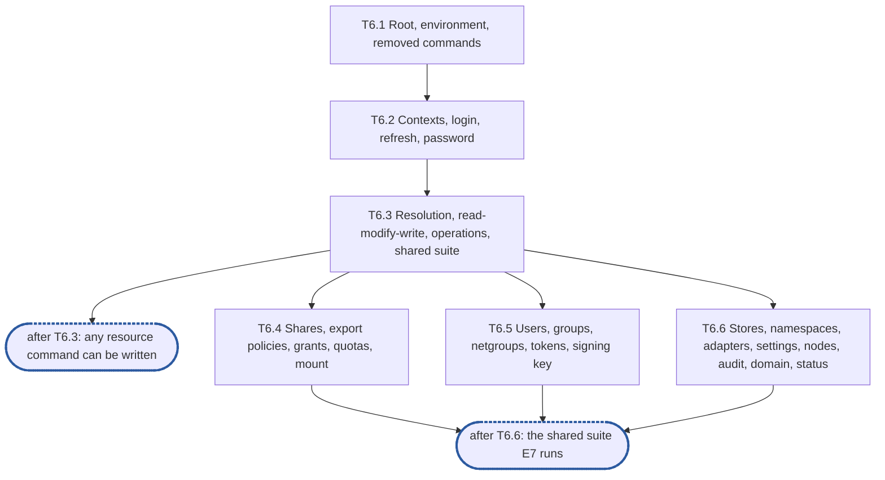

# Epic 6: control plane v2 — the CLI

**Sources:** [RFC 23](../docs/internals/rfcs/rfc-23-control-plane.md) §7 (without `login --oidc`), §9's client
rules, §2.5's `GET /api/v1/health`, §5.3's local socket and refresh, §5.4's password change, §3.5's
e-mail and directory grants, §4.4–§4.6 as the CLI applies them, §10's CP14, and §12's "§7 CLI" row in
the part a unit test can check.
**Track:** A.
**Epic 6 estimate: 6 subtasks, 11.5 man-days.**
**Depends on:** E1, whose `dfsctl` tree refuses every v1 command until this epic; E3's harness
`internal/node/nodetest`; E4's client (`pkg/node/apiv1/client`) and routes, `GET /api/v1/health` among them;
E5's sign-in, refresh, sign-out, password change, API tokens and signing-key rotation. The grant by
directory name and the domain commands need no directory here: `nodetest` reaches none (its seam is
`internal/node`'s `export_test.go`), so this epic tests their arguments and refusal, and E7's T7.6
their success through the API.
**Blocks:** E7, whose "§7 CLI" row runs this epic's shared suite against `dfsctl` in a child
process; E8, whose e2e setup drives the rebuilt CLI.

---

## 1. Goal

`dfsctl` becomes a client of the management API and of nothing else: every command is one or more
calls through `pkg/node/apiv1/client`, the commands no API serves are gone, and the reference is generated
from the tree.

**At the end of the epic:**

- one root is built per invocation from an environment, and no package under `cmd/dfsctl` holds
  state in a package variable;
- `login` signs in and keeps the refresh token in a context, `logout` signs out, and a `401` is
  answered by one refresh under a lock file beside the credentials file, then one retry;
- every resource command resolves names to IDs, echoes the `ETag` it read, stops on `412` with a
  diff, and follows an operation with `--wait` or `operation wait`;
- shares, export policies, grants, quotas, users, groups, netgroups, API tokens, remote stores and
  their credentials, namespaces, adapters, settings, nodes, operations, the audit, the domain's
  actions and the installation's health have their commands; `share mount` reads the adapter's port
  from its record;
- the v1 commands no API serves, the mutual-TLS flags, `--tls-skip-verify` and the global
  `--token` are gone;
- a shared suite, outside the binary's dependencies, runs every command row in process against the
  harness here, and against a child `dfsctl` in E7.

### 1.1 In scope

The root, its environment and the removal of package state; contexts, `login`, `logout`, the
password change and the refresh under the lock file; name resolution, read-modify-write with the
`412` diff, operations and `--wait`; every in-scope resource's commands; the shared suite; the
regenerated reference.

### 1.2 Out of scope

- `login --oidc` and its device grant: a row of
  [the deferral ledger](rfc-23-control-plane-plan.md#61-deferral-ledger) (OpenID Connect sign-in).
- A command importing a keytab as a `Secret` version of `identity.keytab`, and a `user update` flag
  writing a user's Kerberos name: RFC 23 §7 names neither, and the routes they would call are E4's
  T4.9 keytab step and T4.11 `krb` link, settled with the RFC 18 plan's epic 5; a row of
  [the deferral ledger](rfc-23-control-plane-plan.md#61-deferral-ledger) (the keytab import command).
- The client's transport, its version check, its idempotency key, its retry on `401` and its
  credential calls: E4's client, with the edits §9 lists.
- The success paths of every settings-backed write (settings, adapters, remote stores,
  namespaces): the empty settings table refuses them until X3, so they are E7's (D9).
- RFC 23 §12's "§7 CLI" row with the bootstrap and the store unreadable to the CLI's user: E7, on
  the shared suite's child-safe rows (D8).
- Snapshots and snapshot policies, uploads draining, GC and trash: no resource of RFC 23 serves
  them, so their commands go (D7); each comes back with its owning RFC's route, through rows of the
  same ledger, proposed in §9.
- The e2e helpers on the new client: E8.

### 1.3 Names used here

- **E1**, epic 1, delete v1 and declare the surface: `dfsctl`'s tree kept with refusing bodies, the
  CLI-closure rule and the reference test.
- **E3**, epic 3, the node: the harness `internal/node/nodetest`, a node over Badger with the API
  on `127.0.0.1:0` and an injected clock.
- **E4**, epic 4, the management API: the routes and `pkg/node/apiv1/client`.
- **E5**, epic 5, accounts and sign-in.
- **E6**, this epic.
- **E7**, epic 7, **the integration epic**: RFC 23 §12's single-node rows, "§7 CLI" among them.
- **E8**, epic 8, e2e green.
- **X3**, the RFC 13 plan's epic 5, which hands the settings table to the API, outside RFC 23's
  plan.

## 2. How the general rules apply

The rules are those of
[RFC 23's plan, §1.5](rfc-23-control-plane-plan.md#15-general-rules-for-each-epic), cited by number
and title and not copied.

| Rule | Subtasks | How |
| --- | --- | --- |
| rule 1, independent unit tests ([`CLAUDE.md`, "Writing tests"](../CLAUDE.md#writing-tests)) | all | every command runs against a real node built by E3's harness and signed in through E5's real sign-in; the injected clock is kind 1; the RFC 18 plan's in-memory directory is kind 2, held to its suite; a pause hook set per instance through `export_test.go` (T6.3) is what CLAUDE.md allows for forcing an interleaving. No other double |
| rule 2, fuzz every decoder of untrusted bytes ([`CLAUDE.md`, "Writing tests"](../CLAUDE.md#writing-tests)) | none | the CLI decodes the server's answers through E4's client, fuzzed there, and its own credentials file, which only it writes |
| rule 3, observability follows RFC 25 | none | the CLI exports no series; RFC 23 §11 names none for it |
| rule 4, profiling | all | the harness's leak check covers the node under every test; no allocation budget |
| rule 5, public interface and internals ([`CLAUDE.md`, "Verifying a change"](../CLAUDE.md#verifying-a-change)) | all | tests assert what a user reads (output, exit status) and what the server holds afterwards, read back through the API |
| rule 6, known failures shrink ([`CLAUDE.md`, "Writing tests"](../CLAUDE.md#writing-tests)) | none | no suite this epic touches keeps a `known.yaml` |
| rule 7, v2 ignores v1 | T6.1 | the kept pieces stay in place (the root, the context commands, `internal/cli`'s output, prompt and credentials); every v1 body is replaced, none copied |
| rule 8, real dependencies for properties of those dependencies ([`CLAUDE.md`, "Writing tests"](../CLAUDE.md#writing-tests)) | T6.2 | the lock file is tested with two real `dfsctl` processes on one credentials file; `--cacert` on a real TLS listener |
| rule 9, code comment conventions ([`CLAUDE.md`, "Code comments"](../CLAUDE.md#code-comments)) | T6.2, T6.4 | D4's lock and D11's mount exception carry a `decision:` marker each; D12's grant wait one too |
| rule 10, a test must be able to fail ([`CLAUDE.md`, "Writing tests"](../CLAUDE.md#writing-tests)) | all | the lock test fails with the lock removed; the package-state test fails on a new package variable; the removed commands are checked absent, not merely refused |
| rule 11, a symbol is exported only if RFC 23's interface uses it | T6.1, T6.2 | `NewRoot`, `cmdutil.Env` and each noun's `New` are exported only across packages under `cmd/dfsctl`, which nothing outside imports but `cmd/gendocs` (D1); `credentials.NewStoreAt` for the same reason; the client edits are E4's |
| rule 12, each subtask creates only what it declares | all | a noun package moves to `New(env)` in the subtask that rebuilds it; `clisuite` lands with its first rows |

## 3. Requirements and invariants

**The command tree**

| # | Requirement | Kind | Source | Subtasks |
| --- | --- | --- | --- | --- |
| R1 | Every command is one or more API calls; a command the API cannot serve does not exist | MUST | RFC 23 §7 | T6.1 |
| R2 | The CLI opens no metadata store, journal or remote store and reads no host bootstrap; it links no package of the metadata store, the block stores or the control-plane server | MUST NOT | RFC 23 §7, §10 (CP14) | T6.1 |
| R3 | The reference is generated from the command definitions, never by hand, and a change to a command regenerates it in the same change | MUST | RFC 23 §7 | T6.1, T6.4, T6.5, T6.6 |
| R4 | The commands keep the noun-verb tree, resolve names to IDs, make `--wait` opt-in and print as `-o table`, `json` or `yaml` | invariant | RFC 23 plan §4.2 D7 | T6.3 |

**Contexts and sign-in**

| # | Requirement | Kind | Source | Subtasks |
| --- | --- | --- | --- | --- |
| R5 | A named context holds the server URL or the local socket's path, the account and the TLS trust | MUST | RFC 23 §7, §5.3 | T6.2 |
| R6 | A context stores a refresh token or an API token with access for its user only | MUST | RFC 23 §7 | T6.2 |
| R7 | The CLI reads `/api/version` at first contact and refuses a server that serves no major version it speaks, naming both; it ignores a response field it does not know | MUST | RFC 23 §9 | T6.2 |
| R8 | A caller changes its own password through `POST /auth/password`, the one call besides sign-out a must-change password permits | MUST | RFC 23 §5.2, §5.4 | T6.2 |
| R20 | A presented, already-rotated refresh token revokes its session, so no two commands present one refresh token | invariant | RFC 23 §5.3 | T6.2 |

**Writes and operations**

| # | Requirement | Kind | Source | Subtasks |
| --- | --- | --- | --- | --- |
| R9 | Names resolve to IDs with the list filters | MUST | RFC 23 §7, §4.1 | T6.3 |
| R10 | A write reads before it writes and echoes the `ETag` it read, opaque, in `If-Match` | MUST | RFC 23 §7, §4.4 | T6.3 |
| R11 | On `412` the CLI shows the difference and stops rather than retrying | MUST | RFC 23 §7 | T6.3 |
| R12 | A command sends one idempotency key on every call that takes one, and none on sign-in, refresh, the password change, `:set-password` or API-token creation | MUST | RFC 23 §7, §4.5 | T6.2, T6.5 |
| R13 | For an operation the CLI prints its ID and, with `--wait`, follows it to its end with `?wait=` | MUST | RFC 23 §7, §4.6 | T6.3 |
| R14 | An interrupted wait resumes with `operation wait <id>` from any machine | MUST | RFC 23 §7 | T6.3 |

**Resources**

| # | Requirement | Kind | Source | Subtasks |
| --- | --- | --- | --- | --- |
| R15 | `user create` and `user update` take `--email`, and an empty value clears it | MUST | RFC 23 §7, §3.5 | T6.5 |
| R16 | A grant that names a directory principal first runs `resolve-principal`, then grants by ID | MUST | RFC 23 §3.5 | T6.4 |
| R17 | `setting get|set|unset <scope> <key>` reaches every key with no CLI change per setting, and a resource command carries only its spec's fields | invariant | RFC 23 plan §4.2 D5 | T6.6 |
| R18 | `dfsctl share mount` reads the adapter's `port` from its record | invariant | RFC 23 plan §4.2 D12 | T6.4 |

**Conformance**

| # | Requirement | Kind | Source | Subtasks |
| --- | --- | --- | --- | --- |
| R19 | The generated reference matches the command tree, and `go list -deps` of the CLI names no package of the metadata store, the block stores or the control-plane server | test row | RFC 23 §12 ("§7 CLI") | T6.1 |

R2 and R19's dependency half are held by E1's CLI-closure rule, which runs on every change; R19's
reference half by E1's reference test. R7 and R12's client half are E4's client tests (its R59);
this epic's part is that every command reaches the API through that client and nothing else.

## 4. Decisions this epic takes

- **D1, one root per invocation, no package state.** `commands.NewRoot(env cmdutil.Env)`;
  `cmdutil.Env{In io.Reader; Out, Err io.Writer; ConfigPath string; Interactive bool}`, beside the
  client builder and the lock, in `cmdutil`, because `commands` imports every noun package and a
  noun cannot import it back; each noun package exports `New(env cmdutil.Env)`. No package under
  `cmd/dfsctl` declares a package-level variable but the build's version, which `-ldflags` set:
  lower-case `version`, `commit` and `date` in `cmd/dfsctl` (main), where the linker writes them,
  and exported `Version`, `Commit` and `Date` in `cmd/dfsctl/commands`, which main copies them
  into; each set is allowed only in its own directory. `cmdutil.Flags` goes. `credentials.NewStoreAt(path)` replaces the store's
  fixed path, for `ConfigPath`. `internal/cli/prompt` takes its reader from `Env.In` in place of
  `promptui`'s `os.Stdin`; with `Interactive` false a command that would prompt refuses, naming the
  `--…-file` flag to use, which also suits a later MCP subcommand. These exports cross only packages
  under `cmd/dfsctl` and `cmd/gendocs`, so rule 11's list is unchanged. No marker. Prior art:
  kubectl's `NewKubectlCommand(IOStreams)` (from memory).
- **D2, names are positional, IDs come by `--id`.** A positional argument is always a name,
  resolved through the list filter; `--id` passes an ID as is, since a name may spell an ID's
  prefix. No marker. Prior art: kubectl takes names only (from memory).
- **D3, the `412` diff is of the spec as YAML.** On `412` the command reads the resource again and
  prints a unified diff, through `github.com/pmezard/go-difflib` (already in `go.mod`), between the
  spec it read and the one the server now holds, and exits non-zero. No marker. Prior art:
  `kubectl apply`'s conflict report (from memory).
- **D4, every change to the credentials file runs under a lock file beside it.** `<config>.lock`,
  created with `O_CREATE|O_EXCL` (the standard library, the same on every OS, and blocking no
  reader, unlike `LockFileEx`), held across load, change and save, by `login`, `logout`,
  `context` changes and a refresh; a save writes a temporary file and renames it into place. The
  CLI decides that a token has expired only by a `401`, never by its own clock, so `ExpiresAt` and
  `IsExpired` go. A command that gets `401` takes the lock, re-reads the file, refreshes only if the
  token it holds is still the one that failed, and saves the new pair. `decision:` at the lock: a
  lock left by a killed process blocks until removed by hand, named in the error; withdraw it for a
  lease if that bites. Prior art: git's `index.lock` (from memory).
- **D5, a secret never comes from a flag value.** A password, a domain administrator's credential,
  an offline join's password, a remote store's credential and an API token are read from a prompt,
  or from a file named by a `--…-file` flag; the global `--token` goes, `login --token-file` takes
  its place. No marker. Prior art: `docker login --password-stdin` (from memory).
- **D6, the refresh lives in the client, behind a token source the CLI implements.** E4's client
  gains `WithTokenSource(TokenSource)`, where `TokenSource` is
  `Token(ctx) (string, error)` and `Refresh(ctx, failed string) (string, error)`; on a `401` the
  client refreshes once and replays the call, body and idempotency key unchanged, which is safe
  because a `401` applied nothing, inside `Wait` as well. The CLI's source is the locked file of D4.
  No marker. Prior art: `golang.org/x/oauth2`'s `TokenSource` (from memory).
- **D7, the commands no API serves are deleted, and so are the insecure transport flags.** The
  mapping of every v1 command E1 left is the table below. `--client-cert`, `--client-key` and
  `--tls-skip-verify` go with the credentials fields `ClientCert`, `ClientKey` and
  `TLSSkipVerify`; a file that still holds `tls_skip_verify: true` is refused on load, naming the
  field and `--cacert`, since ignoring it would silently start verifying a server the user had
  chosen not to. Trust is `--cacert`. No marker. Prior art: none needed.
- **D8, the shared suite is a package outside the binary.** `cmd/dfsctl/internal/clisuite` holds the
  command rows and `Run(t, Runner, Server)`, where a `Runner` takes arguments and returns stdout,
  stderr and the exit status; only tests import it, so `go list -deps ./cmd/dfsctl` never names it.
  E6's tests pass an in-process `NewRoot` against the harness; E7 passes a child `dfsctl`. Each row
  is marked harness-only (it advances the injected clock or writes through the store) or child-safe;
  E7 runs the child-safe rows. Consumed by E7. No marker.
- **D9, a settings-backed write is tested as its refusal.** Until X3 hands in the settings table,
  E4 refuses every setting, adapter, remote-store and namespace write `400`; this epic tests that the
  command prints the problem's code and detail and exits non-zero. No marker.
- **D10, the CLI-closure rule reads the binary's dependencies.** E1's rule is
  `go list -deps ./cmd/dfsctl`, without `-test`, which this branch amends in E1's document, so the
  suite's import of the harness stays out of it. No marker.
- **D11, `share mount` runs the host's mount command.** It is the one command that does more than
  call the API: it reads the adapter's port, then runs `mount` locally, an exception to R1 recorded
  with a `decision:` marker; it reads no store and no bootstrap, so R2 holds. `share unmount` and
  `share list-mounts` are local only and go.
- **D12, a grant by directory name always waits for `resolve-principal`.** The grant needs the
  operation's result, so it waits whatever `--wait` says. `decision:` at the call.

The v1 commands E1 left, and what each becomes:

| v1 command | v2 |
| --- | --- |
| `version`, `completion`, `logout`, `context …` | kept; `context` gains the socket path, loses the mTLS fields |
| `login` | rebuilt (T6.2) |
| `status` | reads `GET /api/v1/health` (T6.6) |
| `switch-user` | deleted: `context use` |
| `share create`, `list`, `show`, `edit`, `remove` | `share create`, `list`, `get`, `update`, `delete` |
| `share enable`, `disable` | `share resume`, `quiesce` |
| `share permission grant`, `list`, `revoke` | `grant set`, `list`, `remove` |
| `share nfs-config` | `share export-policy get`, `set`, `update` |
| `share mount` | kept (D11) |
| `share unmount`, `list-mounts` | deleted (D11) |
| `share snapshot …`, `share snapshot-policy …` | deleted (ledger, §9) |
| `store block …`, `store metadata …`, `store check` | deleted; `store` is a remote store (T6.6) |
| `quota set`, `list`, `remove` | kept, rebuilt |
| `settings get`, `set`, `list` | `setting get`, `set`, `unset` |
| `user create`, `edit`, `get`, `list`, `remove` | `user create`, `update`, `get`, `list`, `delete` |
| `user password`, `change-password` | `user set-password`; `password change` |
| `group …`, `group add-user`, `remove-user` | `group …`, `add-member`, `remove-member` |
| `idmap …`, `identity-provider`, `netlogon` | deleted: the RFC 18 plan rebuilds none |
| `trash …`, `system drain-uploads` | deleted (ledger, §9) |

## 5. Target tree

```text
cmd/dfsctl/
  main.go                                  T6.1  NewRoot(cmdutil.Env{os streams, default path, a terminal})
  commands/
    root.go root_test.go                   T6.1  NewRoot; removed commands absent; package-state walk
    login.go logout.go password.go         T6.2
    status.go                              T6.6  GET /api/v1/health
    context/                               T6.2  URL or socket path, --cacert
    operation/                             T6.3
    share/ grant/ quota/                   T6.4
    user/ group/ netgroup/ token/          T6.5
    installation/                          T6.5  rotate-signing-key
    store/ namespace/ adapter/ setting/    T6.6
    node/ audit/ domain/                   T6.6
    idmap/ identityprovider/ netlogon/
    trash/ system/ settings/ switch_user.go T6.1  deleted (D7)
  cmdutil/
    env.go client.go lock.go               T6.2  Env, the client builder, the token source, D4
    resolve.go update.go wait.go           T6.3
  internal/clisuite/                       T6.3  the shared rows and Run (D8)
internal/cli/credentials/                  T6.2  NewStoreAt; mTLS and skip-verify fields gone
internal/cli/prompt/                       T6.1  reads Env.In
cmd/gendocs/                               T6.1  builds NewRoot
docs/guide/cli.md                          T6.1, T6.4–T6.6  regenerated
```

## 6. Subtasks

### T6.1 The root, its environment and the removed commands

**Subtask T6.1 estimate: 1.5 man-days.**

- **Track:** A. **Depends on:** E1.
- **Covers:** R1, R2, R3, R19.
- **Deliverables:** `commands.NewRoot` and `cmdutil.Env` (D1); `prompt` reading `Env.In`;
  `cmdutil.Flags` and the global `--token` gone (D5); the commands of D7 deleted with their docs and
  Go-string invocations rewritten or removed; `cmd/gendocs` building `NewRoot`; `cli.md`
  regenerated. The nouns kept move to `New(env)` in the subtask that rebuilds each. Consumed by
  every later subtask.
- **Acceptance criteria:**
  - No package under `cmd/dfsctl` declares a package-level variable but `version`, `commit` and
    `date` in `cmd/dfsctl` and `Version`, `Commit` and `Date` in `cmd/dfsctl/commands`.
  - The removed commands appear nowhere in `cli.md`, and `cmd/gendocs`' four tests pass.
- **Tests:** an AST walk of `cmd/dfsctl`'s files refusing any package-level `var` but the two
  version sets, each in its own directory (a new one fails it, and so does a version name in
  another directory, D1); a walk of `NewRoot`'s tree asserting each deleted command absent (R1);
  E1's reference test and closure rule, unchanged (R3, R19, R2).

### T6.2 Contexts, `login`, `logout`, the refresh and the password change

**Subtask T6.2 estimate: 2.5 man-days.**

- **Track:** A. **Depends on:** T6.1; E4 (the client, with §9's edits); E5 (sign-in, refresh,
  sign-out, the password change, API tokens).
- **Covers:** R5, R6, R7, R8, R12, R20.
- **Deliverables:** `credentials.NewStoreAt`, the mTLS and skip-verify fields gone and a stored
  `tls_skip_verify: true` refused on load (D7), `ExpiresAt` gone (D4); `cmdutil`'s lock file, the
  save by rename, and the token source over the locked file (D4, D6); contexts holding a URL or the
  local socket's path, the account and `--cacert` (R5); `login` (a password from a prompt or
  `--password-file`, or `--token-file` for an API token) and `password change`, each a credential
  call with no idempotency key, and `logout`, which sends one (R8, R12); `login`'s
  `-p`/`--password` flag deleted (D5): T6.1 deleted only `login`'s `--client-cert`, `--client-key`
  and `--tls-skip-verify` flags, leaving `-p` to this subtask; the file `0600` in a `0700` directory (R6).
  `internal/cli/prompt/password.go` is kept for this subtask and takes a writer, but it still runs
  on promptui: chaining two prompts on one reader (`PasswordWithConfirmation`) loses input to
  readline's read-ahead, and promptui races under `-race`. `login` and `password change` read the
  password through one `bufio.Reader` per invocation, or `golang.org/x/term.ReadPassword` on a
  terminal. Consumed by every later subtask.
- **Acceptance criteria:**
  - Two commands refreshing one context at once both succeed and the session survives.
  - A command after the access token's expiry succeeds and leaves the file holding the new pair.
- **Tests:** against the harness, the clock injected: `login`, the clock advanced past the access
  token's lifetime, a command succeeding and the file holding a new refresh token; the lock test:
  the test holds `<config>.lock`, starts two `dfsctl` processes after the expiry, waits until both
  are blocked on it, releases it, and asserts both succeed and a third command is still signed in,
  failing with the lock removed (R20, rule 8); a context naming the harness's local socket (R5); a
  context with `--cacert` against a real TLS listener the harness starts, and the same without it
  refused (R5); the file's mode `0600` and its directory's `0700` read back, and on Windows the
  file's ACL granting only the user (R6); a stored `tls_skip_verify: true` refused naming the field
  (D7); a must-change account refused `password_change_required`, `password change`, then the
  command succeeding (R8); `login` and `password change` each succeeding, which the server refuses
  `400` had a key been sent, and `logout` succeeding with one (R12).

### T6.3 Name resolution, read-modify-write, operations and the shared suite

**Subtask T6.3 estimate: 2 man-days.**

- **Track:** A. **Depends on:** T6.2; E4 (listings, operations, and shares, the first resource
  with an update).
- **Covers:** R4, R9, R10, R11, R13, R14.
- **Deliverables:** `cmdutil.Resolve` (D2), `cmdutil.Update` with the `412` diff (D3),
  `cmdutil.Wait`; `operation get|list|wait|cancel`; `-o table|json|yaml` through
  `internal/cli/output`; `clisuite` with its runner and its first rows (D8); a pause hook in
  `cmdutil.Update`, between its read and its write, set per instance from `export_test.go`.
  Consumed by T6.4–T6.6 and E7.
- **Acceptance criteria:**
  - A name that matches nothing, and an `--id` that names nothing, each fail naming it.
  - A `412` changes nothing on the server and prints the diff.
- **Tests:** over the harness, through a share's update: a name resolved and the record read back
  changed (R9); the pause hook holding the command after its read while the test changes the share
  through the client, so the command gets `412`, prints a diff naming the field and the share keeps
  the test's value (R10, R11); a delete with `--wait` following the runner to its end as the clock
  advances, and without `--wait` printing the ID (R13); a wait cancelled through its context
  printing `operation wait <id>`, then `operation wait <id>` from a fresh root and credentials file
  finishing it (R14); `-o json` and `-o yaml` decoding back to the resource read through the client,
  and `-o table`'s header naming the columns the command declares (R4).

### T6.4 Shares, export policies, grants, quotas and `share mount`

**Subtask T6.4 estimate: 1.75 man-days.**

- **Track:** A. **Depends on:** T6.3; E4 (shares, export policies, grants, quotas).
- **Covers:** R3, R16, R18.
- **Deliverables:** `share create|list|get|update|delete|quiesce|resume`, `share export-policy
  get|set|update`; `grant set|remove|list` by user, group or directory name, the last through
  `resolve-principal`, waited on (D12), the first grant of a principal through `Put` with
  `If-None-Match: *`; `quota set|remove|list`; `share mount` (D11), its command line a pure function
  of host, port, share and options; their `clisuite` rows; `cli.md` regenerated. Consumed by E7, E8.
- **Acceptance criteria:**
  - A grant to `CORP\bob` starts `resolve-principal` with that name; with no directory wired it
    prints the operation's failure and exits non-zero, granting nothing. Its success is E7's T7.6.
  - `share mount` with an adapter record naming port 1445 builds a command line with 1445.
- **Tests:** the `clisuite` rows over the harness, each record read back through the API; a grant by
  directory name sending `resolve-principal` with the name, and, with no directory wired, printing
  its failure, exiting non-zero and leaving no grant (R16); a
  first grant created through `If-None-Match: *` and a second refused `412`; the mount line from an
  adapter record the test writes through the store (R18), the line itself a table test per platform;
  the reference matching (R3).

### T6.5 Users, groups, netgroups, API tokens and the signing key

**Subtask T6.5 estimate: 1.75 man-days.**

- **Track:** A. **Depends on:** T6.3; E4 (users, groups, netgroups); E5 (`:set-password`, API
  tokens, the signing key's rotation).
- **Covers:** R3, R12, R15.
- **Deliverables:** `user create|list|get|update|delete|set-password` (`--email`, an empty value
  clearing it; `--uid`, `--gid`; the password from a prompt or a file, sent with no idempotency
  key); `group create|list|get|update|delete|add-member|remove-member`;
  `netgroup create|list|get|update|delete`; `token create|list|revoke`, `create` sent with no key and
  the token printed once; `installation rotate-signing-key`; their `clisuite` rows; `cli.md`
  regenerated. Consumed by E7.
- **Acceptance criteria:**
  - `user update --email ""` clears the address.
  - A token from `token create` signs a context in through `login --token-file`.
- **Tests:** the `clisuite` rows over the harness; `--email` set, read back, cleared and read back
  absent (R15); `user set-password` and `token create` succeeding with no key (R12); `token create`,
  `login --token-file`, a command, `token revoke`, the command refused;
  `installation rotate-signing-key --wait` ending `succeeded`; the reference matching (R3).

### T6.6 Stores, namespaces, adapters, settings, nodes, the audit, the domain and `status`

**Subtask T6.6 estimate: 2 man-days.**

- **Track:** A. **Depends on:** T6.3; E4 (stores, namespaces, secrets, adapters, settings, nodes, the
  audit, the domain's routes, `GET /api/v1/health`).
- **Covers:** R3, R17.
- **Deliverables:** `store create|list|get|update|delete|set-credential` (the credential from a
  prompt or a file); `namespace create|list|get|delete`; `adapter list|get|set`;
  `setting get|set|unset <scope> <key>`; `node list|get`; `audit list` with its filters;
  `domain resolve|test|join|rotate-machine-password`, `join` online or `--offline`, neither sending
  a key; `status`, reading `GET /api/v1/health`; their `clisuite` rows; `cli.md` regenerated.
  Consumed by E7.
- **Acceptance criteria:**
  - A setting, adapter, store or namespace write prints the server's refusal and exits non-zero
    (D9).
  - `audit list --actor` shows the record of a change the test made.
- **Tests:** the `clisuite` rows over the harness; one table over the settings-backed writes, each
  printing the problem's code and detail and exiting non-zero (D9); `setting get` of a record the
  test writes through the store, at two scopes (R17); `audit list --actor` after a share create;
  `domain resolve`, `domain test` and `join` sending their arguments and, with no directory wired,
  printing the refusal and exiting non-zero (their success is E7's T7.6); `status` naming the harness's readiness; `node list` naming the harness's
  node; the reference matching (R3).

## 7. Order of work



Checkpoint after T6.3: the machinery every resource command uses. Checkpoint after T6.6: the whole
suite, whose child-safe rows E7 runs.

## 8. Suggested pull requests

| PR | Subtasks | Man-days | After | Why together |
| --- | --- | --- | --- | --- |
| 1 | T6.1, T6.2, T6.3 | 6 | — | the root, sign-in and the machinery every command builds on |
| 2 | T6.4, T6.5 | 3.5 | PR 1 | shares and principals, the commands E7's rows use most |
| 3 | T6.6 | 2 | PR 1 | the settings-backed resources, the domain and `status` |

A suggestion only: one pull request per subtask works as well. PR 2 and PR 3 can be open at once.

## 9. Open points

- **E4's client needs three edits** (#4337), which this document is written against:
  `WithTokenSource` and the retry on `401` replaying body and key, `Wait` included (D6);
  `SignIn`, `Refresh`, `SignOut` and `ChangePassword`, never retried by the transport and sent with
  no idempotency key but `SignOut`, which carries one, since a retried refresh revokes the session; a `CallOption` on
  `Create` sending no key, for `token create`, and the same on `Action` for `:set-password`.
  Recommended: E4 adds the first and third, E5 the credential calls beside its routes.
- **Ledger rows proposed** for the commands D7 deletes with no RFC 23 route: uploads draining and GC
  (RFC 9's plan), trash (owner unowned), snapshots and snapshot policies (RFC 12's plan). Until
  they land, `test/scenarios`' `41-smb-dedup-delete-original-gc-xs.sh` (`system drain-uploads`,
  `store block gc`) and `72-smb-snapshot-s3-down-s.sh` cannot be rebuilt; the `system` suite that
  runs them is already off on `feat/storage-v2`.
- **Names this document uses from open pull requests:** E4's `Resource`, `Action`, `Wait`,
  `WithoutIdempotencyKey` and `GET /api/v1/health` (#4337); E5's credential routes and API tokens
  (#4338); E3's `nodetest.New` and its injected clock (#4336).
