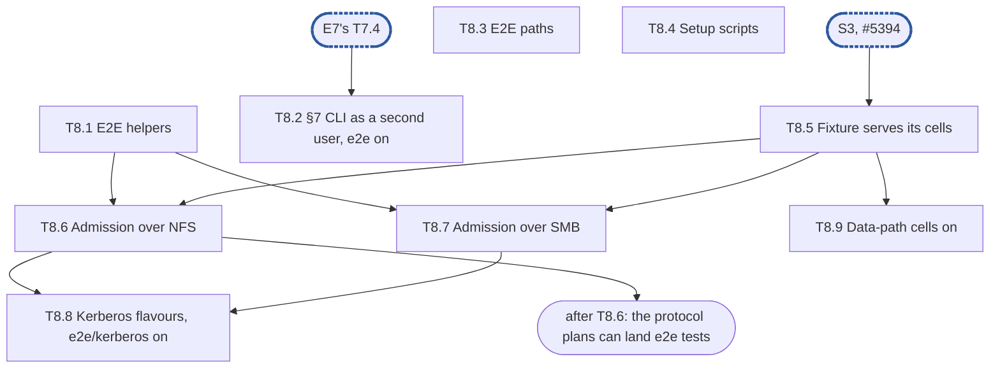

# Epic 8: control plane v2 — E2E green

**Sources:** [RFC 23](../docs/internals/rfcs/rfc-23-control-plane.md) §12 (Conformance): the rows
that mount a share ("§3.2 create admits nobody", "§5.1 roles grant nothing", "§3.5 grants"' admission
half), "§7 CLI"'s second-user form, and the suites paragraph; §3.2's create, §3.5's grants, §5.1, §7
and §10's CP9 and CP14 for what those rows hold; RFC 23's plan §1.5 rule 8, D9 and §5 epic 8; epic
7's D4 and §9 (the items handed here).
**Track:** the team.
**Epic 8 estimate: 9 subtasks, 19.75 man-days.**
**Depends on:** E4 (the client, `pkg/node/apiv1/client`); E7 (the server fixture, its T7.1,
landed; the CLI from a child, its T7.4, #4414, open) for T8.2. S3 for T8.5 to T8.9. S3 has not
been reached (§9): RFC 20's plan's epic 7 starts the adapters inside the node, but the NFS and SMB
handlers on the filesystem service, RFC 21's and RFC 22's plans, are at their first two epics, so
no client can mount yet. Outside RFC 23's plan as well: #5394 (an adapter's status names the port
it bound) for T8.5; the RFC 18 plan's epic 5 (Kerberos and the PAC, closed) and epic 9 (the e2e
Kerberos helper mended) for T8.8; the RFC 13 plan's epic 6 for `dt stack` in T8.4; RFC 8's second
part for the `badger-s3` profile (T8.5, T8.9).
**Blocks:** nothing in RFC 23's plan. RFC 21's plan's epic 16, RFC 22's plan's epic 16 and the RFC 18
plan's epic 9 write their e2e tests on T8.1's helpers and T8.5's fixture.

---

## 1. Goal

The rows only a real mount shows: a share admits nobody until granted, an API role grants nothing
on files, a `none` grant blocks while a group's grant admits once it is gone, and the CLI works as
an OS user who cannot read the host. Around them, the e2e driver epic 1 deleted is rebuilt on the
new client, the harness's fixture serves the protocols, and the cells the `feat/storage-v2` filter
switched off come back on as the data path they need exists.

**At the end of the epic:**

- `test/e2e` drives the server through epic 7's fixture and the API through epic 4's client, with
  helpers the protocol plans' e2e epics build on;
- `§7 CLI` passes as a second OS user, in the `e2e/second-user` cell on `feat/storage-v2`;
- the fixture serves NFS and SMB to the cells that ask for them;
- the three mount rows pass in `e2e` over NFS and SMB, and their Kerberos flavours in
  `e2e/kerberos`;
- the setup scripts that drove v1's CLI drive the new one;
- the filter entries D2 gives this epic are gone, and their cells run against the new server.

### 1.1 In scope

The e2e helpers; `§7 CLI`'s second-user form; the fixture's refusals of a served protocol, of
fixture users and of the S3 profile withdrawn; the mount rows of RFC 23 §12 over NFS, SMB and
Kerberos; `test/suites.yaml`'s e2e paths and the planner's test; the setup scripts D9 names that
still exist; the filter entries D2 gives this epic.

### 1.2 Out of scope

- v1's deleted e2e tests as such (D1): the CLI-only ones are covered at `unit` by E6's `clisuite`
  and E7's T7.4; the protocol ones go to RFC 21's plan's epic 16, RFC 22's plan's epic 16 and the
  RFC 18 plan's epic 9, a row of
  [the deferral ledger](rfc-23-control-plane-plan.md#61-deferral-ledger).
- `§2.2 order`'s adapter clause (D4): RFC 20's plan's epic 7 holds it in `unit`.
- The filter entries of the protocol suites (D2): `pynfs`, `cthon04` and `nfstest` are RFC 21's
  plan's epic 15; `smbtorture` and `wpts` RFC 22's plan's epic 15; `system` RFC
  22's plan's T16.5. `unit/windows` and `integration/kerberos` go with the filter itself at cutover
  (plan D9).
- The fixture's refusal of a shares file, and the SMB-conformance shares file's per-share options
  (`encrypt-data`, `access-based-enumeration`, …) applied as share settings: they bootstrap
  `smbtorture` and `wpts`, RFC 22's plan's epic 15, and their keys wait on X3; a ledger row.
- The scenarios' commands with no v2 command (`system drain-uploads`, `share snapshot`, `store block
  gc`, `reclaim`, `audit-refcounts`, `trash`, `stats call`): the syncer's, GC's and the snapshot
  resource's rows of the ledger, and a row for the rest.
- RFC 18 §10's rows over SMB in `e2e/kerberos` ("`none` is stored" among them) and epic 7's
  consumer-side row for the `krb` link (a PAC-bearing ticket binding the linked user, refused once
  the directory account is recreated): the RFC 18 plan's epic 9, which owns RFC 18 §10's Tier 2
  rows. R7 here is RFC 23 §3.5's admission half, over `AUTH_SYS` and NTLM.
- `docker compose up` on a v2 node, which `dt stack` needs: the ledger's row, the RFC 13 plan's
  epic 6.
- The multi-node rows and CP15: the ledger's cluster row.

### 1.3 Names used here

- **E1**, epic 1: v1 deleted, among it `test/e2e`'s helpers and the tests on them.
- **E3**, epic 3, the node: `node.New`, start and stop, `dfs start`.
- **E4**, epic 4, the management API, and its client `pkg/node/apiv1/client`.
- **E5**, epic 5, accounts and sign-in: roles, the bootstrap administrator, `dfs init`.
- **E6**, epic 6, the CLI: `dfsctl` and its shared table `clisuite`.
- **E7**, epic 7, the integration epic: the server fixture (T7.1), the CLI from a child (T7.4).
- **E8**, this epic.
- **S1**, epic 1 merged: v1 gone and the node's surface frozen.
- **S2**, the node starts and reconciles (E3).
- **S3**, adapters serve through the node, outside RFC 23's plan: RFC 20's plan's epic 7 and RFC
  21's and RFC 22's handlers on the filesystem service. Not the S3 storage service.
- **S7**, in RFC 21's and RFC 22's plans, their sync point "the node serves NFS" (or SMB): the part
  of S3 each protocol brings.
- **X3**, the RFC 13 plan's epic 5, which wires `Check`, `Diff` and `Get`.
- **CP9, CP14**, RFC 23 §10's invariants of those numbers.
- **plan D9**, RFC 23's plan's decision on the `feat/storage-v2` filter (#3714, `tests.yml`'s `V2`)
  and who turns each cell back on.

## 2. How the general rules apply

The rules are those of
[RFC 23's plan, §1.5](rfc-23-control-plane-plan.md#15-general-rules-for-each-epic), cited by number
and title and not copied.

| Rule | Subtasks | How |
| --- | --- | --- |
| rule 1, independent unit tests ([`CLAUDE.md`, "Writing tests"](../CLAUDE.md#writing-tests)) | T8.1, T8.5 | the helpers and the fixture run against a real server, a `dfs start` child over `t.TempDir()`; no test double: a mount is a kernel client |
| rule 2, fuzz every decoder of untrusted bytes ([`CLAUDE.md`, "Writing tests"](../CLAUDE.md#writing-tests)) | none | this epic adds no decoder |
| rule 3, observability follows RFC 25 | none | no series and no condition; the rows read the API's answers and the client's mount result |
| rule 4, profiling | none | the server is a child process; E7's fixture checks it exits 0 at stop, and the in-process leak check has nothing to watch; T8.2's node runs under `nodetest`'s watch as E7's T7.4 does |
| rule 5, public interface and internals ([`CLAUDE.md`, "Verifying a change"](../CLAUDE.md#verifying-a-change)) | T8.2, T8.6–T8.8 | each row asserts at the consumer: the kernel client's mount and the CLI process's exit, never a record |
| rule 6, known failures shrink ([`CLAUDE.md`, "Writing tests"](../CLAUDE.md#writing-tests)) | T8.2, T8.6–T8.9 | `e2e` keeps no `known.yaml`, so each e2e row lands green or not at all (D1); `pjdfstest`'s `test/posix/known.yaml` is rewritten for v2 in T8.9, each entry naming its owner's issue |
| rule 7, v2 ignores v1 | T8.1, T8.4 | the helpers are written against epic 4's client, not lifted from E1's deleted package; the scripts call the new CLI's nouns |
| rule 8, real dependencies for properties of those dependencies ([`CLAUDE.md`, "Writing tests"](../CLAUDE.md#writing-tests)) | T8.6–T8.8 | every refusal and admission is a Linux kernel client's mount (`mount -t nfs`, `mount -t cifs`), Kerberos against a real KDC |
| rule 9, code comment conventions ([`CLAUDE.md`, "Code comments"](../CLAUDE.md#code-comments)) | T8.2, T8.5, T8.6 | `tests.yml`'s filter keeps its `decision:` marker, narrowed to the cells still skipped (D2); `fixture.Unserved`'s `decision:` narrowed to the refusals left; D6's choice of where an NFS refusal shows carries a `decision:` at the row |
| rule 10, a test must be able to fail ([`CLAUDE.md`, "Writing tests"](../CLAUDE.md#writing-tests)) | all | each row is broken once on purpose (an open default at create, a role read as a grant, a command reading the bootstrap) and fails on its assertion |
| rule 11, a symbol is exported only if RFC 23's interface uses it | T8.1, T8.5 | the helpers' and the fixture's exports are the test tree's own surface; nothing under `internal/node` or `pkg/node` gains one |
| rule 12, each subtask creates only what it declares | T8.1 | the helpers have no consumer before S3, so T8.1 is written beside the others but lands with T8.6, its first consumer (§8) |

## 3. Requirements and invariants

Every obligation RFC 23 and its plan place on this epic. A `§12` row is written as RFC 23 names
it, in the part this epic owns.

**The driver and the suites**

| # | Requirement | Kind | Source | Subtasks |
| --- | --- | --- | --- | --- |
| R1 | The e2e helpers are rebuilt on epic 4's client, and the server they drive is started through epic 7's fixture on `dfs init` and `dfs start` | MUST | RFC 23 plan §5 epic 8, §3.3 (E7's row) | T8.1, T8.5 |
| R2 | The rows that mount shares over NFS and SMB run in `e2e`, their Kerberos flavours in `e2e/kerberos` | MUST | RFC 23 §12 (Suites) | T8.6, T8.7, T8.8 |
| R3 | A mount refusal is checked with a kernel client, at the e2e tier | MUST | RFC 23 plan §1.5 rule 8 | T8.6, T8.7, T8.8 |
| R4 | `test/suites.yaml`'s `paths:` for `e2e/kerberos` and `e2e/cross-protocol`, and `test/harness/plan/plan_test.go`'s list, name the v2 packages that replaced the trees epic 1 deleted, so a change to them plans those cells | MUST | RFC 23 plan §5 epic 8 | T8.3 |

**The CLI**

| # | Requirement | Kind | Source | Subtasks |
| --- | --- | --- | --- | --- |
| R5 | `§7 CLI`, its second-user form: the CLI's suite, run as an OS user to whom the host's bootstrap and the store are unreadable, passes, every command working; the CLI never opens the metadata store, a journal or a remote store, nor reads the bootstrap | test row | RFC 23 §12, §7, §10 (CP14); RFC 23 plan §5 epic 8; epic 7's D4 | T8.2 |

**Admission**

| # | Requirement | Kind | Source | Subtasks |
| --- | --- | --- | --- | --- |
| R6 | `§3.2 create admits nobody`: a share created through the API, alice's mount over NFS and over SMB is refused; once alice is granted, her mount is admitted. A create writes no grant, and a new share is reachable by nobody until an operator grants it | test row | RFC 23 §12, §3.2 | T8.6, T8.7, T8.8 |
| R7 | `§3.5 grants`, its admission half: `Finance` granted read and alice, a member, granted `none`, alice's mount is refused; alice's grant deleted, she is admitted read through `Finance`. A `none` grant is stored and blocks the principal, and a deleted grant lets the principal fall through to its groups' grants | test row | RFC 23 §12, §3.5 | T8.6, T8.7, T8.8 |
| R8 | `§5.1 roles grant nothing`: with the bootstrap administrator and an account of every role, every mount of every share over every flavour is refused, and the administrator's record holds no uid, gid, SID, Kerberos name or grant. No role makes an account privileged or granted on any share; file access comes only from share grants | test row | RFC 23 §12, §5.1, §10 (CP9) | T8.6, T8.7, T8.8 |

**Start order**

| # | Requirement | Kind | Source | Subtasks |
| --- | --- | --- | --- | --- |
| R9 | `§2.2 order`, its adapter clause: no adapter listened before the first reconcile completed | withdrawn | RFC 23 §12, §2.2 (step 9): an in-process row, which RFC 20's plan's epic 7 landed in `internal/node`'s `unit` tests; this epic builds nothing that could break it (D4) | — |

**The cells back on**

| # | Requirement | Kind | Source | Subtasks |
| --- | --- | --- | --- | --- |
| R10 | The setup that drives v1's `dfsctl` and configuration is rebuilt on the new CLI: `test/harness/env.sh`'s `stack_dev_user` and `test/scenarios`. Of the rest D9 names, `test/posix/setup-posix.sh` no longer exists (`pjdfstest` starts its server through epic 7's fixture), and the SMB-conformance bootstrap is RFC 22's plan's epic 15's (§1.2) | MUST | RFC 23 plan D9, §5 epic 8 | T8.4 |
| R11 | The filter's entries D2 gives this epic are removed on `feat/storage-v2`, each cell running against the new server: `e2e` (its `second-user` option, then the suite's own cell), `e2e/kerberos`, `pjdfstest`, `fio-verify`, `bench-smoke` and `clients` | MUST | RFC 23 plan D9, §5 epic 8; D2 | T8.2, T8.6, T8.8, T8.9 |

## 4. Decisions this epic takes

- **D1, the deleted tests are not brought back as such.** E1 deleted 52 e2e tests, about 24,000
  lines. `e2e` keeps no `known.yaml`, so a test lands only green, and most of them check a
  protocol's own behaviour (sessions, delegations, locks, leases, Kerberos, squash, NLM, the port
  mapper), which needs RFC 21's and RFC 22's handlers to pass. So:
  - the tests that only drive the CLI (users, groups, shares, stores, adapters, contexts, the
    server's lifecycle) are not brought back: E6's `clisuite` and E7's T7.4 check the same at
    `unit`, as `CLAUDE.md`'s E2E paragraph wants;
  - the tests whose check an RFC 23 §12 mount row states (`permission_enforcement_test.go`'s
    read-only and no-access cases) are replaced by that row;
  - the protocol tests go to the plan that owns the protocol: RFC 21's plan's epic 16 for NFS, RFC
    22's plan's epic 16 for SMB and the cross-protocol ones, the RFC 18 plan's epic 9 for squash and
    the Kerberos identity rows, each written on T8.1's helpers. A ledger row records it.

  This replaces the plan's "the tests epic 1 deleted brought back from history", which this
  document's pull request amends. Prior art: Kubernetes' e2e tests are owned per area, each area's
  team keeping its own (from memory). No marker.
- **D2, a cell leaves the filter with its first green test.** The filter skips by suite, and a cell
  whose run finds no test is graded "not run". RFC 21's and RFC 22's plans (their epics 15)
  already claim their protocol suites, and their rows of `e2e`, `e2e/kerberos` and
  `e2e/cross-protocol`. A cell leaves the filter only once, so whoever lands its first green test
  removes it, and the rows that come after join a running cell:
  - the `e2e` suite leaves the suite list with T8.2, whose `e2e/second-user` row needs no adapter
    and so lands first; `e2e`, `e2e/kerberos` and `e2e/cross-protocol` are skipped by name
    meanwhile (as `unit/windows` already is); `e2e` leaves with T8.6, its first green test under
    `test/e2e`, unless a protocol plan's row lands first, and `e2e/kerberos` with T8.8 unless a
    protocol plan's Kerberos row lands first;
    `e2e/cross-protocol` is the protocol plans';
  - of the suites no protocol plan claims, this epic removes `pjdfstest`, `fio-verify`,
    `bench-smoke` and `clients` (T8.9); on the branch, which runs no nightly tier, `clients` runs
    only its Linux cell, so `clients/windows` and `clients/macos` need no skip of their own and stay
    develop's nightly cells. The filter entry is this epic's alone: RFC 22's plan's epic 15 has
    nothing to remove for `clients/windows`, and its T16.5 owns only that cell's rows (§9).

  Plan D9 is amended to this in the same pull request; RFC 21's and RFC 22's epics 15 keep their
  rows of the e2e cells, which then find the cells already on (§9). The filter's `decision:` marker
  stays, naming the cells still skipped. Prior art: none found.
- **D3, the helpers start the server in process through epic 7's fixture.** `fixture.Start` runs
  `dfs init` and `dfs start`, reads the API address from the log, waits on `/health/ready`, signs in
  and stops by signal; a second launcher in `test/e2e` would drift from it. `test/e2e` declares no
  `fixture:` in `test/suites.yaml`: its rows need accounts, groups and shares of their own and a
  server restarted at will, which one server per cell set up by `dt` does not give, so `main_test.go`
  calls `fixture.Start` with a `dfs` it builds into a directory every user can read, and the
  helpers add only what a row needs beyond the fixture's users and shares: accounts of each role
  with a password, groups and members, shares created with no grant, grants put and deleted, the
  shared table of accounts and expectations the admission rows use, and a mount wrapper over
  `test/e2e/framework`. No marker.
- **D4, `§2.2 order`'s adapter clause stays in `unit`.** RFC 23 §12's suites paragraph runs in `e2e`
  only the rows that mount, and the clause is held in-process by RFC 20's plan's epic 7, which
  dials an adapter's port after every start step. An e2e copy would only repeat it slower, and
  nothing this epic builds can break it, so R9 is withdrawn; that test dials SMB's port only, which
  §9 names. No marker.
- **D5, the second-user row lives under `cmd/dfsctl`, as `nobody`.** `clisuite` is internal to
  `cmd/dfsctl`, so the row is an `e2e`-tagged test there, beside E7's T7.4 and reusing its child
  runner, named `TestSecondUser…`, and run by its own `e2e` option in `test/suites.yaml`,
  `second-user` (`cmd: go test -tags=e2e -run SecondUser ./cmd/dfsctl`), so the cell runs that one
  row rather than the whole `dfsctl` unit suite, `clisuite` included. `e2e` runs as root (`dt`
  runs it so), so the child starts with `SysProcAttr.Credential` set to uid and gid 65534, its
  `dfsctl` built into a directory that user can read and its `HOME` and `XDG_*` directories its
  own; the node's data directory and bootstrap stay `0700` root. No user is created on the host.
  The suite's harness-only rows are left out: they set up or read state through the in-process
  harness, which no separate user can reach, and run the same commands the other rows run. Prior
  art: Go's `os/exec` tests run children under another credential the same way (from memory). No
  marker.
- **D6, each account presents every flavour its record lets it present.** Each role account is
  created with a uid, a gid and a password and no grant, so a refusal can come only from admission,
  never from a missing spelling: it mounts over `AUTH_SYS` with its uid, over SMB with NTLM, and, in
  `e2e/kerberos`, with its Kerberos name. The bootstrap administrator has no spelling, so it presents
  SMB with NTLM by its name and password; `AUTH_SYS` names no account, so the row also mounts over
  `AUTH_SYS` as uid 0, the uid a root bypass would key on, and that is refused too. That its record
  holds no spelling is read back through the API. Where an NFS refusal shows, at the mount or at the
  first access to the share, is RFC 21's; the row asserts that no file of the share is reachable,
  with a `decision:` marker naming RFC 21's choice once it is made (§9). No other marker.

## 5. Target tree

```text
test/e2e/helpers/                         T8.1  server through fixture.Start, signed-in client,
  server.go accounts.go shares.go               accounts, groups, members, shares, grants, mounts,
  mount.go table.go                             the admission rows' table of accounts
test/e2e/main_test.go                     T8.1  builds dfs, one server per package run
cmd/dfsctl/e2e_test.go                    T8.2  §7 CLI as uid 65534, //go:build e2e
.github/workflows/tests.yml               T8.2, T8.8, T8.9  the filter's entries removed (D2)
test/suites.yaml                          T8.2, T8.3  e2e's cmd and paths
test/harness/plan/plan_test.go            T8.3
test/harness/env.sh                       T8.4  stack_dev_user on the new CLI
test/scenarios/setup.sh, lib/tools/       T8.4
test/scenarios/*.sh                       T8.4  calls with a v2 command rewritten
test/harness/fixture/                     T8.5  spec.go's refusals withdrawn; server.go reads the
                                                adapters' ports, creates fixture users, seeds S3
test/e2e/admission_nfs_test.go            T8.6  §3.2, §3.5, §5.1 over NFS
test/e2e/admission_smb_test.go            T8.7  §3.2, §3.5, §5.1 over SMB
test/e2e/admission_kerberos_test.go       T8.8  §3.2, §3.5, §5.1 Kerberos flavours
test/posix/known.yaml                     T8.9  rewritten for v2
```

## 6. Subtasks

### T8.1 The e2e helpers on epic 4's client

**Subtask T8.1 estimate: 2.5 man-days.**

- **Track:** the team. **Depends on:** none. E4's client and E7's T7.1 have landed; it is written
  now and lands with T8.6 (rule 12).
- **Covers:** R1.
- **Deliverables:** `test/e2e/helpers` (D3): `Start(t)` over `fixture.Start`, returning the
  server's addresses and a client signed in as the administrator; `Account(t, role, uid, gid)`
  creating an account with a password set through `:set-password` and no grant; `Group`, `Member`;
  `Share(t, name)` creating a share whose export policy states its flavours and which holds no
  grant; `Grant(t, share, principal, access)` through `Put` with `If-None-Match: *` and `Ungrant`
  through `Delete`; `MountNFS` and `MountSMB` over `test/e2e/framework`'s mounts, returning the
  client's error rather than failing; the admission rows' table of accounts, shares and expected
  answers, shared by T8.6 to T8.8; each helper's cleanup on `t.Cleanup`. `main_test.go` builds `dfs`
  and starts one server per package run. Consumed by T8.6 to T8.8, and by RFC 21's and RFC 22's
  plans' epics 16 and the RFC 18 plan's epic 9.
- **Acceptance criteria:**
  - `go vet -tags=e2e ./test/e2e/...` passes, and nothing under `test/e2e` imports `internal/node`.
- **Tests:** T8.6's rows are the helpers' first consumer and their test; no test of the helpers
  alone.

### T8.2 `§7 CLI` as a second OS user, and its cell on

**Subtask T8.2 estimate: 1 man-days.**

- **Track:** the team. **Depends on:** E7's T7.4 (#4414, the child-safe rows run from a `dfsctl`
  child).
- **Covers:** R5, R11 (the `e2e` suite, `e2e/second-user`).
- **Deliverables:** `cmd/dfsctl/e2e_test.go` (D5): `TestSecondUser`, T7.4's child runner over a
  `nodetest` node, the child run as uid and gid 65534, every row but the harness-only ones; the
  node's data directory and bootstrap checked unreadable to that user first. `test/suites.yaml`:
  `e2e`'s option `second-user`, `cmd: go test -tags=e2e -run SecondUser ./cmd/dfsctl`, `tier: pr`,
  its `paths:` `cmd/dfsctl/**`, `pkg/node/**` and `internal/node/**`; `e2e`'s own `cmd:` is
  unchanged. `tests.yml`'s filter: `e2e` out of the suite list, `e2e`, `e2e/kerberos` and
  `e2e/cross-protocol` skipped by name (D2), the `decision:` marker narrowed to them.
- **Acceptance criteria:**
  - Every row passes as uid 65534, and the `e2e/second-user` cell is green on `feat/storage-v2`,
    running that test alone.
- **Tests:** the row, run once with a command changed to read the bootstrap, which then fails as
  uid 65534 (catches a command that bypasses the API, R5).

### T8.3 The e2e cells' paths on the v2 packages

**Subtask T8.3 estimate: 0.5 man-days.**

- **Track:** the team. **Depends on:** none.
- **Covers:** R4.
- **Deliverables:** `test/suites.yaml`: `e2e`'s `kerberos` option gains `internal/node/**`,
  `pkg/node/**` (the sign-in, the keytab and the share's export policy now reach the mount through
  them) and `test/e2e/admission_kerberos_test.go`; `cross-protocol` gains `internal/node/**` and
  `pkg/node/**` (the grants and the export policy both adapters admit by). `plan_test.go`: a change
  to `internal/node/reconcile.go` and to `pkg/node/apiv1/share.go` plans both cells.
- **Acceptance criteria:**
  - `dt`'s planner tests pass with the new cases.
- **Tests:** the planner cases, run once with the new paths removed (catches a v2 change that no
  longer plans the cells).

### T8.4 The setup scripts on the new CLI

**Subtask T8.4 estimate: 3 man-days.**

- **Track:** the team. **Depends on:** none. The RFC 13 plan's epic 6 for running `dt stack`.
- **Covers:** R10.
- **Deliverables:** about 150 `dfsctl` calls across `env.sh` and 37 scenario scripts:
  - `env.sh`'s `stack_dev_user` on `dfsctl login`, `user create` with its uid, `user set-password`
    and `grant set`;
  - `test/scenarios/setup.sh` on `dfs init`, the new `store`, `namespace` and `share create` nouns,
    `share export-policy set` for the flavours (no default permission), `grant set`, `user create`
    and `user set-password`, and the adapters' settings;
  - `lib/tools/dfs-server` reading the API address from the log and the password `dfs init`
    printed, rather than `:8080` and a fixed password;
  - each scenario's call that has a v2 command rewritten (`store`, `share`, `share quiesce|resume`
    for v1's `share disable|enable`, `grant`, `user`, `adapter`, `login`).

  A scenario that still calls a command with no v2 command (`system drain-uploads`, `share
  snapshot`, `store block gc`, `reclaim`, `audit-refcounts`, `trash`, `stats call`) keeps it,
  listed in the ledger rows §1.2 names.
- **Acceptance criteria:**
  - `shellcheck` passes over every changed script, and no script calls a `dfsctl` noun the new CLI
    does not have but the listed ones.
  - Once the RFC 13 plan's epic 6 serves `docker compose up` on a v2 node, `dt stack up` creates its
    user and grant.
- **Tests:** the `shellcheck` cell; the scripts' behaviour is the `system` suite's, which RFC 22's
  plan's T16.5 turns on. A `rg` over `test/scenarios` and `env.sh` for v1's nouns (`share
  permission`, `store metadata`, `store block`, `adapter enable`, `share enable`) returns only the
  listed calls.

### T8.5 The fixture serves its cells

**Subtask T8.5 estimate: 2 man-days.**

- **Track:** the team. **Depends on:** none. S3 for a served protocol, #5394 for the port an
  adapter bound; RFC 8's second part for the `badger-s3` profile.
- **Covers:** R1.
- **Deliverables:** `fixture.Unserved`'s refusals withdrawn as each part serves: a fixture serving
  NFS or SMB, or with namespaced clients, once the server reads each adapter's port from its status
  (#5394) and fills `{nfs-port}` and `{smb-port}`; fixture users, created with a uid and a password;
  the `badger-s3` profile once a remote store can be seeded. The shares-file refusal stays (§1.2).
  The `decision:` marker narrowed to what is left. Consumed by T8.6 to T8.9 and by the protocol
  plans' suites.
- **Acceptance criteria:**
  - A fixture serving NFS and SMB with users starts, and `{nfs-port}`, `{smb-port}`, `{user}` and
    `{password}` reach a cell.
- **Tests:** `fixture/server_test.go`: a served fixture's ports read back and dialled, its users
  read back through the client (catches a port picked in advance or a user without a password);
  the five real-protocol fixture tests the RFC 20 plan's ledger names run where their protocol
  serves.

### T8.6 The admission rows over NFS

**Subtask T8.6 estimate: 2.5 man-days.**

- **Track:** the team. **Depends on:** T8.1, T8.5. S3 for NFS: the node serving NFS to a Linux
  kernel client over `AUTH_SYS`, with share admission read from the grants (RFC 21's plan's epics
  4, 5 and 7, and its S7).
- **Covers:** R2, R3, R6, R7, R8 (their NFS `AUTH_SYS` part); R11 (`e2e`'s own cell).
- **Deliverables:** `admission_nfs_test.go`: `§3.2`, alice's NFSv3 and NFSv4.1 mounts refused on a
  new share, admitted once granted; `§3.5`, `Finance` read and alice `none`, refused, then alice's
  grant deleted and her mount admitted read, a write refused; `§5.1`, an account of each role
  mounting every share, and an `AUTH_SYS` mount as uid 0 (D6), each refused, and the
  administrator's record read back with no spelling. D6's `decision:` marker on where the refusal
  shows. `tests.yml`: `e2e`'s skip by name removed, unless T8.7 or a protocol plan's row has
  already removed it (D2).
- **Acceptance criteria:**
  - Each row passes on the `e2e` cell with a kernel client.
- **Tests:** the rows, each broken once: a create that writes a read grant for every principal, an
  open default (R6); `none` stored as no grant (R7); a role read as an `admin` grant, and uid 0
  admitted past its grants (R8).

### T8.7 The admission rows over SMB

**Subtask T8.7 estimate: 2 man-days.**

- **Track:** the team. **Depends on:** T8.1, T8.5. S3 for SMB: the node serving SMB to a Linux
  kernel client with NTLM, `TREE_CONNECT` admitted from the grants (RFC 22's plan's epics 4, 5 and
  6, and its S7).
- **Covers:** R2, R3, R6, R7, R8 (their SMB NTLM part).
- **Deliverables:** `admission_smb_test.go`: the same three rows over `mount -t cifs` with NTLM,
  from T8.1's shared table; the bootstrap administrator's own SMB mount by name and password,
  refused on every share. `tests.yml`: `e2e`'s skip by name removed if T8.6 has not removed it.
- **Acceptance criteria:**
  - Each row passes on the `e2e` cell with a kernel client.
- **Tests:** the rows, broken as T8.6's are; the administrator's mount admitted once by planting a
  grant for it (catches an exemption for the bootstrap administrator, R8).

### T8.8 The Kerberos flavours, and `e2e/kerberos` back on

**Subtask T8.8 estimate: 3.75 man-days.**

- **Track:** the team. **Depends on:** T8.6, T8.7. S3 for Kerberos: RPCSEC_GSS `krb5`, `krb5i` and
  `krb5p` (RFC 21's plan's epic 13) and SMB Kerberos sessions (RFC 22's plan's epics 4 and 5), on the
  RFC 18 plan's epic 5; the e2e Kerberos helper mended by the RFC 18 plan's epic 9.
- **Covers:** R2, R3, R6, R7, R8 (their Kerberos part); R11 (`e2e/kerberos`).
- **Deliverables:** the server's half of NFS Kerberos, which nothing else sets up (1 man-day of
  the estimate): an `nfs/<host>` principal beside the `cifs/<host>` one `fixture/kerberos.go`
  writes, the KDC image's entrypoint (`test/smb-conformance/kdc`) taking both; the keytab holding
  both given to the `dfs` child `fixture.Start` runs; `NotSetUp`'s refusal of Kerberos without SMB
  lifted, its message narrowed to what is left. `admission_kerberos_test.go`: the three rows with
  each account's Kerberos name, NFS over `krb5`, `krb5i` and `krb5p` and SMB with Kerberos, against
  the fixture's KDC, so the server's keytab and the accounts' principals share one realm; the test
  names matching the option's `-run Kerberos`. `tests.yml`:
  `e2e/kerberos` out of the filter, unless a protocol plan's Kerberos row has already taken it
  out (D2).
- **Acceptance criteria:**
  - Each flavour's rows pass on the `e2e/kerberos` cell, and the cell is green on
    `feat/storage-v2`.
- **Tests:** the rows, broken as T8.6's are, once per mechanism (catches an admission check one
  flavour skips); `fixture/kerberos_unix_test.go` reads the keytab back and finds both principals,
  and `fixture_test.go`'s `NotSetUp` case for Kerberos over NFS alone expects no refusal (catches a
  keytab holding `cifs/` only, which fails every `krb5` mount).

### T8.9 The data-path cells back on

**Subtask T8.9 estimate: 2.5 man-days.**

- **Track:** the team. **Depends on:** T8.5. S3 for NFS for `pjdfstest` and `fio-verify`, for SMB
  for `clients`, and the data path each suite exercises; RFC 8's second part for the `badger-s3`
  profile `pjdfstest`, `fio-verify` and `clients` run on.
- **Covers:** R11 (`pjdfstest`, `fio-verify`, `bench-smoke`, `clients`).
- **Deliverables:** `tests.yml`: each entry out of the filter once its cell passes against the new
  server; `test/posix/known.yaml` rewritten for v2, each entry naming the issue of the epic that
  fixes it in RFC 17's, RFC 21's or RFC 22's plan.
- **Acceptance criteria:**
  - Each cell is green on `feat/storage-v2`, `pjdfstest` at its rewritten known failures.
- **Tests:** the suites themselves; a known failure that passes fails the run (RFC 29 §4.7), so the
  file cannot keep a stale entry.

## 7. Order of work



T8.1, T8.3 and T8.4 can be done now (6 man-days), T8.2 once E7's T7.4 lands. T8.5 to T8.9 wait for
S3, each for the protocol it mounts; T8.6 and T8.7 go in whichever order their protocol serves.

## 8. Suggested pull requests

| PR | Subtasks | Man-days | After | Why together |
| --- | --- | --- | --- | --- |
| 1 | T8.2 | 1 | E7's T7.4 | the second-user row and its `e2e/second-user` cell on |
| 2 | T8.3, T8.4 | 3.5 | — | the suites' paths and the scripts: no Go, no mount |
| 3 | T8.1, T8.5, T8.6 | 7 | S3 for NFS, #5394 | the helpers, the fixture serving, and their first consumer |
| 4 | T8.7 | 2 | PR 3, S3 for SMB | the rows over SMB |
| 5 | T8.8 | 3.75 | PR 4, S3 for Kerberos | the server's NFS principal, the Kerberos flavours and their cell |
| 6 | T8.9 | 2.5 | PR 3, S3 | the data-path cells, burned down as their data path lands |

PRs 1 and 2 can be open together, now. If SMB serves before NFS, PR 3 takes T8.7 in place of T8.6.
A suggestion only: one pull request per subtask works as well.

## 9. Open points

- **S3 has not been reached (2026-11-25).** On `feat/storage-v2`, RFC 20's plan's epic 7 starts the
  adapters after the first full reconcile and drains them at stop (`internal/node/adapters.go`),
  but `internal/adapter/nfs` holds only the NFSv4 `COMPOUND` scaffold and `internal/adapter/smb` no
  handler: RFC 21's plan has its epics 1 and 2 open (#5637, #5641) and RFC 22's plan none issued, and
  each plan's own S7 ("the node serves" its protocol) is far off. T8.1, T8.3 and T8.4 (6 man-days)
  can start now, T8.2 (1 man-day) after #4414; T8.5 to T8.9 (12.75 man-days) wait. What each needs
  from S3 is named at the subtask, by the RFC 21 and RFC 22 plans' epics; their interfaces are not
  assumed here.
- RFC 21's and RFC 22's epics 15 say they take their rows of `e2e`, `e2e/kerberos` and
  `e2e/cross-protocol` out of the filter. Under D2 the first green test takes a cell out, and
  the `e2e` suite leaves the suite list with T8.2 and `e2e`'s own cell with T8.6; those plans' text
  needs the same reading, a change to them, not here.
  RFC 22's plan's epic 15 also names `clients/windows` among the cells it takes out of the filter;
  under D2 the `clients` entry is T8.9's, and that cell is nightly, which the branch does not run,
  so that change also drops `clients/windows` from its list.
- Where an NFS refusal shows, at `MOUNT` for NFSv3 and at `PUTFH` or a junction `LOOKUP` for NFSv4,
  or at the first access, is RFC 21's to settle (D6). T8.6's assertion is written once it is.
- How a member of `Finance` is resolved at admission over `AUTH_SYS`, from the store's membership or
  from the client's gids, is RFC 18's and RFC 21's (RFC 18 §6.4); R7's row needs only that the
  membership the API wrote admits alice.
- RFC 20's plan's epic 7's start-order test dials SMB's port only, while RFC 23 §12 says "no adapter
  listened"; adding NFS's port there is RFC 20's plan's, once NFS serves.
- T8.9's burn-down is sized blind: `pjdfstest`'s v2 failures are unknown until the data path serves.
  The estimate covers the rewrite of the known file and the filter change, not fixing what it
  lists. Whether `fio-verify` and `bench-smoke` can run on the journal-only engine before RFC 8's
  second part, on a profile with no remote store, is open; if they can, T8.9 drops that dependency.
- T8.4 cannot be run end to end until `dt stack` serves a v2 node or `system` comes back on; until
  then only `shellcheck` and the `rg` check hold it.
- The proposals to RFC 23's plan this document's pull request makes: §5 epic 8's estimate, its
  expected content (D1, the second-user form) and its dropped `§2.2 order` clause (D4); D9's list of
  who removes each filter entry (D2); the §3.3 and §5 text on what epic 8 waits for; the deferral
  ledger's rows for the protocol e2e tests, the shares file's options and the scenarios' commands
  with no v2 command.
