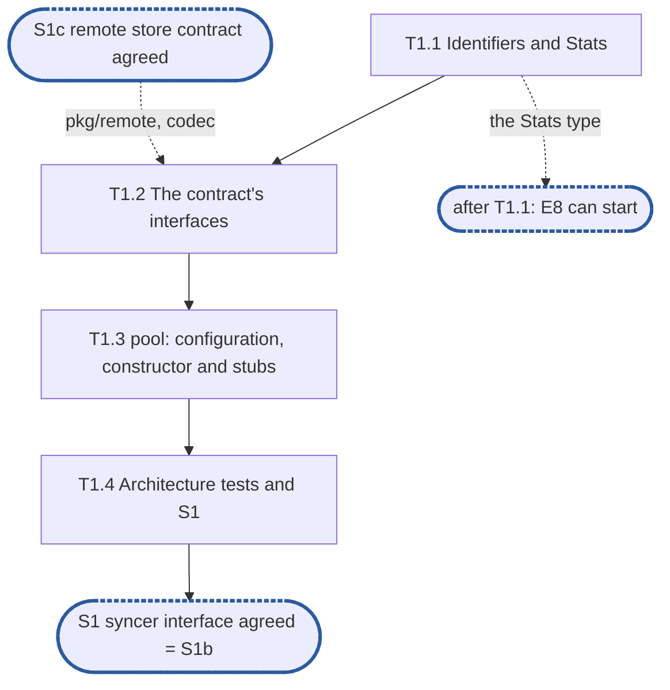

# Epic 1: syncer v2 interfaces

**Sources:** [RFC 3](../docs/internals/rfcs/rfc-3-syncer.md) §1.1, §1.2, §1.3's declarations
for v1.1 (its table "What lands with its first caller" included), §1.4's dependency set, §2.2's
per-worker inputs, §2.10's two settings, §2.12's metrics, §7.2's "§1.3 RFC 4's errors, as they
are" row (its import half) and §8.1's "Structure" kind.
[RFC 0](../docs/internals/rfcs/rfc-0-data-lifecycle.md) §1.2, component autonomy as amended.
[RFC 8](../docs/internals/rfcs/rfc-8-engine.md) §2.1's "One clock and one fault interface",
for the clock. [RFC 25](../docs/internals/rfcs/rfc-25-observability.md) §2.6, for the histogram
buckets. Cited, not owned: [RFC 4](../docs/internals/rfcs/rfc-4-remote-tier.md) §4.1 and §4.8,
the contract the syncer imports, and §4.3's `codec.Store`, as the pull request finalising the
syncer's seam gives them (`docs/rfc-4-syncer-seam`). Every citation is `develop`'s text. The
code lands on `feat/storage-v2`, and the paths below are paths there.
**Track:** the team.
**Epic 1 estimate: 4 subtasks, 3.75 man-days.**
**Depends on:** **RFC 8 offload plan S1c**, the remote store contract agreed: `pkg/remote`'s
names, ranges, chunks, directions, `Meter` and error set, and `codec.Store` with `NewPut`,
`Put.Attempt` and `Put.Stored`, all landed with stub bodies on `feat/storage-v2` by the RFC 4
plan's epic 1. Neither package exists there yet, and every signature of T1.2 is written in
`pkg/remote`'s types. `pkg/sim`, `internal/prof` and `internal/archtest` are already on
`feat/storage-v2`.
**Blocks:** everything. E2 builds the test harness on the agreed surface. E8 needs only the
`Stats` type (T1.1). E3 to E7 fill the stub bodies of T1.3 and the counters of T1.1. Outside this
plan, RFC 8 offload plan epics 15, 16, 17 and 20 call `Flow`, and its epic 21 calls `pool.New`.

---

## 1. Goal

Epic 1 freezes the syncer's surface for v1.1 and the rules that keep it a contract. The root
`pkg/syncer` holds RFC 3 §1.3's contract, written in `pkg/remote`'s types. `pkg/syncer/pool`
holds the constructor and its configuration, behind stub bodies. A transitive import test and a
frozen-exports test hold both packages to what was agreed at S1.

**At the end of the epic:**

- `pkg/syncer` declares `Store`, `Probes`, `ProbeKey`, `StoreID`, `FlowID`, `Syncer`, `Flow`
  and `Stats`, and nothing that RFC 3 §1.3 says lands with its first caller.
- `Stats` has a field for every RFC 3 §2.12 series, with its labels.
- `pool.New(Config)` refuses every invalid configuration and a registration with a probe off.
  Every other method returns an error saying it is not built yet, which E3 to E7 replace.
- RFC 4's `codec.Store` satisfies `syncer.Store`, and `(*codec.Put).Attempt` fits `Upload`'s
  `attempt`, both checked by the compiler.
- The import test reaches `pkg/remote` from each syncer package and no implementation,
  following imports transitively. No production file reads the real clock. Both packages
  export exactly the frozen surface.

### 1.1 In scope

The declarations of RFC 3 §1.3 for v1.1, `Stats`, `pool.Config`, `pool.Clock` and `pool.New`,
the refusals `New` and `Register` make, the compile check against RFC 4's codec, and the
architecture tests.

### 1.2 Out of scope

- Every behaviour behind the stubs: the registry, flows, `Close`, `Unregister` and the pools
  (E3); the attempt loop and `Upload` (E4); health and `Flow.Health` (E5); `Fetch` and
  `Prefetch` (E6); the bound and the snapshot behind `Stats` (E7).
- The Group A suite, `syncertest`, and the per-call faults on RFC 4's fault wrapper (E2).
- The collector and the settings section in `internal/node/content` (E8).
- `FetchRaw`, `UploadRaw`, `FetchVersion` and the staging budget; `Small`; `SetDrift` and
  `ErrDrift`; a registration with a probe off: rows 1 to 4 of the RFC 3 plan's §6.1 deferral
  ledger.
- Building a `codec.Store` per store, the `ProbeKey` value, the root's syncer and the fixed
  per-worker inputs it passes: RFC 8 offload plan epic 21, the ledger's sixth row.

### 1.3 Names used here

- **E1**, this epic.
- **E2**, epic 2, test foundations: the Group A suite in `syncertest` and the per-call faults on
  RFC 4's fault wrapper.
- **E3**, epic 3, registration, flows and the fair scheduler, which creates
  `pkg/syncer/pool/internal/sched`.
- **E4**, epic 4, termination, retries and the uploader.
- **E5**, epic 5, store health.
- **E6**, epic 6, the fetcher.
- **E7**, epic 7, memory bound, `Stats` and the fault sweep.
- **E8**, epic 8, the syncer's own integration: its settings section and its collector.
- **S1**, the syncer interface agreed: the joint review of this epic's written signatures with
  the authors of the RFC 8 offload plan and the RFC 4 plan. It is the RFC 8 offload plan's
  **S1b**.
- **S1c**, the RFC 8 offload plan's remote store contract agreed: `pkg/remote` and the codec's
  surface, the RFC 4 plan's own S1.
- **S2**, the test foundations in CI, at the end of E2.
- **The integration epic**, E8 here; outside this plan, RFC 8 offload plan epic 21, which
  composes the syncer in the node.

## 2. How the general rules apply

The rules are those of
[the RFC 3 plan's §1.5](rfc-3-syncer-plan.md#15-general-rules-for-each-epic). They are cited by
number and title, not copied.

| Rule | Subtasks | How |
| --- | --- | --- |
| rule 1, independent unit tests ([`CLAUDE.md`, "Writing tests"](../CLAUDE.md#writing-tests)) | all | Every test runs on its own: table tests of `New`'s and `Register`'s refusals, reflection over `Stats`, and the architecture tests over the source tree. No test double. E1 declares no internal interface |
| rule 2, fuzz tests where relevant ([`CLAUDE.md`, "Writing tests"](../CLAUDE.md#writing-tests)) | none | Nothing here reads bytes: there is no parser to fuzz |
| rule 3, observability follows RFC 25, with RFC 3's own exception | T1.1, T1.3 | `Stats` carries every RFC 3 §2.12 series (T1.1). Its histograms use RFC 25 §2.6's `request` set. `Config` takes a structured logger and no tracer (D5). No metric is registered here: the collector is E8's |
| rule 4, profiling | T1.1, T1.3 | The unit tests run under `internal/prof`'s leak check. No hot path carries an allocation or dispatch assertion here: the stubs do nothing, and E3 and E7 own those two |
| rule 5, public interface and internals ([`CLAUDE.md`, "Verifying a change"](../CLAUDE.md#verifying-a-change)) | T1.3 | Under `-race`. Each pool size is read back from `Stats`, where E8's collector consumes it. Each refusal is asserted at `New` and `Register`, where the composer and the engine meet it |
| rule 6, known failures shrink | none | No suite this epic's tests run in keeps a `known.yaml`: every test lands green |
| rule 7, v2 ignores v1 | T1.4 | The import test of D8: transitive, one allowlist per package, a package missing from it failing. It is also the import half of RFC 3 §7.2's "§1.3 RFC 4's errors, as they are" row |
| rule 8, real dependencies for properties of those dependencies ([`CLAUDE.md`, "Writing tests"](../CLAUDE.md#writing-tests)) | T1.2, T1.4 | The compile check runs against RFC 4's real `codec` package, and the import test against `go list`'s real dependency graph. Nothing here needs a disk, a store or a service |
| rule 9, code comment conventions ([`CLAUDE.md`, "Code comments"](../CLAUDE.md#code-comments)) | T1.3 | The `decision:` marker at `Register`'s refusal of a probe left off (D5). RFC 3's `decision:` notes on §2.4, §2.8 and §2.10's fixed values sit at code E3 to E5 write |
| rule 10, a test must be able to fail ([`CLAUDE.md`, "Writing tests"](../CLAUDE.md#writing-tests)) | all | Each architecture test runs over a planted `testdata` tree as well as over the real one, and fails on the planted violation. Each refusal test is checked by removing the refusal |
| rule 11, a symbol is exported only if the RFC's interface uses it | all | The exported surface is RFC 3 §1.3's for v1.1, with the names RFC 3 §1.3 and §2.12 use but leave undefined (D2, D3), plus `pool.New`, `Config` and `Clock`. The frozen-exports test (T1.4) pins it at S1 |
| rule 12, each subtask creates only what it declares | all | Each type lands with the subtask that names its consumer. The import test lists only packages that exist: `syncertest` joins with E2, `internal/sched` with E3 (D8) |

## 3. Requirements and invariants

Every MUST and MUST NOT that RFC 3, RFC 0, RFC 8 and RFC 25 place on this epic, numbered so
that subtasks and tests can cite them.

**Dependencies and structure**

| # | Requirement | Kind | Source | Subtasks |
| --- | --- | --- | --- | --- |
| R1 | The syncer's production code reaches RFC 4's contract, `pkg/remote`, and no implementation: no codec, no store, no transforms, no carver, no journal, no metadata store, no engine | MUST NOT | RFC 3 §1.1, §1.3, §1.4, §7.2 ("§1.3 RFC 4's errors, as they are"); RFC 0 §1.2 | T1.4 |
| R2 | The syncer declares none of RFC 4's value types or errors again: names, ranges, chunks, directions, versions, checksums, `Meter`, the error set | MUST NOT | RFC 3 §1.3; RFC 0 §1.2 | T1.1, T1.2, T1.4 |
| R3 | The syncer's dependencies are exactly four, each supplied: a backend as `Store`, the bytes to upload as the `attempt` closure, time as a clock interface, logging as a structured logger. No disk and no network | MUST NOT | RFC 3 §1.4 | T1.2, T1.3, T1.4 |
| R4 | The syncer never reads time from anywhere the virtual clock cannot replace | MUST NOT | RFC 3 §1.4 | T1.3, T1.4 |
| R5 | The clock the syncer reads is declared in its own package, in standard-library types, as the subset of the one clock's methods it uses | invariant | RFC 8 §2.1, "One clock and one fault interface" | T1.3 |
| R6 | The syncer depends on no metrics library | invariant | RFC 3 §2.12 | T1.4 |
| R7 | The contract is a unit of its own: the root holds `Syncer` and `Flow` as interfaces and the types they carry, `pool` implements them, and the root keeps no state and imports only the standard library, libraries outside the components and other contracts | invariant | RFC 0 §1.2; RFC 3 §1.3 | T1.1, T1.2, T1.3, T1.4 |
| R8 | An import test follows imports transitively for each package, and fails when production code reaches another component's implementation; tests may import implementations | invariant | RFC 0 §1.2; RFC 3 §8.1 ("Structure") | T1.4 |

**The surface**

| # | Requirement | Kind | Source | Subtasks |
| --- | --- | --- | --- | --- |
| R9 | `Store` is the syncer's own interface, named for its need: a verified get and a probe, with no put and no delete. RFC 4's `codec.Store` implements it | invariant | RFC 3 §1.3; RFC 0 §1.2 | T1.2 |
| R10 | Nothing RFC 3 §1.3 lands with its first caller is declared before it: no `FetchRaw`, `UploadRaw`, `FetchVersion`, `Small`, `SetDrift` or `ErrDrift` | invariant | RFC 3 §1.3, "What lands with its first caller" | T1.2, T1.4 |
| R11 | `Register` takes `Probes` from the first release, so a later caller changes no signature | invariant | RFC 3 §1.3 | T1.2 |
| R12 | A registration with `PutProbe` or `GetProbe` false is refused until its first caller lands | invariant | RFC 3 §1.3, "What lands with its first caller" | T1.3 |
| R13 | Work reaches the syncer through a flow bound to one store: a call on a flow carries neither a store nor a key | invariant | RFC 3 §1.3 | T1.2 |
| R14 | `Fetch` and `Prefetch` are separate methods, not one method with a priority parameter | invariant | RFC 3 §1.3 | T1.2 |
| R15 | A stream is an `iter.Seq2`; leaving the loop is how a caller stops it, and there is no `Close` to forget | invariant | RFC 3 §1.3 | T1.2 |
| R16 | `ErrDrift` is the syncer's only error value, so v1.1, which defers it, declares none | invariant | RFC 3 §1.3 | T1.2, T1.4 |

**Configuration**

| # | Requirement | Kind | Source | Subtasks |
| --- | --- | --- | --- | --- |
| R17 | The two halves' pool sizes are configurable independently | MUST | RFC 3 §1.2 | T1.3 |
| R18 | No value RFC 3 §2.10 fixes is a field of the configuration: the two worker counts are its only tunables, `upload_workers` and `fetch_workers`, and every other field is an input derived elsewhere. The settings section that declares exactly those two is E8's | MUST NOT | RFC 3 §2.10 | T1.3, T1.4 |
| R19 | An invalid setting is refused, never replaced by a default | MUST | RFC 0 §1.2 | T1.3 |
| R20 | The per-worker figure's inputs are fixed when the process starts: `Max`, the largest of any namespace served at start and never less than 1 MiB, `MaxDecodeLen(Max)` and the header cap | invariant | RFC 3 §2.2 | T1.3 |

**Observability**

| # | Requirement | Kind | Source | Subtasks |
| --- | --- | --- | --- | --- |
| R21 | Every metric RFC 3 §2.12 lists is observable from `Stats`, by half and store, by class for the queue metrics, by reason or outcome where it says so, and the queue gauges both per flow, by the flow's id, and summed | MUST | RFC 3 §2.12 | T1.1 |
| R22 | A histogram uses one of RFC 25's fixed bucket sets | invariant | RFC 25 §2.6 | T1.1 |

## 4. Decisions this epic takes

- **D1, what a refused call returns.** RFC 3 §1.3 and §2.9 say a
  call is refused (a closed flow or syncer, a full queue, the waiter bound, an unhealthy
  direction, a registration with a probe off), but not with what error. RFC 3 §1.3 calls
  `ErrDrift` the syncer's only error value (R16). The engine already depends on the answer: RFC 8
  §6.3's O6 does not count a pass "refused by a full syncer queue (`Throttled`)" as failed, and
  §10.2 reads a put-unhealthy store's cause from `Health(Put)`. The user chose the option
  that keeps R16 and needs no RFC amendment, since each refusal wraps an error of RFC 4's set:
  - a full queue, the waiter bound, a displaced or an evicted entry wrap `remote.ErrThrottled`,
    the reason in the message;
  - a call in an unhealthy direction returns that direction's `Flow.Health` error, which names
    the store and wraps its cause;
  - a call after `Flow.Close` or `Close`, a call naming a `StoreID` that is not registered,
    `Unregister` with a flow open, and a registration with a probe off wrap `remote.ErrInvalid`:
    each is the caller's fault and is never worth retrying.

  Two consequences to weigh: `remote.ErrThrottled` wraps `ErrTransient` (RFC 4 §4.1), so a
  capacity refusal also matches `errors.Is(err, remote.ErrTransient)`; and the engine cannot
  tell a syncer queue refusal from a store that kept throttling past the retry bound, which O6
  treats the same way anyway.

  Not chosen: a sentinel per refusal in `pkg/syncer` (`ErrRefused`, `ErrClosed`), which would
  amend RFC 3 §1.3's "only error value". T1.2 writes the convention into the interfaces' doc
  comments, T1.3's `Register` refusal is its first use, and E3 and E5 apply the rest. Changing it
  after S1 costs a change to every refusal test of E3 and E5 and to the engine's error mapping in
  RFC 8 offload plan epics 15 to 17. Prior art: Go's `net.ErrClosed`, one value for every use of a
  closed connection (from memory); none found for reusing a backend's throttling error as a
  scheduler's own backpressure.
- **D2, the names RFC 3 §1.3 uses but leaves undefined.** `StoreID` and `FlowID` are `uint64`
  values minted by `Register` and `OpenFlow`, zero never minted. `Flow` gains `ID() FlowID`,
  because RFC 3 §2.12 reports flows by id and RFC 8 offload plan epic 21 maps each id to its share.
  `ProbeKey` is `[32]byte`, so the composer passes a digest of endpoint, credential and bucket
  and no credential text is held as a key, and its zero value is the key that shares with nothing
  (RFC 3 §1.3). `Register`'s `name` is the store's metric label and is reported in `Stats`.
  Changing any of these after S1 changes every caller's signature. Prior art: `remote.Name`,
  also a `[32]byte` digest; `os.File.Fd` for an opaque handle number (from memory).
- **D3, the shape of `Stats`.** Per half, then per store, with the per-flow queue gauges beside
  them. Each label value of RFC 3 §2.12 is a named field (`Refused.QueueFull`,
  `Retries.SlowTail`, `ByClass[T].Demand`), never a string or an enum the collector has to
  decode, so a missing label value is a missing field, which T1.1's test and E8's collector see.
  The pool-wide gauges, `syncer_workers` and `syncer_detached_buffers`, sit on the half, since
  no store owns them (§9). A refusal with no registered store behind it (an unknown `StoreID`, a
  call after the syncer's `Close`, a refused `Register`) is not counted, since §2.12 counts
  refusals by store. Fields are added, never changed, so E3 to E7 filling them changes no
  signature. Prior art: the journal's `Stats`, which the node turns into series
  (`journalSeries`, `internal/node/stats.go`).
- **D4, histograms carry RFC 25's `request` set.** `syncer.Histogram` holds one count per bucket
  of that set plus the overflow, and the sum. Its `Bounds` method, a pure method on its own value
  type as RFC 0 §1.2 allows a contract, returns the set, so the counts and the bounds E8 exports
  cannot drift. All four syncer histograms time remote calls or waits on them, which is what the
  `request` set is for. Prior art: the journal's sync histogram, whose own bounds carry a
  `decision:` for drifting from RFC 25's sets (`internal/node/stats.go`); this avoids that.
- **D5, `pool.New` returns the contract.** `New(Config) (syncer.Syncer, error)` returns the
  root interface, so `pool` exports only `New`, `Config` and `Clock`. `Config` holds the two
  worker counts (the only settings, R18), the per-worker inputs (R20), the block target, the
  clock and a logger, and no tracer,
  since RFC 25 §6.1 gives the fetch span to the engine and the syncer opens none. `New` refuses a count below one, a `Max` below 1 MiB, a non-positive input and a
  nil clock or logger, naming the field (R19). `Register` refuses a probe left off, with a
  `decision:` marker naming its first caller, an immutable backup location (RFC 4 §4.14), and
  saying the refusal goes when that caller lands. The block target is set per namespace, from
  1 MiB to 64 MiB (RFC 2 §5.2), while RFC 3 §2.2 and §2.10 size the largest encoded block and
  the quantum from one figure; `BlockTarget` is therefore the largest of the namespaces served at
  start, fixed like `Max`, so `Register` keeps its signature (§9). The transfers pool's size of
  the plan's D6 is not declared: RFC 3 §1.3 and §2.10 land it with the node passing it, and
  nothing does (§9). Prior art: `engine.New` taking `Deps`
  (`pkg/engine/deps.go`); `pkg/settings`' refusal of an invalid value.
- **D6, the clock declares only what the syncer reads.** `pool.Clock` has `Elapsed` and
  `After`, the subset RFC 8 §2.1 tells each component to declare. `Now` is left out: every window,
  bound and backoff of RFC 3 is a difference of monotonic time, and log lines carry their own
  time. This narrows the plan's D3, which named all three. A later epic that needs wall time adds
  `Now`, which costs no caller anything, since the node's clock and `pkg/sim`'s `TestClock`
  already have it. Prior art: `pkg/engine`'s `Clock` (`pkg/engine/deps.go`).
- **D7, v1.1 declares nothing that lands later** (R10), against the plan's epic 1 outline (§9).
  Adding each later adds a method to an interface only `pool` implements, which costs no other
  implementation a change.
- **D8, the import test.** One test in `pkg/syncer` runs `go list -deps` on each production
  package under `pkg/syncer`, and checks every dependency in this module against that package's
  allowlist, so an allowed package that grows a dependency fails it too:
  - `pkg/syncer`: `pkg/remote`;
  - `pkg/syncer/pool`: `pkg/syncer` and `pkg/remote`.

  Packages outside the module must be the standard library. Of it, `os`, `net` and its
  subpackages, `syscall` and `log` are refused as **direct** imports only, which would bring in
  a disk, a network or a logger the syncer was not given (R3): `time`, `context` and `log/slog`
  reach them transitively, so a transitive ban could never pass. A package under `pkg/syncer`
  with no allowlist fails the test, so E2 adds `syncertest`'s entry and E3 `internal/sched`'s
  with the packages themselves. The walk takes its root as an argument, so the planted trees,
  which `./...` skips under `testdata`, are listed by running `go list` in them with
  `GOWORK=off`, as `internal/node/arch_test.go` does. Each package reaching `pkg/remote` needs no check: its
  signatures are written in `pkg/remote`'s types, so the compiler holds it. The test also
  asserts that no production file calls the real clock (`time.Now`, `Since`,
  `Until`, `After`, `AfterFunc`, `Sleep`, `Tick`, `NewTimer`, `NewTicker`,
  `context.WithTimeout`, `WithDeadline`), and that the root declares no package-level variable
  (R4, R7). Test files are not checked: amended RFC 0 §1.2 binds production code only. Prior art:
  `go list -deps` in `internal/node/arch_test.go`; the per-package allowlists of
  `pkg/engine/imports_test.go`, which check direct imports only.
- **D9, the surface is frozen by a test.** A frozen-exports test lists every exported symbol of
  `pkg/syncer` and `pkg/syncer/pool` with its signature, and fails on an extra or a missing one.
  The lister already exists twice, as `exports` in `pkg/settings/arch_test.go` and `nodeExports`
  in `internal/node/arch_test.go`: T1.4 moves the settings one into `internal/archtest` and calls
  it from both rather than write a third copy. The list is what S1 agrees, so a
  later change to the surface is a visible change to the list. Prior art: `TestSettingsExports`
  (`pkg/settings/arch_test.go`).
- **D10, the seam is checked by the compiler.** A test file in package `syncer_test` asserts
  `var _ syncer.Store = (*codec.Store)(nil)` and that `(*codec.Put).Attempt` has the type of
  `Upload`'s `attempt`. S1b is otherwise a review with no compile check (the RFC 8 offload plan's
  §3.2), and RFC 3 §1.3 and RFC 4 §4.1 and §4.3 state the two sides in two documents; this is what keeps
  them one shape. Tests may import the codec (amended RFC 0 §1.2). Prior art: the `var _`
  assertions the repository uses for each interface a type must satisfy.

## 5. Target tree

```text
pkg/syncer/                     RFC 3's contract
  doc.go                  T1.1  the package: the contract, and pool as its implementation
  ids.go                  T1.1  StoreID, FlowID, ProbeKey, Probes
  stats.go                T1.1  Stats, Half, StoreStats, FlowStats, ByClass, Refused, Outcomes,
                                Retries, Detached, Histogram
  stats_test.go           T1.1  every RFC 3 §2.12 series has its field; the bucket set
  syncer.go               T1.2  Store, Syncer, Flow
  seam_test.go            T1.2  codec.Store and Put.Attempt fit the contract (D10)
  imports_test.go         T1.4  import rule, real-clock scan, no package state (D8)
  surface_test.go         T1.4  frozen exports of both packages (D9)
  testdata/arch/          T1.4  planted violations, one per check
  pool/                         the implementation
    pool.go               T1.3  Config, Clock, New, the stub implementation
    pool_test.go          T1.3  New's and Register's refusals, the pool sizes in Stats
```

## 6. Subtasks

### T1.1 Identifiers and `Stats`

**Subtask T1.1 estimate: 1 man-days.**

- **Track:** the team. **Depends on:** none.
- **Covers:** R2, R7, R21, R22.
- **Deliverables:** `ids.go` and `stats.go` in the root (D2, D3, D4):

  ```go
  type StoreID uint64
  type FlowID uint64
  type ProbeKey [32]byte
  type Probes struct{ PutProbe, GetProbe bool }

  type Stats struct{ Upload, Fetch Half }
  type Half struct {
      Workers         int // syncer_workers
      DetachedBuffers int // syncer_detached_buffers; zero for Upload
      Stores          []StoreStats
      Flows           []FlowStats
  }
  type StoreStats struct {
      Store                    StoreID
      Name                     string
      WorkersBusy              int
      InflightBytes            int64
      QueueDepth, Waiters      ByClass[int] // summed over the store's flows
      QueueWait                ByClass[Histogram]
      Refused                  Refused
      Transfers                Outcomes
      Bytes                    uint64
      TransferDuration         Histogram
      FirstByte                Histogram
      Retries                  Retries
      RetryBudgetExhausted     uint64
      ThrottleLimit            int
      Throttled                time.Duration
      Throughput               int64 // bytes per second
      Joined, Rehomed          uint64 // fetch only
      SpeculationPreempted     uint64 // fetch only
      Detached                 Detached
      Healthy                  bool
      Unhealthy                time.Duration
      Transitions              uint64
      ProbeDuration            Histogram
  }
  type FlowStats struct {
      Flow                FlowID
      Store               StoreID
      QueueDepth, Waiters ByClass[int]
  }
  type ByClass[T any] struct{ Demand, Background, Speculation T }
  type Refused struct{ Unhealthy, QueueFull, WaitersFull, Displaced, Evicted, Closed uint64 }
  type Outcomes struct{ OK, Failed, Unknown uint64 }
  type Retries struct{ Transient, Throttled, SlowTail, Verify, Floor, Stalled, Trickle uint64 }
  type Detached struct{ Behind, FlowClosed uint64 }
  type Histogram struct {
      Counts [19]uint64 // one per bound of Bounds, then the overflow
      Sum    time.Duration
  }
  func (Histogram) Bounds() [18]time.Duration
  ```

  Each field's comment names its series. Consumed by T1.2 (`Syncer.Stats`, `Register`), T1.3,
  E3 to E7, which fill the counters, and E8, whose collector reads them.
- **Acceptance criteria:**
  - Every series of RFC 3 §2.12's four tables has a field, with each `reason`, `outcome` and
    `class` value as a named field.
  - `Bounds` returns RFC 25 §2.6's `request` set, 100 µs to 60 s.
  - The root imports only the standard library, and declares no type of RFC 4's.
- **Tests:** at `Stats`, the value E8's collector reads. A table of every series name typed from
  RFC 3 §2.12, each with the field path that carries it, resolved by reflection over a zero
  `Stats` (catches a series with no field, R21). `Bounds` against the 18 bounds typed from RFC 25
  §2.6 (catches a missing or wrong bucket, R22). No test double.

### T1.2 The contract's interfaces

**Subtask T1.2 estimate: 0.5 man-days.**

- **Track:** the team. **Depends on:** T1.1, and S1c for `pkg/remote` and the codec.
- **Covers:** R2, R3, R9, R10, R11, R13, R14, R15, R16.
- **Deliverables:** `syncer.go`, RFC 3 §1.3's v1.1 surface in `pkg/remote`'s types, each doc
  comment naming the RFC 3 section that states its obligations, and D1's refusal convention:

  ```go
  type Store interface {
      Get(ctx context.Context, name remote.Name, want []remote.ChunkRange, m remote.Meter) iter.Seq2[remote.Chunk, error]
      Health(ctx context.Context, d remote.Direction) error
  }
  type Syncer interface {
      Register(name string, store Store, probe ProbeKey, probes Probes) (StoreID, error)
      Unregister(store StoreID) error
      OpenFlow(store StoreID, background bool) (Flow, error)
      Close() error
      Stats() Stats
  }
  type Flow interface {
      ID() FlowID
      Upload(ctx context.Context, name remote.Name, size int64, attempt func(ctx context.Context, m remote.Meter) error) error
      Fetch(ctx context.Context, name remote.Name, want []remote.ChunkRange) iter.Seq2[remote.Chunk, error]
      Prefetch(ctx context.Context, name remote.Name, want []remote.ChunkRange) iter.Seq2[remote.Chunk, error]
      Healthy(d remote.Direction) bool
      Health(d remote.Direction) error
      Close() error
  }
  ```

  `seam_test.go` (D10). Consumed by T1.3, which implements them, by E2's Group A suite, which
  drives them, and by RFC 8 offload plan epics 15 to 17, 20 and 21.
- **Acceptance criteria:**
  - No error value, and none of `FetchRaw`, `UploadRaw`, `FetchVersion`, `Small` or `SetDrift`,
    is declared.
  - No method of `Flow` takes a store or a key.
  - `codec.Store` satisfies `Store`, and `(*codec.Put).Attempt` is an `attempt`.
- **Tests:** the compile check of D10, at the seam RFC 8 offload plan epic 21 composes (catches
  either side's signature drifting from the other, R9). The absences of R10 and R16 are held by
  T1.4's frozen exports.

### T1.3 `pool`: configuration, constructor and stubs

**Subtask T1.3 estimate: 1 man-days.**

- **Track:** the team. **Depends on:** T1.2.
- **Covers:** R3, R4, R5, R7, R12, R17, R18, R19, R20.
- **Deliverables:** `pool.go` (D5, D6):

  ```go
  type Clock interface {
      Elapsed() time.Duration
      After(d time.Duration) <-chan struct{}
  }
  type Config struct {
      UploadWorkers, FetchWorkers int   // upload_workers, fetch_workers
      Max                         int64 // the largest chunk Max of the namespaces served at start, floored at 1 MiB by the caller
      MaxDecodeLen                int64 // MaxDecodeLen(Max) over every registered transform
      HeaderCap                   int64 // the block format's header cap
      BlockTarget                 int64 // the largest block target of the namespaces served at start
      Clock                       Clock
      Logger                      *slog.Logger
  }
  func New(cfg Config) (syncer.Syncer, error)
  ```

  An unexported implementation of `Syncer` and `Flow` whose methods return an unexported
  not-built error, except `New`'s and `Register`'s refusals and `Stats`, which reports each
  half's `Workers`. Consumed by E2's harness, which builds the syncer, by E3 to E7, which replace
  the stubs, and by RFC 8 offload plan epic 21, which calls `New`.
- **Acceptance criteria:**
  - `New` refuses a worker count below one in either half, a `Max` below 1 MiB, a non-positive
    `MaxDecodeLen`, `HeaderCap` or `BlockTarget`, and a nil `Clock`
    or `Logger`, naming the field; a valid `Config` is accepted.
  - `Stats().Upload.Workers` and `Stats().Fetch.Workers` are the two counts, set apart.
  - `Register` refuses `Probes{PutProbe: false}` or `Probes{GetProbe: false}` as D1 says, with
    the `decision:` marker of D5.
- **Tests:** at `New` and `Register`, where the composer and the engine meet them: a table of
  invalid configurations, one field wrong each, each refused with that field named (catches a
  field defaulted instead of refused, R19, R20); one valid configuration accepted. Upload 1 and
  fetch 64 read back from `Stats` (catches one count shared by both halves, R17). Each probe left
  off refused with D1's error, which the not-built error is not (catches the refusal missing,
  R12). `var _ pool.Clock = (*sim.TestClock)(nil)` holds R5 at compile time. No test double;
  `pkg/sim`'s `TestClock` is the clock, kind 1.

### T1.4 Architecture tests and S1

**Subtask T1.4 estimate: 1.25 man-days.**

- **Track:** the team. **Depends on:** T1.3.
- **Covers:** R1, R2, R3, R4, R6, R7, R8, R10, R11, R13, R14, R15, R16, R18.
- **Deliverables:** `imports_test.go` (D8), `surface_test.go` (D9) and `testdata/arch/`, a
  planted package per check. The frozen list is what the S1 review agrees with the RFC 8 offload
  plan's and the RFC 4 plan's authors. Consumed by every later epic, whose code they hold, and
  extended by E2 and E3 with their packages' allowlists.
- **Acceptance criteria:**
  - Over the real tree, each syncer package reaches nothing in this module outside its
    allowlist, no production file calls the real clock, the root declares no package-level
    variable, and both packages export exactly the frozen list.
  - The frozen list holds `Register` taking `Probes`, no `Flow` method taking a store or a key,
    `Fetch` and `Prefetch` apart, and streams as `iter.Seq2` (R11, R13 to R15).
  - Each planted violation is reported, by name: `pkg/remote/codec` reached through a planted
    intermediate package; a direct import of `net/http`; a package under `pkg/syncer` with no
    allowlist; a `time.Now` call; a package-level variable in the root; an extra and a missing
    export, a field added to `Config`, and a `StoreID` added to a `Flow` method.
  - The S1 review has agreed the surface.
- **Tests:** at the source tree every later epic writes into. Each check runs over its planted
  tree and fails on that violation (catches R1, R6 and R8's transitive case, R3, R4, R7, R2,
  R10, R11, R13 to R16 and R18's extra field). The exports test sees exported declarations
  only: an unexported copy of an RFC 4 type in `pool` stays a review item (rule 10). The settings package's own exports test still passes over
  the moved lister. No test double: `go list` and the source are real.

## 7. Order of work



T1.1 needs nothing outside this epic, so it alone can land before S1c; T1.2 to T1.4 all build on
`pkg/remote`. Checkpoint after T1.1: E8's
collector can be written against `Stats`. Checkpoint after T1.4: S1, which unblocks E2.

## 8. Suggested pull requests

| PR | Subtasks | Man-days | After | Why together |
| --- | --- | --- | --- | --- |
| 1 | T1.1, T1.2, T1.3, T1.4 | 3.75 | — | the surface S1 reviews, whole, with the tests that freeze it |

A suggestion only: one pull request per subtask works as well, T1.1 first if E8 is to start
early.

## 9. Open points

- **The plan names `ErrDrift` among epic 1's symbols** (its §1.3 and epic 1's outline), while RFC
  3 §1.3's table and the plan's deferral ledger defer it. This epic follows the RFC (D7).
- **E1 waits on code the plan's graph does not show.** `pkg/remote` and the codec's stubs are not
  on `feat/storage-v2` yet; the RFC 4 plan's epic 1 lands them at S1c. T1.1 does not wait.
- **The transfers pool's size is not in `Config`.** The plan's D6 puts it in epic 1, but RFC 3
  §1.3 lands it with the node passing it, and the plan's §6.1 leaves that unowned; E7's fit
  waits for it.
- **`BlockTarget` is the largest at start, as the user decided.** RFC 3 §2.2 fixes only `Max`
  at start; extending that to the block target keeps `Register`'s signature. Not chosen: each
  store's block target passed to `Register`, with a per-store quantum in E3. RFC 8 offload plan
  epic 21's wait for a namespace opened after start with a larger `Max`
  extends to a larger block target.
- **E8 decides how to label the pool-wide gauges.** RFC 3 §2.12 labels every metric with `half`
  and `store`, but the pool size and the detached buffers belong to the half (D3). E8's collector
  states the label it gives them.
