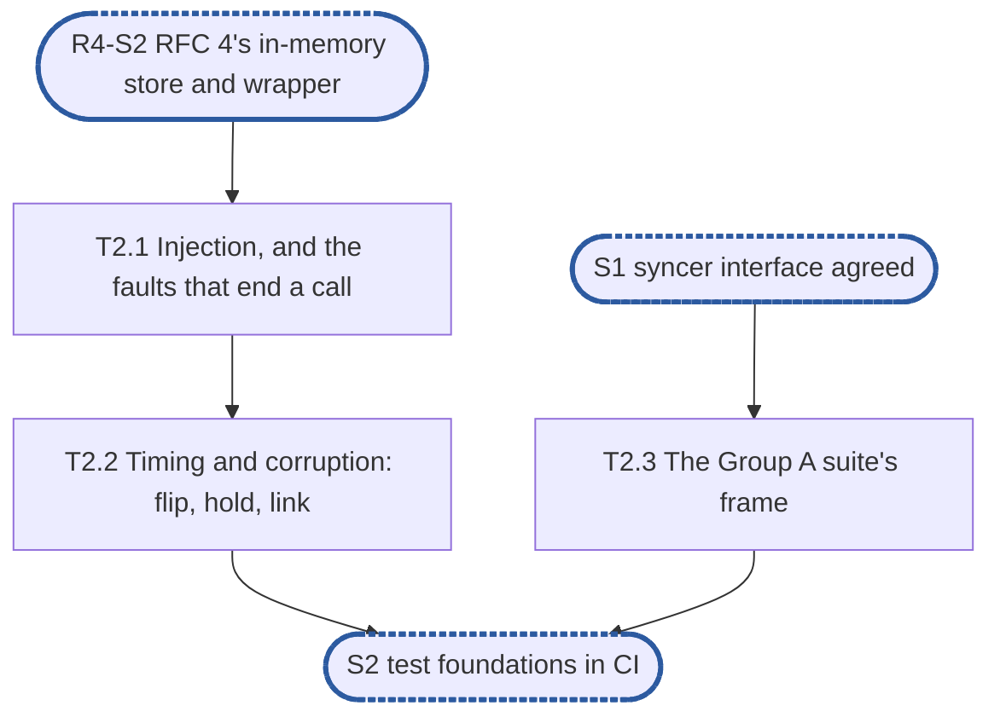

# Epic 2: syncer v2 test foundations

**Sources:** [RFC 3](../docs/internals/rfcs/rfc-3-syncer.md) §1.4 (the fixture, the fault
wrapper's per-call faults, the load record, virtual time), §7's opening paragraph and §7.3
(what must not stand in), §8.1's "Real backend" kind and §8.3's first paragraph (the failure
kinds, the *n*th call). Cited, not owned:
[RFC 4](../docs/internals/rfcs/rfc-4-remote-tier.md) §4.1 (the `remote.Store` contract the
wrapper wraps), §4.3's `codec.Store` and §4.4 (a range past the end); RFC 4 §7.1, the
conformance suite the wrapper passes with nothing injected;
[RFC 29](../docs/internals/rfcs/rfc-29-test-harness.md) §4.11, the test doubles. Every citation
is `develop`'s text. The code lands on `feat/storage-v2`, and the paths below are paths there.
**Track:** the team.
**Epic 2 estimate: 3 subtasks, 8 man-days.**
**Depends on:** **S1**, E1's surface agreed: `pkg/syncer`'s `Syncer`, `Flow`, `Store`, the
import test with one allowlist per package and the frozen-exports test. **R4-S2**, the RFC 4
plan's in-memory store (`pkg/remote/memory`), its load record, `remotetest` and the wrapper that
makes a namespace read-only, all on `feat/storage-v2` (T2.1 and T2.2 only; T2.3 needs S1 alone).
`pkg/sim`'s `TestClock` and `internal/prof` are already there.
**Blocks:** S2, and through it E3, E4 and E5, which inject faults through T2.1 and T2.2 and add
rows to T2.3's suite; E6, which does the same; E7, whose sweep fails the *n*th call with each
kind and whose heap check holds every call; E9, whose B1 to B4 run over T2.2's simulated link.
Outside this plan, RFC 8 offload plan epic 21 runs T2.3's suite over the S3 store.

---

## 1. Goal

Epic 2 gives every syncer check the means to make RFC 4's in-memory store fail the way a remote
service fails, and the frame of the Group A suite that later epics fill. It builds no store and
no suite for one: the in-memory store and its conformance suite are RFC 4's.

**At the end of the epic:**

- RFC 4's fault wrapper can, on the calls a rule selects, fail with any error, commit a put and
  lose its reply, cut a put or a get part-way, flip one byte of a get, hold a call until
  released, and slow a call by a set latency and time per byte on a clock the test supplies.
  The rule selects by operation, direction, block name and the *n*th matching call.
- A call the wrapper slows or holds counts as in flight in the in-memory store's own record for
  as long as it is slowed or held.
- With nothing injected, the wrapper passes RFC 4's conformance suite.
- `syncertest.Run` runs the Group A rows over any remote store its caller opens, and skips by
  name a row whose fault or mode the caller cannot give. It has no rows yet: E3, E4 and E6 add
  them.

### 1.1 In scope

The per-call faults on RFC 4's fault wrapper, in RFC 4's package (T2.1, T2.2); the Group A
suite's frame in `pkg/syncer/syncertest`, its import-test allowlist and its frozen exports
(T2.3).

### 1.2 Out of scope

- The in-memory store, its load record, `remotetest` and the read-only wrapper: the RFC 4 plan's
  epic 2. The faults here are added to that wrapper.
- The opener that runs the suite over the in-memory store through `codec.Store`, and the
  lifecycle rows: E3 (D7). `codec.Store` lands with the RFC 4 plan's epic 6.
- Every other row of the suite: E4 (§2.5, §3.4, §3.3 and §3.5, the measuring pass) and E6
  (§4.1, the verification re-get, §4.2).
- The idle hook that lets the in-memory opener move the clock only when every task is blocked:
  E3, which builds the pools it watches.
- The recording log handler and the held-pool heap measurement: nothing is built for either
  (D6). E5 and E7 use the standard library and `internal/prof` in place.
- The opener over the S3 store and LocalStack behind a fault proxy, and the nightly run: RFC 8
  offload plan epic 21, the sixth row of the RFC 3 plan's §6.1 deferral ledger.

### 1.3 Names used here

- **E1**, epic 1, interfaces: `pkg/syncer`'s contract, `pool.New` with stub bodies, the import
  test and the frozen-exports test.
- **E2**, this epic.
- **E3**, epic 3, registration, flows and the fair scheduler, which builds the pools, the idle
  hook and the first rows.
- **E4**, epic 4, termination, retries and the uploader.
- **E5**, epic 5, store health.
- **E6**, epic 6, the fetcher.
- **E7**, epic 7, memory bound, `Stats` and the fault sweep.
- **E9**, epic 9, E2E green: the benchmarks B1 to B5.
- **S1**, the syncer interface agreed, at the end of E1 (the RFC 8 offload plan's S1b).
- **S2**, the test foundations in CI, at the end of this epic.
- **S3**, the syncer complete over the in-memory store. Where the text says "the S3 store", S3
  is the storage service whose protocol RFC 4's production store speaks, not this point.
- **R4-S2**, the RFC 4 plan's S2: its in-memory store, `remotetest` and read-only wrapper landed.
  Its S2 is not this plan's.
- **The integration epic**, E8 here; outside this plan, RFC 8 offload plan epic 21, which
  composes the syncer in the node and runs the suite over the S3 store.

## 2. How the general rules apply

The rules are those of
[the RFC 3 plan's §1.5](rfc-3-syncer-plan.md#15-general-rules-for-each-epic). They are cited by
number and title, not copied.

| Rule | Subtasks | How |
| --- | --- | --- |
| rule 1, independent unit tests ([`CLAUDE.md`, "Writing tests"](../CLAUDE.md#writing-tests)) | all | T2.1 and T2.2 test the wrapper over RFC 4's in-memory store, a verified implementation (kind 2), on `pkg/sim`'s `TestClock` (kind 1). The wrapper is itself kind 3, verified by running `remotetest` through it with nothing injected. T2.3 tests the frame's own rules as pure functions. No test double is written here |
| rule 2, fuzz tests where relevant ([`CLAUDE.md`, "Writing tests"](../CLAUDE.md#writing-tests)) | none | Nothing here decodes bytes. A flipped byte is written, never parsed |
| rule 3, observability follows RFC 25, with RFC 3's own exception | none | Test support only: no counter, log line or span |
| rule 4, profiling | T2.2, T2.3 | T2.2's held and slowed calls are released or cancelled under `internal/prof`'s leak check, which catches a goroutine left parked on a released hold. `syncertest.Run` watches each row with `prof.Watch`, so every later row runs under it. No hot path: the wrapper is not in a benchmark's timed region except as the simulated link, whose cost is the point |
| rule 5, public interface and internals ([`CLAUDE.md`, "Verifying a change"](../CLAUDE.md#verifying-a-change)) | T2.1, T2.2 | A fault is asserted where it is consumed: what the in-memory store holds after it, the error the caller gets, the bytes the caller reads. A slowed or held call is asserted at the in-memory store's record of calls in flight, where E3 and E4 read the pool and throttle limits (D2). Under `-race` |
| rule 6, known failures shrink | none | No suite this epic's tests run in keeps a `known.yaml`: every test lands green |
| rule 7, v2 ignores v1 | T2.3 | `syncertest` joins E1's import test with its own allowlist: `pkg/syncer`, `pkg/remote` and `internal/prof` (D5). The wrapper lives in RFC 4's package and follows that plan's import test |
| rule 8, real dependencies for properties of those dependencies ([`CLAUDE.md`, "Writing tests"](../CLAUDE.md#writing-tests)) | T2.1, T2.2 | The wrapper wraps the real in-memory store, and `remotetest` holds it to RFC 4's contract. What the in-memory store cannot fail like is RFC 8 offload plan epic 21's run of the suite over the S3 store |
| rule 9, code comment conventions ([`CLAUDE.md`, "Code comments"](../CLAUDE.md#code-comments)) | T2.1, T2.2 | A `decision:` marker where a tear, a loss or a flip on the wrong operation panics (D1), and one at the timing that runs inside the store's call (D2) |
| rule 10, a test must be able to fail ([`CLAUDE.md`, "Writing tests"](../CLAUDE.md#writing-tests)) | all | Each fault's test is checked by disabling that fault and watching the assertion fail; the frame's skip test by making a missing fault pass |
| rule 11, a symbol is exported only if the RFC's interface uses it | T2.3 | `syncertest` exports only the suite: `Run`, `Opener`, `Env`, `Put`, `Mode` and `Faults` (D4). Its rows are unexported. E1's frozen-exports test gains its list |
| rule 12, each subtask creates only what it declares | all | Each fault names the row that first uses it (§6). The frame lands before its rows because three epics on two tracks and RFC 8 offload plan epic 21 write against it (D4). The log handler and the heap measurement are not built (D6) |

## 3. Requirements and invariants

Every obligation that RFC 3 places on this epic, numbered so that subtasks and tests can cite
them.

**The fault wrapper's per-call faults**

| # | Requirement | Kind | Source | Subtasks |
| --- | --- | --- | --- | --- |
| R1 | A call can be slowed by a set latency and a set time per byte, so the pool, not the store, binds | invariant | RFC 3 §1.4, §7.3, §7.4 | T2.2 |
| R2 | A call can fail with any error of RFC 4's set, throttling included, once or every time, in the put direction, the get direction or both | invariant | §1.4 | T2.1 |
| R3 | A put can commit and then lose its response: the block is stored, and the caller is told the put failed | invariant | §1.4, §2.5 | T2.1 |
| R4 | A put can be cut short part-way through its body: nothing is stored under the name, and the caller is told it failed | invariant | §1.4, §3.4 | T2.1 |
| R5 | One chunk's bytes of a get can be corrupted, on the first get only or on every get | invariant | §1.4; §7.1, "§2.4 verification re-get" | T2.2 |
| R6 | Every call can be held until the test releases it | invariant | §1.4 | T2.2 |
| R7 | The probe of either direction can fail or pass, the store's own or the one the syncer shares across a `ProbeKey` | invariant | §1.4 | T2.1 |
| R8 | A fault can fail the *n*th call of a scripted run, for every *n*, with each failure kind: transient, terminal, committed with the response lost, stopped part-way, corrupted, held | invariant | §8.3 | T2.1, T2.2 |
| R9 | Every delay of a fault runs on the clock the test supplies, never on one it cannot replace | MUST NOT | §1.4, "Time is virtual in tests" | T2.2 |

**The fixture**

| # | Requirement | Kind | Source | Subtasks |
| --- | --- | --- | --- | --- |
| R10 | The in-memory store is the fixture every check shares, held to RFC 4's conformance suite; the wrapper around it, with nothing injected, passes that suite too | invariant | §1.4; RFC 29 §4.11 | T2.1 |
| R11 | The load record is the in-memory store's own output: calls in flight and their peak, the order calls reached it, puts per name, bytes held. A call the wrapper slows or holds is in flight in that record for as long as it is slowed or held | invariant | §1.4 | T2.2 |
| R12 | The syncer keeps no store of its own and no suite of its own for one | invariant | §1.4 | T2.3 |

**The Group A suite**

| # | Requirement | Kind | Source | Subtasks |
| --- | --- | --- | --- | --- |
| R13 | A check is writable as: build a syncer over the store, call it, assert on what the store holds and what came back | MUST | §1.4 | T2.3 |
| R14 | The Group A checks run over any remote store the caller opens: the in-memory one in `unit`, the real one against a local emulator behind a fault proxy, nightly | invariant | §1.4; §8.1, "Real backend" | T2.3 |
| R15 | The checks reach the remote store through `codec.Store`, as production reaches a real store | invariant | §1.4 | T2.3 |
| R16 | A check never sleeps on the real clock to let the syncer's time pass: it waits on an outcome, and time moves only when every task is blocked | invariant | §1.4, "Time is virtual in tests" | T2.3 |
| R17 | A Group A check over a backend that cannot lose, corrupt, delay or half-complete asserts nothing, so a check whose fault the caller cannot give is skipped and reported by name, never passed | invariant | §7, opening paragraph | T2.3 |
| R18 | A backend that returns instantly is never used for §2's or §4.4's checks. This epic gives every check the simulated link of R1; E3 to E7, whose checks those are, build them over it | MUST NOT | §7.3 | T2.2 |

RFC 3 §1.4's other obligations belong to other epics: the four dependencies and the real-clock
ban to E1 (its R3 and R4), the held-pool heap bound to E7, and the second bullet of §7.3, a
lifetime count as the source of health, to E5.

## 4. Decisions this epic takes

- **D1, one injection mechanism for every fault, shaped like RFC 4's other fault seam.** The
  wrapper gains `Inject(Rule, Effect) (remove func())`. A `Rule` selects calls by operation,
  probe direction, block name, and the *n*th to the (*n*+*k*−1)th matching call counted from the
  injection (R8). An `Effect` is one of six sealed constructors: `Fail`, `Lose`, `Cut`, `Flip`,
  `Hold` and `Link`. `Lose` on anything but a put, and `Flip` on anything but a get, panic naming
  the operation, because that is a mistake in the test, not a fault the code under test should
  see. Prior art: RFC 4's `s3fault` (`Inject(Rule, Effect)`, the RFC 4 plan's epic 3, D2), so
  RFC 4's two fault seams read alike and RFC 8 offload plan epic 21 maps one onto the other;
  toxiproxy's toxics (from memory). Not chosen: `pkg/sim`'s `Fault` and `Schedule`, whose rules
  are fixed at construction and whose `Err` must fail the call, so a lost reply, a flip, a hold
  or a link cannot be said in it, and whose `Lose` means the opposite of RFC 3 §2.5's (reported
  done, nothing durable). Changing the mechanism after S2 costs every fault injection in E3 to
  E7 and E9. If the RFC 4 plan's epic 2 builds the read-only switch some other way, T2.1 keeps
  it and adds `Inject` beside it.
- **D2, a fault's timing runs inside the store's call.** RFC 3 §1.4 asserts the pool limit and
  the throttle limit at the in-memory store's record of calls in flight, not at the wrapper, so
  that a call outliving its worker is still counted. The wrapper therefore calls the store first
  and applies `Hold` and `Link` while the store's call is open: on a put's first body read, on a
  get's first body read, after a probe's call. A `decision:` marker at the site says so. It
  needs the record to count a get in flight until its body is closed, which is open with the
  RFC 4 plan's epic 2 (§9). Prior art: none found.
- **D3, each effect carries what it waits on.** `Link` takes its clock, `Hold` its release
  channel, so the wrapper's constructor, which is the RFC 4 plan's, keeps its signature. The
  clock is a one-method `Clock` the wrapper declares, `After(d) <-chan struct{}`, which
  `pkg/sim`'s `TestClock` satisfies; E9's benchmarks pass the real clock. Prior art: `pkg/sim`'s
  `Waiter`, the same one method.
- **D4, the suite's frame is settled now, before its rows.** E3 and E6 on track A, E4 on track
  B, and RFC 8 offload plan epic 21 write against it; four authors growing it by need would race
  on its shape. `Run(t, Opener)` opens an `Env` per row. `Env` carries the syncer, the store it
  was built over, the remote store to read back, a way to build a put's attempt without
  importing the codec (`NewPut`, which the opener backs with `codec.Store.NewPut`), the chunk
  maker whose hash the codec verifies, `Wait`, and `Faults`. `Faults` is a struct of function
  fields, one per fault kind: a nil field is a fault the caller cannot give, and a field
  returning `ok == false` refuses one case of it (an error its proxy cannot answer). Not a type
  assertion, which would let a capability silently not exist. `Mode` selects the checksum mode
  and encryption; an opener that cannot select one returns `ok == false`. Adding a fault later
  is one field, which changes no caller that sets fields by name. Prior art: Go's
  `testing/fstest.TestFS`; the journal's conformance suite.
- **D5, time is the opener's.** A row never moves time: it starts its call and waits on the
  outcome through `Env.Wait(done)`. The in-memory opener (E3) moves the `TestClock` whenever
  E3's idle hook reports every task blocked; the opener over the S3 store blocks on `done`, as
  real time passes. So `syncertest` imports no `pkg/sim`, and its allowlist is `pkg/syncer`,
  `pkg/remote` and `internal/prof`. Not chosen: the suite advancing a `TestClock` itself, which
  cannot know when the syncer is idle and has nothing to advance against a real backend.
- **D6, no recording log handler and no heap helper.** `slog.NewJSONHandler` over a buffer
  records the lines E5's logging row counts, and `internal/prof`'s `LiveHeap`, read with every
  call held by T2.2's `Hold`, is E7's held-pool measurement. Each has one consumer, so each is
  written there (rule 12). This drops two items of the RFC 3 plan's outline for this epic (§9).
- **D7, the lifecycle rows are E3's, and S2 runs no row.** E1's stubs refuse every call, so no
  row can pass at S2, and no suite keeps a `known.yaml` to hold one red. E3, which the RFC 3
  plan already makes the owner of "§1.3 lifecycle", writes the rows and the in-memory opener
  with its pools. The opener needs `codec.Store`, from the RFC 4 plan's epic 6, so the suite's
  first run waits for it. This narrows the plan's S2 (§9).
- **D8, the wrapper's tests stay at `remote.Store`.** The plan's epic 2 asks for a get's fault
  to be shown through `codec.Store`, which lands after S2. A flip is a byte of the encoded body;
  asserting it in the bytes the store returns is the layer the wrapper produces, and E6's "§4.1
  verification" row is the layer that consumes it through the codec.

## 5. Target tree

```text
pkg/remote/memory/            RFC 4's in-memory store and fault wrapper (the RFC 4 plan's epic 2)
  inject.go             T2.1  Rule, Effect, Inject, Fail, Lose, Cut; Health per direction
  inject_test.go        T2.1  each fault over the in-memory store; remotetest with nothing injected
  timing.go             T2.2  Clock, Flip, Hold, Link, run inside the store's call
  timing_test.go        T2.2  each effect; the load record of a held and a slowed call
pkg/syncer/syncertest/        the Group A suite
  suite.go              T2.3  Run, Opener, Env, Put, Mode, Faults; the row type and the skip rule
  suite_test.go         T2.3  missing faults and modes named; an incomplete Env refused
pkg/syncer/imports_test.go    T2.3  syncertest's allowlist
pkg/syncer/surface_test.go    T2.3  syncertest's frozen exports
```

If the RFC 4 plan's epic 2 puts its wrapper in another package, T2.1's and T2.2's files go
with it.

## 6. Subtasks

### T2.1 Injection, and the faults that end a call

**Subtask T2.1 estimate: 2.5 man-days.**

- **Track:** the team. **Depends on:** R4-S2.
- **Covers:** R2, R3, R4, R7, R8, R10.
- **Deliverables:** `inject.go` on the RFC 4 plan's wrapper type, written `*Wrapper` here (D1):

  ```go
  type Rule struct {
      Op    string           // "Put", "Get" or "Health"; "" matches every call
      Dir   remote.Direction // for "Health" only: the probe's direction; zero matches both
      Name  remote.Name      // zero matches every name
      From  int              // the first matching call it fires on, counted from Inject; 0 means 1
      Count int              // how many calls from From; 0 means every one
  }
  type Effect interface{ effect() } // sealed
  func (w *Wrapper) Inject(r Rule, e Effect) (remove func())
  func Fail(err error) Effect  // the call returns err and never reaches the store
  func Lose() Effect           // a put is stored, then fails wrapping remote.ErrTransient
  func Cut(after int64) Effect // a put's or a get's body stops after `after` bytes and fails
                               // wrapping remote.ErrTransient; a cut put stores nothing
  ```

  Effects whose rules match one call apply in injection order; the first that ends the call
  wins. Consumed by T2.2, which adds the other three effects; by E3's lifecycle rows and opener;
  E4's §2.5, §3.4 and retry rows and its error table; E5's probe and failure-window rows; E6's
  fetch resume and past-the-end row (`Fail(remote.ErrInvalid)` on a recorded range); E7's sweep.
- **Acceptance criteria:**
  - `Fail` with each error of RFC 4's set, `remote.ErrThrottled` and a `*remote.DeniedError` of
    each cause included, reaches the caller as given and leaves the store untouched.
  - A rule with `Count: 1` fires once, with `Count: 0` on every call, with `From: n` first on the
    *n*th matching call; `remove` stops it and leaves later rules counting.
  - `Lose` leaves the block stored and the put failed; `Cut` leaves nothing stored under the
    name, and a cut get's reader fails after exactly `after` bytes.
  - `Op: "Health"` with `Dir` fails one direction's probe and passes the other's; removing the
    rule passes both.
  - `Lose` on a get or a probe panics naming the operation, with the `decision:` marker of D1.
- **Tests:** at the in-memory store's surface, where `codec.Store` and E3 to E7 meet the faults.
  Each effect over a fresh in-memory store, asserting what `Get` and `List` return afterwards
  (catches a `Lose` that drops the block, R3, and a `Cut` that stores a prefix, R4). The *n*th
  call for *n* from 1 to 5 under each failing effect (catches an off-by-one in `From`, R8).
  Twenty concurrent calls under `Count: 3` under `-race`, exactly three failing (catches a count
  taken outside its lock). `remotetest` over the wrapper with nothing injected (catches a wrapper
  that changes what it passes through, R10). No test double is written: the store is kind 2, the
  wrapper kind 3.

### T2.2 Timing and corruption: flip, hold, link

**Subtask T2.2 estimate: 3 man-days.**

- **Track:** the team. **Depends on:** T2.1.
- **Covers:** R1, R5, R6, R8, R9, R11, R18.
- **Deliverables:** `timing.go` (D2, D3):

  ```go
  type Clock interface{ After(d time.Duration) <-chan struct{} }
  func Flip(off int64) Effect                               // a get covering block offset off reads it with its low bit flipped
  func Hold(release <-chan struct{}) Effect                 // the call waits, inside the store's call, until release closes or its ctx ends
  func Link(c Clock, perCall, perByte time.Duration) Effect // waits perCall once, then perByte for each body byte, on c
  ```

  Consumed by E3's scheduler and lifecycle checks (`Link`, `Hold`); E4's slow-tail, floor,
  trickle and first-byte rows (`Link`, `Hold`); E5's hung-probe row (`Hold` on `"Health"`); E6's
  §4.1 verification and re-get rows (`Flip`); E7's sweep and held-pool heap check (`Flip`,
  `Hold`); E9's B1 to B4, `Link` on the real clock.
- **Acceptance criteria:**
  - A get under `Flip` with `Count: 1` returns one flipped byte at `off` and the stored bytes on
    the next get; with `Count: 0`, on every get. A get whose range does not cover `off` is
    neither changed nor counted.
  - A held put, get or probe returns only after `release` closes, or with `ctx.Err()` once its
    context ends; nothing waits on the real clock.
  - Under `Link` on a `TestClock`, a put of *n* bytes returns only once the clock has moved
    `perCall + n*perByte`.
  - While a put or get is held or slowed, the in-memory store's record shows it in flight and
    its peak counts it.
- **Tests:** at the in-memory store's record of calls in flight, which E3 and E4 assert pool and
  throttle limits on: eight calls held, the record's in-flight count and peak at eight (catches
  a hold applied before the store's call, R11). At the bytes a caller reads: the flipped byte,
  and the next get's clean bytes (catches a flip that sticks, or a stored copy changed, R5). On a
  `TestClock` (kind 1): a linked put still pending after advancing one nanosecond short of its
  time, returned after the last (catches a per-byte time not charged, R1, R9). A held call whose
  context is cancelled returns, under `internal/prof`'s leak check (catches a goroutine parked
  on the hold). No test double is written.

### T2.3 The Group A suite's frame

**Subtask T2.3 estimate: 2.5 man-days.**

- **Track:** the team. **Depends on:** S1.
- **Covers:** R12, R13, R14, R15, R16, R17.
- **Deliverables:** `pkg/syncer/syncertest` (D4, D5):

  ```go
  // Run runs every Group A row over the stores open opens, one subtest each,
  // each under internal/prof's leak check. A row whose fault or mode the
  // opener cannot give is skipped, naming the row and what it lacks.
  func Run(t *testing.T, open Opener)

  // Opener builds a syncer over a fresh remote store in mode m, through the
  // codec, as production builds it, and cleans up with t.Cleanup. ok is false
  // when it cannot select m.
  type Opener func(t *testing.T, m Mode) (e Env, ok bool)

  type Mode struct {
      Checksum remote.Checksum // the put's up-front checksum; zero takes the store's own
      Encrypt  bool            // the chain encrypts
  }

  type Env struct {
      Syncer syncer.Syncer
      Store  syncer.Store // the codec over Remote, which the rows register
      Remote remote.Store // the store itself, read back by the rows
      NewPut func(name remote.Name, src iter.Seq2[remote.Chunk, error]) Put
      Chunk  func(plain []byte) remote.Chunk // its Hash is the one the codec verifies
      Wait   func(done <-chan struct{})      // returns once done closes, letting the syncer's time pass
      Faults Faults
  }

  type Put struct {
      Attempt func(ctx context.Context, m remote.Meter) error
      Stored  func() []remote.ChunkRange // once an Attempt has returned nil
  }

  // Faults are what the opener can make Remote do. A nil field is a fault it
  // cannot give; ok false refuses one case. times 0 means every matching call.
  type Faults struct {
      Fail func(d remote.Direction, err error, times int) (undo func(), ok bool)
      Lose func(times int) (undo func(), ok bool)                 // a put committed, its reply lost
      Cut  func(d remote.Direction, after int64, times int) (undo func(), ok bool)
      Flip func(off int64, times int) (undo func(), ok bool)       // one byte of a get
      Hold func(d remote.Direction, times int) (release func(), ok bool)
      Link func(perCall, perByte time.Duration) (undo func(), ok bool)
  }
  ```

  An unexported row type (name, mode, the faults it needs, its body) and an empty row list that
  E3, E4 and E6 extend, each from a file of its own. `syncertest`'s entry in E1's import test,
  and its frozen-exports list in E1's surface test. Consumed by E3 (the in-memory opener and the
  lifecycle rows), E4 and E6 (their Group A rows), and RFC 8 offload plan epic 21 (the opener
  over the S3 store).
- **Acceptance criteria:**
  - `Run` fails, naming the field, an `Env` missing `Syncer`, `Store`, `Remote`, `NewPut`, `Chunk`
    or `Wait`.
  - A row needing a nil fault, a fault answering `ok == false`, or a mode the opener refuses, is
    skipped with a message naming the row and what it lacks, and is never reported passed.
  - `syncertest` reaches nothing in this module outside `pkg/syncer`, `pkg/remote` and
    `internal/prof`, and exports exactly the list above.
- **Tests:** at `Run`, which E3's opener and RFC 8 offload plan epic 21 call. The frame's rules
  are pure functions of a row and an `Env` (which fields are missing, which faults a row lacks),
  tested by tables (catches a missing fault that runs the row anyway, R17). One planted row run
  through the unexported runner over an `Env` lacking its fault, asserting the subtest reports
  skipped and its message names both (catches a skip turned into a pass, R17). E1's import test
  over a planted `syncertest` importing `pkg/remote/memory` (catches a store reached from the
  suite, R12). No test double: the planted row is input, and no syncer is called.

## 7. Order of work



T2.3 needs only S1, so it can start while RFC 4's in-memory store is still being built. T2.1
and T2.2 are one path on the wrapper. Checkpoint after T2.1: E4 and E5 can inject the failing
faults. Checkpoint at S2: every fault of RFC 3 §1.4 and §8.3, and the frame E3 opens first.

## 8. Suggested pull requests

| PR | Subtasks | Man-days | After | Why together |
| --- | --- | --- | --- | --- |
| 1 | T2.1, T2.2 | 5.5 | — | RFC 4's wrapper gains every per-call fault, in RFC 4's package |
| 2 | T2.3 | 2.5 | — | the suite's frame, in `pkg/syncer`; open alongside PR 1 |

A suggestion only: one pull request per subtask works as well.

## 9. Open points

- **The in-memory store's record must count a get in flight until its body closes** (D2). RFC 3
  §1.4 lists calls in flight without saying when a get ends, and the RFC 4 plan's epic 2, which
  builds the record, is not broken down yet. If it ends a get at `Get`'s return, T2.2 holds a
  get before returning its body and asks that epic for the longer span, since E6's single-flight
  and E3's pool counts read it.
- **The wrapper's type and package are the RFC 4 plan's epic 2's.** The RFC 4 plan's §4.1 lists
  only `pkg/remote/memory` for its epic 2, so this document places the files there and names
  the type `Wrapper`; T2.1 follows whatever that epic writes.
- **The RFC 3 plan's S2 and its epic 2 differ from this document.** Its S2 has the suite running
  its lifecycle rows; here no row runs before E3 (D7). Its epic 2 shows a get's fault through
  `codec.Store` (D8) and builds the recording log handler and the held-pool heap measurement
  (D6). The plan is not edited; E3's, E5's and E7's breakdowns take what moved.
- **E6's "§4.2 yield at once" row needs to see the store read the next chunk.** `Link` on a get,
  whose body advances only as the clock moves, is the intended way; if E6 needs a fault that
  pauses a body after a set number of bytes, it adds one field to `Faults` and one effect, which
  changes no caller.
